# C ABI 接口

<cite>
**本文引用的文件**   
- [dllexport.h](file://DllHsBaSlicer/dllexport.h)
- [initialize.h](file://DllHsBaSlicer/initialize.h)
- [version_info.h](file://DllHsBaSlicer/version_info.h)
- [pipeline_types.h](file://pipelinetypes/pipeline_types.h)
- [fdm_pipeline.h](file://DllHsBaSlicer/fdm_pipeline.h)
- [sla_pipeline.h](file://DllHsBaSlicer/sla_pipeline.h)
- [sls_pipeline.h](file://DllHsBaSlicer/sls_pipeline.h)
- [slm_pipeline.h](file://DllHsBaSlicer/slm_pipeline.h)
- [lom_pipeline.h](file://DllHsBaSlicer/lom_pipeline.h)
- [tdp_pipeline.h](file://DllHsBaSlicer/tdp_pipeline.h)
- [waam_pipeline.h](file://DllHsBaSlicer/waam_pipeline.h)
- [file_transfer_pipeline.h](file://DllHsBaSlicer/file_transfer_pipeline.h)
- [custom_pipeline.h](file://DllHsBaSlicer/custom_pipeline.h)
</cite>

## 目录
1. [项目概述与快速开始](#项目概述与快速开始)
2. [架构总览](#架构总览)
3. [核心概念](#核心概念)
4. [核心模块详解](#核心模块详解)
5. [高级主题](#高级主题)
6. [Lua 脚本系统](#lua-脚本系统)
7. [API 参考文档](#api-参考文档)
8. [集成指南](#集成指南)
9. [开发·测试与贡献](#开发测试与贡献)
10. [扩展开发指南](#扩展开发指南)
11. [示例与教程](#示例与教程)
12. [部署·故障排除与FAQ](#部署故障排除与faq)
13. [附录](#附录)

## 项目概述与快速开始
本页面面向通过动态库调用 HsBaSlicer 切片能力的集成开发者，聚焦 C ABI 接口：所有 DLL 导出的 C 函数、配置结构体、结果结构体、回调类型、错误处理约定、内存管理规则、跨平台兼容性、线程安全要求和性能特征。

快速开始要点：
- 加载动态库后，先调用初始化函数完成 Lua 注册和一次性运行时设置。
- 为具体技术（FDM、SLA、SLS、SLM、LOM、TDP、WAAM）创建默认配置，修改必要字段。
- 调用同步或异步流水线函数执行切片。
- 使用对应的释放函数释放结果中的动态字符串。
- 如需查询版本信息，使用版本 API 并释放返回的字符串。

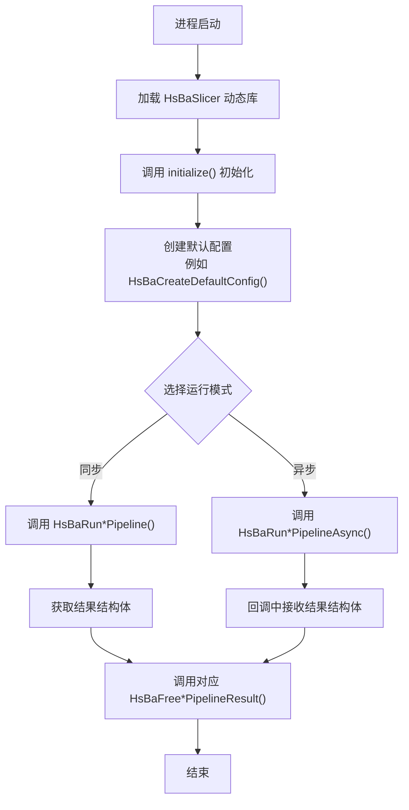

**图示来源**
- [initialize.h:14-19](file://DllHsBaSlicer/initialize.h#L14-L19)
- [fdm_pipeline.h:17-61](file://DllHsBaSlicer/fdm_pipeline.h#L17-L61)
- [sla_pipeline.h:17-56](file://DllHsBaSlicer/sla_pipeline.h#L17-L56)
- [sls_pipeline.h:17-56](file://DllHsBaSlicer/sls_pipeline.h#L17-L56)
- [slm_pipeline.h:17-56](file://DllHsBaSlicer/slm_pipeline.h#L17-L56)
- [lom_pipeline.h:17-56](file://DllHsBaSlicer/lom_pipeline.h#L17-L56)
- [tdp_pipeline.h:17-56](file://DllHsBaSlicer/tdp_pipeline.h#L17-L56)
- [waam_pipeline.h:17-57](file://DllHsBaSlicer/waam_pipeline.h#L17-L57)
- [file_transfer_pipeline.h:17-60](file://DllHsBaSlicer/file_transfer_pipeline.h#L17-L60)
- [custom_pipeline.h:17-62](file://DllHsBaSlicer/custom_pipeline.h#L17-L62)

**章节来源**
- [initialize.h:14-19](file://DllHsBaSlicer/initialize.h#L14-L19)
- [fdm_pipeline.h:17-61](file://DllHsBaSlicer/fdm_pipeline.h#L17-L61)
- [sla_pipeline.h:17-56](file://DllHsBaSlicer/sla_pipeline.h#L17-L56)
- [sls_pipeline.h:17-56](file://DllHsBaSlicer/sls_pipeline.h#L17-L56)
- [slm_pipeline.h:17-56](file://DllHsBaSlicer/slm_pipeline.h#L17-L56)
- [lom_pipeline.h:17-56](file://DllHsBaSlicer/lom_pipeline.h#L17-L56)
- [tdp_pipeline.h:17-56](file://DllHsBaSlicer/tdp_pipeline.h#L17-L56)
- [waam_pipeline.h:17-57](file://DllHsBaSlicer/waam_pipeline.h#L17-L57)
- [file_transfer_pipeline.h:17-60](file://DllHsBaSlicer/file_transfer_pipeline.h#L17-L60)
- [custom_pipeline.h:17-62](file://DllHsBaSlicer/custom_pipeline.h#L17-L62)

## 架构总览
HsBaSlicer 的 C ABI 由以下层次组成：
- 导出宏层：统一 Windows 与非 Windows 平台的符号导出方式。
- 初始化与版本层：提供 DLL 初始化和版本信息查询。
- 类型定义层：所有流水线配置、结果、回调、枚举均定义在独立头文件中，避免下游依赖共享库。
- 流水线层：每种制造技术一个头文件，暴露创建默认配置、同步运行、异步运行、释放结果的函数。
- 自定义流水线层：完全由 Lua 驱动，C++ 侧仅负责构建和执行流水线。

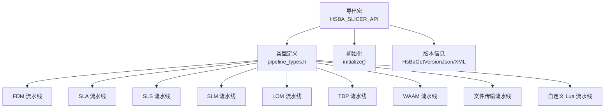

**图示来源**
- [dllexport.h:9-20](file://DllHsBaSlicer/dllexport.h#L9-L20)
- [initialize.h:14-19](file://DllHsBaSlicer/initialize.h#L14-L19)
- [version_info.h:16-41](file://DllHsBaSlicer/version_info.h#L16-L41)
- [pipeline_types.h:19-732](file://pipelinetypes/pipeline_types.h#L19-L732)
- [fdm_pipeline.h:17-61](file://DllHsBaSlicer/fdm_pipeline.h#L17-L61)
- [sla_pipeline.h:17-56](file://DllHsBaSlicer/sla_pipeline.h#L17-L56)
- [sls_pipeline.h:17-56](file://DllHsBaSlicer/sls_pipeline.h#L17-L56)
- [slm_pipeline.h:17-56](file://DllHsBaSlicer/slm_pipeline.h#L17-L56)
- [lom_pipeline.h:17-56](file://DllHsBaSlicer/lom_pipeline.h#L17-L56)
- [tdp_pipeline.h:17-56](file://DllHsBaSlicer/tdp_pipeline.h#L17-L56)
- [waam_pipeline.h:17-57](file://DllHsBaSlicer/waam_pipeline.h#L17-L57)
- [file_transfer_pipeline.h:17-60](file://DllHsBaSlicer/file_transfer_pipeline.h#L17-L60)
- [custom_pipeline.h:17-62](file://DllHsBaSlicer/custom_pipeline.h#L17-L62)

**章节来源**
- [dllexport.h:9-20](file://DllHsBaSlicer/dllexport.h#L9-L20)
- [initialize.h:14-19](file://DllHsBaSlicer/initialize.h#L14-L19)
- [version_info.h:16-41](file://DllHsBaSlicer/version_info.h#L16-L41)
- [pipeline_types.h:19-732](file://pipelinetypes/pipeline_types.h#L19-L732)

## 核心概念
- 配置结构体：每个流水线都有对应的配置结构体，包含模型路径、切片参数、工艺参数、Lua 脚本路径、输出路径等。
- 结果结构体：每个流水线都返回结果结构体，包含成功标志、层数、输出内容或路径、错误消息、耗时。
- 回调类型：进度回调用于报告百分比和阶段描述；结果回调用于异步流水线完成后传递结果。
- 默认配置初始化：每个流水线提供默认配置初始化函数，也可使用类型定义中的内联默认值初始化器。
- 释放函数：所有由 DLL 分配并返回给调用者的字符串都必须通过对应释放函数释放。

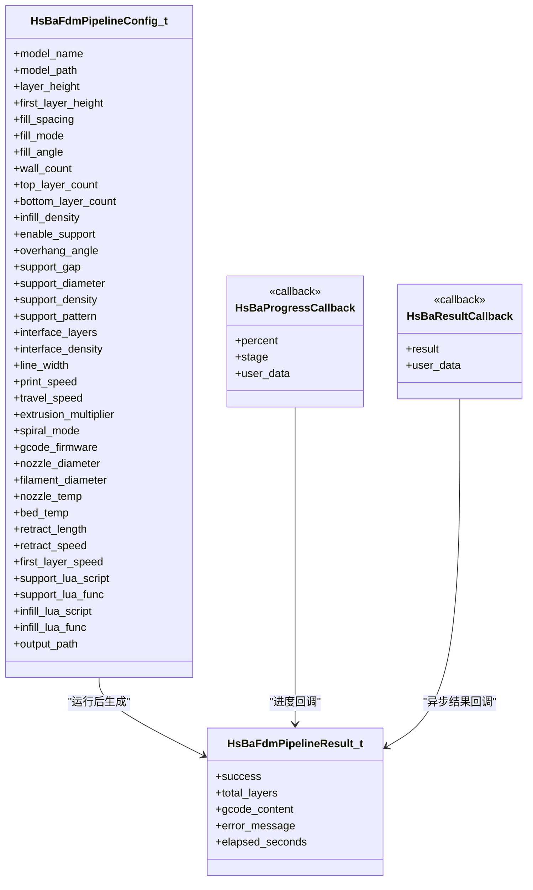

**图示来源**
- [pipeline_types.h:56-140](file://pipelinetypes/pipeline_types.h#L56-L140)
- [fdm_pipeline.h:17-61](file://DllHsBaSlicer/fdm_pipeline.h#L17-L61)

**章节来源**
- [pipeline_types.h:56-140](file://pipelinetypes/pipeline_types.h#L56-L140)
- [pipeline_types.h:170-245](file://pipelinetypes/pipeline_types.h#L170-L245)
- [pipeline_types.h:259-310](file://pipelinetypes/pipeline_types.h#L259-L310)
- [pipeline_types.h:359-401](file://pipelinetypes/pipeline_types.h#L359-L401)
- [pipeline_types.h:419-461](file://pipelinetypes/pipeline_types.h#L419-L461)
- [pipeline_types.h:480-521](file://pipelinetypes/pipeline_types.h#L480-L521)
- [pipeline_types.h:578-625](file://pipelinetypes/pipeline_types.h#L578-L625)
- [pipeline_types.h:636-732](file://pipelinetypes/pipeline_types.h#L636-L732)

## 核心模块详解
本节按流水线技术分类说明 C ABI 接口职责、典型流程、关键参数和注意事项。

### FDM 流水线
- 职责：FDM 切片、支撑、填充、路径生成，最终输出 G-code。
- 主要函数：
  - 创建默认配置：`HsBaCreateDefaultConfig()`
  - 同步运行：`HsBaRunFdmPipeline(config, callback, user_data)`
  - 异步运行：`HsBaRunFdmPipelineAsync(config, callback, user_data, result_callback, result_user_data)`
  - 释放结果：`HsBaFreePipelineResult(result)`
- 关键配置字段：层厚、首层层厚、填充间距、填充模式、填充角度、壁厚、顶底层数、填充密度、支撑开关、悬垂角度、支撑间隙、支撑直径、支撑密度、支撑图案、界面层数、界面密度、线宽、打印速度、移动速度、挤出倍率、螺旋模式、固件目标、喷嘴直径、线材直径、温度、回抽长度、回抽速度、首层速度、Lua 支撑脚本、Lua 填充脚本、输出路径。
- 结果字段：成功标志、总层数、G-code 内容、错误消息、耗时。

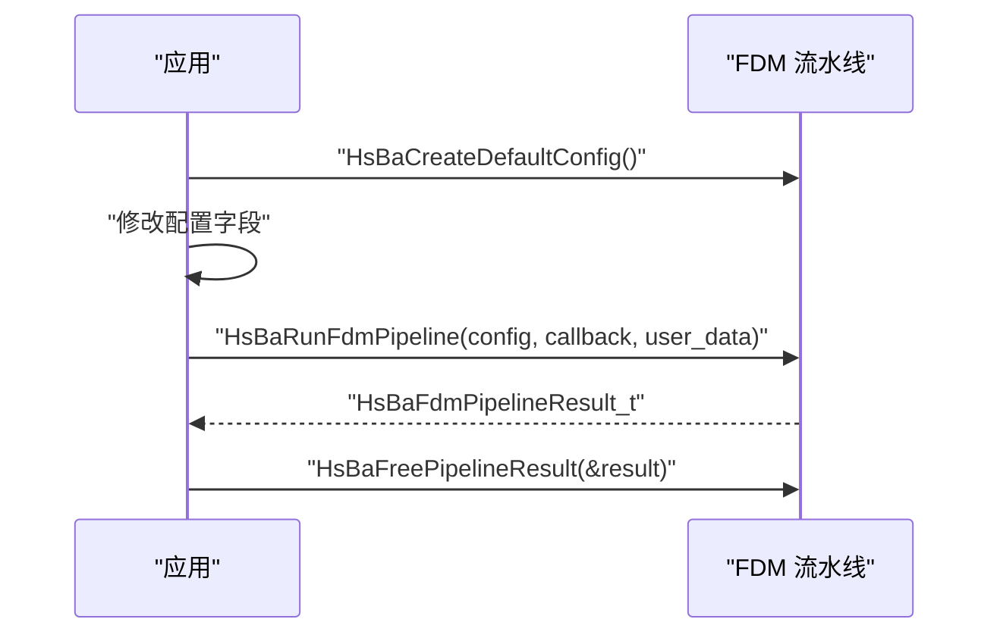

**图示来源**
- [fdm_pipeline.h:17-61](file://DllHsBaSlicer/fdm_pipeline.h#L17-L61)
- [pipeline_types.h:56-140](file://pipelinetypes/pipeline_types.h#L56-L140)

**章节来源**
- [fdm_pipeline.h:17-61](file://DllHsBaSlicer/fdm_pipeline.h#L17-L61)
- [pipeline_types.h:56-140](file://pipelinetypes/pipeline_types.h#L56-L140)

### SLA 流水线
- 职责：SLA 切片、底板/底托、支撑、导出为 zip 图层图像。
- 主要函数：
  - 创建默认配置：`HsBaCreateDefaultSlaConfig()`
  - 同步运行：`HsBaRunSlaPipeline(config, callback, user_data)`
  - 异步运行：`HsBaRunSlaPipelineAsync(config, callback, user_data, result_callback, result_user_data)`
  - 释放结果：`HsBaFreeSlaPipelineResult(result)`
- 关键配置字段：层厚、首层层厚、曝光时间、提升距离、提升速度、回抽速度、底板偏移、边框宽度、填充间距、填充角度、边框数量、凸包选项、支撑开关、悬垂角度、支撑间隙、支撑直径、支撑密度、支撑图案、Lua 支撑脚本、Lua 底板脚本、Lua 导出脚本、输出路径、图像格式、图像宽高。
- 结果字段：成功标志、总层数、导出路径、错误消息、耗时。

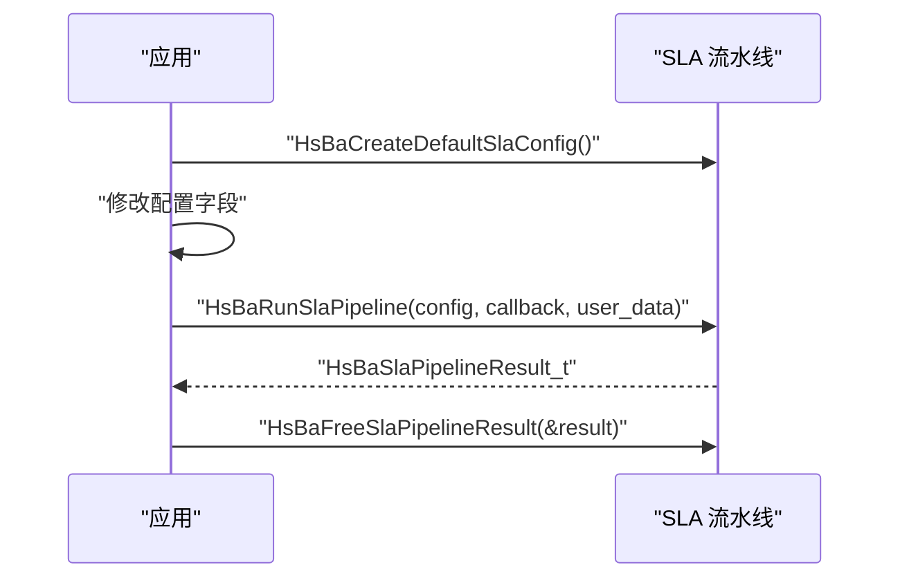

**图示来源**
- [sla_pipeline.h:17-56](file://DllHsBaSlicer/sla_pipeline.h#L17-L56)
- [pipeline_types.h:170-245](file://pipelinetypes/pipeline_types.h#L170-L245)

**章节来源**
- [sla_pipeline.h:17-56](file://DllHsBaSlicer/sla_pipeline.h#L17-L56)
- [pipeline_types.h:170-245](file://pipelinetypes/pipeline_types.h#L170-L245)

### SLS 流水线
- 职责：选择性激光烧结切片，无底板/支撑，输出由 Lua 导出脚本决定。
- 主要函数：
  - 创建默认配置：`HsBaCreateDefaultSlsConfig()`
  - 同步运行：`HsBaRunSlsPipeline(config, callback, user_data)`
  - 异步运行：`HsBaRunSlsPipelineAsync(config, callback, user_data, result_callback, result_user_data)`
  - 释放结果：`HsBaFreeSlsPipelineResult(result)`
- 关键配置字段：层厚、首层层厚、激光功率、扫描速度、 Hatch 间距、Hatch 旋转、床温、Lua 导出脚本、Lua 导出函数、输出路径。
- 结果字段：成功标志、总层数、导出路径、错误消息、耗时。

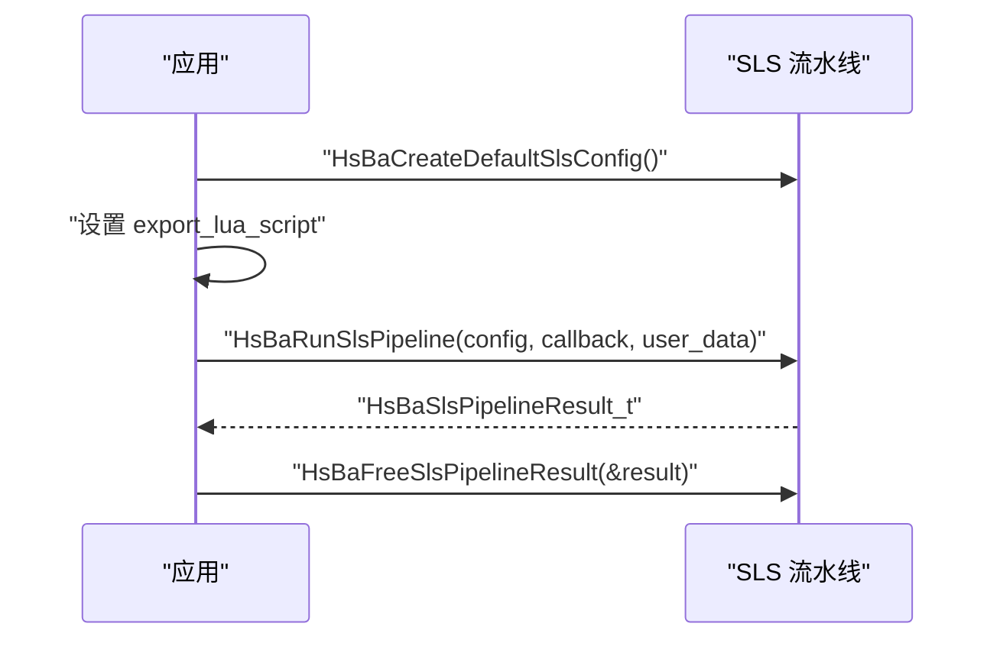

**图示来源**
- [sls_pipeline.h:17-56](file://DllHsBaSlicer/sls_pipeline.h#L17-L56)
- [pipeline_types.h:259-310](file://pipelinetypes/pipeline_types.h#L259-L310)

**章节来源**
- [sls_pipeline.h:17-56](file://DllHsBaSlicer/sls_pipeline.h#L17-L56)
- [pipeline_types.h:259-310](file://pipelinetypes/pipeline_types.h#L259-L310)

### SLM 流水线
- 职责：金属粉末床熔融，流程镜像 SLS，金属相关参数通过配置 JSON 传递给导出脚本。
- 主要函数：
  - 创建默认配置：`HsBaCreateDefaultSlmConfig()`
  - 同步运行：`HsBaRunSlmPipeline(config, callback, user_data)`
  - 异步运行：`HsBaRunSlmPipelineAsync(config, callback, user_data, result_callback, result_user_data)`
  - 释放结果：`HsBaFreeSlmPipelineResult(result)`
- 关键配置字段：层厚、首层层厚、激光功率、扫描速度、Hatch 间距、Hatch 旋转、床温、材料、光源、保护气体、Lua 导出脚本、Lua 导出函数、输出路径。
- 结果字段：成功标志、总层数、导出路径、错误消息、耗时。


**图示来源**
- [slm_pipeline.h:17-56](file://DllHsBaSlicer/slm_pipeline.h#L17-L56)
- [pipeline_types.h:359-401](file://pipelinetypes/pipeline_types.h#L359-L401)

**章节来源**
- [slm_pipeline.h:17-56](file://DllHsBaSlicer/slm_pipeline.h#L17-L56)
- [pipeline_types.h:359-401](file://pipelinetypes/pipeline_types.h#L359-L401)

### LOM 流水线
- 职责：分层实体制造，按片材厚度切片，轮廓交给 Lua 导出脚本。
- 主要函数：
  - 创建默认配置：`HsBaCreateDefaultLomConfig()`
  - 同步运行：`HsBaRunLomPipeline(config, callback, user_data)`
  - 异步运行：`HsBaRunLomPipelineAsync(config, callback, user_data, result_callback, result_user_data)`
  - 释放结果：`HsBaFreeLomPipelineResult(result)`
- 关键配置字段：层厚、首层层厚、切割速度、切割余量、切割功率、粘接温度、粘接压力、粘接时间、封边、切割模式、Lua 导出脚本、Lua 导出函数、输出路径。
- 结果字段：成功标志、总层数、导出路径、错误消息、耗时。

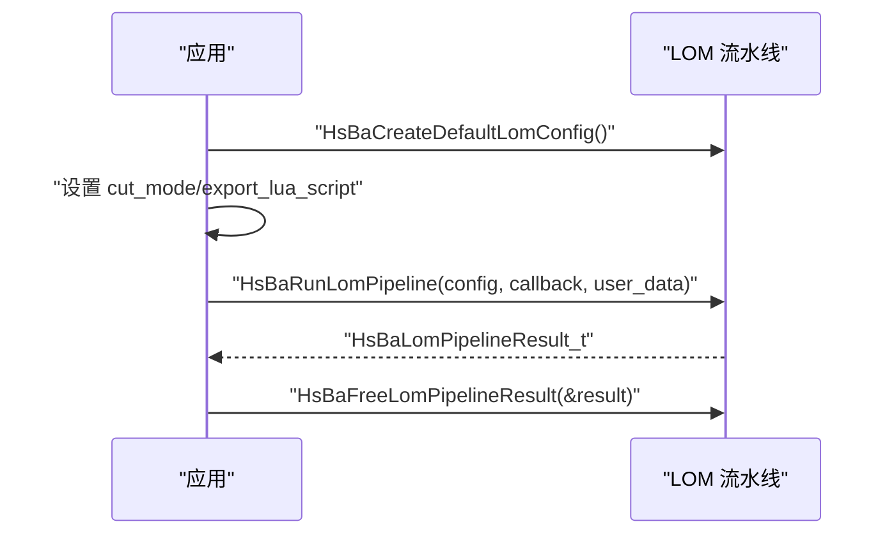

**图示来源**
- [lom_pipeline.h:17-56](file://DllHsBaSlicer/lom_pipeline.h#L17-L56)
- [pipeline_types.h:419-461](file://pipelinetypes/pipeline_types.h#L419-L461)

**章节来源**
- [lom_pipeline.h:17-56](file://DllHsBaSlicer/lom_pipeline.h#L17-L56)
- [pipeline_types.h:419-461](file://pipelinetypes/pipeline_types.h#L419-L461)

### TDP 流水线
- 职责：三维打印（粘结剂喷射），按层切片，将粘结剂轮廓和喷头/固化参数交给 Lua 导出脚本。
- 主要函数：
  - 创建默认配置：`HsBaCreateDefaultTdpConfig()`
  - 同步运行：`HsBaRunTdpPipeline(config, callback, user_data)`
  - 异步运行：`HsBaRunTdpPipelineAsync(config, callback, user_data, result_callback, result_user_data)`
  - 释放结果：`HsBaFreeTdpPipelineResult(result)`
- 关键配置字段：层厚、首层层厚、喷头数量、滴点间距、粘结剂饱和度、固化时间、床温、粘结模式、Lua 导出脚本、Lua 导出函数、输出路径、螺旋模式。
- 结果字段：成功标志、总层数、导出路径、错误消息、耗时。

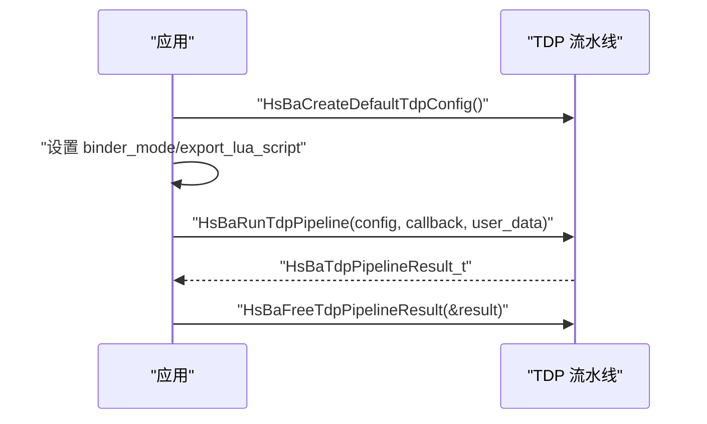

**图示来源**
- [tdp_pipeline.h:17-56](file://DllHsBaSlicer/tdp_pipeline.h#L17-L56)
- [pipeline_types.h:480-521](file://pipelinetypes/pipeline_types.h#L480-L521)

**章节来源**
- [tdp_pipeline.h:17-56](file://DllHsBaSlicer/tdp_pipeline.h#L17-L56)
- [pipeline_types.h:480-521](file://pipelinetypes/pipeline_types.h#L480-L521)

### WAAM 流水线
- 职责：电弧增材制造，逐层沉积金属丝，输出机器人语言程序而非图层 zip。
- 主要函数：
  - 创建默认配置：`HsBaCreateDefaultWaamConfig()`
  - 同步运行：`HsBaRunWaamPipeline(config, callback, user_data)`
  - 异步运行：`HsBaRunWaamPipelineAsync(config, callback, user_data, result_callback, result_user_data)`
  - 释放结果：`HsBaFreeWaamPipelineResult(result)`
- 关键配置字段：层厚、首层层厚、焊道宽度、行走速度、送丝速度、电流、电压、气体流量、材料、焊接工艺、保护方式、保护气体、层间温度、机器人类型、路径 Lua 脚本、路径 Lua 函数、输出路径、螺旋模式。
- 结果字段：成功标志、总层数、输出路径、错误消息、耗时。

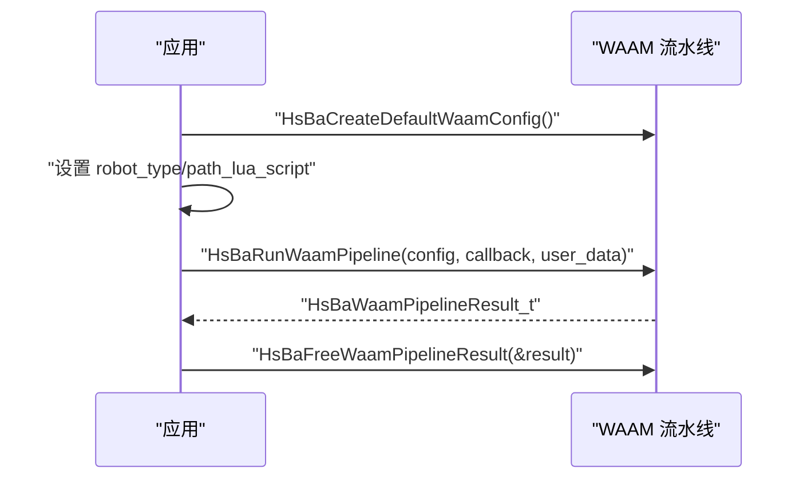

**图示来源**
- [waam_pipeline.h:17-57](file://DllHsBaSlicer/waam_pipeline.h#L17-L57)
- [pipeline_types.h:578-625](file://pipelinetypes/pipeline_types.h#L578-L625)

**章节来源**
- [waam_pipeline.h:17-57](file://DllHsBaSlicer/waam_pipeline.h#L17-L57)
- [pipeline_types.h:578-625](file://pipelinetypes/pipeline_types.h#L578-L625)

### 文件传输流水线
- 职责：通过连接池将文件发送到远程服务。
- 主要函数：
  - 创建默认配置：`HsBaCreateDefaultFileTransferConfig()`
  - 同步运行：`HsBaRunFileTransferPipeline(config, callback, user_data)`
  - 异步运行：`HsBaRunFileTransferPipelineAsync(config, callback, user_data, result_callback, result_user_data)`
  - 释放结果：`HsBaFreeFileTransferPipelineResult(result)`
- 关键配置字段：主机、端口、连接池大小、文件路径数组、文件数量。
- 结果字段：成功标志、成功传输文件数、总文件数、错误消息、耗时。

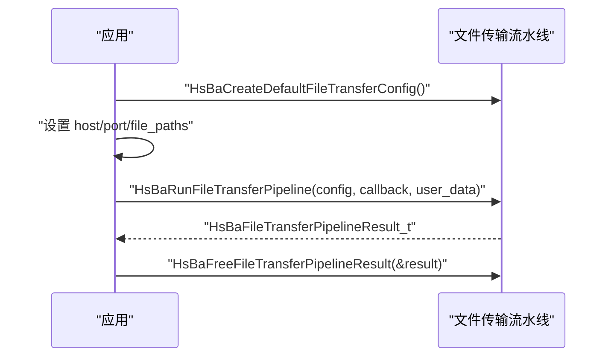

**图示来源**
- [file_transfer_pipeline.h:17-60](file://DllHsBaSlicer/file_transfer_pipeline.h#L17-L60)
- [pipeline_types.h:636-674](file://pipelinetypes/pipeline_types.h#L636-L674)

**章节来源**
- [file_transfer_pipeline.h:17-60](file://DllHsBaSlicer/file_transfer_pipeline.h#L17-L60)
- [pipeline_types.h:636-674](file://pipelinetypes/pipeline_types.h#L636-L674)

### 自定义 Lua 流水线
- 职责：完全由 Lua 入口函数定义工作流，C++ 侧暴露模型加载、切片、支撑、填充、底板、G-code 路径输出、SLA/SLS 打包等构建块。
- 主要函数：
  - 创建默认配置：`HsBaCreateDefaultCustomConfig()`
  - 同步运行：`HsBaRunCustomPipeline(config, callback, user_data)`
  - 异步运行：`HsBaRunCustomPipelineAsync(config, callback, user_data, result_callback, result_user_data)`
  - 释放结果：`HsBaFreeCustomPipelineResult(result)`
- 关键配置字段：Lua 脚本路径、内联 Lua 源码、入口函数名、配置 JSON、模型名称、模型路径、输出路径。
- 结果字段：成功标志、层数、输出路径、结果字符串、错误消息、耗时。

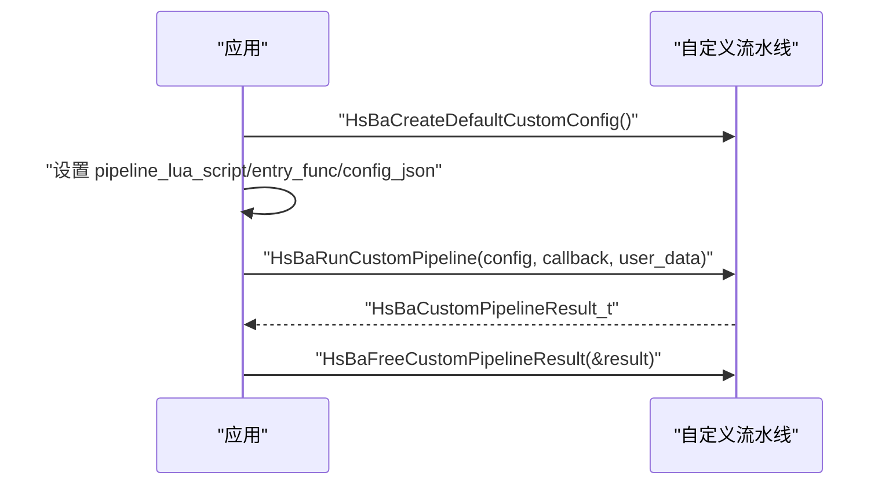

**图示来源**
- [custom_pipeline.h:17-62](file://DllHsBaSlicer/custom_pipeline.h#L17-L62)
- [pipeline_types.h:689-732](file://pipelinetypes/pipeline_types.h#L689-L732)

**章节来源**
- [custom_pipeline.h:17-62](file://DllHsBaSlicer/custom_pipeline.h#L17-L62)
- [pipeline_types.h:689-732](file://pipelinetypes/pipeline_types.h#L689-L732)

## 高级主题
- 跨平台兼容性：
  - 导出宏 `HSBA_SLICER_API` 在 Windows 上使用 `__declspec(dllexport)` 和 `__declspec(dllimport)`，在非 Windows 平台为空宏。
  - 所有 C ABI 头文件使用 `extern "C"` 包裹，确保 C/C++ 链接兼容。
- 内存管理约定：
  - 所有由 DLL 分配并返回给调用者的字符串必须通过对应释放函数释放，例如 `HsBaFreePipelineResult`、`HsBaFreeSlaPipelineResult`、`HsBaFreeSlsPipelineResult`、`HsBaFreeSlmPipelineResult`、`HsBaFreeLomPipelineResult`、`HsBaFreeTdpPipelineResult`、`HsBaFreeWaamPipelineResult`、`HsBaFreeFileTransferPipelineResult`、`HsBaFreeCustomPipelineResult`、`HsBaFreeVersionString`。
  - 结果结构体中的 `error_message` 和输出内容字段均由 DLL 分配，调用方不得直接 `free`。
- 线程安全性要求：
  - 各流水线内部使用协程执行，同步调用会阻塞直到结果就绪；异步调用通过回调返回结果。
  - 建议不同流水线实例在多线程环境中隔离配置和回调上下文，避免共享可变状态。
- 性能特征：
  - 结果结构体包含 `elapsed_seconds`，可用于评估切片耗时。
  - 大模型和高精度切片会增加内存占用和处理时间；合理调整层厚、填充密度、支撑密度可平衡质量与性能。

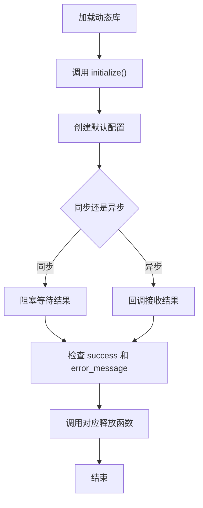

**图示来源**
- [dllexport.h:9-20](file://DllHsBaSlicer/dllexport.h#L9-L20)
- [initialize.h:14-19](file://DllHsBaSlicer/initialize.h#L14-L19)
- [fdm_pipeline.h:53-61](file://DllHsBaSlicer/fdm_pipeline.h#L53-L61)
- [sla_pipeline.h:49-56](file://DllHsBaSlicer/sla_pipeline.h#L49-L56)
- [sls_pipeline.h:49-56](file://DllHsBaSlicer/sls_pipeline.h#L49-L56)
- [slm_pipeline.h:52-56](file://DllHsBaSlicer/slm_pipeline.h#L52-L56)
- [lom_pipeline.h:52-56](file://DllHsBaSlicer/lom_pipeline.h#L52-L56)
- [tdp_pipeline.h:52-56](file://DllHsBaSlicer/tdp_pipeline.h#L52-L56)
- [waam_pipeline.h:53-57](file://DllHsBaSlicer/waam_pipeline.h#L53-L57)
- [file_transfer_pipeline.h:53-60](file://DllHsBaSlicer/file_transfer_pipeline.h#L53-L60)
- [custom_pipeline.h:57-62](file://DllHsBaSlicer/custom_pipeline.h#L57-L62)
- [version_info.h:36-41](file://DllHsBaSlicer/version_info.h#L36-L41)

**章节来源**
- [dllexport.h:9-20](file://DllHsBaSlicer/dllexport.h#L9-L20)
- [initialize.h:14-19](file://DllHsBaSlicer/initialize.h#L14-L19)
- [fdm_pipeline.h:53-61](file://DllHsBaSlicer/fdm_pipeline.h#L53-L61)
- [sla_pipeline.h:49-56](file://DllHsBaSlicer/sla_pipeline.h#L49-L56)
- [sls_pipeline.h:49-56](file://DllHsBaSlicer/sls_pipeline.h#L49-L56)
- [slm_pipeline.h:52-56](file://DllHsBaSlicer/slm_pipeline.h#L52-L56)
- [lom_pipeline.h:52-56](file://DllHsBaSlicer/lom_pipeline.h#L52-L56)
- [tdp_pipeline.h:52-56](file://DllHsBaSlicer/tdp_pipeline.h#L52-L56)
- [waam_pipeline.h:53-57](file://DllHsBaSlicer/waam_pipeline.h#L53-L57)
- [file_transfer_pipeline.h:53-60](file://DllHsBaSlicer/file_transfer_pipeline.h#L53-L60)
- [custom_pipeline.h:57-62](file://DllHsBaSlicer/custom_pipeline.h#L57-L62)
- [version_info.h:36-41](file://DllHsBaSlicer/version_info.h#L36-L41)

## Lua 脚本系统
- 自定义流水线允许完全由 Lua 定义工作流，C++ 侧仅提供构建块。
- 配置结构体支持传入 Lua 脚本路径、内联源码、入口函数名和自由 JSON 配置。
- 进度回调由 Lua 中的 `HsBa.progress()` 驱动，用户可在脚本中控制进度百分比和阶段描述。
- 对于 SLS、SLM、LOM、TDP 等流水线，Lua 导出脚本负责最终输出格式；对于 FDM，Lua 可定制支撑和填充算法；对于 SLA，Lua 可定制支撑、底板和导出逻辑；对于 WAAM，Lua 可定制机器人路径生成。

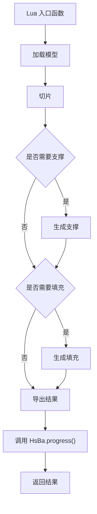

**图示来源**
- [custom_pipeline.h:23-40](file://DllHsBaSlicer/custom_pipeline.h#L23-L40)
- [pipeline_types.h:689-732](file://pipelinetypes/pipeline_types.h#L689-L732)

**章节来源**
- [custom_pipeline.h:23-40](file://DllHsBaSlicer/custom_pipeline.h#L23-L40)
- [pipeline_types.h:689-732](file://pipelinetypes/pipeline_types.h#L689-L732)

## API 参考文档
本节汇总所有 C ABI 函数签名、参数类型、返回值定义和错误码约定。

### 初始化与版本
- `void initialize()`
  - 作用：初始化 DLL，注册 Lua 函数、流水线及一次性运行时设置。
  - 安全性：重复调用无额外效果。
- `char* HsBaGetVersionJson()`
  - 作用：返回 UTF-8 编码的 JSON 版本信息字符串。
  - 释放：必须调用 `HsBaFreeVersionString` 释放。
- `char* HsBaGetVersionXml()`
  - 作用：返回 UTF-8 编码的 XML 版本信息字符串。
  - 释放：必须调用 `HsBaFreeVersionString` 释放。
- `void HsBaFreeVersionString(char* str)`
  - 作用：释放版本字符串。

**章节来源**
- [initialize.h:14-19](file://DllHsBaSlicer/initialize.h#L14-L19)
- [version_info.h:16-41](file://DllHsBaSlicer/version_info.h#L16-L41)

### FDM 流水线 API
- `HsBaFdmPipelineConfig_t HsBaCreateDefaultConfig()`
  - 返回：默认配置结构体。
- `HsBaFdmPipelineResult_t HsBaRunFdmPipeline(const HsBaFdmPipelineConfig_t* config, HsBaProgressCallback callback, void* user_data)`
  - 参数：配置指针、进度回调、用户数据。
  - 返回：结果结构体。
- `void HsBaRunFdmPipelineAsync(const HsBaFdmPipelineConfig_t* config, HsBaProgressCallback callback, void* user_data, HsBaResultCallback result_callback, void* result_user_data)`
  - 参数：配置指针、进度回调、用户数据、结果回调、结果用户数据。
- `void HsBaFreePipelineResult(HsBaFdmPipelineResult_t* result)`
  - 作用：释放结果中的动态字符串。

**章节来源**
- [fdm_pipeline.h:17-61](file://DllHsBaSlicer/fdm_pipeline.h#L17-L61)
- [pipeline_types.h:56-140](file://pipelinetypes/pipeline_types.h#L56-L140)

### SLA 流水线 API
- `HsBaSlaPipelineConfig_t HsBaCreateDefaultSlaConfig()`
- `HsBaSlaPipelineResult_t HsBaRunSlaPipeline(const HsBaSlaPipelineConfig_t* config, HsBaSlaProgressCallback callback, void* user_data)`
- `void HsBaRunSlaPipelineAsync(const HsBaSlaPipelineConfig_t* config, HsBaSlaProgressCallback callback, void* user_data, HsBaSlaResultCallback result_callback, void* result_user_data)`
- `void HsBaFreeSlaPipelineResult(HsBaSlaPipelineResult_t* result)`

**章节来源**
- [sla_pipeline.h:17-56](file://DllHsBaSlicer/sla_pipeline.h#L17-L56)
- [pipeline_types.h:170-245](file://pipelinetypes/pipeline_types.h#L170-L245)

### SLS 流水线 API
- `HsBaSlsPipelineConfig_t HsBaCreateDefaultSlsConfig()`
- `HsBaSlsPipelineResult_t HsBaRunSlsPipeline(const HsBaSlsPipelineConfig_t* config, HsBaSlsProgressCallback callback, void* user_data)`
- `void HsBaRunSlsPipelineAsync(const HsBaSlsPipelineConfig_t* config, HsBaSlsProgressCallback callback, void* user_data, HsBaSlsResultCallback result_callback, void* result_user_data)`
- `void HsBaFreeSlsPipelineResult(HsBaSlsPipelineResult_t* result)`

**章节来源**
- [sls_pipeline.h:17-56](file://DllHsBaSlicer/sls_pipeline.h#L17-L56)
- [pipeline_types.h:259-310](file://pipelinetypes/pipeline_types.h#L259-L310)

### SLM 流水线 API
- `HsBaSlmPipelineConfig_t HsBaCreateDefaultSlmConfig()`
- `HsBaSlmPipelineResult_t HsBaRunSlmPipeline(const HsBaSlmPipelineConfig_t* config, HsBaSlmProgressCallback callback, void* user_data)`
- `void HsBaRunSlmPipelineAsync(const HsBaSlmPipelineConfig_t* config, HsBaSlmProgressCallback callback, void* user_data, HsBaSlmResultCallback result_callback, void* result_user_data)`
- `void HsBaFreeSlmPipelineResult(HsBaSlmPipelineResult_t* result)`

**章节来源**
- [slm_pipeline.h:17-56](file://DllHsBaSlicer/slm_pipeline.h#L17-L56)
- [pipeline_types.h:359-401](file://pipelinetypes/pipeline_types.h#L359-L401)

### LOM 流水线 API
- `HsBaLomPipelineConfig_t HsBaCreateDefaultLomConfig()`
- `HsBaLomPipelineResult_t HsBaRunLomPipeline(const HsBaLomPipelineConfig_t* config, HsBaLomProgressCallback callback, void* user_data)`
- `void HsBaRunLomPipelineAsync(const HsBaLomPipelineConfig_t* config, HsBaLomProgressCallback callback, void* user_data, HsBaLomResultCallback result_callback, void* result_user_data)`
- `void HsBaFreeLomPipelineResult(HsBaLomPipelineResult_t* result)`

**章节来源**
- [lom_pipeline.h:17-56](file://DllHsBaSlicer/lom_pipeline.h#L17-L56)
- [pipeline_types.h:419-461](file://pipelinetypes/pipeline_types.h#L419-L461)

### TDP 流水线 API
- `HsBaTdpPipelineConfig_t HsBaCreateDefaultTdpConfig()`
- `HsBaTdpPipelineResult_t HsBaRunTdpPipeline(const HsBaTdpPipelineConfig_t* config, HsBaTdpProgressCallback callback, void* user_data)`
- `void HsBaRunTdpPipelineAsync(const HsBaTdpPipelineConfig_t* config, HsBaTdpProgressCallback callback, void* user_data, HsBaTdpResultCallback result_callback, void* result_user_data)`
- `void HsBaFreeTdpPipelineResult(HsBaTdpPipelineResult_t* result)`

**章节来源**
- [tdp_pipeline.h:17-56](file://DllHsBaSlicer/tdp_pipeline.h#L17-L56)
- [pipeline_types.h:480-521](file://pipelinetypes/pipeline_types.h#L480-L521)

### WAAM 流水线 API
- `HsBaWaamPipelineConfig_t HsBaCreateDefaultWaamConfig()`
- `HsBaWaamPipelineResult_t HsBaRunWaamPipeline(const HsBaWaamPipelineConfig_t* config, HsBaWaamProgressCallback callback, void* user_data)`
- `void HsBaRunWaamPipelineAsync(const HsBaWaamPipelineConfig_t* config, HsBaWaamProgressCallback callback, void* user_data, HsBaWaamResultCallback result_callback, void* result_user_data)`
- `void HsBaFreeWaamPipelineResult(HsBaWaamPipelineResult_t* result)`

**章节来源**
- [waam_pipeline.h:17-57](file://DllHsBaSlicer/waam_pipeline.h#L17-L57)
- [pipeline_types.h:578-625](file://pipelinetypes/pipeline_types.h#L578-L625)

### 文件传输流水线 API
- `HsBaFileTransferPipelineConfig_t HsBaCreateDefaultFileTransferConfig()`
- `HsBaFileTransferPipelineResult_t HsBaRunFileTransferPipeline(const HsBaFileTransferPipelineConfig_t* config, HsBaFileTransferProgressCallback callback, void* user_data)`
- `void HsBaRunFileTransferPipelineAsync(const HsBaFileTransferPipelineConfig_t* config, HsBaFileTransferProgressCallback callback, void* user_data, HsBaFileTransferResultCallback result_callback, void* result_user_data)`
- `void HsBaFreeFileTransferPipelineResult(HsBaFileTransferPipelineResult_t* result)`

**章节来源**
- [file_transfer_pipeline.h:17-60](file://DllHsBaSlicer/file_transfer_pipeline.h#L17-L60)
- [pipeline_types.h:636-674](file://pipelinetypes/pipeline_types.h#L636-L674)

### 自定义 Lua 流水线 API
- `HsBaCustomPipelineConfig_t HsBaCreateDefaultCustomConfig()`
- `HsBaCustomPipelineResult_t HsBaRunCustomPipeline(const HsBaCustomPipelineConfig_t* config, HsBaCustomProgressCallback callback, void* user_data)`
- `void HsBaRunCustomPipelineAsync(const HsBaCustomPipelineConfig_t* config, HsBaCustomProgressCallback callback, void* user_data, HsBaCustomResultCallback result_callback, void* result_user_data)`
- `void HsBaFreeCustomPipelineResult(HsBaCustomPipelineResult_t* result)`

**章节来源**
- [custom_pipeline.h:17-62](file://DllHsBaSlicer/custom_pipeline.h#L17-L62)
- [pipeline_types.h:689-732](file://pipelinetypes/pipeline_types.h#L689-L732)

## 集成指南
- 加载动态库：
  - Windows：使用 `LoadLibrary` 加载生成的 DLL。
  - Linux/macOS：使用 `dlopen` 加载生成的共享库。
- 解析符号：
  - 使用 `GetProcAddress`（Windows）或 `dlsym`（Linux/macOS）获取函数地址。
- 初始化：
  - 调用 `initialize()` 完成 Lua 注册和一次性设置。
- 配置与运行：
  - 根据目标技术选择对应流水线 API。
  - 使用默认配置初始化器减少遗漏字段风险。
  - 设置必要字段：模型路径、输出路径、Lua 脚本路径等。
- 结果处理：
  - 检查 `success` 字段。
  - 若失败，读取 `error_message`。
  - 使用对应释放函数释放结果。
- 版本查询：
  - 使用 `HsBaGetVersionJson()` 或 `HsBaGetVersionXml()` 获取版本信息。
  - 使用 `HsBaFreeVersionString()` 释放返回字符串。

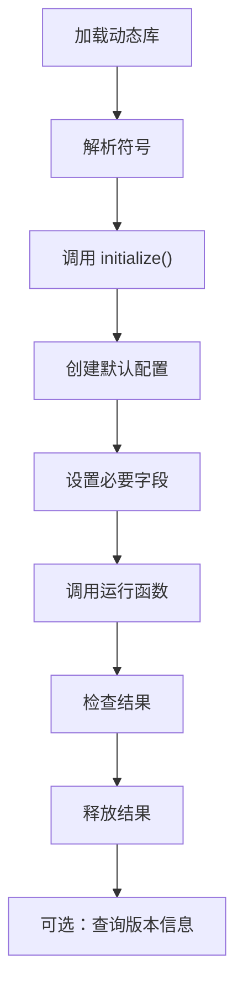

**图示来源**
- [initialize.h:14-19](file://DllHsBaSlicer/initialize.h#L14-L19)
- [version_info.h:16-41](file://DllHsBaSlicer/version_info.h#L16-L41)
- [fdm_pipeline.h:17-61](file://DllHsBaSlicer/fdm_pipeline.h#L17-L61)
- [sla_pipeline.h:17-56](file://DllHsBaSlicer/sla_pipeline.h#L17-L56)
- [sls_pipeline.h:17-56](file://DllHsBaSlicer/sls_pipeline.h#L17-L56)
- [slm_pipeline.h:17-56](file://DllHsBaSlicer/slm_pipeline.h#L17-L56)
- [lom_pipeline.h:17-56](file://DllHsBaSlicer/lom_pipeline.h#L17-L56)
- [tdp_pipeline.h:17-56](file://DllHsBaSlicer/tdp_pipeline.h#L17-L56)
- [waam_pipeline.h:17-57](file://DllHsBaSlicer/waam_pipeline.h#L17-L57)
- [file_transfer_pipeline.h:17-60](file://DllHsBaSlicer/file_transfer_pipeline.h#L17-L60)
- [custom_pipeline.h:17-62](file://DllHsBaSlicer/custom_pipeline.h#L17-L62)

**章节来源**
- [initialize.h:14-19](file://DllHsBaSlicer/initialize.h#L14-L19)
- [version_info.h:16-41](file://DllHsBaSlicer/version_info.h#L16-L41)
- [fdm_pipeline.h:17-61](file://DllHsBaSlicer/fdm_pipeline.h#L17-L61)
- [sla_pipeline.h:17-56](file://DllHsBaSlicer/sla_pipeline.h#L17-L56)
- [sls_pipeline.h:17-56](file://DllHsBaSlicer/sls_pipeline.h#L17-L56)
- [slm_pipeline.h:17-56](file://DllHsBaSlicer/slm_pipeline.h#L17-L56)
- [lom_pipeline.h:17-56](file://DllHsBaSlicer/lom_pipeline.h#L17-L56)
- [tdp_pipeline.h:17-56](file://DllHsBaSlicer/tdp_pipeline.h#L17-L56)
- [waam_pipeline.h:17-57](file://DllHsBaSlicer/waam_pipeline.h#L17-L57)
- [file_transfer_pipeline.h:17-60](file://DllHsBaSlicer/file_transfer_pipeline.h#L17-L60)
- [custom_pipeline.h:17-62](file://DllHsBaSlicer/custom_pipeline.h#L17-L62)

## 开发·测试与贡献
- 代码组织：
  - C ABI 头文件位于 `DllHsBaSlicer` 和各流水线头文件中。
  - 类型定义集中在 `pipelinetypes/pipeline_types.h`，便于下游模块使用。
- 测试建议：
  - 对每个流水线编写最小化用例，验证默认配置、同步运行、异步回调、结果释放。
  - 对错误路径进行测试：无效模型路径、缺失 Lua 脚本、非法参数。
- 贡献规范：
  - 新增流水线时，遵循现有头文件模式：默认配置、同步运行、异步运行、释放结果。
  - 保持回调签名一致，确保进度回调和结果回调行为一致。

[本节为通用指导，不直接分析具体文件]

## 扩展开发指南
- 自定义流水线：
  - 使用 `HsBaCustomPipelineConfig_t` 指定 Lua 脚本和入口函数。
  - 在 Lua 中使用 `HsBa` 全局表提供的构建块实现完整工作流。
- 导出脚本：
  - SLS/SLM/LOM/TDP 需要 Lua 导出脚本定义最终输出格式。
  - FDM/SLA/WAAM 可通过 Lua 定制支撑、填充、底板或路径生成。
- 参数存储：
  - 类型定义中包含参数存储相关枚举和结构体，可用于保存和加载流水线配置。

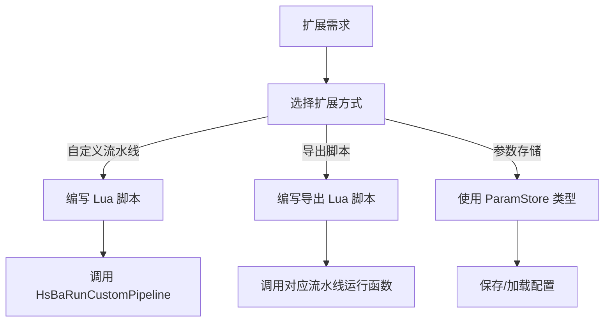

**图示来源**
- [custom_pipeline.h:17-62](file://DllHsBaSlicer/custom_pipeline.h#L17-L62)
- [pipeline_types.h:993-1042](file://pipelinetypes/pipeline_types.h#L993-L1042)

**章节来源**
- [custom_pipeline.h:17-62](file://DllHsBaSlicer/custom_pipeline.h#L17-L62)
- [pipeline_types.h:993-1042](file://pipelinetypes/pipeline_types.h#L993-L1042)

## 示例与教程
- 示例流程：
  - 加载动态库。
  - 调用 `initialize()`。
  - 创建 FDM 默认配置。
  - 设置模型路径和输出路径。
  - 调用 `HsBaRunFdmPipeline()`。
  - 检查 `success` 和 `error_message`。
  - 调用 `HsBaFreePipelineResult()`。
- 异步示例流程：
  - 创建 SLA 默认配置。
  - 设置 Lua 导出脚本。
  - 调用 `HsBaRunSlaPipelineAsync()`。
  - 在结果回调中处理 `HsBaSlaPipelineResult_t`。
  - 释放结果。

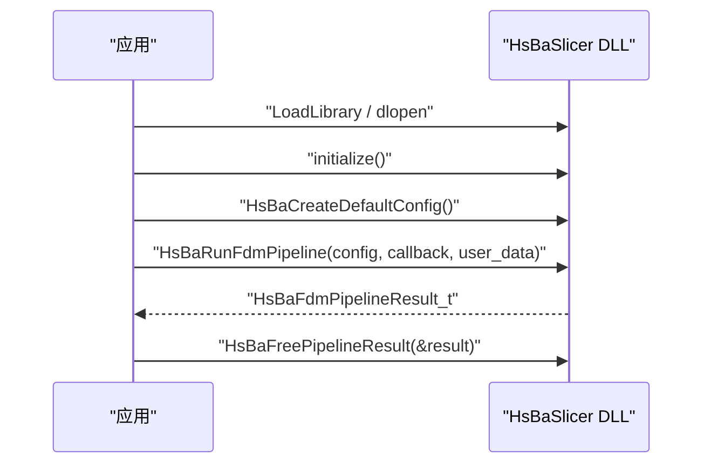

**图示来源**
- [initialize.h:14-19](file://DllHsBaSlicer/initialize.h#L14-L19)
- [fdm_pipeline.h:17-61](file://DllHsBaSlicer/fdm_pipeline.h#L17-L61)

**章节来源**
- [initialize.h:14-19](file://DllHsBaSlicer/initialize.h#L14-L19)
- [fdm_pipeline.h:17-61](file://DllHsBaSlicer/fdm_pipeline.h#L17-L61)

## 部署·故障排除与FAQ
- 常见问题：
  - 未调用 `initialize()`：可能导致 Lua 功能不可用。
  - 未释放结果：导致内存泄漏。
  - 未设置 Lua 导出脚本：SLS/SLM/LOM/TDP 流水线可能失败。
  - 模型路径无效：流水线返回失败并填充 `error_message`。
- 调试技巧：
  - 启用日志记录（若集成日志子系统）。
  - 使用进度回调观察流水线阶段。
  - 检查结果结构体中的 `elapsed_seconds` 和 `error_message`。
- FAQ：
  - 是否线程安全？建议不同流水线实例隔离配置和回调上下文。
  - 如何获取版本信息？使用 `HsBaGetVersionJson()` 或 `HsBaGetVersionXml()`。
  - 如何释放字符串？使用对应释放函数，不要直接 `free`。

**章节来源**
- [initialize.h:14-19](file://DllHsBaSlicer/initialize.h#L14-L19)
- [version_info.h:16-41](file://DllHsBaSlicer/version_info.h#L16-L41)
- [fdm_pipeline.h:53-61](file://DllHsBaSlicer/fdm_pipeline.h#L53-L61)
- [sla_pipeline.h:49-56](file://DllHsBaSlicer/sla_pipeline.h#L49-L56)
- [sls_pipeline.h:49-56](file://DllHsBaSlicer/sls_pipeline.h#L49-L56)
- [slm_pipeline.h:52-56](file://DllHsBaSlicer/slm_pipeline.h#L52-L56)
- [lom_pipeline.h:52-56](file://DllHsBaSlicer/lom_pipeline.h#L52-L56)
- [tdp_pipeline.h:52-56](file://DllHsBaSlicer/tdp_pipeline.h#L52-L56)
- [waam_pipeline.h:53-57](file://DllHsBaSlicer/waam_pipeline.h#L53-L57)
- [file_transfer_pipeline.h:53-60](file://DllHsBaSlicer/file_transfer_pipeline.h#L53-L60)
- [custom_pipeline.h:57-62](file://DllHsBaSlicer/custom_pipeline.h#L57-L62)

## 附录
- 错误码约定：
  - 结果结构体中的 `success` 字段表示成功与否。
  - 失败时 `error_message` 包含 UTF-8 编码的错误描述。
- 默认配置初始化器：
  - 每个流水线类型在 `pipeline_types.h` 中提供内联默认配置初始化器，可直接使用。
- 参数存储类型：
  - 包含流水线种类枚举、后端枚举、连接参数结构和保存/加载结果结构。

```mermaid
erDiagram
PIPELINE_KIND {
int HSBA_PIPELINE_FDM
int HSBA_PIPELINE_SLA
int HSBA_PIPELINE_SLS
int HSBA_PIPELINE_SLM
int HSBA_PIPELINE_LOM
int HSBA_PIPELINE_TDP
int HSBA_PIPELINE_WAAM
int HSBA_PIPELINE_CUSTOM
int HSBA_PIPELINE_FILETRANSFER
int HSBA_PIPELINE_KIND_COUNT
}
PARAM_STORE_BACKEND {
int HSBA_PARAM_BACKEND_SQLITE
int HSBA_PARAM_BACKEND_MYSQL
int HSBA_PARAM_BACKEND_POSTGRESQL
}
PARAM_STORE_CONN {
backend
sqlite_path
host
user
password
database
port
}
PARAM_STORE_RESULT {
success
param_id
error_message
elapsed_seconds
}
```

**图示来源**
- [pipeline_types.h:993-1042](file://pipelinetypes/pipeline_types.h#L993-L1042)

**章节来源**
- [pipeline_types.h:993-1042](file://pipelinetypes/pipeline_types.h#L993-L1042)