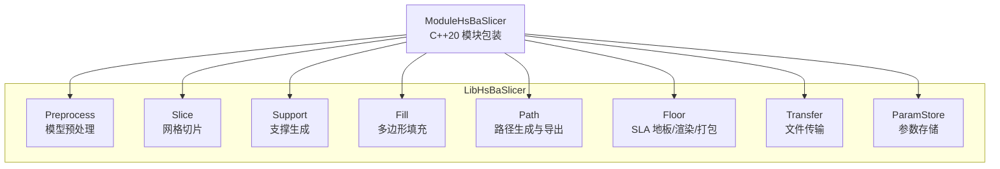
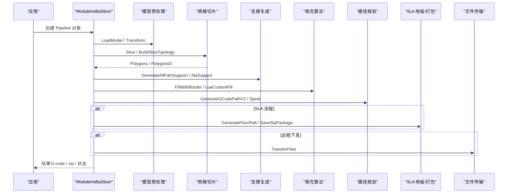
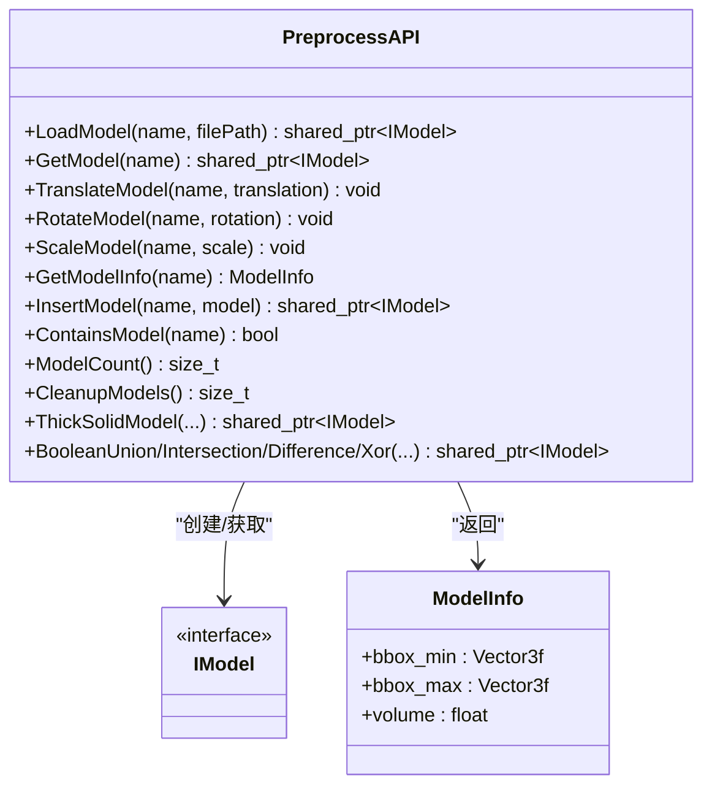
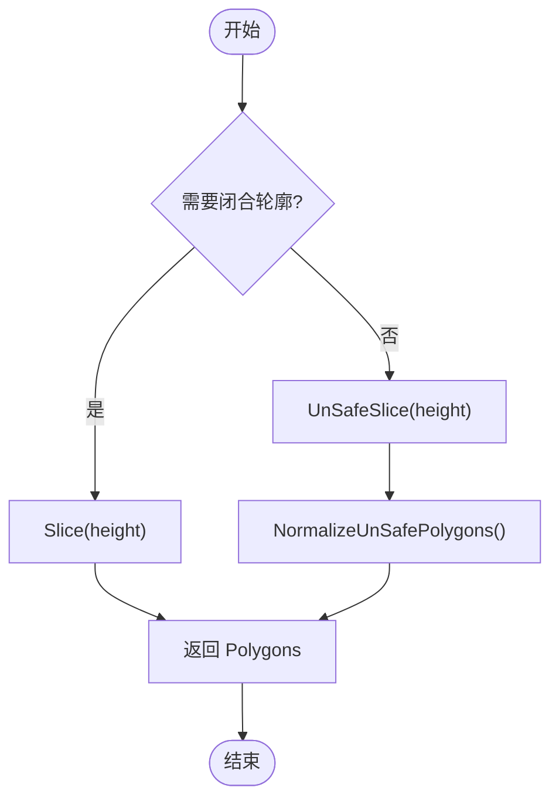
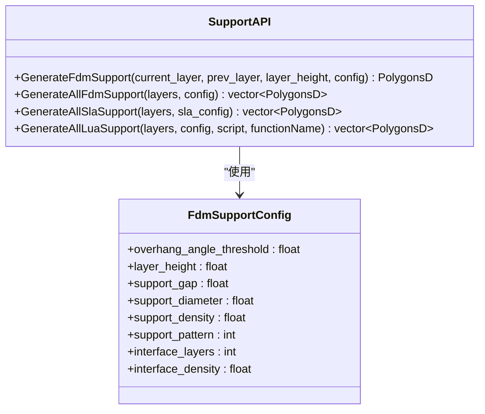
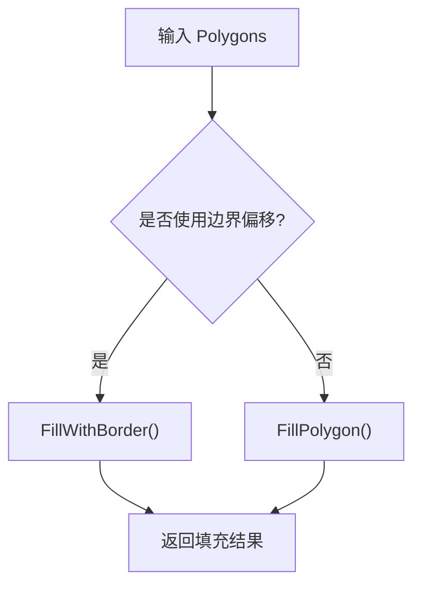
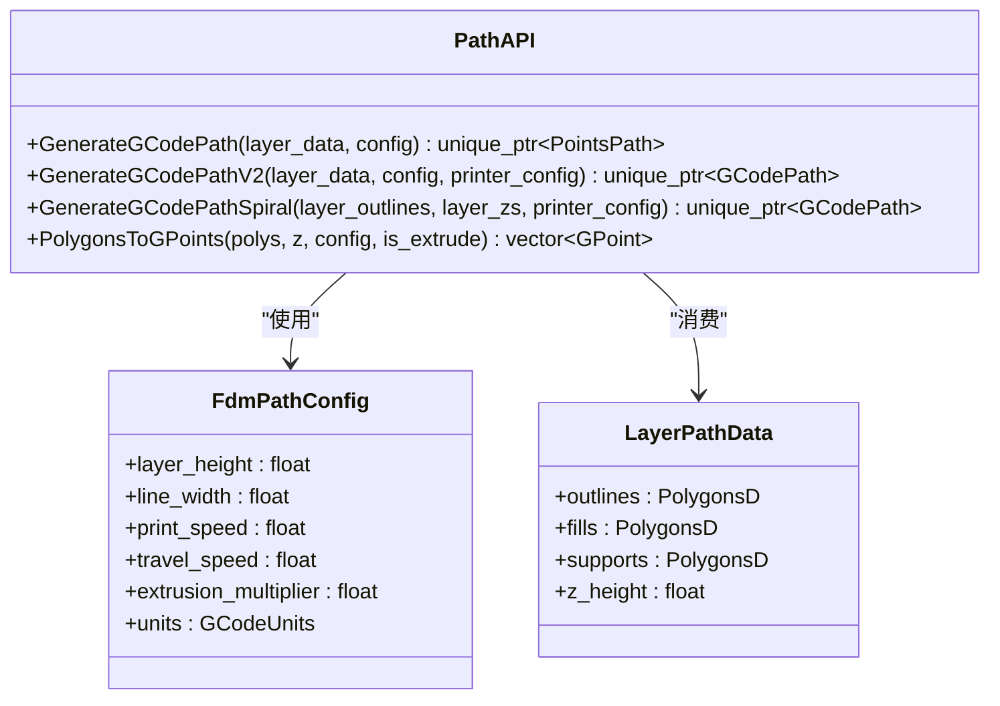
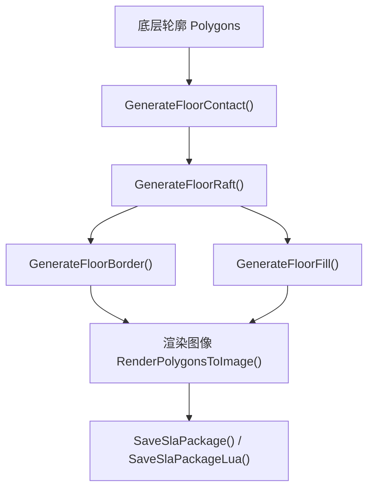
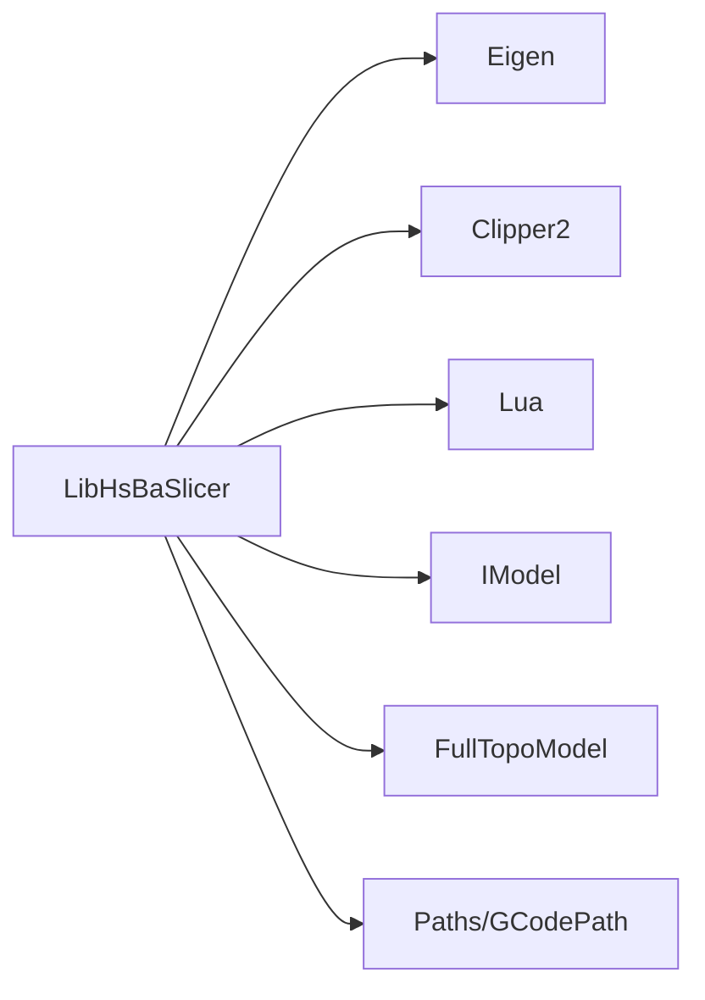

# C++ API (LibHsBaSlicer)

<cite>
**本文引用的文件**   
- [export.h](file://LibHsBaSlicer/export.h)
- [model_preprocess.hpp](file://LibHsBaSlicer/Preprocess/model_preprocess.hpp)
- [mesh_slice.hpp](file://LibHsBaSlicer/Slice/mesh_slice.hpp)
- [fdm_support.hpp](file://LibHsBaSlicer/Support/fdm_support.hpp)
- [polygon_fill.hpp](file://LibHsBaSlicer/Fill/polygon_fill.hpp)
- [path_generator.hpp](file://LibHsBaSlicer/Path/path_generator.hpp)
- [sla_floor.hpp](file://LibHsBaSlicer/Floor/sla_floor.hpp)
- [sls_export.hpp](file://LibHsBaSlicer/Path/sls_export.hpp)
- [param_store_ops.hpp](file://LibHsBaSlicer/ParamStore/param_store_ops.hpp)
- [file_transfer.hpp](file://LibHsBaSlicer/Transfer/file_transfer.hpp)
- [hsba_slicer.cppm](file://ModuleHsBaSlicer/hsba_slicer.cppm)
</cite>

## 目录
1. [简介](#简介)
2. [项目结构](#项目结构)
3. [核心组件](#核心组件)
4. [架构总览](#架构总览)
5. [详细组件分析](#详细组件分析)
6. [依赖关系分析](#依赖关系分析)
7. [性能与并发](#性能与并发)
8. [异常处理与参数校验](#异常处理与参数校验)
9. [智能指针、RAII 与现代 C++ 特性](#智能指针raii-与现代-c-特性)
10. [与底层 C ABI 的映射与迁移指南](#与底层-c-abi-的映射与迁移指南)
11. [故障排查](#故障排查)
12. [结论](#结论)

## 简介
LibHsBaSlicer 是 HsBaSlicer 的核心 C++ 库，提供完整的切片流水线能力：模型预处理、网格切片、支撑生成、多边形填充、路径规划、SLA 地板/渲染/打包、SLS 导出、文件传输与参数存储。它通过一组面向过程的自由函数暴露稳定的 C++ API，并由 ModuleHsBaSlicer 提供基于类的现代 C++20 模块接口（`import hsba.slicer;`），封装 RAII、异常和配置对象，便于上层应用以面向对象方式调用。

本参考文档聚焦 LibHsBaSlicer 的 C++ API，覆盖以下核心功能类与模块：
- 模型预处理：加载、变换、信息查询、布尔运算与抽壳
- 网格切片：安全/不安全切片、Lua 驱动切片、可复用拓扑切片
- 支撑生成：FDM/SLA/Lua 自定义支撑截面
- 填充算法：线型/锯齿/边界偏移/Lua 自定义填充
- 路径规划：FDM G-code 路径、螺旋花瓶模式、点序列转换
- SLA 地板/渲染/打包：底座生成、图像渲染、zip 打包
- SLS 导出：Lua 驱动的无标准格式导出包
- 参数存储：跨流水线工艺参数的持久化与读取
- 文件传输：远程执行器 TCP 连接池化传输

## 项目结构
LibHsBaSlicer 按功能划分为多个子目录，每个子目录对应一个职责清晰的模块；所有对外符号通过 `HSBA_SLICER_LIB_API` 宏统一导出。ModuleHsBaSlicer 提供 C++20 模块包装层，将自由函数封装为类与结果类型，提供更现代的面向对象体验。

**图表来源**
- [hsba_slicer.cppm:50-62](file://ModuleHsBaSlicer/hsba_slicer.cppm#L50-L62)

**章节来源**
- [export.h:1-22](file://LibHsBaSlicer/export.h#L1-L22)
- [hsba_slicer.cppm:1-65](file://ModuleHsBaSlicer/hsba_slicer.cppm#L1-L65)

## 核心组件
本节概述各模块的职责、输入输出与典型使用场景。

- 模型预处理（Preprocess）
  - 负责模型加载、命名池管理、几何变换、信息查询、布尔运算与抽壳。
  - 返回 `std::shared_ptr<IModel>`，支持线程安全的只读访问与受控写入。
- 网格切片（Slice）
  - 提供安全切片（仅闭合轮廓）、不安全切片（含开放轮廓）、Lua 驱动切片与可复用拓扑切片。
  - 输出 `Polygons`（整型）或 `PolygonsD`（双精度）。
- 支撑生成（Support）
  - FDM 支撑、SLA 牺牲支撑、Lua 自定义支撑。
  - 支持单层与全层批量生成。
- 填充算法（Fill）
  - 线型/简单锯齿/锯齿填充，边界偏移填充，Lua 自定义填充。
- 路径规划（Path）
  - FDM G-code 路径生成、V2 多固件输出、螺旋花瓶模式、点序列转换。
- SLA 地板/渲染/打包（Floor）
  - 接触面计算、Raft 生成、边框与内部填充、Lua 自定义地板、图像渲染、zip 打包。
- SLS 导出（Path/SLS）
  - Lua 驱动的无标准格式导出包，支持螺旋路径 JSON 暴露。
- 参数存储（ParamStore）
  - 将 PipelineConfig 结构体持久化到数据库并回填，支持 Sqlite/MySql/PostgreSql。
- 文件传输（Transfer）
  - 远程执行器文件传输，连接池化、进度回调、成功/失败统计。

**章节来源**
- [model_preprocess.hpp:20-120](file://LibHsBaSlicer/Preprocess/model_preprocess.hpp#L20-L120)
- [mesh_slice.hpp:20-103](file://LibHsBaSlicer/Slice/mesh_slice.hpp#L20-L103)
- [fdm_support.hpp:17-69](file://LibHsBaSlicer/Support/fdm_support.hpp#L17-L69)
- [polygon_fill.hpp:15-55](file://LibHsBaSlicer/Fill/polygon_fill.hpp#L15-L55)
- [path_generator.hpp:18-93](file://LibHsBaSlicer/Path/path_generator.hpp#L18-L93)
- [sla_floor.hpp:19-180](file://LibHsBaSlicer/Floor/sla_floor.hpp#L19-L180)
- [sls_export.hpp:15-58](file://LibHsBaSlicer/Path/sls_export.hpp#L15-L58)
- [param_store_ops.hpp:22-90](file://LibHsBaSlicer/ParamStore/param_store_ops.hpp#L22-L90)
- [file_transfer.hpp:17-61](file://LibHsBaSlicer/Transfer/file_transfer.hpp#L17-L61)

## 架构总览
LibHsBaSlicer 采用“自由函数 + 配置结构体”的 C++ API 风格，ModuleHsBaSlicer 在其之上提供面向对象封装。典型流水线如下：

**图表来源**
- [hsba_slicer.cppm:617-751](file://ModuleHsBaSlicer/hsba_slicer.cppm#L617-L751)
- [hsba_slicer.cppm:753-800](file://ModuleHsBaSlicer/hsba_slicer.cppm#L753-L800)

## 详细组件分析

### 模型预处理（Preprocess）
- 设计要点
  - 使用命名池管理模型生命周期，避免重复加载。
  - 提供平移、旋转、缩放等几何变换。
  - 可选 CGAL 扩展：抽壳、布尔运算（交/并/差/XOR）。
- 关键接口
  - `LoadModel(name, filePath)`：加载模型到池，返回 `std::shared_ptr<IModel>`。
  - `GetModel(name)`：获取已加载模型。
  - `TranslateModel/RotateModel/ScaleModel`：几何变换。
  - `GetModelInfo(name)`：返回包围盒与体积。
  - `InsertModel/ContainsModel/ModelCount/CleanupModels`：池管理。
  - `ThickSolidModel/BooleanUnion/Intersection/Difference/Xor`：CGAL 扩展。
- 参数验证与异常
  - 名称冲突抛出无效参数异常；文件格式不支持抛出无效参数异常；IO 错误抛出运行时异常。
- 线程安全
  - 池操作需外部同步；只读查询可并发；写操作（变换/插入/删除）需互斥。

**图表来源**
- [model_preprocess.hpp:25-120](file://LibHsBaSlicer/Preprocess/model_preprocess.hpp#L25-L120)
- [model_preprocess.hpp:122-187](file://LibHsBaSlicer/Preprocess/model_preprocess.hpp#L122-L187)

**章节来源**
- [model_preprocess.hpp:20-187](file://LibHsBaSlicer/Preprocess/model_preprocess.hpp#L20-L187)

### 网格切片（Slice）
- 设计要点
  - 安全切片忽略开放轮廓，适合大多数工艺。
  - 不安全切片保留开放轮廓，适用于材料供给过程。
  - 可复用拓扑切片用于多层流水线，避免每层重建拓扑。
- 关键接口
  - `Slice(model, height, tolerance)`：安全切片。
  - `UnSafeSlice(model, height, tolerance)`：不安全切片。
  - `SliceLua/UnSafeSliceLua`：Lua 驱动切片。
  - `NormalizeUnSafePolygons`：清理开放多段线与复杂多边形，转双精度。
  - `BuildSliceTopology(model)`：构建可复用拓扑。
  - `SliceLayer(topo, z, tolerance)`：从拓扑切片单层。
- 复杂度
  - 单次切片 O(F)，其中 F 为三角面数量；预建拓扑后每层切片仍为 O(F)。
- 线程安全
  - 共享拓扑只读，多线程并发切片安全，只要输出槽独立。

**图表来源**
- [mesh_slice.hpp:22-77](file://LibHsBaSlicer/Slice/mesh_slice.hpp#L22-L77)

**章节来源**
- [mesh_slice.hpp:20-103](file://LibHsBaSlicer/Slice/mesh_slice.hpp#L20-L103)

### 支撑生成（Support）
- 设计要点
  - FDM 支撑：根据悬垂角度阈值、层高、间距、密度、图案生成。
  - SLA 牺牲支撑：细柱状支撑，适合树脂打印。
  - Lua 自定义支撑：替换内置算法，灵活扩展。
- 关键接口
  - `GenerateFdmSupport(current_layer, prev_layer, layer_height, config)`
  - `GenerateAllFdmSupport(layers, config)`
  - `GenerateAllSlaSupport(layers, sla_config)`
  - `GenerateAllLuaSupport(layers, config, script, functionName)`
- 参数验证
  - 层高必须为正；间距与直径需合理；图案枚举有效。
- 异常处理
  - 非法配置抛出无效参数异常；Lua 脚本错误抛出运行时异常。

**图表来源**
- [fdm_support.hpp:17-69](file://LibHsBaSlicer/Support/fdm_support.hpp#L17-L69)

**章节来源**
- [fdm_support.hpp:17-69](file://LibHsBaSlicer/Support/fdm_support.hpp#L17-L69)

### 填充算法（Fill）
- 设计要点
  - 支持线型、简单锯齿、锯齿填充。
  - 边界偏移填充：先外扩再内缩，形成边框+内部填充。
  - Lua 自定义填充：通过脚本文件注入自定义图案。
- 关键接口
  - `FillPolygon(poly, spacing, mode, angle_deg)`
  - `FillWithBorder(poly, spacing, border_count, fill_mode, angle_deg)`
  - `LuaCustomFillByFile(poly, scriptPath, functionName, lineThickness)`
- 性能优化
  - 对大轮廓建议使用 Clipper2 优化后的填充引擎；避免过密间距导致内存膨胀。

**图表来源**
- [polygon_fill.hpp:17-53](file://LibHsBaSlicer/Fill/polygon_fill.hpp#L17-L53)

**章节来源**
- [polygon_fill.hpp:15-55](file://LibHsBaSlicer/Fill/polygon_fill.hpp#L15-L55)

### 路径规划（Path）
- 设计要点
  - FDM G-code 路径生成：支持多固件输出（V2）。
  - 螺旋花瓶模式：将所有层外壁合并为连续上升挤出线。
  - 点序列转换：将多边形转为 GPoint 序列。
- 关键接口
  - `GenerateGCodePath(layer_data, config)`
  - `GenerateGCodePathV2(layer_data, config, printer_config)`
  - `GenerateGCodePathSpiral(layer_outlines, layer_zs, printer_config)`
  - `PolygonsToGPoints(polys, z, config, is_extrude)`
- 数据结构
  - `FdmPathConfig`：层高、线宽、速度、挤出倍率、单位。
  - `LayerPathData`：轮廓、填充、支撑、Z 高度。
- 异常处理
  - 空层数据或无效配置抛出无效参数异常；打印机配置缺失字段抛出运行时异常。

**图表来源**
- [path_generator.hpp:20-93](file://LibHsBaSlicer/Path/path_generator.hpp#L20-L93)

**章节来源**
- [path_generator.hpp:18-93](file://LibHsBaSlicer/Path/path_generator.hpp#L18-L93)

### SLA 地板/渲染/打包（Floor）
- 设计要点
  - 接触面计算：基于底层轮廓，可选凸包/凹包简化。
  - Raft 生成：外扩边框 + 内缩边框 + 内部填充。
  - 图像渲染：自动像素尺寸计算，支持 PNG/JPG/SVG。
  - 打包导出：zip 归档层图像、地板图像、支撑图像与配置文件。
- 关键接口
  - `GenerateFloorContact(bottom_layer, config)`
  - `GenerateFloorRaft(bottom_layer, config)`
  - `GenerateFloorBorder(bottom_layer, config)`
  - `GenerateFloorFill(bottom_layer, config)`
  - `LuaCustomFloorByFile/LuaCustomFloorByString`
  - `RenderPolygonsToImage(polys, width, height, outPath)`
  - `SaveSlaPackage(pkg, output_zip)`
  - `SaveSlaPackageLua(pkg, output_zip, lua_script, lua_func)`
- 配置结构
  - `SlaFloorConfig`：raft 偏移、边框宽度、填充间距/角度、边框环数、凸包开关、凹包点数。
- 异常处理
  - 输入为空或多边形无效抛出无效参数异常；IO 失败返回 false 或抛出运行时异常。

**图表来源**
- [sla_floor.hpp:24-180](file://LibHsBaSlicer/Floor/sla_floor.hpp#L24-L180)

**章节来源**
- [sla_floor.hpp:19-180](file://LibHsBaSlicer/Floor/sla_floor.hpp#L19-L180)

### SLS 导出（Path/SLS）
- 设计要点
  - 无标准格式，完全由 Lua 脚本驱动。
  - 支持螺旋路径 JSON 暴露，兼容现有脚本。
- 关键接口
  - `SaveSlsPackageLua(pkg, output_zip, lua_script, lua_func, error_out)`
- 数据结构
  - `SlsPackage`：层轮廓、Z 高度、配置 JSON、螺旋模式开关。
- 异常处理
  - Lua 脚本错误或 IO 失败返回 false，可通过 `error_out` 获取详情。

**章节来源**
- [sls_export.hpp:15-58](file://LibHsBaSlicer/Path/sls_export.hpp#L15-L58)

### 参数存储（ParamStore）
- 设计要点
  - 将 PipelineConfig 结构体持久化到数据库，支持 Sqlite/MySql/PostgreSql。
  - 使用 AnyObject 反射机制读写，避免重复定义配置结构。
- 关键接口
  - `SavePipelineParams(conn, kind, table, key, cfg)`
  - `LoadPipelineParams(conn, kind, table, key, outCfg)`
  - `FreeLoadedConfigStrings(kind, cfg)`
- 数据结构
  - `ParamPipelineKind`：流水线类型枚举。
  - `ParamBackend`：后端类型枚举。
  - `ParamStoreConn`：连接参数。
  - `ParamStoreOutcome`：保存/加载结果。
- 异常处理
  - 连接失败或键不存在返回失败结果；字符串字段由库分配，需手动释放。

**章节来源**
- [param_store_ops.hpp:22-90](file://LibHsBaSlicer/ParamStore/param_store_ops.hpp#L22-L90)

### 文件传输（Transfer）
- 设计要点
  - 远程执行器文件传输，连接池化 TCP 传输。
  - 进度回调：百分比与阶段描述。
- 关键接口
  - `TransferFiles(config, progress)`
- 数据结构
  - `FileTransferConfig`：主机、端口、连接池大小、文件列表。
  - `FileTransferResult`：成功标志、已传输文件数、总数、错误消息。
- 异常处理
  - 文件不存在或连接失败抛出无效参数异常或运行时异常。

**章节来源**
- [file_transfer.hpp:17-61](file://LibHsBaSlicer/Transfer/file_transfer.hpp#L17-L61)

## 依赖关系分析
LibHsBaSlicer 依赖以下核心类型与第三方库：
- Eigen：向量与几何变换。
- Clipper2：多边形布尔运算与偏移。
- Lua：脚本扩展。
- IModel：模型抽象接口。
- FullTopoModel：拓扑切片缓存。
- Paths/GCodePath：路径与 G-code 输出。

**图表来源**
- [hsba_slicer.cppm:37-48](file://ModuleHsBaSlicer/hsba_slicer.cppm#L37-L48)

**章节来源**
- [hsba_slicer.cppm:37-48](file://ModuleHsBaSlicer/hsba_slicer.cppm#L37-L48)

## 性能与并发
- 模型预处理
  - 使用命名池减少重复加载；布尔运算与抽壳可能耗时，建议异步执行。
- 网格切片
  - 预建拓扑 `BuildSliceTopology` 显著降低多层切片开销；多线程并发切片安全。
- 支撑生成
  - FDM/SLA 支撑计算量大，建议分层并行；Lua 自定义支撑需注意脚本性能。
- 填充算法
  - 大轮廓填充建议使用 Clipper2 优化；避免过密间距。
- 路径规划
  - V2 路径生成支持多固件；螺旋模式减少旅行移动。
- 文件传输
  - 连接池化提升吞吐；进度回调避免 UI 阻塞。

[本节为通用指导，不直接分析具体文件]

## 异常处理与参数校验
- 无效参数异常
  - 名称冲突、文件格式不支持、配置字段非法。
- 运行时异常
  - IO 错误、Lua 脚本错误、网络传输失败。
- 返回值约定
  - 布尔函数返回成功/失败；结构化结果包含错误消息。
- 最佳实践
  - 始终检查返回值；捕获 `std::runtime_error` 或派生异常；对 Lua 脚本进行预验证。

[本节为通用指导，不直接分析具体文件]

## 智能指针、RAII 与现代 C++ 特性
- 智能指针
  - 模型加载返回 `std::shared_ptr<IModel>`，确保资源安全释放。
  - 路径生成返回 `std::unique_ptr<GCodePath>`，所有权明确。
- RAII
  - ModuleHsBaSlicer 的 `Model` 类在构造时加载模型，析构时移除，避免泄漏。
- 现代 C++
  - C++20 模块：`import hsba.slicer;` 提供面向对象 API。
  - 概念与模板：部分工具头使用概念约束类型。
  - 协程：切片流水线支持协程并行。

**章节来源**
- [hsba_slicer.cppm:152-191](file://ModuleHsBaSlicer/hsba_slicer.cppm#L152-L191)
- [hsba_slicer.cppm:567-615](file://ModuleHsBaSlicer/hsba_slicer.cppm#L567-L615)

## 与底层 C ABI 的映射与迁移指南
- 自由函数 vs 类接口
  - LibHsBaSlicer 暴露自由函数；ModuleHsBaSlicer 封装为类（如 `FdmPipeline`、`SlaPipeline`）。
- 配置结构体
  - C 结构体（如 `HsBaFdmPipelineConfig_t`）在 Module 中通过默认工厂函数创建。
- 迁移步骤
  - 从自由函数调用迁移到类方法：例如 `GenerateGCodePathV2` → `FdmPipeline::generatePath`。
  - 从 C ABI 迁移到 C++20 模块：使用 `import hsba.slicer;` 替代头文件包含。
- 注意事项
  - 保持配置结构体字段一致；注意内存所有权（如 `FreeLoadedConfigStrings`）。

**章节来源**
- [hsba_slicer.cppm:129-146](file://ModuleHsBaSlicer/hsba_slicer.cppm#L129-L146)
- [hsba_slicer.cppm:617-751](file://ModuleHsBaSlicer/hsba_slicer.cppm#L617-L751)

## 故障排查
- 模型加载失败
  - 检查文件路径与格式；确认 CGAL 扩展启用。
- 切片结果为空
  - 检查层高是否在模型范围内；使用 `NormalizeUnSafePolygons` 清理开放轮廓。
- 支撑生成异常
  - 验证悬垂角度阈值与层高比例；尝试 Lua 自定义支撑调试。
- 路径生成失败
  - 检查打印机配置字段；确认层数据非空。
- 文件传输错误
  - 验证主机/端口可达性；检查连接池大小与文件权限。

[本节为通用指导，不直接分析具体文件]

## 结论
LibHsBaSlicer 提供了完整、模块化且高性能的切片流水线 C++ API。通过自由函数与面向对象封装的结合，既保持了灵活性，又提升了易用性。结合智能指针、RAII 与现代 C++ 特性，开发者可以高效构建稳定、可扩展的 3D 打印软件系统。

[本节为总结性内容，不直接分析具体文件]