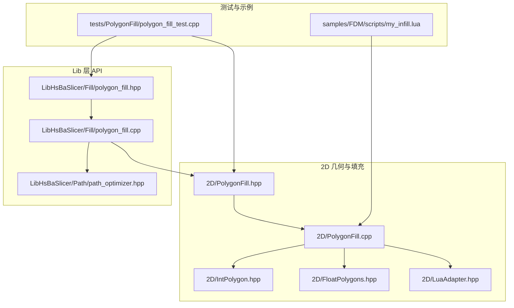
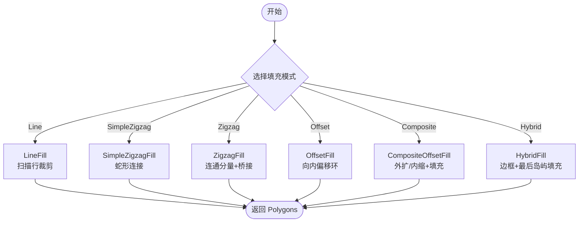
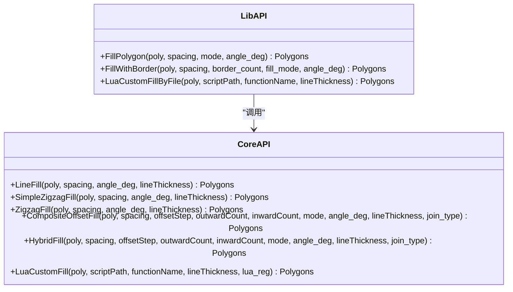
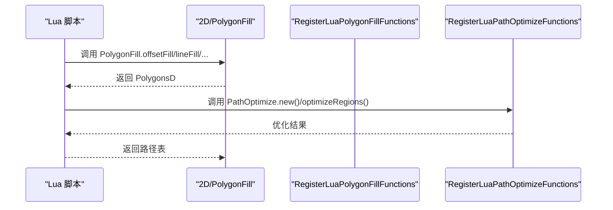
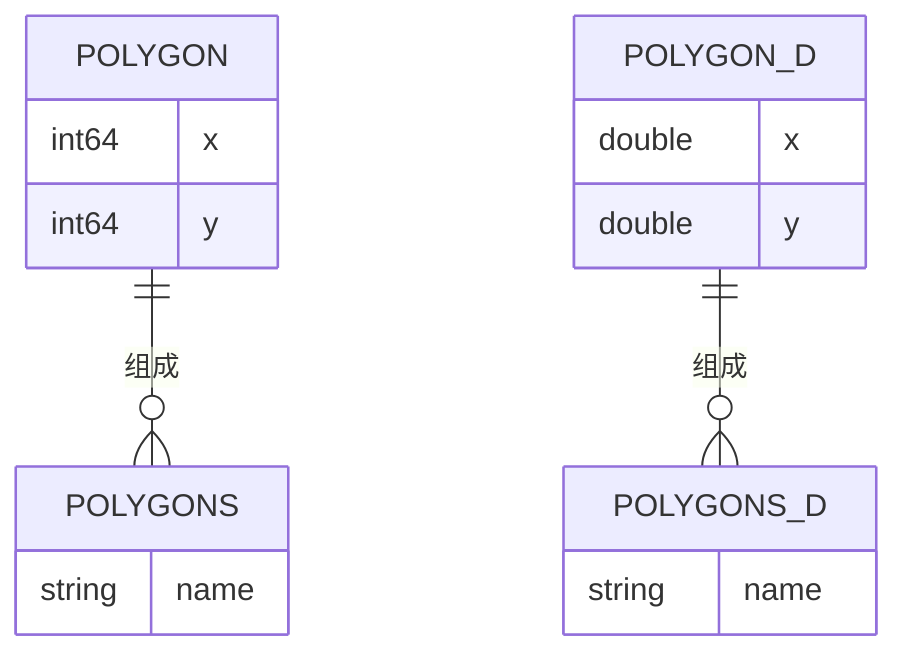
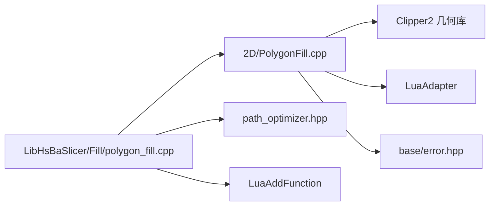

# 填充算法接口

<cite>
**本文引用的文件**   
- [PolygonFill.hpp](file://2D/PolygonFill.hpp)
- [PolygonFill.cpp](file://2D/PolygonFill.cpp)
- [polygon_fill.hpp](file://LibHsBaSlicer/Fill/polygon_fill.hpp)
- [polygon_fill.cpp](file://LibHsBaSlicer/Fill/polygon_fill.cpp)
- [IntPolygon.hpp](file://2D/IntPolygon.hpp)
- [FloatPolygons.hpp](file://2D/FloatPolygons.hpp)
- [LuaAdapter.hpp](file://2D/LuaAdapter.hpp)
- [path_optimizer.hpp](file://LibHsBaSlicer/Path/path_optimizer.hpp)
- [polygon_fill_test.cpp](file://tests/PolygonFill/polygon_fill_test.cpp)
- [my_infill.lua](file://samples/FDM/scripts/my_infill.lua)
</cite>

## 目录
1. [简介](#简介)
2. [项目结构](#项目结构)
3. [核心组件](#核心组件)
4. [架构总览](#架构总览)
5. [详细组件分析](#详细组件分析)
6. [依赖关系分析](#依赖关系分析)
7. [性能与优化](#性能与优化)
8. [参数配置与验证](#参数配置与验证)
9. [使用示例](#使用示例)
10. [质量评估与调试](#质量评估与调试)
11. [故障排查](#故障排查)
12. [结论](#结论)

## 简介
本文件面向 HsBaSlicer 的二维多边形填充子系统，聚焦 C++ API 与 Lua 扩展机制。文档说明以下能力：
- 支持的填充模式：直线、简单锯齿、高级锯齿、偏移环、复合偏移、混合偏移等。
- 自定义填充扩展机制：通过 Lua 脚本生成任意路径或多边形集合。
- 填充参数：间距、角度、线宽、偏移步长、内外偏移层数、拐角连接类型等。
- 填充密度控制：通过间距和偏移层数控制内部填充密度与边界强度。
- 填充路径优化：在 Lib 层将路径优化器注入 Lua 环境，支持区域聚簇与路径顺序优化。
- 与 2D 多边形库集成：基于 Clipper2 的多边形布尔运算、偏移、点包含判断等。
- 输出数据结构：以 Polygons（整数坐标）或 PolygonsD（浮点坐标）表示的路径/多边形集合。

注意：代码中并未出现名为 PolygonFiller 的类；实际填充能力由一组函数与枚举 FillMode 提供，并通过 Lib 层封装为更简洁的 C++ API。

## 项目结构
与填充相关的核心位置如下：
- 2D 几何与填充实现：2D/PolygonFill.hpp、2D/PolygonFill.cpp
- Lib 层对外 C++ API：LibHsBaSlicer/Fill/polygon_fill.hpp、polygon_fill.cpp
- 基础多边形类型：2D/IntPolygon.hpp、2D/FloatPolygons.hpp
- Lua 适配器与注册：2D/LuaAdapter.hpp、2D/PolygonFill.cpp 中的 Lua 绑定
- 路径优化：LibHsBaSlicer/Path/path_optimizer.hpp
- 测试与示例：tests/PolygonFill/polygon_fill_test.cpp、samples/FDM/scripts/my_infill.lua



**图表来源**
- [PolygonFill.hpp:1-141](file://2D/PolygonFill.hpp#L1-L141)
- [PolygonFill.cpp:1-1449](file://2D/PolygonFill.cpp#L1-L1449)
- [polygon_fill.hpp:1-58](file://LibHsBaSlicer/Fill/polygon_fill.hpp#L1-L58)
- [polygon_fill.cpp:1-51](file://LibHsBaSlicer/Fill/polygon_fill.cpp#L1-L51)
- [IntPolygon.hpp](file://2D/IntPolygon.hpp)
- [FloatPolygons.hpp](file://2D/FloatPolygons.hpp)
- [LuaAdapter.hpp](file://2D/LuaAdapter.hpp)
- [path_optimizer.hpp](file://LibHsBaSlicer/Path/path_optimizer.hpp)
- [polygon_fill_test.cpp:1-691](file://tests/PolygonFill/polygon_fill_test.cpp#L1-L691)
- [my_infill.lua:1-89](file://samples/FDM/scripts/my_infill.lua#L1-L89)

**章节来源**
- [PolygonFill.hpp:1-141](file://2D/PolygonFill.hpp#L1-L141)
- [polygon_fill.hpp:1-58](file://LibHsBaSlicer/Fill/polygon_fill.hpp#L1-L58)

## 核心组件
- 填充模式枚举 FillMode：Line、SimpleZigzag、Zigzag。
- 2D 填充函数族：OffsetFill、LineFill、SimpleZigzagFill、ZigzagFill、CompositeOffsetFill、HybridFill、LuaCustomFill、LuaCustomFillString。
- Lib 层封装 API：FillPolygon、FillWithBorder、LuaCustomFillByFile。
- Lua 绑定：RegisterLuaPolygonFillFunctions 暴露 offsetFill、lineFill、simpleZigzagFill、zigzagFill、compositeOffsetFill、hybridFill、offsetOnly 等函数给 Lua。
- 路径优化注入：在 Lib 层调用 RegisterLuaPathOptimizeFunctions，使 Lua 自定义填充可调用 PathOptimize 进行区域聚簇与路径排序优化。

**章节来源**
- [PolygonFill.hpp:60-136](file://2D/PolygonFill.hpp#L60-L136)
- [polygon_fill.hpp:17-53](file://LibHsBaSlicer/Fill/polygon_fill.hpp#L17-L53)
- [polygon_fill.cpp:13-48](file://LibHsBaSlicer/Fill/polygon_fill.cpp#L13-L48)
- [PolygonFill.cpp:406-420](file://2D/PolygonFill.cpp#L406-L420)

## 架构总览
填充系统采用“2D 引擎 + Lib 封装 + Lua 扩展”的分层设计：
- 2D 引擎负责具体填充算法与几何计算。
- Lib 层提供稳定 C++ API，并组合 2D 引擎与路径优化器。
- Lua 扩展允许用户编写自定义填充逻辑，并可访问 2D 几何操作与路径优化能力。

```mermaid
sequenceDiagram
participant App as "应用/上层"
participant Lib as "LibHsBaSlicer/Fill"
participant Core as "2D/PolygonFill"
participant Lua as "Lua 脚本"
participant Opt as "PathOptimize"
App->>Lib : FillPolygon / FillWithBorder / LuaCustomFillByFile
Lib->>Core : LineFill / SimpleZigzagFill / ZigzagFill / CompositeOffsetFill / HybridFill
Core-->>Lib : Polygons
Lib-->>App : Polygons
App->>Lib : LuaCustomFillByFile(poly, scriptPath)
Lib->>Core : LuaCustomFill(...)
Core->>Lua : 加载脚本并调用 generate_fill(poly)
Lua->>Core : 可选调用 PolygonOperations / PolygonFill.*
Lua->>Opt : 可选调用 PathOptimize.optimizeRegions/optimizePolygons
Opt-->>Lua : 优化后的路径/多边形
Lua-->>Core : 返回路径表
Core-->>Lib : Polygons
Lib-->>App : Polygons
```

**图表来源**
- [polygon_fill.cpp:13-48](file://LibHsBaSlicer/Fill/polygon_fill.cpp#L13-L48)
- [PolygonFill.cpp:1283-1446](file://2D/PolygonFill.cpp#L1283-L1446)
- [polygon_fill.hpp:39-53](file://LibHsBaSlicer/Fill/polygon_fill.hpp#L39-L53)

## 详细组件分析

### 填充模式与算法
- 直线填充 LineFill：按指定角度生成平行扫描行，裁剪到多边形内部，返回独立线段集合。
- 简单锯齿 SimpleZigzagFill：将相邻扫描行的有效段连接成蛇形折线，仅允许同行或相邻行连接。
- 高级锯齿 ZigzagFill：对扫描行构建连通分量，跨行时尝试沿外轮廓桥接，避免穿越空洞；失败时回退为独立线段。
- 偏移填充 OffsetFill：向内逐层偏移形成闭合环，直到多边形消失。
- 复合偏移 CompositeOffsetFill：先填充原多边形，再向外/向内多次偏移并分别填充，适合“边框+内部”的组合策略。
- 混合偏移 HybridFill：外层偏移生成边框路径，内层偏移逐步收缩，最终对最小可行岛进行填充。



**图表来源**
- [PolygonFill.cpp:422-473](file://2D/PolygonFill.cpp#L422-L473)
- [PolygonFill.cpp:475-674](file://2D/PolygonFill.cpp#L475-L674)
- [PolygonFill.cpp:676-1175](file://2D/PolygonFill.cpp#L676-L1175)
- [PolygonFill.cpp:422-451](file://2D/PolygonFill.cpp#L422-L451)
- [PolygonFill.cpp:1177-1228](file://2D/PolygonFill.cpp#L1177-L1228)
- [PolygonFill.cpp:1230-1281](file://2D/PolygonFill.cpp#L1230-L1281)

**章节来源**
- [PolygonFill.hpp:20-102](file://2D/PolygonFill.hpp#L20-L102)
- [PolygonFill.cpp:422-1281](file://2D/PolygonFill.cpp#L422-L1281)

### Lib 层封装 API
- FillPolygon：根据 FillMode 分发到 LineFill/SimpleZigzagFill/ZigzagFill。
- FillWithBorder：基于 CompositeOffsetFill，设置 outwardCount=0、inwardCount=border_count，形成边框+内部填充。
- LuaCustomFillByFile：包装 LuaCustomFill，并在注册回调中注入 2D 几何函数与路径优化函数。



**图表来源**
- [polygon_fill.hpp:17-53](file://LibHsBaSlicer/Fill/polygon_fill.hpp#L17-L53)
- [polygon_fill.cpp:13-48](file://LibHsBaSlicer/Fill/polygon_fill.cpp#L13-L48)
- [PolygonFill.hpp:20-136](file://2D/PolygonFill.hpp#L20-L136)

**章节来源**
- [polygon_fill.hpp:17-53](file://LibHsBaSlicer/Fill/polygon_fill.hpp#L17-L53)
- [polygon_fill.cpp:13-48](file://LibHsBaSlicer/Fill/polygon_fill.cpp#L13-L48)

### Lua 自定义填充扩展
- 通过 RegisterLuaPolygonFillFunctions 向 Lua 暴露 PolygonFill.* 系列函数。
- LuaCustomFill/LuaCustomFillString 加载脚本或字符串，执行目标函数，解析返回的表结构（多边形或路径）。
- Lib 层在 LuaCustomFillByFile 中额外注册路径优化器，使脚本可调用 PathOptimize.optimizeRegions/optimizePolygons。



**图表来源**
- [PolygonFill.cpp:406-420](file://2D/PolygonFill.cpp#L406-L420)
- [polygon_fill.cpp:36-48](file://LibHsBaSlicer/Fill/polygon_fill.cpp#L36-L48)
- [PolygonFill.cpp:1283-1446](file://2D/PolygonFill.cpp#L1283-L1446)

**章节来源**
- [PolygonFill.cpp:406-420](file://2D/PolygonFill.cpp#L406-L420)
- [polygon_fill.cpp:36-48](file://LibHsBaSlicer/Fill/polygon_fill.cpp#L36-L48)
- [PolygonFill.cpp:1283-1446](file://2D/PolygonFill.cpp#L1283-L1446)

### 数据模型与坐标系
- Polygons：整数坐标多边形集合，用于几何计算与输出。
- PolygonsD：浮点坐标多边形集合，常用于 Lua 交互与中间计算。
- 转换工具：Integerization/UnIntegerization 在整数与浮点之间转换。
- 几何操作：Offset、Intersection、PointInPolygons、Area 等来自 2D 几何库（Clipper2）。



**图表来源**
- [IntPolygon.hpp](file://2D/IntPolygon.hpp)
- [FloatPolygons.hpp](file://2D/FloatPolygons.hpp)
- [PolygonFill.cpp:43-45](file://2D/PolygonFill.cpp#L43-L45)

**章节来源**
- [IntPolygon.hpp](file://2D/IntPolygon.hpp)
- [FloatPolygons.hpp](file://2D/FloatPolygons.hpp)
- [PolygonFill.cpp:43-45](file://2D/PolygonFill.cpp#L43-L45)

## 依赖关系分析
- 2D 填充实现依赖：
  - Clipper2 几何库：Offset、Intersection、PointInPolygonResult、Area。
  - Lua 胶水：LuaAdapter、MakeUniqueLuaState、PushPolygonsDToLua、LuaTableToPolygonsD。
  - 错误处理：base/error.hpp 中的 RuntimeError。
- Lib 层依赖：
  - 2D/PolygonFill.hpp 提供的填充函数。
  - path_optimizer.hpp 提供路径优化器对象与 Lua 注册函数。
  - LuaAddFunction 获取 2D 几何函数列表。



**图表来源**
- [PolygonFill.cpp:7-16](file://2D/PolygonFill.cpp#L7-L16)
- [polygon_fill.cpp:7-9](file://LibHsBaSlicer/Fill/polygon_fill.cpp#L7-L9)

**章节来源**
- [PolygonFill.cpp:7-16](file://2D/PolygonFill.cpp#L7-L16)
- [polygon_fill.cpp:7-9](file://LibHsBaSlicer/Fill/polygon_fill.cpp#L7-L9)

## 性能与优化
- 迭代上限保护：MAX_FILL_ITERATIONS 防止偏移循环过多。
- 二分搜索精度：MAX_BINARY_SEARCH_ITERATIONS 控制点包含判定收敛速度。
- 行扫描与排序：LineFilling 对每行段按 s_min 排序，提升后续连接效率。
- 连通分量与桥接：ZigzagFill 使用并查集建立跨行连通性，减少无效连接。
- 路径优化：RegionPathOptimizer 支持区域聚簇、路径反转与起点旋转，降低空移距离。

建议优化策略：
- 合理设置 spacing：过小会导致行数激增，过大则填充稀疏。
- 调整 lineThickness：影响桥接采样步长与边框厚度。
- 使用 CompositeOffsetFill/HybridFill：在需要强边框时使用 inwardCount 控制边框强度。
- 启用路径优化：在复杂多区域场景下显著减少移动成本。

[本节为通用指导，不直接分析具体文件]

## 参数配置与验证
- 公共参数
  - spacing：填充线间距，必须为正数；<=0 时部分函数直接返回空结果。
  - angle_deg：填充角度（度），用于 LineFill/SimpleZigzagFill/ZigzagFill。
  - lineThickness：线宽，影响桥接采样与偏移面积阈值。
  - offsetStep：偏移步长，用于 CompositeOffsetFill/HybridFill。
  - outwardCount/inwardCount：外扩/内缩层数，控制边框与内部填充范围。
  - join_type：拐角连接类型，支持 Square/Bevel/Round/Miter。
- 参数验证
  - spacing <= 0：OffsetFill 直接返回空。
  - 多边形退化：当偏移后面积小于 minAreaInt64 或顶点数不足时停止。
  - Lua 返回值：必须返回表，否则抛出 RuntimeError。
  - Lua 函数名：不存在时抛出 RuntimeError。

**章节来源**
- [PolygonFill.cpp:422-451](file://2D/PolygonFill.cpp#L422-L451)
- [PolygonFill.cpp:1230-1281](file://2D/PolygonFill.cpp#L1230-L1281)
- [PolygonFill.cpp:1283-1446](file://2D/PolygonFill.cpp#L1283-L1446)

## 使用示例
以下为典型用法路径与参考位置（不展示具体代码内容）：
- 使用 Lib 层 API 进行直线填充：
  - 入口：FillPolygon(mode=Line)。
  - 参考：[polygon_fill.cpp:13-26](file://LibHsBaSlicer/Fill/polygon_fill.cpp#L13-L26)
- 使用带边框的填充：
  - 入口：FillWithBorder(border_count=n)。
  - 参考：[polygon_fill.cpp:28-34](file://LibHsBaSlicer/Fill/polygon_fill.cpp#L28-L34)
- 使用 Lua 自定义填充：
  - 入口：LuaCustomFillByFile(scriptPath="my_infill.lua")。
  - 参考：[polygon_fill.cpp:36-48](file://LibHsBaSlicer/Fill/polygon_fill.cpp#L36-L48)
  - 脚本示例：[my_infill.lua:1-89](file://samples/FDM/scripts/my_infill.lua#L1-L89)
- 单元测试覆盖多种模式与边界情况：
  - 参考：[polygon_fill_test.cpp:26-84](file://tests/PolygonFill/polygon_fill_test.cpp#L26-L84)、[polygon_fill_test.cpp:108-175](file://tests/PolygonFill/polygon_fill_test.cpp#L108-L175)、[polygon_fill_test.cpp:177-200](file://tests/PolygonFill/polygon_fill_test.cpp#L177-L200)、[polygon_fill_test.cpp:202-258](file://tests/PolygonFill/polygon_fill_test.cpp#L202-L258)

**章节来源**
- [polygon_fill.cpp:13-48](file://LibHsBaSlicer/Fill/polygon_fill.cpp#L13-L48)
- [my_infill.lua:1-89](file://samples/FDM/scripts/my_infill.lua#L1-L89)
- [polygon_fill_test.cpp:26-258](file://tests/PolygonFill/polygon_fill_test.cpp#L26-L258)

## 质量评估与调试
- 点在多边形内校验：PointInPolygons 可用于验证输出路径顶点是否位于输入多边形内部或边界上。
- 边界框检查：可通过遍历所有顶点计算 AABB，确保无异常点（如 (0,0) 伪顶点）。
- 单元测试断言：
  - 直线填充端点落在边界上且同线 y 相同。
  - 锯齿填充所有顶点在原始多边形内。
  - OffsetFill 生成的环首尾闭合。
  - Lua 自定义填充返回固定对角线坐标。
- 调试建议：
  - 打印 PolygonsD 以便可视化。
  - 分阶段验证：先验证裁剪段，再验证连接逻辑，最后验证桥接路径。
  - 使用 JoinType 切换拐角样式，观察角落质量。

**章节来源**
- [polygon_fill_test.cpp:39-84](file://tests/PolygonFill/polygon_fill_test.cpp#L39-L84)
- [polygon_fill_test.cpp:177-200](file://tests/PolygonFill/polygon_fill_test.cpp#L177-L200)
- [polygon_fill_test.cpp:140-175](file://tests/PolygonFill/polygon_fill_test.cpp#L140-L175)

## 故障排查
常见问题与定位方法：
- Lua 脚本加载失败：检查脚本路径与语法，确认函数名存在。
- 返回非表：Lua 函数需返回表，否则会抛 RuntimeError。
- 填充结果为空：spacing <= 0 或偏移后为空；检查参数与多边形有效性。
- 路径越界或出现伪顶点：检查 clamp_segment 回退分支与桥接逻辑；使用边界框断言。
- 拐角质量差：调整 join_type（Square/Bevel/Round/Miter）。

**章节来源**
- [PolygonFill.cpp:1283-1446](file://2D/PolygonFill.cpp#L1283-L1446)
- [PolygonFill.cpp:976-992](file://2D/PolygonFill.cpp#L976-L992)
- [polygon_fill_test.cpp:255-258](file://tests/PolygonFill/polygon_fill_test.cpp#L255-L258)

## 结论
HsBaSlicer 的填充子系统以 2D 几何为核心，提供丰富的填充模式与灵活的 Lua 扩展机制。Lib 层封装了常用 API，便于上层直接使用；同时注入路径优化能力，支持复杂区域的聚簇与路径排序。通过合理的参数配置与质量评估手段，可在保证填充质量的同时提升路径效率。对于未出现 PolygonFiller 类的情况，建议使用现有函数族与 FillMode 枚举完成填充任务。

[本节为总结性内容，不直接分析具体文件]