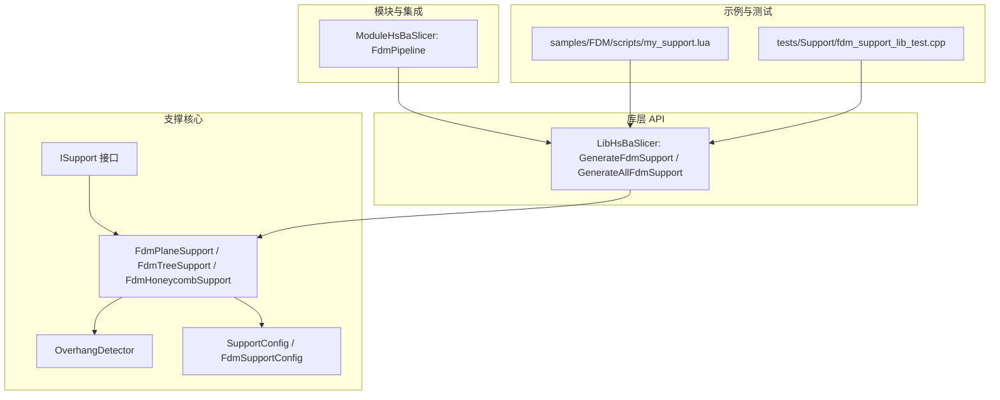
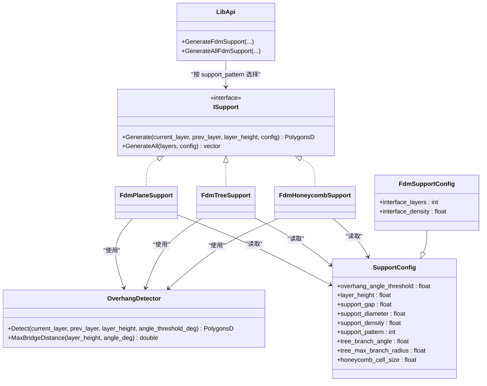
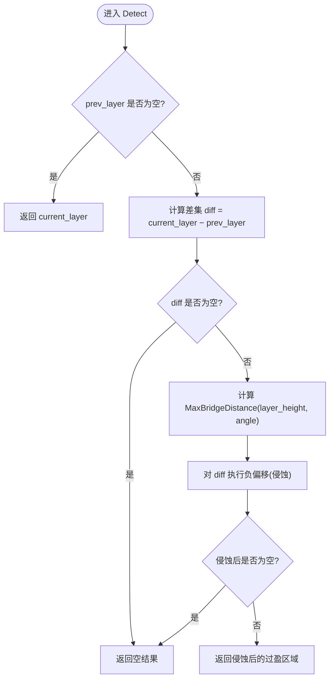
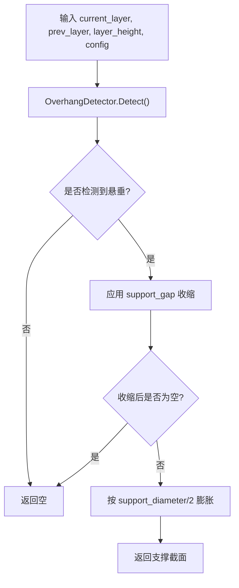
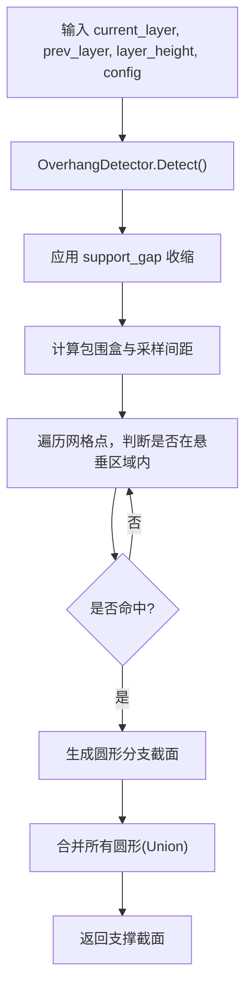
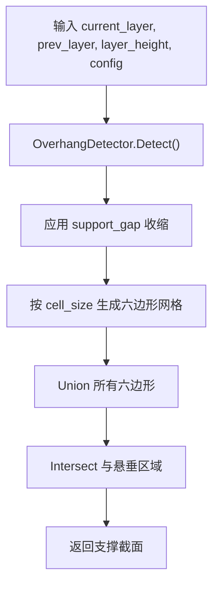
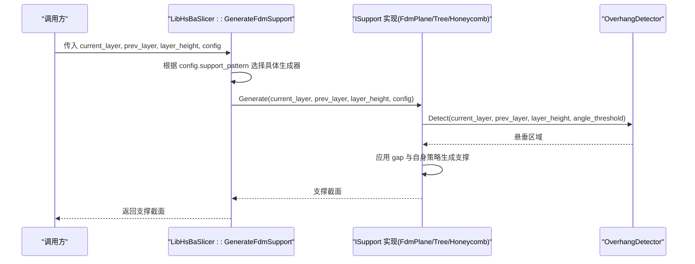
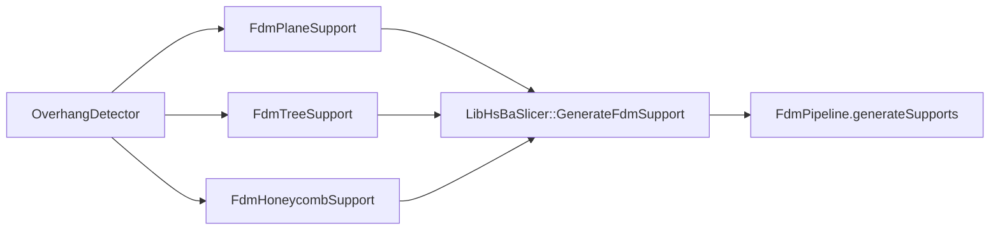

# 支撑生成接口

<cite>
**本文引用的文件**   
- [FdmSupport.hpp](file://support/FdmSupport.hpp)
- [FdmSupport.cpp](file://support/FdmSupport.cpp)
- [ISupport.hpp](file://support/ISupport.hpp)
- [ISupport.cpp](file://support/ISupport.cpp)
- [OverhangDetector.hpp](file://support/OverhangDetector.hpp)
- [OverhangDetector.cpp](file://support/OverhangDetector.cpp)
- [SupportConfig.hpp](file://support\SupportConfig.hpp)
- [fdm_support.hpp](file://LibHsBaSlicer\Support\fdm_support.hpp)
- [fdm_support.cpp](file://LibHsBaSlicer\Support\fdm_support.cpp)
- [hsba_slicer.cppm](file://ModuleHsBaSlicer\hsba_slicer.cppm)
- [my_support.lua](file://samples\FDM\scripts\my_support.lua)
- [fdm_support_lib_test.cpp](file://tests\Support\fdm_support_lib_test.cpp)
</cite>

## 目录
1. [简介](#简介)
2. [项目结构](#项目结构)
3. [核心组件](#核心组件)
4. [架构总览](#架构总览)
5. [详细组件分析](#详细组件分析)
6. [依赖关系分析](#依赖关系分析)
7. [性能与优化建议](#性能与优化建议)
8. [故障排查指南](#故障排查指南)
9. [结论](#结论)
10. [附录：API 参考与示例](#附录api-参考与示例)

## 简介
本文件为 HsBaSlicer 的 FDM 支撑生成 C++ API 完整参考文档，聚焦于 ISupport 抽象接口、FdmPlaneSupport/FdmTreeSupport/FdmHoneycombSupport 三类支撑算法、悬垂检测 OverhangDetector、支撑配置 SupportConfig/FdmSupportConfig，以及 LibHsBaSlicer 对外暴露的 GenerateFdmSupport/GenerateAllFdmSupport 等入口。文档同时说明支撑数据组织方式、与填充系统的集成点、质量评估方法与性能调优建议，并提供 Lua 脚本与测试用例中的实际使用示例路径。

## 项目结构
支撑相关代码主要分布在以下模块：
- support：核心算法与配置（ISupport、FdmSupport、OverhangDetector、SupportConfig）
- LibHsBaSlicer/Support：对外 C++ API 封装（fdm_support.hpp/.cpp）
- ModuleHsBaSlicer：模块导出与管道集成（hsba_slicer.cppm）
- samples/FDM/scripts：Lua 自定义支撑脚本示例
- tests/Support：C++ 单元测试验证支撑生成流程

图表来源
- [ISupport.hpp:14-45](file://support/ISupport.hpp#L14-L45)
- [FdmSupport.hpp:11-63](file://support/FdmSupport.hpp#L11-L63)
- [OverhangDetector.hpp:12-50](file://support/OverhangDetector.hpp#L12-L50)
- [SupportConfig.hpp:11-43](file://support\SupportConfig.hpp#L11-L43)
- [fdm_support.hpp:17-67](file://LibHsBaSlicer\Support\fdm_support.hpp#L17-L67)
- [hsba_slicer.cppm:193-219](file://ModuleHsBaSlicer\hsba_slicer.cppm#L193-L219)
- [my_support.lua:1-83](file://samples\FDM\scripts\my_support.lua#L1-L83)
- [fdm_support_lib_test.cpp:22-71](file://tests\Support\fdm_support_lib_test.cpp#L22-L71)

章节来源
- [ISupport.hpp:14-45](file://support/ISupport.hpp#L14-L45)
- [FdmSupport.hpp:11-63](file://support/FdmSupport.hpp#L11-L63)
- [OverhangDetector.hpp:12-50](file://support/OverhangDetector.hpp#L12-L50)
- [SupportConfig.hpp:11-43](file://support\SupportConfig.hpp#L11-L43)
- [fdm_support.hpp:17-67](file://LibHsBaSlicer\Support\fdm_support.hpp#L17-L67)
- [hsba_slicer.cppm:193-219](file://ModuleHsBaSlicer\hsba_slicer.cppm#L193-L219)

## 核心组件
- ISupport：定义单层支撑生成接口与全层批量生成的默认实现。
- FdmPlaneSupport：基于悬垂区域膨胀生成柱状支撑截面。
- FdmTreeSupport：在悬垂区域内按间距采样生成树状分支截面。
- FdmHoneycombSupport：在悬垂区域内以蜂窝六边形网格填充生成支撑。
- OverhangDetector：根据层高与角度阈值计算最大桥接距离，并裁剪出需要支撑的区域。
- SupportConfig/FdmSupportConfig：通用与 FDM 专用支撑参数集合。
- LibHsBaSlicer::GenerateFdmSupport/GenerateAllFdmSupport：对外 C++ API，按配置选择具体支撑策略。

章节来源
- [ISupport.hpp:14-45](file://support/ISupport.hpp#L14-L45)
- [ISupport.cpp:9-21](file://support/ISupport.cpp#L9-L21)
- [FdmSupport.hpp:13-63](file://support/FdmSupport.hpp#L13-L63)
- [FdmSupport.cpp:48-71](file://support/FdmSupport.cpp#L48-L71)
- [FdmSupport.cpp:77-149](file://support/FdmSupport.cpp#L77-L149)
- [FdmSupport.cpp:155-233](file://support/FdmSupport.cpp#L155-L233)
- [OverhangDetector.hpp:14-50](file://support/OverhangDetector.hpp#L14-L50)
- [OverhangDetector.cpp:23-74](file://support/OverhangDetector.cpp#L23-L74)
- [SupportConfig.hpp:11-43](file://support\SupportConfig.hpp#L11-L43)
- [fdm_support.hpp:17-67](file://LibHsBaSlicer\Support\fdm_support.hpp#L17-L67)
- [fdm_support.cpp:14-51](file://LibHsBaSlicer\Support\fdm_support.cpp#L14-L51)

## 架构总览
支撑生成采用“策略 + 工厂”模式：ISupport 定义统一接口，具体支撑类型通过配置字段 support_pattern 选择；LibHsBaSlicer 提供高层 API 负责实例化与调度；上层管道（如 FdmPipeline）可复用该 API 完成切片→支撑→填充→路径的全流程。

图表来源
- [ISupport.hpp:14-45](file://support/ISupport.hpp#L14-L45)
- [FdmSupport.hpp:13-63](file://support/FdmSupport.hpp#L13-L63)
- [OverhangDetector.hpp:14-50](file://support/OverhangDetector.hpp#L14-L50)
- [SupportConfig.hpp:11-43](file://support\SupportConfig.hpp#L11-L43)
- [fdm_support.hpp:17-67](file://LibHsBaSlicer\Support\fdm_support.hpp#L17-L67)

## 详细组件分析

### 悬垂检测算法（OverhangDetector）
- 输入：当前层轮廓 current_layer、上一层轮廓 prev_layer、层高 layer_height、角度阈值 overhang_angle_threshold。
- 逻辑：
  - 若 prev_layer 为空，则整个 current_layer 视为悬垂。
  - 计算差集 diff = current_layer − prev_layer。
  - 根据 MaxBridgeDistance 计算可桥接的最大水平距离，对 diff 进行负偏移（侵蚀）过滤小悬垂。
  - 返回侵蚀后的多边形作为需要支撑的区域。
- 复杂度：主要受 Clipper2 几何运算影响，通常为 O(n log n) 级别的多边形布尔运算。

图表来源
- [OverhangDetector.cpp:23-74](file://support/OverhangDetector.cpp#L23-L74)

章节来源
- [OverhangDetector.hpp:14-50](file://support/OverhangDetector.hpp#L14-L50)
- [OverhangDetector.cpp:23-74](file://support/OverhangDetector.cpp#L23-L74)

### 平面支撑（FdmPlaneSupport）
- 目标：将悬垂区域膨胀为柱状支撑截面，并在模型与支撑之间保留间隙。
- 关键步骤：
  - 调用 OverhangDetector 获取悬垂区域。
  - 应用 support_gap 收缩悬垂区域，形成支撑与模型的分离面。
  - 按 support_diameter/2 膨胀得到圆形柱截面集合。
- 适用场景：简单悬垂、快速生成、易于移除。

图表来源
- [FdmSupport.cpp:48-71](file://support/FdmSupport.cpp#L48-L71)

章节来源
- [FdmSupport.hpp:13-24](file://support/FdmSupport.hpp#L13-L24)
- [FdmSupport.cpp:48-71](file://support/FdmSupport.cpp#L48-L71)

### 树状支撑（FdmTreeSupport）
- 目标：在悬垂区域内按固定间距采样生成圆形分支点，模拟从底板向上生长的树状结构。
- 关键步骤：
  - 计算悬垂区域并应用 gap。
  - 在包围盒内按 spacing ≈ support_diameter × 1.5 的网格采样。
  - 对每个采样点判断是否在悬垂区域内，若是则生成半径为 support_diameter/2 的圆。
  - 合并所有圆（Union）得到支撑截面。
- 特点：分支点稀疏、材料少、强度适中，适合中等悬垂。

图表来源
- [FdmSupport.cpp:77-149](file://support/FdmSupport.cpp#L77-L149)

章节来源
- [FdmSupport.hpp:26-44](file://support/FdmSupport.hpp#L26-L44)
- [FdmSupport.cpp:77-149](file://support/FdmSupport.cpp#L77-L149)

### 蜂窝形支撑（FdmHoneycombSupport）
- 目标：在悬垂区域内以六边形蜂窝网格填充，提供轻量但刚性的支撑。
- 关键步骤：
  - 计算悬垂区域并应用 gap。
  - 根据 honeycomb_cell_size 生成平顶六边形网格。
  - 将所有六边形 Union 后与悬垂区域 Intersect，得到最终支撑截面。
- 特点：密度可控、支撑面积大、移除难度略高。

图表来源
- [FdmSupport.cpp:155-233](file://support/FdmSupport.cpp#L155-L233)

章节来源
- [FdmSupport.hpp:46-63](file://support/FdmSupport.hpp#L46-L63)
- [FdmSupport.cpp:155-233](file://support/FdmSupport.cpp#L155-L233)

### 支撑配置结构体（SupportConfig / FdmSupportConfig）
- SupportConfig：通用支撑参数，包括悬垂角度阈值、层高、间隙、直径、密度、图案类型、树状角度/半径、蜂窝单元尺寸等。
- FdmSupportConfig：继承 SupportConfig，增加界面层数与界面密度，用于控制支撑与模型接触层的填充特性。

章节来源
- [SupportConfig.hpp:11-43](file://support\SupportConfig.hpp#L11-L43)

### 类接口与生成流程（ISupport 与默认实现）
- ISupport::Generate：单层支撑生成接口。
- ISupport::GenerateAll：默认实现逐层迭代调用 Generate，首层 prev_layer 为空。
- 各 FDM 支撑类型均实现 Generate，内部统一先做悬垂检测与间隙处理，再按各自策略生成截面。

图表来源
- [fdm_support.cpp:14-51](file://LibHsBaSlicer\Support\fdm_support.cpp#L14-L51)
- [ISupport.cpp:9-21](file://support/ISupport.cpp#L9-L21)
- [FdmSupport.cpp:48-71](file://support/FdmSupport.cpp#L48-L71)
- [FdmSupport.cpp:77-149](file://support/FdmSupport.cpp#L77-L149)
- [FdmSupport.cpp:155-233](file://support/FdmSupport.cpp#L155-L233)
- [OverhangDetector.cpp:23-74](file://support/OverhangDetector.cpp#L23-L74)

章节来源
- [ISupport.hpp:14-45](file://support/ISupport.hpp#L14-L45)
- [ISupport.cpp:9-21](file://support/ISupport.cpp#L9-L21)
- [fdm_support.cpp:14-51](file://LibHsBaSlicer\Support\fdm_support.cpp#L14-L51)

## 依赖关系分析
- 支撑生成器依赖 OverhangDetector 进行悬垂区域判定。
- 支撑生成器依赖 2D 几何工具（Clipper2）进行 Offset/Union/Intersect 等布尔运算。
- LibHsBaSlicer 层通过 support_pattern 分派到具体支撑实现。
- 上层管道（FdmPipeline）可复用 GenerateAllFdmSupport 完成全层支撑生成。

图表来源
- [FdmSupport.cpp:48-71](file://support/FdmSupport.cpp#L48-L71)
- [FdmSupport.cpp:77-149](file://support/FdmSupport.cpp#L77-L149)
- [FdmSupport.cpp:155-233](file://support/FdmSupport.cpp#L155-L233)
- [fdm_support.cpp:14-51](file://LibHsBaSlicer\Support\fdm_support.cpp#L14-L51)
- [hsba_slicer.cppm:214-217](file://ModuleHsBaSlicer\hsba_slicer.cppm#L214-L217)

章节来源
- [FdmSupport.cpp:48-71](file://support/FdmSupport.cpp#L48-L71)
- [FdmSupport.cpp:77-149](file://support/FdmSupport.cpp#L77-L149)
- [FdmSupport.cpp:155-233](file://support/FdmSupport.cpp#L155-L233)
- [fdm_support.cpp:14-51](file://LibHsBaSlicer\Support\fdm_support.cpp#L14-L51)
- [hsba_slicer.cppm:214-217](file://ModuleHsBaSlicer\hsba_slicer.cppm#L214-L217)

## 性能与优化建议
- 悬垂检测：
  - 合理设置 overhang_angle_threshold：角度越大，可桥接的水平距离越小，需支撑区域越少。
  - 对于薄壁或精细特征，适当增大 support_gap 可减少支撑与模型的接触面积，降低打印风险。
- 平面支撑：
  - support_diameter 越大，支撑体积越大、强度越高，但移除难度增加。
  - 建议在保证强度的前提下尽量减小 diameter。
- 树状支撑：
  - 采样间距与 support_diameter 成正比，过大间距可能导致支撑不足，过小则材料浪费。
  - 可通过调整 tree_branch_angle 与 tree_max_branch_radius（若后续扩展）控制分支形态。
- 蜂窝支撑：
  - honeycomb_cell_size 越小，支撑越密、强度越高，但计算量与材料消耗上升。
  - 对大面积悬垂建议使用蜂窝支撑以获得更好的稳定性。
- 几何运算：
  - 大量 Offset/Union/Intersect 操作可能成为瓶颈，建议对大模型分层并行处理（由上层管道负责）。
  - 避免重复整数化/浮点转换，已在实现中通过局部包装函数减少歧义。

[本节为通用指导，不直接分析具体文件]

## 故障排查指南
- 未生成支撑：
  - 检查 prev_layer 是否为空（首层），此时整个 current_layer 被视为悬垂。
  - 确认 overhang_angle_threshold 是否过大导致无悬垂。
  - 检查 support_gap 是否过大导致收缩后为空。
- 支撑过细或断裂：
  - 增大 support_diameter 或减小蜂窝单元尺寸。
  - 切换至蜂窝支撑以提升整体刚性。
- 支撑与模型粘连：
  - 增大 support_gap。
  - 在 Lua 脚本中对支撑结果进行二次 offset 收缩。
- 性能问题：
  - 减少不必要的 Union/Intersect 次数。
  - 对大规模模型启用分层并行（由上层管道管理）。

章节来源
- [OverhangDetector.cpp:23-74](file://support/OverhangDetector.cpp#L23-L74)
- [FdmSupport.cpp:48-71](file://support/FdmSupport.cpp#L48-L71)
- [FdmSupport.cpp:77-149](file://support/FdmSupport.cpp#L77-L149)
- [FdmSupport.cpp:155-233](file://support/FdmSupport.cpp#L155-L233)

## 结论
HsBaSlicer 的支撑子系统以 ISupport 为抽象核心，提供平面、树状、蜂窝三种 FDM 支撑策略，并通过 OverhangDetector 精确识别悬垂区域。LibHsBaSlicer 暴露简洁的 C++ API，便于上层管道与外部系统集成。通过合理的配置与优化策略，可在支撑质量、材料与效率之间取得良好平衡。

[本节为总结性内容，不直接分析具体文件]

## 附录：API 参考与示例

### C++ 公共 API（LibHsBaSlicer）
- GenerateFdmSupport(current_layer, prev_layer, layer_height, config)
  - 功能：按 config.support_pattern 选择具体支撑策略，生成单层支撑截面。
- GenerateAllFdmSupport(layers, config)
  - 功能：对全部层调用对应生成器的 GenerateAll，返回每层支撑截面序列。
- GenerateAllSlaSupport(layers, sla_config)
  - 功能：SLA 牺牲型支撑生成（树脂打印）。
- GenerateAllLuaSupport(layers, config, script, functionName)
  - 功能：使用 Lua 脚本替换内置支撑算法，支持注入 2D/3D 函数。

章节来源
- [fdm_support.hpp:17-67](file://LibHsBaSlicer\Support\fdm_support.hpp#L17-L67)
- [fdm_support.cpp:14-74](file://LibHsBaSlicer\Support\fdm_support.cpp#L14-L74)

### 配置结构体
- SupportConfig
  - overhang_angle_threshold：悬垂角度阈值（度）
  - layer_height：层高（mm）
  - support_gap：支撑与模型间隙（mm）
  - support_diameter：支撑柱直径（mm）
  - support_density：支撑填充密度 [0,1]
  - support_pattern：支撑类型（0=平面，1=树状，2=蜂窝）
  - tree_branch_angle：树状分支角度（度）
  - tree_max_branch_radius：树状最大分支半径（mm）
  - honeycomb_cell_size：蜂窝单元尺寸（mm）
- FdmSupportConfig
  - interface_layers：界面层数
  - interface_density：界面层填充密度

章节来源
- [SupportConfig.hpp:11-43](file://support\SupportConfig.hpp#L11-L43)

### 与填充系统的集成
- FdmPipeline 提供 generateSupports 方法，接收切片后的层轮廓并调用 GenerateAllFdmSupport 生成支撑，随后进入填充阶段。
- 支撑数据以 std::vector<PolygonsD> 形式组织，每层一个 PolygonsD，便于后续路径规划与 G-code 生成。

章节来源
- [hsba_slicer.cppm:214-217](file://ModuleHsBaSlicer\hsba_slicer.cppm#L214-L217)

### 实际代码示例

- C++ 单元测试示例（平面/树状/蜂窝）
  - 展示如何构造层轮廓、设置 FdmSupportConfig、调用 GenerateFdmSupport 与 GenerateAllFdmSupport，并断言结果非空。
  - 参考路径：[fdm_support_lib_test.cpp:22-71](file://tests\Support\fdm_support_lib_test.cpp#L22-L71)

- Lua 自定义支撑脚本示例
  - 演示如何使用 Support.detect_overhang 检测悬垂，按 config.support_pattern 选择内置生成器，调用 Support.generate 生成支撑，并对结果进行二次 offset 收缩。
  - 参考路径：[my_support.lua:30-79](file://samples\FDM\scripts\my_support.lua#L30-L79)

章节来源
- [fdm_support_lib_test.cpp:22-71](file://tests\Support\fdm_support_lib_test.cpp#L22-L71)
- [my_support.lua:30-79](file://samples\FDM\scripts\my_support.lua#L30-L79)