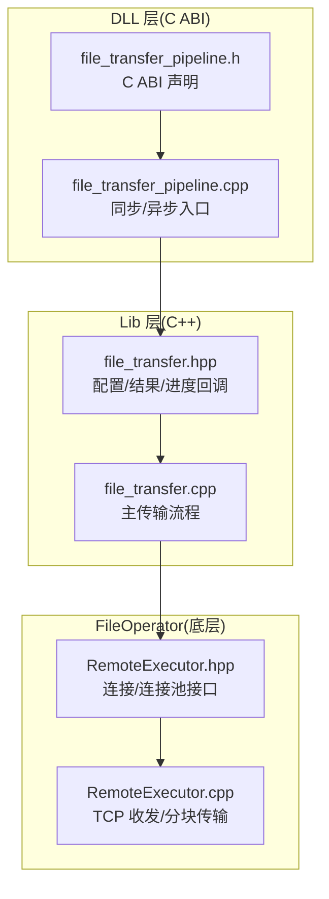
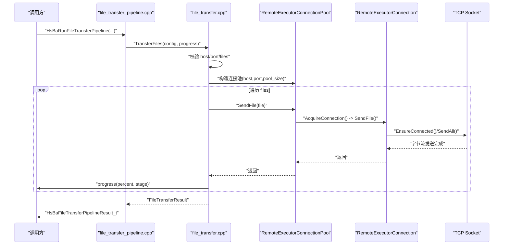
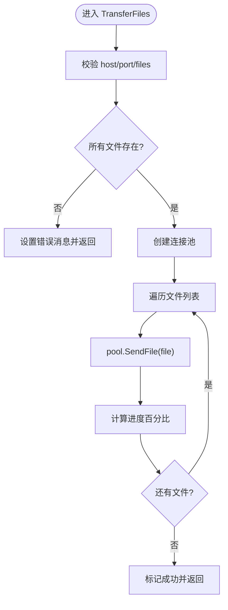
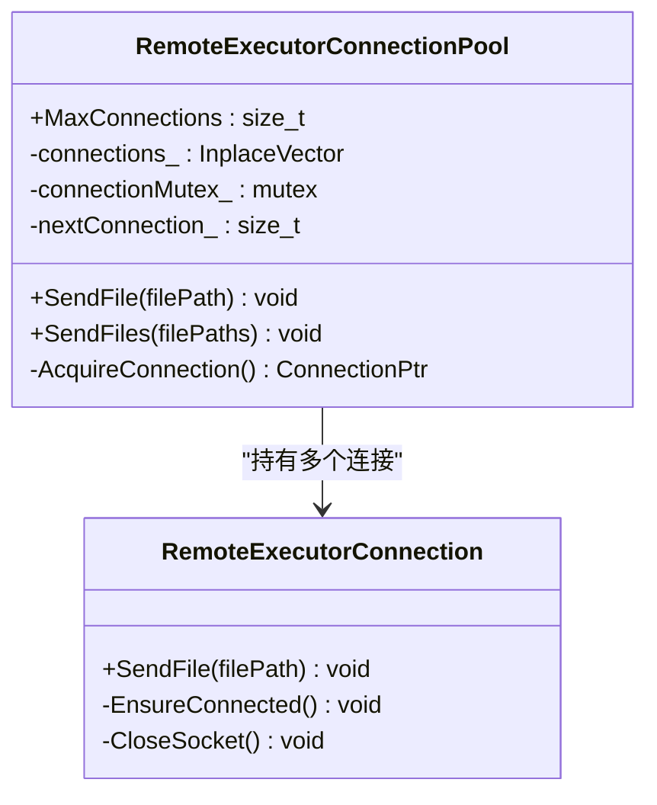
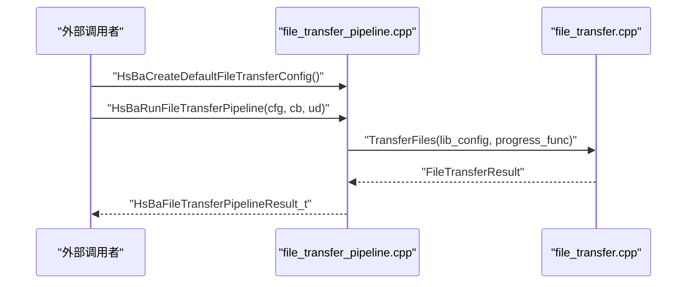
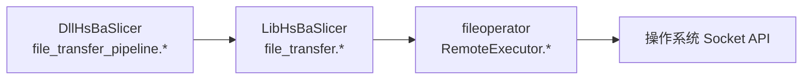
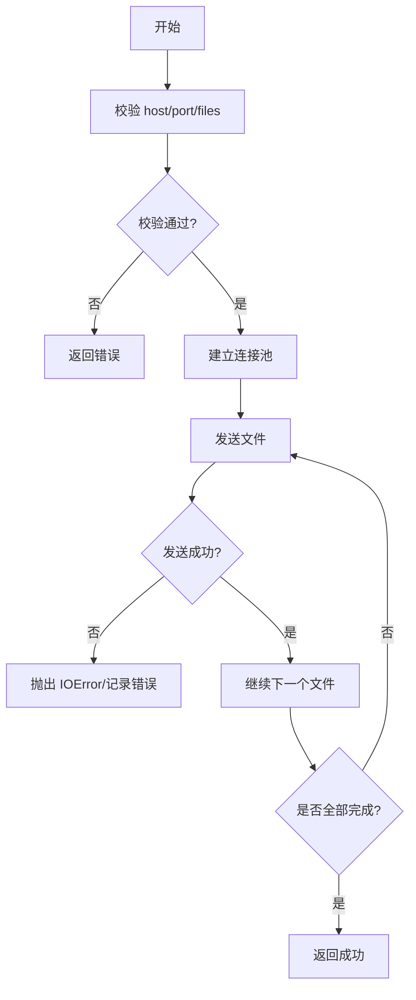

# 文件传输接口

<cite>
**本文引用的文件**   
- [file_transfer.hpp](file://LibHsBaSlicer/Transfer/file_transfer.hpp)
- [file_transfer.cpp](file://LibHsBaSlicer/Transfer/file_transfer.cpp)
- [file_transfer_pipeline.h](file://DllHsBaSlicer/file_transfer_pipeline.h)
- [file_transfer_pipeline.cpp](file://DllHsBaSlicer/file_transfer_pipeline.cpp)
- [RemoteExecutor.hpp](file://fileoperator/RemoteExecutor.hpp)
- [RemoteExecutor.cpp](file://fileoperator/RemoteExecutor.cpp)
- [remote_executor_test.cpp](file://tests/FilesOperator/remote_executor_test.cpp)
</cite>

## 目录
1. [简介](#简介)
2. [项目结构](#项目结构)
3. [核心组件](#核心组件)
4. [架构总览](#架构总览)
5. [详细组件分析](#详细组件分析)
6. [依赖关系分析](#依赖关系分析)
7. [性能与并发](#性能与并发)
8. [故障恢复与错误处理](#故障恢复与错误处理)
9. [使用示例与最佳实践](#使用示例与最佳实践)
10. [结论](#结论)

## 简介
本参考文档聚焦于 HsBaSlicer 的文件传输 C++ API，重点说明 LibHsBaSlicer 层提供的文件传输能力、DllHsBaSlicer 暴露的 C ABI 管道接口，以及底层基于 TCP 的远程执行器连接与连接池机制。文档涵盖：
- 配置与结果类型
- 进度回调与阶段报告
- 批量文件发送与顺序传输流程
- 连接池与并发模型
- 大文件分块传输与内存管理
- 错误分类与异常传播
- 与文件系统操作的集成点
- 性能优化建议与故障恢复策略

需要特别说明的是：当前仓库未提供“本地压缩/解压”或“网络协议加密”等通用库；文件传输采用原始二进制流（文件名+长度+数据）通过 TCP 发送到远端服务。若需压缩/解压，应在上层应用自行实现并调用本传输接口。

## 项目结构
围绕文件传输的相关代码分布在以下模块：
- LibHsBaSlicer/Transfer：对外暴露的 C++ 传输 API（配置、结果、进度回调、主函数）
- DllHsBaSlicer：C ABI 封装，提供同步/异步运行入口与结果释放
- fileoperator：远程执行器连接与连接池实现（TCP 收发、分块读取、地址解析）
- tests：连接池与连接的单元测试用例

**图表来源**
- [file_transfer_pipeline.h:17-60](file://DllHsBaSlicer/file_transfer_pipeline.h#L17-L60)
- [file_transfer_pipeline.cpp:78-186](file://DllHsBaSlicer/file_transfer_pipeline.cpp#L78-L186)
- [file_transfer.hpp:20-60](file://LibHsBaSlicer/Transfer/file_transfer.hpp#L20-L60)
- [file_transfer.cpp:25-91](file://LibHsBaSlicer/Transfer/file_transfer.cpp#L25-L91)
- [RemoteExecutor.hpp:23-98](file://fileoperator/RemoteExecutor.hpp#L23-L98)
- [RemoteExecutor.cpp:148-325](file://fileoperator/RemoteExecutor.cpp#L148-L325)

**章节来源**
- [file_transfer_pipeline.h:1-67](file://DllHsBaSlicer/file_transfer_pipeline.h#L1-L67)
- [file_transfer_pipeline.cpp:1-194](file://DllHsBaSlicer/file_transfer_pipeline.cpp#L1-L194)
- [file_transfer.hpp:1-65](file://LibHsBaSlicer/Transfer/file_transfer.hpp#L1-L65)
- [file_transfer.cpp:1-95](file://LibHsBaSlicer/Transfer/file_transfer.cpp#L1-L95)
- [RemoteExecutor.hpp:1-103](file://fileoperator/RemoteExecutor.hpp#L1-L103)
- [RemoteExecutor.cpp:1-325](file://fileoperator/RemoteExecutor.cpp#L1-L325)

## 核心组件
本节概述关键类型与职责：
- FileTransferConfig：传输配置（主机、端口、连接池大小、待传文件列表）
- FileTransferResult：传输结果（成功标志、已传数量、总数、错误信息）
- FileTransferProgressFunc：进度回调（百分比、阶段描述）
- TransferFiles：主传输函数（校验→建立连接池→顺序发送→进度上报）
- RemoteExecutorConnection：单连接（建立 TCP、发送文件）
- RemoteExecutorConnectionPool：连接池（轮询分配、线程安全）

**章节来源**
- [file_transfer.hpp:20-60](file://LibHsBaSlicer/Transfer/file_transfer.hpp#L20-L60)
- [file_transfer.cpp:25-91](file://LibHsBaSlicer/Transfer/file_transfer.cpp#L25-L91)
- [RemoteExecutor.hpp:23-98](file://fileoperator/RemoteExecutor.hpp#L23-L98)

## 架构总览
下图展示从 C ABI 到 Lib 再到 FileOperator 的调用链与数据流向。

**图表来源**
- [file_transfer_pipeline.cpp:116-186](file://DllHsBaSlicer/file_transfer_pipeline.cpp#L116-L186)
- [file_transfer.cpp:25-91](file://LibHsBaSlicer/Transfer/file_transfer.cpp#L25-L91)
- [RemoteExecutor.cpp:154-195](file://fileoperator/RemoteExecutor.cpp#L154-L195)
- [RemoteExecutor.cpp:277-325](file://fileoperator/RemoteExecutor.cpp#L277-L325)

## 详细组件分析

### 配置与结果类型
- FileTransferConfig
  - host/port：远端服务地址与端口
  - pool_size：连接池大小（内部会限制在 [1, MaxConnections]）
  - files：待传输文件路径集合
- FileTransferResult
  - success：是否全部成功
  - files_transferred/total_files：计数统计
  - error_message：失败时的错误信息

设计要点：
- 所有字符串字段均为 std::string，便于跨语言边界传递
- 进度回调以 std::function 形式传入，支持可选回调

**章节来源**
- [file_transfer.hpp:20-60](file://LibHsBaSlicer/Transfer/file_transfer.hpp#L20-L60)

### 主传输流程：TransferFiles
主要步骤：
1. 校验 host/port/files 非空
2. 校验每个文件存在
3. 构建 RemoteExecutorConnectionPool（自动限制池大小）
4. 顺序发送每个文件，更新进度
5. 返回结果

**图表来源**
- [file_transfer.cpp:25-91](file://LibHsBaSlicer/Transfer/file_transfer.cpp#L25-L91)

**章节来源**
- [file_transfer.cpp:25-91](file://LibHsBaSlicer/Transfer/file_transfer.cpp#L25-L91)

### 连接与连接池：RemoteExecutorConnection / RemoteExecutorConnectionPool
- RemoteExecutorConnection
  - 负责建立 TCP 连接、发送文件名与文件大小、按固定分块大小循环读取并发送
  - 使用 EnsureConnected 懒加载连接，避免重复建立
  - 使用 SendAll 保证完整写入
- RemoteExecutorConnectionPool
  - 维护固定数量的连接，使用互斥锁保护轮询索引
  - 提供 SendFile/SendFiles 接口

**图表来源**
- [RemoteExecutor.hpp:23-98](file://fileoperator/RemoteExecutor.hpp#L23-L98)
- [RemoteExecutor.cpp:148-325](file://fileoperator/RemoteExecutor.cpp#L148-L325)

**章节来源**
- [RemoteExecutor.hpp:23-98](file://fileoperator/RemoteExecutor.hpp#L23-L98)
- [RemoteExecutor.cpp:148-325](file://fileoperator/RemoteExecutor.cpp#L148-L325)

### C ABI 管道封装：file_transfer_pipeline
- 提供默认配置创建、同步运行、异步运行与结果释放
- 将 C 回调桥接到 C++ 进度回调
- 使用协程包装内部任务，统一计时与异常捕获

**图表来源**
- [file_transfer_pipeline.h:17-60](file://DllHsBaSlicer/file_transfer_pipeline.h#L17-L60)
- [file_transfer_pipeline.cpp:78-186](file://DllHsBaSlicer/file_transfer_pipeline.cpp#L78-L186)

**章节来源**
- [file_transfer_pipeline.h:1-67](file://DllHsBaSlicer/file_transfer_pipeline.h#L1-L67)
- [file_transfer_pipeline.cpp:1-194](file://DllHsBaSlicer/file_transfer_pipeline.cpp#L1-L194)

## 依赖关系分析
- DllHsBaSlicer 层依赖 LibHsBaSlicer 层的 TransferFiles
- LibHsBaSlicer 层依赖 fileoperator 的连接与连接池
- 底层 RemoteExecutor 使用平台相关 socket API（Winsock/POSIX）

**图表来源**
- [file_transfer_pipeline.cpp:16-18](file://DllHsBaSlicer/file_transfer_pipeline.cpp#L16-L18)
- [file_transfer.cpp:7](file://LibHsBaSlicer/Transfer/file_transfer.cpp#L7)
- [RemoteExecutor.cpp:17-32](file://fileoperator/RemoteExecutor.cpp#L17-L32)

**章节来源**
- [file_transfer_pipeline.cpp:1-194](file://DllHsBaSlicer/file_transfer_pipeline.cpp#L1-L194)
- [file_transfer.cpp:1-95](file://LibHsBaSlicer/Transfer/file_transfer.cpp#L1-L95)
- [RemoteExecutor.cpp:1-325](file://fileoperator/RemoteExecutor.cpp#L1-L325)

## 性能与并发
- 连接池
  - 最大连接数 MaxConnections = 16
  - 轮询分配，降低频繁建连开销
- 大文件传输
  - 固定分块大小 64 KiB，减少单次 IO 压力与内存占用
  - 使用 SendAll 确保完整写入，避免半包问题
- 进度上报
  - 线性插值估算进度，提升 UI 反馈体验
- 并发模型
  - 当前 TransferFiles 为顺序发送；连接池用于复用连接而非并行发送
  - 如需更高吞吐，可在上层对文件进行分组并发调度（注意远端服务处理能力）

优化建议：
- 合理设置 pool_size（通常 4~8），根据 CPU/IO/网络带宽调优
- 对超大文件可考虑在上层做分片并发（例如按 100MB 切片），但需保证远端能正确重组
- 监控网络丢包与重传，必要时引入重试与断点续传逻辑（见下节）

**章节来源**
- [RemoteExecutor.hpp:56-98](file://fileoperator/RemoteExecutor.hpp#L56-L98)
- [RemoteExecutor.cpp:183-194](file://fileoperator/RemoteExecutor.cpp#L183-L194)
- [file_transfer.cpp:79-87](file://LibHsBaSlicer/Transfer/file_transfer.cpp#L79-L87)

## 故障恢复与错误处理
- 输入校验
  - host/port/files 为空时直接返回错误
  - 文件不存在时报错并终止
- 连接与发送
  - 连接建立失败抛出 IOError
  - 发送过程中网络错误或远端关闭连接抛出 IOError
- 异常传播
  - Dll 层捕获 RuntimeError 并转换为错误消息
- 测试覆盖
  - 连接池大小为 0 抛 InvalidArgumentError
  - 发送不存在的文件抛 IOError

**图表来源**
- [file_transfer.cpp:31-58](file://LibHsBaSlicer/Transfer/file_transfer.cpp#L31-L58)
- [RemoteExecutor.cpp:154-195](file://fileoperator/RemoteExecutor.cpp#L154-L195)
- [remote_executor_test.cpp:9-18](file://tests/FilesOperator/remote_executor_test.cpp#L9-L18)

**章节来源**
- [file_transfer.cpp:31-58](file://LibHsBaSlicer/Transfer/file_transfer.cpp#L31-L58)
- [RemoteExecutor.cpp:154-195](file://fileoperator/RemoteExecutor.cpp#L154-L195)
- [remote_executor_test.cpp:9-18](file://tests/FilesOperator/remote_executor_test.cpp#L9-L18)

## 使用示例与最佳实践

### 基本用法（C++）
- 构造 FileTransferConfig，设置 host/port/pool_size/files
- 定义 FileTransferProgressFunc 回调，打印进度与阶段
- 调用 TransferFiles 获取 FileTransferResult

参考路径：
- [file_transfer.hpp:20-60](file://LibHsBaSlicer/Transfer/file_transfer.hpp#L20-L60)
- [file_transfer.cpp:25-91](file://LibHsBaSlicer/Transfer/file_transfer.cpp#L25-L91)

### C ABI 调用（同步）
- 使用 HsBaCreateDefaultFileTransferConfig 创建默认配置
- 填充 host/port/file_paths
- 调用 HsBaRunFileTransferPipeline，传入进度回调与用户数据
- 使用 HsBaFreeFileTransferPipelineResult 释放结果中的错误消息

参考路径：
- [file_transfer_pipeline.h:17-60](file://DllHsBaSlicer/file_transfer_pipeline.h#L17-L60)
- [file_transfer_pipeline.cpp:155-167](file://DllHsBaSlicer/file_transfer_pipeline.cpp#L155-L167)

### C ABI 调用（异步）
- 调用 HsBaRunFileTransferPipelineAsync，传入结果回调
- 在结果回调中检查 success 与 elapsed_seconds

参考路径：
- [file_transfer_pipeline.h:37-51](file://DllHsBaSlicer/file_transfer_pipeline.h#L37-L51)
- [file_transfer_pipeline.cpp:169-186](file://DllHsBaSlicer/file_transfer_pipeline.cpp#L169-L186)

### 批量文件处理
- 在 config.files 中填入多个路径，TransferFiles 会顺序发送
- 如需并发，可在上层对文件列表进行分组并发调度（注意远端服务能力）

参考路径：
- [file_transfer.cpp:79-87](file://LibHsBaSlicer/Transfer/file_transfer.cpp#L79-L87)

### 进度监控
- 进度回调包含 percent 与 stage，可用于 UI 显示
- 阶段包括：校验、建立连接、传输中、完成

参考路径：
- [file_transfer.cpp:31-90](file://LibHsBaSlicer/Transfer/file_transfer.cpp#L31-L90)

### 大文件处理策略
- 底层使用 64 KiB 分块读取与发送，适合大文件
- 如需更细粒度控制，可在上层实现分片并发与合并（需远端配合）

参考路径：
- [RemoteExecutor.cpp:183-194](file://fileoperator/RemoteExecutor.cpp#L183-L194)

### 内存管理与资源释放
- 连接池内部使用智能指针管理连接对象
- C ABI 结果中的错误消息由 HsBaFreeFileTransferPipelineResult 释放

参考路径：
- [file_transfer_pipeline.cpp:188-193](file://DllHsBaSlicer/file_transfer_pipeline.cpp#L188-L193)

### 与文件系统操作的集成
- 传输前校验文件存在性
- 底层打开文件并以二进制模式读取

参考路径：
- [file_transfer.cpp:50-57](file://LibHsBaSlicer/Transfer/file_transfer.cpp#L50-L57)
- [RemoteExecutor.cpp:158-171](file://fileoperator/RemoteExecutor.cpp#L158-L171)

### 数据完整性保证
- 当前协议：文件名长度(64位)+文件名+文件大小(64位)+数据流
- 建议在远端侧进行校验和校验（如 CRC32/SHA256），或在应用层增加校验字段

参考路径：
- [RemoteExecutor.cpp:173-181](file://fileoperator/RemoteExecutor.cpp#L173-L181)

### 压缩/解压说明
- 当前传输为原始二进制流，不包含压缩/解压逻辑
- 如需压缩，请在上层先压缩文件，再调用本传输接口；解压同理

[本节为概念性说明，无需源码引用]

## 结论
HsBaSlicer 的文件传输 API 提供了清晰的配置/结果模型、进度回调与稳定的连接池机制，适用于批量文件的顺序传输场景。其底层基于 TCP 的分块传输保证了大文件处理的稳定性与内存友好性。对于高吞吐需求，可通过上层并发调度与合理的连接池大小进行优化。若需压缩/解压与更强的数据完整性保障，可在应用层扩展协议与校验逻辑。