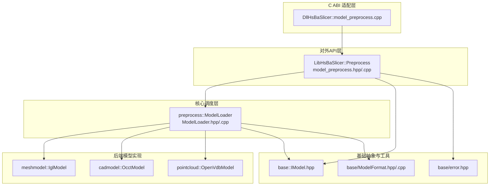
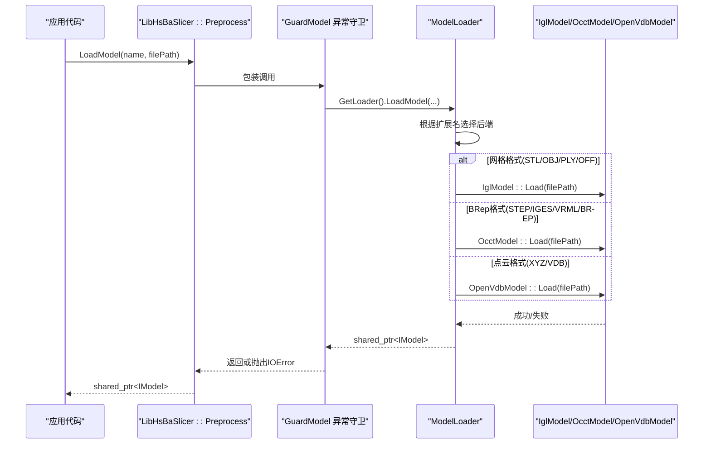
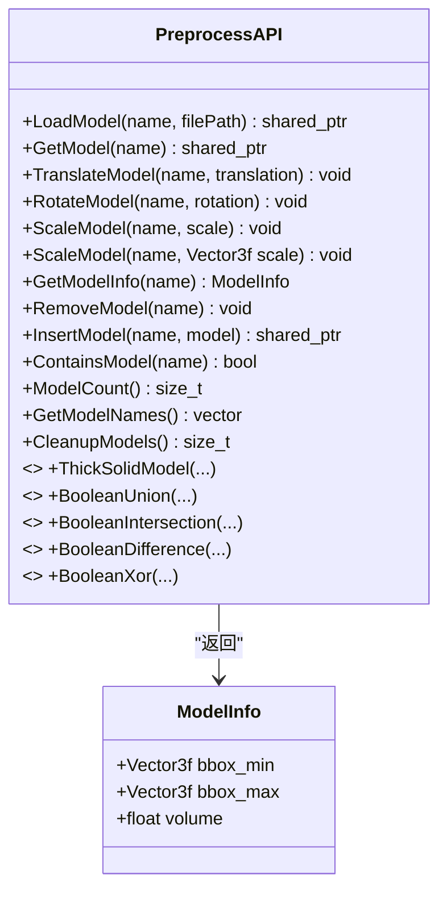
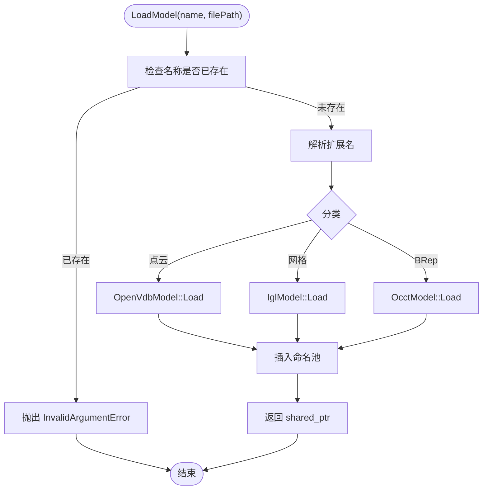
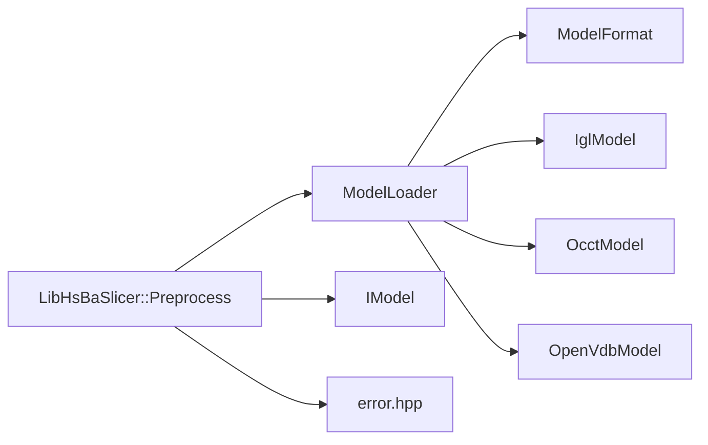

# 模型预处理接口

<cite>
**本文引用的文件**   
- [LibHsBaSlicer/Preprocess/model_preprocess.hpp](file://LibHsBaSlicer/Preprocess/model_preprocess.hpp)
- [LibHsBaSlicer/Preprocess/model_preprocess.cpp](file://LibHsBaSlicer/Preprocess/model_preprocess.cpp)
- [preprocess/ModelLoader.hpp](file://preprocess/ModelLoader.hpp)
- [preprocess/ModelLoader.cpp](file://preprocess/ModelLoader.cpp)
- [base/IModel.hpp](file://base/IModel.hpp)
- [base/error.hpp](file://base/error.hpp)
- [base/ModelFormat.hpp](file://base/ModelFormat.hpp)
- [base/ModelFormat.cpp](file://base/ModelFormat.cpp)
- [DllHsBaSlicer/model_preprocess.cpp](file://DllHsBaSlicer/model_preprocess.cpp)
</cite>

## 目录
1. [简介](#简介)
2. [项目结构](#项目结构)
3. [核心组件](#核心组件)
4. [架构总览](#架构总览)
5. [详细组件分析](#详细组件分析)
6. [依赖关系分析](#依赖关系分析)
7. [性能与资源管理](#性能与资源管理)
8. [异常处理与错误码](#异常处理与错误码)
9. [使用示例与最佳实践](#使用示例与最佳实践)
10. [常见问题排查](#常见问题排查)
11. [结论](#结论)

## 简介
本文件面向 HsBaSlicer 的“模型预处理”C++ API，重点说明如何加载、转换、查询和预处理 3D 模型。文档围绕以下目标展开：
- 解释 LibHsBaSlicer 暴露的模型预处理 C++ 接口（LoadModel、TranslateModel、RotateModel、ScaleModel、GetModelInfo、BooleanUnion/Difference/Intersection/Xor、ThickSolidModel 等）。
- 说明底层 ModelLoader 的设计模式、格式分发、几何验证与高级布尔/实体操作。
- 给出智能指针使用、异常处理、线程安全与资源管理的最佳实践。
- 列出支持的模型格式（STL/OBJ/PLY/OFF、STEP/IGES/VRML/BREP、XYZ/VDB）及条件编译开关的影响。
- 提供可操作的代码路径引用与流程图，帮助快速上手并避免常见陷阱。

## 项目结构
与模型预处理直接相关的代码分布在以下模块：
- LibHsBaSlicer/Preprocess：对外暴露的 C++ 预处理 API（函数式接口 + 数据对象）。
- preprocess：内部实现 ModelLoader，负责按扩展名选择 IglModel/OcctModel/OpenVdbModel 并维护命名模型池。
- base：IModel 抽象接口、错误类型、模型格式枚举与工具函数。
- DllHsBaSlicer：将 C++ API 包装为 C ABI，供外部语言调用。

图表来源
- [LibHsBaSlicer/Preprocess/model_preprocess.hpp:1-192](file://LibHsBaSlicer/Preprocess/model_preprocess.hpp#L1-L192)
- [LibHsBaSlicer/Preprocess/model_preprocess.cpp:1-204](file://LibHsBaSlicer/Preprocess/model_preprocess.cpp#L1-L204)
- [preprocess/ModelLoader.hpp:1-206](file://preprocess/ModelLoader.hpp#L1-L206)
- [preprocess/ModelLoader.cpp:1-456](file://preprocess/ModelLoader.cpp#L1-L456)
- [base/IModel.hpp:1-151](file://base/IModel.hpp#L1-L151)
- [base/error.hpp:1-147](file://base/error.hpp#L1-L147)
- [base/ModelFormat.hpp:1-116](file://base/ModelFormat.hpp#L1-L116)
- [base/ModelFormat.cpp:1-177](file://base/ModelFormat.cpp#L1-L177)
- [DllHsBaSlicer/model_preprocess.cpp:1-51](file://DllHsBaSlicer/model_preprocess.cpp#L1-L51)

章节来源
- [README.md:100-150](file://README.md#L100-L150)

## 核心组件
- 对外 C++ API（LibHsBaSlicer::Preprocess）
  - 提供函数式接口：LoadModel、GetModel、TranslateModel、RotateModel、ScaleModel、GetModelInfo、RemoveModel、InsertModel、ContainsModel、ModelCount、GetModelNames、CleanupModels。
  - 在启用 CGAL 时，额外提供 ThickSolidModel、BooleanUnion/Intersection/Difference/Xor。
  - 所有导出函数通过 GuardModel 统一捕获第三方异常，确保跨边界只抛出 RuntimeError 派生类。
- 内部调度器（preprocess::ModelLoader）
  - 基于文件扩展名自动选择后端：网格格式走 IglModel；BRep 格式走 OcctModel；点云格式走 OpenVdbModel。
  - 维护 NamedObjectPool<IModel>，支持插入、查找、删除、清理未引用模型。
  - 提供高级布尔运算与实体壳操作（条件编译）。
- 基础抽象（base::IModel）
  - 定义统一的 3D 模型接口：Load/Save、Transform/Translate/Rotate/Scale、BoundingBox/Volume、TriangleMesh。
- 模型格式（base::ModelFormat）
  - 定义模型格式枚举与字符串映射，并提供 IsMeshFormat/IsBrepFormat/IsPointCloudFormat 等判断函数。
- C ABI 适配（DllHsBaSlicer）
  - 将 C++ shared_ptr<IModel> 转为 void* 句柄，封装异常，返回给外部语言。

章节来源
- [LibHsBaSlicer/Preprocess/model_preprocess.hpp:20-192](file://LibHsBaSlicer/Preprocess/model_preprocess.hpp#L20-L192)
- [LibHsBaSlicer/Preprocess/model_preprocess.cpp:13-52](file://LibHsBaSlicer/Preprocess/model_preprocess.cpp#L13-L52)
- [preprocess/ModelLoader.hpp:21-202](file://preprocess/ModelLoader.hpp#L21-L202)
- [base/IModel.hpp:63-139](file://base/IModel.hpp#L63-L139)
- [base/ModelFormat.hpp:16-116](file://base/ModelFormat.hpp#L16-L116)
- [DllHsBaSlicer/model_preprocess.cpp:14-51](file://DllHsBaSlicer/model_preprocess.cpp#L14-L51)

## 架构总览
下图展示从用户调用到具体模型实现的完整流程。

图表来源
- [LibHsBaSlicer/Preprocess/model_preprocess.cpp:54-57](file://LibHsBaSlicer/Preprocess/model_preprocess.cpp#L54-L57)
- [preprocess/ModelLoader.cpp:45-84](file://preprocess/ModelLoader.cpp#L45-L84)

## 详细组件分析

### 对外 C++ API：LibHsBaSlicer::Preprocess
- 设计要点
  - 以函数式 API 暴露能力，内部通过 thread_local ModelLoader 维护每线程独立的模型池，避免多线程竞争。
  - 所有导出函数均通过 GuardModel 包裹，将第三方异常转换为 IOError，保证跨边界稳定。
- 关键数据结构
  - ModelInfo：包含包围盒最小/最大坐标与体积。
- 主要方法签名与语义
  - LoadModel(name, filePath) -> shared_ptr<IModel>
    - 将模型加载入命名池，名称必须唯一。
  - GetModel(name) -> shared_ptr<IModel>
    - 获取已加载模型，不存在返回 nullptr。
  - TranslateModel/RotateModel/ScaleModel(name, ...)
    - 对指定模型执行变换。
  - GetModelInfo(name) -> ModelInfo
    - 返回包围盒与体积。
  - RemoveModel/InsertModel/ContainsModel/ModelCount/GetModelNames/CleanupModels
    - 模型池管理与生命周期控制。
  - 条件编译（USE_CGAL）
    - ThickSolidModel(sourceName, resultName, thickness/closingFaces)
    - BooleanUnion/Intersection/Difference/Xor(leftName, rightName, resultName)

图表来源
- [LibHsBaSlicer/Preprocess/model_preprocess.hpp:25-120](file://LibHsBaSlicer/Preprocess/model_preprocess.hpp#L25-L120)
- [LibHsBaSlicer/Preprocess/model_preprocess.hpp:122-187](file://LibHsBaSlicer/Preprocess/model_preprocess.hpp#L122-L187)

章节来源
- [LibHsBaSlicer/Preprocess/model_preprocess.hpp:20-192](file://LibHsBaSlicer/Preprocess/model_preprocess.hpp#L20-L192)
- [LibHsBaSlicer/Preprocess/model_preprocess.cpp:13-52](file://LibHsBaSlicer/Preprocess/model_preprocess.cpp#L13-L52)
- [LibHsBaSlicer/Preprocess/model_preprocess.cpp:54-160](file://LibHsBaSlicer/Preprocess/model_preprocess.cpp#L54-L160)
- [LibHsBaSlicer/Preprocess/model_preprocess.cpp:162-201](file://LibHsBaSlicer/Preprocess/model_preprocess.cpp#L162-L201)

### 内部调度器：ModelLoader
- 设计模式
  - 策略分发：依据扩展名选择 IglModel/OcctModel/OpenVdbModel。
  - 命名对象池：NamedObjectPool<IModel> 管理模型生命周期，支持 Cleanup 回收未被外部引用的模型。
- 加载流程
  - 检查名称是否重复。
  - 解析扩展名，分类为点云/网格/BRep。
  - 实例化对应后端并调用 Load；失败则抛出 RuntimeError。
  - 将模型插入命名池并返回共享指针。
- 高级操作
  - 布尔运算优先尝试 OcctModel（若可用），否则回退到 IglModel（需要 CGAL）。
  - 实体壳（ThickSolid）要求源模型为 OcctModel。
  - 点云操作（OpenVDB）：重建网格、合并、下采样、去噪、质心/法线计算、点数统计。

图表来源
- [preprocess/ModelLoader.cpp:45-84](file://preprocess/ModelLoader.cpp#L45-L84)

章节来源
- [preprocess/ModelLoader.hpp:21-202](file://preprocess/ModelLoader.hpp#L21-L202)
- [preprocess/ModelLoader.cpp:45-130](file://preprocess/ModelLoader.cpp#L45-L130)
- [preprocess/ModelLoader.cpp:132-323](file://preprocess/ModelLoader.cpp#L132-L323)
- [preprocess/ModelLoader.cpp:325-453](file://preprocess/ModelLoader.cpp#L325-L453)

### 基础抽象：IModel
- 职责
  - 统一模型接口：加载/保存、变换、包围盒/体积、三角网格提取。
- 关键点
  - 所有变换接口接受 Eigen 类型，便于与几何库无缝集成。
  - TriangleMesh 返回顶点与面片矩阵，供布尔运算与可视化使用。

章节来源
- [base/IModel.hpp:63-139](file://base/IModel.hpp#L63-L139)

### 模型格式：ModelFormat
- 支持格式
  - 网格：STL（ASCII/Binary/Unknown）、OBJ、PLY（ASCII/Binary/Unknown）、OFF。
  - BRep：STEP、IGES、VRML、BREP。
  - CSG：SLDPRT、CATPART。
  - 点云：XYZ、VDB。
- 工具函数
  - ToString(ModelFormat)、ModelTypeFromExtName、IsMeshFormat/IsBrepFormat/IsCSGFormat/IsPointCloudFormat。

章节来源
- [base/ModelFormat.hpp:16-116](file://base/ModelFormat.hpp#L16-L116)
- [base/ModelFormat.cpp:12-177](file://base/ModelFormat.cpp#L12-L177)

## 依赖关系分析
- 耦合关系
  - LibHsBaSlicer::Preprocess 依赖 ModelLoader 与 IModel。
  - ModelLoader 依赖 ModelFormat 工具与具体后端实现（IglModel/OcctModel/OpenVdbModel）。
  - 布尔运算与实体壳操作依赖 USE_CGAL/USE_OCCT 宏。
- 外部依赖
  - Eigen：向量/矩阵/四元数。
  - 第三方几何库：OpenCASCADE（OCCT）、CGAL、OpenVDB（条件编译）。

图表来源
- [LibHsBaSlicer/Preprocess/model_preprocess.cpp:10-12](file://LibHsBaSlicer/Preprocess/model_preprocess.cpp#L10-L12)
- [preprocess/ModelLoader.cpp:13-22](file://preprocess/ModelLoader.cpp#L13-L22)

章节来源
- [LibHsBaSlicer/Preprocess/model_preprocess.cpp:10-12](file://LibHsBaSlicer/Preprocess/model_preprocess.cpp#L10-L12)
- [preprocess/ModelLoader.cpp:13-22](file://preprocess/ModelLoader.cpp#L13-L22)

## 性能与资源管理
- 线程安全
  - 每个线程拥有独立的 ModelLoader（thread_local），避免全局状态竞争。
- 内存管理
  - 使用 std::shared_ptr<IModel> 进行所有权共享，命名池内部也持有共享指针。
  - CleanupModels/Cleanup 会移除未被外部引用的模型，释放内存。
- 性能建议
  - 批量加载模型时尽量复用同一线程，减少线程上下文切换。
  - 布尔运算与实体壳操作可能昂贵，建议在后台线程执行并异步回调结果。
  - 点云重建网格时合理设置体素大小与粒子半径，避免过度细分导致内存暴涨。
  - 对大型 STEP/IGES 模型，优先使用 OcctModel 进行布尔运算以获得更精确的结果。

[本节为通用指导，不直接分析具体文件]

## 异常处理与错误码
- 异常体系
  - 所有异常继承自 std::runtime_error，并通过自定义子类表达语义：RuntimeError、InvalidArgumentError、IOError、NotSupportedError 等。
- 边界保护
  - GuardModel 将所有第三方异常（如 Standard_Failure、CGAL::Exception）转换为 IOError，确保跨 C ABI 边界稳定。
- 典型异常场景
  - 名称重复：InvalidArgumentError。
  - 文件格式不支持：InvalidArgumentError。
  - 文件读取失败：RuntimeError。
  - 平台功能缺失（如 OCCT/CGAL/OpenVDB 未启用）：NotSupportedError 或 RuntimeError。

章节来源
- [base/error.hpp:17-147](file://base/error.hpp#L17-L147)
- [LibHsBaSlicer/Preprocess/model_preprocess.cpp:24-52](file://LibHsBaSlicer/Preprocess/model_preprocess.cpp#L24-L52)
- [preprocess/ModelLoader.cpp:45-84](file://preprocess/ModelLoader.cpp#L45-L84)

## 使用示例与最佳实践

### 基本用法：加载与查询
- 步骤
  - 调用 LoadModel 传入唯一名称与文件路径。
  - 使用 GetModel 获取共享指针，或直接调用 Transform 相关函数。
  - 使用 GetModelInfo 获取包围盒与体积。
- 参考路径
  - [LibHsBaSlicer/Preprocess/model_preprocess.cpp:54-130](file://LibHsBaSlicer/Preprocess/model_preprocess.cpp#L54-L130)

### 变换操作：平移、旋转、缩放
- 步骤
  - 使用 TranslateModel/RotateModel/ScaleModel 对模型进行变换。
  - 注意 ScaleModel 支持标量与三维向量两种重载。
- 参考路径
  - [LibHsBaSlicer/Preprocess/model_preprocess.cpp:64-114](file://LibHsBaSlicer/Preprocess/model_preprocess.cpp#L64-L114)

### 布尔运算与实体壳（需启用 CGAL/OCCT）
- 布尔运算
  - 优先使用 OcctModel 源模型；若不可用，回退到 IglModel（需要 CGAL）。
- 实体壳
  - 要求源模型为 OcctModel，厚度为正表示向内偏移。
- 参考路径
  - [preprocess/ModelLoader.cpp:172-323](file://preprocess/ModelLoader.cpp#L172-L323)
  - [LibHsBaSlicer/Preprocess/model_preprocess.cpp:162-201](file://LibHsBaSlicer/Preprocess/model_preprocess.cpp#L162-L201)

### 点云处理（需启用 OpenVDB）
- 常用操作
  - PointCloudToMesh：从点云重建网格。
  - MergePointClouds：合并两个点云。
  - DownsamplePointCloud/RemovePointCloudOutliers：下采样与去噪。
  - PointCloudCentroid/PointCloudNormals/PointCloudCount：统计与属性计算。
- 参考路径
  - [preprocess/ModelLoader.cpp:325-453](file://preprocess/ModelLoader.cpp#L325-L453)

### 智能指针与资源管理最佳实践
- 始终使用 std::shared_ptr<IModel> 传递模型，避免手动释放。
- 使用 CleanupModels 定期清理未被引用的模型，防止内存泄漏。
- 在多线程环境中，每个线程应独立使用其线程局部 ModelLoader，不要跨线程共享名称。

章节来源
- [LibHsBaSlicer/Preprocess/model_preprocess.cpp:17-22](file://LibHsBaSlicer/Preprocess/model_preprocess.cpp#L17-L22)
- [LibHsBaSlicer/Preprocess/model_preprocess.cpp:157-160](file://LibHsBaSlicer/Preprocess/model_preprocess.cpp#L157-L160)

## 常见问题排查
- 问题：加载 STL/OBJ/PLY/OFF 失败
  - 可能原因：文件路径错误或文件格式不被识别。
  - 解决：确认扩展名属于网格格式；检查文件可读性。
  - 参考路径
    - [preprocess/ModelLoader.cpp:58-66](file://preprocess/ModelLoader.cpp#L58-L66)
- 问题：加载 STEP/IGES/VRML/BREP 失败
  - 可能原因：平台未启用 OCCT。
  - 解决：构建时启用 USE_OCCT；或使用网格格式作为替代。
  - 参考路径
    - [preprocess/ModelLoader.cpp:68-81](file://preprocess/ModelLoader.cpp#L68-L81)
- 问题：布尔运算报错“非 OcctModel”
  - 可能原因：源模型不是 OcctModel。
  - 解决：使用 OcctModel 源模型，或确保 CGAL 可用以回退到 IglModel。
  - 参考路径
    - [preprocess/ModelLoader.cpp:218-243](file://preprocess/ModelLoader.cpp#L218-L243)
- 问题：点云操作不可用
  - 可能原因：平台未启用 OpenVDB。
  - 解决：构建时启用 USE_OPENVDB。
  - 参考路径
    - [preprocess/ModelLoader.cpp:29-42](file://preprocess/ModelLoader.cpp#L29-L42)

章节来源
- [preprocess/ModelLoader.cpp:58-81](file://preprocess/ModelLoader.cpp#L58-L81)
- [preprocess/ModelLoader.cpp:218-243](file://preprocess/ModelLoader.cpp#L218-L243)
- [preprocess/ModelLoader.cpp:29-42](file://preprocess/ModelLoader.cpp#L29-L42)

## 结论
HsBaSlicer 的模型预处理 API 提供了简洁而强大的模型加载、变换、查询与高级几何处理能力。通过 LibHsBaSlicer::Preprocess 的函数式接口与 ModelLoader 的策略分发机制，用户可以以统一的方式处理网格、CAD 与点云数据。结合智能指针、命名池与异常守卫，系统在易用性与健壮性之间取得了良好平衡。建议在工程中遵循本文的最佳实践，并根据平台能力选择合适的后端与参数，以获得稳定高效的预处理体验。