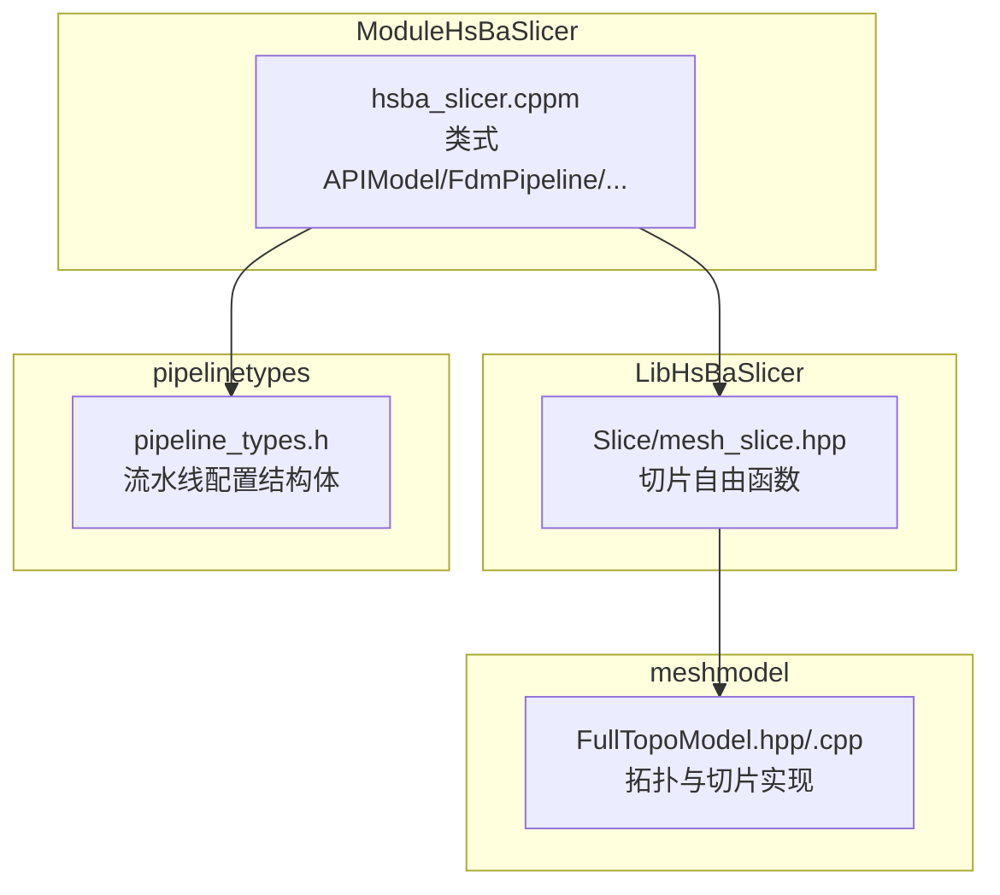
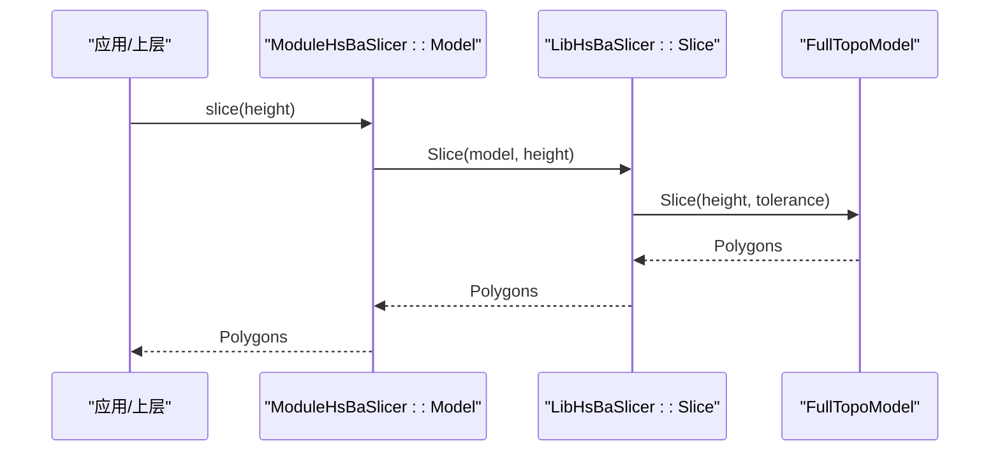
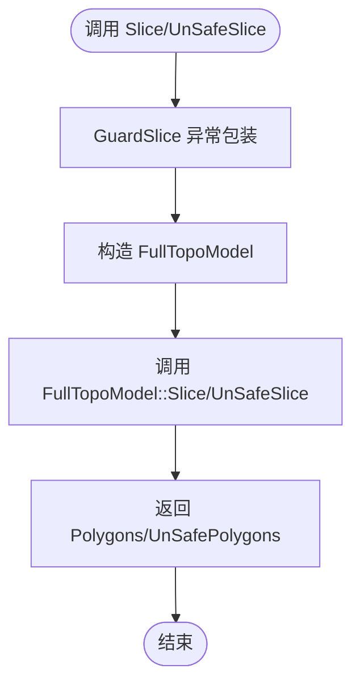
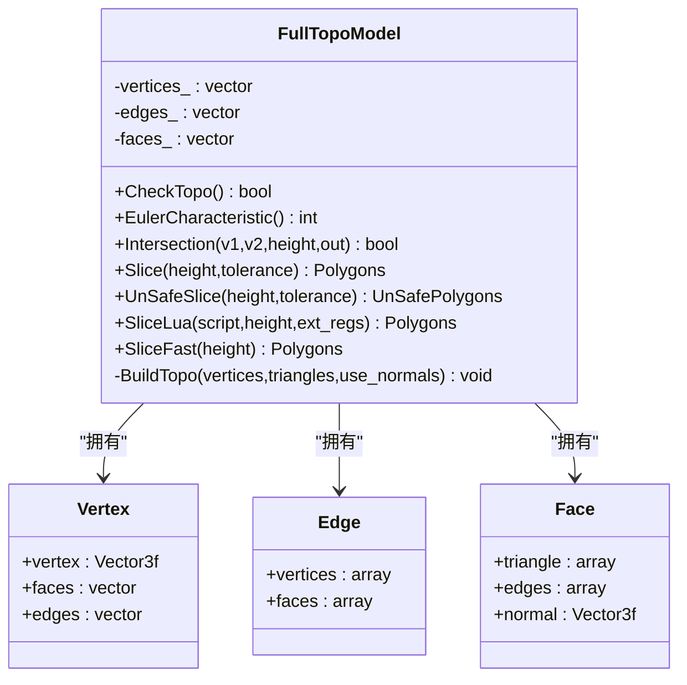
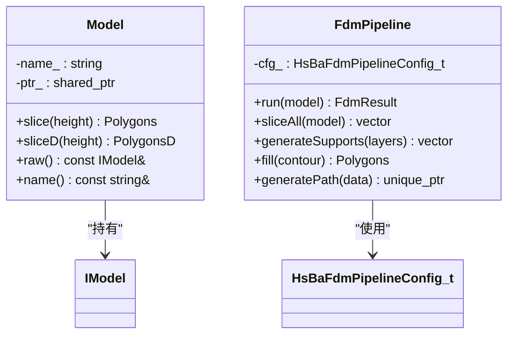
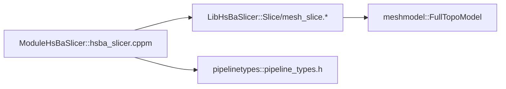

# 网格切片接口

<cite>
**本文引用的文件**   
- [mesh_slice.hpp](file://LibHsBaSlicer/Slice/mesh_slice.hpp)
- [mesh_slice.cpp](file://LibHsBaSlicer/Slice/mesh_slice.cpp)
- [FullTopoModel.hpp](file://meshmodel/FullTopoModel.hpp)
- [FullTopoModel.cpp](file://meshmodel/FullTopoModel.cpp)
- [hsba_slicer.cppm](file://ModuleHsBaSlicer/hsba_slicer.cppm)
- [pipeline_types.h](file://pipelinetypes/pipeline_types.h)
</cite>

## 目录
1. [简介](#简介)
2. [项目结构](#项目结构)
3. [核心组件](#核心组件)
4. [架构总览](#架构总览)
5. [详细组件分析](#详细组件分析)
6. [依赖关系分析](#依赖关系分析)
7. [性能与质量优化](#性能与质量优化)
8. [错误处理与调试指南](#错误处理与调试指南)
9. [结论](#结论)
10. [附录：API 参考与示例](#附录api-参考与示例)

## 简介
本文件面向 HsBaSlicer 的网格切片 C++ API，重点说明 LibHsBaSlicer 中 MeshSlicer（以 Free Functions 形式暴露）与 ModuleHsBaSlicer 提供的类式 API（C++20 module）。文档覆盖：
- 切片算法入口、参数与返回值
- 层数据访问与标准化处理
- 可复用拓扑构建与多线程安全切片
- 与底层 FullTopoModel 的交互方式
- 质量优化、边界处理与拓扑完整性检查
- 错误处理与调试技巧
- 实际调用流程与代码片段路径

## 项目结构
切片相关代码主要分布在以下模块：
- LibHsBaSlicer/Slice：对外暴露的切片自由函数（Safe/Unsafe/Lua/Topology）
- meshmodel：FullTopoModel 提供完整拓扑重建与切片实现
- ModuleHsBaSlicer：C++20 module 封装类 Model 与流水线类，内部调用 Lib 层切片函数
- pipelinetypes：各工艺流水线的配置结构体（含层高、首层高度等）

图表来源
- [mesh_slice.hpp:1-107](file://LibHsBaSlicer/Slice/mesh_slice.hpp#L1-L107)
- [FullTopoModel.hpp:1-150](file://meshmodel/FullTopoModel.hpp#L1-L150)
- [hsba_slicer.cppm:1-120](file://ModuleHsBaSlicer/hsba_slicer.cppm#L1-L120)
- [pipeline_types.h:56-113](file://pipelinetypes/pipeline_types.h#L56-L113)

章节来源
- [mesh_slice.hpp:1-107](file://LibHsBaSlicer/Slice/mesh_slice.hpp#L1-L107)
- [FullTopoModel.hpp:1-150](file://meshmodel/FullTopoModel.hpp#L1-L150)
- [hsba_slicer.cppm:1-120](file://ModuleHsBaSlicer/hsba_slicer.cppm#L1-L120)
- [pipeline_types.h:56-113](file://pipelinetypes/pipeline_types.h#L56-L113)

## 核心组件
- 切片自由函数（LibHsBaSlicer::Slicer）
  - Slice / UnSafeSlice：按 Z 平面切片，返回闭合或包含开放轮廓的多边形集合
  - SliceLua / UnSafeSliceLua：通过 Lua 脚本驱动切片
  - NormalizeUnSafePolygons：将不安全切片结果规范化为双精度多边形
  - BuildSliceTopology / SliceLayer：预构建拓扑并逐层切片，适合多层流水线
- 全拓扑模型（meshmodel::FullTopoModel）
  - 提供顶点/边/面拓扑结构，支持 CheckTopo、EulerCharacteristic、Intersection
  - 提供 Safe/Unsafe/Lua/Fast 多种切片方法
- 类式 API（ModuleHsBaSlicer::HsBa::Slicer）
  - Model：RAII 模型句柄，提供 slice/sliceD 等方法
  - FdmPipeline/SlaPipeline 等：组合切片、支撑、填充、路径生成等阶段

章节来源
- [mesh_slice.hpp:22-103](file://LibHsBaSlicer/Slice/mesh_slice.hpp#L22-L103)
- [FullTopoModel.hpp:43-145](file://meshmodel/FullTopoModel.hpp#L43-L145)
- [hsba_slicer.cppm:152-191](file://ModuleHsBaSlicer/hsba_slicer.cppm#L152-L191)

## 架构总览
切片调用链从上层类式 API 到 Lib 层自由函数，再进入 FullTopoModel 几何内核。

图表来源
- [hsba_slicer.cppm:607-612](file://ModuleHsBaSlicer/hsba_slicer.cppm#L607-L612)
- [mesh_slice.cpp:45-53](file://LibHsBaSlicer/Slice/mesh_slice.cpp#L45-L53)
- [FullTopoModel.hpp:107-114](file://meshmodel/FullTopoModel.hpp#L107-L114)

## 详细组件分析

### 切片自由函数（LibHsBaSlicer::Slicer）
- Slice(const IModel&, float height, double tolerance=0.001)
  - 功能：对模型进行 Z 轴平面切片，丢弃开放轮廓，返回闭合多边形集合
  - 实现：构造 FullTopoModel 并调用其 Slice
- UnSafeSlice(const IModel&, float height, double tolerance=0.001)
  - 功能：返回可能包含开放轮廓的切片结果
- SliceLua / UnSafeSliceLua
  - 功能：通过 Lua 脚本在顶点/边/面数据上自定义切片逻辑
- NormalizeUnSafePolygons(UnSafePolygons) -> PolygonsD
  - 功能：过滤非简单多边形与开放折线，转换为双精度坐标
- BuildSliceTopology(const IModel&) -> shared_ptr<FullTopoModel>
  - 功能：一次性构建拓扑，避免每层重复重建
- SliceLayer(const FullTopoModel&, float z, double tolerance=0.001) -> PolygonsD
  - 功能：基于预构建拓扑切片并规范化，线程安全（只读拓扑）

图表来源
- [mesh_slice.cpp:27-43](file://LibHsBaSlicer/Slice/mesh_slice.cpp#L27-L43)
- [mesh_slice.cpp:45-63](file://LibHsBaSlicer/Slice/mesh_slice.cpp#L45-L63)

章节来源
- [mesh_slice.hpp:22-103](file://LibHsBaSlicer/Slice/mesh_slice.hpp#L22-L103)
- [mesh_slice.cpp:45-115](file://LibHsBaSlicer/Slice/mesh_slice.cpp#L45-L115)

### 全拓扑模型（FullTopoModel）
- 数据结构
  - Vertex/Edge/Face：顶点、边、面拓扑关系
  - UnSafePolygon/UnSafePolygons：允许开放的轮廓集合
- 关键方法
  - CheckTopo()：检查拓扑完整性
  - EulerCharacteristic()：欧拉示性数，辅助检测孔洞
  - Intersection(v1,v2,height,out)：线段与 Z 平面的交点计算
  - Slice/UnSafeSlice/SliceLua/SliceFast：多种切片策略
- 复杂度与性能
  - 构造 FullTopoModel 会重建拓扑；后续每层切片不再重复构建
  - SliceFast 直接利用拓扑信息快速切片，但需先通过 CheckTopo

图表来源
- [FullTopoModel.hpp:53-145](file://meshmodel/FullTopoModel.hpp#L53-L145)

章节来源
- [FullTopoModel.hpp:18-145](file://meshmodel/FullTopoModel.hpp#L18-L145)
- [FullTopoModel.cpp:864-907](file://meshmodel/FullTopoModel.cpp#L864-L907)

### 类式 API（ModuleHsBaSlicer::HsBa::Slicer）
- Model
  - slice(float) -> Polygons
  - sliceD(float) -> PolygonsD
  - 内部调用 Lib 层 Slice 并进行整数/浮点转换
- FdmPipeline/SlaPipeline 等
  - 组合切片、支撑、填充、路径生成、导出等阶段
  - 使用 pipeline_types.h 中的配置结构体

图表来源
- [hsba_slicer.cppm:152-191](file://ModuleHsBaSlicer/hsba_slicer.cppm#L152-L191)
- [hsba_slicer.cppm:197-225](file://ModuleHsBaSlicer/hsba_slicer.cppm#L197-L225)
- [pipeline_types.h:56-113](file://pipelinetypes/pipeline_types.h#L56-L113)

章节来源
- [hsba_slicer.cppm:567-615](file://ModuleHsBaSlicer/hsba_slicer.cppm#L567-L615)
- [hsba_slicer.cppm:621-751](file://ModuleHsBaSlicer/hsba_slicer.cppm#L621-L751)
- [pipeline_types.h:56-113](file://pipelinetypes/pipeline_types.h#L56-L113)

## 依赖关系分析
- ModuleHsBaSlicer 依赖 LibHsBaSlicer 的切片自由函数
- LibHsBaSlicer 切片自由函数依赖 meshmodel::FullTopoModel
- 所有流水线配置来自 pipelinetypes.h

图表来源
- [hsba_slicer.cppm:50-62](file://ModuleHsBaSlicer/hsba_slicer.cppm#L50-L62)
- [mesh_slice.cpp:1-13](file://LibHsBaSlicer/Slice/mesh_slice.cpp#L1-L13)
- [FullTopoModel.hpp:1-17](file://meshmodel/FullTopoModel.hpp#L1-L17)
- [pipeline_types.h:1-12](file://pipelinetypes/pipeline_types.h#L1-L12)

章节来源
- [hsba_slicer.cppm:50-62](file://ModuleHsBaSlicer/hsba_slicer.cppm#L50-L62)
- [mesh_slice.cpp:1-13](file://LibHsBaSlicer/Slice/mesh_slice.cpp#L1-L13)
- [FullTopoModel.hpp:1-17](file://meshmodel/FullTopoModel.hpp#L1-L17)
- [pipeline_types.h:1-12](file://pipelinetypes/pipeline_types.h#L1-L12)

## 性能与质量优化
- 层高与精度
  - layer_height、first_layer_height：控制层间距与首层厚度，影响切片数量与表面质量
  - tolerance：坐标容差，用于点合并与数值稳定性
- 拓扑复用
  - 使用 BuildSliceTopology 一次构建拓扑，再用 SliceLayer 多次切片，避免 O(总面数) 的重建开销
- 快速切片
  - SliceFast 直接利用拓扑信息，但需先 CheckTopo 确保拓扑完整性
- 边界与拓扑完整性
  - CheckTopo 与 EulerCharacteristic 可用于检测不完整流形与孔洞
  - NormalizeUnSafePolygons 过滤开放折线与非简单多边形，提升下游处理稳定性
- 并行切片
  - SliceLayer 对共享拓扑只读访问，可在不同线程并发调用，各自写入独立输出容器

章节来源
- [mesh_slice.hpp:79-103](file://LibHsBaSlicer/Slice/mesh_slice.hpp#L79-L103)
- [FullTopoModel.hpp:80-114](file://meshmodel/FullTopoModel.hpp#L80-L114)
- [FullTopoModel.cpp:875-907](file://meshmodel/FullTopoModel.cpp#L875-L907)

## 错误处理与调试指南
- 异常包装
  - GuardSlice 将 CGAL/OCCT 等第三方异常统一转换为 IOError，避免跨 ABI 边界传播
- 常见错误
  - 拓扑不完整：调用 SliceFast 前必须 CheckTopo，否则抛出 RuntimeError
  - 无效输入：Open 轮廓或非简单多边形会被 NormalizeUnSafePolygons 过滤
- 调试建议
  - 打印 EulerCharacteristic 与 CheckTopo 结果，定位拓扑问题
  - 使用 UnSafeSlice 获取开放轮廓，结合 NormalizeUnSafePolygons 观察过滤前后差异
  - 在 Lua 切片脚本中逐步验证 V/E/F 与 height 数据

章节来源
- [mesh_slice.cpp:18-43](file://LibHsBaSlicer/Slice/mesh_slice.cpp#L18-L43)
- [FullTopoModel.cpp:875-880](file://meshmodel/FullTopoModel.cpp#L875-L880)
- [mesh_slice.cpp:85-103](file://LibHsBaSlicer/Slice/mesh_slice.cpp#L85-L103)

## 结论
HsBaSlicer 的网格切片 API 提供了从高层类式接口到低层几何内核的完整链路。通过 Safe/Unsafe/Lua/Fast 多种切片模式、可复用拓扑构建与严格的异常包装，既保证了易用性与扩展性，也兼顾了性能与健壮性。在实际工程中，推荐优先使用 BuildSliceTopology + SliceLayer 的组合进行多层切片，并结合 CheckTopo 与 NormalizeUnSafePolygons 保证拓扑与边界质量。

## 附录：API 参考与示例

### 切片参数与配置
- 层高与首层高度
  - FDM：layer_height、first_layer_height
  - SLA：layer_height、first_layer_height
- 填充与支撑
  - fill_spacing、fill_mode、wall_count、infill_density
  - enable_support、overhang_angle、support_gap、support_diameter、support_density、support_pattern
- 路径与输出
  - line_width、print_speed、travel_speed、extrusion_multiplier
  - gcode_firmware、nozzle_diameter、filament_diameter、nozzle_temp、bed_temp、retract_length、retract_speed、first_layer_speed

章节来源
- [pipeline_types.h:56-113](file://pipelinetypes/pipeline_types.h#L56-L113)
- [pipeline_types.h:170-218](file://pipelinetypes/pipeline_types.h#L170-L218)

### 切片方法速查
- 自由函数
  - Slice(model, height, tolerance)
  - UnSafeSlice(model, height, tolerance)
  - SliceLua(model, script, height)
  - UnSafeSliceLua(model, script, height)
  - NormalizeUnSafePolygons(unsafe_polys)
  - BuildSliceTopology(model)
  - SliceLayer(topo, z, tolerance)
- 类式 API
  - Model::slice(height)
  - Model::sliceD(height)

章节来源
- [mesh_slice.hpp:22-103](file://LibHsBaSlicer/Slice/mesh_slice.hpp#L22-L103)
- [hsba_slicer.cppm:607-612](file://ModuleHsBaSlicer/hsba_slicer.cppm#L607-L612)

### 调用流程示例（路径引用）
- 通过类式 API 进行单层切片
  - [hsba_slicer.cppm:607-612](file://ModuleHsBaSlicer/hsba_slicer.cppm#L607-L612)
- 通过自由函数进行 Safe/Unsafe 切片
  - [mesh_slice.cpp:45-63](file://LibHsBaSlicer/Slice/mesh_slice.cpp#L45-L63)
- 预构建拓扑并逐层切片
  - [mesh_slice.cpp:105-115](file://LibHsBaSlicer/Slice/mesh_slice.cpp#L105-L115)
- FDM 流水线切片阶段
  - [hsba_slicer.cppm:623-638](file://ModuleHsBaSlicer/hsba_slicer.cppm#L623-L638)