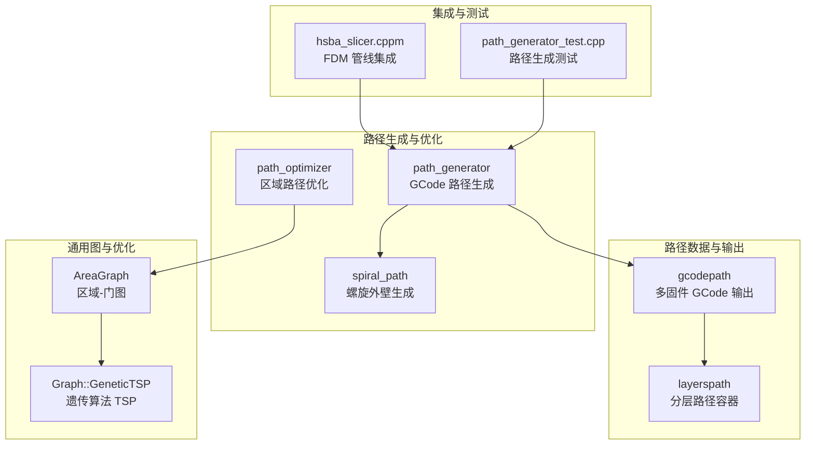
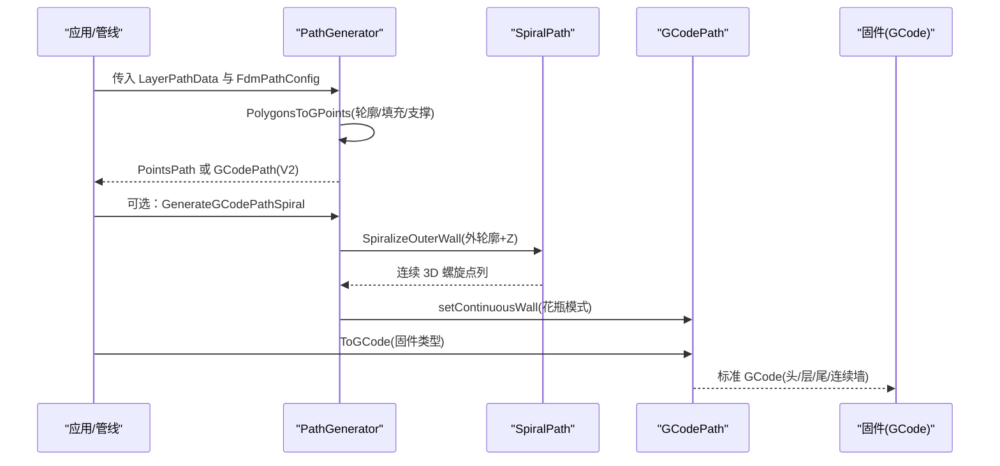
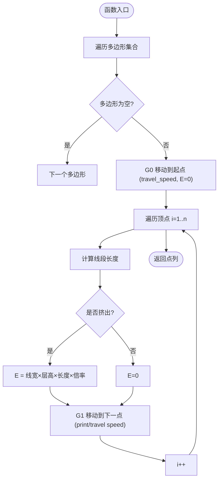
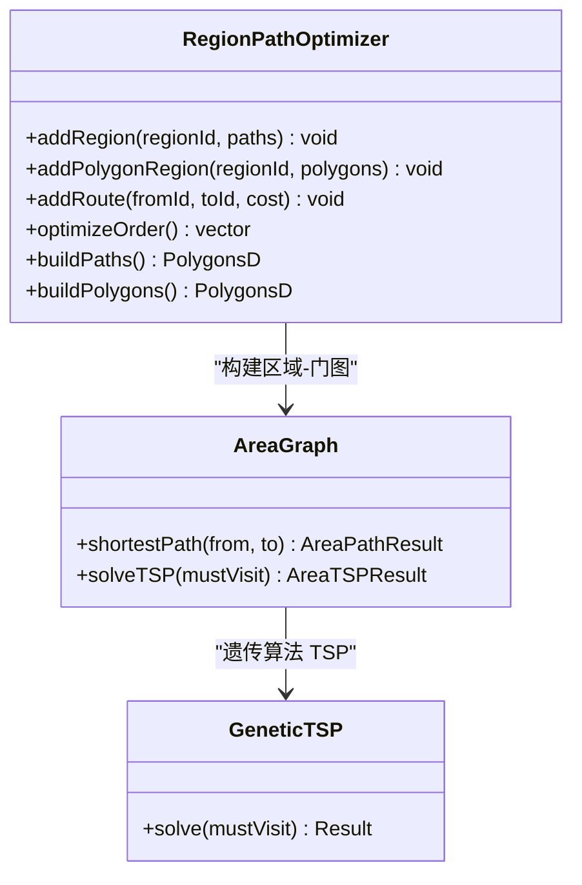
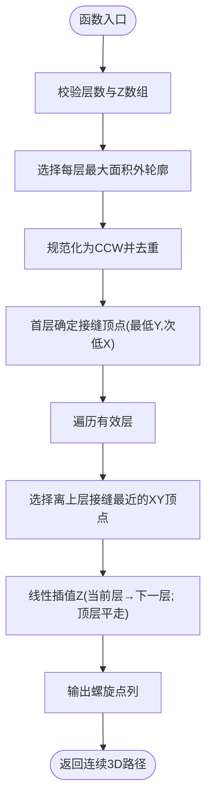
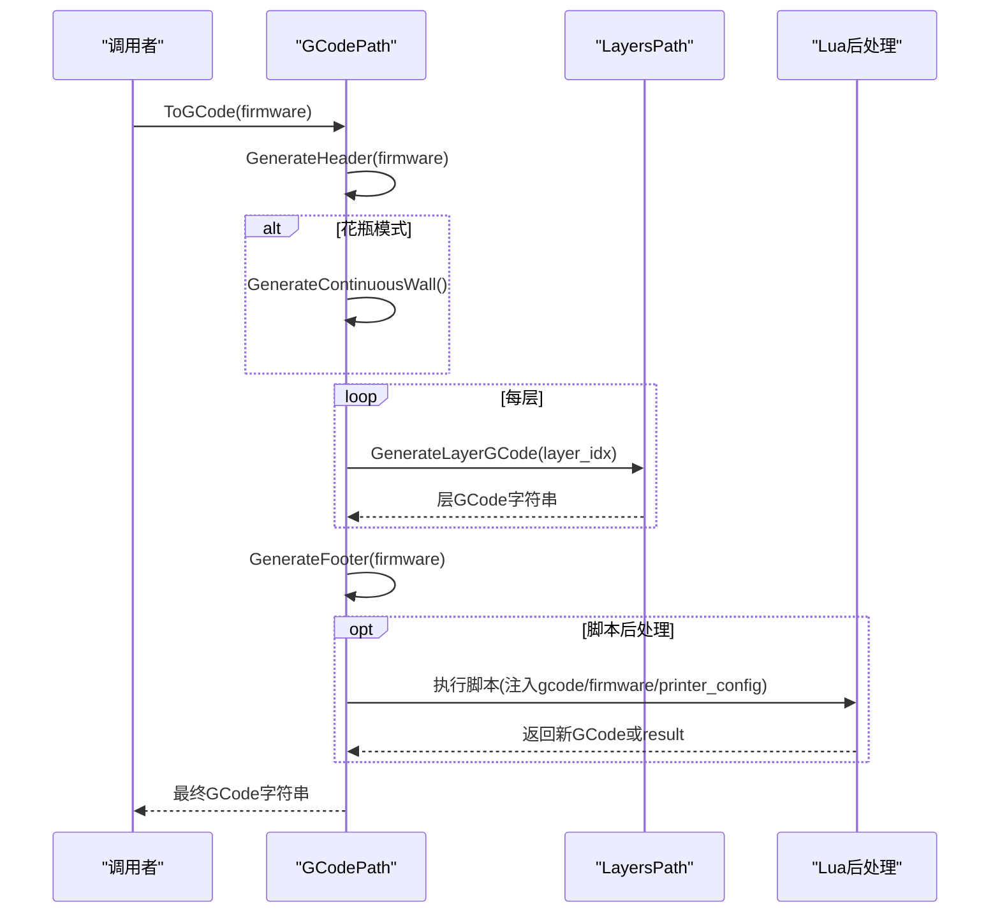
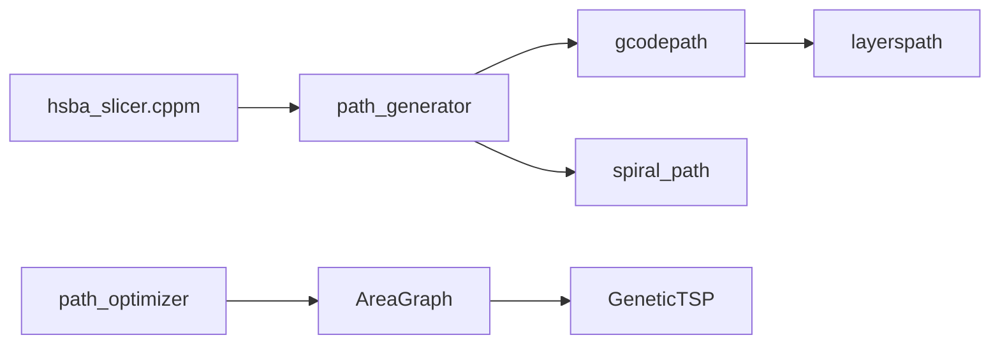

# 路径规划接口

<cite>
**本文引用的文件**   
- [path_generator.hpp](file://LibHsBaSlicer/Path/path_generator.hpp)
- [path_generator.cpp](file://LibHsBaSlicer/Path/path_generator.cpp)
- [path_optimizer.hpp](file://LibHsBaSlicer/Path/path_optimizer.hpp)
- [path_optimizer.cpp](file://LibHsBaSlicer/Path/path_optimizer.cpp)
- [spiral_path.hpp](file://LibHsBaSlicer/Path/spiral_path.hpp)
- [spiral_path.cpp](file://LibHsBaSlicer/Path/spiral_path.cpp)
- [gcodepath.hpp](file://paths/gcodepath.hpp)
- [gcodepath.cpp](file://paths/gcodepath.cpp)
- [layerspath.hpp](file://paths/layerspath.hpp)
- [AreaGraph.hpp](file://utils/AreaGraph.hpp)
- [Graph.hpp](file://utils/Graph.hpp)
- [hsba_slicer.cppm](file://ModuleHsBaSlicer/hsba_slicer.cppm)
- [README.md](file://docs/en/LibHsBaSlicer/README.md)
- [path_generator_test.cpp](file://tests/PathsOut/path_generator_test.cpp)
</cite>

## 目录
1. [简介](#简介)
2. [项目结构](#项目结构)
3. [核心组件](#核心组件)
4. [架构总览](#架构总览)
5. [详细组件分析](#详细组件分析)
6. [依赖关系分析](#依赖关系分析)
7. [性能与质量评估](#性能与质量评估)
8. [故障排查指南](#故障排查指南)
9. [结论](#结论)
10. [附录：使用示例与最佳实践](#附录使用示例与最佳实践)

## 简介
本文件面向 HsBaSlicer 的路径规划 C++ API，重点说明以下能力：
- 基于分层轮廓的 GCode 路径生成（轮廓、填充、支撑）
- 多固件格式输出（Marlin、RepRap/RRF、Klipper）
- 连续螺旋外壁（花瓶模式）路径生成
- 区域级路径连接优化（遗传算法 TSP + 最近邻内区排序）
- 速度规划、挤出量计算、回退策略与运动学约束处理
- 路径数据结构定义、配置项与输出格式选项
- 路径平滑、拐角处理与回退策略
- 与不同固件格式的适配和路径指令生成
- 路径质量评估指标与性能优化技巧

该文档既适合初学者快速上手，也适合需要深入理解实现细节的开发者。

## 项目结构
路径规划相关代码主要分布在以下模块：
- LibHsBaSlicer/Path：路径生成与优化核心 API
- paths：路径数据模型与 GCode 输出
- utils：通用图结构与遗传算法求解器
- ModuleHsBaSlicer：管道集成示例（FDM 管线调用路径生成）
- tests：路径生成与输出的单元测试

图表来源
- [path_generator.hpp:1-96](file://LibHsBaSlicer/Path/path_generator.hpp#L1-L96)
- [path_optimizer.hpp:1-191](file://LibHsBaSlicer/Path/path_optimizer.hpp#L1-L191)
- [spiral_path.hpp:1-63](file://LibHsBaSlicer/Path/spiral_path.hpp#L1-L63)
- [gcodepath.hpp:1-112](file://paths/gcodepath.hpp#L1-L112)
- [layerspath.hpp:1-64](file://paths/layerspath.hpp#L1-L64)
- [AreaGraph.hpp:1-350](file://utils/AreaGraph.hpp#L1-L350)
- [Graph.hpp:860-1059](file://utils/Graph.hpp#L860-L1059)
- [hsba_slicer.cppm:695-734](file://ModuleHsBaSlicer/hsba_slicer.cppm#L695-L734)
- [path_generator_test.cpp:72-121](file://tests/PathsOut/path_generator_test.cpp#L72-L121)

章节来源
- [path_generator.hpp:1-96](file://LibHsBaSlicer/Path/path_generator.hpp#L1-L96)
- [gcodepath.hpp:1-112](file://paths/gcodepath.hpp#L1-L112)
- [layerspath.hpp:1-64](file://paths/layerspath.hpp#L1-L64)
- [AreaGraph.hpp:1-350](file://utils/AreaGraph.hpp#L1-L350)
- [Graph.hpp:860-1059](file://utils/Graph.hpp#L860-L1059)

## 核心组件
- FdmPathConfig：FDM 路径生成配置（层高、线宽、打印速度、移动速度、挤出倍率、单位）
- LayerPathData：单层路径数据（轮廓、填充、支撑、Z 高度）
- PolygonsToGPoints：将二维多边形序列转换为 GPoint 点列（含 G0/G1、速度与挤出）
- GenerateGCodePath / GenerateGCodePathV2：从分层数据生成 PointsPath 或 GCodePath
- GenerateGCodePathSpiral：生成连续螺旋外壁（花瓶模式）
- RegionPathOptimizer：区域级路径连接优化（TSP + 最近邻）
- SpiralizeOuterWall：从每层外轮廓生成连续 3D 螺旋路径
- GCodePath：多固件 GCode 输出（头尾、层段、连续墙、Lua 后处理）
- LayersPath：分层路径容器（保存每层配置与多边形集合）

章节来源
- [path_generator.hpp:23-91](file://LibHsBaSlicer/Path/path_generator.hpp#L23-L91)
- [path_generator.cpp:14-139](file://LibHsBaSlicer/Path/path_generator.cpp#L14-L139)
- [path_optimizer.hpp:23-100](file://LibHsBaSlicer/Path/path_optimizer.hpp#L23-L100)
- [spiral_path.hpp:16-58](file://LibHsBaSlicer/Path/spiral_path.hpp#L16-L58)
- [gcodepath.hpp:24-107](file://paths/gcodepath.hpp#L24-L107)
- [layerspath.hpp:17-60](file://paths/layerspath.hpp#L17-L60)

## 架构总览
路径生成的整体流程如下：
- 输入：切片后的分层轮廓（outlines）、填充（fills）、支撑（supports），以及层高 Z
- 生成：
  - 基础路径：PolygonsToGPoints 将多边形转为 GPoint，按顺序拼接为 PointsPath
  - V2 路径：GenerateGCodePathV2 将分层数据写入 GCodePath，并附带打印机配置
  - 花瓶模式：GenerateGCodePathSpiral 通过 SpiralizeOuterWall 生成连续 3D 螺旋外壁
- 优化：RegionPathOptimizer 对独立区域进行访问顺序优化（TSP），并对区域内路径方向进行贪心排列
- 输出：GCodePath.ToGCode 根据目标固件生成标准 GCode（Marlin/RepRap/Klipper），支持相对/绝对挤出、回退、首层速度等

图表来源
- [path_generator.cpp:61-139](file://LibHsBaSlicer/Path/path_generator.cpp#L61-L139)
- [spiral_path.cpp:88-167](file://LibHsBaSlicer/Path/spiral_path.cpp#L88-L167)
- [gcodepath.cpp:310-327](file://paths/gcodepath.cpp#L310-L327)

## 详细组件分析

### PathGenerator：GCode 路径生成
- 功能要点
  - PolygonsToGPoints：遍历每个多边形，首点用 G0 移动到起点，后续点用 G1 逐段绘制；挤出模式下按线段长度计算挤出量 E = 线宽 × 层高 × 线段长度 × 挤出倍率
  - GenerateGCodePath：将每层的 outlines/fills/supports 依次转换为 GPoint 并追加到 PointsPath
  - GenerateGCodePathV2：将每层组合多边形写入 GCodePath，并在层配置中编码 Z 高度
  - GenerateGCodePathSpiral：调用 SpiralizeOuterWall 生成连续 3D 螺旋外壁，设置到 GCodePath 中用于花瓶模式

- 关键数据结构
  - FdmPathConfig：包含层高、线宽、打印速度、移动速度、挤出倍率、单位
  - LayerPathData：包含 outlines、fills、supports、z_height

- 速度与挤出
  - 移动速度：travel_speed（G0）
  - 打印速度：print_speed（G1）
  - 挤出量：E = line_width × layer_height × segment_length × extrusion_multiplier

- 错误与边界
  - 空多边形跳过
  - 非挤出模式时 E=0

章节来源
- [path_generator.hpp:23-91](file://LibHsBaSlicer/Path/path_generator.hpp#L23-L91)
- [path_generator.cpp:14-139](file://LibHsBaSlicer/Path/path_generator.cpp#L14-L139)

#### 流程图：PolygonsToGPoints

图表来源
- [path_generator.cpp:14-59](file://LibHsBaSlicer/Path/path_generator.cpp#L14-L59)

### RegionPathOptimizer：区域路径连接优化
- 功能要点
  - 将每个独立区域建模为 AreaGraph 的一个“区域”节点，区域内的端点作为“门”（gate）
  - 区域间路由成本为直线距离（空中移动），区域内门到门成本也为直线距离
  - 区域访问顺序通过遗传算法 TSP 求解；区域内路径方向通过最近邻贪心排列
  - 提供两种模式：
    - 填充结果模式（addRegion）：区域是多点折线集合，端点作为门
    - 多边形模式（addPolygonRegion）：区域是多边形集合，所有顶点作为门

- 关键方法
  - addRegion / addPolygonRegion：添加区域
  - addRoute：手动指定对称空中移动成本
  - optimizeOrder：求解区域访问顺序（TSP）
  - buildPaths / buildPolygons：输出优化后的完整路径或多边形集合

- 复杂度与行为
  - 当区域数 < 2 时保持插入顺序
  - 当 TSP 失败时回退为插入顺序
  - 两区域时直接比较两个方向的最短路

章节来源
- [path_optimizer.hpp:23-100](file://LibHsBaSlicer/Path/path_optimizer.hpp#L23-L100)
- [path_optimizer.cpp:42-158](file://LibHsBaSlicer/Path/path_optimizer.cpp#L42-L158)
- [AreaGraph.hpp:197-345](file://utils/AreaGraph.hpp#L197-L345)
- [Graph.hpp:876-1059](file://utils/Graph.hpp#L876-L1059)

#### 类图：RegionPathOptimizer 与 AreaGraph

图表来源
- [path_optimizer.hpp:44-100](file://LibHsBaSlicer/Path/path_optimizer.hpp#L44-L100)
- [AreaGraph.hpp:95-345](file://utils/AreaGraph.hpp#L95-L345)
- [Graph.hpp:876-1059](file://utils/Graph.hpp#L876-L1059)

### SpiralPath：连续螺旋外壁（花瓶模式）
- 功能要点
  - 选择每层最外层闭合轮廓（最大绝对有符号面积）
  - 规范化轮廓为逆时针（CCW）并去除重复闭合点
  - 固定接缝（seam）：首层采用最低 Y（次低 X）的顶点；后续层选择 XY 上离上一层接缝最近的顶点
  - 沿轮廓遍历，线性插值 Z 从当前层高到下一层高；顶层平走
  - 输出连续 3D 螺旋点列，无回退、无层间跳跃

- 关键数据结构
  - SpiralPoint：x/y/z 三维点

- 适用场景
  - 均匀截面柱体/棱柱的外壁连续打印，提升表面质量和强度

章节来源
- [spiral_path.hpp:16-58](file://LibHsBaSlicer/Path/spiral_path.hpp#L16-L58)
- [spiral_path.cpp:16-167](file://LibHsBaSlicer/Path/spiral_path.cpp#L16-L167)

#### 流程图：SpiralizeOuterWall

图表来源
- [spiral_path.cpp:88-167](file://LibHsBaSlicer/Path/spiral_path.cpp#L88-L167)

### GCodePath：多固件 GCode 输出
- 功能要点
  - 继承 LayersPath，存储分层多边形与配置
  - ToGCode(firmware)：生成标准 GCode（头/层/尾），支持 Marlin/RepRap/Klipper
  - SaveGCode：保存到文件
  - ToGCode(firmware, script, lua_reg)：Lua 后处理脚本，可修改最终 GCode
  - setContinuousWall：设置连续螺旋外壁（花瓶模式），在 ToGCode 中优先输出
  - 挤出计算：CalcExtrusion 基于线宽、层高、线段长度与耗材直径计算 E 值
  - 回退策略：层间移动前执行回退（retract），启用时根据相对/绝对挤出模式输出相应 E 指令
  - 首层速度：first_layer_speed 仅应用于第一层

- 关键数据结构
  - GCodePrinterConfig：喷嘴直径、耗材直径、温度、回退参数、速度、层高、线宽、挤出模式等
  - PathPoint3D：连续螺旋外壁的点（x/y/z）

- 固件差异
  - Marlin：M104/M109、M82/M83、G92 E0
  - RepRap：额外 M106 风扇控制
  - Klipper：SET_PRESSURE_ADVANCE、M220/M221、SET_FAN_SPEED

章节来源
- [gcodepath.hpp:24-107](file://paths/gcodepath.hpp#L24-L107)
- [gcodepath.cpp:53-425](file://paths/gcodepath.cpp#L53-L425)

#### 序列图：GCodePath.ToGCode 输出流程

图表来源
- [gcodepath.cpp:65-425](file://paths/gcodepath.cpp#L65-L425)

### 与 FDM 管线的集成
- hsba_slicer.cppm 展示了如何将切片、支撑、填充结果组装为 LayerPathData，并调用 GenerateGCodePathV2 生成 GCodePath
- 典型步骤：
  - 切片得到每层轮廓
  - 转换为 double 精度以生成支撑
  - 生成支撑并合并到 LayerPathData
  - 调用 GenerateGCodePathV2 输出多固件 GCode

章节来源
- [hsba_slicer.cppm:695-734](file://ModuleHsBaSlicer/hsba_slicer.cppm#L695-L734)

## 依赖关系分析
- PathGenerator 依赖：
  - 2D 多边形类型（FloatPolygons/IntPolygon）
  - 路径数据类型（PointsPath/GCodePath）
  - 螺旋路径（SpiralizeOuterWall）
- RegionPathOptimizer 依赖：
  - AreaGraph（区域-门图）
  - GeneticTSP（遗传算法 TSP）
- GCodePath 依赖：
  - LayersPath（分层路径容器）
  - Lua（可选后处理）
  - 标准库（格式化、文件 IO）

图表来源
- [path_generator.cpp:1-139](file://LibHsBaSlicer/Path/path_generator.cpp#L1-L139)
- [path_optimizer.cpp:42-158](file://LibHsBaSlicer/Path/path_optimizer.cpp#L42-L158)
- [gcodepath.cpp:1-425](file://paths/gcodepath.cpp#L1-L425)
- [hsba_slicer.cppm:695-734](file://ModuleHsBaSlicer/hsba_slicer.cppm#L695-L734)

## 性能与质量评估
- 路径生成性能
  - PolygonsToGPoints 的时间复杂度约为 O(N×V)，N 为多边形数量，V 为多边形顶点数
  - 挤出量计算为常数时间 per 线段
- 区域优化性能
  - AreaGraph.shortestPath 使用 Dijkstra 或类似最短路径算法（内部实现由 Graph 提供）
  - solveTSP 使用遗传算法，默认种群大小 150、最大代数 500，可通过参数调整
  - 当区域数较少（如 2）时直接比较两个方向，避免无意义的 GA
- 质量评估指标
  - 空中移动总距离（air-move cost）：越小越好
  - 回退次数：越少通常越稳定
  - 连续外壁长度与连续性：花瓶模式下应无回退
  - 挤出稳定性：E 值变化平滑，避免突变
- 优化建议
  - 合理设置 line_width、layer_height、extrusion_multiplier 以获得稳定的挤出
  - 对复杂模型先进行区域优化（RegionPathOptimizer），减少跨区移动
  - 对于花瓶模式，确保每层存在有效外轮廓且接缝对齐良好

[本节为通用指导，不直接分析具体文件]

## 故障排查指南
- 常见问题
  - 空多边形导致无输出：检查 LayerPathData 中的 outlines/fills/supports 是否为空
  - 花瓶模式无连续墙：确认每层至少有一个有效闭合外轮廓，且 Z 数组与轮廓数量一致
  - GCode 输出异常：检查 GCodePrinterConfig 参数（如 relative_extrusion、enable_retraction）
  - TSP 失败回退：当区域不可达或图不完整时，optimizeOrder 会回退为插入顺序
- 调试手段
  - 使用 ToString/Save 输出中间结果（LayersPath/GCodePath）
  - 启用 Lua 后处理脚本，检查 gcode/firmware/printer_config 变量
  - 查看单元测试覆盖路径生成与花瓶模式的行为

章节来源
- [gcodepath.cpp:329-338](file://paths/gcodepath.cpp#L329-L338)
- [path_generator_test.cpp:72-121](file://tests/PathsOut/path_generator_test.cpp#L72-L121)

## 结论
HsBaSlicer 的路径规划接口提供了从分层轮廓到多固件 GCode 的完整链路，涵盖：
- 基础路径生成（轮廓/填充/支撑）
- 连续螺旋外壁（花瓶模式）
- 区域级路径连接优化（遗传算法 TSP）
- 多固件适配（Marlin/RepRap/Klipper）
- 速度规划、挤出计算、回退策略
- Lua 扩展与后处理

这些组件共同构成了一个可扩展、高性能且易于集成的路径规划系统。

[本节为总结性内容，不直接分析具体文件]

## 附录：使用示例与最佳实践

### 示例一：生成优化的打印路径（V2）
- 步骤
  - 准备 LayerPathData（每层的 outlines/fills/supports 与 z_height）
  - 配置 FdmPathConfig（层高、线宽、速度、挤出倍率）
  - 配置 GCodePrinterConfig（喷嘴/耗材/温度/回退/速度等）
  - 调用 GenerateGCodePathV2 生成 GCodePath
  - 使用 ToGCode 或 SaveGCode 输出多固件 GCode

参考文档
- [README.md:380-413](file://docs/en/LibHsBaSlicer/README.md#L380-L413)

章节来源
- [README.md:380-413](file://docs/en/LibHsBaSlicer/README.md#L380-L413)
- [path_generator.cpp:95-116](file://LibHsBaSlicer/Path/path_generator.cpp#L95-L116)
- [gcodepath.cpp:310-338](file://paths/gcodepath.cpp#L310-L338)

### 示例二：花瓶模式（连续螺旋外壁）
- 步骤
  - 准备每层外轮廓（PolygonsD）与对应 Z 高度（vector<double>）
  - 调用 GenerateGCodePathSpiral 生成 GCodePath
  - 使用 ToGCode 输出连续螺旋外壁的 GCode

章节来源
- [path_generator.cpp:118-139](file://LibHsBaSlicer/Path/path_generator.cpp#L118-L139)
- [spiral_path.cpp:88-167](file://LibHsBaSlicer/Path/spiral_path.cpp#L88-L167)
- [gcodepath.cpp:271-308](file://paths/gcodepath.cpp#L271-L308)

### 示例三：区域路径连接优化
- 步骤
  - 创建 RegionPathOptimizer
  - 添加区域（addRegion 或 addPolygonRegion）
  - 可选：addRoute 手动指定区域间成本
  - 调用 optimizeOrder 求解访问顺序
  - 调用 buildPaths 或 buildPolygons 输出优化结果

章节来源
- [path_optimizer.hpp:44-100](file://LibHsBaSlicer/Path/path_optimizer.hpp#L44-L100)
- [path_optimizer.cpp:118-158](file://LibHsBaSlicer/Path/path_optimizer.cpp#L118-L158)
- [AreaGraph.hpp:267-345](file://utils/AreaGraph.hpp#L267-L345)

### 最佳实践
- 参数调优
  - 合理设置 line_width 与 layer_height，保证挤出体积稳定
  - 根据材料特性调整 extrusion_multiplier
  - 针对首层降低 print_speed 以提升附着力
- 路径质量
  - 使用 RegionPathOptimizer 减少跨区移动
  - 花瓶模式确保外轮廓闭合且接缝对齐
- 性能优化
  - 控制遗传算法参数（popSize、maxGen）平衡质量与耗时
  - 避免过多小区域，必要时合并相邻区域

[本节为通用指导，不直接分析具体文件]