# C++ API

<cite>
**本文引用的文件**   
- [export.h](file://LibHsBaSlicer/export.h)
- [IModel.hpp](file://base/IModel.hpp)
- [FloatPolygons.hpp](file://2D/FloatPolygons.hpp)
- [IntPolygon.hpp](file://2D/IntPolygon.hpp)
- [model_preprocess.hpp](file://LibHsBaSlicer/Preprocess/model_preprocess.hpp)
- [mesh_slice.hpp](file://LibHsBaSlicer/Slice/mesh_slice.hpp)
- [polygon_fill.hpp](file://LibHsBaSlicer/Fill/polygon_fill.hpp)
- [path_generator.hpp](file://LibHsBaSlicer/Path/path_generator.hpp)
- [path_optimizer.hpp](file://LibHsBaSlicer/Path/path_optimizer.hpp)
- [spiral_path.hpp](file://LibHsBaSlicer/Path/spiral_path.hpp)
- [gcodepath.hpp](file://paths/gcodepath.hpp)
- [fdm_support.hpp](file://LibHsBaSlicer/Support/fdm_support.hpp)
- [sla_floor.hpp](file://LibHsBaSlicer/Floor/sla_floor.hpp)
- [sls_export.hpp](file://LibHsBaSlicer/Path/sls_export.hpp)
- [waam_export.hpp](file://LibHsBaSlicer/Path/waam_export.hpp)
- [lua_pipeline.hpp](file://LibHsBaSlicer/Extends/lua_pipeline.hpp)
- [file_transfer.hpp](file://LibHsBaSlicer/Transfer/file_transfer.hpp)
</cite>

## 目录
1. [简介](#简介)
2. [项目结构](#项目结构)
3. [核心组件](#核心组件)
4. [架构总览](#架构总览)
5. [详细组件分析](#详细组件分析)
6. [依赖关系分析](#依赖关系分析)
7. [性能与线程安全](#性能与线程安全)
8. [故障排除指南](#故障排除指南)
9. [结论](#结论)
10. [附录：常用数据结构与配置项](#附录常用数据结构与配置项)

## 简介
本参考文档面向 HsBaSlicer 的 C++ API，聚焦 LibHsBaSlicer 对外暴露的核心能力：模型预处理、网格切片、填充算法、路径生成、支撑/底板生成、多工艺导出（SLA/SLS/WAAM）、Lua 自定义流水线以及文件传输。文档按功能模块组织，提供接口职责、参数说明、异常与资源管理要点、线程安全保证、性能建议与最佳实践，并给出可复用的对象生命周期与错误处理模式示例。

## 项目结构
LibHsBaSlicer 将几何、切片、填充、路径、支撑、导出与 Lua 扩展解耦为独立头文件；基础类型与导出宏位于 base 与 export 层；2D 几何在 2D 子目录中提供整数与双精度多边形类型及布尔/偏移/面积等运算。

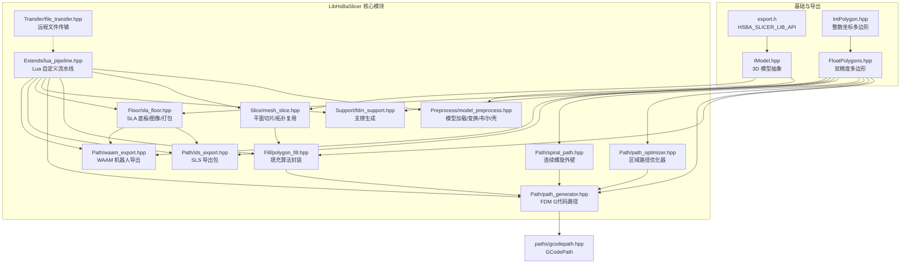

**图示来源**
- [export.h:1-22](file://LibHsBaSlicer/export.h#L1-L22)
- [IModel.hpp:111-139](file://base/IModel.hpp#L111-L139)
- [IntPolygon.hpp:16-26](file://2D/IntPolygon.hpp#L16-L26)
- [FloatPolygons.hpp:18-25](file://2D/FloatPolygons.hpp#L18-L25)
- [model_preprocess.hpp:20-120](file://LibHsBaSlicer/Preprocess/model_preprocess.hpp#L20-L120)
- [mesh_slice.hpp:18-103](file://LibHsBaSlicer/Slice/mesh_slice.hpp#L18-L103)
- [polygon_fill.hpp:15-53](file://LibHsBaSlicer/Fill/polygon_fill.hpp#L15-L53)
- [path_generator.hpp:18-91](file://LibHsBaSlicer/Path/path_generator.hpp#L18-L91)
- [path_optimizer.hpp:21-100](file://LibHsBaSlicer/Path/path_optimizer.hpp#L21-L100)
- [spiral_path.hpp:14-58](file://LibHsBaSlicer/Path/spiral_path.hpp#L14-L58)
- [gcodepath.hpp:24-107](file://paths/gcodepath.hpp#L24-L107)
- [fdm_support.hpp:17-67](file://LibHsBaSlicer/Support/fdm_support.hpp#L17-L67)
- [sla_floor.hpp:19-195](file://LibHsBaSlicer/Floor/sla_floor.hpp#L19-L195)
- [sls_export.hpp:15-56](file://LibHsBaSlicer/Path/sls_export.hpp#L15-L56)
- [waam_export.hpp:15-72](file://LibHsBaSlicer/Path/waam_export.hpp#L15-L72)
- [lua_pipeline.hpp:17-83](file://LibHsBaSlicer/Extends/lua_pipeline.hpp#L17-L83)
- [file_transfer.hpp:17-60](file://LibHsBaSlicer/Transfer/file_transfer.hpp#L17-L60)

**章节来源**
- [export.h:1-22](file://LibHsBaSlicer/export.h#L1-L22)
- [IModel.hpp:111-139](file://base/IModel.hpp#L111-L139)
- [IntPolygon.hpp:16-26](file://2D/IntPolygon.hpp#L16-L26)
- [FloatPolygons.hpp:18-25](file://2D/FloatPolygons.hpp#L18-L25)

## 核心组件
本节概述各模块的职责边界与公共入口函数，便于快速定位所需 API。

- 模型预处理（Preprocess）
  - 负责模型加载、命名池管理、平移/旋转/缩放、信息查询、布尔运算与厚壳操作。
  - 关键函数：LoadModel、GetModel、TranslateModel/RotateModel/ScaleModel、GetModelInfo、RemoveModel、InsertModel、ContainsModel、ModelCount、CleanupModels、BooleanUnion/Difference/Intersection/Xor、ThickSolidModel。
- 网格切片（Slice）
  - 提供安全切片（仅闭合轮廓）、不安全切片（含开放轮廓）、Lua 驱动切片、拓扑复用 BuildSliceTopology + SliceLayer。
  - 关键函数：Slice、UnSafeSlice、SliceLua、UnSafeSliceLua、NormalizeUnSafePolygons、BuildSliceTopology、SliceLayer。
- 填充系统（Fill）
  - 对多边形进行线型/之字形/边框+填充/Lua 自定义填充。
  - 关键函数：FillPolygon、FillWithBorder、LuaCustomFillByFile。
- 路径生成（Path）
  - FDM G代码路径生成、V2 多固件输出、螺旋花瓶模式、PolygonsD 到 GPoint 转换。
  - 关键函数：GenerateGCodePath、GenerateGCodePathV2、GenerateGCodePathSpiral、PolygonsToGPoints。
  - 螺旋外壁：SpiralizeOuterWall。
  - 区域路径优化：RegionPathOptimizer 类及其 addRegion/addPolygonRegion/optimizeOrder/buildPaths/buildPolygons。
- 支撑与底板（Support / Floor）
  - FDM/SLA 支撑生成、SLA 底板/边框/填充、Lua 自定义底板、SLA 图像渲染与打包。
  - 关键函数：GenerateFdmSupport、GenerateAllFdmSupport、GenerateAllSlaSupport、GenerateAllLuaSupport、GenerateFloorContact/Raft/Border/Fill、LuaCustomFloorByFile/String、RenderPolygonsToImage/Buffer、SaveSlaPackage/Lua。
- 导出（SLS / WAAM）
  - SLS 导出包与 Lua 驱动导出；WAAM 机器人程序导出（ABB/KUKA/FANUC）。
  - 关键函数：SaveSlsPackageLua、SaveWaamRobotPath。
- Lua 自定义流水线（Extends）
  - 完全由 Lua 编排的流水线上下文与运行入口。
  - 关键函数：SetupLuaPipelineEnvironment、RunLuaPipeline。
- 文件传输（Transfer）
  - 远程执行服务文件传输配置、结果与进度回调。
  - 关键函数：TransferFiles。

**章节来源**
- [model_preprocess.hpp:20-187](file://LibHsBaSlicer/Preprocess/model_preprocess.hpp#L20-L187)
- [mesh_slice.hpp:18-103](file://LibHsBaSlicer/Slice/mesh_slice.hpp#L18-L103)
- [polygon_fill.hpp:15-53](file://LibHsBaSlicer/Fill/polygon_fill.hpp#L15-L53)
- [path_generator.hpp:18-91](file://LibHsBaSlicer/Path/path_generator.hpp#L18-L91)
- [path_optimizer.hpp:21-186](file://LibHsBaSlicer/Path/path_optimizer.hpp#L21-L186)
- [spiral_path.hpp:14-58](file://LibHsBaSlicer/Path/spiral_path.hpp#L14-L58)
- [fdm_support.hpp:17-67](file://LibHsBaSlicer/Support/fdm_support.hpp#L17-L67)
- [sla_floor.hpp:19-195](file://LibHsBaSlicer/Floor/sla_floor.hpp#L19-L195)
- [sls_export.hpp:15-56](file://LibHsBaSlicer/Path/sls_export.hpp#L15-L56)
- [waam_export.hpp:15-72](file://LibHsBaSlicer/Path/waam_export.hpp#L15-L72)
- [lua_pipeline.hpp:17-83](file://LibHsBaSlicer/Extends/lua_pipeline.hpp#L17-L83)
- [file_transfer.hpp:17-60](file://LibHsBaSlicer/Transfer/file_transfer.hpp#L17-L60)

## 架构总览
下图展示从模型到最终导出的典型数据流：模型预处理 → 切片 → 填充 → 路径生成/优化 → 支撑/底板 → 导出或 Lua 自定义流水线。

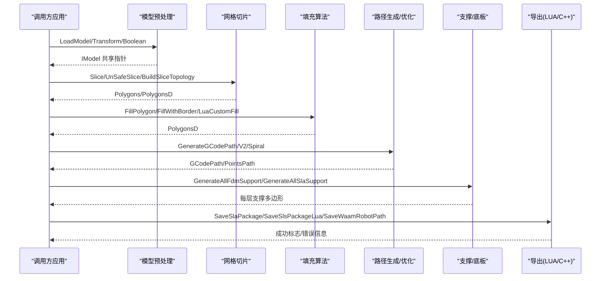

**图示来源**
- [model_preprocess.hpp:40-120](file://LibHsBaSlicer/Preprocess/model_preprocess.hpp#L40-L120)
- [mesh_slice.hpp:22-103](file://LibHsBaSlicer/Slice/mesh_slice.hpp#L22-L103)
- [polygon_fill.hpp:17-53](file://LibHsBaSlicer/Fill/polygon_fill.hpp#L17-L53)
- [path_generator.hpp:44-91](file://LibHsBaSlicer/Path/path_generator.hpp#L44-L91)
- [fdm_support.hpp:19-67](file://LibHsBaSlicer/Support/fdm_support.hpp#L19-L67)
- [sla_floor.hpp:35-195](file://LibHsBaSlicer/Floor/sla_floor.hpp#L35-L195)
- [sls_export.hpp:35-56](file://LibHsBaSlicer/Path/sls_export.hpp#L35-L56)
- [waam_export.hpp:54-72](file://LibHsBaSlicer/Path/waam_export.hpp#L54-L72)

## 详细组件分析

### 模型预处理模块（Preprocess）
- 设计要点
  - 通过名称管理的模型池，支持插入、查询、删除与清理。
  - 提供平移、旋转、均匀/非均匀缩放与变换。
  - 可选 CGAL 构建布尔运算与厚壳（壳化）操作。
- 关键接口
  - 生命周期：LoadModel/InsertModel → GetModel/ContainsModel → RemoveModel/CleanupModels。
  - 变换：TranslateModel/RotateModel/ScaleModel。
  - 信息：GetModelInfo、ModelCount、GetModelNames。
  - 高级：BooleanUnion/Difference/Intersection/Xor、ThickSolidModel。
- 参数验证与异常
  - 重复名称或格式不支持时抛出 InvalidArgumentError。
  - 文件无法加载或 OCCT 不可用时抛出 RuntimeError。
- 资源管理
  - 返回 std::shared_ptr<IModel>，遵循 RAII 自动释放。
  - CleanupModels 清理无外部引用的模型。

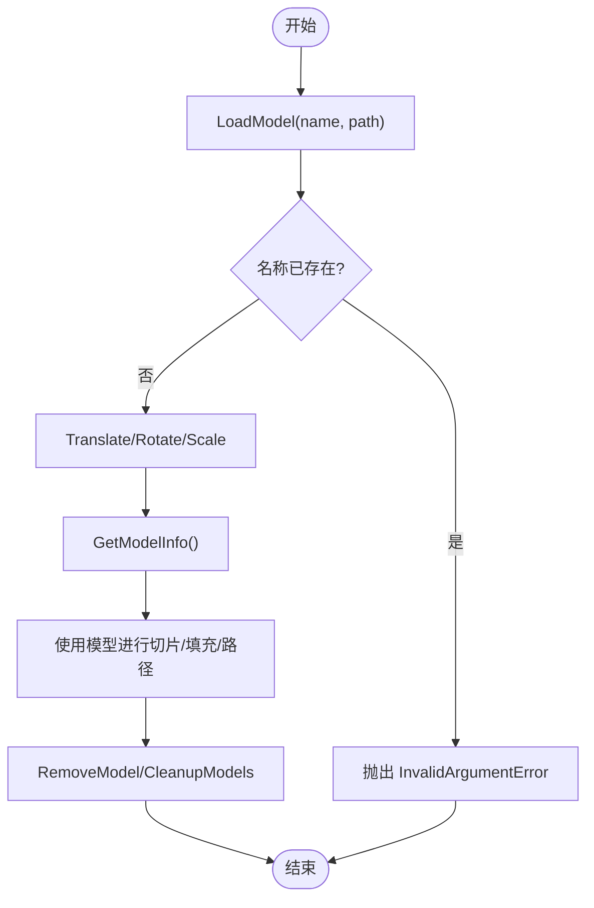

**图示来源**
- [model_preprocess.hpp:32-120](file://LibHsBaSlicer/Preprocess/model_preprocess.hpp#L32-L120)

**章节来源**
- [model_preprocess.hpp:20-187](file://LibHsBaSlicer/Preprocess/model_preprocess.hpp#L20-L187)

### 网格切片模块（Slice）
- 设计要点
  - 提供安全切片（忽略开放轮廓）与不安全切片（包含开放轮廓），适用于不同工艺需求。
  - 支持 Lua 驱动切片以扩展策略。
  - 通过 BuildSliceTopology 预构建拓扑，避免逐层重建，提升多层切片性能。
- 关键接口
  - Slice、UnSafeSlice、SliceLua、UnSafeSliceLua、NormalizeUnSafePolygons。
  - BuildSliceTopology、SliceLayer（只读拓扑，跨线程并发安全）。
- 线程安全
  - 共享 FullTopoModel 的 SliceLayer 调用是只读的，只要每个线程写入各自输出即可并发。

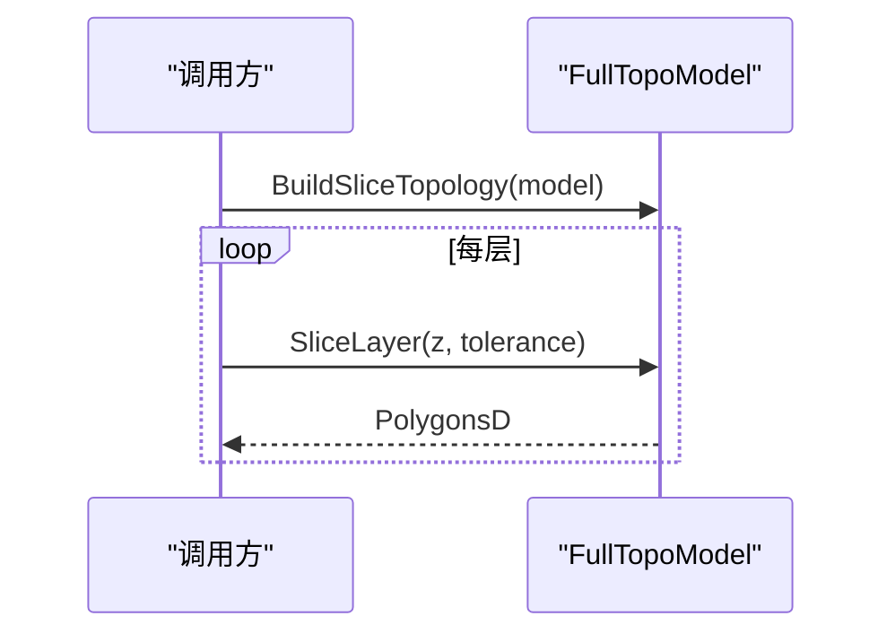

**图示来源**
- [mesh_slice.hpp:79-103](file://LibHsBaSlicer/Slice/mesh_slice.hpp#L79-L103)

**章节来源**
- [mesh_slice.hpp:18-103](file://LibHsBaSlicer/Slice/mesh_slice.hpp#L18-L103)

### 填充算法模块（Fill）
- 设计要点
  - 封装 2D 填充引擎，支持直线、简单之字形、之字形、边框+内部填充与 Lua 自定义填充。
- 关键接口
  - FillPolygon(poly, spacing, mode, angle_deg)。
  - FillWithBorder(poly, spacing, border_count, fill_mode, angle_deg)。
  - LuaCustomFillByFile(poly, scriptPath, functionName, lineThickness)。

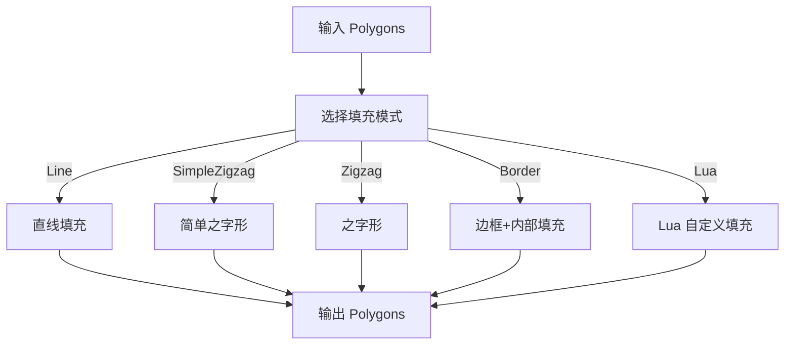

**图示来源**
- [polygon_fill.hpp:17-53](file://LibHsBaSlicer/Fill/polygon_fill.hpp#L17-L53)

**章节来源**
- [polygon_fill.hpp:15-53](file://LibHsBaSlicer/Fill/polygon_fill.hpp#L15-L53)

### 路径生成与优化模块（Path）
- 设计要点
  - FDM 路径生成：支持 PointsPath 与 GCodePath（多固件 Marlin/RepRap/Klipper）。
  - 螺旋花瓶模式：SpiralizeOuterWall 生成连续上升的外壁。
  - 区域路径优化：RegionPathOptimizer 基于遗传 TSP 优化区域访问顺序，减少空移成本。
- 关键接口
  - GenerateGCodePath、GenerateGCodePathV2、GenerateGCodePathSpiral、PolygonsToGPoints。
  - RegionPathOptimizer：addRegion/addPolygonRegion/addRoute/optimizeOrder/buildPaths/buildPolygons。
  - SpiralizeOuterWall(layer_sections, layer_zs)。

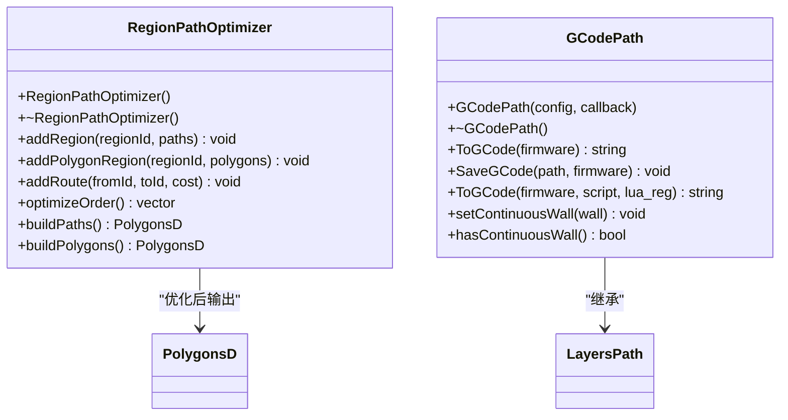

**图示来源**
- [path_optimizer.hpp:44-100](file://LibHsBaSlicer/Path/path_optimizer.hpp#L44-L100)
- [gcodepath.hpp:62-107](file://paths/gcodepath.hpp#L62-L107)

```mermaid
sequenceDiagram
participant App as "调用方"
participant Gen as "路径生成"
participant Opt as "区域优化器"
participant Spir as "螺旋外壁"
participant GC as "GCodePath"
App->>Gen : GenerateGCodePathV2(layer_data, config, printer_config)
Gen-->>App : unique_ptr<GCodePath>
App->>Opt : optimizeOrder()/buildPaths()
Opt-->>App : PolygonsD(优化后)
App->>Spir : SpiralizeOuterWall(layer_outlines, layer_zs)
Spir-->>App : vector<SpiralPoint>
App->>GC : setContinuousWall(spiral_points)
GC-->>App : ToGCode(firmware)
```

**图示来源**
- [path_generator.hpp:44-91](file://LibHsBaSlicer/Path/path_generator.hpp#L44-L91)
- [path_optimizer.hpp:44-100](file://LibHsBaSlicer/Path/path_optimizer.hpp#L44-L100)
- [spiral_path.hpp:31-58](file://LibHsBaSlicer/Path/spiral_path.hpp#L31-L58)
- [gcodepath.hpp:87-96](file://paths/gcodepath.hpp#L87-L96)

**章节来源**
- [path_generator.hpp:18-91](file://LibHsBaSlicer/Path/path_generator.hpp#L18-L91)
- [path_optimizer.hpp:21-186](file://LibHsBaSlicer/Path/path_optimizer.hpp#L21-L186)
- [spiral_path.hpp:14-58](file://LibHsBaSlicer/Path/spiral_path.hpp#L14-L58)
- [gcodepath.hpp:24-107](file://paths/gcodepath.hpp#L24-L107)

### 支撑与底板模块（Support / Floor）
- 设计要点
  - FDM 支撑：单层/全层生成；SLA 牺牲支撑；Lua 自定义支撑。
  - SLA 底板：接触面、完整底板、边框、内部填充；Lua 自定义底板；图像渲染与打包。
- 关键接口
  - GenerateFdmSupport、GenerateAllFdmSupport、GenerateAllSlaSupport、GenerateAllLuaSupport。
  - GenerateFloorContact/Raft/Border/Fill、LuaCustomFloorByFile/String。
  - RenderPolygonsToImage/Buffer、SaveSlaPackage/Lua。

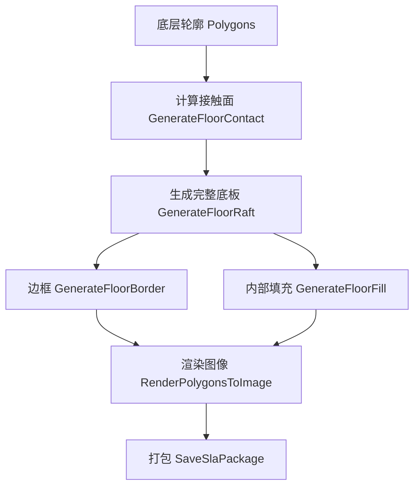

**图示来源**
- [sla_floor.hpp:35-195](file://LibHsBaSlicer/Floor/sla_floor.hpp#L35-L195)

**章节来源**
- [fdm_support.hpp:17-67](file://LibHsBaSlicer/Support/fdm_support.hpp#L17-L67)
- [sla_floor.hpp:19-195](file://LibHsBaSlicer/Floor/sla_floor.hpp#L19-L195)

### 导出模块（SLS / WAAM）
- 设计要点
  - SLS：无标准输出，完全由 Lua 脚本驱动导出逻辑。
  - WAAM：机器人语言程序（ABB/KUKA/FANUC），支持螺旋焊接路径。
- 关键接口
  - SaveSlsPackageLua(pkg, output_zip, lua_script, lua_func, error_out)。
  - SaveWaamRobotPath(pkg, output_path, lua_script, lua_func, error_out)。

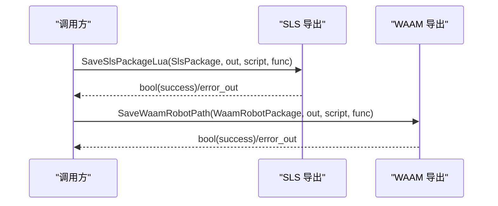

**图示来源**
- [sls_export.hpp:35-56](file://LibHsBaSlicer/Path/sls_export.hpp#L35-L56)
- [waam_export.hpp:54-72](file://LibHsBaSlicer/Path/waam_export.hpp#L54-L72)

**章节来源**
- [sls_export.hpp:15-56](file://LibHsBaSlicer/Path/sls_export.hpp#L15-L56)
- [waam_export.hpp:15-72](file://LibHsBaSlicer/Path/waam_export.hpp#L15-L72)

### Lua 自定义流水线（Extends）
- 设计要点
  - 完全由 Lua 编排整个流程，C++ 仅提供环境搭建与运行入口。
  - 提供 LuaPipelineContext（脚本、配置、输出路径、进度回调）与 LuaPipelineOutput（成功标志、层数、输出路径、返回值、错误消息）。
- 关键接口
  - SetupLuaPipelineEnvironment(L, ctx, out, run_state)。
  - RunLuaPipeline(ctx)。

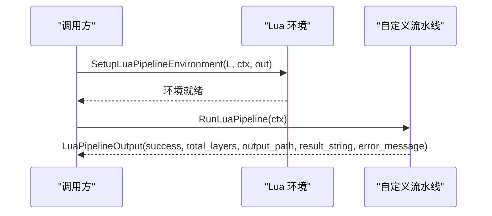

**图示来源**
- [lua_pipeline.hpp:19-83](file://LibHsBaSlicer/Extends/lua_pipeline.hpp#L19-L83)

**章节来源**
- [lua_pipeline.hpp:17-83](file://LibHsBaSlicer/Extends/lua_pipeline.hpp#L17-L83)

### 文件传输模块（Transfer）
- 设计要点
  - 远程执行服务文件传输，支持连接池、进度回调与结果统计。
- 关键接口
  - FileTransferConfig（host/port/pool_size/files）。
  - FileTransferResult（success/files_transferred/total_files/error_message）。
  - TransferFiles(config, progress)。

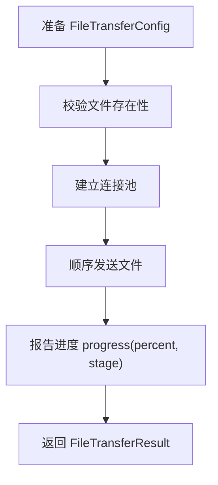

**图示来源**
- [file_transfer.hpp:20-60](file://LibHsBaSlicer/Transfer/file_transfer.hpp#L20-L60)

**章节来源**
- [file_transfer.hpp:17-60](file://LibHsBaSlicer/Transfer/file_transfer.hpp#L17-L60)

## 依赖关系分析
- 导出宏
  - HSBA_SLICER_LIB_API 用于 Windows DLL 导出/导入与非 Windows 平台无修饰。
- 基础类型
  - IModel 定义 3D 模型抽象接口（加载/保存/变换/包围盒/体积/三角网格）。
  - 2D 多边形：IntPolygon（整数坐标）与 FloatPolygons（双精度坐标），提供布尔、偏移、面积、简化与文本转多边形等工具。
- 模块耦合
  - Slice 依赖 IModel 与 2D 多边形类型。
  - Fill/Path/Support/Floor 均依赖 PolygonsD。
  - Path 依赖 gcodepath.hpp 中的 GCodePath 与 LayersPath。
  - Lua 流水线聚合多个模块能力，作为高层编排入口。

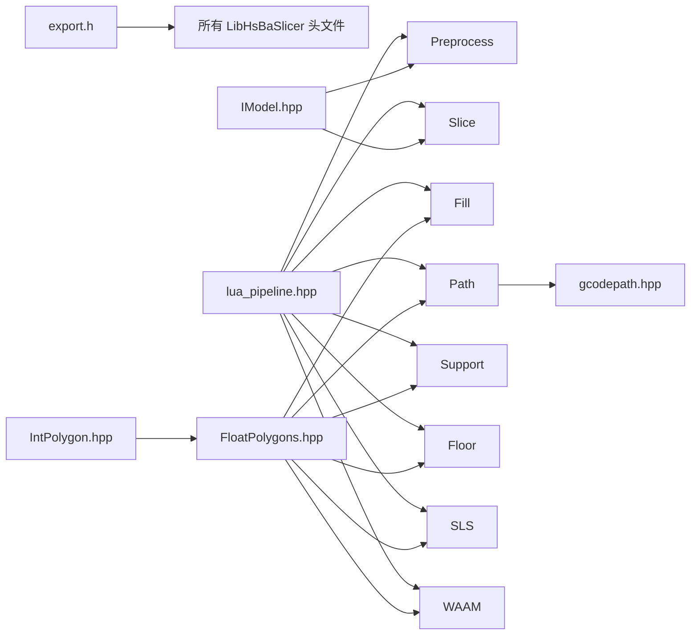

**图示来源**
- [export.h:1-22](file://LibHsBaSlicer/export.h#L1-L22)
- [IModel.hpp:111-139](file://base/IModel.hpp#L111-L139)
- [IntPolygon.hpp:16-26](file://2D/IntPolygon.hpp#L16-L26)
- [FloatPolygons.hpp:18-25](file://2D/FloatPolygons.hpp#L18-L25)
- [gcodepath.hpp:62-107](file://paths/gcodepath.hpp#L62-L107)
- [lua_pipeline.hpp:19-83](file://LibHsBaSlicer/Extends/lua_pipeline.hpp#L19-L83)

**章节来源**
- [export.h:1-22](file://LibHsBaSlicer/export.h#L1-L22)
- [IModel.hpp:111-139](file://base/IModel.hpp#L111-L139)
- [IntPolygon.hpp:16-26](file://2D/IntPolygon.hpp#L16-L26)
- [FloatPolygons.hpp:18-25](file://2D/FloatPolygons.hpp#L18-L25)
- [gcodepath.hpp:62-107](file://paths/gcodepath.hpp#L62-L107)
- [lua_pipeline.hpp:19-83](file://LibHsBaSlicer/Extends/lua_pipeline.hpp#L19-L83)

## 性能与线程安全
- 切片性能
  - 使用 BuildSliceTopology 预构建拓扑，避免每层 O(total_faces) 的重建；SliceLayer 对只读拓扑并发安全。
- 路径优化
  - RegionPathOptimizer 使用遗传 TSP 优化区域访问顺序，显著减少空移成本；建议在填充前优化区域顺序或在填充后优化路径顺序。
- 螺旋模式
  - SpiralizeOuterWall 生成连续外壁，避免层间重入与旅行移动，提高表面质量与强度；适用于均匀截面柱体。
- 线程安全
  - 共享 FullTopoModel 的 SliceLayer 调用是只读的，多线程并发安全。
  - 其他模块（如模型池、Lua 状态）需由调用方保证线程隔离或使用同步机制。
- 内存与资源
  - 使用 std::shared_ptr 管理模型与拓扑；GCodePath 通过 RAII 管理路径与输出。
  - 及时调用 RemoveModel/CleanupModels 释放不再使用的模型。

[本节为通用指导，不直接分析具体文件]

## 故障排除指南
- 模型加载失败
  - 检查文件路径与格式支持；确认名称唯一；捕获 InvalidArgumentError/RuntimeError。
- 切片结果为空
  - 检查模型是否封闭；调整 tolerance；必要时使用 UnSafeSlice 并 NormalizeUnSafePolygons。
- 填充异常
  - 检查输入多边形是否为简单多边形；使用 MakeSimple 简化；确认 FillMode 与角度设置合理。
- 路径生成问题
  - 检查 LayerPathData 的 outlines/fills/supports 与 z_height 一致性；确认 FdmPathConfig 单位与打印参数匹配。
- 导出失败
  - SLS/WAAM：检查 Lua 脚本语法与全局变量契约；使用 error_out 获取详细错误信息。
- 文件传输失败
  - 检查 host/port 连通性与文件存在性；查看 FileTransferResult.error_message。

**章节来源**
- [model_preprocess.hpp:32-120](file://LibHsBaSlicer/Preprocess/model_preprocess.hpp#L32-L120)
- [mesh_slice.hpp:22-103](file://LibHsBaSlicer/Slice/mesh_slice.hpp#L22-L103)
- [polygon_fill.hpp:17-53](file://LibHsBaSlicer/Fill/polygon_fill.hpp#L17-L53)
- [path_generator.hpp:44-91](file://LibHsBaSlicer/Path/path_generator.hpp#L44-L91)
- [sls_export.hpp:35-56](file://LibHsBaSlicer/Path/sls_export.hpp#L35-L56)
- [waam_export.hpp:54-72](file://LibHsBaSlicer/Path/waam_export.hpp#L54-L72)
- [file_transfer.hpp:49-60](file://LibHsBaSlicer/Transfer/file_transfer.hpp#L49-L60)

## 结论
HsBaSlicer 的 C++ API 提供了从模型预处理、切片、填充、路径生成到多工艺导出的完整工具链。通过模块化设计与清晰的公共接口，开发者可以灵活组合不同阶段，同时借助 Lua 扩展获得高度定制化的流水线。推荐优先使用 BuildSliceTopology 提升多层切片性能，结合 RegionPathOptimizer 与 SpiralizeOuterWall 优化路径质量与效率，并在导出阶段利用 Lua 脚本实现业务定制化。

[本节为总结性内容，不直接分析具体文件]

## 附录：常用数据结构与配置项
- 模型信息
  - ModelInfo：bbox_min、bbox_max、volume。
- 切片与多边形
  - PolygonsD：双精度多边形集合；Polygons：整数多边形集合。
- FDM 路径配置
  - FdmPathConfig：layer_height、line_width、print_speed、travel_speed、extrusion_multiplier、units。
  - LayerPathData：outlines、fills、supports、z_height。
- GCode 输出
  - GCodePrinterConfig：nozzle_diameter、filament_diameter、nozzle_temp、bed_temp、retract_length/speed、print/travel/first_layer_speed、layer_height、line_width、extrusion_multiplier、relative_extrusion、enable_retraction。
  - GCodeFirmware：Marlin、RepRap、Klipper。
- 支撑与底板
  - Support::FdmSupportConfig、Support::SlaSupportConfig、Support::SupportConfig。
  - SlaFloorConfig：raft_offset、border_width、fill_spacing、fill_angle_deg、border_count、use_convex_hull、concave_hull_points。
- 导出包
  - SlsPackage：layer_outlines、layer_z_heights、config_json、spiral_mode。
  - WaamRobotPackage：layer_outlines、layer_z_heights、weld、robot_type、bead_width、config_json、spiral_mode。
  - SlaPackage：layer_outlines、layer_supports、floor_polygons、config_json、image_width/height、image_extension、include_floor_images/include_support_images。
- Lua 流水线
  - LuaPipelineContext：script、script_file、entry_func、config_json、output_path、model_name、model_path、progress_cb。
  - LuaPipelineOutput：success、total_layers、output_path、result_string、error_message。
- 文件传输
  - FileTransferConfig：host、port、pool_size、files。
  - FileTransferResult：success、files_transferred、total_files、error_message。

**章节来源**
- [model_preprocess.hpp:22-30](file://LibHsBaSlicer/Preprocess/model_preprocess.hpp#L22-L30)
- [path_generator.hpp:20-51](file://LibHsBaSlicer/Path/path_generator.hpp#L20-L51)
- [gcodepath.hpp:24-49](file://paths/gcodepath.hpp#L24-L49)
- [fdm_support.hpp:17-67](file://LibHsBaSlicer/Support/fdm_support.hpp#L17-L67)
- [sla_floor.hpp:21-33](file://LibHsBaSlicer/Floor/sla_floor.hpp#L21-L33)
- [sls_export.hpp:17-33](file://LibHsBaSlicer/Path/sls_export.hpp#L17-L33)
- [waam_export.hpp:17-52](file://LibHsBaSlicer/Path/waam_export.hpp#L17-L52)
- [lua_pipeline.hpp:19-51](file://LibHsBaSlicer/Extends/lua_pipeline.hpp#L19-L51)
- [file_transfer.hpp:20-40](file://LibHsBaSlicer/Transfer/file_transfer.hpp#L20-L40)