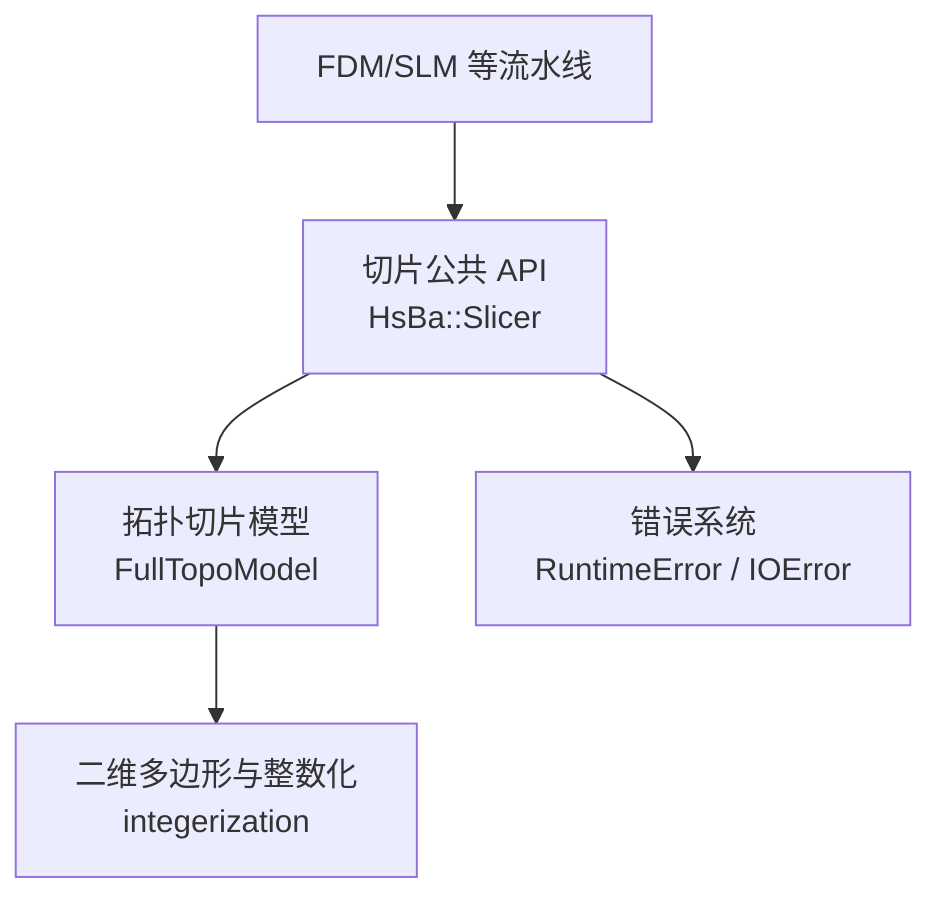
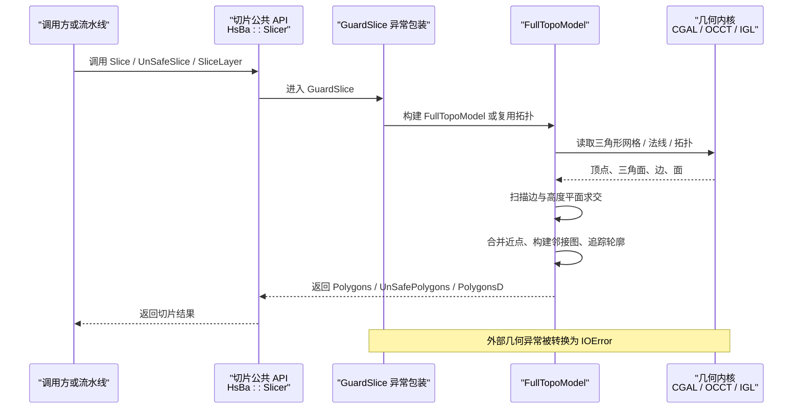
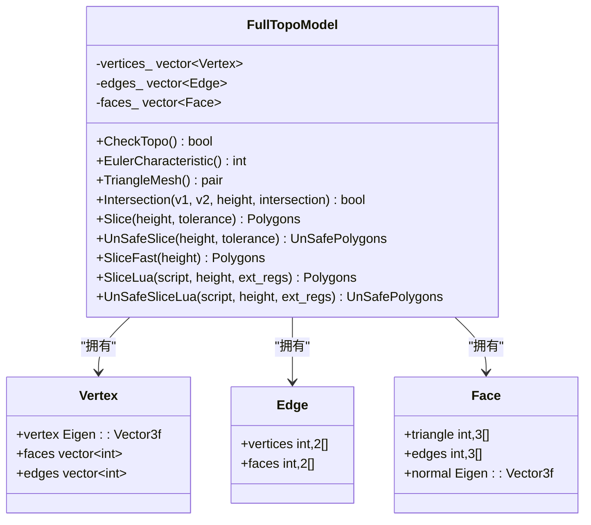
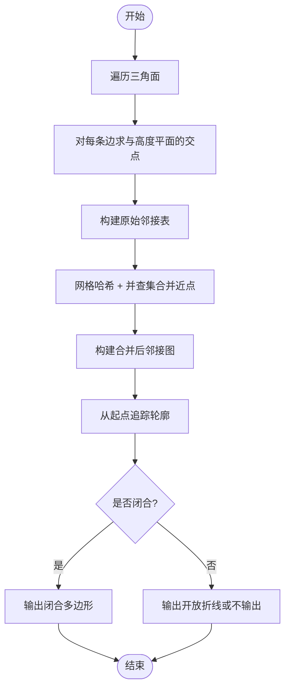
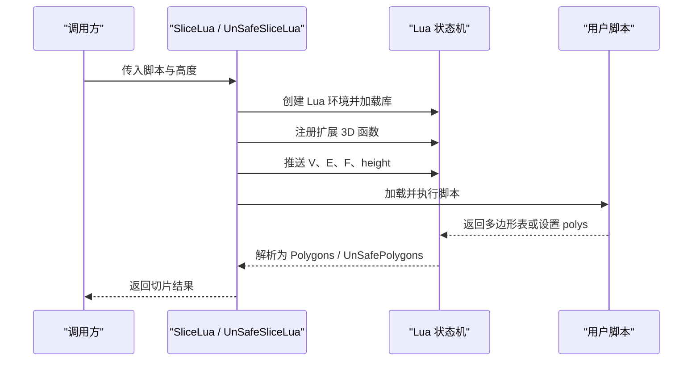
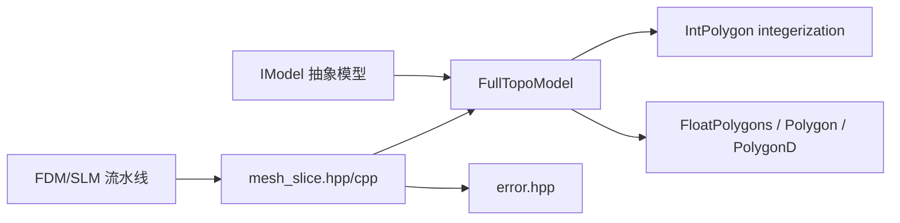
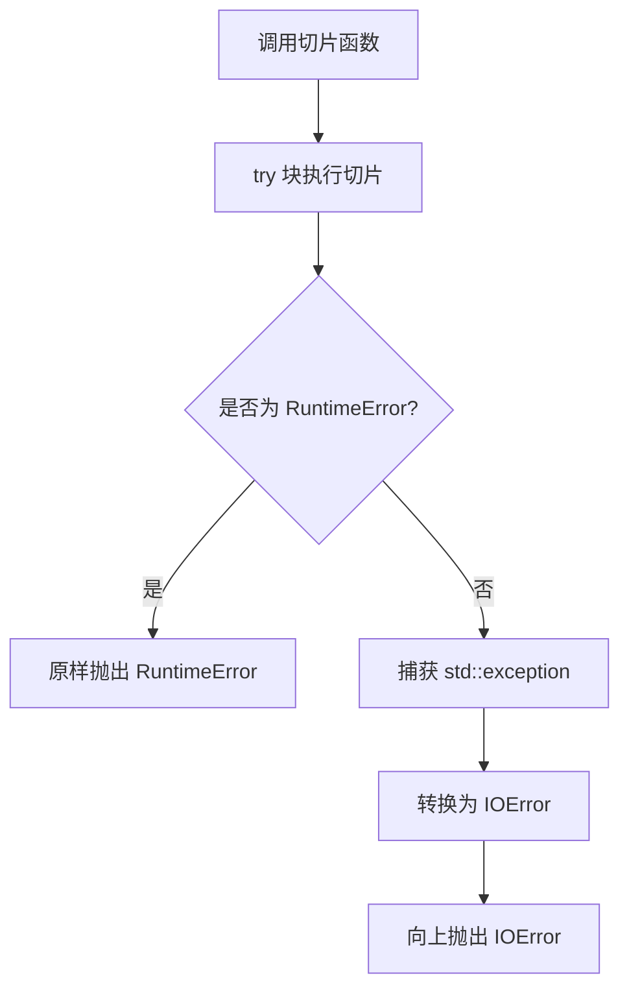
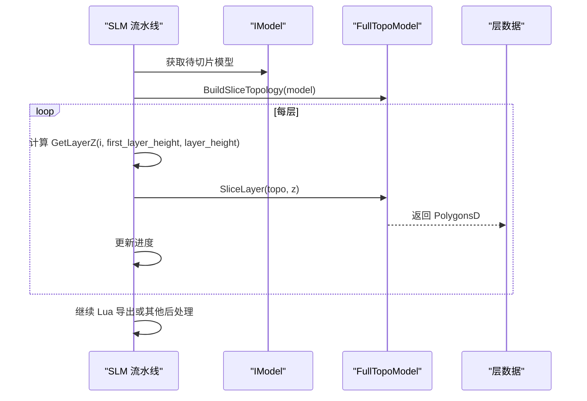

# 切片引擎 API

<cite>
**本文引用的文件**   
- [LibHsBaSlicer/Slice/mesh_slice.hpp](file://LibHsBaSlicer/Slice/mesh_slice.hpp)
- [LibHsBaSlicer/Slice/mesh_slice.cpp](file://LibHsBaSlicer/Slice/mesh_slice.cpp)
- [meshmodel/FullTopoModel.hpp](file://meshmodel/FullTopoModel.hpp)
- [meshmodel/FullTopoModel.cpp](file://meshmodel/FullTopoModel.cpp)
- [2D/IntPolygon.hpp](file://2D/IntPolygon.hpp)
- [base/error.hpp](file://base/error.hpp)
- [pipelinetypes/pipeline_types.h](file://pipelinetypes/pipeline_types.h)
- [support/SupportConfig.hpp](file://support/SupportConfig.hpp)
- [DllHsBaSlicer/slm_pipeline.cpp](file://DllHsBaSlicer/slm_pipeline.cpp)
</cite>

## 目录
1. [引言](#引言)
2. [项目结构定位](#项目结构定位)
3. [核心组件](#核心组件)
4. [架构总览](#架构总览)
5. [详细组件分析](#详细组件分析)
6. [依赖关系分析](#依赖关系分析)
7. [性能特征与优化建议](#性能特征与优化建议)
8. [错误处理与异常指南](#错误处理与异常指南)
9. [完整切片流程示例](#完整切片流程示例)
10. [结论](#结论)

## 引言
本文件面向 HsBaSlicer 的切片引擎 C++ API，重点说明 `MeshSlice` 相关接口、`FullTopoModel` 拓扑切片实现、层切片生成、轮廓提取、拓扑检查与 Lua 驱动切片能力。文档同时给出切片参数配置来源、典型流水线调用方式、算法原理、复杂度分析与故障排查建议。

需要特别说明的是：源码中并没有名为 `MeshSlice` 的类；切片公共 API 位于命名空间 `HsBa::Slicer`，对外暴露 `Slice`、`UnSafeSlice`、`SliceLua`、`UnSafeSliceLua`、`NormalizeUnSafePolygons`、`BuildSliceTopology`、`SliceLayer` 等函数，而真正的切片核心由 `FullTopoModel` 提供。因此本文以“切片引擎 API”为标题，围绕这两个关键对象展开。

## 项目结构定位
切片引擎代码主要分布在以下位置：
- 公共 C++ 切片 API：`LibHsBaSlicer/Slice/mesh_slice.{hpp,cpp}`
- 拓扑切片核心：`meshmodel/FullTopoModel.{hpp,cpp}`
- 二维多边形基础类型与整数化常量：`2D/IntPolygon.hpp`
- 错误类型定义：`base/error.hpp`
- FDM/SLM 等流水线中的层高、填充密度、支撑参数：`pipelinetypes/pipeline_types.h`、`support/SupportConfig.hpp`
- SLM 流水线实际调用切片接口的示例：`DllHsBaSlicer/slm_pipeline.cpp`

**图表来源**  
- [LibHsBaSlicer/Slice/mesh_slice.hpp:18-103](file://LibHsBaSlicer/Slice/mesh_slice.hpp#L18-L103)
- [meshmodel/FullTopoModel.hpp:23-146](file://meshmodel/FullTopoModel.hpp#L23-L146)
- [2D/IntPolygon.hpp:17-17](file://2D/IntPolygon.hpp#L17-L17)
- [base/error.hpp:1-200](file://base/error.hpp#L1-L200)

**章节来源**  
- [LibHsBaSlicer/Slice/mesh_slice.hpp:1-108](file://LibHsBaSlicer/Slice/mesh_slice.hpp#L1-L108)
- [LibHsBaSlicer/Slice/mesh_slice.cpp:1-119](file://LibHsBaSlicer/Slice/mesh_slice.cpp#L1-L119)
- [meshmodel/FullTopoModel.hpp:1-150](file://meshmodel/FullTopoModel.hpp#L1-L150)

## 核心组件
### 切片公共 API：`HsBa::Slicer`
该命名空间提供面向用户的稳定切片入口，包括：
- `Slice(model, height, tolerance)`：安全切片，返回闭合多边形。
- `UnSafeSlice(model, height, tolerance)`：不安全切片，可能包含开放轮廓。
- `SliceLua(model, script, height)`：使用内联 Lua 脚本进行自定义切片。
- `UnSafeSliceLua(model, script, height)`：Lua 驱动的不安全切片。
- `NormalizeUnSafePolygons(unsafe_polys)`：将不安全切片结果清理为双精度闭合多边形集合。
- `BuildSliceTopology(model)`：从模型构建可复用的拓扑对象。
- `SliceLayer(topo, z, tolerance)`：对预构建拓扑按层切片并归一化。

这些函数是上层流水线（如 FDM、SLM、LOM）调用切片的统一入口。

**章节来源**  
- [LibHsBaSlicer/Slice/mesh_slice.hpp:22-103](file://LibHsBaSlicer/Slice/mesh_slice.hpp#L22-L103)
- [LibHsBaSlicer/Slice/mesh_slice.cpp:46-116](file://LibHsBaSlicer/Slice/mesh_slice.cpp#L46-L116)

### 拓扑切片模型：`FullTopoModel`
`FullTopoModel` 是专为切片重建完整拓扑关系的网格模型，内部维护顶点、边、面及其邻接关系，并提供：
- 拓扑完整性检查：`CheckTopo()`
- 欧拉示性数：`EulerCharacteristic()`
- 三角形网格导出：`TriangleMesh()`
- Z 方向线段与平面交点计算：`Intersection(v1, v2, height, intersection)`
- 安全切片：`Slice(height, tolerance)`
- 不安全切片：`UnSafeSlice(height, tolerance)`
- 快速切片：`SliceFast(height)`
- Lua 驱动切片：多种 `SliceLua` / `UnSafeSliceLua` 重载

该类注释明确指出：它不是通用几何修改器，而是切片专用拓扑重建对象；构造时会重建拓扑关系，但重建后的流形可能不完整，不保证完全拓扑校验。

**章节来源**  
- [meshmodel/FullTopoModel.hpp:18-146](file://meshmodel/FullTopoModel.hpp#L18-L146)
- [meshmodel/FullTopoModel.cpp:27-158](file://meshmodel/FullTopoModel.cpp#L27-L158)

## 架构总览
切片引擎的整体数据流如下：

**图表来源**  
- [LibHsBaSlicer/Slice/mesh_slice.cpp:17-53](file://LibHsBaSlicer/Slice/mesh_slice.cpp#L17-L53)
- [meshmodel/FullTopoModel.cpp:32-48](file://meshmodel/FullTopoModel.cpp#L32-L48)
- [meshmodel/FullTopoModel.cpp:246-272](file://meshmodel/FullTopoModel.cpp#L246-L272)
- [meshmodel/FullTopoModel.cpp:328-599](file://meshmodel/FullTopoModel.cpp#L328-L599)

## 详细组件分析

### 切片公共 API 设计
`HsBa::Slicer` 的切片函数职责清晰：
- 接收 `IModel` 源模型、切片高度 `height`、坐标容差 `tolerance`。
- 通过 `FullTopoModel` 完成切片。
- 所有导出函数经过 `GuardSlice` 包装，确保跨边界异常安全。
- `BuildSliceTopology` + `SliceLayer` 组合用于多层切片场景，避免每层重复构建拓扑。

| 函数 | 输入 | 输出 | 用途 |
|---|---|---|---|
| `Slice` | `IModel`、`height`、`tolerance` | `Polygons` | 安全切片，丢弃开放轮廓 |
| `UnSafeSlice` | `IModel`、`height`、`tolerance` | `UnSafePolygons` | 保留开放轮廓，适合材料沉积类工艺 |
| `SliceLua` | `IModel`、Lua 脚本、`height` | `Polygons` | 用 Lua 自定义切片逻辑 |
| `UnSafeSliceLua` | `IModel`、Lua 脚本、`height` | `UnSafePolygons` | Lua 自定义不安全切片 |
| `NormalizeUnSafePolygons` | `UnSafePolygons` | `PolygonsD` | 过滤开放折线、简化多边形、转双精度 |
| `BuildSliceTopology` | `IModel` | `shared_ptr<FullTopoModel>` | 一次性构建拓扑 |
| `SliceLayer` | `FullTopoModel`、`z`、`tolerance` | `PolygonsD` | 对预建拓扑按层切片并归一化 |

**章节来源**  
- [LibHsBaSlicer/Slice/mesh_slice.hpp:22-103](file://LibHsBaSlicer/Slice/mesh_slice.hpp#L22-L103)
- [LibHsBaSlicer/Slice/mesh_slice.cpp:46-116](file://LibHsBaSlicer/Slice/mesh_slice.cpp#L46-L116)

### `FullTopoModel` 数据结构与拓扑重建
`FullTopoModel` 的核心数据结构包括：
- `Vertex`：顶点坐标、关联面索引、关联边索引。
- `Edge`：两端顶点、相邻两个面。
- `Face`：三个顶点索引、三条边索引、可选面法线。

构造函数从 `IModel` 或顶点/三角面数组中提取三角形网格，然后建立顶点、边、面的双向邻接关系。若启用法线，则调用 IGL 的面法线计算。

**图表来源**  
- [meshmodel/FullTopoModel.hpp:53-142](file://meshmodel/FullTopoModel.hpp#L53-L142)
- [meshmodel/FullTopoModel.cpp:50-158](file://meshmodel/FullTopoModel.cpp#L50-L158)

**章节来源**  
- [meshmodel/FullTopoModel.hpp:53-142](file://meshmodel/FullTopoModel.hpp#L53-L142)
- [meshmodel/FullTopoModel.cpp:27-158](file://meshmodel/FullTopoModel.cpp#L27-L158)

### 切片算法工作原理
`FullTopoModel::Slice` 和 `UnSafeSlice` 共享相似的处理流程：

1. **三角形边与高度平面求交**  
   对每个三角形的三条边调用 `Intersection`，得到与水平切片平面的交点。

2. **坐标整数化与近点合并**  
   使用全局整数化常量 `integerization` 将浮点 XY 坐标映射到整数网格键；通过网格哈希与并查集合并距离小于 `tolerance` 的点，避免浮点误差导致轮廓断裂。

3. **构建邻接图**  
   将同一三角形上两个交点连接为无向边，形成原始邻接表，并去重排序。

4. **轮廓追踪**  
   从未访问节点出发，沿邻接图追踪路径；选择下一个邻居时，优先保持入射方向角度变化最小，从而尽量保持几何连续性。

5. **闭合判断与输出**  
   - `Slice`：只输出长度至少为 3 的闭合多边形。
   - `UnSafeSlice`：记录是否闭合，允许开放折线。
   - `SliceFast`：先检查拓扑完整性，再基于边级相交信息直接构建邻接图，跳过部分冗余步骤。

**图表来源**  
- [meshmodel/FullTopoModel.cpp:328-599](file://meshmodel/FullTopoModel.cpp#L328-L599)
- [meshmodel/FullTopoModel.cpp:604-873](file://meshmodel/FullTopoModel.cpp#L604-L873)
- [meshmodel/FullTopoModel.cpp:875-1025](file://meshmodel/FullTopoModel.cpp#L875-L1025)

**章节来源**  
- [meshmodel/FullTopoModel.cpp:246-272](file://meshmodel/FullTopoModel.cpp#L246-L272)
- [meshmodel/FullTopoModel.cpp:328-599](file://meshmodel/FullTopoModel.cpp#L328-L599)
- [meshmodel/FullTopoModel.cpp:604-873](file://meshmodel/FullTopoModel.cpp#L604-L873)
- [meshmodel/FullTopoModel.cpp:875-1025](file://meshmodel/FullTopoModel.cpp#L875-L1025)

### 切片参数配置方法
切片引擎本身接受的关键参数是：
- `height` / `z`：切片高度，单位毫米。
- `tolerance`：坐标容差，用于合并相近交点，默认值在公共 API 中为 `0.001`。
- `layer_height`、`first_layer_height`：层高与首层层高，通常由上层流水线决定。
- `fill_spacing`、`infill_density`、`wall_count`、`top_layer_count`、`bottom_layer_count`：填充与壁厚参数，属于后续填充与路径生成阶段。
- `enable_support`、`overhang_angle`、`support_gap`、`support_diameter`、`support_density`、`support_pattern`、`interface_layers`、`interface_density`：支撑相关参数。

这些参数并非直接传入 `Slice`，而是由 FDM/SLM 等流水线配置结构体提供，并在流水线中计算每层 Z 高度后调用 `SliceLayer`。

| 参数类别 | 字段 | 默认值 | 含义 |
|---|---|---:|---|
| 层高 | `layer_height` | `0.2` mm | 常规层高 |
| 首层层高 | `first_layer_height` | `0.2` mm | 首层特殊层高 |
| 填充间距 | `fill_spacing` | `0.4` mm | 填充线间距 |
| 填充密度 | `infill_density` | `0.2` | 填充密度 `[0,1]` |
| 壁厚 | `wall_count` | `3` | 外壁周长数量 |
| 顶面层数 | `top_layer_count` | `3` | 顶部实心层数 |
| 底面层数 | `bottom_layer_count` | `3` | 底部实心层数 |
| 支撑开关 | `enable_support` | `1` | 是否启用支撑 |
| 悬垂角度 | `overhang_angle` | `45.0` 度 | 悬垂检测阈值 |
| 支撑间隙 | `support_gap` | `0.5` mm | 支撑与模型间隙 |
| 支撑直径 | `support_diameter` | `2.0` mm | 支撑柱直径 |
| 支撑密度 | `support_density` | `0.3` | 支撑填充密度 `[0,1]` |
| 支撑图案 | `support_pattern` | `HSBA_SUPPORT_PLANE` | 支撑图案类型 |
| 界面层数 | `interface_layers` | `2` | 支撑与模型界面层数 |
| 界面密度 | `interface_density` | `0.5` | 界面层填充密度 `[0,1]` |

**章节来源**  
- [pipelinetypes/pipeline_types.h:56-91](file://pipelinetypes/pipeline_types.h#L56-L91)
- [support/SupportConfig.hpp:33-43](file://support/SupportConfig.hpp#L33-L43)
- [LibHsBaSlicer/Slice/mesh_slice.hpp:28-33](file://LibHsBaSlicer/Slice/mesh_slice.hpp#L28-L33)

### Lua 驱动切片
`FullTopoModel` 支持通过 Lua 脚本自定义切片逻辑。脚本执行时，全局变量包括：
- `V`：1-based 顶点数组，每个元素含 `x`、`y`、`z`。
- `E`：1-based 边数组，每个元素含两个顶点索引。
- `F`：1-based 面数组，每个元素含三个顶点索引。
- `height`：当前切片高度。

脚本应返回多边形表，或由 `polys` 全局变量提供结果。`SliceLua` 返回 `Polygons`，`UnSafeSliceLua` 返回 `UnSafePolygons`。

**图表来源**  
- [meshmodel/FullTopoModel.cpp:1027-1130](file://meshmodel/FullTopoModel.cpp#L1027-L1130)
- [meshmodel/FullTopoModel.cpp:1132-1241](file://meshmodel/FullTopoModel.cpp#L1132-L1241)
- [meshmodel/FullTopoModel.cpp:274-324](file://meshmodel/FullTopoModel.cpp#L274-L324)

**章节来源**  
- [meshmodel/FullTopoModel.hpp:116-132](file://meshmodel/FullTopoModel.hpp#L116-L132)
- [meshmodel/FullTopoModel.cpp:1027-1241](file://meshmodel/FullTopoModel.cpp#L1027-L1241)

## 依赖关系分析
切片引擎的依赖关系如下：

**图表来源**  
- [LibHsBaSlicer/Slice/mesh_slice.hpp:9-16](file://LibHsBaSlicer/Slice/mesh_slice.hpp#L9-L16)
- [meshmodel/FullTopoModel.hpp:11-16](file://meshmodel/FullTopoModel.hpp#L11-L16)
- [2D/IntPolygon.hpp:17-17](file://2D/IntPolygon.hpp#L17-L17)

**章节来源**  
- [LibHsBaSlicer/Slice/mesh_slice.hpp:9-16](file://LibHsBaSlicer/Slice/mesh_slice.hpp#L9-L16)
- [meshmodel/FullTopoModel.hpp:11-16](file://meshmodel/FullTopoModel.hpp#L11-L16)
- [2D/IntPolygon.hpp:17-17](file://2D/IntPolygon.hpp#L17-L17)

## 性能特征与优化建议
### 时间复杂度
- 拓扑构建：与三角面数量线性相关，并涉及边哈希映射与邻接表构建。
- 单次切片：
  - 遍历所有三角面求交：`O(F)`。
  - 构建原始邻接表与去重：近似 `O(E_intersections)`。
  - 网格哈希与并查集合并近点：近似 `O(N_points)`。
  - 轮廓追踪：与轮廓节点数线性相关。
- 多层切片：
  - 每次调用 `Slice` / `UnSafeSlice` 都会重新构建 `FullTopoModel`，成本较高。
  - 推荐先用 `BuildSliceTopology` 构建一次拓扑，再用 `SliceLayer` 多次切片。

### 空间复杂度
- `FullTopoModel` 存储顶点、边、面及邻接关系，空间与模型规模成正比。
- 切片过程中临时存储邻接表、网格哈希、并查集、访问集合等，额外空间与切片轮廓复杂度相关。

### 优化建议
1. **复用拓扑**：对多层流水线，优先使用 `BuildSliceTopology` + `SliceLayer`。
2. **合理设置容差**：`tolerance` 过小可能导致轮廓断裂，过大可能合并不同几何特征。
3. **避免无效层**：对没有有效闭合轮廓的层，下游填充与路径生成应跳过。
4. **并行切片**：当各层路径规划互不干扰时，单层的切片可在协程或线程中独立处理。
5. **快速模式**：若已确认拓扑完整且只需要闭合轮廓，可考虑 `SliceFast`，但其仍要求拓扑完整。

**章节来源**  
- [LibHsBaSlicer/Slice/mesh_slice.hpp:79-103](file://LibHsBaSlicer/Slice/mesh_slice.hpp#L79-L103)
- [meshmodel/FullTopoModel.cpp:875-1025](file://meshmodel/FullTopoModel.cpp#L875-L1025)

## 错误处理与异常指南
切片引擎的错误处理分为两层：

1. **几何内核异常转换**  
   `GuardSlice` 将所有导出函数包裹在 try-catch 中：
   - 项目自身异常 `RuntimeError` 原样抛出。
   - 其他 `std::exception` 子类（如 CGAL、OCCT 等外部几何库异常）被转换为 `IOError`，并附加“Slicing failed”前缀。

2. **Lua 脚本异常**  
   Lua 初始化失败、脚本加载失败、运行时错误或指定函数不存在时，会抛出 `RuntimeError`，并携带具体错误信息。

3. **拓扑不完整**  
   `SliceFast` 在拓扑不完整时会抛出 `RuntimeError("FullTopoModel topology invalid")`。

**图表来源**  
- [LibHsBaSlicer/Slice/mesh_slice.cpp:17-43](file://LibHsBaSlicer/Slice/mesh_slice.cpp#L17-L43)
- [meshmodel/FullTopoModel.cpp:875-880](file://meshmodel/FullTopoModel.cpp#L875-L880)
- [meshmodel/FullTopoModel.cpp:1027-1130](file://meshmodel/FullTopoModel.cpp#L1027-L1130)

**章节来源**  
- [LibHsBaSlicer/Slice/mesh_slice.cpp:17-43](file://LibHsBaSlicer/Slice/mesh_slice.cpp#L17-L43)
- [meshmodel/FullTopoModel.cpp:875-880](file://meshmodel/FullTopoModel.cpp#L875-L880)
- [meshmodel/FullTopoModel.cpp:1027-1130](file://meshmodel/FullTopoModel.cpp#L1027-L1130)

## 完整切片流程示例
下面以 SLM 流水线为例，展示从网格输入到层数据输出的典型调用方式。该示例来自源码中的 SLM 流水线实现，展示了如何：
1. 准备模型。
2. 构建可复用拓扑。
3. 按层高计算每层 Z 坐标。
4. 调用 `SliceLayer` 获取每层轮廓。
5. 报告进度并继续后续导出流程。

**图表来源**  
- [DllHsBaSlicer/slm_pipeline.cpp:280-294](file://DllHsBaSlicer/slm_pipeline.cpp#L280-L294)
- [LibHsBaSlicer/Slice/mesh_slice.cpp:106-116](file://LibHsBaSlicer/Slice/mesh_slice.cpp#L106-L116)

**章节来源**  
- [DllHsBaSlicer/slm_pipeline.cpp:280-294](file://DllHsBaSlicer/slm_pipeline.cpp#L280-L294)
- [LibHsBaSlicer/Slice/mesh_slice.cpp:106-116](file://LibHsBaSlicer/Slice/mesh_slice.cpp#L106-L116)

## 结论
HsBaSlicer 的切片引擎以 `HsBa::Slicer` 公共 API 为入口，以 `FullTopoModel` 为核心实现 Z 方向平面切片。其设计强调：
- 安全切片与不安全切片的明确区分。
- 通过 `BuildSliceTopology` + `SliceLayer` 支持高效多层切片。
- 通过 Lua 脚本扩展切片逻辑。
- 通过 `GuardSlice` 统一处理外部几何库异常。
- 通过 `integerization`、网格哈希与并查集提升数值稳定性。

在实际工程中，建议：
- 使用流水线配置结构体管理层高、填充密度、支撑参数。
- 对多层模型优先复用拓扑。
- 根据工艺选择 `Slice` 或 `UnSafeSlice`。
- 对 Lua 脚本做好错误处理与调试日志。
- 对异常采用 `RuntimeError` 与 `IOError` 的分类处理方式。