# 填充算法 API

<cite>
**本文引用的文件**   
- [2D/PolygonFill.hpp](file://2D/PolygonFill.hpp)
- [2D/PolygonFill.cpp](file://2D/PolygonFill.cpp)
- [LibHsBaSlicer/Fill/polygon_fill.hpp](file://LibHsBaSlicer/Fill/polygon_fill.hpp)
- [LibHsBaSlicer/Fill/polygon_fill.cpp](file://LibHsBaSlicer/Fill/polygon_fill.cpp)
- [2D/IntPolygon.hpp](file://2D/IntPolygon.hpp)
- [2D/FloatPolygons.hpp](file://2D/FloatPolygons.hpp)
- [ModuleHsBaSlicer/hsba_slicer.cppm](file://ModuleHsBaSlicer/hsba_slicer.cppm)
- [tests/PolygonFill/polygon_fill_test.cpp](file://tests/PolygonFill/polygon_fill_test.cpp)
</cite>

## 目录
1. [引言](#引言)
2. [项目结构](#项目结构)
3. [核心组件](#核心组件)
4. [架构总览](#架构总览)
5. [详细组件分析](#详细组件分析)
6. [依赖关系分析](#依赖关系分析)
7. [性能与适用场景](#性能与适用场景)
8. [使用示例与扩展方法](#使用示例与扩展方法)
9. [多边形基础几何运算 API](#多边形基础几何运算-api)
10. [故障排除](#故障排除)
11. [结论](#结论)

## 引言
本文面向 HsBaSlicer 的 C++ 用户，系统化记录填充算法相关接口：包括 2D 几何层的多边形类型、布尔与偏移运算，以及 PolygonFill 提供的直线、锯齿形、混合填充和 Lua 自定义填充能力。文档同时给出 LibHsBaSlicer 对外暴露的简化 API、模块层如何调用填充、以及测试用例中体现的行为约束，帮助读者快速理解并正确使用这些 API。

## 项目结构
与填充算法直接相关的代码主要分布在以下位置：
- 2D 几何与填充实现：`2D/PolygonFill.hpp`、`2D/PolygonFill.cpp`、`2D/IntPolygon.hpp`、`2D/FloatPolygons.hpp`
- LibHsBaSlicer 对外封装：`LibHsBaSlicer/Fill/polygon_fill.hpp`、`LibHsBaSlicer/Fill/polygon_fill.cpp`
- 模块层集成与 FDM 路径生成：`ModuleHsBaSlicer/hsba_slicer.cppm`
- 行为验证与边界用例：`tests/PolygonFill/polygon_fill_test.cpp`

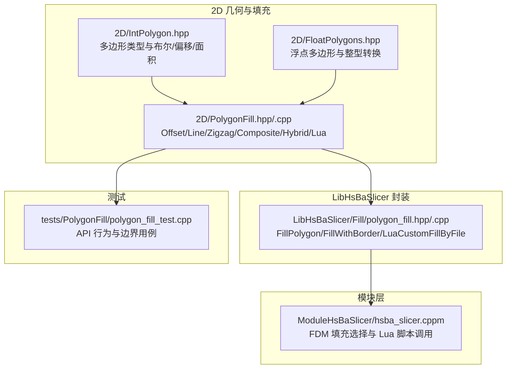

**图表来源**
- [2D/IntPolygon.hpp:1-241](file://2D/IntPolygon.hpp#L1-L241)
- [2D/FloatPolygons.hpp:1-271](file://2D/FloatPolygons.hpp#L1-L271)
- [2D/PolygonFill.hpp:1-141](file://2D/PolygonFill.hpp#L1-L141)
- [LibHsBaSlicer/Fill/polygon_fill.hpp:1-58](file://LibHsBaSlicer/Fill/polygon_fill.hpp#L1-L58)
- [ModuleHsBaSlicer/hsba_slicer.cppm:667-675](file://ModuleHsBaSlicer/hsba_slicer.cppm#L667-L675)
- [tests/PolygonFill/polygon_fill_test.cpp:175-210](file://tests/PolygonFill/polygon_fill_test.cpp#L175-L210)

**章节来源**
- [2D/PolygonFill.hpp:1-141](file://2D/PolygonFill.hpp#L1-L141)
- [LibHsBaSlicer/Fill/polygon_fill.hpp:1-58](file://LibHsBaSlicer/Fill/polygon_fill.hpp#L1-L58)
- [ModuleHsBaSlicer/hsba_slicer.cppm:667-675](file://ModuleHsBaSlicer/hsba_slicer.cppm#L667-L675)
- [tests/PolygonFill/polygon_fill_test.cpp:175-210](file://tests/PolygonFill/polygon_fill_test.cpp#L175-L210)

## 核心组件
本节聚焦填充算法的核心接口与数据结构：
- 多边形类型与坐标体系：整数坐标 `Point2/Polygon/Polygons` 与浮点坐标 `Point2D/PolygonD/PolygonsD`，并通过 `integerization` 缩放因子进行双向转换。
- 几何运算：Union、Intersection、Difference、Xor、Offset、Area、PointInPolygons。
- 填充模式枚举：`FillMode::Line`、`FillMode::SimpleZigzag`、`FillMode::Zigzag`。
- 填充函数族：OffsetFill、LineFill、SimpleZigzagFill、ZigzagFill、CompositeOffsetFill、HybridFill、LuaCustomFill、LuaCustomFillString。
- LibHsBaSlicer 对外 API：FillPolygon、FillWithBorder、LuaCustomFillByFile。

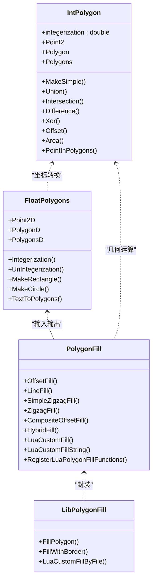

**图表来源**
- [2D/IntPolygon.hpp:16-212](file://2D/IntPolygon.hpp#L16-L212)
- [2D/FloatPolygons.hpp:18-221](file://2D/FloatPolygons.hpp#L18-L221)
- [2D/PolygonFill.hpp:20-136](file://2D/PolygonFill.hpp#L20-L136)
- [LibHsBaSlicer/Fill/polygon_fill.hpp:17-55](file://LibHsBaSlicer/Fill/polygon_fill.hpp#L17-L55)

**章节来源**
- [2D/IntPolygon.hpp:16-212](file://2D/IntPolygon.hpp#L16-L212)
- [2D/FloatPolygons.hpp:18-221](file://2D/FloatPolygons.hpp#L18-L221)
- [2D/PolygonFill.hpp:20-136](file://2D/PolygonFill.hpp#L20-L136)
- [LibHsBaSlicer/Fill/polygon_fill.hpp:17-55](file://LibHsBaSlicer/Fill/polygon_fill.hpp#L17-L55)

## 架构总览
从调用链看，填充算法在三个层次协作：
- 2D 层提供几何与填充实现；
- LibHsBaSlicer 层提供简洁 API，将复杂参数组合为常用模式；
- 模块层根据配置选择填充策略，支持 Lua 脚本自定义填充。

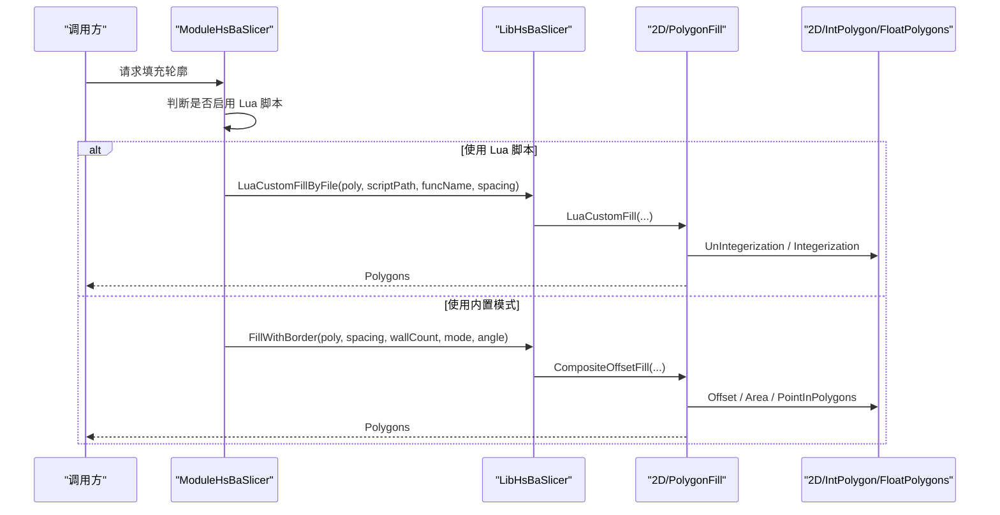

**图表来源**
- [ModuleHsBaSlicer/hsba_slicer.cppm:667-675](file://ModuleHsBaSlicer/hsba_slicer.cppm#L667-L675)
- [LibHsBaSlicer/Fill/polygon_fill.cpp:13-49](file://LibHsBaSlicer/Fill/polygon_fill.cpp#L13-L49)
- [2D/PolygonFill.cpp:1493-1585](file://2D/PolygonFill.cpp#L1493-L1585)
- [2D/FloatPolygons.hpp:196-221](file://2D/FloatPolygons.hpp#L196-L221)

**章节来源**
- [ModuleHsBaSlicer/hsba_slicer.cppm:667-675](file://ModuleHsBaSlicer/hsba_slicer.cppm#L667-L675)
- [LibHsBaSlicer/Fill/polygon_fill.cpp:13-49](file://LibHsBaSlicer/Fill/polygon_fill.cpp#L13-L49)
- [2D/PolygonFill.cpp:1493-1585](file://2D/PolygonFill.cpp#L1493-L1585)

## 详细组件分析

### 填充模式与接口规范
- 直线填充：`LineFill(poly, spacing, angle_deg, lineThickness)`
  - 作用：按角度生成平行线扫描段，返回独立线段集合。
  - 关键参数：间距 `spacing`、角度 `angle_deg`（度）、线宽 `lineThickness`。
- 简单锯齿填充：`SimpleZigzagFill(poly, spacing, angle_deg, lineThickness)`
  - 作用：连接相邻行扫描段中心形成连续折线，适合较规则区域。
- 高级锯齿填充：`ZigzagFill(poly, spacing, angle_deg, lineThickness)`
  - 作用：改进拐角处理，通过连通分量与桥接逻辑避免穿越空洞或凹口。
- 复合偏移填充：`CompositeOffsetFill(poly, spacing, offsetStep, outwardCount, inwardCount, mode, angle_deg, lineThickness, join_type)`
  - 作用：对原轮廓分别向外/向内偏移多层，并对每层执行内部填充。
- 混合填充：`HybridFill(poly, spacing, offsetStep, outwardCount, inwardCount, mode, angle_deg, lineThickness, join_type)`
  - 作用：先输出若干偏移轮廓作为边界，再对最内层有效岛屿执行内部填充。
- Lua 自定义填充：`LuaCustomFill(...)`、`LuaCustomFillString(...)`
  - 作用：加载 Lua 脚本或字符串，调用指定函数生成路径表。

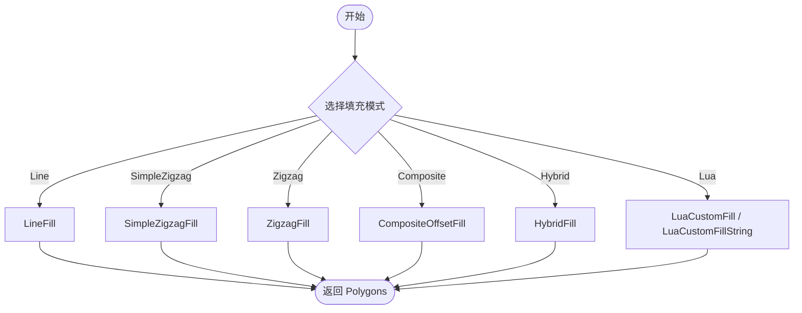

**图表来源**
- [2D/PolygonFill.hpp:27-130](file://2D/PolygonFill.hpp#L27-L130)
- [2D/PolygonFill.cpp:504-564](file://2D/PolygonFill.cpp#L504-L564)
- [2D/PolygonFill.cpp:568-800](file://2D/PolygonFill.cpp#L568-L800)
- [2D/PolygonFill.cpp:803-1370](file://2D/PolygonFill.cpp#L803-L1370)
- [2D/PolygonFill.cpp:1372-1491](file://2D/PolygonFill.cpp#L1372-L1491)
- [2D/PolygonFill.cpp:1493-1669](file://2D/PolygonFill.cpp#L1493-L1669)

**章节来源**
- [2D/PolygonFill.hpp:27-130](file://2D/PolygonFill.hpp#L27-L130)
- [2D/PolygonFill.cpp:504-564](file://2D/PolygonFill.cpp#L504-L564)
- [2D/PolygonFill.cpp:568-800](file://2D/PolygonFill.cpp#L568-L800)
- [2D/PolygonFill.cpp:803-1370](file://2D/PolygonFill.cpp#L803-L1370)
- [2D/PolygonFill.cpp:1372-1491](file://2D/PolygonFill.cpp#L1372-L1491)
- [2D/PolygonFill.cpp:1493-1669](file://2D/PolygonFill.cpp#L1493-L1669)

### 直线填充 LineFill
- 输入：多边形集合、间距、角度、线宽。
- 处理：计算扫描方向向量，构造矩形条带并与多边形求交，提取每个扫描行的有效区间，排序后生成独立线段。
- 输出：每条线段作为一个 Polygon（两个顶点）。

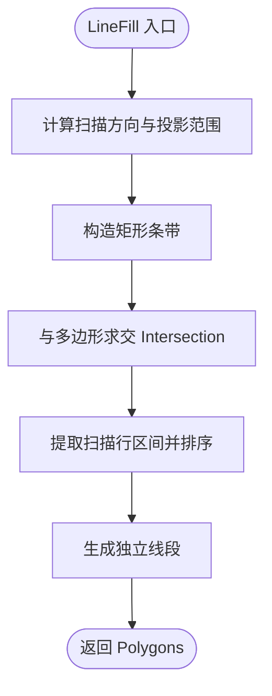

**图表来源**
- [2D/PolygonFill.cpp:44-160](file://2D/PolygonFill.cpp#L44-L160)
- [2D/PolygonFill.cpp:543-564](file://2D/PolygonFill.cpp#L543-L564)

**章节来源**
- [2D/PolygonFill.cpp:44-160](file://2D/PolygonFill.cpp#L44-L160)
- [2D/PolygonFill.cpp:543-564](file://2D/PolygonFill.cpp#L543-L564)

### 简单锯齿填充 SimpleZigzagFill
- 输入：多边形集合、间距、角度、线宽。
- 处理：复用扫描行区间，按奇偶行顺序连接相邻行区间中心，形成连续折线；若区间无效则直接输出原始扫描段。
- 特点：连接限制在同一行或相邻行，避免跨行跳变导致的路径异常。

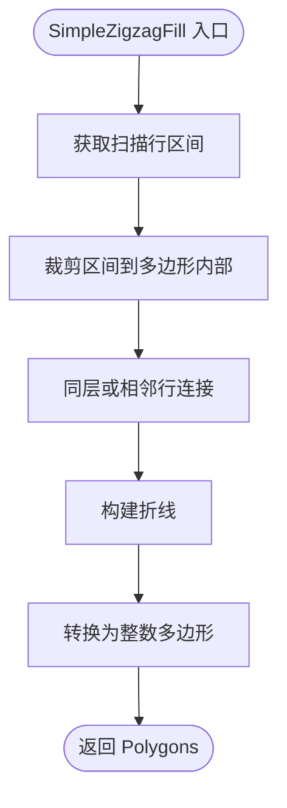

**图表来源**
- [2D/PolygonFill.cpp:568-800](file://2D/PolygonFill.cpp#L568-L800)

**章节来源**
- [2D/PolygonFill.cpp:568-800](file://2D/PolygonFill.cpp#L568-L800)

### 高级锯齿填充 ZigzagFill
- 输入：多边形集合、间距、角度、线宽。
- 处理：
  - 对每行区间排序并展平为统一列表；
  - 使用并查集建立相邻行区间的连通分量；
  - 通过“桥接”逻辑在凹口或空洞处沿外轮廓绕行；
  - 若桥接失败，回退到中线检测或直接输出额外线段。
- 特点：更稳健地处理复杂轮廓与多岛情况，减少路径断裂与穿越空洞。

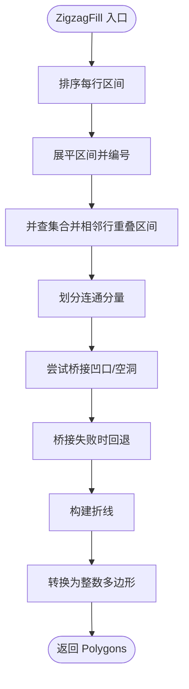

**图表来源**
- [2D/PolygonFill.cpp:803-1370](file://2D/PolygonFill.cpp#L803-L1370)

**章节来源**
- [2D/PolygonFill.cpp:803-1370](file://2D/PolygonFill.cpp#L803-L1370)

### 复合偏移填充 CompositeOffsetFill
- 输入：多边形集合、内部填充间距、偏移步长、外扩层数、内缩层数、填充模式、角度、线宽、倒角类型。
- 处理：
  - 对原轮廓执行内部填充；
  - 对每一层外扩/内缩轮廓分别执行内部填充；
  - 汇总所有结果。
- 适用：需要多层边框与内部填充的组合场景。

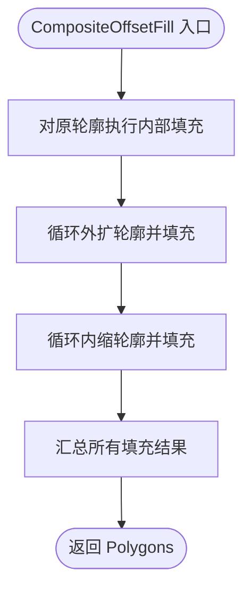

**图表来源**
- [2D/PolygonFill.cpp:1372-1428](file://2D/PolygonFill.cpp#L1372-L1428)

**章节来源**
- [2D/PolygonFill.cpp:1372-1428](file://2D/PolygonFill.cpp#L1372-L1428)

### 混合填充 HybridFill
- 输入：与 CompositeOffsetFill 相同。
- 处理：
  - 输出若干外扩轮廓作为边界；
  - 输出若干内缩轮廓直到面积过小；
  - 对最后一个有效内缩岛屿执行内部填充；
  - 汇总边界与内部填充结果。
- 适用：强调边界轮廓质量，同时对最小岛屿进行填充。

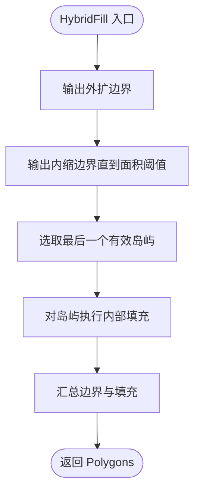

**图表来源**
- [2D/PolygonFill.cpp:1430-1491](file://2D/PolygonFill.cpp#L1430-L1491)

**章节来源**
- [2D/PolygonFill.cpp:1430-1491](file://2D/PolygonFill.cpp#L1430-L1491)

### Lua 自定义填充
- 输入：多边形集合、脚本路径或脚本字符串、函数名、线宽、可选注册回调。
- 处理：
  - 创建独立 Lua 状态；
  - 注册多边形操作与填充函数；
  - 加载脚本并调用目标函数；
  - 解析返回的表结构，收集路径片段；
  - 转换为整数多边形并返回。
- 扩展点：可通过 `lua_reg` 注入更多 2D 函数与路径优化函数，使脚本具备更强的处理能力。

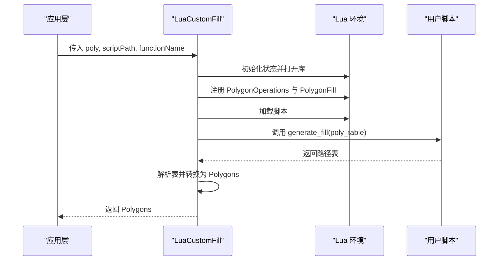

**图表来源**
- [2D/PolygonFill.cpp:1493-1585](file://2D/PolygonFill.cpp#L1493-L1585)
- [2D/PolygonFill.cpp:1587-1669](file://2D/PolygonFill.cpp#L1587-L1669)

**章节来源**
- [2D/PolygonFill.cpp:1493-1585](file://2D/PolygonFill.cpp#L1493-L1585)
- [2D/PolygonFill.cpp:1587-1669](file://2D/PolygonFill.cpp#L1587-L1669)

## 依赖关系分析
- 2D 层依赖 Clipper2 进行布尔运算与偏移；
- FloatPolygons 提供浮点多边形与整型转换；
- PolygonFill 依赖 IntPolygon 的几何运算与 FloatPolygons 的类型转换；
- LibHsBaSlicer 封装层依赖 2D 层并提供更高层语义；
- 模块层根据配置选择内置填充或 Lua 脚本填充。

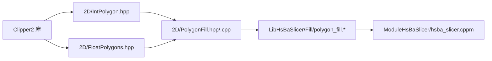

**图表来源**
- [2D/IntPolygon.hpp:1-241](file://2D/IntPolygon.hpp#L1-L241)
- [2D/FloatPolygons.hpp:1-271](file://2D/FloatPolygons.hpp#L1-L271)
- [2D/PolygonFill.hpp:1-141](file://2D/PolygonFill.hpp#L1-L141)
- [LibHsBaSlicer/Fill/polygon_fill.hpp:1-58](file://LibHsBaSlicer/Fill/polygon_fill.hpp#L1-L58)
- [ModuleHsBaSlicer/hsba_slicer.cppm:667-675](file://ModuleHsBaSlicer/hsba_slicer.cppm#L667-L675)

**章节来源**
- [2D/IntPolygon.hpp:1-241](file://2D/IntPolygon.hpp#L1-L241)
- [2D/FloatPolygons.hpp:1-271](file://2D/FloatPolygons.hpp#L1-L271)
- [2D/PolygonFill.hpp:1-141](file://2D/PolygonFill.hpp#L1-L141)
- [LibHsBaSlicer/Fill/polygon_fill.hpp:1-58](file://LibHsBaSlicer/Fill/polygon_fill.hpp#L1-L58)
- [ModuleHsBaSlicer/hsba_slicer.cppm:667-675](file://ModuleHsBaSlicer/hsba_slicer.cppm#L667-L675)

## 性能与适用场景
- OffsetFill：通过不断内缩生成闭合环，适用于需要同心边框的场景；非正间距会短路返回空结果。
- LineFill：扫描线与求交复杂度较高，但输出为独立线段，便于后续路径优化；适合规则区域与高角度覆盖。
- SimpleZigzagFill：连接相邻行区间，路径连续性较好；对复杂凹口处理较弱。
- ZigzagFill：引入连通分量与桥接逻辑，鲁棒性更强；适合复杂轮廓与多岛情况。
- CompositeOffsetFill：对多层偏移均执行填充，计算量随层数线性增长；适合需要多层边框与内部填充的组合。
- HybridFill：优先输出边界轮廓，仅对最小岛屿填充；适合强调边界质量且控制内部填充成本的场景。
- Lua 自定义填充：灵活性最高，但涉及 Lua 状态创建与脚本加载开销；适合需要高度定制化的填充策略。

[本节为通用性能讨论，不直接分析具体文件]

## 使用示例与扩展方法

### 使用 LibHsBaSlicer 填充 API
- 基本填充：`FillPolygon(poly, spacing, mode, angle_deg)`
  - 根据 `FillMode` 选择直线、简单锯齿或高级锯齿填充。
- 带边框填充：`FillWithBorder(poly, spacing, border_count, fill_mode, angle_deg)`
  - 基于 `CompositeOffsetFill`，设置外扩层数为 0，内缩层数为 `border_count`。
- Lua 自定义填充：`LuaCustomFillByFile(poly, scriptPath, functionName, lineThickness)`
  - 自动注册 2D 函数与路径优化函数，供脚本调用。

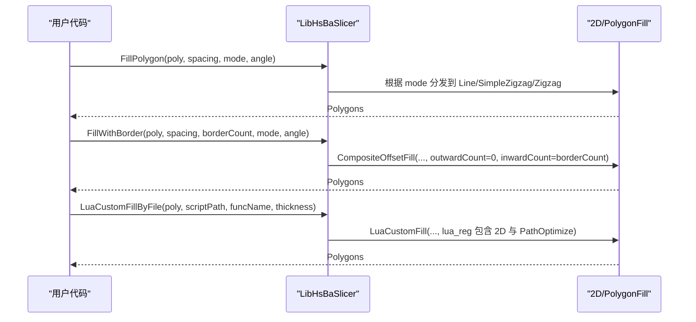

**图表来源**
- [LibHsBaSlicer/Fill/polygon_fill.cpp:13-49](file://LibHsBaSlicer/Fill/polygon_fill.cpp#L13-L49)
- [2D/PolygonFill.cpp:1493-1585](file://2D/PolygonFill.cpp#L1493-L1585)

**章节来源**
- [LibHsBaSlicer/Fill/polygon_fill.cpp:13-49](file://LibHsBaSlicer/Fill/polygon_fill.cpp#L13-L49)
- [2D/PolygonFill.cpp:1493-1585](file://2D/PolygonFill.cpp#L1493-L1585)

### 模块层调用与配置
- 当配置中存在 Lua 脚本路径时，模块层调用 `LuaCustomFillByFile`；
- 否则调用 `FillWithBorder`，使用墙层数作为边框数量。

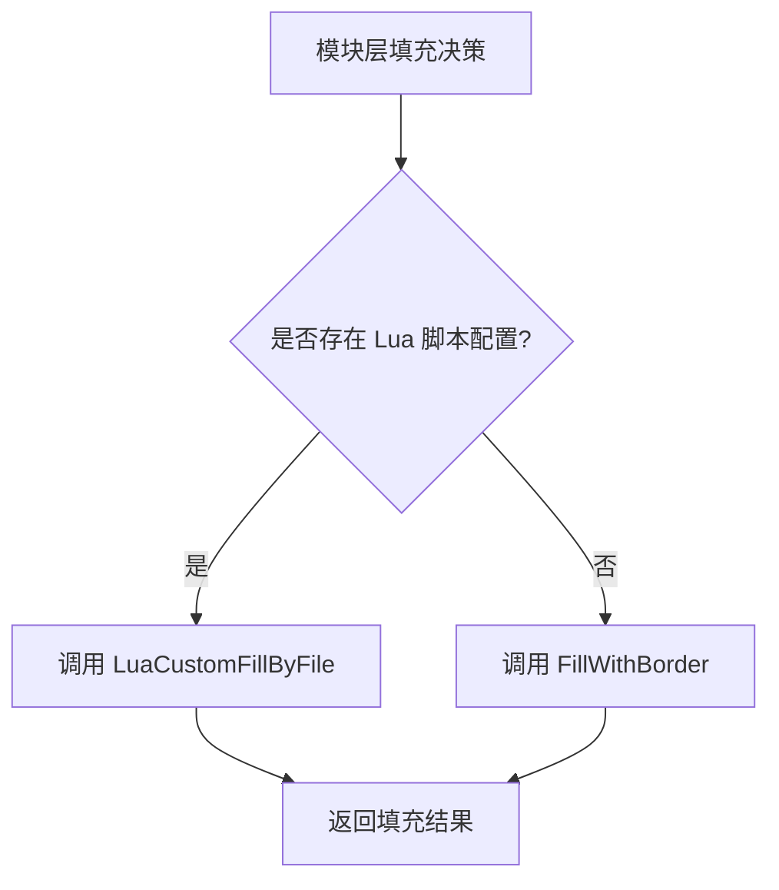

**图表来源**
- [ModuleHsBaSlicer/hsba_slicer.cppm:667-675](file://ModuleHsBaSlicer/hsba_slicer.cppm#L667-L675)

**章节来源**
- [ModuleHsBaSlicer/hsba_slicer.cppm:667-675](file://ModuleHsBaSlicer/hsba_slicer.cppm#L667-L675)

### 自定义填充模式的扩展方法
- 通过 `LuaCustomFill` 或 `LuaCustomFillString` 提供 `lua_reg` 回调，注入更多 2D 函数与路径优化函数；
- 在脚本中实现 `generate_fill(poly_table)`，返回路径表；
- 可结合 `PathOptimize.optimizeRegions` 与 `PathOptimize.optimizePolygons` 对区域进行优化。

**章节来源**
- [2D/PolygonFill.cpp:1493-1585](file://2D/PolygonFill.cpp#L1493-L1585)
- [tests/PolygonFill/polygon_fill_test.cpp:522-540](file://tests/PolygonFill/polygon_fill_test.cpp#L522-L540)

## 多边形基础几何运算 API
本节整理多边形基础几何运算接口，涵盖交集、并集、差集、异或、偏移、面积与点包含测试等。

- 单多边形布尔运算：
  - `Union(left, right, fill_rule)`
  - `Intersection(left, right, fill_rule)`
  - `Difference(left, right, fill_rule)`
  - `Xor(left, right, fill_rule)`
- 多边形集合布尔运算：
  - `Union(left, right, fill_rule)`
  - `Intersection(left, right, fill_rule)`
  - `Difference(left, right, fill_rule)`
  - `Xor(left, right, fill_rule)`
- 偏移与端点类型：
  - `Offset(p, delta, join_type, end_type)`
  - `Offset(ps, delta, join_type, end_type)`
- 面积与点包含：
  - `Area(p)`、`Area(ps)`
  - `PointInPolygons(point, polys, isEvenOdd)`

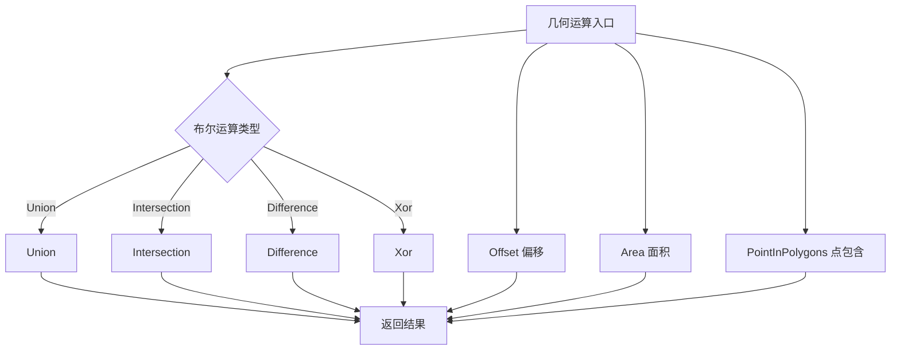

**图表来源**
- [2D/IntPolygon.hpp:68-178](file://2D/IntPolygon.hpp#L68-L178)

**章节来源**
- [2D/IntPolygon.hpp:68-178](file://2D/IntPolygon.hpp#L68-L178)

## 故障排除
- OffsetFill 返回空：
  - 当 `spacing <= 0` 时直接返回空结果；
  - 测试用例验证了零间距与负间距均短路为空。
- ZigzagFill 路径越界或出现伪顶点：
  - 测试用例确保所有顶点位于多边形包围盒内；
  - 桥接失败时会回退到中线检测或输出额外线段，避免未初始化顶点泄漏。
- Lua 自定义填充异常：
  - 脚本加载失败或函数不存在会抛出运行时错误；
  - 返回值必须为表，否则会抛出错误。

**章节来源**
- [tests/PolygonFill/polygon_fill_test.cpp:175-210](file://tests/PolygonFill/polygon_fill_test.cpp#L175-L210)
- [tests/PolygonFill/polygon_fill_test.cpp:522-540](file://tests/PolygonFill/polygon_fill_test.cpp#L522-L540)
- [tests/PolygonFill/polygon_fill_test.cpp:620-679](file://tests/PolygonFill/polygon_fill_test.cpp#L620-L679)
- [2D/PolygonFill.cpp:1493-1585](file://2D/PolygonFill.cpp#L1493-L1585)

## 结论
HsBaSlicer 的填充算法以 2D 几何为基础，提供多种填充模式与灵活的 Lua 扩展机制。对于常规需求，可直接使用 LibHsBaSlicer 的 `FillPolygon` 与 `FillWithBorder`；对于复杂场景，推荐通过 `LuaCustomFillByFile` 注入自定义脚本，并结合路径优化函数提升最终路径质量。在实际工程中，应根据轮廓复杂度、边框需求与性能预算选择合适的填充模式，并注意间距、角度与线宽等参数的合理配置。

[本节为总结性内容，不直接分析具体文件]