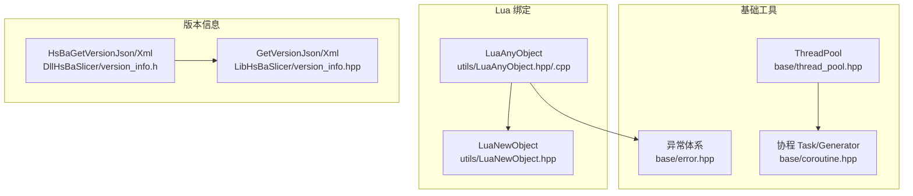
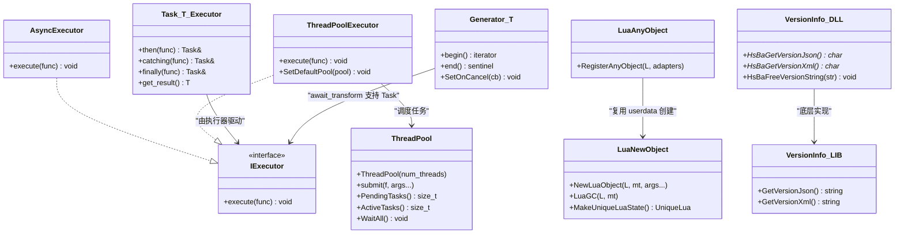
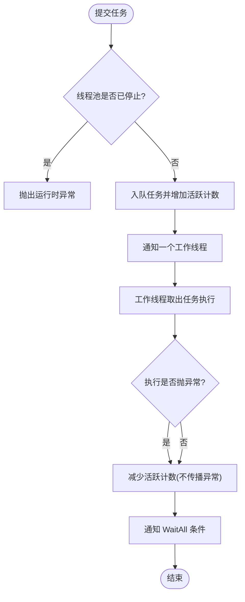
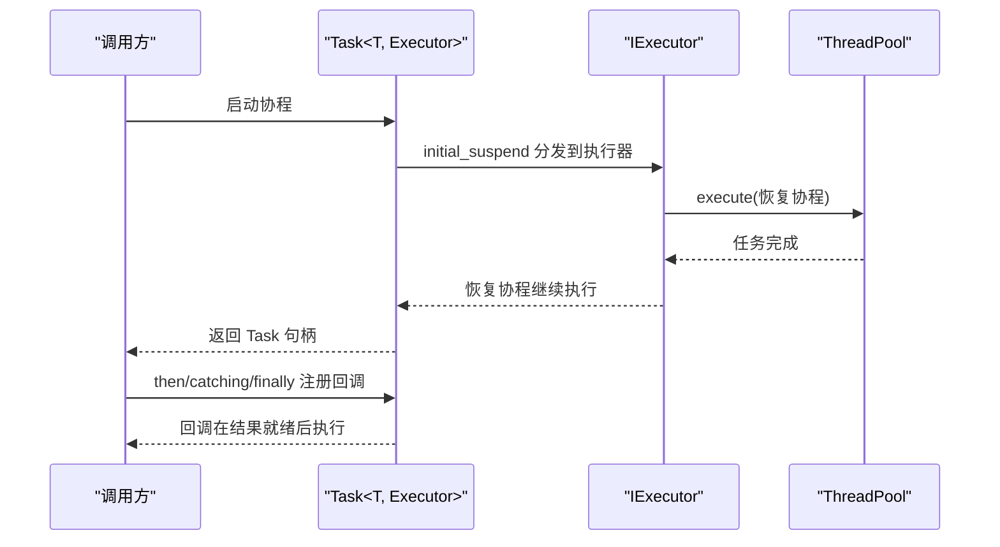
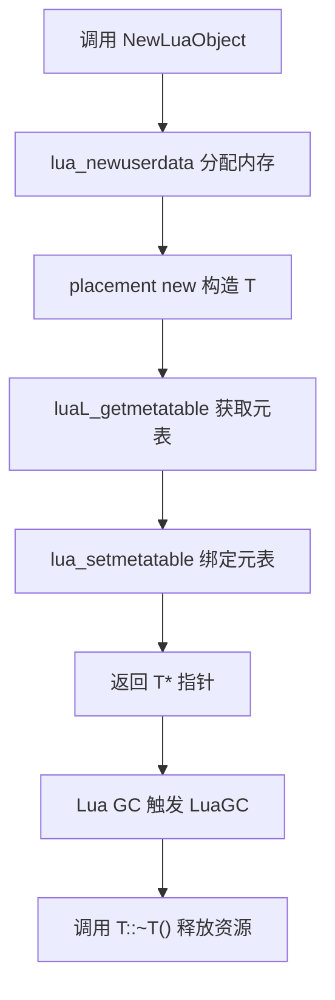
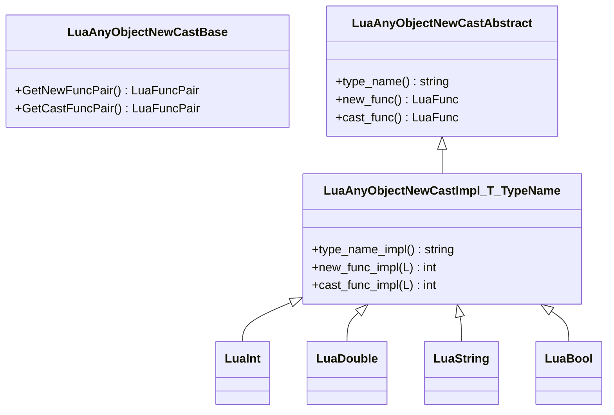
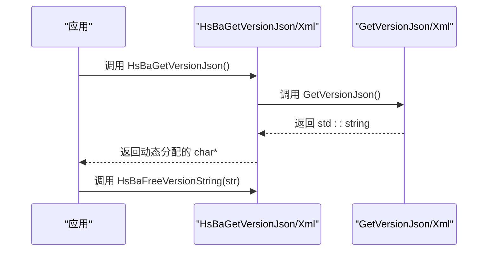
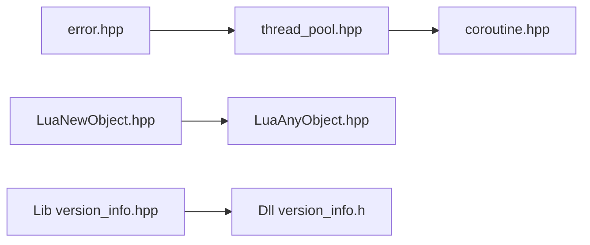

# 工具类 API

<cite>
**本文引用的文件**   
- [thread_pool.hpp](file://base/thread_pool.hpp)
- [coroutine.hpp](file://base/coroutine.hpp)
- [error.hpp](file://base/error.hpp)
- [LuaNewObject.hpp](file://utils/LuaNewObject.hpp)
- [LuaAnyObject.hpp](file://utils/LuaAnyObject.hpp)
- [LuaAnyObject.cpp](file://utils/LuaAnyObject.cpp)
- [version_info.h](file://DllHsBaSlicer/version_info.h)
- [version_info.hpp](file://LibHsBaSlicer/version_info.hpp)
</cite>

## 目录
1. [引言](#引言)
2. [项目结构](#项目结构)
3. [核心组件](#核心组件)
4. [架构总览](#架构总览)
5. [详细组件分析](#详细组件分析)
6. [依赖关系分析](#依赖关系分析)
7. [性能与线程安全](#性能与线程安全)
8. [错误处理与资源管理](#错误处理与资源管理)
9. [使用示例与最佳实践](#使用示例与最佳实践)
10. [故障排除](#故障排除)
11. [结论](#结论)

## 引言
本页面聚焦 HsBaSlicer 的工具类 C++ API，覆盖以下实用能力：
- 版本信息查询（C ABI 与 C++ 接口）
- 线程池任务调度
- C++20 协程任务、生成器与执行器
- Lua 对象绑定与 AnyObject 类型桥接

这些工具类位于 base 与 utils 模块中，既可直接在 C++ 工程中使用，也可通过 DllHsBaSlicer 暴露给外部进程或脚本系统。文档同时给出线程安全说明、性能注意事项、错误处理策略和实际集成建议。

## 项目结构
本章节仅关注与“工具类 API”直接相关的源码位置：
- base：通用基础工具，包括线程池、协程、异常体系
- utils：Lua 绑定与 AnyObject 桥接工具
- DllHsBaSlicer：对外暴露的 C ABI 版本查询接口
- LibHsBaSlicer：C++ 侧版本查询接口

**图示来源**
- [thread_pool.hpp:25-162](file://base/thread_pool.hpp#L25-L162)
- [coroutine.hpp:41-773](file://base/coroutine.hpp#L41-L773)
- [error.hpp:15-145](file://base/error.hpp#L15-L145)
- [LuaNewObject.hpp:13-115](file://utils/LuaNewObject.hpp#L13-L115)
- [LuaAnyObject.hpp:19-521](file://utils/LuaAnyObject.hpp#L19-L521)
- [version_info.h:11-45](file://DllHsBaSlicer/version_info.h#L11-L45)
- [version_info.hpp:13-27](file://LibHsBaSlicer/version_info.hpp#L13-L27)

**章节来源**
- [thread_pool.hpp:1-214](file://base/thread_pool.hpp#L1-L214)
- [coroutine.hpp:1-1091](file://base/coroutine.hpp#L1-L1091)
- [error.hpp:1-147](file://base/error.hpp#L1-L147)
- [LuaNewObject.hpp:1-118](file://utils/LuaNewObject.hpp#L1-L118)
- [LuaAnyObject.hpp:1-523](file://utils/LuaAnyObject.hpp#L1-L523)
- [version_info.h:1-48](file://DllHsBaSlicer/version_info.h#L1-L48)
- [version_info.hpp:1-30](file://LibHsBaSlicer/version_info.hpp#L1-L30)

## 核心组件
本节概述各工具类的职责与关键接口。

- 线程池 ThreadPool
  - 用途：创建固定数量的工作线程，提交可返回 std::future 的任务，支持等待全部完成、统计待处理与活跃任务数。
  - 关键点：构造参数为线程数；析构时停止并 join 所有线程；submit 在已停止状态下抛出运行时异常。

- 协程 Task/Generator 与执行器 IExecutor
  - 用途：封装 C++20 协程，提供异步任务链式调用 then/catching/finally，以及 Generator 惰性迭代。
  - 关键点：IExecutor 抽象执行上下文；AsyncExecutor 默认异步执行；ThreadPoolExecutor 将协程调度到线程池；Task 结果包装 Result 并提供 get_or_throw。

- Lua 对象绑定 LuaNewObject / LuaGC
  - 用途：在 Lua userdata 中构造 C++ 对象，自动关联元表，并在垃圾回收时调用析构；提供 MakeUniqueLuaState 管理 lua_State 生命周期。

- Lua 任意对象桥接 LuaAnyObject
  - 用途：将 C++ 任意类型以 AnyObject 形式在 Lua 中注册、创建与转换；提供 new_/cast_ 系列函数；内置 int/double/string/bool 等常见类型的适配器。

- 版本信息接口
  - DllHsBaSlicer：C ABI 导出 HsBaGetVersionJson/HsBaGetVersionXml/HsBaFreeVersionString。
  - LibHsBaSlicer：C++ 接口 GetVersionJson/GetVersionXml，返回 std::string。

**章节来源**
- [thread_pool.hpp:29-162](file://base/thread_pool.hpp#L29-L162)
- [coroutine.hpp:47-773](file://base/coroutine.hpp#L47-L773)
- [LuaNewObject.hpp:15-115](file://utils/LuaNewObject.hpp#L15-L115)
- [LuaAnyObject.hpp:21-521](file://utils/LuaAnyObject.hpp#L21-L521)
- [version_info.h:16-41](file://DllHsBaSlicer/version_info.h#L16-L41)
- [version_info.hpp:15-25](file://LibHsBaSlicer/version_info.hpp#L15-L25)

## 架构总览
下图展示工具类之间的依赖与交互关系：

**图示来源**
- [thread_pool.hpp:29-162](file://base/thread_pool.hpp#L29-L162)
- [thread_pool.hpp:164-210](file://base/thread_pool.hpp#L164-L210)
- [coroutine.hpp:47-773](file://base/coroutine.hpp#L47-L773)
- [coroutine.hpp:780-1042](file://base/coroutine.hpp#L780-L1042)
- [LuaNewObject.hpp:15-115](file://utils/LuaNewObject.hpp#L15-L115)
- [LuaAnyObject.hpp:21-521](file://utils/LuaAnyObject.hpp#L21-L521)
- [version_info.h:16-41](file://DllHsBaSlicer/version_info.h#L16-L41)
- [version_info.hpp:15-25](file://LibHsBaSlicer/version_info.hpp#L15-L25)

## 详细组件分析

### 线程池 ThreadPool
- 设计要点
  - 内部维护任务队列、条件变量与原子计数器，保证多生产者单消费者模型下的并发安全。
  - WorkerLoop 循环取任务执行，捕获异常但不中断线程；完成后通知 WaitAll。
  - 析构时设置停止标志并唤醒所有 worker，随后 join 线程。
- 关键接口
  - 构造：显式指定线程数，若为 0 抛出 InvalidArgumentError。
  - submit：提交可调用对象及参数，返回 std::future。
  - PendingTasks/ActiveTasks：分别返回队列长度与正在执行的任务数。
  - WaitAll：阻塞直到队列为空且无活跃任务。
- 线程安全
  - 所有共享状态均受互斥锁保护；active_tasks_ 为原子计数。
- 性能考虑
  - 避免频繁提交极小任务导致调度开销过大；合理设置线程数，通常与硬件并发一致。

**图示来源**
- [thread_pool.hpp:67-153](file://base/thread_pool.hpp#L67-L153)

**章节来源**
- [thread_pool.hpp:29-162](file://base/thread_pool.hpp#L29-L162)
- [error.hpp:17-45](file://base/error.hpp#L17-L45)

### 协程 Task/Generator 与执行器
- 执行器 IExecutor
  - NoopExecutor：同步执行回调。
  - AsyncExecutor：使用 std::async 异步执行。
  - ThreadPoolExecutor：将任务提交到 ThreadPool，支持设置全局默认线程池。
- Task<T, Executor>
  - 提供 then/catching/finally 链式回调；Result 封装值与异常，get_or_throw 在存在异常时重抛。
  - await_transform 支持嵌套 Task 与自定义分配器的 CustomAllocatorTask。
- Generator<T>
  - 惰性迭代器，支持 co_yield；unhandled_exception 触发 onCancel 钩子。
  - 支持 SetOnCancel 设置取消回调。
- 自定义分配器
  - CustomAllocatorTask/CustomAllocatorGenerator 允许通过静态分配器控制 promise/generator 内存布局。

**图示来源**
- [coroutine.hpp:234-382](file://base/coroutine.hpp#L234-L382)
- [coroutine.hpp:414-555](file://base/coroutine.hpp#L414-L555)
- [thread_pool.hpp:164-210](file://base/thread_pool.hpp#L164-L210)

**章节来源**
- [coroutine.hpp:47-773](file://base/coroutine.hpp#L47-L773)
- [coroutine.hpp:780-1042](file://base/coroutine.hpp#L780-L1042)
- [thread_pool.hpp:164-210](file://base/thread_pool.hpp#L164-L210)

### Lua 对象绑定 LuaNewObject / LuaGC
- NewLuaObject
  - 在 Lua userdata 中构造 C++ 对象，并设置元表名称；支持编译期模板字符串作为元表名。
- LuaGC
  - 在 Lua GC 阶段调用对象的析构函数，确保资源释放。
- MakeUniqueLuaState
  - 返回带自定义删除器的 unique_ptr，自动关闭 lua_State。

**图示来源**
- [LuaNewObject.hpp:25-53](file://utils/LuaNewObject.hpp#L25-L53)
- [LuaNewObject.hpp:63-87](file://utils/LuaNewObject.hpp#L63-L87)
- [LuaNewObject.hpp:92-115](file://utils/LuaNewObject.hpp#L92-L115)

**章节来源**
- [LuaNewObject.hpp:15-115](file://utils/LuaNewObject.hpp#L15-L115)

### Lua 任意对象桥接 LuaAnyObject
- 类型适配器
  - LuaAnyObjectNewCastBase：定义 new_func/cast_func 对。
  - LuaAnyObjectNewCastAbstract：CRTP 基类，自动生成 new_/cast_ 函数名。
  - LuaAnyObjectNewCastImpl<T, TypeName>：通用适配器；针对 int/long/size_t/double/float/bool/string/cstring 提供特化。
- RegisterAnyObject
  - 将适配器注册到给定 lua_State，使 Lua 可通过 new_<type>/cast_<type> 操作 AnyObject。
- 行为特性
  - cast_* 使用 cast_new 避免重复析构；异常会被转换为 Lua 错误消息。

**图示来源**
- [LuaAnyObject.hpp:32-112](file://utils/LuaAnyObject.hpp#L32-L112)
- [LuaAnyObject.hpp:118-510](file://utils/LuaAnyObject.hpp#L118-L510)

**章节来源**
- [LuaAnyObject.hpp:21-521](file://utils/LuaAnyObject.hpp#L21-L521)
- [LuaAnyObject.cpp:11-49](file://utils/LuaAnyObject.cpp#L11-L49)

### 版本信息接口
- DllHsBaSlicer（C ABI）
  - HsBaGetVersionJson：返回 UTF-8 JSON 字符串，需调用 HsBaFreeVersionString 释放。
  - HsBaGetVersionXml：返回 UTF-8 XML 字符串，需调用 HsBaFreeVersionString 释放。
- LibHsBaSlicer（C++）
  - GetVersionJson/GetVersionXml：返回 std::string，无需手动释放。

**图示来源**
- [version_info.h:16-41](file://DllHsBaSlicer/version_info.h#L16-L41)
- [version_info.hpp:15-25](file://LibHsBaSlicer/version_info.hpp#L15-L25)

**章节来源**
- [version_info.h:1-48](file://DllHsBaSlicer/version_info.h#L1-L48)
- [version_info.hpp:1-30](file://LibHsBaSlicer/version_info.hpp#L1-L30)

## 依赖关系分析
- ThreadPool 依赖 coroutine.hpp 中的 IExecutor 接口（用于可选的协程执行器）。
- LuaAnyObject 依赖 LuaNewObject 提供的 userdata 创建与 GC 机制。
- 协程 Task/Generator 依赖 IExecutor 抽象，具体执行器可由 AsyncExecutor 或 ThreadPoolExecutor 提供。
- 版本信息接口在 DLL 层封装 C++ 层实现，统一对外暴露 C ABI。

**图示来源**
- [thread_pool.hpp:22-23](file://base/thread_pool.hpp#L22-L23)
- [LuaAnyObject.hpp:8-9](file://utils/LuaAnyObject.hpp#L8-L9)
- [version_info.h:9](file://DllHsBaSlicer/version_info.h#L9)
- [version_info.hpp:11](file://LibHsBaSlicer/version_info.hpp#L11)

**章节来源**
- [thread_pool.hpp:1-214](file://base/thread_pool.hpp#L1-L214)
- [LuaAnyObject.hpp:1-523](file://utils/LuaAnyObject.hpp#L1-L523)
- [version_info.h:1-48](file://DllHsBaSlicer/version_info.h#L1-L48)
- [version_info.hpp:1-30](file://LibHsBaSlicer/version_info.hpp#L1-L30)

## 性能与线程安全
- 线程池
  - 线程安全：所有共享状态受互斥锁保护；active_tasks_ 使用原子类型。
  - 性能：避免过度细粒度的任务拆分；合理设置线程数；优先批量提交任务以减少调度开销。
- 协程
  - 执行器选择：AsyncExecutor 适合轻量异步；ThreadPoolExecutor 适合 CPU 密集任务，避免阻塞主线程。
  - 取消与异常：Generator 支持 SetOnCancel；Task 的 catching/finally 可用于清理与日志记录。
- Lua 绑定
  - 内存管理：使用 LuaGC 确保析构；MakeUniqueLuaState 避免 lua_State 泄漏。
  - 类型转换：AnyObject 适配器在 cast_* 时使用 cast_new 避免重复析构，降低开销。
- 版本信息
  - C ABI 返回的动态字符串必须由调用方释放；C++ 接口返回 std::string 更安全便捷。

[本节为通用指导，不直接分析具体文件]

## 错误处理与资源管理
- 异常体系
  - 继承自 std::runtime_error，包含 RuntimeError、InvalidArgumentError、IOError、TimeoutError 等。
  - ThreadPool 在无效参数或非法状态时抛出相应异常。
- 协程异常
  - Task 的 Result::get_or_throw 在存在异常时重抛；Generator 的 unhandled_exception 触发 onCancel。
- Lua 错误
  - LuaAnyObject 的 cast_* 将异常转换为 Lua 错误消息；NewLuaObject 需要正确设置元表以避免 GC 失败。
- 资源释放
  - DllHsBaSlicer 的版本字符串必须调用 HsBaFreeVersionString。
  - Lua 对象通过 LuaGC 自动析构；Lua 状态通过 MakeUniqueLuaState 智能指针管理。

**章节来源**
- [error.hpp:17-145](file://base/error.hpp#L17-L145)
- [thread_pool.hpp:37-46](file://base/thread_pool.hpp#L37-L46)
- [thread_pool.hpp:77-89](file://base/thread_pool.hpp#L77-L89)
- [coroutine.hpp:234-382](file://base/coroutine.hpp#L234-L382)
- [coroutine.hpp:822-827](file://base/coroutine.hpp#L822-L827)
- [LuaAnyObject.hpp:89-112](file://utils/LuaAnyObject.hpp#L89-L112)
- [version_info.h:16-41](file://DllHsBaSlicer/version_info.h#L16-L41)

## 使用示例与最佳实践

### 线程池使用示例
- 基本用法
  - 创建线程池，提交多个任务，使用 future 获取结果，最后调用 WaitAll 等待完成。
- 最佳实践
  - 根据 CPU 核心数设置线程数；避免在任务中长时间持有锁；对可能抛出的异常进行捕获与记录。

参考路径
- [thread_pool.hpp:37-111](file://base/thread_pool.hpp#L37-L111)

### 协程与执行器使用示例
- 使用 AsyncExecutor
  - 定义协程函数，返回 Task<T>，使用 then/catching/finally 构建流水线。
- 使用 ThreadPoolExecutor
  - 设置默认线程池或传入实例，将计算密集型任务卸载到线程池。
- 使用 Generator
  - 用 co_yield 产生序列，配合 SetOnCancel 实现取消逻辑。

参考路径
- [coroutine.hpp:234-382](file://base/coroutine.hpp#L234-L382)
- [coroutine.hpp:780-893](file://base/coroutine.hpp#L780-L893)
- [thread_pool.hpp:164-210](file://base/thread_pool.hpp#L164-L210)

### Lua 对象绑定示例
- 创建 C++ 对象并在 Lua 中管理
  - 使用 NewLuaObject 创建对象并绑定元表；在 Lua 中访问对象属性与方法。
- 垃圾回收
  - 使用 LuaGC 确保对象析构；使用 MakeUniqueLuaState 管理 lua_State。

参考路径
- [LuaNewObject.hpp:25-53](file://utils/LuaNewObject.hpp#L25-L53)
- [LuaNewObject.hpp:63-115](file://utils/LuaNewObject.hpp#L63-L115)

### Lua AnyObject 桥接示例
- 注册类型适配器
  - 使用 RegisterAnyObject 将 new_/cast_ 函数注册到 Lua。
- 在 Lua 中创建与转换
  - 调用 new_<type> 创建 AnyObject；调用 cast_<type> 转回原生类型。

参考路径
- [LuaAnyObject.hpp:512-521](file://utils/LuaAnyObject.hpp#L512-L521)
- [LuaAnyObject.cpp:11-49](file://utils/LuaAnyObject.cpp#L11-L49)

### 版本信息查询示例
- C++ 接口
  - 直接调用 GetVersionJson/GetVersionXml 获取字符串。
- C ABI 接口
  - 调用 HsBaGetVersionJson/HsBaGetVersionXml 获取动态字符串，并使用 HsBaFreeVersionString 释放。

参考路径
- [version_info.hpp:15-25](file://LibHsBaSlicer/version_info.hpp#L15-L25)
- [version_info.h:16-41](file://DllHsBaSlicer/version_info.h#L16-L41)

## 故障排除
- 线程池无法提交任务
  - 检查线程池是否已析构或处于停止状态；确认未向已停止的线程池提交任务。
- 协程回调未执行
  - 检查执行器是否正确设置；确认 Task 未被提前销毁；必要时使用 finally 进行清理。
- Lua 对象未析构
  - 确认已为对象设置正确的元表；使用 LuaGC 或在 Lua 中触发垃圾回收。
- AnyObject 转换失败
  - 检查 Lua 传入类型是否与目标类型匹配；查看 cast_* 抛出的异常消息。
- 版本字符串泄漏
  - 确保调用 HsBaFreeVersionString 释放由 HsBaGetVersionJson/HsBaGetVersionXml 返回的字符串。

**章节来源**
- [thread_pool.hpp:77-89](file://base/thread_pool.hpp#L77-L89)
- [coroutine.hpp:338-359](file://base/coroutine.hpp#L338-L359)
- [LuaNewObject.hpp:63-87](file://utils/LuaNewObject.hpp#L63-L87)
- [LuaAnyObject.hpp:89-112](file://utils/LuaAnyObject.hpp#L89-L112)
- [version_info.h:36-41](file://DllHsBaSlicer/version_info.h#L36-L41)

## 结论
HsBaSlicer 的工具类 API 提供了稳定且可扩展的基础设施：
- 线程池与协程组合，既能高效利用多核，又能保持代码的线性可读性。
- Lua 绑定与 AnyObject 桥接，便于脚本扩展与动态配置。
- 版本信息接口兼顾 C ABI 与 C++ 使用场景，满足跨语言集成需求。

在实际项目中，建议：
- 使用 ThreadPoolExecutor 承载 CPU 密集任务，AsyncExecutor 承载 IO 或轻量异步。
- 通过 RegisterAnyObject 集中管理 Lua 类型注册，避免散落的绑定代码。
- 严格遵循资源释放约定，尤其是 C ABI 返回的动态字符串与 Lua 对象的生命周期。

[本节为总结性内容，不直接分析具体文件]