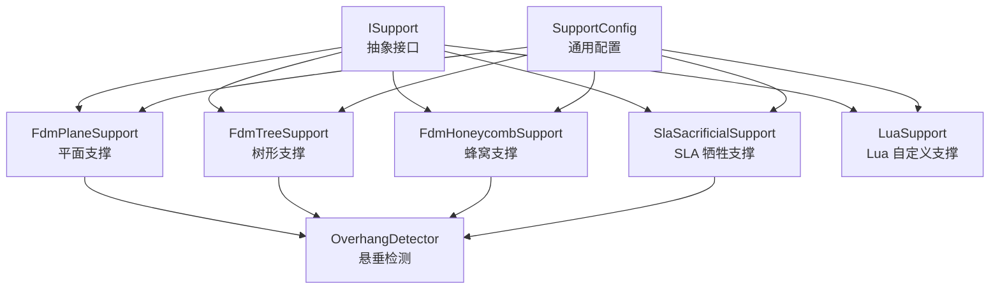
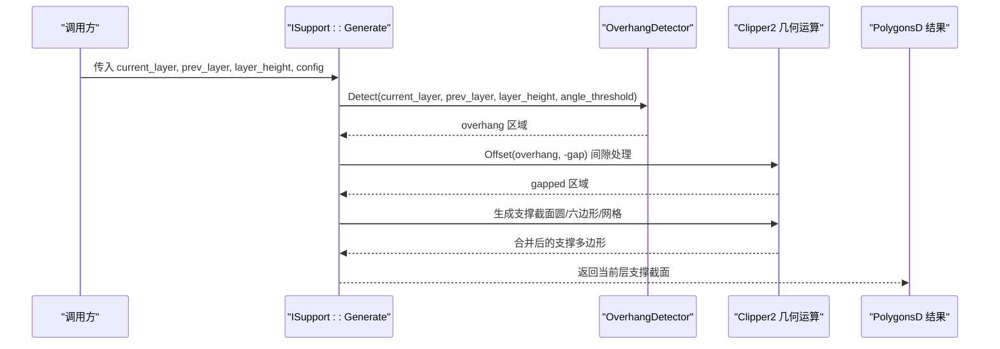
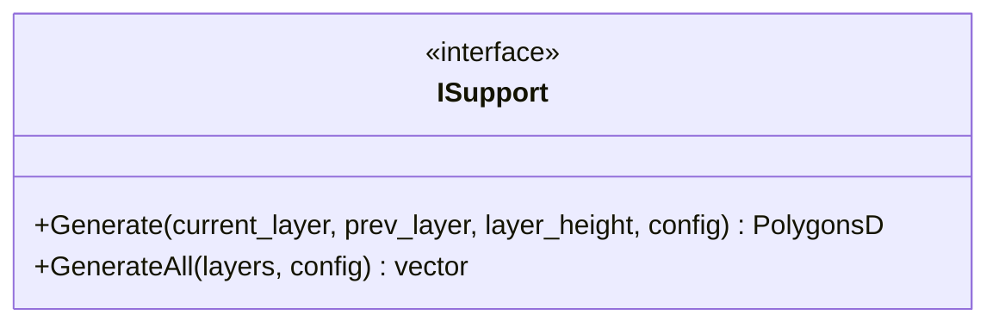
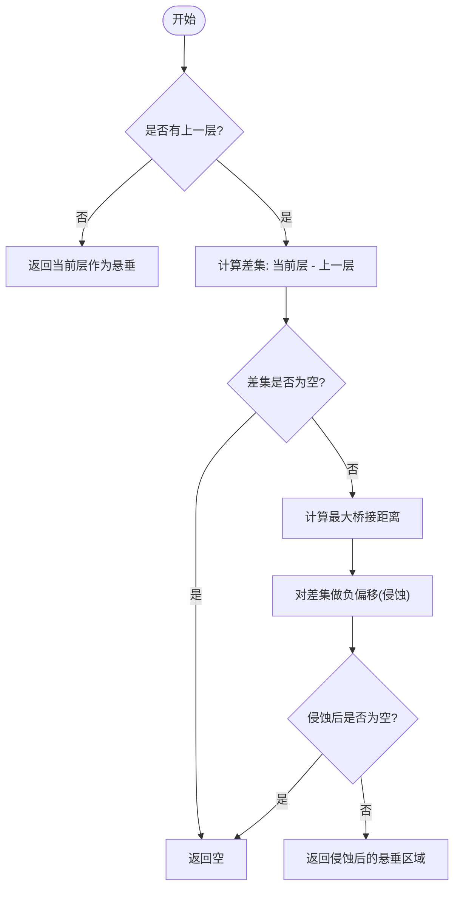
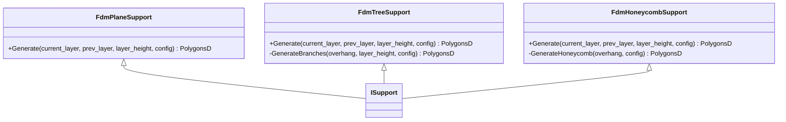
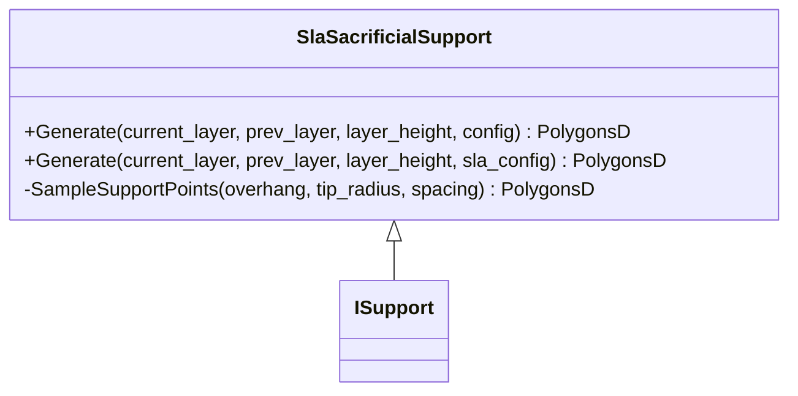
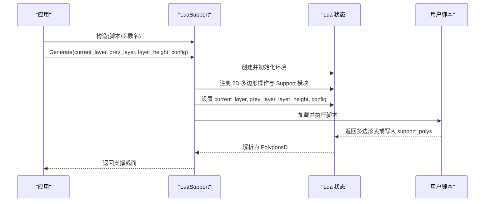
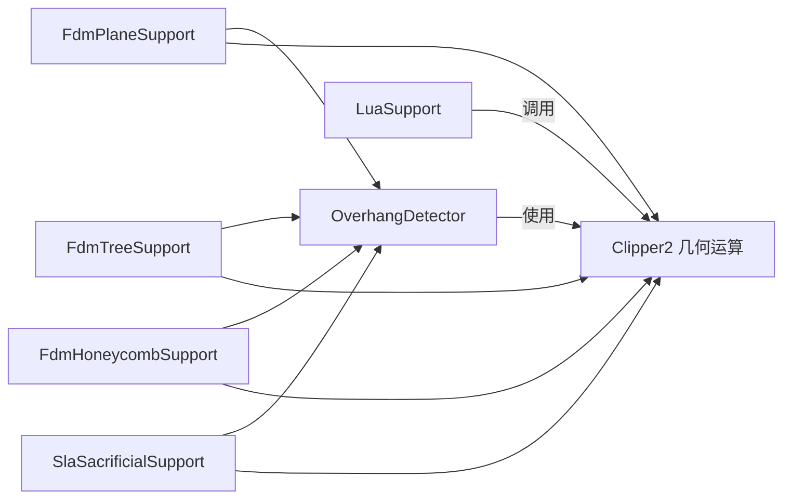

# 支撑生成 API

<cite>
**本文引用的文件**   
- [ISupport.hpp](file://support/ISupport.hpp)
- [ISupport.cpp](file://support/ISupport.cpp)
- [FdmSupport.hpp](file://support/FdmSupport.hpp)
- [FdmSupport.cpp](file://support/FdmSupport.cpp)
- [SlaSupport.hpp](file://support/SlaSupport.hpp)
- [SlaSupport.cpp](file://support/SlaSupport.cpp)
- [OverhangDetector.hpp](file://support/OverhangDetector.hpp)
- [OverhangDetector.cpp](file://support/OverhangDetector.cpp)
- [SupportConfig.hpp](file://support/SupportConfig.hpp)
- [LuaSupport.hpp](file://support/LuaSupport.hpp)
- [LuaSupport.cpp](file://support/LuaSupport.cpp)
</cite>

## 目录
1. [引言](#引言)
2. [项目结构](#项目结构)
3. [核心组件](#核心组件)
4. [架构总览](#架构总览)
5. [详细组件分析](#详细组件分析)
6. [依赖关系分析](#依赖关系分析)
7. [性能与复杂度](#性能与复杂度)
8. [使用示例与参数调优](#使用示例与参数调优)
9. [故障排除指南](#故障排除指南)
10. [结论](#结论)
11. [附录：API 参考速查](#附录api-参考速查)

## 引言
本文件面向 HsBaSlicer 的支撑生成 C++ API，重点说明 FDM 与 SLA 两类支撑算法的接口规范、悬垂检测配置、典型用法、参数调优策略以及扩展机制。读者无需深入几何内核即可理解如何调用 ISupport 抽象接口、选择平面/树形/蜂窝支撑或 SLA 牺牲支撑，并通过 Lua 脚本实现自定义支撑算法。

## 项目结构
支撑相关代码集中在 support 目录，采用“抽象接口 + 具体算法 + 配置 + 悬垂检测 + Lua 扩展”的分层组织方式：
- 抽象接口：ISupport
- FDM 支撑：FdmPlaneSupport、FdmTreeSupport、FdmHoneycombSupport
- SLA 支撑：SlaSacrificialSupport
- 悬垂检测：OverhangDetector
- 配置结构体：SupportConfig、FdmSupportConfig、SlaSupportConfig
- Lua 扩展：LuaSupport

图表来源
- [ISupport.hpp:22-45](file://support/ISupport.hpp#L22-L45)
- [FdmSupport.hpp:19-63](file://support/FdmSupport.hpp#L19-L63)
- [SlaSupport.hpp:20-42](file://support/SlaSupport.hpp#L20-L42)
- [OverhangDetector.hpp:20-50](file://support/OverhangDetector.hpp#L20-L50)
- [SupportConfig.hpp:14-43](file://support/SupportConfig.hpp#L14-L43)

章节来源
- [ISupport.hpp:1-49](file://support/ISupport.hpp#L1-L49)
- [FdmSupport.hpp:1-67](file://support/FdmSupport.hpp#L1-L67)
- [SlaSupport.hpp:1-46](file://support/SlaSupport.hpp#L1-L46)
- [OverhangDetector.hpp:1-54](file://support/OverhangDetector.hpp#L1-L54)
- [SupportConfig.hpp:1-47](file://support/SupportConfig.hpp#L1-L47)
- [LuaSupport.hpp:1-85](file://support/LuaSupport.hpp#L1-L85)

## 核心组件
本节概述支撑系统的关键类与职责：
- ISupport：定义逐层支撑生成的统一接口，并提供按层遍历的默认实现 GenerateAll。
- OverhangDetector：根据相邻两层轮廓计算需要支撑的悬垂区域，支持角度阈值与层高控制。
- SupportConfig / FdmSupportConfig / SlaSupportConfig：支撑算法共享与专用配置字段。
- FdmPlaneSupport / FdmTreeSupport / FdmHoneycombSupport：FDM 三种支撑策略。
- SlaSacrificialSupport：SLA 牺牲支撑，细尖底、易去除。
- LuaSupport：通过 Lua 脚本完全替换内置支撑算法，提供丰富的 2D 多边形操作能力。

章节来源
- [ISupport.hpp:22-45](file://support/ISupport.hpp#L22-L45)
- [ISupport.cpp:9-21](file://support/ISupport.cpp#L9-L21)
- [OverhangDetector.hpp:20-50](file://support/OverhangDetector.hpp#L20-L50)
- [SupportConfig.hpp:14-43](file://support/SupportConfig.hpp#L14-L43)
- [FdmSupport.hpp:19-63](file://support/FdmSupport.hpp#L19-L63)
- [SlaSupport.hpp:20-42](file://support/SlaSupport.hpp#L20-L42)
- [LuaSupport.hpp:40-81](file://support/LuaSupport.hpp#L40-L81)

## 架构总览
支撑生成流程以“悬垂检测 → 间隙处理 → 支撑截面生成”为主线，各算法复用同一套输入输出约定：
- 输入：当前层轮廓 current_layer、上一级层轮廓 prev_layer、层高 layer_height、配置 config。
- 输出：当前层的支撑横截多边形 PolygonsD。

图表来源
- [ISupport.hpp:35-44](file://support/ISupport.hpp#L35-L44)
- [OverhangDetector.cpp:41-80](file://support/OverhangDetector.cpp#L41-L80)
- [FdmSupport.cpp:48-76](file://support/FdmSupport.cpp#L48-L76)
- [FdmSupport.cpp:145-167](file://support/FdmSupport.cpp#L145-L167)
- [FdmSupport.cpp:244-266](file://support/FdmSupport.cpp#L244-L266)
- [SlaSupport.cpp:81-123](file://support/SlaSupport.cpp#L81-L123)

## 详细组件分析

### 抽象接口 ISupport
- 职责：定义单层的 Generate 接口，并提供按层迭代 GenerateAll 的默认实现。
- 关键点：
  - Generate：接收当前层、前一层、层高与配置，返回当前层支撑截面。
  - GenerateAll：从底部到顶部逐层调用 Generate，首层 prev_layer 为空。

图表来源
- [ISupport.hpp:22-45](file://support/ISupport.hpp#L22-L45)
- [ISupport.cpp:9-21](file://support/ISupport.cpp#L9-L21)

章节来源
- [ISupport.hpp:22-45](file://support/ISupport.hpp#L22-L45)
- [ISupport.cpp:9-21](file://support/ISupport.cpp#L9-L21)

### 悬垂检测 OverhangDetector
- 职责：基于相邻两层轮廓与角度阈值，计算需要支撑的悬垂区域。
- 关键方法：
  - Detect(current_layer, prev_layer, layer_height, angle_threshold_deg)
  - Detect(current_layer, prev_layer, config)
  - MaxBridgeDistance(layer_height, angle_deg)
- 算法要点：
  - 若无前一层，则整层视为悬垂。
  - 使用差集得到未覆盖区域，再根据角度阈值换算最大桥接距离，对差集进行负偏移（侵蚀）过滤可桥接的小悬垂。
  - 角度≥90°无悬垂；角度≤0°全部为悬垂。

图表来源
- [OverhangDetector.cpp:23-39](file://support/OverhangDetector.cpp#L23-L39)
- [OverhangDetector.cpp:41-80](file://support/OverhangDetector.cpp#L41-L80)

章节来源
- [OverhangDetector.hpp:20-50](file://support/OverhangDetector.hpp#L20-L50)
- [OverhangDetector.cpp:23-80](file://support/OverhangDetector.cpp#L23-L80)

### 配置结构体 SupportConfig / FdmSupportConfig / SlaSupportConfig
- SupportConfig（通用）：
  - overhang_angle_threshold：悬垂角度阈值（度），默认 45.0
  - layer_height：层高（mm），默认 0.2
  - support_gap：支撑与模型间隙（mm），默认 0.5
  - support_diameter：支撑柱直径（mm），默认 2.0
  - support_density：支撑填充密度 [0,1]，默认 0.3
  - support_pattern：支撑模式 0=平面，1=树形，2=蜂窝，默认 0
  - tree_branch_angle：树形分支角度（度），默认 30.0
  - tree_max_branch_radius：树形最大分支半径（mm），默认 5.0
  - honeycomb_cell_size：蜂窝单元尺寸（mm），默认 5.0
- FdmSupportConfig（继承 SupportConfig）：
  - interface_layers：界面层数量，默认 2
  - interface_density：界面层填充密度 [0,1]，默认 0.5
- SlaSupportConfig（继承 SupportConfig）：
  - tip_diameter：支撑尖端直径（mm），默认 0.3
  - raft_thickness：筏层厚度（mm），默认 0.5

章节来源
- [SupportConfig.hpp:14-43](file://support/SupportConfig.hpp#L14-L43)

### FDM 支撑：平面、树形、蜂窝
- FdmPlaneSupport（平面支撑）：
  - 原理：检测悬垂 → 应用间隙 → 将悬垂区域膨胀为支撑柱截面（半径 = support_diameter/2）。
  - 适用场景：简单柱状支撑，快速且稳定。
- FdmTreeSupport（树形支撑）：
  - 原理：在悬垂区域内按间距采样点，放置圆形分支尖端（半径 = support_diameter/2），并合并重叠圆。
  - 特点：分支自底板向上生长，二维截面表现为多个圆点，层间连接由 GenerateAll 串联。
- FdmHoneycombSupport（蜂窝支撑）：
  - 原理：在悬垂区域内生成平顶六边形蜂窝网格，并与悬垂区域求交。
  - 特点：轻量但刚性好，适合大面积悬垂。

图表来源
- [FdmSupport.hpp:19-63](file://support/FdmSupport.hpp#L19-L63)
- [FdmSupport.cpp:48-76](file://support/FdmSupport.cpp#L48-L76)
- [FdmSupport.cpp:81-167](file://support/FdmSupport.cpp#L81-L167)
- [FdmSupport.cpp:173-266](file://support/FdmSupport.cpp#L173-L266)

章节来源
- [FdmSupport.hpp:19-63](file://support/FdmSupport.hpp#L19-L63)
- [FdmSupport.cpp:48-76](file://support/FdmSupport.cpp#L48-L76)
- [FdmSupport.cpp:81-167](file://support/FdmSupport.cpp#L81-L167)
- [FdmSupport.cpp:173-266](file://support/FdmSupport.cpp#L173-L266)

### SLA 支撑：牺牲支撑
- SlaSacrificialSupport（牺牲支撑）：
  - 原理：检测悬垂 → 应用间隙 → 在悬垂区域内按间距采样支撑点，每个点生成小圆（半径 = tip_diameter/2），最后合并所有圆。
  - 特点：尖端小便于去除，基底大利于附着；常用于树脂打印。
  - 重载：同时支持 SupportConfig 与 SlaSupportConfig。

图表来源
- [SlaSupport.hpp:20-42](file://support/SlaSupport.hpp#L20-L42)
- [SlaSupport.cpp:38-123](file://support/SlaSupport.cpp#L38-L123)
- [SlaSupport.cpp:126-133](file://support/SlaSupport.cpp#L126-L133)

章节来源
- [SlaSupport.hpp:20-42](file://support/SlaSupport.hpp#L20-L42)
- [SlaSupport.cpp:38-133](file://support/SlaSupport.cpp#L38-L133)

### Lua 自定义支撑 LuaSupport
- 职责：允许用户用 Lua 脚本完全替换内置支撑算法。
- 可用全局变量：
  - current_layer：当前层多边形表
  - prev_layer：上一层多边形表
  - layer_height：层高（mm）
  - config：配置表（包含 overhang_angle_threshold、layer_height、support_gap、support_diameter、support_density、support_pattern、tree_branch_angle、tree_max_branch_radius、honeycomb_cell_size）
- 执行流程：
  - 初始化 Lua 环境，注册 2D 多边形操作函数与 Support 模块。
  - 加载脚本（内联或文件），执行主块或指定函数（默认 generate_support）。
  - 解析返回值或全局 support_polys 为 PolygonsD。
- 扩展点：SetExternalRegs 可在 Lua 状态初始化时注入额外函数。

图表来源
- [LuaSupport.hpp:40-81](file://support/LuaSupport.hpp#L40-L81)
- [LuaSupport.cpp:19-90](file://support/LuaSupport.cpp#L19-L90)
- [LuaSupport.cpp:113-177](file://support/LuaSupport.cpp#L113-L177)

章节来源
- [LuaSupport.hpp:40-81](file://support/LuaSupport.hpp#L40-L81)
- [LuaSupport.cpp:19-177](file://support/LuaSupport.cpp#L19-L177)

## 依赖关系分析
- 耦合关系：
  - 所有支撑算法均依赖 OverhangDetector 计算悬垂区域。
  - 几何运算通过 Clipper2 完成（差集、并集、偏移等）。
  - 配置结构体被所有算法共享，SLA 与 FDM 分别扩展专用字段。
- 外部依赖：
  - 2D 几何类型与工具：FloatPolygons、IntPolygon、LuaAdapter。
  - Lua 运行时：LuaSupport 依赖 lua_State 及辅助库。

图表来源
- [FdmSupport.cpp:48-76](file://support/FdmSupport.cpp#L48-L76)
- [FdmSupport.cpp:145-167](file://support/FdmSupport.cpp#L145-L167)
- [FdmSupport.cpp:244-266](file://support/FdmSupport.cpp#L244-L266)
- [SlaSupport.cpp:81-123](file://support/SlaSupport.cpp#L81-L123)
- [OverhangDetector.cpp:41-80](file://support/OverhangDetector.cpp#L41-L80)

章节来源
- [FdmSupport.cpp:48-266](file://support/FdmSupport.cpp#L48-L266)
- [SlaSupport.cpp:38-133](file://support/SlaSupport.cpp#L38-L133)
- [OverhangDetector.cpp:23-80](file://support/OverhangDetector.cpp#L23-L80)

## 性能与复杂度
- 时间复杂度：
  - 悬垂检测：主要开销来自差集与偏移运算，近似 O(N log N) 与几何规模相关。
  - 平面支撑：一次偏移膨胀，O(M)，M 为悬垂区域顶点数。
  - 树形支撑：网格采样 O(K)，K 为候选点数；随后并集合并 O(K log K)。
  - 蜂窝支撑：生成六边形网格 O(P)，P 为单元格数；并集+交集 O((P+Q) log (P+Q))，Q 为悬垂区域规模。
  - SLA 牺牲支撑：采样 O(S)，S 为候选点数；并集合并 O(S log S)。
- 空间复杂度：
  - 与中间几何对象（整数化多边形、临时集合）线性相关于输入规模。
- 优化建议：
  - 合理设置 support_diameter 与 spacing，避免过密采样。
  - 调整 honeycomb_cell_size 平衡精度与性能。
  - 使用 GenerateAll 批量处理层，减少重复配置解析。

[本节为通用性能讨论，不直接分析具体文件]

## 使用示例与参数调优

### 基本调用流程
- 步骤：
  1. 准备每层轮廓 layers（从底部到顶部）。
  2. 构建 SupportConfig 或专用配置（FdmSupportConfig / SlaSupportConfig）。
  3. 选择具体支撑类实例（如 FdmPlaneSupport、FdmTreeSupport、FdmHoneycombSupport、SlaSacrificialSupport）。
  4. 调用 GenerateAll(layers, config) 获取逐层支撑截面。
- 输出：vector<PolygonsD>，与 layers 同长度。

章节来源
- [ISupport.cpp:9-21](file://support/ISupport.cpp#L9-L21)

### 参数调优建议
- 悬垂检测：
  - overhang_angle_threshold：增大可减少支撑面积，过小会增加支撑密度。
  - layer_height：影响桥接距离计算，较小层高更敏感。
- FDM 支撑：
  - support_gap：增大间隙可减少粘连，但可能降低支撑稳定性。
  - support_diameter：增大提升强度，但材料消耗增加。
  - tree_branch_angle / tree_max_branch_radius：控制树形分支形态与覆盖范围。
  - honeycomb_cell_size：较大值减少计算量，较小值提高填充精度。
- SLA 支撑：
  - tip_diameter：越小越易去除，但需保证附着强度。
  - support_diameter：决定支撑点间距，过大可能导致支撑不足。

章节来源
- [SupportConfig.hpp:14-43](file://support/SupportConfig.hpp#L14-L43)
- [OverhangDetector.cpp:23-39](file://support/OverhangDetector.cpp#L23-L39)

### 结果后处理
- 常见后处理：
  - 合并相邻层支撑以减少断裂。
  - 移除过小支撑区域（面积阈值）。
  - 导出为路径或切片数据（结合 LibHsBaSlicer Path 模块）。
- 注意：
  - 确保支撑与模型之间保持足够间隙，避免打印粘连。
  - 检查支撑是否跨越模型内部空洞，必要时裁剪。

[本节为通用后处理指导，不直接分析具体文件]

## 故障排除指南
- Lua 脚本错误：
  - 现象：抛出 RuntimeError，提示 load error 或 runtime error。
  - 排查：检查脚本语法、函数名是否正确、返回值是否为多边形表。
- 支撑为空：
  - 原因：悬垂区域为空、间隙过大导致侵蚀后为空、采样间距过大。
  - 解决：调整 overhang_angle_threshold、support_gap、support_diameter。
- 支撑不稳定：
  - 原因：支撑直径过小、蜂窝单元过大、树形分支稀疏。
  - 解决：增大 support_diameter、减小 honeycomb_cell_size、调整 tree_branch_angle。

章节来源
- [LuaSupport.cpp:113-177](file://support/LuaSupport.cpp#L113-L177)
- [OverhangDetector.cpp:41-80](file://support/OverhangDetector.cpp#L41-L80)
- [FdmSupport.cpp:48-76](file://support/FdmSupport.cpp#L48-L76)
- [FdmSupport.cpp:145-167](file://support/FdmSupport.cpp#L145-L167)
- [FdmSupport.cpp:244-266](file://support/FdmSupport.cpp#L244-L266)
- [SlaSupport.cpp:81-123](file://support/SlaSupport.cpp#L81-L123)

## 结论
HsBaSlicer 的支撑生成 API 提供了清晰、可扩展的接口体系，涵盖 FDM 平面/树形/蜂窝支撑与 SLA 牺牲支撑，并通过 Lua 脚本支持完全自定义算法。开发者可根据模型特征与工艺需求灵活调整悬垂检测与支撑参数，获得稳定高效的支撑结果。

[本节为总结性内容，不直接分析具体文件]

## 附录：API 参考速查

### ISupport
- 方法：
  - Generate(current_layer, prev_layer, layer_height, config) → PolygonsD
  - GenerateAll(layers, config) → vector<PolygonsD>

章节来源
- [ISupport.hpp:22-45](file://support/ISupport.hpp#L22-L45)
- [ISupport.cpp:9-21](file://support/ISupport.cpp#L9-L21)

### OverhangDetector
- 方法：
  - Detect(current_layer, prev_layer, layer_height, angle_threshold_deg) → PolygonsD
  - Detect(current_layer, prev_layer, config) → PolygonsD
  - MaxBridgeDistance(layer_height, angle_deg) → double

章节来源
- [OverhangDetector.hpp:20-50](file://support/OverhangDetector.hpp#L20-L50)
- [OverhangDetector.cpp:23-80](file://support/OverhangDetector.cpp#L23-L80)

### FdmPlaneSupport / FdmTreeSupport / FdmHoneycombSupport
- 方法：
  - Generate(current_layer, prev_layer, layer_height, config) → PolygonsD
- 私有方法：
  - FdmTreeSupport::GenerateBranches(overhang, layer_height, config) → PolygonsD
  - FdmHoneycombSupport::GenerateHoneycomb(overhang, config) → PolygonsD

章节来源
- [FdmSupport.hpp:19-63](file://support/FdmSupport.hpp#L19-L63)
- [FdmSupport.cpp:48-76](file://support/FdmSupport.cpp#L48-L76)
- [FdmSupport.cpp:81-167](file://support/FdmSupport.cpp#L81-L167)
- [FdmSupport.cpp:173-266](file://support/FdmSupport.cpp#L173-L266)

### SlaSacrificialSupport
- 方法：
  - Generate(current_layer, prev_layer, layer_height, config) → PolygonsD
  - Generate(current_layer, prev_layer, layer_height, sla_config) → PolygonsD
- 私有方法：
  - SampleSupportPoints(overhang, tip_radius, spacing) → PolygonsD

章节来源
- [SlaSupport.hpp:20-42](file://support/SlaSupport.hpp#L20-L42)
- [SlaSupport.cpp:38-133](file://support/SlaSupport.cpp#L38-L133)

### LuaSupport
- 构造：
  - LuaSupport(script)
  - LuaSupport(script, funcName)
  - LuaSupport(script_file, funcName)
- 方法：
  - Generate(current_layer, prev_layer, layer_height, config) → PolygonsD
  - SetExternalRegs(regs)

章节来源
- [LuaSupport.hpp:40-81](file://support/LuaSupport.hpp#L40-L81)
- [LuaSupport.cpp:93-177](file://support/LuaSupport.cpp#L93-L177)