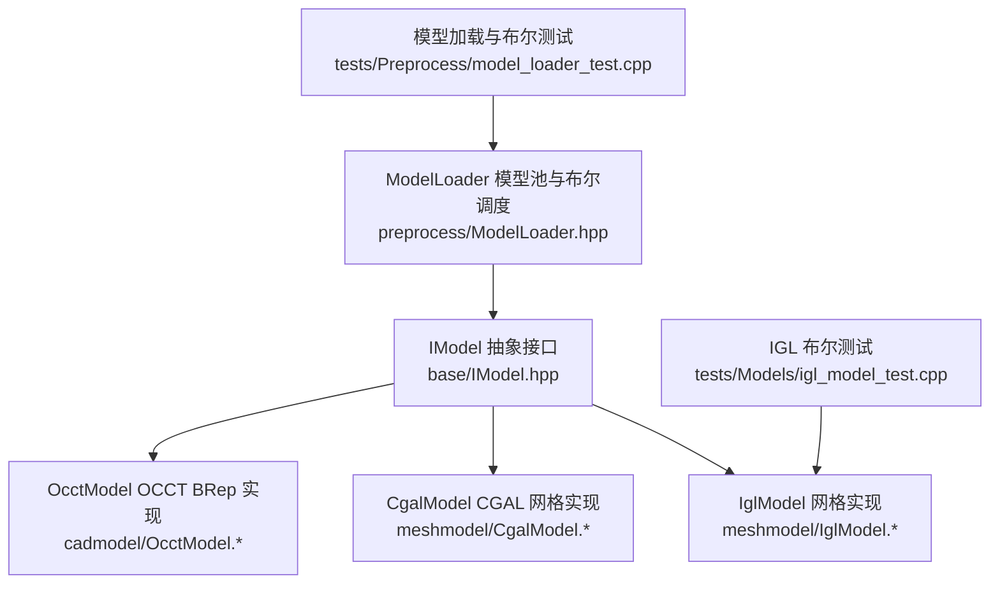
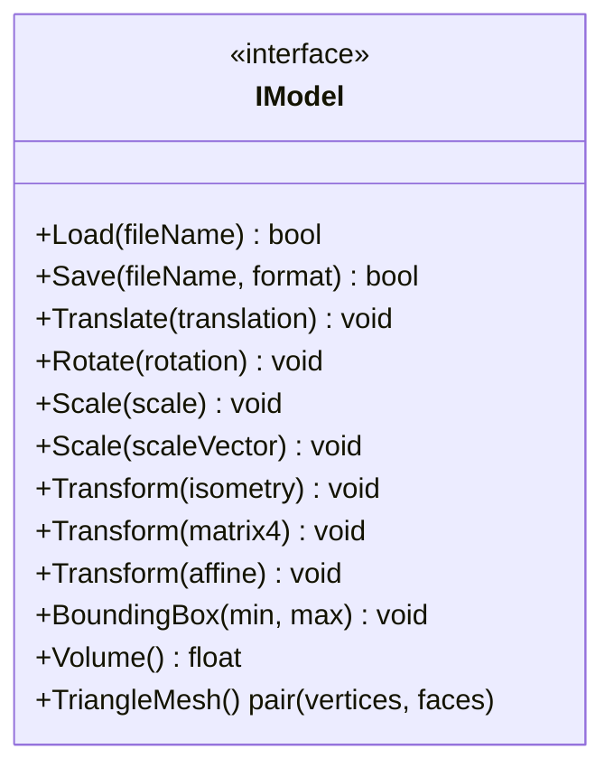
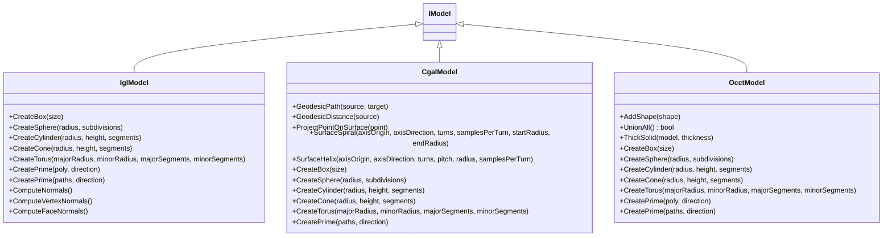
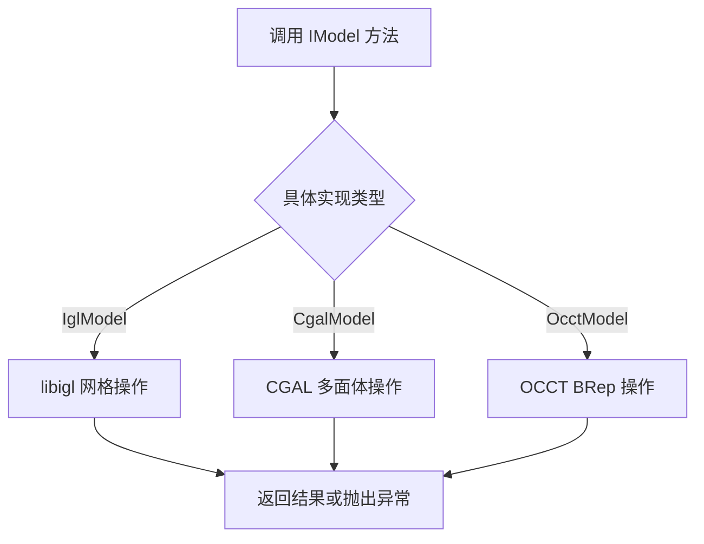
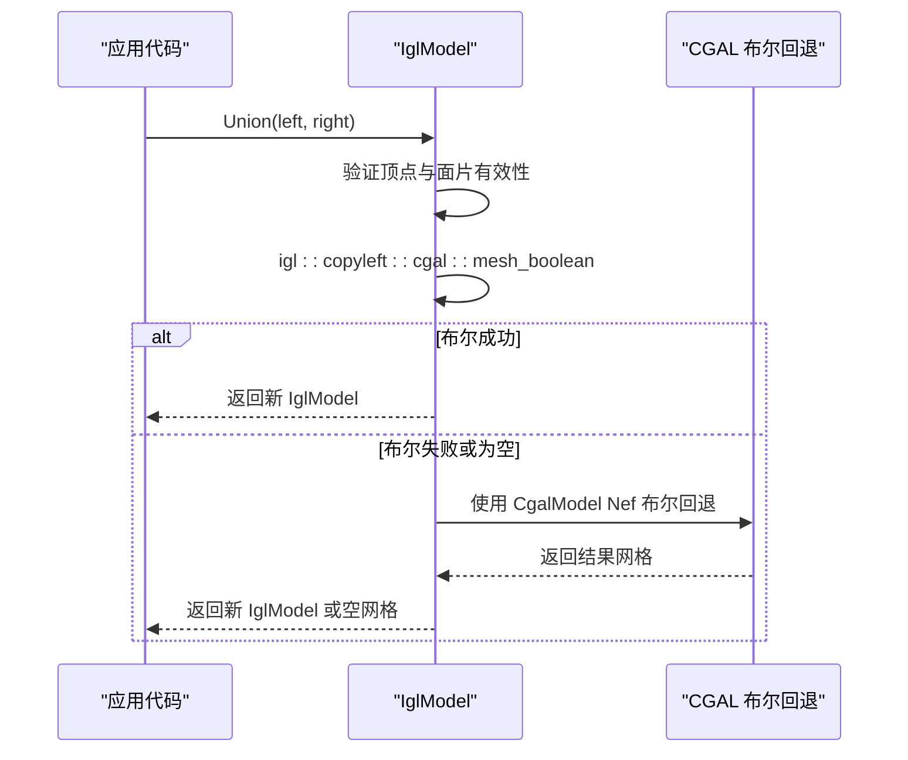
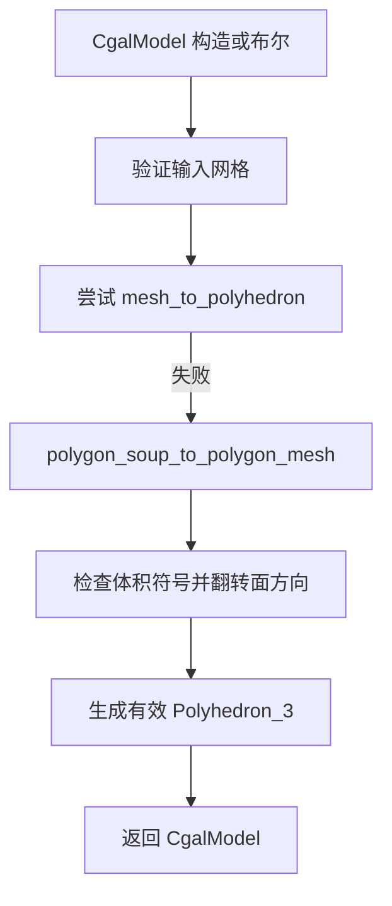
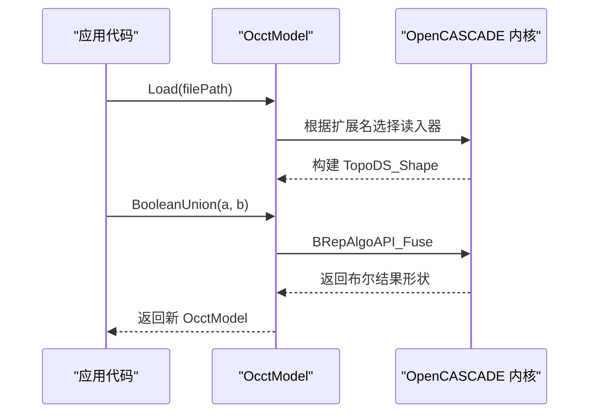
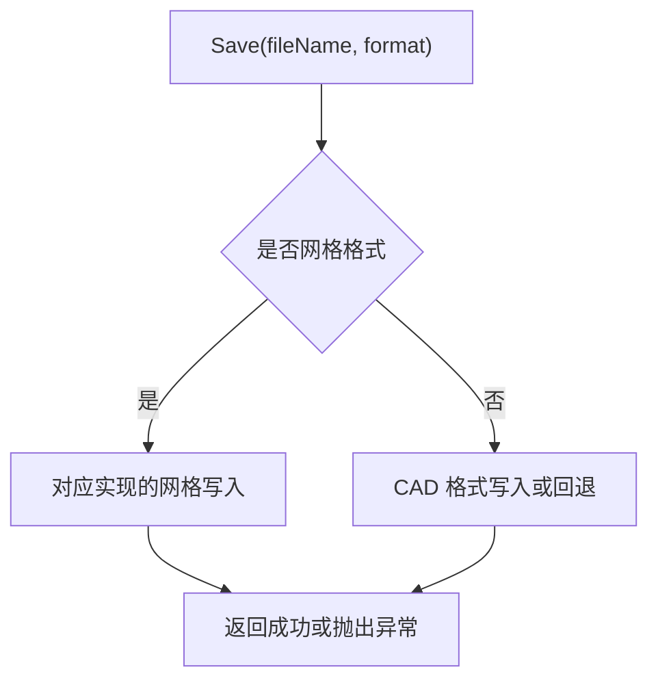
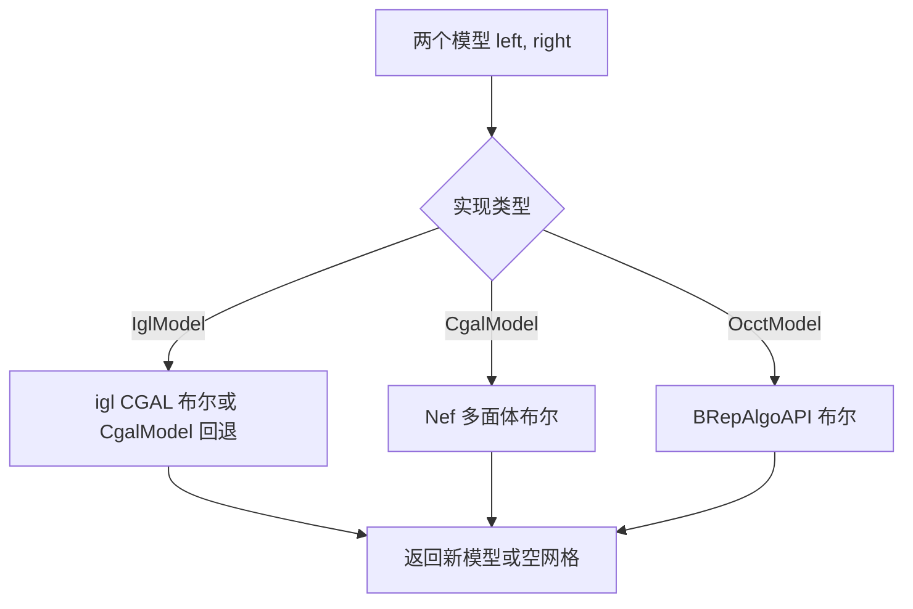

# 模型处理 API

<cite>
**本文引用的文件**   
- [IModel.hpp](file://base/IModel.hpp)
- [IglModel.hpp](file://meshmodel/IglModel.hpp)
- [IglModel.cpp](file://meshmodel/IglModel.cpp)
- [CgalModel.hpp](file://meshmodel/CgalModel.hpp)
- [CgalModel.cpp](file://meshmodel/CgalModel.cpp)
- [OcctModel.hpp](file://cadmodel/OcctModel.hpp)
- [OcctModel.cpp](file://cadmodel/OcctModel.cpp)
- [ModelLoader.hpp](file://preprocess/ModelLoader.hpp)
- [igl_model_test.cpp](file://tests/Models/igl_model_test.cpp)
- [model_loader_test.cpp](file://tests/Preprocess/model_loader_test.cpp)
</cite>

## 目录
1. [文档目标与适用范围](#文档目标与适用范围)
2. [项目结构中的模型相关位置](#项目结构中的模型相关位置)
3. [核心抽象接口 IModel](#核心抽象接口-imodel)
4. [架构总览：三种模型实现](#架构总览三种模型实现)
5. [详细组件分析](#详细组件分析)
6. [模型加载、保存与格式支持](#模型加载保存与格式支持)
7. [几何变换与布尔运算规范](#几何变换与布尔运算规范)
8. [生命周期管理、内存与异常处理](#生命周期管理内存与异常处理)
9. [线程安全与性能建议](#线程安全与性能建议)
10. [使用示例与最佳实践](#使用示例与最佳实践)
11. [故障排除指南](#故障排除指南)
12. [结论](#结论)

## 文档目标与适用范围
本文面向 HsBaSlicer 的 C++ 用户，聚焦模型处理 API。目标是完整说明以下对象与行为：
- IModel 抽象接口及其语义。
- IglModel、CgalModel、OcctModel 三类实现的接口差异、参数约定、返回值含义和错误行为。
- 模型加载、保存、几何变换、布尔运算、体积与包围盒查询、三角网格导出等核心操作。
- 模型对象的生命周期管理、内存管理、异常类型与调试建议。
- 线程安全保证、性能特征与优化建议。
- 基于源码实证的使用示例路径，不直接粘贴代码内容。

## 项目结构中的模型相关位置
HsBaSlicer 将模型抽象与实现按领域拆分：
- 抽象接口位于 base 目录。
- 网格模型实现位于 meshmodel 目录。
- CAD/BRep 模型实现位于 cadmodel 目录。
- 模型池与布尔运算调度位于 preprocess 目录。
- 测试用例位于 tests 目录。

**图表来源**
- [IModel.hpp:110-139](file://base/IModel.hpp#L110-L139)
- [IglModel.hpp:16-121](file://meshmodel/IglModel.hpp#L16-L121)
- [CgalModel.hpp:24-155](file://meshmodel/CgalModel.hpp#L24-L155)
- [OcctModel.hpp:20-124](file://cadmodel/OcctModel.hpp#L20-L124)
- [ModelLoader.hpp:47-133](file://preprocess/ModelLoader.hpp#L47-L133)

**章节来源**
- [IModel.hpp:110-139](file://base/IModel.hpp#L110-L139)
- [IglModel.hpp:16-121](file://meshmodel/IglModel.hpp#L16-L121)
- [CgalModel.hpp:24-155](file://meshmodel/CgalModel.hpp#L24-L155)
- [OcctModel.hpp:20-124](file://cadmodel/OcctModel.hpp#L20-L124)
- [ModelLoader.hpp:47-133](file://preprocess/ModelLoader.hpp#L47-L133)

## 核心抽象接口 IModel
IModel 是 HsBaSlicer 中所有 3D 模型的统一抽象。它定义：
- 模型加载与保存。
- 平移、旋转、缩放、通用仿射变换。
- 轴对齐包围盒查询。
- 体积查询。
- 三角网格导出。

**图表来源**
- [IModel.hpp:110-139](file://base/IModel.hpp#L110-L139)

### 接口语义与返回约定
- Load：从文件加载模型；成功与否由具体实现决定，通常通过布尔或异常表达。
- Save：以指定格式保存模型；失败时可能抛出异常或返回 false。
- Translate/Rotate/Scale/Transform：原地修改模型几何。
- BoundingBox：输出最小、最大包围盒坐标。
- Volume：返回有符号或绝对体积，具体实现可能不同。
- TriangleMesh：返回 libigl 风格的顶点矩阵与面片索引矩阵。

**章节来源**
- [IModel.hpp:110-139](file://base/IModel.hpp#L110-L139)

## 架构总览：三种模型实现
IModel 有三个主要实现：
- IglModel：基于 libigl 的三角网格模型，适合快速网格读写、基础布尔回退与几何计算。
- CgalModel：基于 CGAL 的多面体网格模型，提供 Nef 多面体布尔运算与表面测地线、螺旋等高级几何能力。
- OcctModel：基于 OpenCASCADE 的 BRep CAD 模型，适合 STEP/IGES/VRML/BREP 等 CAD 格式与实体布尔、加厚等操作。

**图表来源**
- [IglModel.hpp:16-121](file://meshmodel/IglModel.hpp#L16-L121)
- [CgalModel.hpp:24-155](file://meshmodel/CgalModel.hpp#L24-L155)
- [OcctModel.hpp:20-124](file://cadmodel/OcctModel.hpp#L20-L124)

**章节来源**
- [IglModel.hpp:16-121](file://meshmodel/IglModel.hpp#L16-L121)
- [CgalModel.hpp:24-155](file://meshmodel/CgalModel.hpp#L24-L155)
- [OcctModel.hpp:20-124](file://cadmodel/OcctModel.hpp#L20-L124)

## 详细组件分析

### IModel 抽象接口
IModel 定义了统一的模型操作契约。其关键方法包括：
- 文件 IO：Load、Save。
- 几何变换：Translate、Rotate、Scale（标量与向量）、Transform（Isometry、Matrix4、Affine）。
- 几何查询：BoundingBox、Volume、TriangleMesh。

**图表来源**
- [IModel.hpp:110-139](file://base/IModel.hpp#L110-L139)

**章节来源**
- [IModel.hpp:110-139](file://base/IModel.hpp#L110-L139)

### IglModel 实现
IglModel 是 libigl 驱动的三角网格模型，提供：
- 构造：空模型、从顶点与面片构造、可选法线计算。
- 文件 IO：STL/OBJ/PLY/OFF 等网格格式。
- 几何变换：平移、旋转、缩放、仿射变换。
- 几何查询：包围盒、体积、三角网格导出。
- 法线计算：面法线、顶点法线。
- 布尔运算：Union、Intersection、Difference、Xor，依赖 CGAL；未启用 CGAL 时抛出不支持异常。
- 原始几何工厂：CreateBox、CreateSphere、CreateCylinder、CreateCone、CreateTorus。
- 拉伸工厂：CreatePrime，支持单多边形与多轮廓（含孔洞）拉伸。

**图表来源**
- [IglModel.cpp:195-245](file://meshmodel/IglModel.cpp#L195-L245)
- [IglModel.cpp:248-391](file://meshmodel/IglModel.cpp#L248-L391)

#### 布尔运算行为与边界条件
- 输入有效性检查：顶点行数、列数、有限值、面片索引范围。
- 优先尝试 igl 的 CGAL 布尔；若结果为空，则回退到 CgalModel 的 Nef 布尔。
- 未启用 CGAL 编译选项时，布尔函数抛出“不支持”异常。

**章节来源**
- [IglModel.cpp:195-245](file://meshmodel/IglModel.cpp#L195-L245)
- [IglModel.cpp:248-391](file://meshmodel/IglModel.cpp#L248-L391)
- [IglModel.cpp:392-409](file://meshmodel/IglModel.cpp#L392-L409)

### CgalModel 实现
CgalModel 是 CGAL 驱动的多面体网格模型，提供：
- 构造：从 Polyhedron_3 或 Eigen 顶点/面片构造，包含自动修复与方向校正。
- 文件 IO：STL/PLY/OBJ/OFF 等网格格式。
- 几何变换：平移、旋转、缩放、仿射变换。
- 几何查询：包围盒、体积、三角网格导出。
- 布尔运算：Union、Intersection、Difference、Xor，基于 Nef 多面体。
- 原始几何工厂：CreateBox、CreateSphere、CreateCylinder、CreateCone、CreateTorus。
- 拉伸工厂：CreatePrime，支持单多边形与多轮廓拉伸，并强制三角化与方向修正。
- 表面几何：测地线路径、测地距离、点投影、表面螺旋、表面螺旋线。

**图表来源**
- [CgalModel.cpp:42-119](file://meshmodel/CgalModel.cpp#L42-L119)

**章节来源**
- [CgalModel.cpp:42-119](file://meshmodel/CgalModel.cpp#L42-L119)
- [CgalModel.cpp:238-276](file://meshmodel/CgalModel.cpp#L238-L276)
- [CgalModel.cpp:625-733](file://meshmodel/CgalModel.cpp#L625-L733)

### OcctModel 实现
OcctModel 是 OpenCASCADE 驱动的 BRep CAD 模型，提供：
- 构造：从 TopoDS_Shape 拷贝或移动构造。
- 形状组合：AddShape 将多个子形状加入复合形状。
- 文件 IO：STEP/IGES/VRML/BREP；也支持导出为网格格式（先 tessellation 再交给 IglModel）。
- 几何变换：平移、旋转、缩放、仿射变换。
- 几何查询：包围盒、体积、三角网格导出。
- 布尔运算：Union、Intersection、Difference、Xor。
- 实体操作：UnionAll 合并所有子实体；ThickSolid 实体加厚。
- 原始几何工厂：CreateBox、CreateSphere、CreateCylinder、CreateCone、CreateTorus。
- 拉伸工厂：CreatePrime，支持单多边形与多轮廓（外轮廓加孔洞）拉伸。

**图表来源**
- [OcctModel.cpp:213-237](file://cadmodel/OcctModel.cpp#L213-L237)
- [OcctModel.cpp:451-469](file://cadmodel/OcctModel.cpp#L451-L469)

**章节来源**
- [OcctModel.cpp:213-237](file://cadmodel/OcctModel.cpp#L213-L237)
- [OcctModel.cpp:238-271](file://cadmodel/OcctModel.cpp#L238-L271)
- [OcctModel.cpp:331-407](file://cadmodel/OcctModel.cpp#L331-L407)
- [OcctModel.cpp:451-469](file://cadmodel/OcctModel.cpp#L451-L469)
- [OcctModel.cpp:471-540](file://cadmodel/OcctModel.cpp#L471-L540)
- [OcctModel.cpp:542-663](file://cadmodel/OcctModel.cpp#L542-L663)

## 模型加载、保存与格式支持

### 支持的模型格式
IModel 通过 ModelFormat 枚举描述格式类别，各实现分别支持：
- IglModel：STL（二进制/ASCII）、OBJ、PLY（二进制/ASCII）、OFF。
- CgalModel：STL（二进制/ASCII）、PLY（二进制/ASCII）、OBJ、OFF。
- OcctModel：STEP、IGES、VRML、BREP；也可导出为网格格式（内部 tessellation 后委托 IglModel）。

**图表来源**
- [IglModel.cpp:72-99](file://meshmodel/IglModel.cpp#L72-L99)
- [CgalModel.cpp:133-157](file://meshmodel/CgalModel.cpp#L133-L157)
- [OcctModel.cpp:238-271](file://cadmodel/OcctModel.cpp#L238-L271)

### 加载流程与错误处理
- IglModel.Load：使用 libigl 读取三角网格；路径编码转换。
- CgalModel.Load：使用 CGAL 读取多面体网格，并三角化面片。
- OcctModel.Load：根据扩展名选择 STEP/IGES/VRML/BREP 读入器；失败抛 IO 异常；返回 shape 是否为空。

**章节来源**
- [IglModel.cpp:64-70](file://meshmodel/IglModel.cpp#L64-L70)
- [CgalModel.cpp:121-132](file://meshmodel/CgalModel.cpp#L121-L132)
- [OcctModel.cpp:213-237](file://cadmodel/OcctModel.cpp#L213-L237)

## 几何变换与布尔运算规范

### 几何变换
三类实现均提供：
- Translate(Eigen::Vector3f)
- Rotate(Eigen::Quaternionf)
- Scale(float)
- Scale(Eigen::Vector3f)
- Transform(Eigen::Isometry3f)
- Transform(Eigen::Matrix4f)
- Transform(Eigen::Transform<float, 3, Eigen::Affine>)

注意：
- IglModel 对行存储顶点矩阵进行广播加法与右乘转置矩阵，同时更新法线。
- CgalModel 与 OcctModel 将 Eigen 变换转换为各自内核的变换对象并作用于内部几何。

**章节来源**
- [IglModel.cpp:101-150](file://meshmodel/IglModel.cpp#L101-L150)
- [CgalModel.cpp:158-204](file://meshmodel/CgalModel.cpp#L158-L204)
- [OcctModel.cpp:272-329](file://cadmodel/OcctModel.cpp#L272-L329)

### 布尔运算
- IglModel：Union、Intersection、Difference、Xor；优先 igl CGAL 布尔，失败回退 CgalModel Nef 布尔；未启用 CGAL 时抛“不支持”。
- CgalModel：Union、Intersection、Difference、Xor；基于 Nef 多面体。
- OcctModel：Union、Intersection、Difference、Xor；基于 BRepAlgoAPI。

**图表来源**
- [IglModel.cpp:195-391](file://meshmodel/IglModel.cpp#L195-L391)
- [CgalModel.cpp:238-276](file://meshmodel/CgalModel.cpp#L238-L276)
- [OcctModel.cpp:451-469](file://cadmodel/OcctModel.cpp#L451-L469)

**章节来源**
- [IglModel.cpp:195-391](file://meshmodel/IglModel.cpp#L195-L391)
- [CgalModel.cpp:238-276](file://meshmodel/CgalModel.cpp#L238-L276)
- [OcctModel.cpp:451-469](file://cadmodel/OcctModel.cpp#L451-L469)

## 生命周期管理、内存与异常处理

### 生命周期管理
- IModel 是抽象基类，实际对象由具体实现创建；推荐通过静态工厂 CreateBox/CreateSphere 等或直接构造。
- IglModel 支持拷贝、移动构造与赋值；内部存储 Eigen 矩阵，默认构造为空网格。
- CgalModel 支持拷贝、移动构造与赋值；内部存储 CGAL Polyhedron_3。
- OcctModel 支持拷贝、移动构造与赋值；内部存储 TopoDS_Shape。

建议：
- 使用 std::shared_ptr<IModel> 在高层传递模型，避免裸指针所有权歧义。
- 对大型模型优先使用移动构造减少复制开销。
- 在需要持久化前调用 Save，并在不再使用时释放 shared_ptr 引用计数归零。

**章节来源**
- [IglModel.hpp:26-53](file://meshmodel/IglModel.hpp#L26-L53)
- [CgalModel.hpp:34-48](file://meshmodel/CgalModel.hpp#L34-L48)
- [OcctModel.hpp:30-43](file://cadmodel/OcctModel.hpp#L30-L43)

### 内存管理
- IglModel 的顶点、面片、法线均为 Eigen 矩阵，遵循 RAII。
- CgalModel 的 Polyhedron_3 由 CGAL 管理，构造过程可能触发网格修复与三角化。
- OcctModel 的 TopoDS_Shape 由 OCCT 管理，AddShape 会合并子形状。

**章节来源**
- [IglModel.cpp:37-62](file://meshmodel/IglModel.cpp#L37-L62)
- [CgalModel.cpp:38-119](file://meshmodel/CgalModel.cpp#L38-L119)
- [OcctModel.cpp:63-74](file://cadmodel/OcctModel.cpp#L63-L74)
- [OcctModel.cpp:192-211](file://cadmodel/OcctModel.cpp#L192-L211)

### 异常处理
常见异常类型：
- NotSupportedError：不支持的文件格式或未启用 CGAL 的布尔操作。
- IOError：文件读写失败。
- RuntimeError：几何构造失败、布尔失败、模型未加载等。
- InvalidArgumentError：参数非法，如多边形点数不足、路径为空。

建议：
- 在调用 Load/Save 前后捕获 IOError。
- 在布尔运算前后捕获 NotSupportedError/RuntimeError。
- 在 CreatePrime 等工厂函数前后捕获 InvalidArgumentError/RuntimeError。

**章节来源**
- [IglModel.cpp:72-99](file://meshmodel/IglModel.cpp#L72-L99)
- [IglModel.cpp:392-409](file://meshmodel/IglModel.cpp#L392-L409)
- [CgalModel.cpp:133-157](file://meshmodel/CgalModel.cpp#L133-L157)
- [OcctModel.cpp:76-147](file://cadmodel/OcctModel.cpp#L76-L147)
- [OcctModel.cpp:213-237](file://cadmodel/OcctModel.cpp#L213-L237)

## 线程安全与性能建议

### 线程安全
- IModel 接口本身不提供同步原语；每个模型实例的状态由具体实现维护。
- 同一 IModel 实例不应被多个线程并发修改；如需并行处理，应为每个线程创建独立模型副本或使用线程局部模型。
- ModelLoader 作为模型池，应确保插入、查询与布尔操作的串行访问或在外部加锁。

**章节来源**
- [IModel.hpp:110-139](file://base/IModel.hpp#L110-L139)
- [ModelLoader.hpp:47-133](file://preprocess/ModelLoader.hpp#L47-L133)

### 性能建议
- IglModel：
  - 布尔运算优先使用 igl CGAL 布尔；若频繁失败，考虑直接使用 CgalModel 以避免回退开销。
  - 大规模网格应避免重复 ComputeNormals；仅在必要时计算。
- CgalModel：
  - 布尔运算基于 Nef 多面体，复杂度较高；尽量简化输入网格或预处理拓扑。
  - SurfaceSpiral/SurfaceHelix 等表面几何算法采样较多，需控制 samplesPerTurn。
- OcctModel：
  - Tessellation 到三角网格成本较高；仅在需要网格时使用 TriangleMesh。
  - 布尔运算与实体加厚可能产生复杂拓扑；建议分步执行并检查结果。

[本节为通用性能指导，不直接分析具体文件]

## 使用示例与最佳实践

### 创建与操作 IglModel
- 通过 CreateBox/CreateSphere 等工厂创建基础几何。
- 使用 Translate/Rotate/Scale/Transform 进行几何变换。
- 使用 Union/Intersection/Difference/Xor 进行布尔运算（需启用 CGAL）。
- 使用 Volume/TriangleMesh 获取几何信息。

参考测试路径：
- [igl_model_test.cpp:47-67](file://tests/Models/igl_model_test.cpp#L47-L67)

**章节来源**
- [igl_model_test.cpp:47-67](file://tests/Models/igl_model_test.cpp#L47-L67)

### 创建与操作 CgalModel
- 通过 CreateBox/CreateSphere 等工厂创建基础几何。
- 使用 GeodesicPath/GeodesicDistance/ProjectPointOnSurface/SurfaceSpiral/SurfaceHelix 进行表面几何分析。
- 使用布尔运算获得拓扑结果。

参考实现路径：
- [CgalModel.cpp:238-276](file://meshmodel/CgalModel.cpp#L238-L276)
- [CgalModel.cpp:625-733](file://meshmodel/CgalModel.cpp#L625-L733)

**章节来源**
- [CgalModel.cpp:238-276](file://meshmodel/CgalModel.cpp#L238-L276)
- [CgalModel.cpp:625-733](file://meshmodel/CgalModel.cpp#L625-L733)

### 创建与操作 OcctModel
- 通过 CreateBox/CreateSphere 等工厂创建基础几何。
- 使用 AddShape 组合多个子形状。
- 使用 BooleanUnion/BooleanIntersection/BooleanDifference/BooleanXor 进行布尔运算。
- 使用 ThickSolid 进行实体加厚。
- 使用 Volume/TriangleMesh 获取几何信息。

参考测试路径：
- [model_loader_test.cpp:327-381](file://tests/Preprocess/model_loader_test.cpp#L327-L381)

**章节来源**
- [model_loader_test.cpp:327-381](file://tests/Preprocess/model_loader_test.cpp#L327-L381)

### 通过 ModelLoader 管理模型与布尔运算
- LoadModel：按文件名加载模型并存入池。
- InsertModel：插入已构造模型。
- GetModel/operator[]：按名称检索模型。
- BooleanUnion/BooleanIntersection/BooleanDifference/BooleanXor：对池中模型执行布尔运算并命名结果。

参考声明路径：
- [ModelLoader.hpp:47-133](file://preprocess/ModelLoader.hpp#L47-L133)

**章节来源**
- [ModelLoader.hpp:47-133](file://preprocess/ModelLoader.hpp#L47-L133)

## 故障排除指南

### 常见问题
- 布尔运算返回空网格：
  - IglModel：检查输入网格是否有效（顶点有限、索引合法）；共面或退化面可能导致 igl CGAL 布尔失败，可尝试调整相对位置或改用 CgalModel。
  - CgalModel：检查输入拓扑是否闭合且方向一致；必要时使用三角化与方向修正。
  - OcctModel：检查布尔输入是否有效实体；复杂拓扑可能需要 UnionAll 或简化。
- 文件格式不支持：
  - IglModel/CgalModel：仅支持网格格式；CAD 格式需使用 OcctModel。
  - OcctModel：仅支持 STEP/IGES/VRML/BREP；其他格式需先转换为网格。
- 文件读写失败：
  - 检查路径编码转换与文件权限；捕获 IOError。
- 参数非法：
  - CreatePrime 要求多边形至少三个点；PolygonsD 不能为空；捕获 InvalidArgumentError。

**章节来源**
- [IglModel.cpp:195-391](file://meshmodel/IglModel.cpp#L195-L391)
- [CgalModel.cpp:42-119](file://meshmodel/CgalModel.cpp#L42-L119)
- [OcctModel.cpp:213-237](file://cadmodel/OcctModel.cpp#L213-L237)
- [model_loader_test.cpp:306-318](file://tests/Preprocess/model_loader_test.cpp#L306-L318)

## 结论
HsBaSlicer 的模型处理 API 通过 IModel 抽象统一了网格与 CAD 模型的操作方式。IglModel 适合快速网格处理与轻量布尔回退；CgalModel 提供稳健的 CGAL 布尔与表面几何能力；OcctModel 提供强大的 CAD 格式支持与实体布尔、加厚等高级操作。用户在生命周期管理上应遵循 RAII 与 shared_ptr 所有权模式，在异常处理上区分 NotSupportedError、IOError、RuntimeError、InvalidArgumentError，并根据实现特性进行性能优化与线程安全约束。