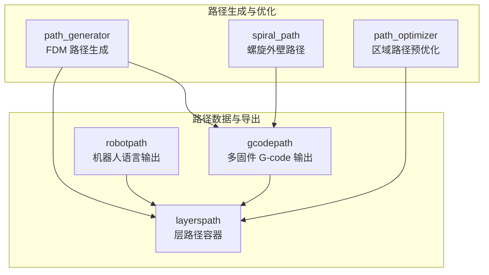
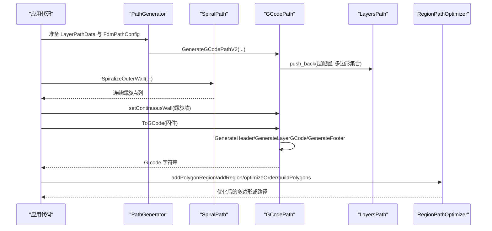
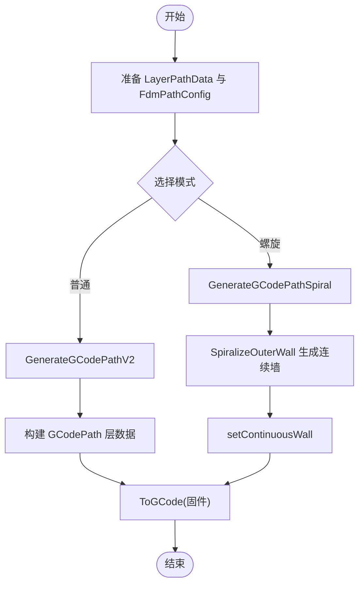
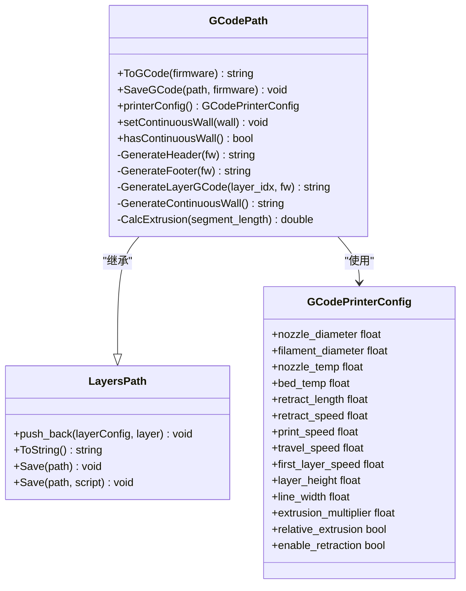
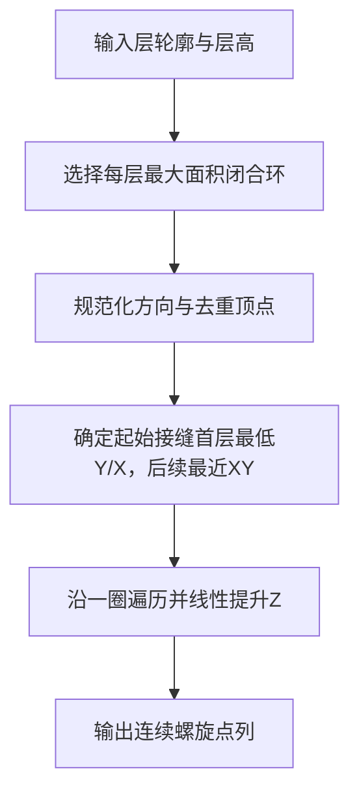
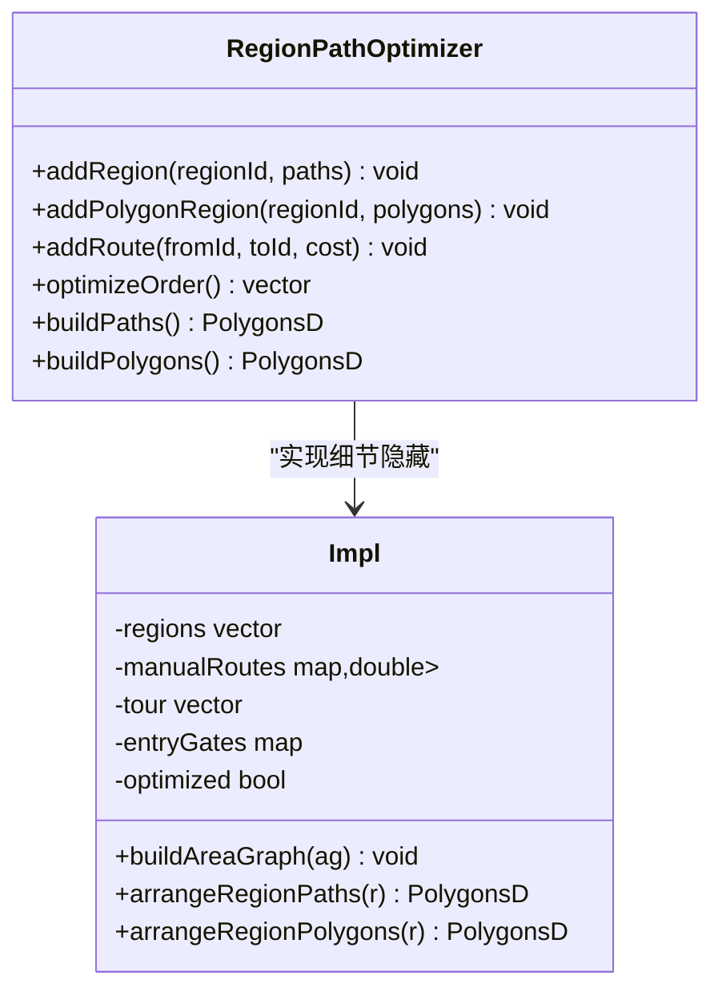
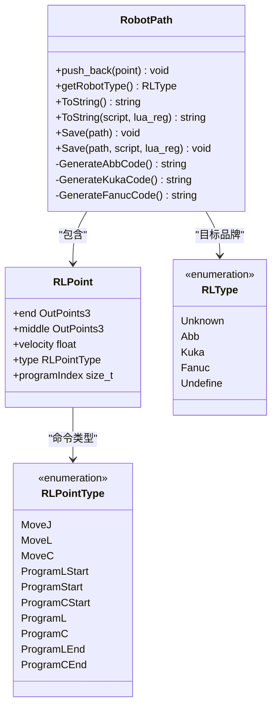
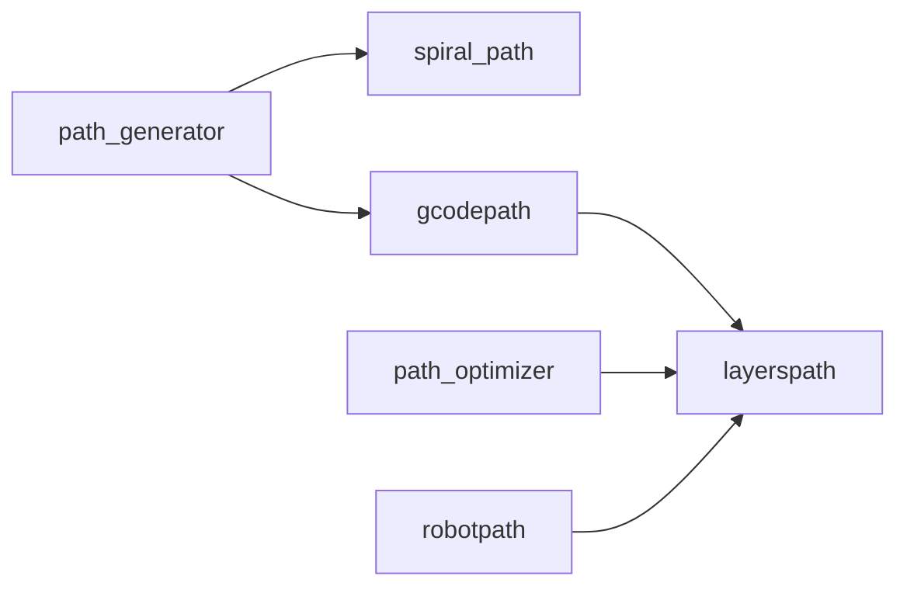

# 路径规划 API

<cite>
**本文引用的文件**   
- [path_generator.hpp](file://LibHsBaSlicer/Path/path_generator.hpp)
- [path_generator.cpp](file://LibHsBaSlicer/Path/path_generator.cpp)
- [spiral_path.hpp](file://LibHsBaSlicer/Path/spiral_path.hpp)
- [spiral_path.cpp](file://LibHsBaSlicer/Path/spiral_path.cpp)
- [gcodepath.hpp](file://paths/gcodepath.hpp)
- [gcodepath.cpp](file://paths/gcodepath.cpp)
- [layerspath.hpp](file://paths/layerspath.hpp)
- [layerspath.cpp](file://paths/layerspath.cpp)
- [robotpath.hpp](file://paths/robotpath.hpp)
- [robotpath.cpp](file://paths/robotpath.cpp)
- [path_optimizer.hpp](file://LibHsBaSlicer/Path/path_optimizer.hpp)
- [path_optimizer.cpp](file://LibHsBaSlicer/Path/path_optimizer.cpp)
</cite>

## 目录
1. [引言](#引言)
2. [项目结构](#项目结构)
3. [核心组件](#核心组件)
4. [架构总览](#架构总览)
5. [详细组件分析](#详细组件分析)
6. [依赖关系分析](#依赖关系分析)
7. [性能与优化](#性能与优化)
8. [故障排除指南](#故障排除指南)
9. [结论](#结论)
10. [附录：完整路径生成流程示例](#附录完整路径生成流程示例)

## 引言
本文件面向 HsBaSlicer 的路径规划 C++ API，重点说明 PathGenerator 相关接口、G-code 路径生成、螺旋路径（花瓶模式）、层路径组织、机器人路径输出以及区域路径预优化的设计与用法。文档以源码为依据，给出类图、序列图和流程图，帮助读者从高层到代码级理解路径生成的完整流程、参数配置、后处理扩展点与性能调优选项。

## 项目结构
路径规划相关代码主要分布在以下位置：
- LibHsBaSlicer/Path：路径生成与优化核心（FDM G-code、螺旋路径、区域路径优化）
- paths：路径数据模型与导出器（G-code、层路径、机器人路径）

**图表来源**
- [path_generator.hpp:20-91](file://LibHsBaSlicer/Path/path_generator.hpp#L20-L91)
- [spiral_path.hpp:16-58](file://LibHsBaSlicer/Path/spiral_path.hpp#L16-L58)
- [path_optimizer.hpp:23-186](file://LibHsBaSlicer/Path/path_optimizer.hpp#L23-L186)
- [layerspath.hpp:17-60](file://paths/layerspath.hpp#L17-L60)
- [gcodepath.hpp:24-107](file://paths/gcodepath.hpp#L24-L107)
- [robotpath.hpp:15-104](file://paths/robotpath.hpp#L15-L104)

**章节来源**
- [path_generator.hpp:20-91](file://LibHsBaSlicer/Path/path_generator.hpp#L20-L91)
- [gcodepath.hpp:24-107](file://paths/gcodepath.hpp#L24-L107)
- [layerspath.hpp:17-60](file://paths/layerspath.hpp#L17-L60)
- [robotpath.hpp:15-104](file://paths/robotpath.hpp#L15-L104)
- [path_optimizer.hpp:23-186](file://LibHsBaSlicer/Path/path_optimizer.hpp#L23-L186)

## 核心组件
- FdmPathConfig：FDM 路径生成配置（层高、线宽、打印速度、移动速度、挤出倍率、单位）。
- LayerPathData：单层路径数据（轮廓、填充、支撑、Z 高度）。
- PointsPath / GCodePath：路径容器与 G-code 输出；GCodePath 支持多固件（Marlin/RepRap/Klipper）和连续螺旋墙。
- SpiralPoint / SpiralizeOuterWall：螺旋路径点与算法入口。
- RegionPathOptimizer：区域路径预优化器，支持“填充结果模式”和“多边形模式”，通过遗传 TSP + 最近邻贪心减少空移。
- RobotPath：工业机器人路径输出（ABB/KUKA/FANUC），支持程序块与圆弧/直线运动。

**章节来源**
- [path_generator.hpp:20-91](file://LibHsBaSlicer/Path/path_generator.hpp#L20-L91)
- [gcodepath.hpp:24-107](file://paths/gcodepath.hpp#L24-L107)
- [spiral_path.hpp:16-58](file://LibHsBaSlicer/Path/spiral_path.hpp#L16-L58)
- [path_optimizer.hpp:23-186](file://LibHsBaSlicer/Path/path_optimizer.hpp#L23-L186)
- [robotpath.hpp:15-104](file://paths/robotpath.hpp#L15-L104)

## 架构总览
路径生成与导出的整体调用链如下：

**图表来源**
- [path_generator.cpp:63-140](file://LibHsBaSlicer/Path/path_generator.cpp#L63-L140)
- [gcodepath.cpp:69-350](file://paths/gcodepath.cpp#L69-L350)
- [spiral_path.cpp:88-164](file://LibHsBaSlicer/Path/spiral_path.cpp#L88-L164)
- [path_optimizer.cpp:129-235](file://LibHsBaSlicer/Path/path_optimizer.cpp#L129-L235)

## 详细组件分析

### PathGenerator：FDM G-code 路径生成
- PolygonsToGPoints：将二维多边形转换为 G-point 序列，按轮廓/填充/支撑顺序生成移动与挤出点。
- GenerateGCodePath：基于 PointsPath 的简单路径生成（逐层写入轮廓、填充、支撑）。
- GenerateGCodePathV2：基于 GCodePrinterConfig 的多固件路径生成，每层以配置字符串携带 Z 高度，并合并所有多边形为单组。
- GenerateGCodePathSpiral：花瓶模式，使用 SpiralizeOuterWall 生成连续上升外壁，设置到 GCodePath 的连续墙。

**图表来源**
- [path_generator.cpp:14-140](file://LibHsBaSlicer/Path/path_generator.cpp#L14-L140)
- [spiral_path.cpp:88-164](file://LibHsBaSlicer/Path/spiral_path.cpp#L88-L164)

**章节来源**
- [path_generator.hpp:20-91](file://LibHsBaSlicer/Path/path_generator.hpp#L20-L91)
- [path_generator.cpp:14-140](file://LibHsBaSlicer/Path/path_generator.cpp#L14-L140)

### GCodePath：多固件 G-code 输出
- GCodePrinterConfig：喷嘴直径、线材直径、温度、回抽、速度、相对/绝对挤出等。
- ToGCode(firmware)：根据固件类型生成头部、层路径、尾部；若设置了连续墙则优先输出螺旋墙。
- CalcExtrusion：根据线宽、层高、线段长度与线材截面积计算挤出量。
- SaveGCode：保存 G-code 到文件。
- Lua 后处理：支持传入脚本对基础 G-code 进行替换或增强。

**图表来源**
- [gcodepath.hpp:24-107](file://paths/gcodepath.hpp#L24-L107)
- [layerspath.hpp:17-60](file://paths/layerspath.hpp#L17-L60)

**章节来源**
- [gcodepath.hpp:24-107](file://paths/gcodepath.hpp#L24-L107)
- [gcodepath.cpp:51-459](file://paths/gcodepath.cpp#L51-L459)
- [layerspath.hpp:17-60](file://paths/layerspath.hpp#L17-L60)
- [layerspath.cpp:25-496](file://paths/layerspath.cpp#L25-L496)

### SpiralPath：螺旋路径（花瓶模式）
- SpiralPoint：三维路径点（x/y/z）。
- SpiralizeOuterWall：从每层外轮廓中选择最大面积闭合环，对齐接缝，线性插值 Z，生成连续螺旋墙。

**图表来源**
- [spiral_path.cpp:18-85](file://LibHsBaSlicer/Path/spiral_path.cpp#L18-L85)
- [spiral_path.cpp:88-164](file://LibHsBaSlicer/Path/spiral_path.cpp#L88-L164)

**章节来源**
- [spiral_path.hpp:16-58](file://LibHsBaSlicer/Path/spiral_path.hpp#L16-L58)
- [spiral_path.cpp:18-164](file://LibHsBaSlicer/Path/spiral_path.cpp#L18-L164)

### RegionPathOptimizer：区域路径预优化
- 两种模式：
  - 填充结果模式（addRegion）：每个区域是多段折线，头尾端点作为门控点，输出完整填充路径。
  - 多边形模式（addPolygonRegion）：每个区域是闭合多边形，所有顶点作为门控点，输出优化顺序的多边形集合。
- 优化策略：
  - 区域间访问顺序：遗传 TSP（AreaGraph）。
  - 区域内门控点到门控点顺序：最近邻贪心。
- 提供 Lua 绑定与一次性优化函数（optimizeRegions/optimizePolygons）。

**图表来源**
- [path_optimizer.hpp:23-186](file://LibHsBaSlicer/Path/path_optimizer.hpp#L23-L186)
- [path_optimizer.cpp:45-439](file://LibHsBaSlicer/Path/path_optimizer.cpp#L45-L439)

**章节来源**
- [path_optimizer.hpp:23-186](file://LibHsBaSlicer/Path/path_optimizer.hpp#L23-L186)
- [path_optimizer.cpp:129-235](file://LibHsBaSlicer/Path/path_optimizer.cpp#L129-L235)
- [path_optimizer.cpp:441-741](file://LibHsBaSlicer/Path/path_optimizer.cpp#L441-L741)

### RobotPath：工业机器人路径输出
- RLType：支持的机器人品牌（ABB/KUKA/FANUC）。
- RLPointType：运动/程序命令类型（MoveJ/MoveL/MoveC/ProgramStart/ProgramLEnd 等）。
- RLPoint：包含终点、中间点、速度与类型。
- ToString/Save：生成 ABB/KUKA/FANUC 程序代码，支持用户 Lua 脚本自定义输出。

**图表来源**
- [robotpath.hpp:15-104](file://paths/robotpath.hpp#L15-L104)

**章节来源**
- [robotpath.hpp:15-104](file://paths/robotpath.hpp#L15-L104)
- [robotpath.cpp:60-524](file://paths/robotpath.cpp#L60-L524)

## 依赖关系分析
- path_generator 依赖 spiral_path 与路径数据模型（PolygonsD/GPoint）。
- gcodepath 继承 layerspath，并使用 GCodePrinterConfig 控制输出。
- robotpath 独立于 G-code，但同样遵循 IPath 的导出范式（ToString/Save/Lua 后处理）。
- path_optimizer 依赖 AreaGraph 与 PolygonFill 工具，提供区域访问顺序优化。

**图表来源**
- [path_generator.cpp:1-143](file://LibHsBaSlicer/Path/path_generator.cpp#L1-L143)
- [gcodepath.cpp:1-459](file://paths/gcodepath.cpp#L1-L459)
- [layerspath.cpp:1-496](file://paths/layerspath.cpp#L1-L496)
- [robotpath.cpp:1-524](file://paths/robotpath.cpp#L1-L524)
- [path_optimizer.cpp:1-741](file://LibHsBaSlicer/Path/path_optimizer.cpp#L1-L741)

**章节来源**
- [path_generator.cpp:1-143](file://LibHsBaSlicer/Path/path_generator.cpp#L1-L143)
- [gcodepath.cpp:1-459](file://paths/gcodepath.cpp#L1-L459)
- [layerspath.cpp:1-496](file://paths/layerspath.cpp#L1-L496)
- [robotpath.cpp:1-524](file://paths/robotpath.cpp#L1-L524)
- [path_optimizer.cpp:1-741](file://LibHsBaSlicer/Path/path_optimizer.cpp#L1-L741)

## 性能与优化
- 路径生成阶段：
  - 使用 PolygonsToGPoints 批量转换多边形为路径点，避免频繁分配。
  - GenerateGCodePathV2 将每层多边形合并为一组，减少层内跳转。
- 螺旋路径：
  - SpiralizeOuterWall 仅选择每层最大面积闭合环，跳过无效层，降低复杂度。
  - 接缝对齐确保连续墙无断点，减少回抽与停顿。
- 区域路径优化：
  - 遗传 TSP 用于区域访问顺序优化，适合多区域场景。
  - 最近邻贪心用于区域内门控点排序，快速收敛。
  - 手动添加路线（addRoute）可覆盖自动距离计算，用于特殊布局优化。
- G-code 输出：
  - CalcExtrusion 基于几何体积与线材截面积精确计算挤出量。
  - 支持相对/绝对挤出模式与回抽开关，平衡速度与质量。
- Lua 后处理：
  - 可在 G-code 生成后执行脚本，调整速度、温度、分段等，灵活优化。

[本节为通用性能讨论，不直接分析具体文件]

## 故障排除指南
- G-code 文件无法打开：
  - SaveGCode 在文件打开失败时抛出运行时错误，检查路径权限与磁盘空间。
- Lua 脚本加载或运行错误：
  - ToGCode 与 LayersPath/RobotPath 的 Lua 接口在 loadbuffer/pcall 失败时抛出错误，检查脚本语法与全局变量名（如 gcode/firmware/printer_config）。
- 螺旋路径为空：
  - SpiralizeOuterWall 要求至少一个有效闭合环；若层轮廓为空或面积非正，返回空路径。
- 区域优化模式冲突：
  - 同一优化器实例不能混用 addRegion 与 addPolygonRegion，否则会抛出运行时错误。
- 机器人类型不支持：
  - RobotPath::ToString 在未指定脚本且机器人类型为未知时会抛出异常，建议使用 Lua 脚本自定义输出。

**章节来源**
- [gcodepath.cpp:353-362](file://paths/gcodepath.cpp#L353-L362)
- [gcodepath.cpp:364-459](file://paths/gcodepath.cpp#L364-L459)
- [layerspath.cpp:30-59](file://paths/layerspath.cpp#L30-L59)
- [layerspath.cpp:61-163](file://paths/layerspath.cpp#L61-L163)
- [robotpath.cpp:91-113](file://paths/robotpath.cpp#L91-L113)
- [path_optimizer.cpp:68-120](file://LibHsBaSlicer/Path/path_optimizer.cpp#L68-L120)

## 结论
HsBaSlicer 的路径规划 API 提供了从 FDM G-code 生成、螺旋路径到机器人路径输出的完整能力，并通过区域路径预优化显著减少空移与跳跃。GCodePath 支持多固件与 Lua 后处理，便于在不同设备与工艺下灵活定制。对于复杂模型，建议结合 RegionPathOptimizer 与 SpiralizeOuterWall，以获得更高质量与更高效率的输出。

[本节为总结性内容，不直接分析具体文件]

## 附录：完整路径生成流程示例
以下为典型路径生成流程的步骤说明（不含具体代码）：
1. 准备 LayerPathData 与 FdmPathConfig：
   - 设置层高、线宽、打印速度、移动速度、挤出倍率。
   - 为每层准备 outlines、fills、supports 与 z_height。
2. 生成 G-code 路径：
   - 调用 GenerateGCodePathV2 获取 GCodePath。
   - 如需花瓶模式，调用 SpiralizeOuterWall 并将结果 setContinuousWall。
3. 输出 G-code：
   - 调用 ToGCode(Marlin/RepRap/Klipper) 生成字符串。
   - 可选：传入 Lua 脚本进行后处理。
   - 调用 SaveGCode 保存到文件。
4. 区域路径预优化（可选）：
   - 使用 RegionPathOptimizer.addPolygonRegion 或 addRegion。
   - 调用 optimizeOrder 与 buildPolygons/buildPaths。
5. 机器人路径（可选）：
   - 创建 RobotPath，设置目标品牌与起点。
   - 添加 RLPoint，调用 ToString/Save 输出 ABB/KUKA/FANUC 程序。

**章节来源**
- [path_generator.hpp:20-91](file://LibHsBaSlicer/Path/path_generator.hpp#L20-L91)
- [path_generator.cpp:63-140](file://LibHsBaSlicer/Path/path_generator.cpp#L63-L140)
- [gcodepath.hpp:24-107](file://paths/gcodepath.hpp#L24-L107)
- [gcodepath.cpp:332-459](file://paths/gcodepath.cpp#L332-L459)
- [spiral_path.hpp:16-58](file://LibHsBaSlicer/Path/spiral_path.hpp#L16-L58)
- [spiral_path.cpp:88-164](file://LibHsBaSlicer/Path/spiral_path.cpp#L88-L164)
- [path_optimizer.hpp:23-186](file://LibHsBaSlicer/Path/path_optimizer.hpp#L23-L186)
- [robotpath.hpp:15-104](file://paths/robotpath.hpp#L15-L104)