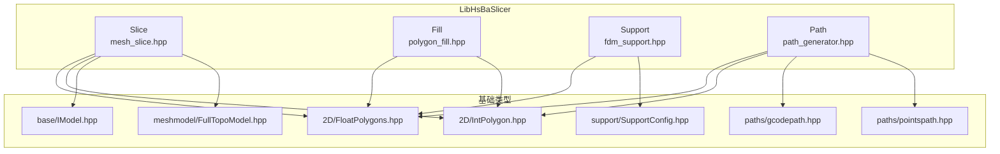
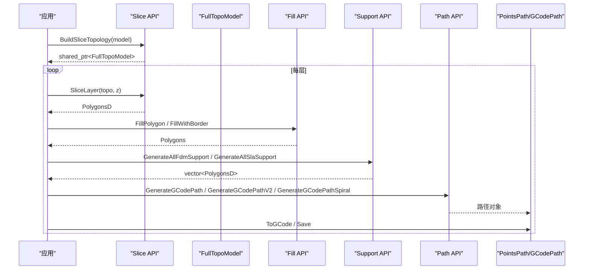
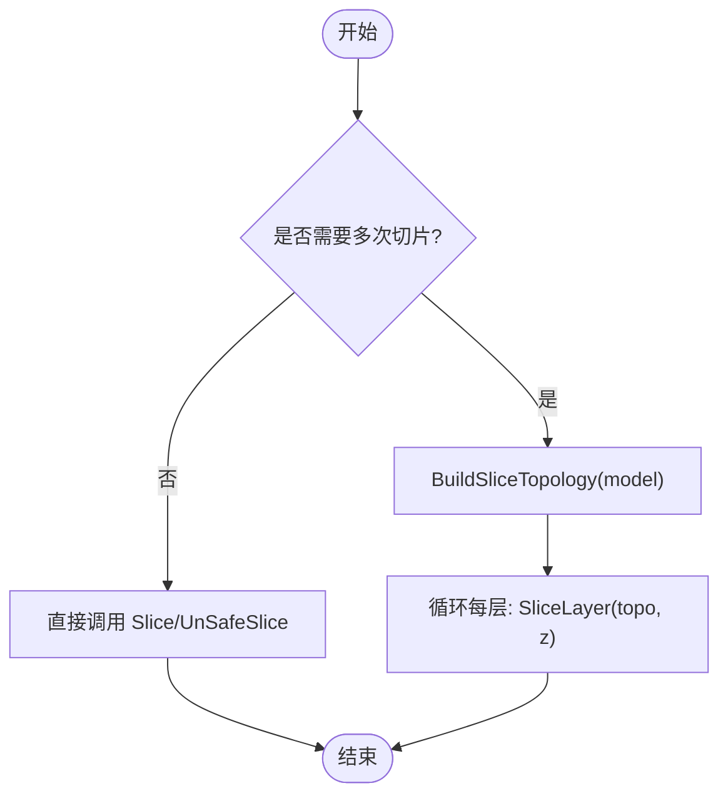
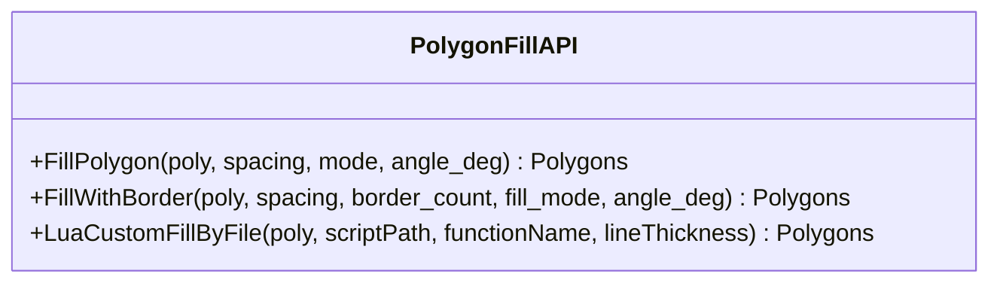
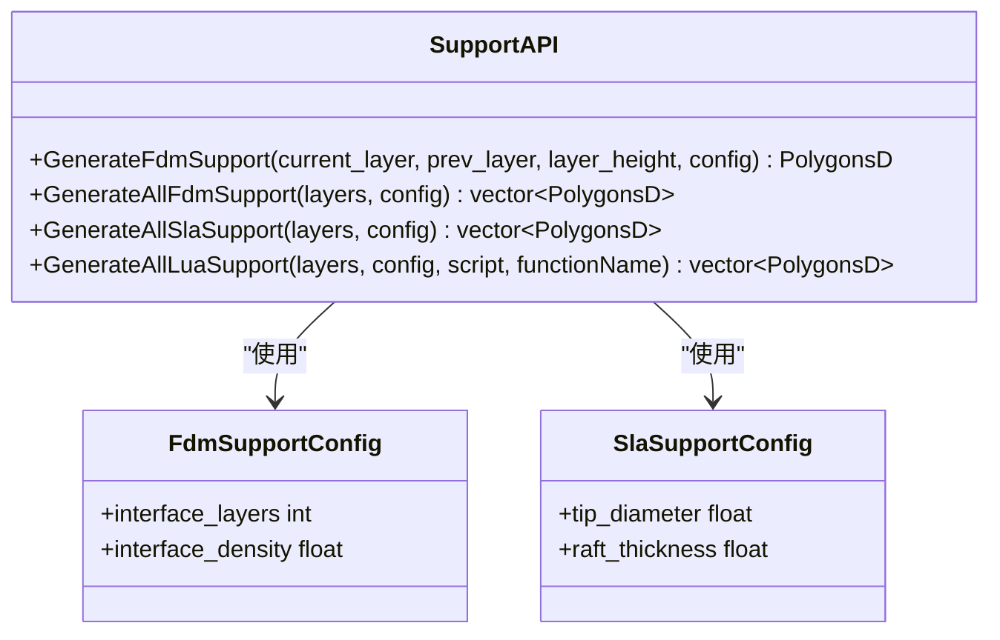
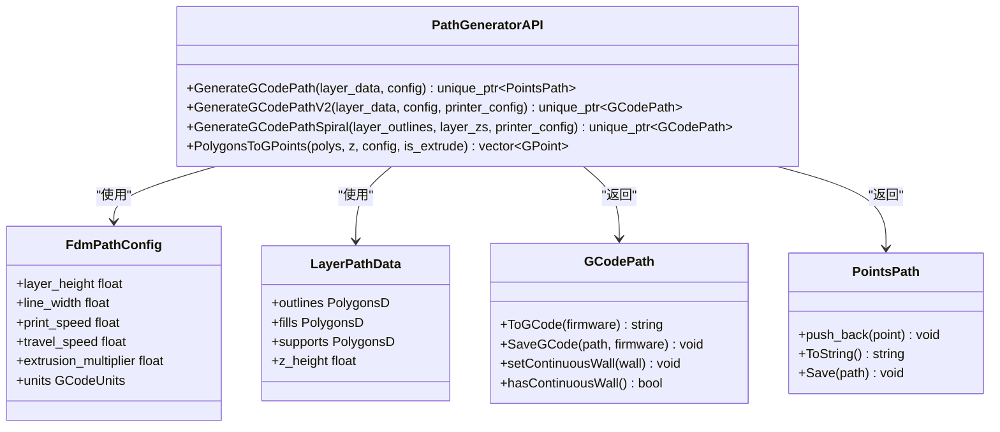
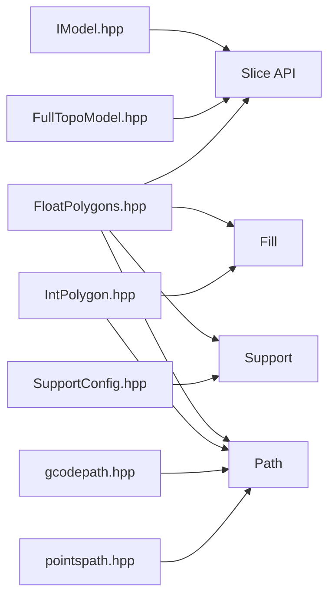

# C++ 核心 API

<cite>
**本文引用的文件**   
- [export.h](file://LibHsBaSlicer/export.h)
- [mesh_slice.hpp](file://LibHsBaSlicer/Slice/mesh_slice.hpp)
- [polygon_fill.hpp](file://LibHsBaSlicer/Fill/polygon_fill.hpp)
- [fdm_support.hpp](file://LibHsBaSlicer/Support/fdm_support.hpp)
- [path_generator.hpp](file://LibHsBaSlicer/Path/path_generator.hpp)
- [FloatPolygons.hpp](file://2D/FloatPolygons.hpp)
- [IntPolygon.hpp](file://2D/IntPolygon.hpp)
- [IModel.hpp](file://base/IModel.hpp)
- [FullTopoModel.hpp](file://meshmodel/FullTopoModel.hpp)
- [SupportConfig.hpp](file://support/SupportConfig.hpp)
- [gcodepath.hpp](file://paths/gcodepath.hpp)
- [pointspath.hpp](file://paths/pointspath.hpp)
</cite>

## 目录
1. [简介](#简介)
2. [项目结构](#项目结构)
3. [核心组件](#核心组件)
4. [架构总览](#架构总览)
5. [详细组件分析](#详细组件分析)
6. [依赖关系分析](#依赖关系分析)
7. [性能与并发](#性能与并发)
8. [故障排除指南](#故障排除指南)
9. [结论](#结论)
10. [附录：常用数据模型与配置](#附录常用数据模型与配置)

## 简介
本页面面向使用 LibHsBaSlicer 的 C++ 开发者，聚焦面向对象接口与函数式 API 的使用说明。文档覆盖以下核心能力：
- 网格切片：安全/不安全切片、Lua 驱动切片、可复用拓扑切片
- 填充计算：直线/锯齿/边界偏移填充、Lua 自定义填充
- 支撑生成：FDM（平面/树/蜂窝）、SLA 牺牲支撑、Lua 自定义支撑
- 路径规划：FDM G 代码路径生成、多固件输出、花瓶模式螺旋外壁

所有公共符号通过 HSBA_SLICER_LIB_API 宏导出，便于在 Windows DLL 与非 Windows 平台正确导入导出。

## 项目结构
LibHsBaSlicer 将切片、填充、支撑、路径等能力以“功能域”组织：
- Slice：网格切片相关函数
- Fill：2D 多边形填充
- Support：支撑生成封装
- Path：G 代码路径生成与输出类型
- 2D：基础几何类型与布尔运算
- base：模型抽象 IModel
- meshmodel：切片专用拓扑模型 FullTopoModel
- support：支撑算法与配置
- paths：路径数据结构与输出



**图表来源**
- [mesh_slice.hpp:1-108](file://LibHsBaSlicer/Slice/mesh_slice.hpp#L1-L108)
- [polygon_fill.hpp:1-58](file://LibHsBaSlicer/Fill/polygon_fill.hpp#L1-L58)
- [fdm_support.hpp:1-72](file://LibHsBaSlicer/Support/fdm_support.hpp#L1-L72)
- [path_generator.hpp:1-96](file://LibHsBaSlicer/Path/path_generator.hpp#L1-L96)
- [FloatPolygons.hpp:1-271](file://2D/FloatPolygons.hpp#L1-L271)
- [IntPolygon.hpp:1-241](file://2D/IntPolygon.hpp#L1-L241)
- [IModel.hpp:1-151](file://base/IModel.hpp#L1-L151)
- [FullTopoModel.hpp:1-150](file://meshmodel/FullTopoModel.hpp#L1-L150)
- [SupportConfig.hpp:1-47](file://support/SupportConfig.hpp#L1-L47)
- [gcodepath.hpp:1-112](file://paths/gcodepath.hpp#L1-L112)
- [pointspath.hpp:1-99](file://paths/pointspath.hpp#L1-L99)

**章节来源**
- [export.h:1-22](file://LibHsBaSlicer/export.h#L1-L22)

## 核心组件
本节概述面向 C++ 开发者的主要接口族，包括函数式 API 与关键数据结构。

- 切片 API（Slice）
  - 提供安全/不安全切片、Lua 驱动切片、可复用拓扑构建与逐层切片
  - 返回 Polygons/PolygonsD 或 UnSafePolygons/UnSafePolygonsD
- 填充 API（Fill）
  - 提供直线/锯齿/边界偏移填充与 Lua 自定义填充
  - 输入为 Polygons，输出为 Polygons
- 支撑 API（Support）
  - 提供 FDM 单层/全层支撑、SLA 全层支撑、Lua 自定义支撑
  - 输入为 PolygonsD，输出为 PolygonsD 或 vector<PolygonsD>
- 路径 API（Path）
  - 提供 FDM G 代码路径生成、多固件输出、花瓶模式螺旋外壁
  - 返回 PointsPath 或 GCodePath

**章节来源**
- [mesh_slice.hpp:22-103](file://LibHsBaSlicer/Slice/mesh_slice.hpp#L22-L103)
- [polygon_fill.hpp:17-53](file://LibHsBaSlicer/Fill/polygon_fill.hpp#L17-L53)
- [fdm_support.hpp:19-67](file://LibHsBaSlicer/Support/fdm_support.hpp#L19-L67)
- [path_generator.hpp:20-91](file://LibHsBaSlicer/Path/path_generator.hpp#L20-L91)

## 架构总览
LibHsBaSlicer 的 C++ API 以“函数式入口 + 基础几何类型 + 输出对象”的方式组织。典型调用链如下：



**图表来源**
- [mesh_slice.hpp:89-103](file://LibHsBaSlicer/Slice/mesh_slice.hpp#L89-L103)
- [polygon_fill.hpp:24-53](file://LibHsBaSlicer/Fill/polygon_fill.hpp#L24-L53)
- [fdm_support.hpp:27-67](file://LibHsBaSlicer/Support/fdm_support.hpp#L27-L67)
- [path_generator.hpp:50-80](file://LibHsBaSlicer/Path/path_generator.hpp#L50-L80)
- [gcodepath.hpp:66-106](file://paths/gcodepath.hpp#L66-L106)
- [pointspath.hpp:61-94](file://paths/pointspath.hpp#L61-L94)

## 详细组件分析

### 切片 API（Slice）
Slice 模块提供面向 IModel 与 FullTopoModel 的切片函数，支持安全/不安全切片、Lua 驱动切片以及可复用拓扑优化。

- 关键函数
  - Slice：按高度对 IModel 进行安全切片，忽略开放轮廓
  - UnSafeSlice：包含开放轮廓的切片
  - SliceLua / UnSafeSliceLua：基于内联 Lua 脚本的切片
  - NormalizeUnSafePolygons：将不安全切片结果规范化为双精度闭合多边形集合
  - BuildSliceTopology：从 IModel 构建可复用的 FullTopoModel
  - SliceLayer：对预构建拓扑执行单层切片并规范化

- 生命周期与资源管理
  - BuildSliceTopology 返回 std::shared_ptr<FullTopoModel>，由调用方共享所有权；多个线程可并发读取同一拓扑，只要各自写入独立输出容器
  - 切片函数不持有外部状态，适合无状态调用

- 线程安全性
  - 文档明确：共享同一 FullTopoModel 的多线程并发调用是安全的，前提是各线程写入各自的输出槽

- 复杂度与性能建议
  - 未使用 BuildSliceTopology 时，每次 UnSafeSlice 会重建拓扑，复杂度与面数相关；多层流水线应优先使用 BuildSliceTopology + SliceLayer 避免重复构建



**图表来源**
- [mesh_slice.hpp:89-103](file://LibHsBaSlicer/Slice/mesh_slice.hpp#L89-L103)

**章节来源**
- [mesh_slice.hpp:22-103](file://LibHsBaSlicer/Slice/mesh_slice.hpp#L22-L103)
- [FullTopoModel.hpp:53-127](file://meshmodel/FullTopoModel.hpp#L53-L127)

### 填充 API（PolygonFill）
Fill 模块提供 2D 多边形填充能力，包括直线、简单锯齿、普通锯齿、边界偏移与 Lua 自定义填充。

- 关键函数
  - FillPolygon：对输入多边形进行指定间距、模式和角度的填充
  - FillWithBorder：带边界偏移的填充
  - LuaCustomFillByFile：通过 Lua 脚本文件生成自定义填充图案

- 数据类型
  - 输入：Polygons（整数坐标）
  - 输出：Polygons（整数坐标）

- 使用建议
  - 对于复杂形状，先进行 MakeSimple 简化以减少冗余点
  - 调整 spacing 与 angle_deg 控制填充密度与方向



**图表来源**
- [polygon_fill.hpp:24-53](file://LibHsBaSlicer/Fill/polygon_fill.hpp#L24-L53)

**章节来源**
- [polygon_fill.hpp:17-53](file://LibHsBaSlicer/Fill/polygon_fill.hpp#L17-L53)

### 支撑 API（FdmSupport）
Support 模块提供 FDM 与 SLA 支撑生成封装，支持单层与全层生成，并提供 Lua 自定义支撑。

- 关键函数
  - GenerateFdmSupport：根据当前层与上一层生成 FDM 支撑截面
  - GenerateAllFdmSupport：对所有层批量生成 FDM 支撑
  - GenerateAllSlaSupport：对所有层批量生成 SLA 牺牲支撑
  - GenerateAllLuaSupport：通过 Lua 脚本替换内置支撑算法

- 配置结构
  - Support::SupportConfig：通用支撑参数（悬垂角度阈值、层高、间隙、柱径、密度、图案、树分支角度/半径、蜂窝单元尺寸）
  - Support::FdmSupportConfig：FDM 特有（界面层数、界面密度）
  - Support::SlaSupportConfig：SLA 特有（尖端直径、底板厚度）

- 线程安全性
  - 函数本身无状态，可并发调用；注意输入 PolygonsD 的并发访问语义



**图表来源**
- [fdm_support.hpp:27-67](file://LibHsBaSlicer/Support/fdm_support.hpp#L27-L67)
- [SupportConfig.hpp:14-43](file://support/SupportConfig.hpp#L14-L43)

**章节来源**
- [fdm_support.hpp:19-67](file://LibHsBaSlicer/Support/fdm_support.hpp#L19-L67)
- [SupportConfig.hpp:11-43](file://support/SupportConfig.hpp#L11-L43)

### 路径 API（PathGenerator）
Path 模块提供 FDM G 代码路径生成与输出，支持多固件输出与花瓶模式螺旋外壁。

- 关键结构与函数
  - FdmPathConfig：路径生成配置（层高、线宽、打印速度、移动速度、挤出倍率、单位）
  - LayerPathData：单层路径数据（轮廓、填充、支撑、Z 高度）
  - GenerateGCodePath：生成 PointsPath
  - GenerateGCodePathV2：生成 GCodePath（多固件）
  - GenerateGCodePathSpiral：生成连续螺旋外壁（花瓶模式）
  - PolygonsToGPoints：将 PolygonsD 转换为 GPoint 序列

- 输出类型
  - PointsPath：基于有序 GPoint 的路径，支持保存与字符串化
  - GCodePath：继承 LayersPath，支持 ToGCode(firmware)、SaveGCode、设置连续螺旋外壁



**图表来源**
- [path_generator.hpp:23-91](file://LibHsBaSlicer/Path/path_generator.hpp#L23-L91)
- [gcodepath.hpp:66-106](file://paths/gcodepath.hpp#L66-L106)
- [pointspath.hpp:61-94](file://paths/pointspath.hpp#L61-L94)

**章节来源**
- [path_generator.hpp:20-91](file://LibHsBaSlicer/Path/path_generator.hpp#L20-L91)
- [gcodepath.hpp:66-106](file://paths/gcodepath.hpp#L66-L106)
- [pointspath.hpp:61-94](file://paths/pointspath.hpp#L61-L94)

### 基础几何与模型类型
- 2D 几何
  - Point2D/PolygonD/PolygonsD：双精度点、多边形与多边形集合
  - Point2/Polygon/Polygons：64 位整型点、多边形与多边形集合
  - 提供布尔运算（Union/Intersection/Difference/Xor）、Offset、Area、MakeSimple、TextToPolygons、Integerization/UnIntegerization 等
- 模型抽象
  - IModel：3D 模型接口，支持加载/保存、变换、包围盒、体积、三角网格提取
- 切片拓扑
  - FullTopoModel：面向切片的完整拓扑重建模型，提供 Safe/Unsafe/Lua 切片与快速切片

```mermaid
erDiagram
POINT_2D {
double x
double y
}
POLYGON_D {
list<Point2D> path
}
POLYGONS_D {
list<PolygonD> paths
}
POINT_2 {
int64_t x
int64_t y
}
POLYGON {
list<Point2> path
}
POLYGONS {
list<Polygon> paths
}
IMODEL {
<<interface>>
Load(fileName)
Save(fileName, format)
Translate(vec3)
Rotate(quat)
Scale(scale)
Transform(matrix)
BoundingBox(min, max)
Volume()
TriangleMesh()
}
FULLTOPOMODEL {
CheckTopo()
GetVertices()
GetEdges()
GetFaces()
Slice(height, tolerance)
UnSafeSlice(height, tolerance)
SliceFast(height)
SliceLua(script, height)
}
POLYGONS_D ||--o{ POLYGON_D : "包含"
POLYGONS ||--o{ POLYGON : "包含"
FULLTOPOMODEL ..|| IMODEL : "消费"
```

**图表来源**
- [FloatPolygons.hpp:18-26](file://2D/FloatPolygons.hpp#L18-L26)
- [IntPolygon.hpp:19-26](file://2D/IntPolygon.hpp#L19-L26)
- [IModel.hpp:111-139](file://base/IModel.hpp#L111-L139)
- [FullTopoModel.hpp:53-127](file://meshmodel/FullTopoModel.hpp#L53-L127)

**章节来源**
- [FloatPolygons.hpp:27-221](file://2D/FloatPolygons.hpp#L27-L221)
- [IntPolygon.hpp:28-210](file://2D/IntPolygon.hpp#L28-L210)
- [IModel.hpp:65-139](file://base/IModel.hpp#L65-L139)
- [FullTopoModel.hpp:53-127](file://meshmodel/FullTopoModel.hpp#L53-L127)

## 依赖关系分析
LibHsBaSlicer 的 C++ API 依赖关系清晰：
- Slice 依赖 IModel 与 FullTopoModel，并返回 2D 几何类型
- Fill 依赖 2D 几何类型
- Support 依赖 2D 几何类型与支撑配置
- Path 依赖 2D 几何类型与路径输出类型（PointsPath/GCodePath）



**图表来源**
- [mesh_slice.hpp:12-16](file://LibHsBaSlicer/Slice/mesh_slice.hpp#L12-L16)
- [polygon_fill.hpp:11-13](file://LibHsBaSlicer/Fill/polygon_fill.hpp#L11-L13)
- [fdm_support.hpp:13-15](file://LibHsBaSlicer/Support/fdm_support.hpp#L13-L15)
- [path_generator.hpp:12-16](file://LibHsBaSlicer/Path/path_generator.hpp#L12-L16)

**章节来源**
- [mesh_slice.hpp:12-16](file://LibHsBaSlicer/Slice/mesh_slice.hpp#L12-L16)
- [polygon_fill.hpp:11-13](file://LibHsBaSlicer/Fill/polygon_fill.hpp#L11-L13)
- [fdm_support.hpp:13-15](file://LibHsBaSlicer/Support/fdm_support.hpp#L13-L15)
- [path_generator.hpp:12-16](file://LibHsBaSlicer/Path/path_generator.hpp#L12-L16)

## 性能与并发
- 切片性能
  - 多层流水线优先使用 BuildSliceTopology + SliceLayer，避免每层重建拓扑
  - 合理设置 tolerance，平衡数值稳定性与性能
- 填充性能
  - 对复杂多边形先进行 MakeSimple 减少冗余点
  - 调整 spacing 与 angle_deg 控制填充密度与计算量
- 支撑性能
  - 选择合适的支撑图案（平面/树/蜂窝），大跨度结构可使用树支撑减少材料
  - 调整 support_gap 与 support_diameter 平衡支撑强度与移除难度
- 路径性能
  - 使用 GenerateGCodePathV2 获取多固件输出能力
  - 花瓶模式使用 GenerateGCodePathSpiral 生成连续外壁，减少层间移动
- 并发建议
  - 共享 FullTopoModel 的并发读取是安全的，但需确保每个线程写入独立的输出容器
  - 填充与支撑函数无状态，可并行处理不同层或多模型

[本节为通用指导，不直接分析具体文件]

## 故障排除指南
- 切片结果为空或不闭合
  - 检查输入模型的拓扑完整性（FullTopoModel::CheckTopo）
  - 使用 NormalizeUnSafePolygons 清理开放轮廓与非简单多边形
- 支撑未生成或过少
  - 检查 overhang_angle_threshold 与 layer_height 是否合理
  - 调整 support_gap 与 support_diameter
- G 代码输出异常
  - 确认 FdmPathConfig 与 GCodePrinterConfig 的单位与参数一致
  - 使用 ToGCode(firmware) 指定目标固件，必要时使用 Lua 后处理脚本

**章节来源**
- [FullTopoModel.hpp:80-114](file://meshmodel/FullTopoModel.hpp#L80-L114)
- [mesh_slice.hpp:67-77](file://LibHsBaSlicer/Slice/mesh_slice.hpp#L67-L77)
- [SupportConfig.hpp:14-43](file://support/SupportConfig.hpp#L14-L43)
- [path_generator.hpp:50-80](file://LibHsBaSlicer/Path/path_generator.hpp#L50-L80)
- [gcodepath.hpp:74-82](file://paths/gcodepath.hpp#L74-L82)

## 结论
LibHsBaSlicer 的 C++ API 以清晰的函数式入口与稳定的几何类型为基础，提供从切片到路径生成的完整流程。通过 BuildSliceTopology 优化多层切片、合理使用填充与支撑策略、选择合适的路径输出类型，可以在保证质量的同时获得良好性能。多线程环境下，共享拓扑读取是安全的，但需遵循独立输出的并发约定。

[本节为总结性内容，不直接分析具体文件]

## 附录：常用数据模型与配置
- 2D 几何类型
  - Point2D/PolygonD/PolygonsD：双精度
  - Point2/Polygon/Polygons：64 位整型
- 模型接口
  - IModel：加载/保存、变换、包围盒、体积、三角网格
- 切片拓扑
  - FullTopoModel：Safe/Unsafe/Lua 切片、快速切片、拓扑检查
- 支撑配置
  - Support::SupportConfig：通用参数
  - Support::FdmSupportConfig：FDM 特有
  - Support::SlaSupportConfig：SLA 特有
- 路径配置与输出
  - FdmPathConfig：路径生成参数
  - LayerPathData：单层路径数据
  - GCodePath：多固件输出、连续螺旋外壁
  - PointsPath：有序 GPoint 路径

**章节来源**
- [FloatPolygons.hpp:18-26](file://2D/FloatPolygons.hpp#L18-L26)
- [IntPolygon.hpp:19-26](file://2D/IntPolygon.hpp#L19-L26)
- [IModel.hpp:111-139](file://base/IModel.hpp#L111-L139)
- [FullTopoModel.hpp:53-127](file://meshmodel/FullTopoModel.hpp#L53-L127)
- [SupportConfig.hpp:14-43](file://support/SupportConfig.hpp#L14-L43)
- [path_generator.hpp:23-42](file://LibHsBaSlicer/Path/path_generator.hpp#L23-L42)
- [gcodepath.hpp:66-106](file://paths/gcodepath.hpp#L66-L106)
- [pointspath.hpp:61-94](file://paths/pointspath.hpp#L61-L94)