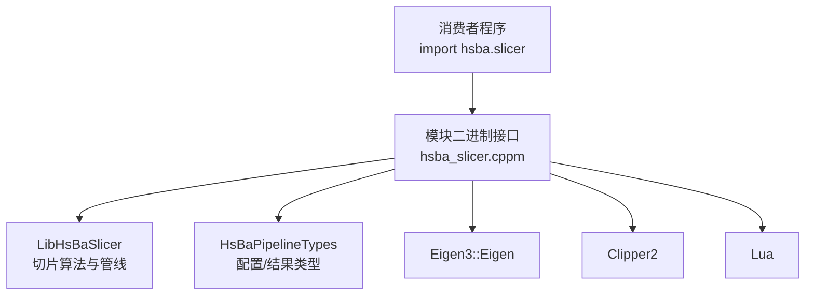
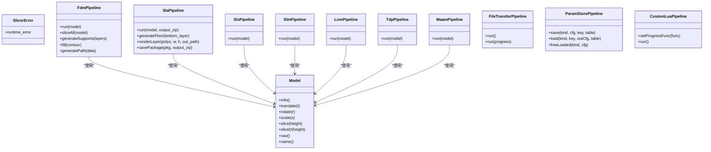
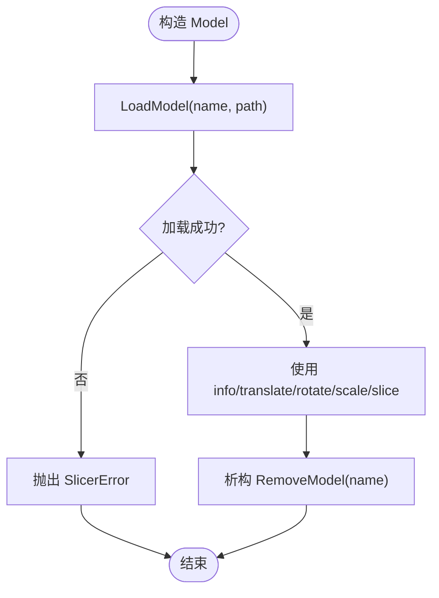
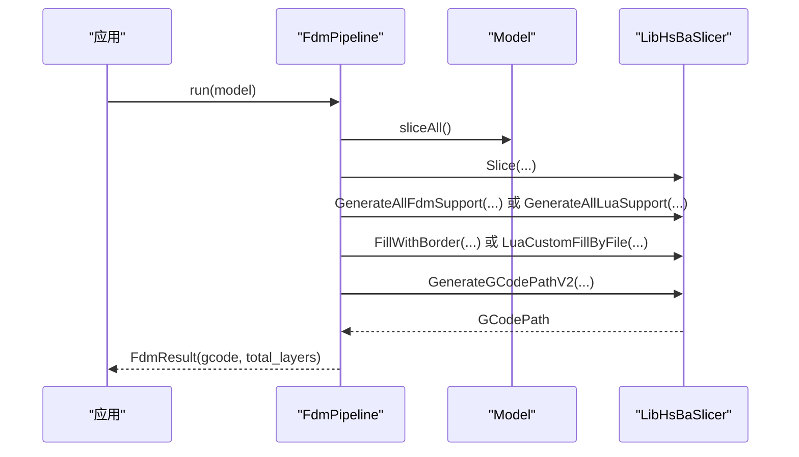
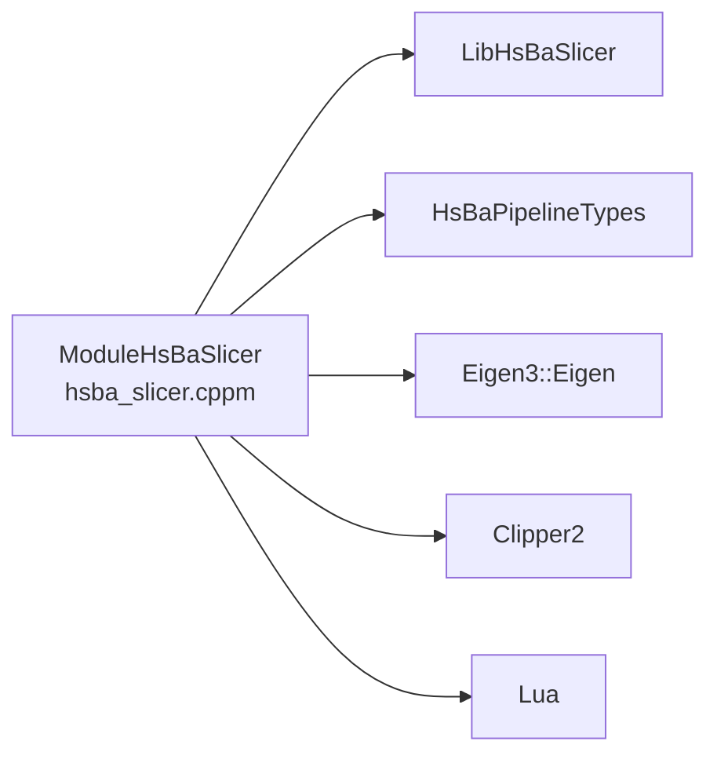
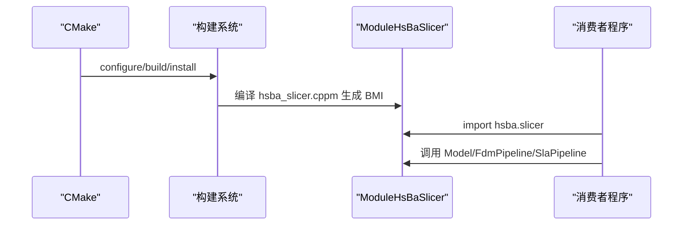

# C++20 模块接口

<cite>
**本文引用的文件**   
- [hsba_slicer.cppm](file://ModuleHsBaSlicer/hsba_slicer.cppm)
- [module_anchor.cpp](file://ModuleHsBaSlicer/module_anchor.cpp)
- [CMakeLists.txt（ModuleHsBaSlicer）](file://ModuleHsBaSlicer/CMakeLists.txt)
- [main_module.cpp（示例）](file://samples/LibHsBaSlicer/main_module.cpp)
- [cpp_cmake_usage.md（英文文档）](file://docs/en/cpp_cmake_usage.md)
</cite>

## 目录
1. [简介](#简介)
2. [项目结构](#项目结构)
3. [核心组件](#核心组件)
4. [架构总览](#架构总览)
5. [详细组件分析](#详细组件分析)
6. [依赖关系分析](#依赖关系分析)
7. [性能与编译时间优化](#性能与编译时间优化)
8. [与传统头文件的兼容性与迁移策略](#与传统头文件的兼容性与迁移策略)
9. [构建与集成指南](#构建与集成指南)
10. [故障排查](#故障排查)
11. [结论](#结论)

## 简介
本文件面向使用现代 C++ 工具链的开发者，系统性说明 HsBaSlicer 的 C++20 模块接口 ModuleHsBaSlicer。该模块通过 `import hsba.slicer;` 暴露类风格 API，封装 LibHsBaSlicer 的自由函数，提供 RAII 模型管理、异常安全、以及 FDM/SLA/SLS/SLM/LOM/3DP/WAAM/文件传输/参数存储等流水线能力。文档涵盖：
- 模块导出接口与命名空间组织
- 依赖管理与 ABI 边界
- 模块编译配置、链接选项与 CMake 集成
- 最佳实践代码示例路径
- 与传统头文件使用的兼容性考虑和迁移建议
- 性能优势分析与编译时间优化建议

## 项目结构
ModuleHsBaSlicer 是一个“单文件模块”实现：接口与实现合并到 `hsba_slicer.cppm`，并通过 CMake 的 `FILE_SET ... TYPE CXX_MODULES` 暴露给消费者。`module_anchor.cpp` 仅用于确保静态库归档产物生成。

图表来源
- [CMakeLists.txt（ModuleHsBaSlicer）:1-46](file://ModuleHsBaSlicer/CMakeLists.txt#L1-L46)
- [hsba_slicer.cppm:10-65](file://ModuleHsBaSlicer/hsba_slicer.cppm#L10-L65)

章节来源
- [CMakeLists.txt（ModuleHsBaSlicer）:1-46](file://ModuleHsBaSlicer/CMakeLists.txt#L1-L46)
- [module_anchor.cpp:1-13](file://ModuleHsBaSlicer/module_anchor.cpp#L1-L13)

## 核心组件
ModuleHsBaSlicer 在命名空间 `HsBa::Slicer` 中导出以下关键抽象：
- 异常与类型别名
  - `SlicerError`：统一异常基类
  - 几何类型别名：`Point2/Polygon/Polygons`、`Point2D/PolygonD/PolygonsD`
  - 重导出配置/结果类型：如 `HsBaFdmPipelineConfig_t`、`HsBaSlaPipelineResult_t` 等
  - Lua 回调类型：`LuaRegFunc`、`ZipperEventCallbackFunc`、`DBEventCallbackFunc`
- RAII 模型
  - `Model`：加载、变换、切片、释放资源
- 流水线类
  - `FdmPipeline`：切片→支撑→填充→路径→G-code
  - `SlaPipeline`：切片→支撑→底板→渲染→打包
  - `SlsPipeline`、`SlmPipeline`、`LomPipeline`、`TdpPipeline`、`WaamPipeline`：Lua 驱动或机器人路径导出
  - `FileTransferPipeline`：文件校验→连接池→传输
  - `ParamStorePipeline`：参数持久化（SQLite/MySQL/PostgreSQL）
  - `CustomLuaPipeline`：完全由 Lua 脚本编排的流水线
- 扩展点
  - `luaCustomFill/Floor/Support`：Lua 自定义填充/底板/支撑
  - `add2DFunction/add3DFunction/addFileFunction/addEventCallback/addZipperEventCallback/addDBEventCallback`
- 版本与工具
  - `versionJson/versionXml`
  - `toDouble/toInt`

章节来源
- [hsba_slicer.cppm:67-540](file://ModuleHsBaSlicer/hsba_slicer.cppm#L67-L540)

## 架构总览
ModuleHsBaSlicer 作为薄包装层，将用户友好的类 API 映射到底层自由函数。其职责包括：
- 生命周期管理（RAII）
- 配置转换与默认值工厂
- 错误处理（抛出 `SlicerError`）
- 对 Lua 扩展点的统一入口

图表来源
- [hsba_slicer.cppm:152-540](file://ModuleHsBaSlicer/hsba_slicer.cppm#L152-L540)

## 详细组件分析

### 模块接口与命名空间组织
- 模块声明为 `export module hsba.slicer;`，所有公开符号位于 `HsBa::Slicer` 命名空间。
- 全局模块片段（GMF）包含标准库、第三方库和项目头文件，避免重复导入导致的 MSVC C2572 问题。
- 类型别名与配置类型从 `pipelinetypes/pipeline_types.h` 重导出，保证与头文件版本一致。

章节来源
- [hsba_slicer.cppm:10-65](file://ModuleHsBaSlicer/hsba_slicer.cppm#L10-L65)
- [hsba_slicer.cppm:85-128](file://ModuleHsBaSlicer/hsba_slicer.cppm#L85-L128)

### RAII 模型：Model
- 构造时加载模型，析构时自动移除；支持移动语义。
- 提供信息查询、变换、整数/双精度切片、原始 IModel 访问。
- 内部调用底层 LoadModel/RemoveModel/Slice 等函数。

图表来源
- [hsba_slicer.cppm:567-615](file://ModuleHsBaSlicer/hsba_slicer.cppm#L567-L615)

章节来源
- [hsba_slicer.cppm:152-191](file://ModuleHsBaSlicer/hsba_slicer.cppm#L152-L191)
- [hsba_slicer.cppm:567-615](file://ModuleHsBaSlicer/hsba_slicer.cppm#L567-L615)

### FDM 流水线：FdmPipeline
- 全链路：切片 → 支撑 → 填充 → 路径生成 → G-code 输出。
- 支持 Lua 自定义填充/支撑，以及多种填充模式与打印机参数。
- 返回 `FdmResult`（gcode 文本与层数）。

图表来源
- [hsba_slicer.cppm:621-751](file://ModuleHsBaSlicer/hsba_slicer.cppm#L621-L751)

章节来源
- [hsba_slicer.cppm:197-225](file://ModuleHsBaSlicer/hsba_slicer.cppm#L197-L225)
- [hsba_slicer.cppm:621-751](file://ModuleHsBaSlicer/hsba_slicer.cppm#L621-L751)

### SLA 流水线：SlaPipeline
- 全链路：切片 → 支撑 → 底板 → 渲染 → 打包。
- 支持 Lua 自定义底板与导出脚本。
- 返回 `SlaResult`（是否保存成功与层数）。

章节来源
- [hsba_slicer.cppm:231-258](file://ModuleHsBaSlicer/hsba_slicer.cppm#L231-L258)
- [hsba_slicer.cppm:757-856](file://ModuleHsBaSlicer/hsba_slicer.cppm#L757-L856)

### Lua 驱动流水线：Sls/Slm/Lom/Tdp/Waam
- 这些流水线以 Lua 脚本为核心编排逻辑，C++ 侧负责切片数据准备与调用对应导出函数。
- 若未配置 `export_lua_script`，会抛出 `SlicerError`。

章节来源
- [hsba_slicer.cppm:264-348](file://ModuleHsBaSlicer/hsba_slicer.cppm#L264-L348)
- [hsba_slicer.cppm:862-1013](file://ModuleHsBaSlicer/hsba_slicer.cppm#L862-L1013)

### 文件传输流水线：FileTransferPipeline
- 封装 TransferFiles，支持进度回调。
- 失败时抛出 `SlicerError`。

章节来源
- [hsba_slicer.cppm:354-378](file://ModuleHsBaSlicer/hsba_slicer.cppm#L354-L378)
- [hsba_slicer.cppm:1019-1052](file://ModuleHsBaSlicer/hsba_slicer.cppm#L1019-L1052)

### 参数存储流水线：ParamStorePipeline
- 提供 save/load/freeLoaded，封装后端与管道类型的转换。
- 支持 SQLite/MySQL/PostgreSQL（移动端仅 SQLite）。

章节来源
- [hsba_slicer.cppm:384-445](file://ModuleHsBaSlicer/hsba_slicer.cppm#L384-L445)
- [hsba_slicer.cppm:1058-1139](file://ModuleHsBaSlicer/hsba_slicer.cppm#L1058-L1139)

### 自定义 Lua 流水线：CustomLuaPipeline
- 允许通过脚本文件或内联源码定义完整流程，并支持进度回调。
- 返回 `CustomLuaResult`（成功标志、层数、输出路径、返回值字符串）。

章节来源
- [hsba_slicer.cppm:447-479](file://ModuleHsBaSlicer/hsba_slicer.cppm#L447-L479)
- [hsba_slicer.cppm:1145-1178](file://ModuleHsBaSlicer/hsba_slicer.cppm#L1145-L1178)

### Lua 扩展与事件回调
- 提供 add2DFunction/add3DFunction/addFileFunction 注册外部 Lua 函数。
- 提供 addEventCallback/addZipperEventCallback/addDBEventCallback 注册事件回调。

章节来源
- [hsba_slicer.cppm:481-520](file://ModuleHsBaSlicer/hsba_slicer.cppm#L481-L520)
- [hsba_slicer.cppm:1208-1224](file://ModuleHsBaSlicer/hsba_slicer.cppm#L1208-L1224)

## 依赖关系分析
ModuleHsBaSlicer 通过 PUBLIC 链接向消费者传递必要的依赖：
- LibHsBaSlicer：核心算法与流水线
- HsBaPipelineTypes：配置/结果类型
- Eigen3::Eigen：几何计算
- PkgConfig::Clipper2：多边形布尔运算
- Lua：脚本扩展

图表来源
- [CMakeLists.txt（ModuleHsBaSlicer）:22-29](file://ModuleHsBaSlicer/CMakeLists.txt#L22-L29)

章节来源
- [CMakeLists.txt（ModuleHsBaSlicer）:22-34](file://ModuleHsBaSlicer/CMakeLists.txt#L22-L34)

## 性能与编译时间优化
- 单文件模块设计：接口与实现合并到 `hsba_slicer.cppm`，避免 MSVC 下独立实现单元的隐式导入 std 重定义问题（C2572），减少编译期歧义。
- 静态库构建：ModuleHsBaSlicer 始终为 STATIC，避免 DLL 链接阶段系统库路径问题，同时通过 PUBLIC 链接把依赖传递给消费者，利于增量编译与缓存。
- 编译器标志传播：CGAL 通过 INTERFACE 传播 `/fp:strict` 与 `_SCL_SECURE_NO_WARNINGS`，ModuleHsBaSlicer 重新导出为 PUBLIC，消费者无需手动设置，降低不一致风险。
- 几何与 IO 优化：FDM/SLA 流水线中对向量进行 reserve，减少动态扩容开销；分层循环中尽量复用中间结果。

章节来源
- [hsba_slicer.cppm:1-9](file://ModuleHsBaSlicer/hsba_slicer.cppm#L1-L9)
- [CMakeLists.txt（ModuleHsBaSlicer）:8-14](file://ModuleHsBaSlicer/CMakeLists.txt#L8-L14)
- [CMakeLists.txt（ModuleHsBaSlicer）:36-45](file://ModuleHsBaSlicer/CMakeLists.txt#L36-L45)
- [hsba_slicer.cppm:623-637](file://ModuleHsBaSlicer/hsba_slicer.cppm#L623-L637)

## 与传统头文件的兼容性与迁移策略
- 类型一致性：模块与头文件共用 `pipelinetypes/pipeline_types.h` 中的配置/结果类型，不重复定义，保证 ABI 兼容。
- GMF 限制：C++20 标准限制导致 GMF 中 `#include` 的类型不会导出给消费者。因此，像 `ModelInfo`、`LayerPathData` 等需在消费者端直接 include 相关头文件。
- 迁移建议：
  - 优先使用 `import hsba.slicer;` 获取类风格 API 与异常安全。
  - 保留对 `pipelinetypes/pipeline_types.h` 的 include，用于配置结构体。
  - 如需直接使用底层自由函数，可继续使用传统头文件方式（LibHsBaSlicer），但推荐逐步迁移到模块 API 以获得更好的封装与错误处理。

章节来源
- [docs/en/cpp_cmake_usage.md:312-332](file://docs/en/cpp_cmake_usage.md#L312-L332)
- [hsba_slicer.cppm:37-63](file://ModuleHsBaSlicer/hsba_slicer.cppm#L37-L63)

## 构建与集成指南

### 使用 ModuleHsBaSlicer（C++20 模块）
- 要求：CMake ≥ 3.28，C++20 兼容编译器（MSVC 19.36+、GCC 13+、Clang 16+）。
- CMake 集成：
  - 通过 `find_package(HsBaSlicer REQUIRED)` 引入。
  - 链接目标 `HsBaSlicer::ModuleHsBaSlicer`。
- 示例参考：
  - 示例程序路径：[main_module.cpp](file://samples/LibHsBaSlicer/main_module.cpp)

图表来源
- [docs/en/cpp_cmake_usage.md:155-173](file://docs/en/cpp_cmake_usage.md#L155-L173)
- [CMakeLists.txt（ModuleHsBaSlicer）:16-20](file://ModuleHsBaSlicer/CMakeLists.txt#L16-L20)

章节来源
- [docs/en/cpp_cmake_usage.md:155-173](file://docs/en/cpp_cmake_usage.md#L155-L173)
- [CMakeLists.txt（ModuleHsBaSlicer）:16-20](file://ModuleHsBaSlicer/CMakeLists.txt#L16-L20)

### 示例：模块导入与使用最佳实践
- 示例程序展示了：
  - 标准库 include 必须在 `import` 之前（MSVC 要求）
  - 直接 include 非导出类型（如 `ModelInfo`）
  - 使用 `defaultFdmConfig()` 配置 FDM 流水线
  - 使用 `FdmPipeline.run(Model)` 完成全流程
  - 可选的 `CustomLuaPipeline` 完全由 Lua 脚本编排

章节来源
- [main_module.cpp:14-29](file://samples/LibHsBaSlicer/main_module.cpp#L14-L29)
- [main_module.cpp:65-97](file://samples/LibHsBaSlicer/main_module.cpp#L65-L97)
- [main_module.cpp:101-127](file://samples/LibHsBaSlicer/main_module.cpp#L101-L127)

## 故障排查
- MSVC C2572（std 重定义）：
  - 原因：独立实现单元隐式导入 std 导致冲突。
  - 解决：采用单文件模块（接口+实现合并），并确保消费者端 `#include` 在 `import` 之前。
- MSVC C5050（编译标志不一致）：
  - 原因：CGAL 通过 INTERFACE 传播 `/fp:strict` 与 `_SCL_SECURE_NO_WARNINGS`。
  - 解决：ModuleHsBaSlicer 已重新导出为 PUBLIC，消费者无需手动设置。
- 平台差异：
  - Clang/GCC：GMF 类型不可导出，消费者需直接 include 所需头文件。
  - Android/iOS：仅支持 SQLite 后端。

章节来源
- [hsba_slicer.cppm:1-9](file://ModuleHsBaSlicer/hsba_slicer.cppm#L1-L9)
- [CMakeLists.txt（ModuleHsBaSlicer）:36-45](file://ModuleHsBaSlicer/CMakeLists.txt#L36-L45)
- [docs/en/cpp_cmake_usage.md:312-332](file://docs/en/cpp_cmake_usage.md#L312-L332)

## 结论
ModuleHsBaSlicer 通过 C++20 模块语法提供了稳定、易用的类风格 API，封装了 HsBaSlicer 的核心切片与导出能力。它解决了传统头文件方式的碎片化问题，提升了错误处理与资源管理能力，并在构建系统中通过静态库与 PUBLIC 依赖传播简化了集成复杂度。对于现代 C++ 工具链用户，推荐优先采用 `import hsba.slicer;` 的方式接入 HsBaSlicer，并结合示例与文档进行渐进式迁移。