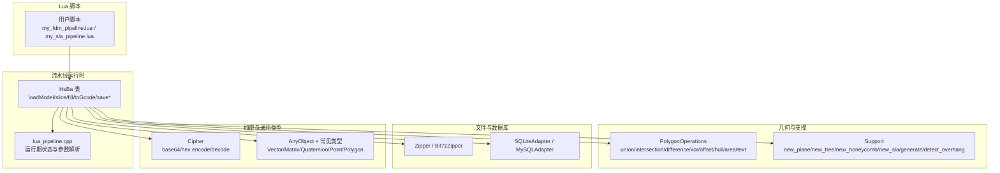
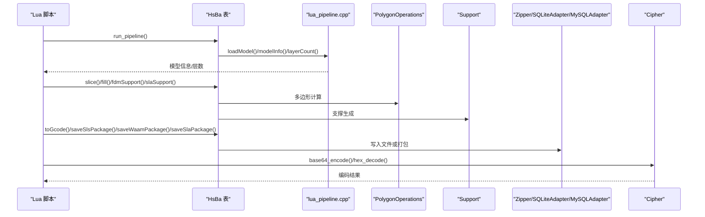
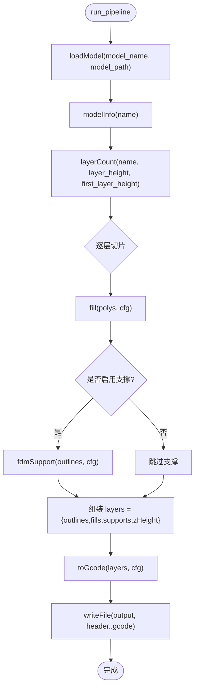
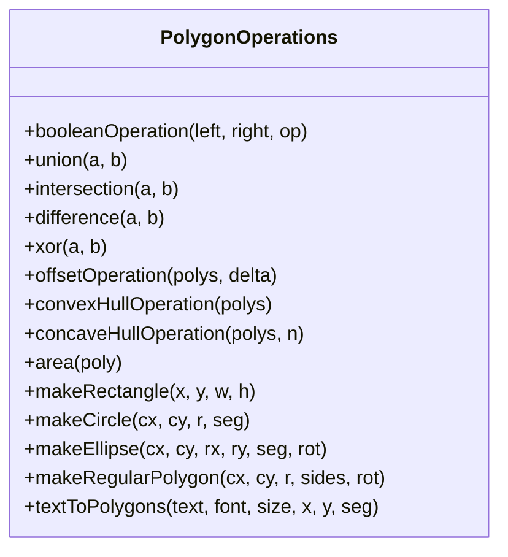
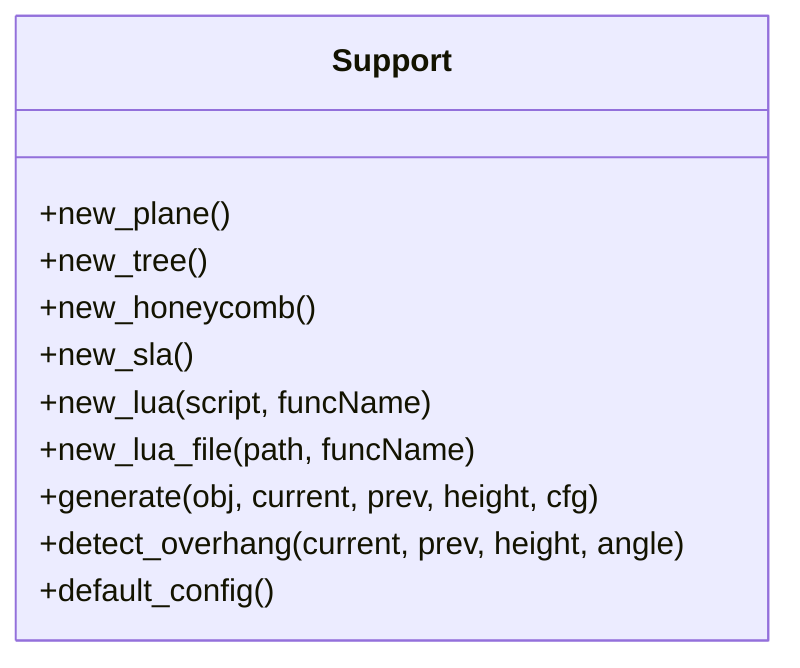
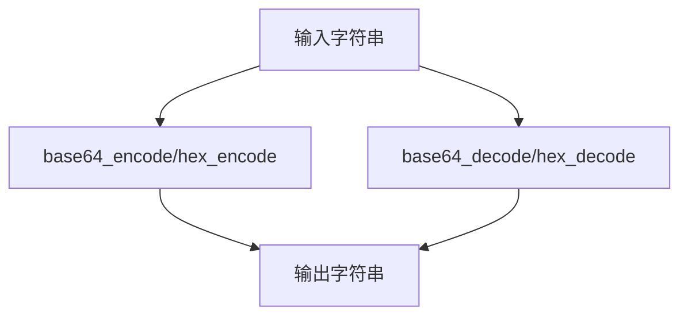
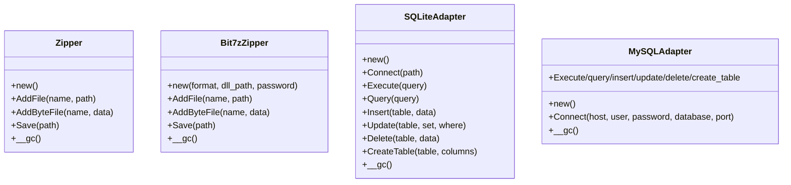
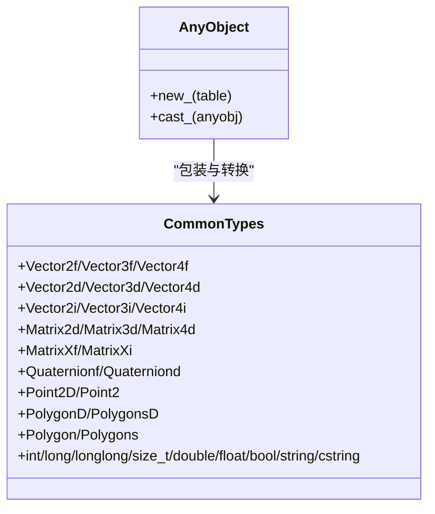
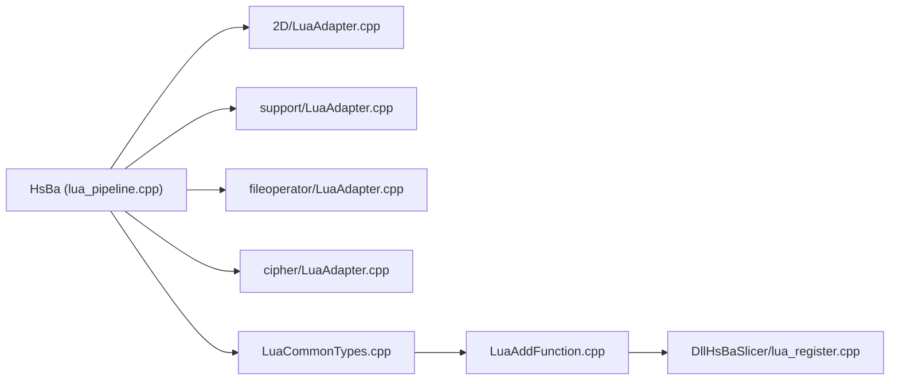

# Lua API

<cite>
**本文引用的文件**   
- [2D/LuaAdapter.cpp](file://2D/LuaAdapter.cpp)
- [cipher/LuaAdapter.cpp](file://cipher/LuaAdapter.cpp)
- [fileoperator/LuaAdapter.cpp](file://fileoperator/LuaAdapter.cpp)
- [support/LuaAdapter.cpp](file://support/LuaAdapter.cpp)
- [LibHsBaSlicer/Extends/LuaAddFunction.cpp](file://LibHsBaSlicer/Extends/LuaAddFunction.cpp)
- [LibHsBaSlicer/Extends/LuaCommonTypes.cpp](file://LibHsBaSlicer/Extends/LuaCommonTypes.cpp)
- [LibHsBaSlicer/Extends/lua_pipeline.cpp](file://LibHsBaSlicer/Extends/lua_pipeline.cpp)
- [DllHsBaSlicer/lua_register.cpp](file://DllHsBaSlicer/lua_register.cpp)
- [samples/Custom/scripts/my_fdm_pipeline.lua](file://samples/Custom/scripts/my_fdm_pipeline.lua)
- [samples/Custom/scripts/my_sla_pipeline.lua](file://samples/Custom/scripts/my_sla_pipeline.lua)
- [samples/FDM/scripts/my_infill.lua](file://samples/FDM/scripts/my_infill.lua)
- [samples/FDM/scripts/my_support.lua](file://samples/FDM/scripts/my_support.lua)
- [fileoperator/test_lua_adapter.lua](file://fileoperator/test_lua_adapter.lua)
</cite>

## 目录
1. [简介](#简介)
2. [项目结构](#项目结构)
3. [核心组件](#核心组件)
4. [架构总览](#架构总览)
5. [详细组件分析](#详细组件分析)
6. [依赖关系分析](#依赖关系分析)
7. [性能与内存管理](#性能与内存管理)
8. [故障排除指南](#故障排除指南)
9. [结论](#结论)
10. [附录：Lua 脚本示例与最佳实践](#附录lua-脚本示例与最佳实践)

## 简介
本文件为 HsBaSlicer 的 Lua API 参考文档，面向使用 Lua 脚本扩展切片、几何处理、文件操作、加密以及自定义流水线能力的用户。文档基于源码实现，系统梳理以下方面：
- 暴露给 Lua 的全局表与函数：HsBa、PolygonOperations、Support、Cipher、Zipper、SQLiteAdapter、MySQLAdapter、Bit7zZipper 等。
- Lua 与 C++ 的类型映射约定：多边形、点、向量、矩阵、AnyObject、字符串与二进制数据。
- 内存管理与对象生命周期：userdata、元表 __gc、AnyObject 包装。
- 错误处理机制：C++ 异常到 Lua 错误的转换、返回值约定。
- 脚本扩展点与事件回调：按维度注册函数、事件回调注册。
- 完整示例：FDM/SLA 流水线、填充与支撑脚本、文件与加密用法。
- 性能优化建议与调试技巧。
- Lua 5.3+ 兼容性说明与已知限制。

## 项目结构
Lua API 由多个模块共同组成：
- 流水线运行时与全局 HsBa 表：[LibHsBaSlicer/Extends/lua_pipeline.cpp](file://LibHsBaSlicer/Extends/lua_pipeline.cpp)
- 2D 几何与多边形操作：[2D/LuaAdapter.cpp](file://2D/LuaAdapter.cpp)
- 支撑生成工具：[support/LuaAdapter.cpp](file://support/LuaAdapter.cpp)
- 文件与数据库适配器（Zipper、SQLiteAdapter、MySQLAdapter、Bit7zZipper）：[fileoperator/LuaAdapter.cpp](file://fileoperator/LuaAdapter.cpp)
- 加密与编码（Base64、Hex）：[cipher/LuaAdapter.cpp](file://cipher/LuaAdapter.cpp)
- 通用类型与 AnyObject 适配：[LibHsBaSlicer/Extends/LuaCommonTypes.cpp](file://LibHsBaSlicer/Extends/LuaCommonTypes.cpp)
- 外部函数与事件回调注册接口：[LibHsBaSlicer/Extends/LuaAddFunction.cpp](file://LibHsBaSlicer/Extends/LuaAddFunction.cpp)、[DllHsBaSlicer/lua_register.cpp](file://DllHsBaSlicer/lua_register.cpp)

**图示来源** 
- [LibHsBaSlicer/Extends/lua_pipeline.cpp:224-800](file://LibHsBaSlicer/Extends/lua_pipeline.cpp#L224-L800)
- [2D/LuaAdapter.cpp:311-490](file://2D/LuaAdapter.cpp#L311-L490)
- [support/LuaAdapter.cpp:253-276](file://support/LuaAdapter.cpp#L253-L276)
- [fileoperator/LuaAdapter.cpp:52-300](file://fileoperator/LuaAdapter.cpp#L52-L300)
- [cipher/LuaAdapter.cpp:85-96](file://cipher/LuaAdapter.cpp#L85-L96)
- [LibHsBaSlicer/Extends/LuaCommonTypes.cpp:438-531](file://LibHsBaSlicer/Extends/LuaCommonTypes.cpp#L438-L531)

**章节来源**
- [LibHsBaSlicer/Extends/lua_pipeline.cpp:224-800](file://LibHsBaSlicer/Extends/lua_pipeline.cpp#L224-L800)
- [2D/LuaAdapter.cpp:311-490](file://2D/LuaAdapter.cpp#L311-L490)
- [support/LuaAdapter.cpp:253-276](file://support/LuaAdapter.cpp#L253-L276)
- [fileoperator/LuaAdapter.cpp:52-300](file://fileoperator/LuaAdapter.cpp#L52-L300)
- [cipher/LuaAdapter.cpp:85-96](file://cipher/LuaAdapter.cpp#L85-L96)
- [LibHsBaSlicer/Extends/LuaCommonTypes.cpp:438-531](file://LibHsBaSlicer/Extends/LuaCommonTypes.cpp#L438-L531)

## 核心组件
本节概述所有暴露给 Lua 的主要组件及其职责：
- HsBa：流水线算子集合，提供模型加载、切片、填充、支撑、路径生成、打包导出、进度上报、文件读写等能力。
- PolygonOperations：2D 几何布尔运算、偏移、凸包/凹包、面积、基础图形构造、文字转多边形。
- Support：支撑生成器工厂与悬垂检测，支持平面、树状、蜂窝、SLA 支撑及 Lua 自定义支撑。
- Cipher：Base64 与 Hex 编解码。
- Zipper / Bit7zZipper：压缩归档创建与保存，支持多种格式。
- SQLiteAdapter / MySQLAdapter：SQL 连接、执行、查询、增删改查、建表。
- AnyObject 与常见类型：统一包装任意 C++ 类型，并提供 new_*/cast_* 方法在 Lua 表与原生类型之间转换。

**章节来源**
- [LibHsBaSlicer/Extends/lua_pipeline.cpp:224-800](file://LibHsBaSlicer/Extends/lua_pipeline.cpp#L224-L800)
- [2D/LuaAdapter.cpp:311-490](file://2D/LuaAdapter.cpp#L311-L490)
- [support/LuaAdapter.cpp:253-276](file://support/LuaAdapter.cpp#L253-L276)
- [cipher/LuaAdapter.cpp:85-96](file://cipher/LuaAdapter.cpp#L85-L96)
- [fileoperator/LuaAdapter.cpp:52-300](file://fileoperator/LuaAdapter.cpp#L52-L300)
- [LibHsBaSlicer/Extends/LuaCommonTypes.cpp:438-531](file://LibHsBaSlicer/Extends/LuaCommonTypes.cpp#L438-L531)

## 架构总览
下图展示从 Lua 脚本到 C++ 实现的调用链与数据流：

**图示来源** 
- [LibHsBaSlicer/Extends/lua_pipeline.cpp:224-800](file://LibHsBaSlicer/Extends/lua_pipeline.cpp#L224-L800)
- [2D/LuaAdapter.cpp:311-490](file://2D/LuaAdapter.cpp#L311-L490)
- [support/LuaAdapter.cpp:253-276](file://support/LuaAdapter.cpp#L253-L276)
- [fileoperator/LuaAdapter.cpp:52-300](file://fileoperator/LuaAdapter.cpp#L52-L300)
- [cipher/LuaAdapter.cpp:85-96](file://cipher/LuaAdapter.cpp#L85-L96)

## 详细组件分析

### HsBa 流水线 API
HsBa 是 Lua 驱动流水线的核心入口，提供模型管理、坐标转换、切片、填充、支撑、路径生成与打包导出等功能。

主要函数与行为：
- 进度与输出控制
  - progress(percent, stage?)：上报进度百分比与阶段名称。
  - setLayers(n)：设置总层数。
  - setOutputPath(path)：设置最终输出路径。
- 文件读写
  - readFile(path) -> string|nil：读取二进制文件内容。
  - writeFile(path, content) -> true：写入二进制内容。
- 模型管理
  - loadModel(name, path) -> true：加载或复用模型。
  - modelInfo(name) -> {bbox_min={x,y,z}, bbox_max={x,y,z}, volume}：获取包围盒与体积。
  - translateModel(name, {x,y,z})：平移模型。
  - rotateModel(name, {x,y,z,w})：旋转模型（四元数）。
  - scaleModel(name, s | {x,y,z})：缩放模型。
  - removeModel(name)：移除模型。
  - modelNames() -> {name,...}：列出已加载模型名。
- 切片与坐标
  - layerCount(name, layerHeight, firstLayerHeight) -> int：计算层数。
  - layerZ(index0based, layerHeight, firstLayerHeight) -> number：计算 Z 高度。
  - slice(name, z) -> polygons：安全切片（闭合轮廓）。
  - sliceUnsafe(name, z) -> polygons：非安全切片（可能丢弃开放轮廓）。
  - toInt(polygons) / toDouble(intPolygons)：整数与浮点多边形坐标互转。
- 填充
  - fill(polygons[, {spacing, mode, angle, borderCount}]) -> polygons：生成填充路径。
- 支撑
  - fdmSupport(layers, cfg) -> layers：FDM 支撑生成。
  - slaSupport(layers, cfg) -> layers：SLA 支撑生成。
- SLA 地板
  - floor(bottomPolygons, cfg) -> polygons：生成底板/Raft。
- 路径与 G-code
  - spiralize(sections[, {layerHeight, startZ, zHeights}]) -> path：螺旋外壁路径。
  - toGcode(layers, cfg) -> gcode：将层数据转换为 G-code 字符串。
- 打包导出
  - saveSlsPackage({outlines, zHeights, config, output, script, func}) -> bool
  - saveWaamPackage({outlines, zHeights, weld, robotType, beadWidth, config, output, script, func}) -> bool|string
  - saveSlaPackage({outlines, supports, floor, config, output, imageWidth, imageHeight, imageExtension}) -> bool

数据类型约定：
- 多边形：数组 of 点表，点表包含 x/y 字段；浮点精度使用 double，整数精度使用 int64。
- 层列表：数组 of 层，每层为多边形数组。
- 配置表：键值对，数值型字段默认值在代码中定义。

错误处理：
- 无效模型或参数时返回 lua_error。
- 路径生成失败时返回错误字符串或 false。

**图示来源** 
- [LibHsBaSlicer/Extends/lua_pipeline.cpp:224-800](file://LibHsBaSlicer/Extends/lua_pipeline.cpp#L224-L800)

**章节来源**
- [LibHsBaSlicer/Extends/lua_pipeline.cpp:224-800](file://LibHsBaSlicer/Extends/lua_pipeline.cpp#L224-L800)

### PolygonOperations 几何 API
提供 2D 多边形布尔运算、偏移、凸包/凹包、面积、基础图形构造和文字转多边形。

主要函数：
- booleanOperation(leftTable, rightTable, operationName) -> table：统一布尔接口，operationName 支持 union/intersection/difference/xor。
- union/polysA, polysB -> table
- intersection/polysA, polysB -> table
- difference/polysA, polysB -> table
- xor/polysA, polysB -> table
- offsetOperation(polys, delta) -> table：偏移（正膨胀，负收缩）。
- convexHullOperation(polys) -> table：凸包。
- concaveHullOperation(polys, additionalPoints) -> table：凹包模拟。
- area(poly) -> number：面积。
- makeRectangle(x, y, width, height) -> table：矩形。
- makeCircle(cx, cy, radius [, segments]) -> table：圆形。
- makeEllipse(cx, cy, rx, ry [, segments, rotation]) -> table：椭圆。
- makeRegularPolygon(cx, cy, radius, sides [, rotation]) -> table：正多边形。
- textToPolygons(text, font_file, font_size [, x, y, curve_segments]) -> table：文字转多边形。
- dumpPolygon/polygons（可选编译宏 HSBA_POLYGON_DUMP）：调试导出。

类型映射：
- 输入/输出均为 Lua 表：多边形为点表数组，点表含 x/y 字段。
- 内部使用 Clipper2 库进行几何计算。

错误处理：
- 参数数量或类型不匹配时报错。
- 未知布尔操作时报错。

**图示来源** 
- [2D/LuaAdapter.cpp:311-490](file://2D/LuaAdapter.cpp#L311-L490)

**章节来源**
- [2D/LuaAdapter.cpp:311-490](file://2D/LuaAdapter.cpp#L311-L490)

### Support 支撑 API
提供支撑生成器工厂与悬垂检测，支持内置模式与 Lua 自定义支撑。

主要函数：
- Support.new_plane() -> support_obj
- Support.new_tree() -> support_obj
- Support.new_honeycomb() -> support_obj
- Support.new_sla() -> support_obj
- Support.new_lua(script [, funcName]) -> support_obj
- Support.new_lua_file(path, funcName) -> support_obj
- Support.generate(support_obj, current_layer, prev_layer, layer_height, config_table) -> polygons
- Support.detect_overhang(current_layer, prev_layer, layer_height, angle_deg) -> polygons
- Support.default_config() -> table：默认支撑配置字段。

配置字段（部分）：
- overhang_angle_threshold、layer_height、support_gap、support_diameter、support_density、support_pattern、tree_branch_angle、tree_max_branch_radius、honeycomb_cell_size。

类型映射：
- current_layer/prev_layer：多边形表（double 精度）。
- config_table：键值对，数值型字段。

错误处理：
- 无效支撑对象时报错。
- 生成过程中抛出的异常会转为 Lua 错误。

**图示来源** 
- [support/LuaAdapter.cpp:253-276](file://support/LuaAdapter.cpp#L253-L276)

**章节来源**
- [support/LuaAdapter.cpp:253-276](file://support/LuaAdapter.cpp#L253-L276)

### Cipher 加密与编码 API
提供 Base64 与 Hex 编解码。

主要函数：
- Cipher.base64_encode(data) -> string
- Cipher.base64_decode(data) -> string
- Cipher.hex_encode(data) -> string
- Cipher.hex_decode(data) -> string

类型映射：
- data：Lua 字符串（二进制安全）。
- 返回值：Lua 字符串。

错误处理：
- 解码失败抛出异常并转为 Lua 错误。

**图示来源** 
- [cipher/LuaAdapter.cpp:85-96](file://cipher/LuaAdapter.cpp#L85-L96)

**章节来源**
- [cipher/LuaAdapter.cpp:85-96](file://cipher/LuaAdapter.cpp#L85-L96)

### 文件与数据库适配器 API
提供压缩归档与数据库访问能力。

Zipper：
- Zipper.new() -> obj
- obj:AddFile(name, path) -> bool
- obj:AddByteFile(name, data) -> bool
- obj:Save(path) -> bool
- obj:__gc()

Bit7zZipper（可选编译宏 HSBA_USE_BIT7Z）：
- Bit7zZipper.new(format, dll_path?, password?) -> obj
- obj:AddFile/AddByteFile/Save/__gc

SQLiteAdapter：
- SQLiteAdapter.new() -> obj
- obj:Connect(path) -> bool
- obj:Execute(query) -> bool
- obj:Query(query) -> rows（数组 of 行表）
- obj:Insert(table, data) -> bool
- obj:Update(table, set_data, where_data) -> bool
- obj:Delete(table, data) -> bool
- obj:CreateTable(table, columns) -> bool

MySQLAdapter（可选编译宏 HSBA_USE_MYSQL）：
- MySQLAdapter.new() -> obj
- obj:Connect(host, user, password, database, port?) -> bool
- obj:Execute/query/insert/update/delete/create_table 同 SQLiteAdapter。

类型映射：
- 文件路径：字符串。
- 字节数据：Lua 字符串（二进制安全）。
- SQL 查询：字符串。
- 插入/更新数据：表，键为列名，值为标量（int64/string/bool）。
- 查询结果：数组 of 行表，行表键为列名，值为标量。

错误处理：
- 无效对象或运行时错误抛出 RuntimeError，转为 Lua 错误。

**图示来源** 
- [fileoperator/LuaAdapter.cpp:52-300](file://fileoperator/LuaAdapter.cpp#L52-L300)
- [fileoperator/LuaAdapter.cpp:304-565](file://fileoperator/LuaAdapter.cpp#L304-L565)
- [fileoperator/LuaAdapter.cpp:567-800](file://fileoperator/LuaAdapter.cpp#L567-L800)

**章节来源**
- [fileoperator/LuaAdapter.cpp:52-300](file://fileoperator/LuaAdapter.cpp#L52-L300)
- [fileoperator/LuaAdapter.cpp:304-565](file://fileoperator/LuaAdapter.cpp#L304-L565)
- [fileoperator/LuaAdapter.cpp:567-800](file://fileoperator/LuaAdapter.cpp#L567-L800)

### AnyObject 与常见类型
AnyObject 用于在 Lua 与 C++ 之间传递任意类型数据，并提供 new_*/cast_* 方法。

支持的常见类型（部分）：
- 向量：Vector2f/Vector3f/Vector4f、Vector2d/Vector3d/Vector4d、Vector2i/Vector3i/Vector4i
- 矩阵：Matrix2d/Matrix3d/Matrix4d、MatrixXf/MatrixXi
- 四元数：Quaternionf/Quaterniond
- 几何：Point2D/Point2、PolygonD/PolygonsD、Polygon/Polygons
- 标量：int/long/longlong/size_t/double/float/bool/string/cstring

类型映射：
- 向量/矩阵：Lua 表，键为 x/y/z/w 或行列索引。
- 几何：多边形为点表数组，点表含 x/y 字段。
- 标量：直接映射到 Lua 对应类型。

注册机制：
- InstallCommonAnyObjectTypes() 在管道启动时注册，确保每个 Lua 状态只注册一次。
- RegisterCommonAnyObjectTypes(L) 在每个 Lua 状态上构建 AnyObject 全局表。

**图示来源** 
- [LibHsBaSlicer/Extends/LuaCommonTypes.cpp:438-531](file://LibHsBaSlicer/Extends/LuaCommonTypes.cpp#L438-L531)

**章节来源**
- [LibHsBaSlicer/Extends/LuaCommonTypes.cpp:438-531](file://LibHsBaSlicer/Extends/LuaCommonTypes.cpp#L438-L531)

## 依赖关系分析
Lua API 的依赖关系如下：
- HsBa 运行时依赖 2D 几何、支撑、路径生成、文件与加密模块。
- 2D 几何依赖 Clipper2 库。
- 文件与数据库适配器依赖底层实现（Bit7z、SQLite、MySQL）。
- AnyObject 依赖反射与类型注册机制。
- 外部函数与事件回调通过 Add2DFunctions/Add3DFunctions/AddFileFunctions 与 AddEventCallback 注册。

**图示来源** 
- [LibHsBaSlicer/Extends/lua_pipeline.cpp:224-800](file://LibHsBaSlicer/Extends/lua_pipeline.cpp#L224-L800)
- [2D/LuaAdapter.cpp:311-490](file://2D/LuaAdapter.cpp#L311-L490)
- [support/LuaAdapter.cpp:253-276](file://support/LuaAdapter.cpp#L253-L276)
- [fileoperator/LuaAdapter.cpp:52-300](file://fileoperator/LuaAdapter.cpp#L52-L300)
- [cipher/LuaAdapter.cpp:85-96](file://cipher/LuaAdapter.cpp#L85-L96)
- [LibHsBaSlicer/Extends/LuaCommonTypes.cpp:438-531](file://LibHsBaSlicer/Extends/LuaCommonTypes.cpp#L438-L531)
- [LibHsBaSlicer/Extends/LuaAddFunction.cpp:1-68](file://LibHsBaSlicer/Extends/LuaAddFunction.cpp#L1-L68)
- [DllHsBaSlicer/lua_register.cpp:1-43](file://DllHsBaSlicer/lua_register.cpp#L1-L43)

**章节来源**
- [LibHsBaSlicer/Extends/lua_pipeline.cpp:224-800](file://LibHsBaSlicer/Extends/lua_pipeline.cpp#L224-L800)
- [LibHsBaSlicer/Extends/LuaAddFunction.cpp:1-68](file://LibHsBaSlicer/Extends/LuaAddFunction.cpp#L1-L68)
- [DllHsBaSlicer/lua_register.cpp:1-43](file://DllHsBaSlicer/lua_register.cpp#L1-L43)

## 性能与内存管理
- 多边形与层数据在 Lua 与 C++ 之间频繁拷贝，建议使用批量操作减少跨边界调用次数。
- 使用 Integerization/UnIntegerization 在整数与浮点坐标间转换时注意精度损失，尽量在算法内部保持一种精度。
- 大文件读写应使用二进制模式，避免额外编码开销。
- 数据库查询结果以 Lua 表返回，大量数据时应分页或限制行数。
- AnyObject 包装类型适合复杂数据结构传递，但应避免在热路径中频繁创建销毁。
- 压缩归档 Bit7zZipper 支持多种格式，选择合适格式以减少 CPU 与 I/O 压力。
- 进度上报 HsBa.progress 应在长循环中定期调用，避免阻塞 UI。

[本节为通用指导，不直接分析具体文件]

## 故障排除指南
常见问题与排查步骤：
- 模型未加载或切片失败：检查 modelInfo 返回值与层数计算；确认 layerHeight/firstLayerHeight 为正数。
- 填充结果为空：检查多边形是否为闭合轮廓；调整 spacing/angle/borderCount。
- 支撑生成失败：检查悬垂角度阈值与支撑配置；使用 Support.detect_overhang 先验证悬垂区域。
- 文件写入失败：确认路径权限与磁盘空间；使用 HsBa.readFile 测试路径可读性。
- 数据库连接失败：检查主机、用户名、密码、端口；使用 Execute 执行简单语句验证连接。
- 压缩归档失败：确认格式字符串有效；Bit7zZipper 需要正确 DLL 路径与密码。
- 加密解码异常：确认输入字符串合法；捕获 Lua 错误并记录原始数据。

**章节来源**
- [LibHsBaSlicer/Extends/lua_pipeline.cpp:224-800](file://LibHsBaSlicer/Extends/lua_pipeline.cpp#L224-L800)
- [fileoperator/LuaAdapter.cpp:52-300](file://fileoperator/LuaAdapter.cpp#L52-L300)
- [cipher/LuaAdapter.cpp:85-96](file://cipher/LuaAdapter.cpp#L85-L96)

## 结论
HsBaSlicer 的 Lua API 提供了完整的切片流水线扩展能力，涵盖几何处理、支撑生成、文件与数据库操作、加密与通用类型转换。通过 HsBa、PolygonOperations、Support、Cipher、Zipper、SQLiteAdapter、MySQLAdapter、Bit7zZipper 与 AnyObject，用户可以在 Lua 中灵活编排切片流程，实现高度定制化的制造输出。建议在热路径中减少跨边界调用，合理使用 AnyObject 与批量操作，并注意精度与内存管理。

[本节为总结，不直接分析具体文件]

## 附录：Lua 脚本示例与最佳实践

### FDM 完全 Lua 流水线示例
- 示例脚本：[samples/Custom/scripts/my_fdm_pipeline.lua](file://samples/Custom/scripts/my_fdm_pipeline.lua)
- 关键步骤：
  - 加载模型、计算层数、逐层切片与填充。
  - 条件生成支撑。
  - 组装层数据并生成 G-code。
  - 写入文件并上报输出路径。

**章节来源**
- [samples/Custom/scripts/my_fdm_pipeline.lua:1-172](file://samples/Custom/scripts/my_fdm_pipeline.lua#L1-L172)

### SLA 完全 Lua 流水线示例
- 示例脚本：[samples/Custom/scripts/my_sla_pipeline.lua](file://samples/Custom/scripts/my_sla_pipeline.lua)
- 关键步骤：
  - 加载模型、逐层切片。
  - 生成 SLA 支撑与地板。
  - 打包层图与配置文件。

**章节来源**
- [samples/Custom/scripts/my_sla_pipeline.lua:1-105](file://samples/Custom/scripts/my_sla_pipeline.lua#L1-L105)

### 自定义填充脚本示例
- 示例脚本：[samples/FDM/scripts/my_infill.lua](file://samples/FDM/scripts/my_infill.lua)
- 关键点：
  - 使用 PolygonOperations.intersection 裁剪填充线到当前层轮廓。
  - 可调整间距与角度策略。

**章节来源**
- [samples/FDM/scripts/my_infill.lua:1-89](file://samples/FDM/scripts/my_infill.lua#L1-L89)

### 自定义支撑脚本示例
- 示例脚本：[samples/FDM/scripts/my_support.lua](file://samples/FDM/scripts/my_support.lua)
- 关键点：
  - 使用 Support.detect_overhang 检测悬垂区域。
  - 根据配置选择支撑生成器并生成支撑。
  - 可使用 PolygonOperations.offsetOperation 微调接触点。

**章节来源**
- [samples/FDM/scripts/my_support.lua:1-83](file://samples/FDM/scripts/my_support.lua#L1-L83)

### 文件与数据库适配器测试脚本
- 示例脚本：[fileoperator/test_lua_adapter.lua](file://fileoperator/test_lua_adapter.lua)
- 关键点：
  - 验证 Zipper、SQLiteAdapter、MySQLAdapter、Bit7zZipper 的方法存在性与调用约定。
  - 区分静态调用 Class.Method 与实例调用 obj:Method。

**章节来源**
- [fileoperator/test_lua_adapter.lua:1-66](file://fileoperator/test_lua_adapter.lua#L1-L66)

### 类型映射与内存管理最佳实践
- 多边形表结构：数组 of 点表，点表含 x/y 字段。
- 使用 AnyObject 包装复杂类型，避免在热路径中频繁转换。
- 二进制数据使用字符串类型传递，注意长度与编码。
- 数据库查询结果限制行数，避免大表一次性加载。

[本节为通用指导，不直接分析具体文件]

### Lua 5.3+ 兼容性与已知限制
- 使用 LUA_REGISTRYINDEX 的整数索引访问全局状态，要求 Lua 5.3+。
- 不支持 LuaJIT 的某些特性，建议使用标准 Lua 5.3+ 解释器。
- 部分功能受编译宏控制（如 HSBA_USE_BIT7Z、HSBA_USE_MYSQL），需确认构建选项。
- 多边形几何计算依赖 Clipper2，复杂形状可能出现数值不稳定，建议预处理与容差调整。

[本节为通用指导，不直接分析具体文件]