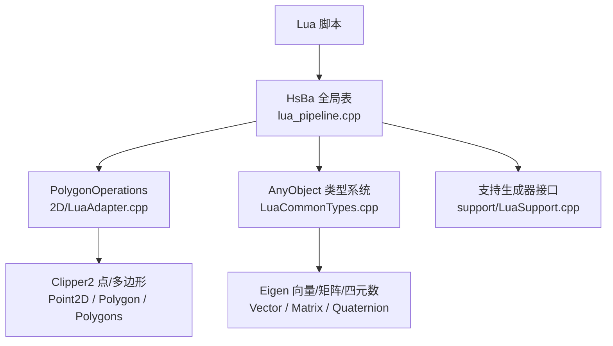
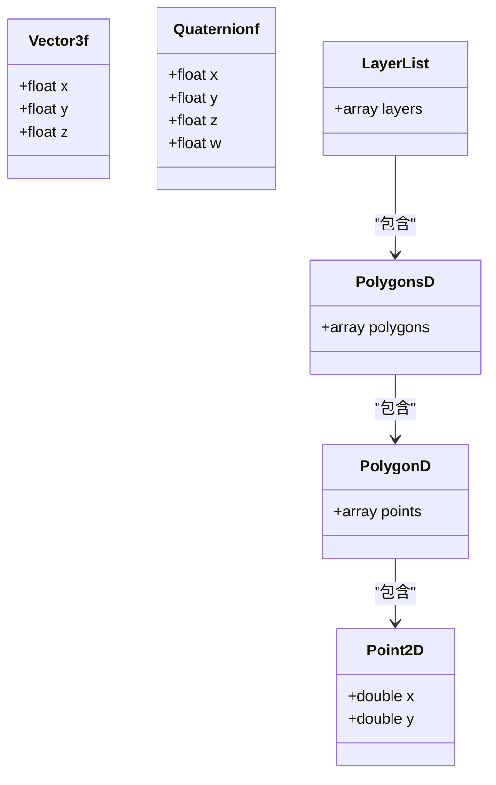
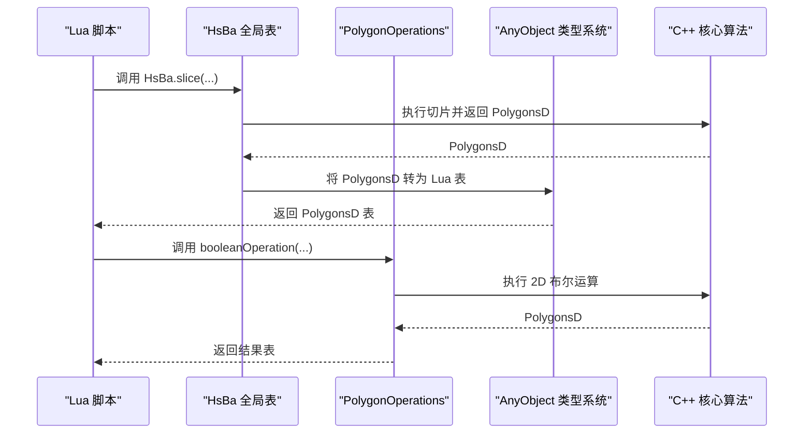
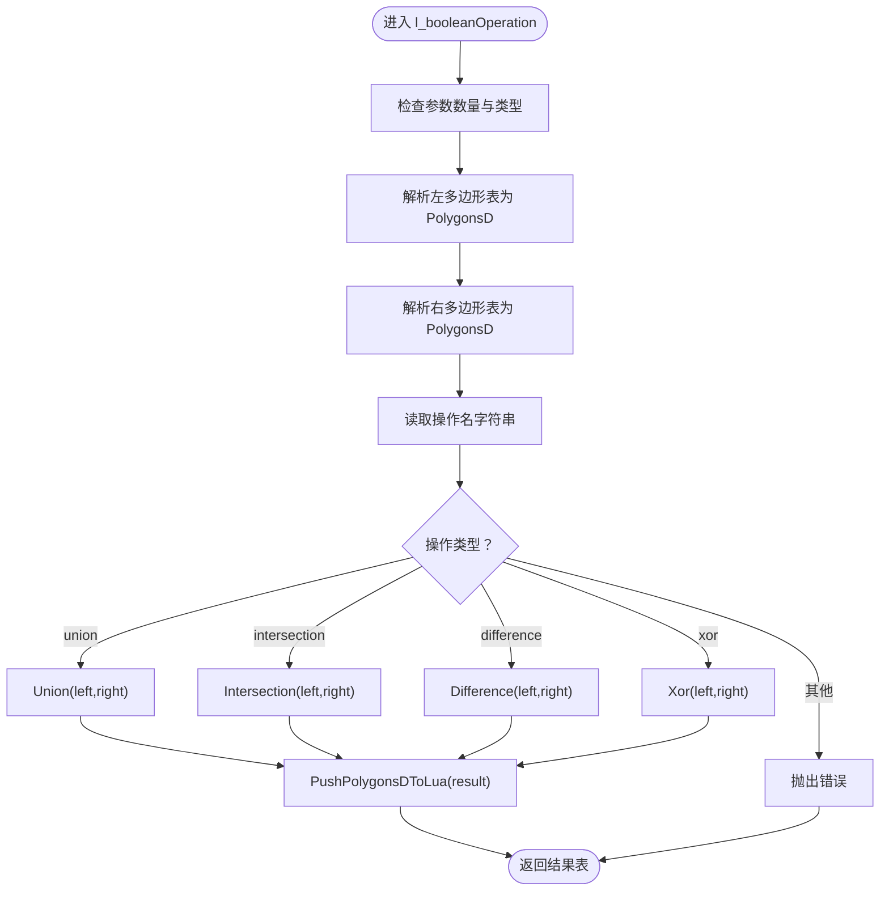
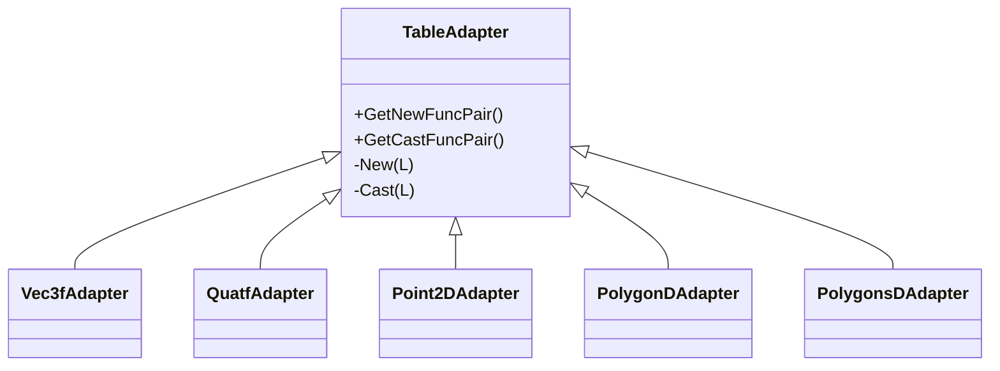
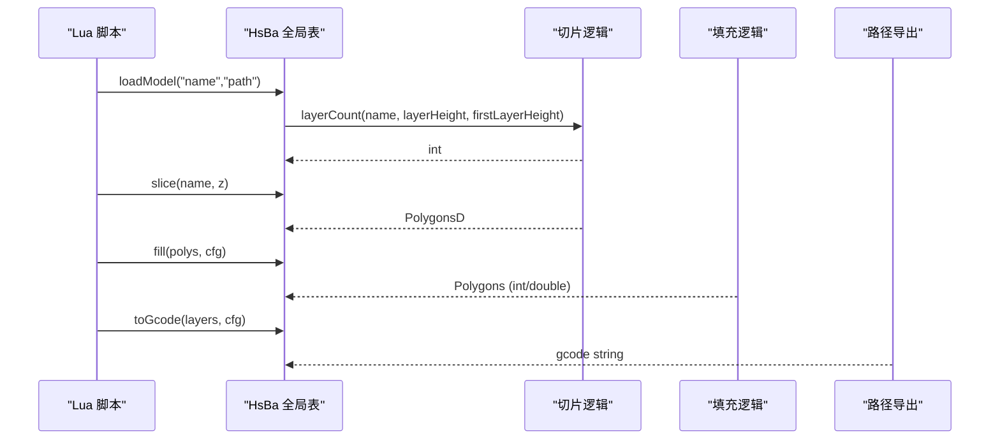
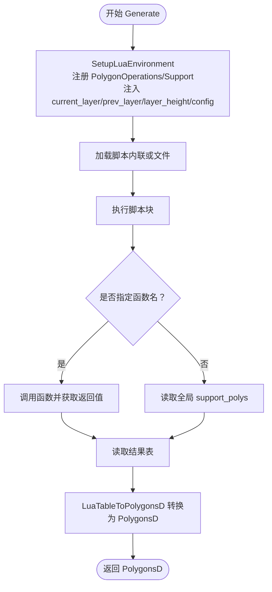
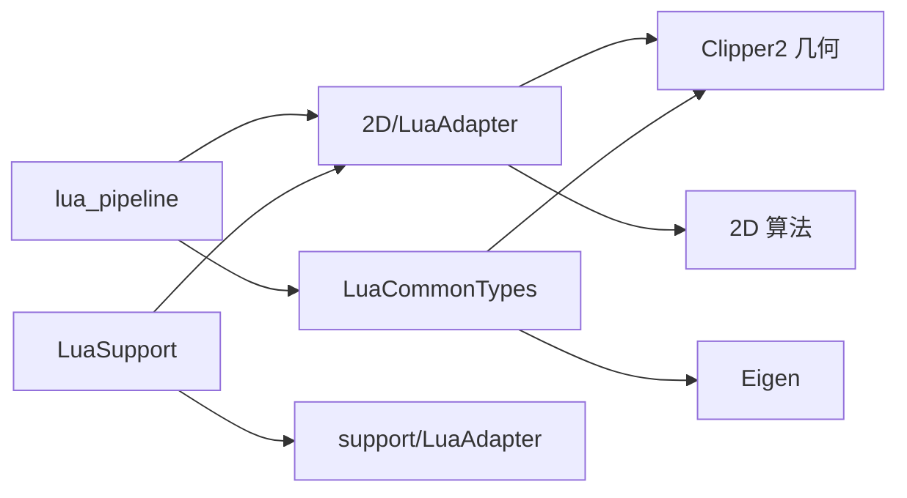

# Lua 类型系统

<cite>
**本文引用的文件**   
- [2D/LuaAdapter.hpp](file://2D/LuaAdapter.hpp)
- [2D/LuaAdapter.cpp](file://2D/LuaAdapter.cpp)
- [LibHsBaSlicer/Extends/LuaCommonTypes.hpp](file://LibHsBaSlicer/Extends/LuaCommonTypes.hpp)
- [LibHsBaSlicer/Extends/LuaCommonTypes.cpp](file://LibHsBaSlicer/Extends/LuaCommonTypes.cpp)
- [LibHsBaSlicer/Extends/lua_pipeline.hpp](file://LibHsBaSlicer/Extends/lua_pipeline.hpp)
- [LibHsBaSlicer/Extends/lua_pipeline.cpp](file://LibHsBaSlicer/Extends/lua_pipeline.cpp)
- [support/LuaSupport.hpp](file://support/LuaSupport.hpp)
- [support/LuaSupport.cpp](file://support/LuaSupport.cpp)
- [.luarc.json](file://.luarc.json)
</cite>

## 目录
1. [引言](#引言)
2. [项目结构](#项目结构)
3. [核心概念与基础几何类型](#核心概念与基础几何类型)
4. [架构总览](#架构总览)
5. [详细组件分析](#详细组件分析)
6. [依赖关系分析](#依赖关系分析)
7. [性能与内存管理](#性能与内存管理)
8. [错误处理与调试](#错误处理与调试)
9. [最佳实践与类型检查示例](#最佳实践与类型检查示例)
10. [结论](#结论)

## 引言
本文件面向 HsBaSlicer 的 Lua API 使用者，系统性说明其类型系统：如何在 C++ 与 Lua 之间传递 Point2D、Point3D、Quaternion、Polygon、Polygons 等基础几何类型，以及 LayerList 在脚本中的表结构约定。文档同时给出数值类型转换、字符串处理、表结构映射、userdata 生命周期和错误处理的实现细节，并提供类型检查示例与最佳实践，帮助开发者在 Lua 脚本中正确、安全地使用这些类型。

## 项目结构
围绕 Lua 类型系统的代码主要分布在以下模块：
- 2D 几何与 Polygon 操作：2D/LuaAdapter.*
- 通用 AnyObject 类型注册与表映射：LibHsBaSlicer/Extends/LuaCommonTypes.*
- 完整 Lua 驱动流水线环境：LibHsBaSlicer/Extends/lua_pipeline.*
- 基于 Lua 的自定义支撑生成器：support/LuaSupport.*
- Lua 编辑器全局符号配置：.luarc.json

图表来源
- [LibHsBaSlicer/Extends/lua_pipeline.cpp:224-256](file://LibHsBaSlicer/Extends/lua_pipeline.cpp#L224-L256)
- [2D/LuaAdapter.cpp:311-329](file://2D/LuaAdapter.cpp#L311-L329)
- [LibHsBaSlicer/Extends/LuaCommonTypes.cpp:469-512](file://LibHsBaSlicer/Extends/LuaCommonTypes.cpp#L469-L512)
- [support/LuaSupport.cpp:67-90](file://support/LuaSupport.cpp#L67-L90)

章节来源
- [LibHsBaSlicer/Extends/lua_pipeline.cpp:1-40](file://LibHsBaSlicer/Extends/lua_pipeline.cpp#L1-L40)
- [2D/LuaAdapter.hpp:1-84](file://2D/LuaAdapter.hpp#L1-L84)
- [LibHsBaSlicer/Extends/LuaCommonTypes.hpp:1-45](file://LibHsBaSlicer/Extends/LuaCommonTypes.hpp#L1-L45)

## 核心概念与基础几何类型
本节聚焦 Lua 侧可见的基础几何类型及其表结构约定。

- Point2D（二维浮点坐标）
  - Lua 表字段：x、y（number）。
  - 由 Clipper2::Point2D 表示；在 AnyObject 系统中注册为 “Point2D”。
  - 读取时优先取命名键 x/y，也兼容位置序列 {v1, v2}。

- Point3D（三维浮点坐标）
  - Lua 表字段：x、y、z（number）。
  - 对应 Eigen::Vector3f/Vector3d；在 AnyObject 系统中注册为 “Vector3f”“Vector3d”。

- Quaternion（四元数）
  - Lua 表字段：x、y、z、w（number），顺序与 Eigen 内部一致。
  - 在 AnyObject 系统中注册为 “Quaternionf”“Quaterniond”。

- Polygon（单条多边形路径）
  - Lua 表：一维数组，元素为 Point2D 表 {x,y}。
  - 对应 Clipper2::Polygon（整数精度）或 PolygonD（双精度）。
  - 在 AnyObject 系统中注册为 “Polygon”“PolygonD”。

- Polygons（多条多边形集合）
  - Lua 表：一维数组，元素为 Polygon 表。
  - 对应 Clipper2::Polygons 或 PolygonsD。
  - 在 AnyObject 系统中注册为 “Polygons”“PolygonsD”。

- LayerList（层列表）
  - Lua 表：一维数组，元素为 PolygonsD（即每层的多边形集合）。
  - 用于支撑、填充、G-code 输出等阶段的数据交换。

图表来源
- [LibHsBaSlicer/Extends/LuaCommonTypes.cpp:205-283](file://LibHsBaSlicer/Extends/LuaCommonTypes.cpp#L205-L283)
- [LibHsBaSlicer/Extends/LuaCommonTypes.cpp:285-337](file://LibHsBaSlicer/Extends/LuaCommonTypes.cpp#L285-L337)
- [LibHsBaSlicer/Extends/LuaCommonTypes.cpp:106-125](file://LibHsBaSlicer/Extends/LuaCommonTypes.cpp#L106-L125)
- [LibHsBaSlicer/Extends/lua_pipeline.cpp:191-222](file://LibHsBaSlicer/Extends/lua_pipeline.cpp#L191-L222)

章节来源
- [LibHsBaSlicer/Extends/LuaCommonTypes.hpp:110-140](file://LibHsBaSlicer/Extends/LuaCommonTypes.hpp#L110-L140)
- [LibHsBaSlicer/Extends/LuaCommonTypes.cpp:205-337](file://LibHsBaSlicer/Extends/LuaCommonTypes.cpp#L205-L337)
- [LibHsBaSlicer/Extends/lua_pipeline.cpp:191-222](file://LibHsBaSlicer/Extends/lua_pipeline.cpp#L191-L222)

## 架构总览
HsBaSlicer 通过一个统一的 Lua 环境暴露给脚本：
- 全局表 HsBa：提供模型加载、切片、填充、支撑、路径导出、打包等能力。
- 全局表 PolygonOperations：提供 2D 布尔运算、偏移、凸包、面积、图形构造等。
- AnyObject 类型系统：统一注册常见类型（向量、矩阵、四元数、点、多边形），并提供 new_*/cast_* 系列函数。
- 自定义支撑生成器 LuaSupport：允许用 Lua 脚本替换内置支撑算法。

图表来源
- [LibHsBaSlicer/Extends/lua_pipeline.cpp:435-460](file://LibHsBaSlicer/Extends/lua_pipeline.cpp#L435-L460)
- [2D/LuaAdapter.cpp:22-54](file://2D/LuaAdapter.cpp#L22-L54)
- [LibHsBaSlicer/Extends/LuaCommonTypes.cpp:469-512](file://LibHsBaSlicer/Extends/LuaCommonTypes.cpp#L469-L512)

章节来源
- [LibHsBaSlicer/Extends/lua_pipeline.hpp:19-83](file://LibHsBaSlicer/Extends/lua_pipeline.hpp#L19-L83)
- [LibHsBaSlicer/Extends/lua_pipeline.cpp:224-256](file://LibHsBaSlicer/Extends/lua_pipeline.cpp#L224-L256)
- [2D/LuaAdapter.cpp:311-329](file://2D/LuaAdapter.cpp#L311-L329)

## 详细组件分析

### 2D 几何与 Polygon 操作（2D/LuaAdapter）
- 作用
  - 负责 Polygon/Polygons 与 Lua 表之间的双向转换。
  - 向 Lua 注册 PolygonOperations 表，提供布尔运算、偏移、凸包、面积、图形构造等函数。
- 关键行为
  - PushPolygonDToLua / PushPolygonsDToLua：将 C++ 多边形推入 Lua 表，点使用 {x,y} 字段。
  - LuaTableToPolygonD / LuaTableToPolygonsD：从 Lua 表解析出 PolygonD/PolygonsD。
  - integerization 转换：PushPolygonToLua 会将整数坐标除以缩放因子得到浮点值；LuaTableToPolygon 则反向取整。
  - RegisterLuaPolygonOperations：将一组 C++ 函数注册到全局 PolygonOperations。

图表来源
- [2D/LuaAdapter.cpp:22-54](file://2D/LuaAdapter.cpp#L22-L54)
- [2D/LuaAdapter.cpp:332-382](file://2D/LuaAdapter.cpp#L332-L382)
- [2D/LuaAdapter.cpp:385-485](file://2D/LuaAdapter.cpp#L385-L485)

章节来源
- [2D/LuaAdapter.hpp:16-81](file://2D/LuaAdapter.hpp#L16-L81)
- [2D/LuaAdapter.cpp:16-54](file://2D/LuaAdapter.cpp#L16-L54)
- [2D/LuaAdapter.cpp:311-329](file://2D/LuaAdapter.cpp#L311-L329)
- [2D/LuaAdapter.cpp:332-485](file://2D/LuaAdapter.cpp#L332-L485)

### 通用 AnyObject 类型系统（LuaCommonTypes）
- 作用
  - 为常见类型（Eigen 向量/矩阵/四元数、Clipper2 点/多边形）注册反射元数据与 Lua 适配器。
  - 提供 new_<Type>/cast_<Type> 全局函数，用于创建与转换 AnyObject 包装的对象。
- 表编码约定
  - 向量/四元数：{x,y,(z),(w)} 命名键；也接受位置序列 {v1,v2,...}。
  - 矩阵：嵌套行序列 {{r1c1,r1c2,...},{...}}。
  - 点：{x,y}。
  - 多边形：点序列；多边形集合：多边形序列。
- 注册入口
  - RegisterCommonAnyObjectTypes：一次性注册标量与自定义类型，并在 registry 中标记以避免重复注册。
  - InstallCommonAnyObjectTypes：将注册函数加入 2D/3D/File 函数池，供各流水线阶段复用。

图表来源
- [LibHsBaSlicer/Extends/LuaCommonTypes.cpp:342-435](file://LibHsBaSlicer/Extends/LuaCommonTypes.cpp#L342-L435)
- [LibHsBaSlicer/Extends/LuaCommonTypes.cpp:438-467](file://LibHsBaSlicer/Extends/LuaCommonTypes.cpp#L438-L467)
- [LibHsBaSlicer/Extends/LuaCommonTypes.cpp:469-512](file://LibHsBaSlicer/Extends/LuaCommonTypes.cpp#L469-L512)

章节来源
- [LibHsBaSlicer/Extends/LuaCommonTypes.hpp:20-45](file://LibHsBaSlicer/Extends/LuaCommonTypes.hpp#L20-L45)
- [LibHsBaSlicer/Extends/LuaCommonTypes.hpp:110-140](file://LibHsBaSlicer/Extends/LuaCommonTypes.hpp#L110-L140)
- [LibHsBaSlicer/Extends/LuaCommonTypes.cpp:30-76](file://LibHsBaSlicer/Extends/LuaCommonTypes.cpp#L30-L76)
- [LibHsBaSlicer/Extends/LuaCommonTypes.cpp:106-125](file://LibHsBaSlicer/Extends/LuaCommonTypes.cpp#L106-L125)
- [LibHsBaSlicer/Extends/LuaCommonTypes.cpp:205-337](file://LibHsBaSlicer/Extends/LuaCommonTypes.cpp#L205-L337)
- [LibHsBaSlicer/Extends/LuaCommonTypes.cpp:469-534](file://LibHsBaSlicer/Extends/LuaCommonTypes.cpp#L469-L534)

### 完整 Lua 驱动流水线（lua_pipeline）
- 作用
  - 构建 HsBa 全局表，暴露模型、切片、填充、支撑、路径导出、打包等能力。
  - 维护运行状态（进度回调、层数、输出路径）并通过 registry 存取。
- 关键 API
  - HsBa.progress(percent[, stage])
  - HsBa.setLayers(n)、HsBa.setOutputPath(path)
  - HsBa.loadModel(name,path)、HsBa.modelInfo(name)
  - HsBa.translateModel/rotateModel/scaleModel/removeModel/modelNames
  - HsBa.layerCount/layerZ/slice/sliceUnsafe
  - HsBa.toInt/toDouble
  - HsBa.fill(polygons[, cfg])
  - HsBa.fdmSupport/slaSupport
  - HsBa.floor(bottomPolygons,cfg)
  - HsBa.spiralize(sections[, cfg])
  - HsBa.toGcode(layers,cfg)
  - HsBa.saveSlsPackage/saveWaamPackage/saveSlaPackage
- 层数据结构
  - LayerList：一维数组，元素为 PolygonsD（每层的多边形集合）。
  - toGcode 输入层表：{outlines=..., fills=..., supports=..., zHeight=...}。

图表来源
- [LibHsBaSlicer/Extends/lua_pipeline.cpp:292-340](file://LibHsBaSlicer/Extends/lua_pipeline.cpp#L292-L340)
- [LibHsBaSlicer/Extends/lua_pipeline.cpp:401-478](file://LibHsBaSlicer/Extends/lua_pipeline.cpp#L401-L478)
- [LibHsBaSlicer/Extends/lua_pipeline.cpp:482-508](file://LibHsBaSlicer/Extends/lua_pipeline.cpp#L482-L508)
- [LibHsBaSlicer/Extends/lua_pipeline.cpp:622-690](file://LibHsBaSlicer/Extends/lua_pipeline.cpp#L622-L690)

章节来源
- [LibHsBaSlicer/Extends/lua_pipeline.hpp:19-83](file://LibHsBaSlicer/Extends/lua_pipeline.hpp#L19-L83)
- [LibHsBaSlicer/Extends/lua_pipeline.cpp:50-70](file://LibHsBaSlicer/Extends/lua_pipeline.cpp#L50-L70)
- [LibHsBaSlicer/Extends/lua_pipeline.cpp:224-256](file://LibHsBaSlicer/Extends/lua_pipeline.cpp#L224-L256)
- [LibHsBaSlicer/Extends/lua_pipeline.cpp:185-222](file://LibHsBaSlicer/Extends/lua_pipeline.cpp#L185-L222)
- [LibHsBaSlicer/Extends/lua_pipeline.cpp:435-508](file://LibHsBaSlicer/Extends/lua_pipeline.cpp#L435-L508)
- [LibHsBaSlicer/Extends/lua_pipeline.cpp:622-690](file://LibHsBaSlicer/Extends/lua_pipeline.cpp#L622-L690)

### 基于 Lua 的自定义支撑生成器（support/LuaSupport）
- 作用
  - 允许用户用 Lua 脚本完全替换内置支撑算法。
  - 向脚本暴露 current_layer、prev_layer、layer_height、config 等全局变量。
- 执行流程
  - 初始化 Lua 环境，注册 PolygonOperations 与 Support 模块。
  - 推送当前层、前一层、层高与配置到 Lua。
  - 加载并执行脚本块，可选调用指定函数名。
  - 从返回值或全局 support_polys 读取 PolygonsD 结果。

图表来源
- [support/LuaSupport.cpp:19-49](file://support/LuaSupport.cpp#L19-L49)
- [support/LuaSupport.cpp:51-90](file://support/LuaSupport.cpp#L51-L90)
- [support/LuaSupport.cpp:113-178](file://support/LuaSupport.cpp#L113-L178)

章节来源
- [support/LuaSupport.hpp:21-81](file://support/LuaSupport.hpp#L21-L81)
- [support/LuaSupport.cpp:19-90](file://support/LuaSupport.cpp#L19-L90)
- [support/LuaSupport.cpp:113-178](file://support/LuaSupport.cpp#L113-L178)

## 依赖关系分析
- 2D/LuaAdapter 依赖 Clipper2 几何类型与 2D 算法（如 Union/Intersection/Difference/Xor、Offset、ConvexHull、ConcaveHullSimulation、MakeRectangle/Circle/Ellipse/RegularPolygon、TextToPolygons）。
- LuaCommonTypes 依赖 Eigen 与 Clipper2，并通过 AnyObject 机制向 Lua 暴露 new_/cast_ 函数。
- lua_pipeline 组合多个子系统：2D 几何、填充、支撑、路径导出、文件打包等，并通过 HsBa 表暴露给脚本。
- LuaSupport 依赖 2D/LuaAdapter 与 support/LuaAdapter（Support 模块注册）。

图表来源
- [2D/LuaAdapter.cpp:9-10](file://2D/LuaAdapter.cpp#L9-L10)
- [LibHsBaSlicer/Extends/LuaCommonTypes.cpp:10-21](file://LibHsBaSlicer/Extends/LuaCommonTypes.cpp#L10-L21)
- [LibHsBaSlicer/Extends/lua_pipeline.cpp:17-39](file://LibHsBaSlicer/Extends/lua_pipeline.cpp#L17-L39)
- [support/LuaSupport.cpp:10-13](file://support/LuaSupport.cpp#L10-L13)

章节来源
- [2D/LuaAdapter.cpp:9-10](file://2D/LuaAdapter.cpp#L9-L10)
- [LibHsBaSlicer/Extends/LuaCommonTypes.cpp:10-21](file://LibHsBaSlicer/Extends/LuaCommonTypes.cpp#L10-L21)
- [LibHsBaSlicer/Extends/lua_pipeline.cpp:17-39](file://LibHsBaSlicer/Extends/lua_pipeline.cpp#L17-L39)
- [support/LuaSupport.cpp:10-13](file://support/LuaSupport.cpp#L10-L13)

## 性能与内存管理
- 数值类型转换
  - 浮点与整数：Lua 的 number 与 C++ double/float 直接映射；整数经 integerization 缩放后用于高精度计算，再还原为浮点。
  - 向量/矩阵/四元数：按字段或行列顺序读写，避免额外拷贝时使用 AnyObject 视图。
- 表结构映射
  - 多边形与点采用轻量表结构，Push* 与 Read* 函数对栈进行严格管理，避免泄漏。
- userdata 生命周期
  - 通过 AnyObject 系统管理对象生命周期，配合 __gc 钩子释放资源（例如 Zipper、数据库适配器等）。
  - PipelineRunState 通过 LUA_REGISTRYINDEX 绑定到 Lua 状态，确保跨函数访问的安全性。
- 内存优化建议
  - 尽量使用 PolygonsD 而非逐点构造。
  - 避免在 Lua 层频繁创建/销毁大型表，必要时在 C++ 层批量处理。

章节来源
- [2D/LuaAdapter.cpp:358-382](file://2D/LuaAdapter.cpp#L358-L382)
- [LibHsBaSlicer/Extends/LuaCommonTypes.cpp:143-200](file://LibHsBaSlicer/Extends/LuaCommonTypes.cpp#L143-L200)
- [LibHsBaSlicer/Extends/lua_pipeline.cpp:50-70](file://LibHsBaSlicer/Extends/lua_pipeline.cpp#L50-L70)

## 错误处理与调试
- 参数校验
  - 所有 Lua 函数在进入时检查参数个数与类型，不合法时调用 luaL_error 抛出明确错误信息。
- 脚本加载与执行
  - 使用 luaL_loadbuffer/loadfile 与 lua_pcall 包裹脚本执行，捕获编译期与运行期错误。
- 错误传播
  - C++ 侧 RuntimeError 被捕获并转换为 Lua 错误消息。
- 调试建议
  - 使用 PolygonOperations.area 验证多边形闭合性与方向。
  - 使用 dumpPolygon/dumpPolygons（条件编译）导出中间结果进行可视化。

章节来源
- [2D/LuaAdapter.cpp:16-19](file://2D/LuaAdapter.cpp#L16-L19)
- [2D/LuaAdapter.cpp:22-54](file://2D/LuaAdapter.cpp#L22-L54)
- [support/LuaSupport.cpp:130-178](file://support/LuaSupport.cpp#L130-L178)
- [LibHsBaSlicer/Extends/lua_pipeline.cpp:275-288](file://LibHsBaSlicer/Extends/lua_pipeline.cpp#L275-L288)

## 最佳实践与类型检查示例
- 在 Lua 中构造 Point2D
  - 使用 {x=..., y=...} 或 {x,y} 形式；推荐命名键以提高可读性。
- 在 Lua 中构造 Polygon/Polygons
  - Polygon：[{x,y}, ...]；Polygons：[polygon, ...]。
- 在 Lua 中构造 LayerList
  - [polygons_of_layer_1, polygons_of_layer_2, ...]。
- 类型检查建议
  - 在调用 HsBa.slice 之前，确认传入的 z 为 number。
  - 在调用 HsBa.fill 之前，确认 polygons 为 table，且每个元素为 table。
  - 在调用 HsBa.toGcode 之前，确认 layers 为 table，且每个层包含 outlines/fills/supports/zHeight。
- 数值精度
  - 使用 HsBa.toInt/HsBa.toDouble 在整数与浮点多边形之间转换，注意缩放因子带来的舍入误差。
- 错误处理
  - 使用 pcall 包裹脚本执行，捕获错误并记录日志。
  - 对于 PolygonOperations 函数，先校验参数类型与数量。

章节来源
- [LibHsBaSlicer/Extends/lua_pipeline.cpp:465-478](file://LibHsBaSlicer/Extends/lua_pipeline.cpp#L465-L478)
- [LibHsBaSlicer/Extends/lua_pipeline.cpp:622-690](file://LibHsBaSlicer/Extends/lua_pipeline.cpp#L622-L690)
- [2D/LuaAdapter.cpp:385-485](file://2D/LuaAdapter.cpp#L385-L485)

## 结论
HsBaSlicer 的 Lua 类型系统以 AnyObject 为核心，结合 2D/LuaAdapter 与 lua_pipeline，提供了稳定、一致的几何类型映射与脚本交互方式。开发者应遵循表结构约定，合理使用 new_/cast_ 系列函数，并注意数值精度与内存管理。通过严格的参数校验与错误处理机制，可以在 Lua 脚本中安全地调用 C++ 核心算法，完成切片、填充、支撑与路径导出等任务。