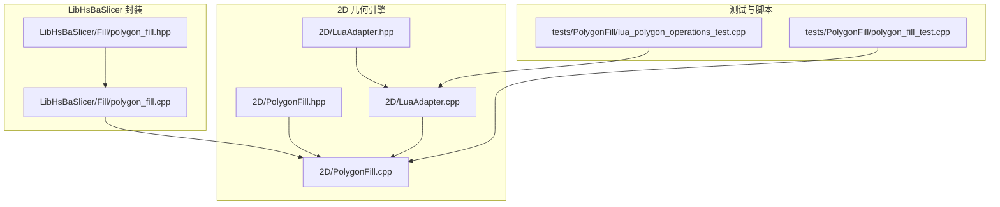
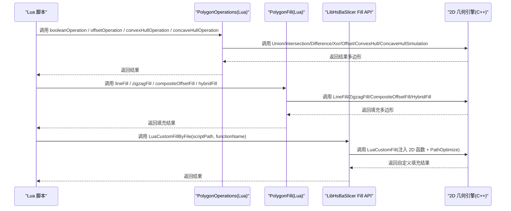
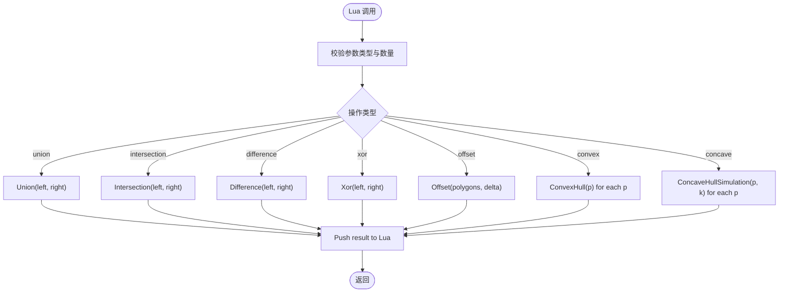
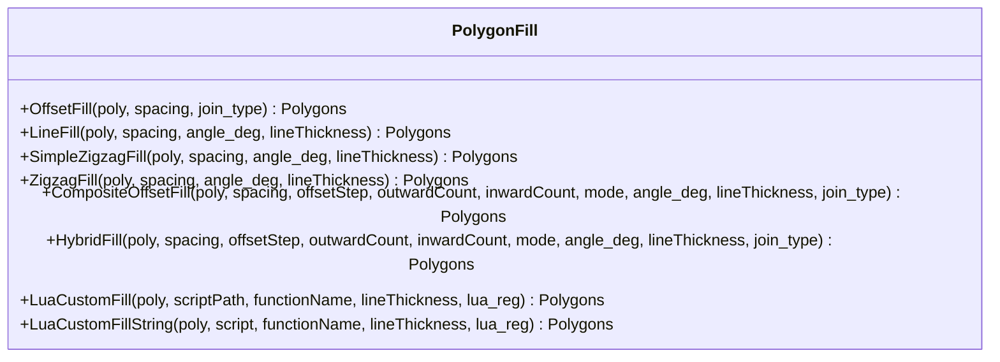
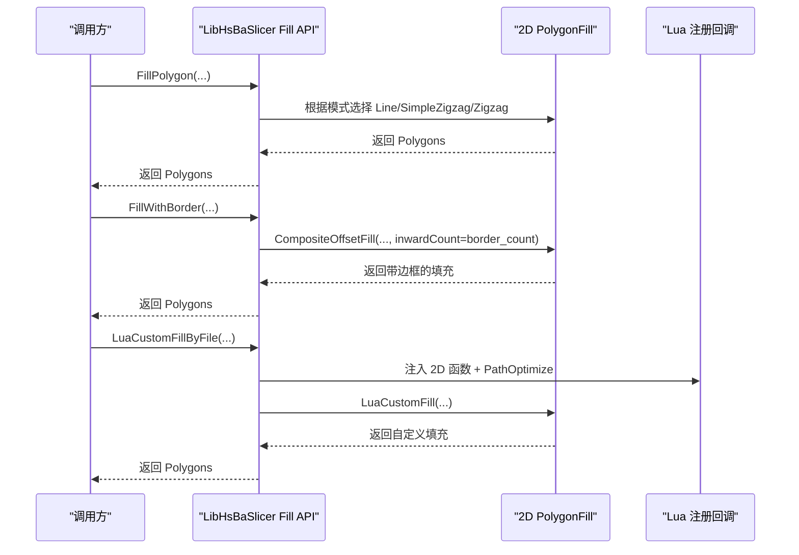
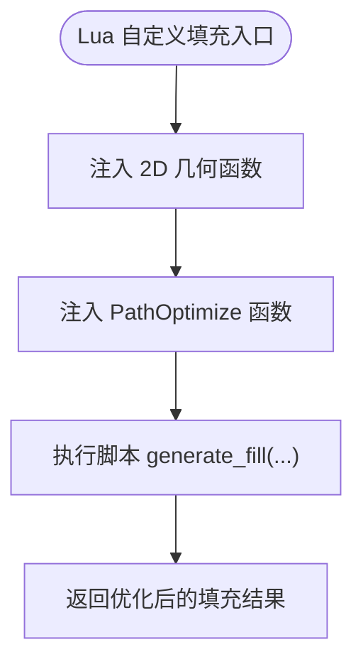
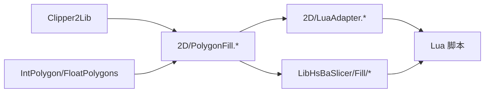

# 几何操作库

<cite>
**本文引用的文件**   
- [2D/PolygonFill.hpp](file://2D/PolygonFill.hpp)
- [2D/PolygonFill.cpp](file://2D/PolygonFill.cpp)
- [LibHsBaSlicer/Fill/polygon_fill.hpp](file://LibHsBaSlicer/Fill/polygon_fill.hpp)
- [LibHsBaSlicer/Fill/polygon_fill.cpp](file://LibHsBaSlicer/Fill/polygon_fill.cpp)
- [2D/LuaAdapter.hpp](file://2D/LuaAdapter.hpp)
- [2D/LuaAdapter.cpp](file://2D/LuaAdapter.cpp)
- [tests/PolygonFill/lua_polygon_operations_test.cpp](file://tests/PolygonFill/lua_polygon_operations_test.cpp)
- [tests/PolygonFill/polygon_fill_test.cpp](file://tests/PolygonFill/polygon_fill_test.cpp)
</cite>

## 目录
1. [简介](#简介)
2. [项目结构](#项目结构)
3. [核心组件](#核心组件)
4. [架构总览](#架构总览)
5. [详细组件分析](#详细组件分析)
6. [依赖关系分析](#依赖关系分析)
7. [性能与参数调优](#性能与参数调优)
8. [故障排除指南](#故障排除指南)
9. [结论](#结论)
10. [附录：示例与用法](#附录示例与用法)

## 简介
本文件为 HsBaSlicer 几何操作库的权威文档，聚焦以下能力：
- 多边形布尔运算（并集、交集、差集、异或）
- 偏移操作（内/外偏移、边界层生成）
- 凸包与凹包计算
- 填充算法（直线填充、锯齿形填充、混合填充、Lua 自定义填充）
- 路径优化（区域优化与多边形优化，通过 Lua 暴露）

该库以 C++ 实现为核心，并通过 Lua 适配器将几何函数注册到 Lua 环境，供脚本扩展与调用。

## 项目结构
几何操作相关代码主要分布在两个层次：
- 2D 几何引擎层：提供多边形数据结构、布尔运算、偏移、凸/凹包、填充算法等核心能力
- LibHsBaSlicer 封装层：对外暴露简洁 API，并在 Lua 环境中集成路径优化能力

图示来源
- [2D/PolygonFill.hpp:1-141](file://2D/PolygonFill.hpp#L1-L141)
- [2D/PolygonFill.cpp:1-800](file://2D/PolygonFill.cpp#L1-L800)
- [2D/LuaAdapter.hpp:1-84](file://2D/LuaAdapter.hpp#L1-L84)
- [2D/LuaAdapter.cpp:1-493](file://2D/LuaAdapter.cpp#L1-L493)
- [LibHsBaSlicer/Fill/polygon_fill.hpp:1-58](file://LibHsBaSlicer/Fill/polygon_fill.hpp#L1-L58)
- [LibHsBaSlicer/Fill/polygon_fill.cpp:1-52](file://LibHsBaSlicer/Fill/polygon_fill.cpp#L1-L52)

章节来源
- [2D/PolygonFill.hpp:1-141](file://2D/PolygonFill.hpp#L1-L141)
- [2D/LuaAdapter.hpp:1-84](file://2D/LuaAdapter.hpp#L1-L84)
- [LibHsBaSlicer/Fill/polygon_fill.hpp:1-58](file://LibHsBaSlicer/Fill/polygon_fill.hpp#L1-L58)

## 核心组件
- PolygonOperations（Lua 侧）
  - 提供布尔运算、偏移、凸包、凹包、面积、基础图形构造等函数
  - 在 Lua 中注册为 PolygonOperations 表
- PolygonFill（C++ 与 Lua 双端）
  - 提供 OffsetFill、LineFill、SimpleZigzagFill、ZigzagFill、CompositeOffsetFill、HybridFill、LuaCustomFill 等
  - 在 Lua 中注册为 PolygonFill 表
- LibHsBaSlicer Fill API
  - 对外暴露 FillPolygon、FillWithBorder、LuaCustomFillByFile
  - 在 LuaCustomFillByFile 中自动注入 2D 几何函数与路径优化函数

章节来源
- [2D/LuaAdapter.cpp:311-329](file://2D/LuaAdapter.cpp#L311-L329)
- [2D/LuaAdapter.cpp:487-491](file://2D/LuaAdapter.cpp#L487-L491)
- [2D/PolygonFill.cpp:488-502](file://2D/PolygonFill.cpp#L488-L502)
- [LibHsBaSlicer/Fill/polygon_fill.hpp:17-53](file://LibHsBaSlicer/Fill/polygon_fill.hpp#L17-L53)
- [LibHsBaSlicer/Fill/polygon_fill.cpp:13-49](file://LibHsBaSlicer/Fill/polygon_fill.cpp#L13-L49)

## 架构总览
下图展示从用户脚本到几何引擎的调用链，以及 LibHsBaSlicer 如何桥接 2D 几何与路径优化。

图示来源
- [2D/LuaAdapter.cpp:22-54](file://2D/LuaAdapter.cpp#L22-L54)
- [2D/LuaAdapter.cpp:108-153](file://2D/LuaAdapter.cpp#L108-L153)
- [2D/PolygonFill.cpp:231-432](file://2D/PolygonFill.cpp#L231-L432)
- [LibHsBaSlicer/Fill/polygon_fill.cpp:35-49](file://LibHsBaSlicer/Fill/polygon_fill.cpp#L35-L49)

## 详细组件分析

### PolygonOperations（Lua 几何操作）
- 布尔运算
  - union(left, right)
  - intersection(left, right)
  - difference(left, right)
  - xor(left, right)
  - booleanOperation(left, right, opName)
- 偏移
  - offsetOperation(polygons, delta)
- 凸包与凹包
  - convexHullOperation(polygons)
  - concaveHullOperation(polygons, numAdditionalPoints)
- 其他工具
  - area(polygon)
  - makeRectangle(x, y, width, height)
  - makeCircle(cx, cy, radius[, segments])
  - makeEllipse(cx, cy, rx, ry[, segments[, rotation]])
  - makeRegularPolygon(cx, cy, radius, sides[, rotation])
  - textToPolygons(text, font_file, font_size[, x[, y[, curve_segments]]])

图示来源
- [2D/LuaAdapter.cpp:22-54](file://2D/LuaAdapter.cpp#L22-L54)
- [2D/LuaAdapter.cpp:108-153](file://2D/LuaAdapter.cpp#L108-L153)

章节来源
- [2D/LuaAdapter.cpp:22-54](file://2D/LuaAdapter.cpp#L22-L54)
- [2D/LuaAdapter.cpp:108-153](file://2D/LuaAdapter.cpp#L108-L153)
- [2D/LuaAdapter.cpp:311-329](file://2D/LuaAdapter.cpp#L311-L329)
- [2D/LuaAdapter.cpp:487-491](file://2D/LuaAdapter.cpp#L487-L491)

### PolygonFill（填充算法）
- 偏移填充
  - OffsetFill(poly, spacing, join_type)
- 直线填充
  - LineFill(poly, spacing, angle_deg, lineThickness)
- 锯齿形填充
  - SimpleZigzagFill(poly, spacing, angle_deg, lineThickness)
  - ZigzagFill(poly, spacing, angle_deg, lineThickness)
- 复合偏移填充
  - CompositeOffsetFill(poly, spacing, offsetStep, outwardCount, inwardCount, mode, angle_deg, lineThickness, join_type)
- 混合填充
  - HybridFill(poly, spacing, offsetStep, outwardCount, inwardCount, mode, angle_deg, lineThickness, join_type)
- Lua 自定义填充
  - LuaCustomFill(poly, scriptPath, functionName, lineThickness, lua_reg)
  - LuaCustomFillString(poly, script, functionName, lineThickness, lua_reg)

图示来源
- [2D/PolygonFill.hpp:20-136](file://2D/PolygonFill.hpp#L20-L136)
- [2D/PolygonFill.cpp:504-800](file://2D/PolygonFill.cpp#L504-L800)

章节来源
- [2D/PolygonFill.hpp:20-136](file://2D/PolygonFill.hpp#L20-L136)
- [2D/PolygonFill.cpp:504-800](file://2D/PolygonFill.cpp#L504-L800)

### LibHsBaSlicer Fill API（对外封装）
- FillPolygon(poly, spacing, mode, angle_deg)
- FillWithBorder(poly, spacing, border_count, fill_mode, angle_deg)
- LuaCustomFillByFile(poly, scriptPath, functionName="generate_fill", lineThickness=0.5)

图示来源
- [LibHsBaSlicer/Fill/polygon_fill.cpp:13-49](file://LibHsBaSlicer/Fill/polygon_fill.cpp#L13-L49)
- [LibHsBaSlicer/Fill/polygon_fill.hpp:17-53](file://LibHsBaSlicer/Fill/polygon_fill.hpp#L17-L53)

章节来源
- [LibHsBaSlicer/Fill/polygon_fill.hpp:17-53](file://LibHsBaSlicer/Fill/polygon_fill.hpp#L17-L53)
- [LibHsBaSlicer/Fill/polygon_fill.cpp:13-49](file://LibHsBaSlicer/Fill/polygon_fill.cpp#L13-L49)

### 路径优化（PathOptimize）
- 通过 LibHsBaSlicer 的 LuaCustomFillByFile 自动向 Lua 环境注入路径优化函数
- 在 Lua 脚本中可对区域进行优化后再输出路径

图示来源
- [LibHsBaSlicer/Fill/polygon_fill.cpp:35-49](file://LibHsBaSlicer/Fill/polygon_fill.cpp#L35-L49)

章节来源
- [LibHsBaSlicer/Fill/polygon_fill.cpp:35-49](file://LibHsBaSlicer/Fill/polygon_fill.cpp#L35-L49)

## 依赖关系分析
- 2D 几何引擎
  - 使用 Clipper2Lib 进行布尔运算、偏移、点包含判断等
  - 使用整数化/反整数化进行数值精度控制
- Lua 适配器
  - 负责 Lua 栈与多边形数据结构的转换
  - 注册 PolygonOperations 与 PolygonFill 到全局命名空间
- LibHsBaSlicer 封装
  - 组合 2D 几何与路径优化，提供统一 API

图示来源
- [2D/PolygonFill.cpp:1-32](file://2D/PolygonFill.cpp#L1-L32)
- [2D/LuaAdapter.cpp:1-11](file://2D/LuaAdapter.cpp#L1-L11)
- [LibHsBaSlicer/Fill/polygon_fill.cpp:1-10](file://LibHsBaSlicer/Fill/polygon_fill.cpp#L1-L10)

章节来源
- [2D/PolygonFill.cpp:1-32](file://2D/PolygonFill.cpp#L1-L32)
- [2D/LuaAdapter.cpp:1-11](file://2D/LuaAdapter.cpp#L1-L11)
- [LibHsBaSlicer/Fill/polygon_fill.cpp:1-10](file://LibHsBaSlicer/Fill/polygon_fill.cpp#L1-L10)

## 性能与参数调优
- 偏移填充
  - spacing 过小会导致迭代次数增加；注意 MAX_FILL_ITERATIONS 限制
  - join_type 影响拐角质量与计算开销（Square/Bevel/Round/Miter）
- 直线与锯齿填充
  - spacing 决定扫描线密度；angle_deg 决定方向；lineThickness 影响线段宽度
  - SimpleZigzagFill 与 ZigzagFill 在连接策略上不同，后者对拐角处理更稳健
- 复合与混合填充
  - outwardCount/inwardCount 控制边界层数；spacing/offsetStep 控制内部填充密度
  - mode 可选择 Line/SimpleZigzag/Zigzag
- 数值精度
  - 内部使用整数化（integerization）与反整数化，避免浮点误差累积
- 性能建议
  - 合理设置 spacing 与 lineThickness，避免过密扫描线
  - 对于复杂轮廓，优先使用 ZigzagFill 以获得更好的连通性
  - 使用 FillWithBorder 时，border_count 不宜过大，以免边界层过多导致计算量上升

章节来源
- [2D/PolygonFill.cpp:26-31](file://2D/PolygonFill.cpp#L26-L31)
- [2D/PolygonFill.cpp:504-541](file://2D/PolygonFill.cpp#L504-L541)
- [2D/PolygonFill.cpp:544-800](file://2D/PolygonFill.cpp#L544-L800)

## 故障排除指南
- Lua 参数错误
  - 所有 Lua 包装函数均进行参数类型与数量检查，失败时抛出明确错误信息
- 未知布尔操作
  - booleanOperation 仅支持 union/intersection/difference/xor，传入其他名称会报错
- 偏移结果为空
  - 当 spacing <= 0 或偏移后无有效区域时返回空结果
- 填充结果为空
  - 当 spacing <= 0 或输入多边形为空时返回空结果

章节来源
- [2D/LuaAdapter.cpp:16-19](file://2D/LuaAdapter.cpp#L16-L19)
- [2D/LuaAdapter.cpp:22-54](file://2D/LuaAdapter.cpp#L22-L54)
- [2D/PolygonFill.cpp:504-510](file://2D/PolygonFill.cpp#L504-L510)
- [2D/PolygonFill.cpp:568-574](file://2D/PolygonFill.cpp#L568-L574)

## 结论
HsBaSlicer 几何操作库提供了完整的 2D 几何处理能力，涵盖布尔运算、偏移、凸/凹包、多种填充模式，并通过 Lua 适配器与 LibHsBaSlicer 封装层，将能力暴露给脚本与上层应用。其设计强调可配置性与可扩展性，适合在切片、路径生成与可视化等场景中复用。

## 附录：示例与用法
以下为基于源码的真实调用路径与测试用例参考，便于快速上手：

- 使用 PolygonOperations 进行布尔运算与偏移
  - 参考测试：[lua_polygon_operations_test.cpp](file://tests/PolygonFill/lua_polygon_operations_test.cpp)
  - 对应 Lua 接口：
    - PolygonOperations.union(left, right)
    - PolygonOperations.intersection(left, right)
    - PolygonOperations.difference(left, right)
    - PolygonOperations.xor(left, right)
    - PolygonOperations.offsetOperation(polygons, delta)
    - PolygonOperations.convexHullOperation(polygons)
    - PolygonOperations.concaveHullOperation(polygons, k)

- 使用 PolygonFill 进行填充
  - 参考测试：[polygon_fill_test.cpp](file://tests/PolygonFill/polygon_fill_test.cpp)
  - 对应 C++ API：
    - LineFill(poly, spacing, angle_deg, lineThickness)
    - SimpleZigzagFill(poly, spacing, angle_deg, lineThickness)
    - ZigzagFill(poly, spacing, angle_deg, lineThickness)
    - CompositeOffsetFill(poly, spacing, offsetStep, outwardCount, inwardCount, mode, angle_deg, lineThickness, join_type)
    - HybridFill(poly, spacing, offsetStep, outwardCount, inwardCount, mode, angle_deg, lineThickness, join_type)
  - 对应 Lua 接口：
    - PolygonFill.lineFill(poly, spacing, angle_deg, lineThickness)
    - PolygonFill.simpleZigzagFill(poly, spacing, angle_deg, lineThickness)
    - PolygonFill.zigzagFill(poly, spacing, angle_deg, lineThickness)
    - PolygonFill.compositeOffsetFill(...)
    - PolygonFill.hybridFill(...)

- 使用 LibHsBaSlicer Fill API
  - FillPolygon(poly, spacing, mode, angle_deg)
  - FillWithBorder(poly, spacing, border_count, fill_mode, angle_deg)
  - LuaCustomFillByFile(poly, scriptPath, functionName="generate_fill", lineThickness=0.5)

章节来源
- [tests/PolygonFill/lua_polygon_operations_test.cpp](file://tests/PolygonFill/lua_polygon_operations_test.cpp)
- [tests/PolygonFill/polygon_fill_test.cpp](file://tests/PolygonFill/polygon_fill_test.cpp)
- [2D/LuaAdapter.cpp:311-329](file://2D/LuaAdapter.cpp#L311-L329)
- [2D/PolygonFill.cpp:488-502](file://2D/PolygonFill.cpp#L488-L502)
- [LibHsBaSlicer/Fill/polygon_fill.hpp:17-53](file://LibHsBaSlicer/Fill/polygon_fill.hpp#L17-L53)
- [LibHsBaSlicer/Fill/polygon_fill.cpp:13-49](file://LibHsBaSlicer/Fill/polygon_fill.cpp#L13-L49)