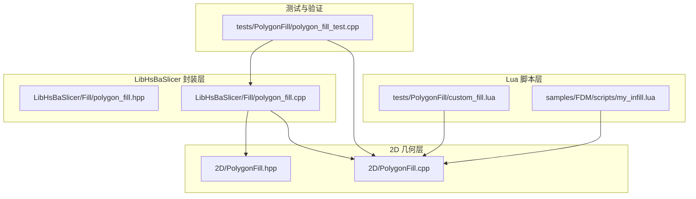
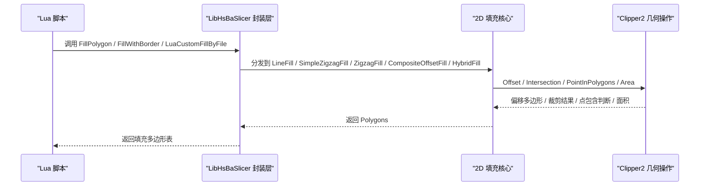
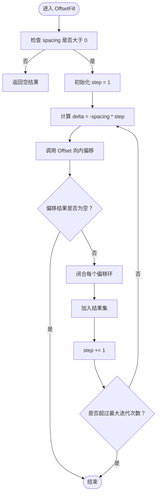
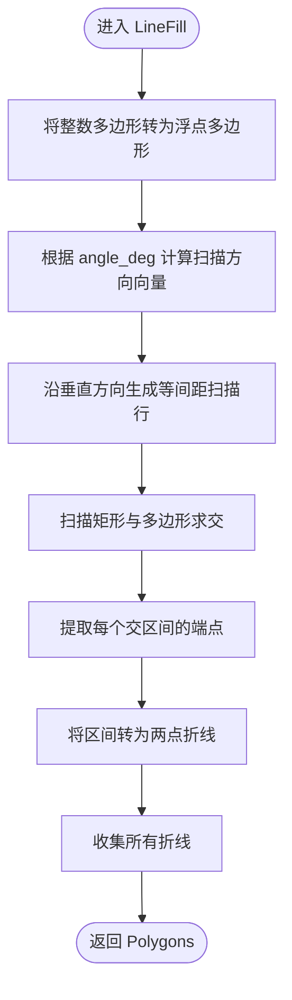
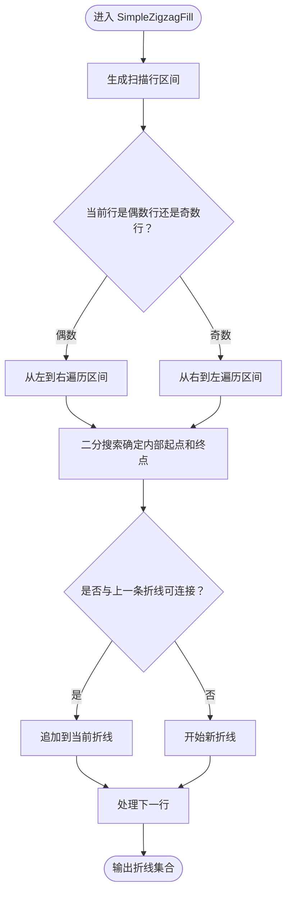
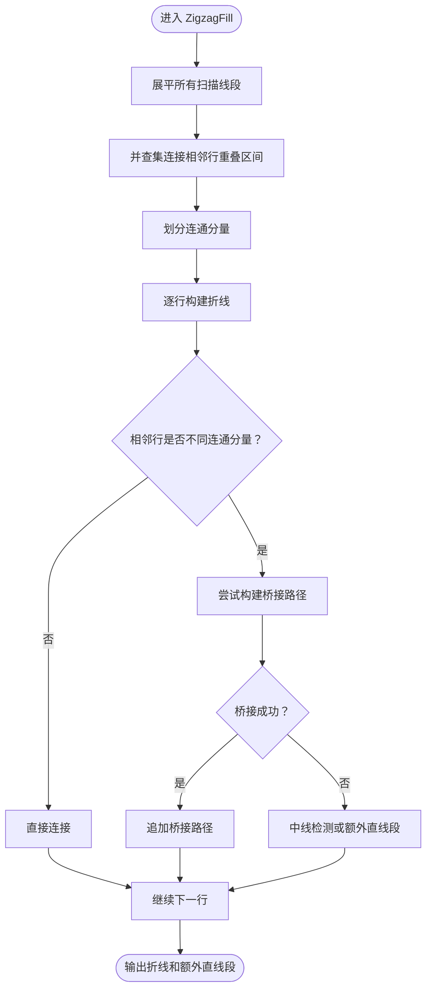
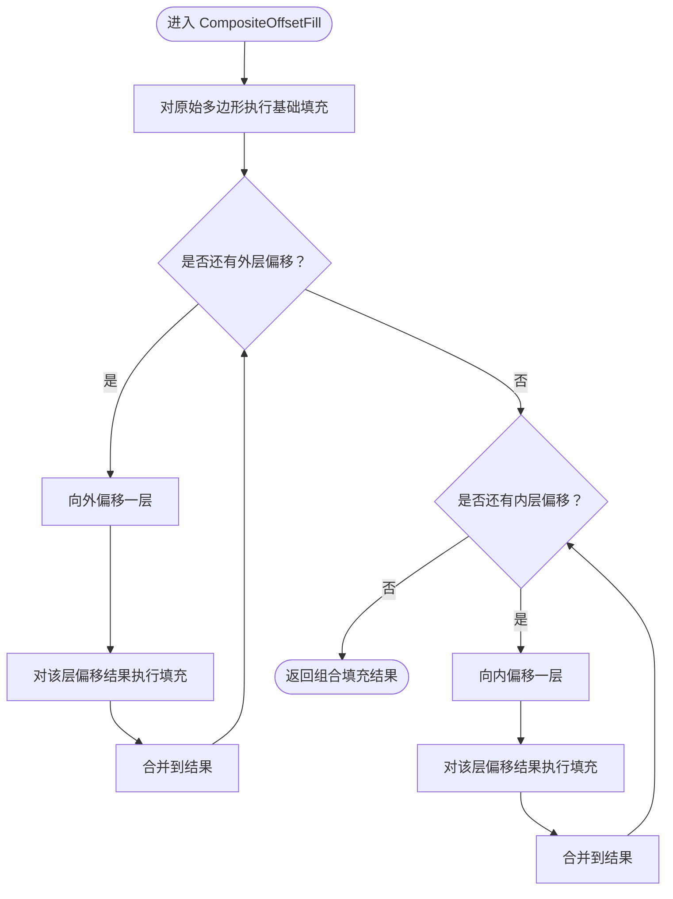
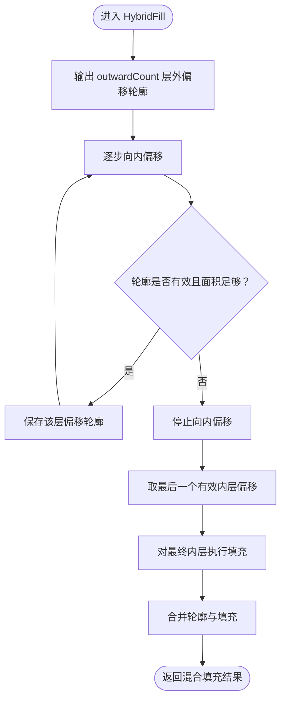

# 填充算法

<cite>
**本文引用的文件**   
- [2D/PolygonFill.hpp](file://2D/PolygonFill.hpp)
- [2D/PolygonFill.cpp](file://2D/PolygonFill.cpp)
- [LibHsBaSlicer/Fill/polygon_fill.hpp](file://LibHsBaSlicer/Fill/polygon_fill.hpp)
- [LibHsBaSlicer/Fill/polygon_fill.cpp](file://LibHsBaSlicer/Fill/polygon_fill.cpp)
- [samples/FDM/scripts/my_infill.lua](file://samples/FDM/scripts/my_infill.lua)
- [tests/PolygonFill/custom_fill.lua](file://tests/PolygonFill/custom_fill.lua)
- [tests/PolygonFill/polygon_fill_test.cpp](file://tests/PolygonFill/polygon_fill_test.cpp)
</cite>

## 目录
1. [引言](#引言)
2. [项目结构中的填充系统定位](#项目结构中的填充系统定位)
3. [核心组件与调用入口](#核心组件与调用入口)
4. [架构总览](#架构总览)
5. [详细算法说明](#详细算法说明)
6. [参数配置与调优指南](#参数配置与调优指南)
7. [Lua 脚本使用方式](#lua-脚本使用方式)
8. [C++ 库直接调用方式](#c-库直接调用方式)
9. [性能特征与优化建议](#性能特征与优化建议)
10. [故障排除](#故障排除)
11. [结论](#结论)

## 引言
本文围绕 HsBaSlicer 的二维多边形填充子系统，系统性说明以下填充算法的实现原理、几何特征、适用场景和参数调优方法：
- `OffsetFill`：基于向内偏移的同心环填充。
- `LineFill`：按角度生成的平行线填充。
- `SimpleZigzagFill`：简单蛇形折线填充。
- `ZigzagFill`：带连通域桥接与边界绕行能力的进阶蛇形填充。
- `CompositeOffsetFill`：组合偏移边框 + 内部填充。
- `HybridFill`：先输出若干偏移轮廓，再对最内层有效区域执行填充。

文档同时给出 Lua 脚本调用路径与 LibHsBaSlicer C++ API 的直接调用方式，并基于源码行为总结性能特征和优化建议。

## 项目结构中的填充系统定位
填充算法的核心实现位于 2D 几何模块，对外通过 LibHsBaSlicer 封装层暴露统一 API，并通过 Lua 绑定供脚本扩展。

**图表来源**
- [2D/PolygonFill.hpp:1-140](file://2D/PolygonFill.hpp#L1-L140)
- [2D/PolygonFill.cpp:1-502](file://2D/PolygonFill.cpp#L1-L502)
- [LibHsBaSlicer/Fill/polygon_fill.hpp:1-58](file://LibHsBaSlicer/Fill/polygon_fill.hpp#L1-L58)
- [LibHsBaSlicer/Fill/polygon_fill.cpp:1-52](file://LibHsBaSlicer/Fill/polygon_fill.cpp#L1-L52)
- [samples/FDM/scripts/my_infill.lua:1-89](file://samples/FDM/scripts/my_infill.lua#L1-L89)
- [tests/PolygonFill/custom_fill.lua:1-16](file://tests/PolygonFill/custom_fill.lua#L1-L16)
- [tests/PolygonFill/polygon_fill_test.cpp:175-652](file://tests/PolygonFill/polygon_fill_test.cpp#L175-L652)

**章节来源**
- [2D/PolygonFill.hpp:1-140](file://2D/PolygonFill.hpp#L1-L140)
- [2D/PolygonFill.cpp:1-502](file://2D/PolygonFill.cpp#L1-L502)
- [LibHsBaSlicer/Fill/polygon_fill.hpp:1-58](file://LibHsBaSlicer/Fill/polygon_fill.hpp#L1-L58)
- [LibHsBaSlicer/Fill/polygon_fill.cpp:1-52](file://LibHsBaSlicer/Fill/polygon_fill.cpp#L1-L52)

## 核心组件与调用入口
### 2D 层公共接口
2D 层提供面向多边形填充的核心函数，包括偏移填充、平行线填充、两种蛇形填充、组合偏移填充、混合填充，以及 Lua 自定义填充入口。

| 函数 | 主要职责 | 关键参数 | 返回值 |
|---|---|---|---|
| `OffsetFill` | 生成向内偏移的闭合环填充 | `poly`、`spacing`、`join_type` | 多边形集合 |
| `LineFill` | 生成平行线填充 | `poly`、`spacing`、`angle_deg`、`lineThickness` | 多边形集合 |
| `SimpleZigzagFill` | 简单蛇形折线填充 | `poly`、`spacing`、`angle_deg`、`lineThickness` | 多边形集合 |
| `ZigzagFill` | 进阶蛇形填充，含连通域桥接 | `poly`、`spacing`、`angle_deg`、`lineThickness` | 多边形集合 |
| `CompositeOffsetFill` | 组合偏移边框 + 内部填充 | `poly`、`spacing`、`offsetStep`、`outwardCount`、`inwardCount`、`mode`、`angle_deg`、`lineThickness`、`join_type` | 多边形集合 |
| `HybridFill` | 先输出偏移轮廓，再填充最内层 | `poly`、`spacing`、`offsetStep`、`outwardCount`、`inwardCount`、`mode`、`angle_deg`、`lineThickness`、`join_type` | 多边形集合 |
| `LuaCustomFill` / `LuaCustomFillString` | 通过 Lua 脚本生成填充 | `poly`、脚本路径或代码、函数名、`lineThickness`、可选注册回调 | 多边形集合 |

**章节来源**
- [2D/PolygonFill.hpp:20-136](file://2D/PolygonFill.hpp#L20-L136)

### LibHsBaSlicer 封装层
LibHsBaSlicer 层提供更简洁的对外 API：
- `FillPolygon`：根据 `FillMode` 选择 `LineFill`、`SimpleZigzagFill` 或 `ZigzagFill`。
- `FillWithBorder`：基于 `CompositeOffsetFill` 生成带偏移边框的内部填充。
- `LuaCustomFillByFile`：加载外部 Lua 脚本，注入 2D 几何函数与路径优化函数后执行自定义填充。

**章节来源**
- [LibHsBaSlicer/Fill/polygon_fill.hpp:17-53](file://LibHsBaSlicer/Fill/polygon_fill.hpp#L17-L53)
- [LibHsBaSlicer/Fill/polygon_fill.cpp:13-49](file://LibHsBaSlicer/Fill/polygon_fill.cpp#L13-L49)

## 架构总览
填充系统的调用链可以理解为三层：
1. **Lua 脚本层**：通过 `PolygonFill.*` 函数或直接调用 `generate_fill` 返回填充结果。
2. **LibHsBaSlicer 封装层**：将业务语义（如“带边框填充”）映射到 2D 层的具体算法。
3. **2D 几何层**：实现具体的扫描行、偏移、连通域、桥接、边界绕行等几何逻辑。

**图表来源**
- [LibHsBaSlicer/Fill/polygon_fill.cpp:13-49](file://LibHsBaSlicer/Fill/polygon_fill.cpp#L13-L49)
- [2D/PolygonFill.cpp:504-1491](file://2D/PolygonFill.cpp#L504-L1491)

## 详细算法说明

### OffsetFill：向内偏移同心环
`OffsetFill` 以固定间距反复向内偏移原始多边形，直到偏移结果为空；每次偏移得到的轮廓会被闭合，并作为一条独立填充环加入结果。

- 几何特征：
  - 输出为一系列闭合轮廓环。
  - 适合需要均匀壁厚、分层支撑或轮廓强化场景。
- 关键行为：
  - `spacing <= 0` 时直接返回空结果。
  - 每层偏移结果都会调用闭合路径逻辑，确保首尾顶点重合。
  - 存在最大迭代次数保护，避免极端情况下无限循环。

**图表来源**
- [2D/PolygonFill.cpp:504-541](file://2D/PolygonFill.cpp#L504-L541)

**章节来源**
- [2D/PolygonFill.cpp:504-541](file://2D/PolygonFill.cpp#L504-L541)
- [tests/PolygonFill/polygon_fill_test.cpp:175-200](file://tests/PolygonFill/polygon_fill_test.cpp#L175-L200)

### LineFill：平行线填充
`LineFill` 基于扫描行策略：
1. 将多边形转换为浮点多边形。
2. 根据角度计算扫描方向向量。
3. 沿垂直于扫描方向的轴生成等间距扫描线。
4. 用扫描矩形与原始多边形求交，得到每条扫描线上的线段区间。
5. 将每个区间转换为两点折线，作为独立填充段输出。

- 几何特征：
  - 输出为大量独立线段。
  - 适合快速估算填充密度、可视化扫描方向、或与后续路径连接器配合。
- 关键行为：
  - `lineThickness` 在 `LineFill` 中主要用于构造扫描矩形宽度，但最终返回的是两点折线。
  - 角度通过弧度转换参与投影计算。

**图表来源**
- [2D/PolygonFill.cpp:44-160](file://2D/PolygonFill.cpp#L44-L160)
- [2D/PolygonFill.cpp:544-564](file://2D/PolygonFill.cpp#L544-L564)

**章节来源**
- [2D/PolygonFill.cpp:44-160](file://2D/PolygonFill.cpp#L44-L160)
- [2D/PolygonFill.cpp:544-564](file://2D/PolygonFill.cpp#L544-L564)

### SimpleZigzagFill：简单蛇形填充
`SimpleZigzagFill` 在 `LineFilling` 的基础上，按行交替方向连接相邻扫描线段，形成连续折线：
- 偶数行从左到右连接。
- 奇数行从右到左连接。
- 仅允许同一行或相邻行之间连接。
- 使用二分搜索确定线段与多边形边界的交点，保证连接点落在多边形内部。

- 几何特征：
  - 输出为连续折线路径。
  - 适合需要单条或少量打印路径的场景。
- 关键行为：
  - 若某扫描区间完全在多边形外，则退化为独立线段。
  - 非相邻行不会连接，避免产生长距离跳跃。

**图表来源**
- [2D/PolygonFill.cpp:568-800](file://2D/PolygonFill.cpp#L568-L800)

**章节来源**
- [2D/PolygonFill.cpp:568-800](file://2D/PolygonFill.cpp#L568-L800)

### ZigzagFill：进阶蛇形填充
`ZigzagFill` 在简单蛇形基础上增加了连通域分析和桥接逻辑：
1. 将所有扫描线段展平，记录所属行、索引、端点和投影区间。
2. 使用并查集连接相邻行中投影区间重叠的线段，构建连通分量。
3. 当相邻行属于不同连通分量时，尝试构建“桥接路径”，使折线绕过凹口而不是直接穿越空洞。
4. 桥接失败时回退到中线检测或额外直线段输出。

- 几何特征：
  - 更适合复杂形状、凹多边形、岛屿或多连通域。
  - 能生成绕边界走位的桥接路径，减少跨空洞断裂。
- 关键行为：
  - 使用 `PointInPolygons` 判断点是否在多边形内。
  - 桥接路径会沿外轮廓较短弧采样，并按线宽控制采样步长。
  - 无法连接的片段会作为额外直线段追加到结果。

**图表来源**
- [2D/PolygonFill.cpp:803-1370](file://2D/PolygonFill.cpp#L803-L1370)

**章节来源**
- [2D/PolygonFill.cpp:803-1370](file://2D/PolygonFill.cpp#L803-L1370)
- [tests/PolygonFill/polygon_fill_test.cpp:542-652](file://tests/PolygonFill/polygon_fill_test.cpp#L542-L652)

### CompositeOffsetFill：组合偏移边框 + 内部填充
`CompositeOffsetFill` 的工作流程：
1. 对原始多边形执行基础填充。
2. 向外偏移 `outwardCount` 层，并对每层偏移结果再次填充。
3. 向内偏移 `inwardCount` 层，并对每层偏移结果再次填充。
4. 所有结果合并输出。

- 几何特征：
  - 可同时生成外扩边框、内缩边框和内部填充。
  - 适合需要多层壁厚、轮廓强化与内部支撑的组合场景。
- 关键行为：
  - 内部填充模式由 `FillMode` 决定：`Line`、`SimpleZigzag`、`Zigzag`。
  - 偏移角点连接类型由 `join_type` 控制。

**图表来源**
- [2D/PolygonFill.cpp:1372-1428](file://2D/PolygonFill.cpp#L1372-L1428)

**章节来源**
- [2D/PolygonFill.cpp:1372-1428](file://2D/PolygonFill.cpp#L1372-L1428)

### HybridFill：混合填充
`HybridFill` 的行为更接近“先画边框，再填中心”：
1. 输出 `outwardCount` 层向外偏移轮廓。
2. 逐步向内偏移，直到面积小于阈值或轮廓退化。
3. 对最后一个有效内层偏移结果执行填充。
4. 将偏移轮廓与最终填充结果合并。

- 几何特征：
  - 强调轮廓边界输出，内部只填充最内层有效区域。
  - 适合需要清晰外框 + 局部内部支撑的结构。
- 关键行为：
  - 使用 `lineThickness^2` 作为最小面积阈值，避免过小碎片。
  - 如果内层偏移为空或面积不足，提前停止。

**图表来源**
- [2D/PolygonFill.cpp:1430-1491](file://2D/PolygonFill.cpp#L1430-L1491)

**章节来源**
- [2D/PolygonFill.cpp:1430-1491](file://2D/PolygonFill.cpp#L1430-L1491)

## 参数配置与调优指南

### 通用参数说明
| 参数 | 含义 | 典型影响 | 调优建议 |
|---|---|---|---|
| `spacing` | 填充线间距 | 越小越密，打印时间越长 | 根据模型强度需求和打印速度平衡；过大可能漏填，过小增加路径数量 |
| `angle_deg` | 填充角度 | 改变扫描方向和交叉纹理 | 相邻层建议旋转角度以避免层间薄弱面；常见 0°、45°、90° |
| `lineThickness` | 填充线宽 | 影响桥接采样步长、最小面积阈值、扫描矩形宽度 | 与挤出线宽一致；过大可能导致过度填充，过小可能桥接不稳定 |
| `offsetStep` | 偏移步长 | 控制偏移层间距 | 通常与 `spacing` 保持一致以获得均匀边框 |
| `outwardCount` | 向外偏移层数 | 增加外扩边框厚度 | 用于加强边缘或外壳；过多会增加路径长度 |
| `inwardCount` | 向内偏移层数 | 增加内缩边框或内部层次 | 用于内部支撑或壁厚增强；过多可能缩小可填充区域 |
| `mode` | 内部填充模式 | 决定内部使用 `Line`、`SimpleZigzag` 或 `Zigzag` | 简单区域可用 `Line`；复杂区域推荐 `Zigzag` |
| `join_type` | 偏移角点连接类型 | 影响偏移轮廓拐角形状 | `Square` 默认；`Round` 更平滑但计算更多；`Bevel`、`Miter` 适用于硬角需求 |

### 各函数参数对照
| 函数 | 必需参数 | 可选参数 | 默认值 |
|---|---|---|---|
| `OffsetFill` | `poly`、`spacing` | `join_type` | `Square` |
| `LineFill` | `poly`、`spacing`、`angle_deg` | `lineThickness` | `0.5` |
| `SimpleZigzagFill` | `poly`、`spacing`、`angle_deg` | `lineThickness` | `0.5` |
| `ZigzagFill` | `poly`、`spacing`、`angle_deg` | `lineThickness` | `0.5` |
| `CompositeOffsetFill` | `poly`、`spacing`、`offsetStep`、`outwardCount`、`inwardCount`、`mode`、`angle_deg` | `lineThickness`、`join_type` | `lineThickness=0.5`，`join_type=Square` |
| `HybridFill` | `poly`、`spacing`、`offsetStep`、`outwardCount`、`inwardCount`、`mode`、`angle_deg` | `lineThickness`、`join_type` | `lineThickness=0.5`，`join_type=Square` |

**章节来源**
- [2D/PolygonFill.hpp:20-102](file://2D/PolygonFill.hpp#L20-L102)
- [2D/PolygonFill.cpp:231-432](file://2D/PolygonFill.cpp#L231-L432)

## Lua 脚本使用方式

### PolygonFill 全局函数
Lua 层通过 `RegisterLuaPolygonFillFunctions` 注册 `PolygonFill` 表，包含以下函数：
- `offsetFill`
- `lineFill`
- `simpleZigzagFill`
- `zigzagFill`
- `compositeOffsetFill`
- `hybridFill`
- `offsetOnly`

这些函数接收浮点多边形表，并返回浮点多边形表；部分函数支持可选 `join_type` 字段。

**章节来源**
- [2D/PolygonFill.cpp:231-495](file://2D/PolygonFill.cpp#L231-L495)

### 自定义填充脚本约定
自定义 Lua 填充脚本需实现 `generate_fill(poly)` 函数：
- 输入：当前层多边形表。
- 输出：多边形或折线表。
- 可使用 `PolygonOperations` 进行偏移、并集、交集、差集、异或、几何构造等操作。
- 通过 `LuaCustomFillByFile` 加载脚本时，还会注入 `PathOptimize`，支持路径优化。

示例脚本参考：
- [samples/FDM/scripts/my_infill.lua](file://samples/FDM/scripts/my_infill.lua)
- [tests/PolygonFill/custom_fill.lua](file://tests/PolygonFill/custom_fill.lua)

**章节来源**
- [samples/FDM/scripts/my_infill.lua:1-89](file://samples/FDM/scripts/my_infill.lua#L1-L89)
- [tests/PolygonFill/custom_fill.lua:1-16](file://tests/PolygonFill/custom_fill.lua#L1-L16)
- [LibHsBaSlicer/Fill/polygon_fill.cpp:35-49](file://LibHsBaSlicer/Fill/polygon_fill.cpp#L35-L49)

## C++ 库直接调用方式

### LibHsBaSlicer 公开 API
| 函数 | 用途 | 典型用法 |
|---|---|---|
| `FillPolygon` | 根据 `FillMode` 选择填充算法 | 传入 `spacing`、`angle_deg`、`FillMode::Zigzag` |
| `FillWithBorder` | 生成带偏移边框的内部填充 | 传入 `border_count` 作为内缩边框层数 |
| `LuaCustomFillByFile` | 加载外部 Lua 脚本执行自定义填充 | 传入脚本路径、函数名、线宽 |

**章节来源**
- [LibHsBaSlicer/Fill/polygon_fill.hpp:17-53](file://LibHsBaSlicer/Fill/polygon_fill.hpp#L17-L53)
- [LibHsBaSlicer/Fill/polygon_fill.cpp:13-49](file://LibHsBaSlicer/Fill/polygon_fill.cpp#L13-L49)

### 2D 层直接调用
如果需要更细粒度控制，可直接调用 2D 层函数：
- 使用 `OffsetFill` 生成同心环。
- 使用 `LineFill` 生成平行线。
- 使用 `SimpleZigzagFill` 或 `ZigzagFill` 生成蛇形路径。
- 使用 `CompositeOffsetFill` 或 `HybridFill` 组合偏移与填充。

**章节来源**
- [2D/PolygonFill.hpp:20-136](file://2D/PolygonFill.hpp#L20-L136)

## 性能特征与优化建议

### 复杂度与行为特征
| 算法 | 主要计算阶段 | 性能特点 | 适用场景 |
|---|---|---|---|
| `OffsetFill` | 多次 `Offset` 调用 + 路径闭合 | 偏移层数越多，计算量越大；适合小层数边框 | 壁厚、轮廓强化 |
| `LineFill` | 扫描行 + 矩形相交 + 区间提取 | 输出大量独立线段，适合轻量分析 | 快速填充、可视化 |
| `SimpleZigzagFill` | 扫描行 + 行内连接 + 二分搜索 | 连接逻辑较简单，适合规则区域 | 中等复杂度填充 |
| `ZigzagFill` | 扫描行 + 并查集 + 连通域 + 桥接 | 复杂度高，但连通性更好 | 凹多边形、岛屿、复杂形状 |
| `CompositeOffsetFill` | 基础填充 + 多层偏移 + 每层填充 | 计算量随偏移层数和填充模式增长 | 多层边框 + 内部填充 |
| `HybridFill` | 外轮廓输出 + 内层偏移 + 最终填充 | 比组合填充少一些中间层填充，但仍较重 | 外框 + 局部内部填充 |

### 优化建议
1. **优先选择合适的填充模式**：
   - 简单区域使用 `LineFill` 或 `SimpleZigzagFill`。
   - 复杂区域使用 `ZigzagFill`，避免断线。
2. **合理设置 `spacing`**：
   - 过大会导致填充稀疏；过小会增加路径数量和计算时间。
   - 建议结合模型尺寸和打印精度调整。
3. **控制偏移层数**：
   - `outwardCount` 和 `inwardCount` 不宜过大，否则会产生大量中间层。
   - 对于只需要外框的场景，优先使用 `HybridFill`。
4. **注意 `lineThickness` 的影响**：
   - 影响桥接采样步长和最小面积阈值。
   - 与挤出线宽保持一致可减少异常。
5. **角度设计**：
   - 相邻层旋转角度可提升层间结合力。
   - 避免与模型主应力方向完全一致。

[本节为通用性能讨论，不直接分析具体源码文件]

## 故障排除

### 常见问题
| 问题 | 可能原因 | 排查方法 |
|---|---|---|
| `OffsetFill` 返回空结果 | `spacing <= 0` 或偏移过快导致轮廓消失 | 检查 `spacing` 是否为正数，适当增大 |
| 蛇形填充出现断线 | 连通域变化或桥接失败 | 使用 `ZigzagFill` 替代 `SimpleZigzagFill` |
| 填充路径超出原始多边形 | 扫描区间未正确裁剪 | 检查 `lineThickness` 和角度，确认内部点判断逻辑 |
| Lua 脚本报错 | 脚本语法错误或函数名不匹配 | 检查 `generate_fill` 是否存在，参数类型是否正确 |
| 路径优化不可用 | 未注入 `PathOptimize` | 使用 `LuaCustomFillByFile` 而非直接 `LuaCustomFill` |

**章节来源**
- [tests/PolygonFill/polygon_fill_test.cpp:175-200](file://tests/PolygonFill/polygon_fill_test.cpp#L175-L200)
- [tests/PolygonFill/polygon_fill_test.cpp:522-540](file://tests/PolygonFill/polygon_fill_test.cpp#L522-L540)
- [2D/PolygonFill.cpp:1494-1585](file://2D/PolygonFill.cpp#L1494-L1585)

## 结论
HsBaSlicer 的填充系统提供了从简单平行线到复杂桥接蛇形、从单一填充到组合偏移的完整能力。开发者应根据模型几何特征、强度需求和打印效率选择合适的算法：
- 简单规则区域：`LineFill` 或 `SimpleZigzagFill`。
- 复杂凹多边形：`ZigzagFill`。
- 需要多层边框：`CompositeOffsetFill`。
- 需要外框 + 局部内部填充：`HybridFill`。
- 需要高度定制：Lua 自定义填充脚本。

通过合理调节 `spacing`、`angle_deg`、`lineThickness`、偏移层数和填充模式，可以在质量、速度和稳定性之间取得良好平衡。