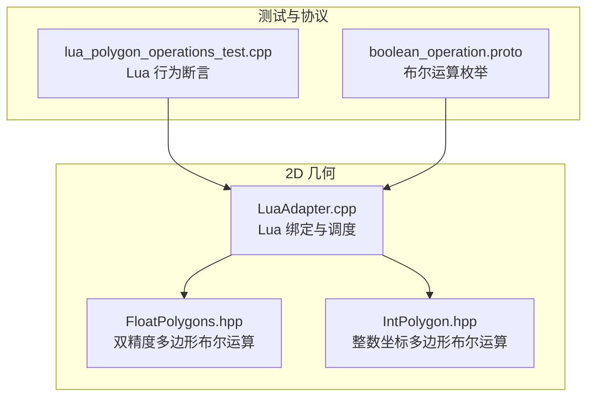
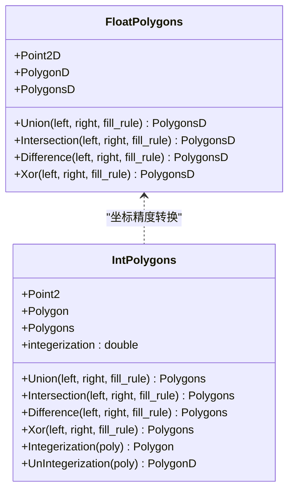
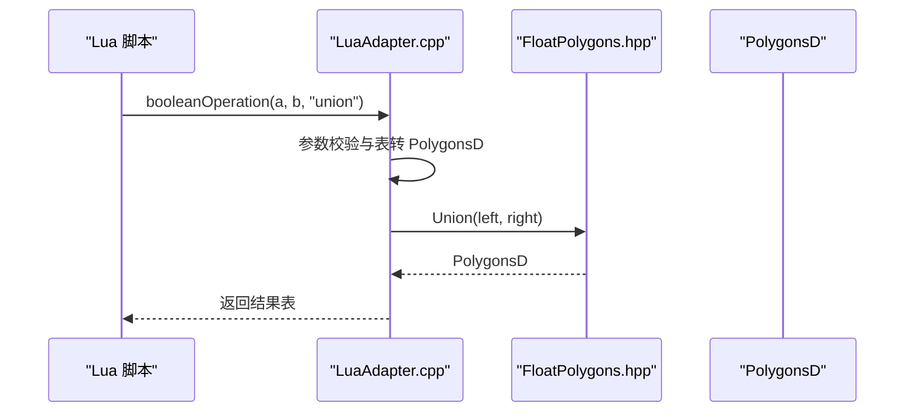
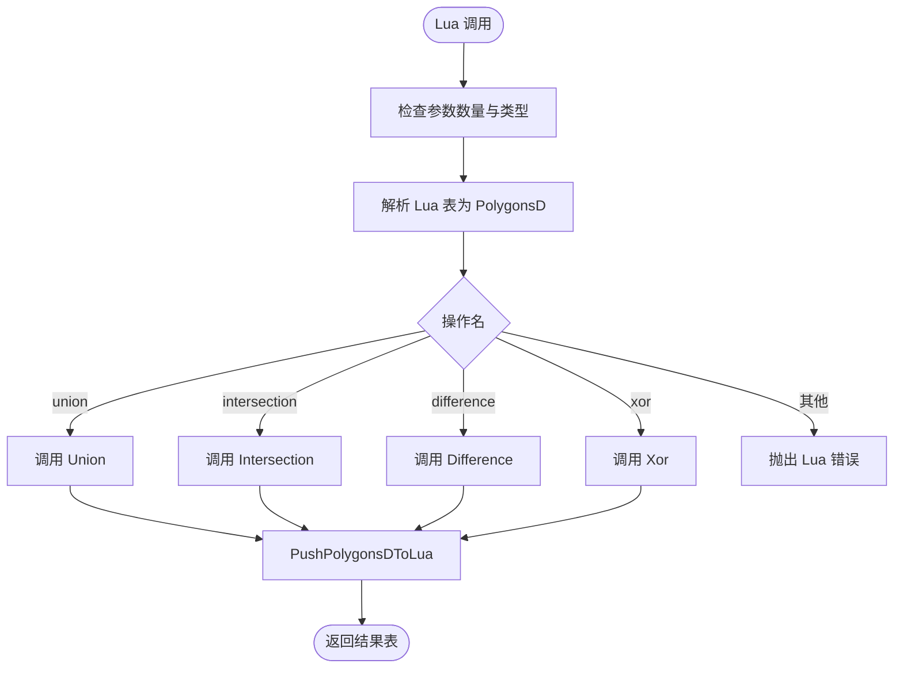
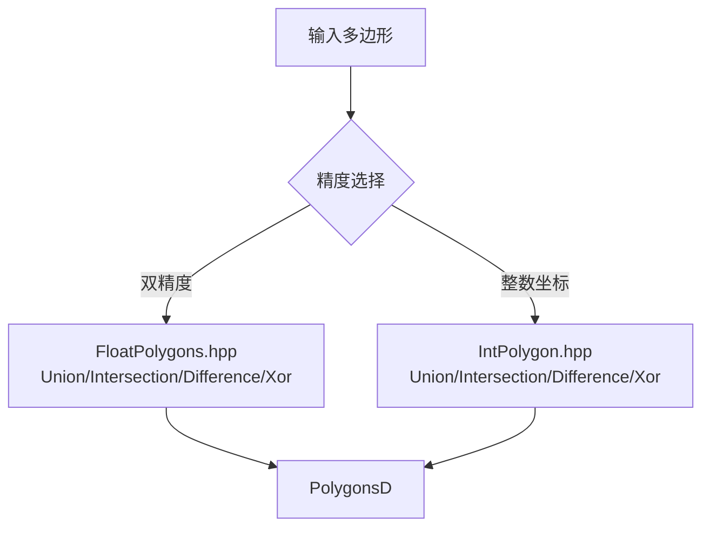
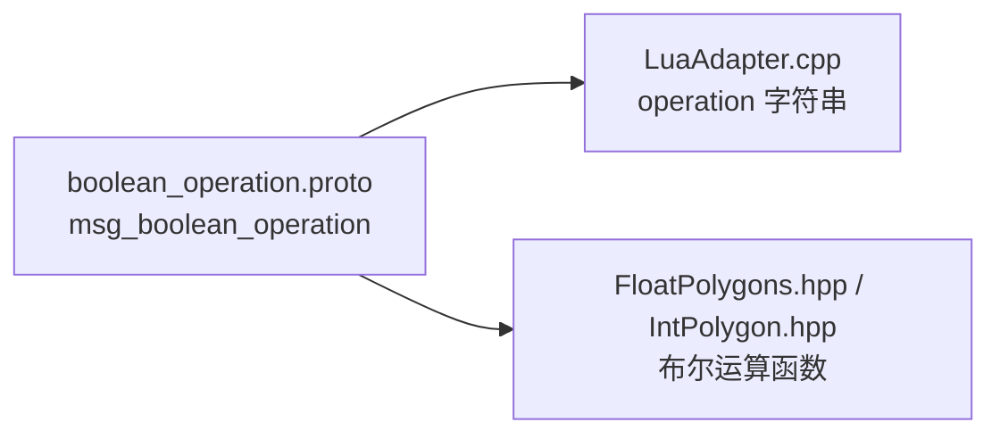
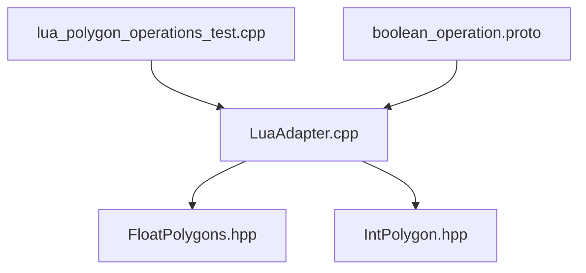

# 多边形布尔运算

<cite>
**本文引用的文件**   
- [FloatPolygons.hpp](file://2D/FloatPolygons.hpp)
- [IntPolygon.hpp](file://2D/IntPolygon.hpp)
- [LuaAdapter.cpp](file://2D/LuaAdapter.cpp)
- [lua_polygon_operations_test.cpp](file://tests/PolygonFill/lua_polygon_operations_test.cpp)
- [boolean_operation.proto](file://proto/boolean_operation.proto)
</cite>

## 目录
1. [引言](#引言)
2. [项目结构定位](#项目结构定位)
3. [核心组件](#核心组件)
4. [架构总览](#架构总览)
5. [详细组件分析](#详细组件分析)
6. [依赖关系分析](#依赖关系分析)
7. [性能与注意事项](#性能与注意事项)
8. [故障排除指南](#故障排除指南)
9. [结论](#结论)
10. [附录：API 参考与示例](#附录api-参考与示例)

## 引言
本文面向需要在 HsBaSlicer 中进行二维多边形布尔运算的开发者，系统说明以下能力：
- C++ 层的多边形布尔运算接口：`Union`、`Intersection`、`Difference`、`Xor`。
- Lua 脚本侧暴露的 `PolygonOperations.booleanOperation`、`union`、`intersection`、`difference`、`xor`。
- 不同布尔运算的几何意义、典型应用场景。
- 参数与返回值约定、坐标精度模型、填充规则。
- 自相交多边形处理建议、边界情况与性能注意事项。
- 提供 Lua API 调用示例和 C++ 直接调用方式（以源码路径引用代替具体代码片段）。

## 项目结构定位
多边形布尔运算相关实现集中在 2D 几何模块中：
- 双精度浮点多边形类型与布尔运算接口定义在 `2D/FloatPolygons.hpp`。
- 整数坐标多边形类型与布尔运算接口定义在 `2D/IntPolygon.hpp`。
- Lua 到 C++ 的桥接函数、参数校验与错误提示在 `2D/LuaAdapter.cpp`。
- Lua 行为验证用例在 `tests/PolygonFill/lua_polygon_operations_test.cpp`。
- 协议枚举用于跨语言或序列化场景中的布尔运算类型标识，见 `proto/boolean_operation.proto`。

**图表来源**
- [FloatPolygons.hpp:43-121](file://2D/FloatPolygons.hpp#L43-L121)
- [IntPolygon.hpp:68-146](file://2D/IntPolygon.hpp#L68-L146)
- [LuaAdapter.cpp:22-106](file://2D/LuaAdapter.cpp#L22-L106)
- [lua_polygon_operations_test.cpp:129-181](file://tests/PolygonFill/lua_polygon_operations_test.cpp#L129-L181)
- [boolean_operation.proto:5-11](file://proto/boolean_operation.proto#L5-L11)

**章节来源**
- [FloatPolygons.hpp:1-121](file://2D/FloatPolygons.hpp#L1-L121)
- [IntPolygon.hpp:1-146](file://2D/IntPolygon.hpp#L1-L146)
- [LuaAdapter.cpp:1-106](file://2D/LuaAdapter.cpp#L1-L106)
- [lua_polygon_operations_test.cpp:129-181](file://tests/PolygonFill/lua_polygon_operations_test.cpp#L129-L181)
- [boolean_operation.proto:1-12](file://proto/boolean_operation.proto#L1-L12)

## 核心组件
本节聚焦多边形布尔运算的核心 API 与数据模型。

### 数据类型与精度模型
- 双精度多边形：
  - `Point2D`、`PolygonD`、`PolygonsD` 基于 Clipper2 的双精度类型。
  - 布尔运算返回 `PolygonsD`，即一组双精度多边形。
- 整数坐标多边形：
  - `Point2`、`Polygon`、`Polygons` 基于 Clipper2 的 64 位整数类型。
  - 存在缩放因子 `integerization = 1e6`，用于在整数空间进行精确布尔运算。
  - 通过 `Integerization` / `UnIntegerization` 在双精度与整数坐标之间转换。

**图表来源**
- [FloatPolygons.hpp:16-26](file://2D/FloatPolygons.hpp#L16-L26)
- [FloatPolygons.hpp:43-121](file://2D/FloatPolygons.hpp#L43-L121)
- [IntPolygon.hpp:16-26](file://2D/IntPolygon.hpp#L16-L26)
- [IntPolygon.hpp:68-146](file://2D/IntPolygon.hpp#L68-L146)

**章节来源**
- [FloatPolygons.hpp:16-26](file://2D/FloatPolygons.hpp#L16-L26)
- [FloatPolygons.hpp:43-121](file://2D/FloatPolygons.hpp#L43-L121)
- [IntPolygon.hpp:16-26](file://2D/IntPolygon.hpp#L16-L26)
- [IntPolygon.hpp:68-146](file://2D/IntPolygon.hpp#L68-L146)

### 布尔运算函数签名与语义
- 双精度版本（`FloatPolygons.hpp`）：
  - `PolygonsD Union(const PolygonD& left, const PolygonD& right, FillRule fill_rule = EvenOdd)`
  - `PolygonsD Intersection(const PolygonD& left, const PolygonD& right, FillRule fill_rule = EvenOdd)`
  - `PolygonsD Difference(const PolygonD& left, const PolygonD& right, FillRule fill_rule = EvenOdd)`
  - `PolygonsD Xor(const PolygonD& left, const PolygonD& right, FillRule fill_rule = EvenOdd)`
- 整数坐标版本（`IntPolygon.hpp`）：
  - `Polygons Union(const Polygon& left, const Polygon& right, FillRule fill_rule = EvenOdd)`
  - `Polygons Intersection(const Polygon& left, const Polygon& right, FillRule fill_rule = EvenOdd)`
  - `Polygons Difference(const Polygon& left, const Polygon& right, FillRule fill_rule = EvenOdd)`
  - `Polygons Xor(const Polygon& left, const Polygon& right, FillRule fill_rule = EvenOdd)`

所有函数均支持可选填充规则，默认使用“奇偶”规则；返回值为结果多边形集合。

**章节来源**
- [FloatPolygons.hpp:43-121](file://2D/FloatPolygons.hpp#L43-L121)
- [IntPolygon.hpp:68-146](file://2D/IntPolygon.hpp#L68-L146)

## 架构总览
Lua 脚本通过 `PolygonOperations` 表访问多边形布尔运算。内部流程如下：
1. Lua 调用 `PolygonOperations.booleanOperation(a, b, op)` 或专用函数如 `union`、`intersection`、`difference`、`xor`。
2. `LuaAdapter.cpp` 将 Lua 表解析为 `PolygonsD`。
3. 根据操作名分发到对应 C++ 布尔运算函数。
4. 将结果 `PolygonsD` 写回 Lua 表。

**图表来源**
- [LuaAdapter.cpp:22-54](file://2D/LuaAdapter.cpp#L22-L54)
- [FloatPolygons.hpp:43-51](file://2D/FloatPolygons.hpp#L43-L51)

**章节来源**
- [LuaAdapter.cpp:22-106](file://2D/LuaAdapter.cpp#L22-L106)
- [FloatPolygons.hpp:43-121](file://2D/FloatPolygons.hpp#L43-L121)

## 详细组件分析

### Lua 布尔运算绑定
- 通用调度器 `l_booleanOperation`：
  - 接收三个参数：左多边形表、右多边形表、操作名字符串。
  - 支持操作名：`union`、`intersection`、`difference`、`xor`。
  - 未知操作名会抛出 Lua 错误。
- 专用绑定函数：
  - `l_union`、`l_intersection`、`l_difference`、`l_xor`。
  - 每个函数校验两个多边形表并调用对应 C++ 函数。
- 注册入口：
  - `RegisterLuaPolygonOperations` 将 `booleanOperation`、`union`、`intersection`、`difference`、`xor` 等函数注册到全局 `PolygonOperations` 表。

**图表来源**
- [LuaAdapter.cpp:22-106](file://2D/LuaAdapter.cpp#L22-L106)

**章节来源**
- [LuaAdapter.cpp:22-106](file://2D/LuaAdapter.cpp#L22-L106)
- [LuaAdapter.cpp:311-329](file://2D/LuaAdapter.cpp#L311-L329)
- [LuaAdapter.cpp:487-491](file://2D/LuaAdapter.cpp#L487-L491)

### 双精度与整数坐标布尔运算
- 双精度版本适用于直接使用浮点坐标的场景，便于与图形库、文本转多边形等流程衔接。
- 整数坐标版本通过 `integerization = 1e6` 将坐标缩放到整数空间，提升布尔运算数值稳定性。
- 两者均支持对单个多边形和多边形集合的布尔运算重载。

**图表来源**
- [FloatPolygons.hpp:43-121](file://2D/FloatPolygons.hpp#L43-L121)
- [IntPolygon.hpp:68-146](file://2D/IntPolygon.hpp#L68-L146)

**章节来源**
- [FloatPolygons.hpp:43-121](file://2D/FloatPolygons.hpp#L43-L121)
- [IntPolygon.hpp:68-146](file://2D/IntPolygon.hpp#L68-L146)

### 协议枚举与跨语言映射
- `msg_boolean_operation` 枚举定义了四种布尔运算及未知状态，可用于消息传递、配置或外部系统集成。
- 该枚举与 Lua/C++ 层的操作名一一对应：
  - `boolop_union` → `union`
  - `boolop_intersection` → `intersection`
  - `boolop_difference` → `difference`
  - `boolop_xor` → `xor`
  - `boolop_unknown` → 未识别操作

**图表来源**
- [boolean_operation.proto:5-11](file://proto/boolean_operation.proto#L5-L11)
- [LuaAdapter.cpp:32-50](file://2D/LuaAdapter.cpp#L32-L50)

**章节来源**
- [boolean_operation.proto:1-12](file://proto/boolean_operation.proto#L1-L12)
- [LuaAdapter.cpp:32-50](file://2D/LuaAdapter.cpp#L32-L50)

## 依赖关系分析
- Lua 层依赖：
  - `LuaAdapter.cpp` 依赖 `FloatPolygons.hpp` 提供的 `Union`、`Intersection`、`Difference`、`Xor`。
  - 同时依赖 `IntPolygon.hpp` 中的偏移、凸包等辅助功能（非布尔运算部分）。
- 测试层依赖：
  - `lua_polygon_operations_test.cpp` 通过 `RegisterLuaPolygonOperations` 注册并断言 Lua 行为。
- 协议层依赖：
  - `boolean_operation.proto` 作为跨语言枚举，供上层管道或外部系统使用。

**图表来源**
- [lua_polygon_operations_test.cpp:129-181](file://tests/PolygonFill/lua_polygon_operations_test.cpp#L129-L181)
- [LuaAdapter.cpp:22-106](file://2D/LuaAdapter.cpp#L22-L106)
- [FloatPolygons.hpp:43-121](file://2D/FloatPolygons.hpp#L43-L121)
- [IntPolygon.hpp:68-146](file://2D/IntPolygon.hpp#L68-L146)
- [boolean_operation.proto:5-11](file://proto/boolean_operation.proto#L5-L11)

**章节来源**
- [lua_polygon_operations_test.cpp:129-181](file://tests/PolygonFill/lua_polygon_operations_test.cpp#L129-L181)
- [LuaAdapter.cpp:22-106](file://2D/LuaAdapter.cpp#L22-L106)
- [FloatPolygons.hpp:43-121](file://2D/FloatPolygons.hpp#L43-L121)
- [IntPolygon.hpp:68-146](file://2D/IntPolygon.hpp#L68-L146)
- [boolean_operation.proto:5-11](file://proto/boolean_operation.proto#L5-L11)

## 性能与注意事项
- 数值精度与稳定性：
  - 整数坐标布尔运算通过 `integerization = 1e6` 将坐标放大至整数空间，减少浮点误差累积，适合高精度裁剪与布尔运算。
  - 双精度版本更适合直接处理浮点坐标，但需注意极端几何下的数值稳定性。
- 自相交多边形：
  - 接口文档强调“移除共线点”的简化能力（`MakeSimple`），建议在复杂多边形上先做简化与规范化，再进行布尔运算。
  - 对于自相交多边形，可考虑使用 `NormalizeToSimplePolygons` 或 `MakeSimpleAndSplit` 将其拆分为简单多边形集合后再运算。
- 填充规则：
  - 默认填充规则为“奇偶”，在某些复杂嵌套结构中可能需要调整填充规则以获得预期结果。
- 性能特征：
  - 布尔运算复杂度与顶点数、交点数密切相关；大量小多边形集合运算时，建议先合并或简化以减少计算量。
  - Lua 层存在表解析与构造开销，批量处理时应尽量减少跨语言调用次数。

[本节为通用指导，不直接分析具体文件]

## 故障排除指南
- Lua 参数错误：
  - 当传入的参数不是多边形表或操作名非法时，Lua 层会抛出错误。例如：
    - `booleanOperation` 需要三个参数：两个表和一个字符串。
    - `union`、`intersection`、`difference`、`xor` 需要两个多边形表。
- 常见错误分支：
  - 未知操作名：`booleanOperation(a, b, "nonsense")` 会触发错误。
  - 类型不匹配：传入数字而非表会触发错误。
- 调试建议：
  - 使用 `area` 函数检查结果面积是否符合预期。
  - 借助 `DumpPolygon` / `DumpPolygons`（需启用 `HSBA_POLYGON_DUMP`）导出 SVG 可视化结果。

**章节来源**
- [LuaAdapter.cpp:16-19](file://2D/LuaAdapter.cpp#L16-L19)
- [LuaAdapter.cpp:22-54](file://2D/LuaAdapter.cpp#L22-L54)
- [LuaAdapter.cpp:56-106](file://2D/LuaAdapter.cpp#L56-L106)
- [lua_polygon_operations_test.cpp:176-181](file://tests/PolygonFill/lua_polygon_operations_test.cpp#L176-L181)

## 结论
HsBaSlicer 的多边形布尔运算提供了从 Lua 到 C++ 的完整链路：
- Lua 侧通过 `PolygonOperations.booleanOperation` 与专用函数便捷调用。
- C++ 侧提供双精度与整数坐标两套 API，兼顾易用性与数值稳定性。
- 协议枚举支持跨语言集成。
在实际工程中，建议优先使用整数坐标布尔运算以保证稳定性，并在复杂几何前进行简化与规范化；Lua 脚本中应做好参数校验与错误处理。

[本节为总结性内容，不直接分析具体文件]

## 附录：API 参考与示例

### Lua API 参考
- `PolygonOperations.booleanOperation(left_polygons, right_polygons, operation_name)`
  - 参数：
    - `left_polygons`：左多边形表（数组形式，元素为点表 `{x, y}`）。
    - `right_polygons`：右多边形表。
    - `operation_name`：字符串，取值 `union`、`intersection`、`difference`、`xor`。
  - 返回：结果多边形表。
- `PolygonOperations.union(left_polygons, right_polygons)`
- `PolygonOperations.intersection(left_polygons, right_polygons)`
- `PolygonOperations.difference(left_polygons, right_polygons)`
- `PolygonOperations.xor(left_polygons, right_polygons)`

**章节来源**
- [LuaAdapter.cpp:22-106](file://2D/LuaAdapter.cpp#L22-L106)
- [LuaAdapter.cpp:311-329](file://2D/LuaAdapter.cpp#L311-L329)

### C++ API 参考
- 双精度：
  - `PolygonsD Union(const PolygonD&, const PolygonD&, FillRule = EvenOdd)`
  - `PolygonsD Intersection(const PolygonD&, const PolygonD&, FillRule = EvenOdd)`
  - `PolygonsD Difference(const PolygonD&, const PolygonD&, FillRule = EvenOdd)`
  - `PolygonsD Xor(const PolygonD&, const PolygonD&, FillRule = EvenOdd)`
- 整数坐标：
  - `Polygons Union(const Polygon&, const Polygon&, FillRule = EvenOdd)`
  - `Polygons Intersection(const Polygon&, const Polygon&, FillRule = EvenOdd)`
  - `Polygons Difference(const Polygon&, const Polygon&, FillRule = EvenOdd)`
  - `Polygons Xor(const Polygon&, const Polygon&, FillRule = EvenOdd)`

**章节来源**
- [FloatPolygons.hpp:43-121](file://2D/FloatPolygons.hpp#L43-L121)
- [IntPolygon.hpp:68-146](file://2D/IntPolygon.hpp#L68-L146)

### 几何意义与应用场景
- 并集（Union）：
  - 几何意义：合并两个多边形的覆盖区域。
  - 应用场景：多边形合并、轮廓融合、区域扩展。
- 交集（Intersection）：
  - 几何意义：保留两个多边形共同覆盖的区域。
  - 应用场景：裁剪、掩模、重叠检测。
- 差集（Difference）：
  - 几何意义：从左多边形中减去右多边形覆盖的区域。
  - 应用场景：开孔、挖槽、形状切割。
- 异或（Xor）：
  - 几何意义：仅保留只属于其中一个多边形的区域。
  - 应用场景：差异高亮、对称差集、边缘增强。

[本节为概念性说明，不直接分析具体文件]

### Lua 调用示例（以源码路径引用）
- 基本布尔运算断言与面积校验：
  - 参见测试脚本中对 `union`、`intersection`、`difference`、`xor` 的面积断言。
  - 路径：[lua_polygon_operations_test.cpp:148-158](file://tests/PolygonFill/lua_polygon_operations_test.cpp#L148-L158)
- 通用调度器覆盖所有操作名：
  - 参见测试脚本中对 `booleanOperation` 的四路分支断言。
  - 路径：[lua_polygon_operations_test.cpp:154-158](file://tests/PolygonFill/lua_polygon_operations_test.cpp#L154-L158)

**章节来源**
- [lua_polygon_operations_test.cpp:148-158](file://tests/PolygonFill/lua_polygon_operations_test.cpp#L148-L158)
- [lua_polygon_operations_test.cpp:154-158](file://tests/PolygonFill/lua_polygon_operations_test.cpp#L154-L158)

### C++ 直接调用方式（以源码路径引用）
- 双精度布尔运算调用位置：
  - Lua 适配器中调用 `Union`、`Intersection`、`Difference`、`Xor`。
  - 路径：[LuaAdapter.cpp:32-46](file://2D/LuaAdapter.cpp#L32-L46)
- 整数坐标布尔运算接口定义：
  - 路径：[IntPolygon.hpp:75-146](file://2D/IntPolygon.hpp#L75-L146)

**章节来源**
- [LuaAdapter.cpp:32-46](file://2D/LuaAdapter.cpp#L32-L46)
- [IntPolygon.hpp:75-146](file://2D/IntPolygon.hpp#L75-L146)