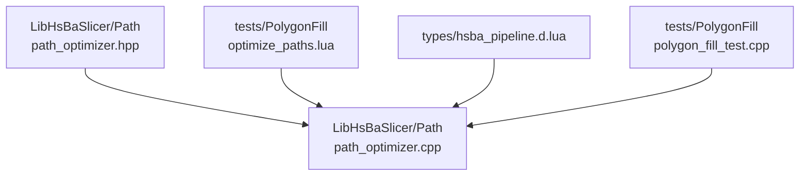
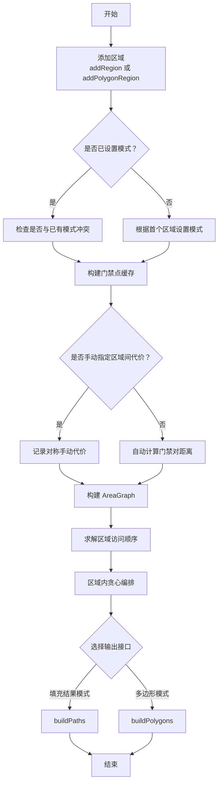
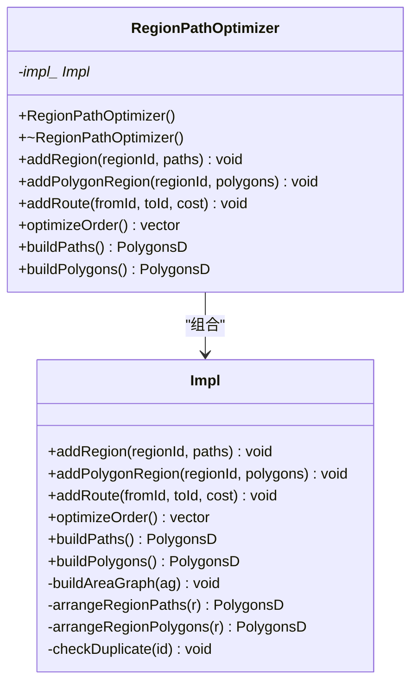
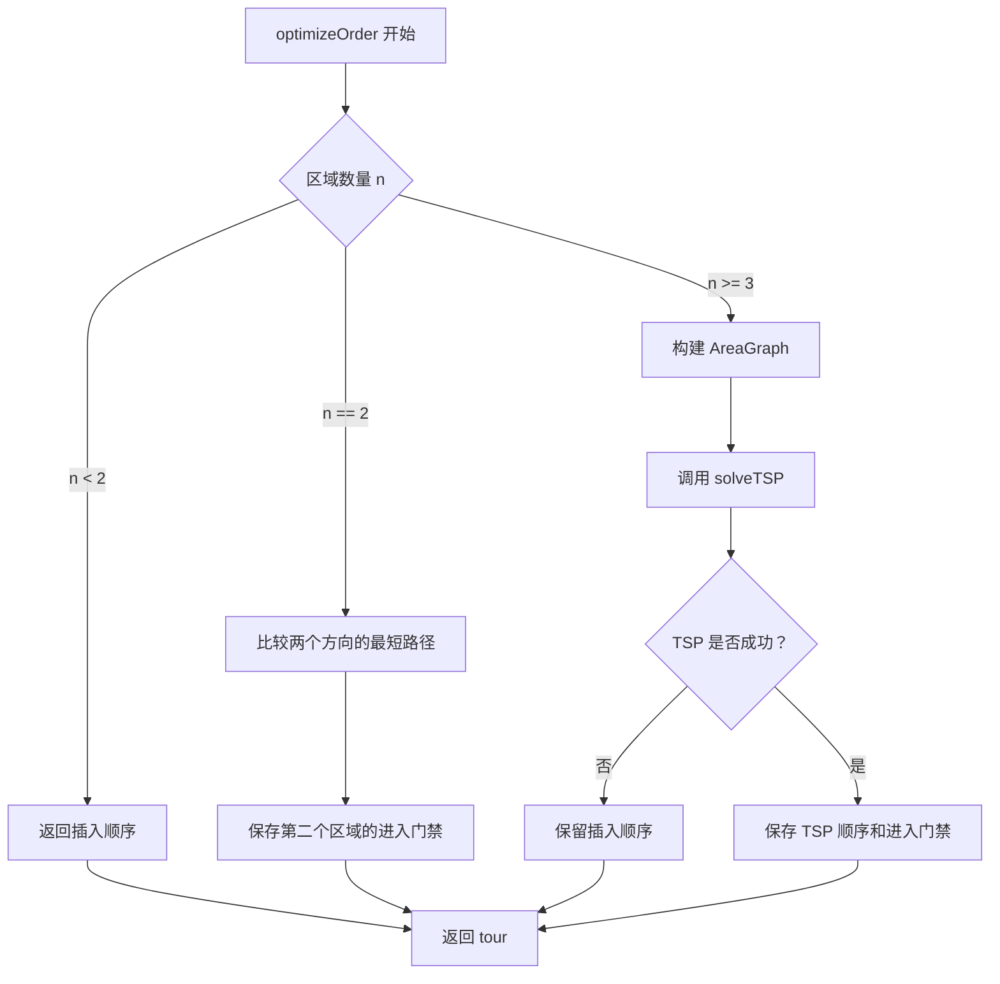
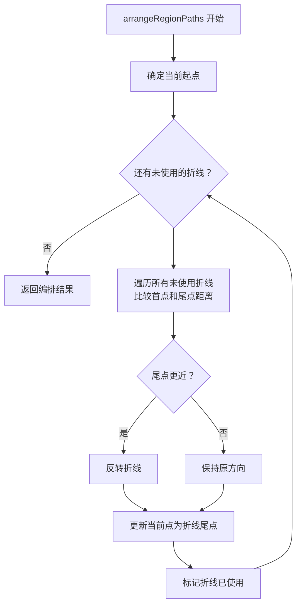
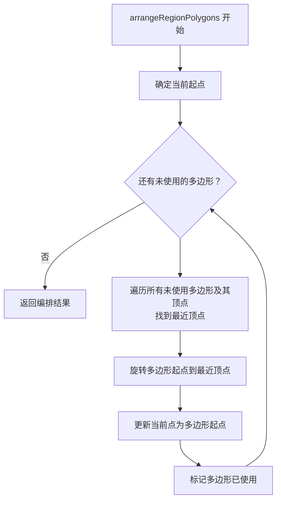
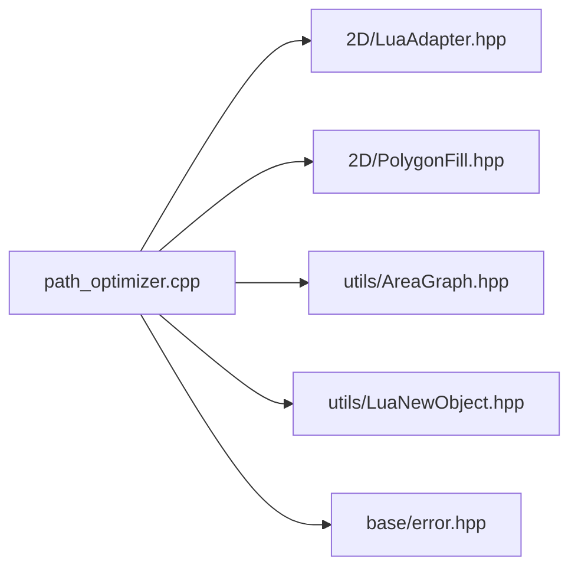

# 路径优化

<cite>
**本文引用的文件**   
- [path_optimizer.hpp](file://LibHsBaSlicer/Path/path_optimizer.hpp)
- [path_optimizer.cpp](file://LibHsBaSlicer/Path/path_optimizer.cpp)
- [optimize_paths.lua](file://tests/PolygonFill/optimize_paths.lua)
- [hsba_pipeline.d.lua](file://types/hsba_pipeline.d.lua)
- [polygon_fill_test.cpp](file://tests/PolygonFill/polygon_fill_test.cpp)
</cite>

## 目录
1. [引言](#引言)
2. [项目结构中的路径优化位置](#项目结构中的路径优化位置)
3. [核心组件与 API](#核心组件与-api)
4. [架构总览](#架构总览)
5. [详细组件分析](#详细组件分析)
6. [依赖关系分析](#依赖关系分析)
7. [性能与复杂度](#性能与复杂度)
8. [使用场景与示例](#使用场景与示例)
9. [Lua 脚本调用方式](#lua-脚本调用方式)
10. [效果评估方法与指标](#效果评估方法与指标)
11. [故障排除](#故障排除)
12. [结论与最佳实践](#结论与最佳实践)

## 引言
路径优化功能用于在路径输出前减少空行程、改善打印或加工顺序。其核心思想是：把相互独立的区域建模为图顶点，求解使区域间空走代价最小的访问顺序；区域内再按贪心策略安排多边形或折线的访问次序和方向，从而降低整体移动距离。

该能力同时提供 C++ 接口和 Lua 脚本嵌入入口，既可用于流水线内部自动优化，也可由用户通过 Lua 脚本自定义策略。

## 项目结构中的路径优化位置
路径优化实现位于 `LibHsBaSlicer/Path` 模块中，对外暴露 `RegionPathOptimizer` 类以及一组 Lua 绑定函数。测试用例位于 `tests/PolygonFill`，并提供一个可直接运行的示例脚本。



**图示来源**
- [path_optimizer.hpp:23-115](file://LibHsBaSlicer/Path/path_optimizer.hpp#L23-L115)
- [path_optimizer.cpp:38-47](file://LibHsBaSlicer/Path/path_optimizer.cpp#L38-L47)
- [optimize_paths.lua:1-33](file://tests/PolygonFill/optimize_paths.lua#L1-L33)
- [hsba_pipeline.d.lua:64-77](file://types/hsba_pipeline.d.lua#L64-L77)
- [polygon_fill_test.cpp:354-374](file://tests/PolygonFill/polygon_fill_test.cpp#L354-L374)

**章节来源**
- [path_optimizer.hpp:23-115](file://LibHsBaSlicer/Path/path_optimizer.hpp#L23-L115)
- [path_optimizer.cpp:38-47](file://LibHsBaSlicer/Path/path_optimizer.cpp#L38-L47)

## 核心组件与 API
路径优化的主要对象是 `RegionPathOptimizer`，它支持两种不可混用的模式：

| 模式 | 输入 | 门禁点 | 输出 | 典型用途 |
|---|---|---|---|---|
| 多边形模式 | 多边形轮廓集合 | 所有多边形顶点 | 优化顺序的多边形集合 | 填充前优化，减少后续填充时的空走 |
| 填充结果模式 | 填充路径（多点折线） | 每条折线的首点和尾点 | 完整填充路径 | 填充后优化，减少打印或加工过程中的空行程 |

### RegionPathOptimizer 关键方法

| 方法 | 说明 |
|---|---|
| `addRegion(regionId, paths)` | 添加填充结果模式的区域，`paths` 是多条多点折线 |
| `addPolygonRegion(regionId, polygons)` | 添加多边形模式的区域，`polygons` 是多边形轮廓集合 |
| `addRoute(fromId, toId, cost)` | 手动覆盖两个区域之间的对称空走代价 |
| `optimizeOrder()` | 计算区域访问顺序，返回区域 ID 序列 |
| `buildPaths()` | 输出填充结果模式下的完整路径序列 |
| `buildPolygons()` | 输出多边形模式下的优化多边形序列 |

这些方法在 Lua 侧也暴露为 `PathOptimize.new()` 创建的实例方法，包括 `addRegion`、`addPolygons`、`addRoute`、`optimizeOrder`、`buildPaths`、`buildPolygons`。

**章节来源**
- [path_optimizer.hpp:52-95](file://LibHsBaSlicer/Path/path_optimizer.hpp#L52-L95)
- [path_optimizer.cpp:446-474](file://LibHsBaSlicer/Path/path_optimizer.cpp#L446-L474)
- [hsba_pipeline.d.lua:64-77](file://types/hsba_pipeline.d.lua#L64-L77)

## 架构总览
路径优化器采用 Pimpl 结构，将具体实现放在 `Impl` 中，对外只暴露稳定接口。核心流程如下：

1. 根据第一个加入的区域决定模式：多边形模式或填充结果模式。
2. 为每个区域构建门禁点缓存。
3. 使用 `AreaGraph` 建立区域图：区域内门禁到门禁的直线距离作为内部成本，区域间门禁对之间的直线距离作为空走成本。
4. 当区域数大于等于 3 时，使用遗传 TSP 求解区域访问顺序；区域数为 2 时直接比较两个方向。
5. 根据区域顺序和进入门禁，分别用贪心策略编排区域内多边形或折线的访问顺序和方向。



**图示来源**
- [path_optimizer.cpp:45-66](file://LibHsBaSlicer/Path/path_optimizer.cpp#L45-L66)
- [path_optimizer.cpp:129-184](file://LibHsBaSlicer/Path/path_optimizer.cpp#L129-L184)
- [path_optimizer.cpp:252-312](file://LibHsBaSlicer/Path/path_optimizer.cpp#L252-L312)
- [path_optimizer.cpp:316-438](file://LibHsBaSlicer/Path/path_optimizer.cpp#L316-L438)

## 详细组件分析

### RegionPathOptimizer 类设计
`RegionPathOptimizer` 使用 `std::unique_ptr<Impl>` 隐藏实现细节，避免头文件耦合 Lua 类型。类的公共接口集中在路径优化生命周期管理上：添加区域、添加手动路线、求解顺序、输出结果。



**图示来源**
- [path_optimizer.hpp:44-100](file://LibHsBaSlicer/Path/path_optimizer.hpp#L44-L100)
- [path_optimizer.cpp:45-66](file://LibHsBaSlicer/Path/path_optimizer.cpp#L45-L66)
- [path_optimizer.cpp:441-474](file://LibHsBaSlicer/Path/path_optimizer.cpp#L441-L474)

**章节来源**
- [path_optimizer.hpp:44-100](file://LibHsBaSlicer/Path/path_optimizer.hpp#L44-L100)
- [path_optimizer.cpp:441-474](file://LibHsBaSlicer/Path/path_optimizer.cpp#L441-L474)

### 区域建模与门禁机制
每个区域维护以下信息：

| 字段 | 含义 |
|---|---|
| `id` | 区域唯一标识 |
| `polygonMode` | 是否为多边形模式 |
| `paths` | 多边形或折线集合 |
| `gates` | 门禁点缓存 |
| `gateOwners` | 多边形模式下门禁对应的多边形索引和顶点索引 |

在多边形模式中，所有多边形顶点都是门禁；在填充结果模式中，每条折线的首点和尾点是门禁。

**章节来源**
- [path_optimizer.cpp:47-58](file://LibHsBaSlicer/Path/path_optimizer.cpp#L47-L58)
- [path_optimizer.cpp:68-120](file://LibHsBaSlicer/Path/path_optimizer.cpp#L68-L120)

### 区域访问顺序求解
区域访问顺序的核心是 `optimizeOrder`：

1. 如果区域数小于 2，直接返回插入顺序。
2. 构建 `AreaGraph`。
3. 如果区域数为 2，直接比较两个方向的入口门禁路径。
4. 如果区域数大于等于 3，调用 `solveTSP` 使用遗传算法求解。
5. 保存区域顺序和每个区域的进入门禁。



**图示来源**
- [path_optimizer.cpp:129-184](file://LibHsBaSlicer/Path/path_optimizer.cpp#L129-L184)

**章节来源**
- [path_optimizer.cpp:129-184](file://LibHsBaSlicer/Path/path_optimizer.cpp#L129-L184)

### 区域内路径编排
#### 填充结果模式：`arrangeRegionPaths`
从进入门禁端点出发，每次选择距离当前点最近的折线端点；如果折线尾点更近，则反转折线方向。这样可减少相邻折线间的跳跃。



**图示来源**
- [path_optimizer.cpp:316-376](file://LibHsBaSlicer/Path/path_optimizer.cpp#L316-L376)

#### 多边形模式：`arrangeRegionPolygons`
从进入门禁顶点出发，每次选择最近顶点对应的多边形，并将该多边形的起点旋转到最近顶点，不改变环绕方向。闭合轮廓完成后回到起点，继续下一个多边形。



**图示来源**
- [path_optimizer.cpp:378-438](file://LibHsBaSlicer/Path/path_optimizer.cpp#L378-L438)

**章节来源**
- [path_optimizer.cpp:316-438](file://LibHsBaSlicer/Path/path_optimizer.cpp#L316-L438)

### Lua 绑定与 PathOptimize 表
Lua 层注册全局表 `PathOptimize`，并提供：

| Lua 接口 | 行为 |
|---|---|
| `PathOptimize.new()` | 创建 `RegionPathOptimizer` 实例 |
| `opt:addRegion(...)` | 添加填充结果模式区域 |
| `opt:addPolygons(...)` | 添加多边形模式区域 |
| `opt:addRoute(...)` | 手动覆盖区域间空走代价 |
| `opt:optimizeOrder()` | 计算区域顺序 |
| `opt:buildPaths()` | 输出完整填充路径 |
| `opt:buildPolygons()` | 输出优化后的多边形集合 |
| `PathOptimize.optimizeRegions(regions)` | 一键填充结果模式优化 |
| `PathOptimize.optimizePolygons(regions)` | 一键多边形模式优化 |

```mermaid
sequenceDiagram
participant Script as "Lua 脚本"
participant Lib as "path_optimizer.cpp"
participant Opt as "RegionPathOptimizer"
participant Graph as "AreaGraph"
Script->>Lib : PathOptimize.new()
Lib-->>Script : 返回优化器实例
Script->>Lib : opt : addRegion(i, paths)
Lib->>Opt : addRegion(...)
Script->>Lib : opt : addRoute(from, to, cost)
Lib->>Opt : addRoute(...)
Script->>Lib : opt : optimizeOrder()
Lib->>Opt : optimizeOrder()
Opt->>Graph : buildAreaGraph()
Opt->>Graph : solveTSP()
Graph-->>Opt : 区域访问顺序
Opt-->>Script : 区域 ID 列表
Script->>Lib : opt : buildPaths()
Lib->>Opt : buildPaths()
Opt-->>Script : 完整填充路径
```

**图示来源**
- [path_optimizer.cpp:477-563](file://LibHsBaSlicer/Path/path_optimizer.cpp#L477-L563)
- [path_optimizer.cpp:565-628](file://LibHsBaSlicer/Path/path_optimizer.cpp#L565-L628)

**章节来源**
- [path_optimizer.cpp:477-563](file://LibHsBaSlicer/Path/path_optimizer.cpp#L477-L563)
- [path_optimizer.cpp:565-628](file://LibHsBaSlicer/Path/path_optimizer.cpp#L565-L628)

## 依赖关系分析
路径优化依赖以下组件：

| 依赖 | 作用 |
|---|---|
| `2D/LuaAdapter.hpp` | Lua 与 `PolygonsD` 之间的数据转换 |
| `2D/PolygonFill.hpp` | 多边形填充相关类型和工具 |
| `utils/AreaGraph.hpp` | 区域图、门禁、最短路径和 TSP 求解 |
| `utils/LuaNewObject.hpp` | Lua userdata 对象创建和垃圾回收 |
| `base/error.hpp` | 运行时错误抛出 |



**图示来源**
- [path_optimizer.cpp:8-22](file://LibHsBaSlicer/Path/path_optimizer.cpp#L8-L22)

**章节来源**
- [path_optimizer.cpp:8-22](file://LibHsBaSlicer/Path/path_optimizer.cpp#L8-L22)

## 性能与复杂度
路径优化包含两个层次的成本计算：

1. **区域内门禁到门禁的距离**：用于描述区域内部的移动成本。
2. **区域间门禁对的直线距离**：用于描述空走成本。

时间复杂度方面：

| 步骤 | 复杂度说明 |
|---|---|
| 构建门禁点 | 与区域数和顶点数线性相关 |
| 构建区域内部成本矩阵 | 与门禁数的平方相关 |
| 构建区域间路由权重 | 与区域数的平方乘以门禁数乘积相关 |
| 贪心编排 | 与区域内路径或多边形数量的平方相关 |
| TSP 求解 | 由 `AreaGraph.solveTSP` 决定，源码注释说明区域数大于等于 3 时使用遗传算法 |

空间复杂度主要由区域数据、门禁缓存、手动路由表和图结构决定。

**章节来源**
- [path_optimizer.cpp:252-312](file://LibHsBaSlicer/Path/path_optimizer.cpp#L252-L312)
- [path_optimizer.cpp:316-438](file://LibHsBaSlicer/Path/path_optimizer.cpp#L316-L438)
- [path_optimizer.hpp:37-42](file://LibHsBaSlicer/Path/path_optimizer.hpp#L37-L42)

## 使用场景与示例

### 减少空行程
当模型被切分为多个独立区域时，打印机或加工设备需要在区域之间空走。路径优化通过最小化区域间空走距离来减少这种无效移动。

典型流程：
1. 将每层切片得到的独立区域作为输入。
2. 使用 `PathOptimize.optimizeRegions` 或 `PathOptimize.optimizePolygons` 进行优化。
3. 将优化后的顺序交给填充或路径输出阶段。

**章节来源**
- [path_optimizer.hpp:23-42](file://LibHsBaSlicer/Path/path_optimizer.hpp#L23-L42)
- [path_optimizer.cpp:565-628](file://LibHsBaSlicer/Path/path_optimizer.cpp#L565-L628)

### 优化打印顺序
在填充结果模式下，优化器不仅调整区域顺序，还会调整区域内折线的访问顺序和方向。例如，当某条折线的尾点更接近上一条折线的终点时，会反转该折线以减少跳变。

测试用例验证了单区域路径反转行为：第一条路径正向，第二条路径因尾点更近而被反转。

**章节来源**
- [polygon_fill_test.cpp:354-374](file://tests/PolygonFill/polygon_fill_test.cpp#L354-L374)
- [path_optimizer.cpp:316-376](file://LibHsBaSlicer/Path/path_optimizer.cpp#L316-L376)

### 手动覆盖区域间代价
某些工艺场景中，用户可能希望强制跳过某个区域或优先访问某个区域。此时可通过 `addRoute` 手动设置两个区域之间的对称空走代价。

测试用例展示了添加手动路线后仍能正常求解区域顺序并输出完整路径。

**章节来源**
- [polygon_fill_test.cpp:376-385](file://tests/PolygonFill/polygon_fill_test.cpp#L376-L385)
- [path_optimizer.cpp:122-127](file://LibHsBaSlicer/Path/path_optimizer.cpp#L122-L127)

## Lua 脚本调用方式

### 使用 PathOptimize 全局表
Lua 环境中注册了 `PathOptimize` 表，可以直接调用一键优化函数：

| 函数 | 输入 | 输出 |
|---|---|---|
| `PathOptimize.optimizeRegions(regions)` | 区域数组，每个区域是折线数组 | 完整填充路径数组 |
| `PathOptimize.optimizePolygons(regions)` | 区域数组，每个区域是多边形数组 | 优化顺序的多边形数组 |

`regions` 的结构为：区域数组 → 折线或多边形数组 → `{x=.., y=..}` 点数组。

### 使用 PathOptimize 实例
需要自定义策略时，可以创建实例并逐步配置：

```lua
local opt = PathOptimize.new()
for i, paths in ipairs(regions) do
    opt:addRegion(i, paths)
end
local order = opt:optimizeOrder()
return opt:buildPaths()
```

多边形模式对应 `addPolygons` 和 `buildPolygons`。

### 示例脚本
仓库提供的示例脚本定义了三个函数：

| 函数名 | 模式 | 行为 |
|---|---|---|
| `optimize_paths` | 填充结果模式 | 调用 `PathOptimize.optimizeRegions` |
| `optimize_paths_manual` | 填充结果模式 | 手动构建优化器，可覆盖区域间代价 |
| `optimize_polygons` | 多边形模式 | 调用 `PathOptimize.optimizePolygons` |

**章节来源**
- [optimize_paths.lua:1-33](file://tests/PolygonFill/optimize_paths.lua#L1-L33)
- [path_optimizer.cpp:477-628](file://LibHsBaSlicer/Path/path_optimizer.cpp#L477-L628)
- [hsba_pipeline.d.lua:64-77](file://types/hsba_pipeline.d.lua#L64-L77)

## 效果评估方法与指标
可以从以下几个维度评估路径优化效果：

| 指标 | 含义 | 评估方式 |
|---|---|---|
| 空走总距离 | 区域间和区域内非打印移动的累计距离 | 比较优化前后路径端点之间的欧氏距离之和 |
| 区域访问顺序稳定性 | 相同输入下是否得到一致顺序 | 多次运行对比返回的 `optimizeOrder` 结果 |
| 路径连续性 | 相邻路径或折线之间的跳跃是否减少 | 检查 `buildPaths` 输出的相邻端点距离分布 |
| 方向合理性 | 折线反转和多边形旋转是否符合预期 | 结合测试断言和可视化检查 |
| 性能开销 | 优化过程耗时和内存占用 | 对大规模区域集合进行基准测试 |

实际项目中建议：

1. 对同一组区域运行优化前后两次路径生成。
2. 统计空走距离、平均跳跃距离、最大跳跃距离。
3. 对关键工艺场景录制优化前后的 G-code 或机器人程序，进行长度和时长对比。
4. 对遗传 TSP 的结果做多次采样，观察收敛稳定性。

[本节为通用评估指导，不直接分析具体代码文件]

## 故障排除

### 在同一优化器中混用两种模式
如果在同一个 `RegionPathOptimizer` 中先添加 `addRegion`，再添加 `addPolygonRegion`，或反过来，会抛出运行时错误。

**章节来源**
- [path_optimizer.cpp:68-120](file://LibHsBaSlicer/Path/path_optimizer.cpp#L68-L120)

### 调用错误的输出接口
- 在填充结果模式下调用 `buildPolygons` 会报错。
- 在多边形模式下调用 `buildPaths` 会报错。

**章节来源**
- [path_optimizer.cpp:187-234](file://LibHsBaSlicer/Path/path_optimizer.cpp#L187-L234)

### 区域 ID 重复
重复添加相同 `regionId` 会抛出“区域已存在”的错误。

**章节来源**
- [path_optimizer.cpp:241-248](file://LibHsBaSlicer/Path/path_optimizer.cpp#L241-L248)

### Lua 脚本找不到函数或返回值格式错误
当 Lua 脚本中没有定义期望的函数名，或者函数没有返回表格时，会抛出运行时错误。

**章节来源**
- [path_optimizer.cpp:660-681](file://LibHsBaSlicer/Path/path_optimizer.cpp#L660-L681)

## 结论与最佳实践
路径优化通过区域级 TSP 和区域内贪心编排，有效减少空行程和路径跳变。推荐的最佳实践包括：

1. **明确模式**：在填充前使用多边形模式，在填充后使用填充结果模式，不要混用。
2. **合理划分区域**：将物理上独立的轮廓或填充块作为不同区域，有助于优化器发现更优的空走路径。
3. **谨慎使用手动代价**：仅在已知工艺约束下覆盖区域间代价，避免破坏自动优化效果。
4. **结合测试验证**：参考现有单元测试，验证路径反转、区域顺序和连续性的正确性。
5. **在 Lua 中封装策略**：通过 `PathOptimize.optimizeRegions` 和 `PathOptimize.optimizePolygons` 提供默认策略，再通过实例接口扩展自定义逻辑。

[本节为总结性内容，不直接分析具体代码文件]