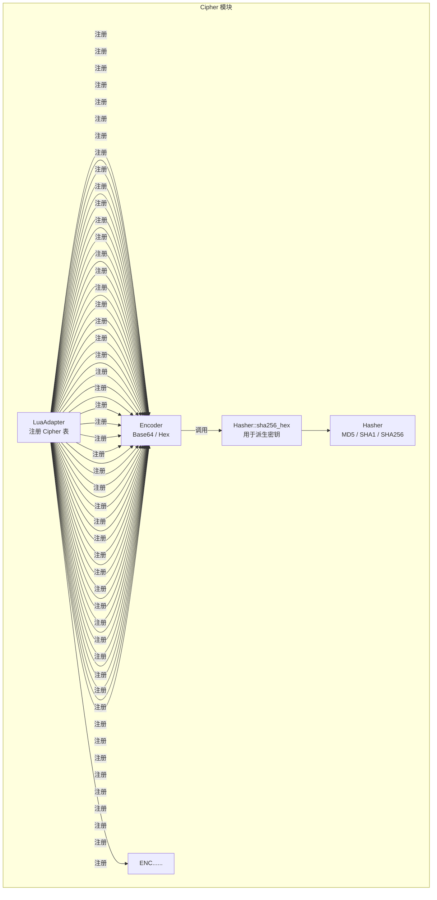
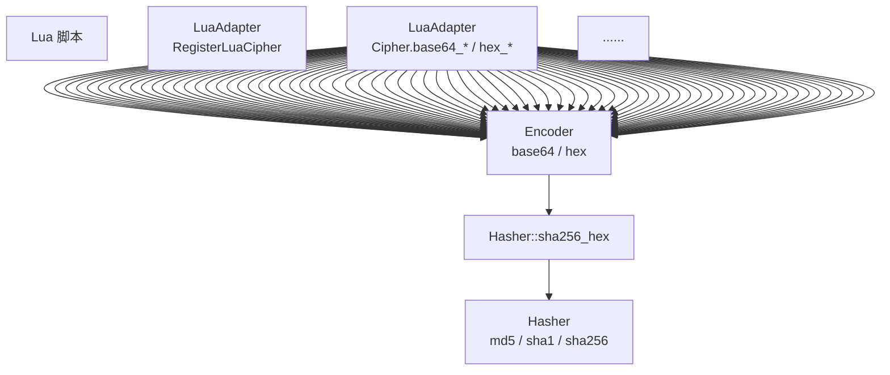
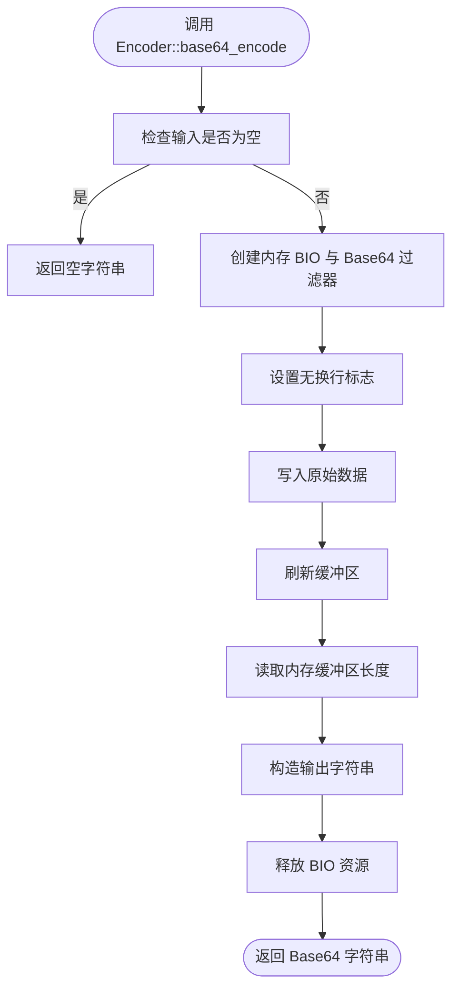
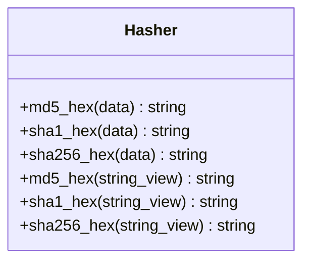
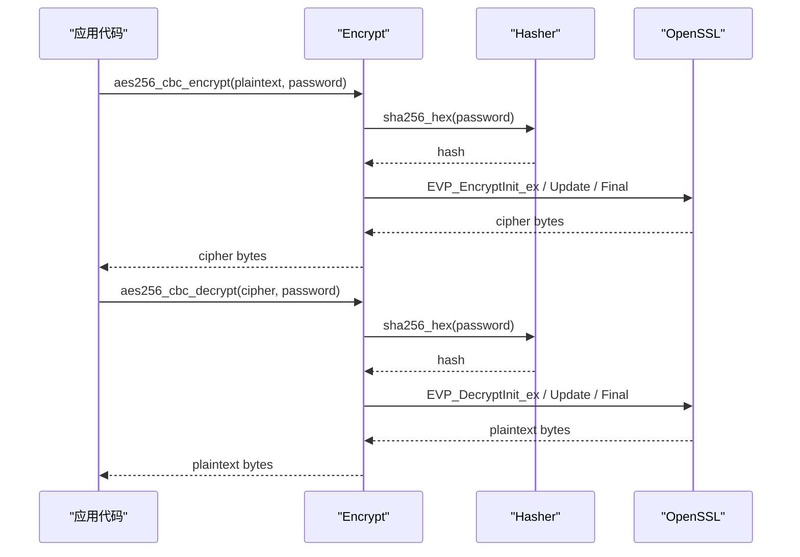
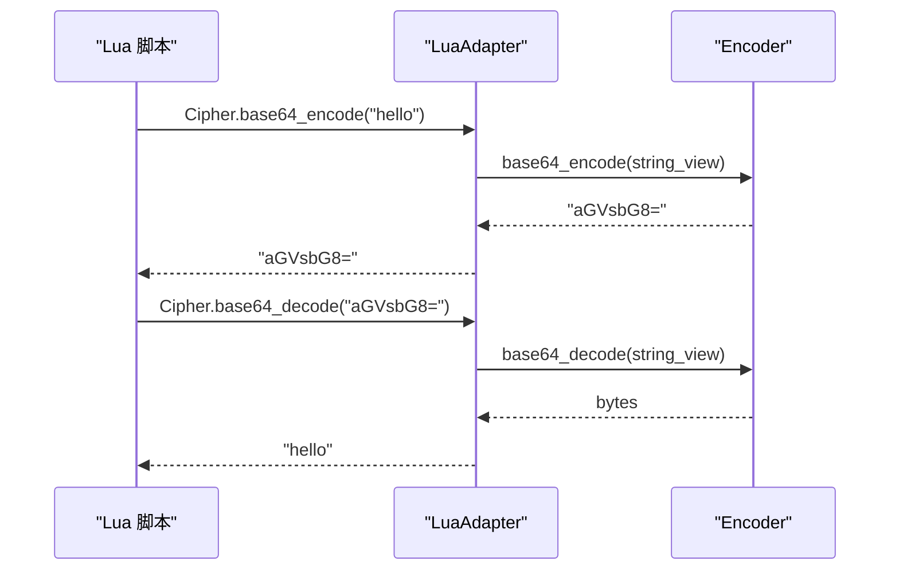
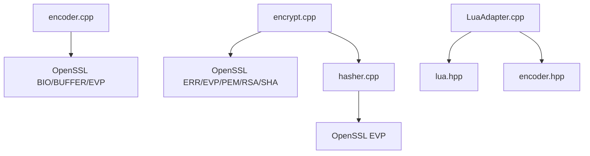

# 加密编码工具

<cite>
**本文引用的文件**   
- [encoder.hpp](file://cipher/encoder.hpp)
- [encoder.cpp](file://cipher/encoder.cpp)
- [hasher.hpp](file://cipher/hasher.hpp)
- [hasher.cpp](file://cipher/hasher.cpp)
- [encrypt.hpp](file://cipher/encrypt.hpp)
- [encrypt.cpp](file://cipher/encrypt.cpp)
- [LuaAdapter.hpp](file://cipher/LuaAdapter.hpp)
- [LuaAdapter.cpp](file://cipher/LuaAdapter.cpp)
- [cipher_test.cpp](file://tests/Cipher/cipher_test.cpp)
- [cipher_lua_adapter_test.cpp](file://tests/Cipher/cipher_lua_adapter_test.cpp)
</cite>

## 目录
1. [简介](#简介)
2. [项目结构](#项目结构)
3. [核心组件](#核心组件)
4. [架构总览](#架构总览)
5. [详细组件分析](#详细组件分析)
6. [依赖关系分析](#依赖关系分析)
7. [性能与安全性考虑](#性能与安全性考虑)
8. [使用示例](#使用示例)
9. [故障排除](#故障排除)
10. [结论](#结论)

## 简介
本文件面向 HsBaSlicer 的加密编码工具模块，聚焦以下目标：
- 记录 Cipher 命名空间下的 Encoder、Hasher、Encrypt 三个核心类。
- 说明 base64_encode、base64_decode、hex_encode、hex_decode 的行为、输入输出与错误处理。
- 解释哈希算法 MD5、SHA1、SHA256 的使用方式与适用场景。
- 提供数据加密、签名验证、安全传输的完整流程示例。
- 对比 Base64 与十六进制编码的特点与兼容性。
- 给出安全最佳实践与性能优化建议。

该模块基于 OpenSSL 实现，对外暴露 C++ API，并通过 Lua 适配器向脚本层暴露基础编码能力。

## 项目结构
Cipher 模块位于仓库根目录的 cipher 子目录中，主要文件如下：
- encoder.hpp / encoder.cpp：Base64 与十六进制编解码。
- hasher.hpp / hasher.cpp：MD5、SHA1、SHA256 哈希计算。
- encrypt.hpp / encrypt.cpp：对称加密 AES/3DES、非对称加密 RSA。
- LuaAdapter.hpp / LuaAdapter.cpp：将基础编码函数暴露给 Lua。
- tests/Cipher：单元测试覆盖编解码、加解密、RSA 密钥生成与 PEM 校验等。

**图表来源**
- [LuaAdapter.cpp:85-96](file://cipher/LuaAdapter.cpp#L85-L96)
- [encoder.hpp:14-52](file://cipher/encoder.hpp#L14-L52)
- [hasher.hpp:14-39](file://cipher/hasher.hpp#L14-L39)
- [encrypt.hpp:18-76](file://cipher/encrypt.hpp#L18-L76)

**章节来源**
- [encoder.hpp:1-55](file://cipher/encoder.hpp#L1-L55)
- [encoder.cpp:1-143](file://cipher/encoder.cpp#L1-L143)
- [hasher.hpp:1-42](file://cipher/hasher.hpp#L1-L42)
- [hasher.cpp:1-77](file://cipher/hasher.cpp#L1-L77)
- [encrypt.hpp:1-79](file://cipher/encrypt.hpp#L1-L79)
- [encrypt.cpp:1-661](file://cipher/encrypt.cpp#L1-L661)
- [LuaAdapter.hpp:1-18](file://cipher/LuaAdapter.hpp#L1-L18)
- [LuaAdapter.cpp:1-98](file://cipher/LuaAdapter.cpp#L1-L98)

## 核心组件
Cipher 模块由三个无状态工具类组成：
- Encoder：提供 Base64 与十六进制编码/解码。
- Hasher：提供 MD5、SHA1、SHA256 哈希，返回十六进制摘要。
- Encrypt：提供 AES-256、3DES、RSA 加密解密，支持密码派生密钥或显式 IV，以及 PEM 密钥对生成。

这些类均位于 HsBa::Slicer::Cipher 命名空间下，API 以静态方法暴露，便于在 C++ 与 Lua 脚本中调用。

**章节来源**
- [encoder.hpp:14-52](file://cipher/encoder.hpp#L14-L52)
- [hasher.hpp:14-39](file://cipher/hasher.hpp#L14-L39)
- [encrypt.hpp:18-76](file://cipher/encrypt.hpp#L18-L76)

## 架构总览
Cipher 模块的调用关系如下：
- LuaAdapter 将 Cipher.base64_encode、Cipher.base64_decode、Cipher.hex_encode、Cipher.hex_decode 注册到全局 Cipher 表。
- Encoder 使用 OpenSSL BIO 实现 Base64，使用自实现逻辑实现十六进制编解码。
- Hasher 使用 OpenSSL EVP 接口计算 MD5、SHA1、SHA256。
- Encrypt 使用 OpenSSL EVP/PEM/RSA 接口实现对称与非对称加密；其内部通过 Hasher::sha256_hex 从密码派生密钥和 IV。

**图表来源**
- [LuaAdapter.cpp:13-96](file://cipher/LuaAdapter.cpp#L13-L96)
- [encoder.cpp:44-142](file://cipher/encoder.cpp#L44-L142)
- [hasher.cpp:34-76](file://cipher/hasher.cpp#L34-L76)
- [encrypt.cpp:24-45](file://cipher/encrypt.cpp#L24-L45)

## 详细组件分析

### Encoder：Base64 与十六进制编解码
Encoder 提供以下核心方法：
- base64_encode：将字节序列编码为 Base64 字符串。
- base64_decode：将 Base64 字符串解码为字节序列。
- hex_encode：将字节序列编码为小写十六进制字符串。
- hex_decode：将十六进制字符串解码为字节序列。
- 同时提供 string_view 重载与 *_to_string 便捷方法。

实现要点：
- Base64 使用 OpenSSL BIO 接口，关闭换行符输出，确保结果紧凑。
- 十六进制编码采用查表方式生成小写字母；解码时校验字符范围并抛出异常。
- 空输入在 Base64 编码中返回空串；十六进制解码要求长度为偶数。

**图表来源**
- [encoder.cpp:44-86](file://cipher/encoder.cpp#L44-L86)

**章节来源**
- [encoder.hpp:14-52](file://cipher/encoder.hpp#L14-L52)
- [encoder.cpp:44-142](file://cipher/encoder.cpp#L44-L142)
- [cipher_test.cpp:68-80](file://tests/Cipher/cipher_test.cpp#L68-L80)
- [cipher_lua_adapter_test.cpp:66-127](file://tests/Cipher/cipher_lua_adapter_test.cpp#L66-L127)

### Hasher：MD5、SHA1、SHA256 哈希
Hasher 提供静态方法计算 MD5、SHA1、SHA256 的十六进制摘要：
- md5_hex：适用于快速校验与兼容性场景，但不推荐用于密码或安全敏感用途。
- sha1_hex：历史兼容常用，但已不推荐用于安全场景。
- sha256_hex：当前推荐的安全哈希算法，广泛用于密钥派生、完整性校验等。

实现要点：
- 使用 EVP_MD_CTX 初始化、更新、最终化流程。
- 内部 to_hex 函数将二进制摘要转换为小写十六进制字符串。
- 所有失败路径抛出 RuntimeError。

**图表来源**
- [hasher.hpp:14-39](file://cipher/hasher.hpp#L14-L39)
- [hasher.cpp:34-76](file://cipher/hasher.cpp#L34-L76)

**章节来源**
- [hasher.hpp:1-42](file://cipher/hasher.hpp#L1-L42)
- [hasher.cpp:1-77](file://cipher/hasher.cpp#L1-L77)
- [cipher_test.cpp:194-199](file://tests/Cipher/cipher_test.cpp#L194-L199)

### Encrypt：对称与非对称加密
Encrypt 提供三类能力：
- AES-256：支持 CBC 模式（含密码派生 IV）与 ECB 模式（无 IV），以及显式 IV 版本。
- 3DES：支持 ECB 与 CBC（含显式 IV）。
- RSA：基于 PEM 公钥/私钥进行 OAEP 填充的加密与解密，并提供密钥对生成。

关键常量：
- AES_KEY_SIZE = 32 字节（AES-256）。
- AES_IV_SIZE = 16 字节（AES-CBC）。
- DES3_KEY_SIZE = 24 字节（3DES）。
- DES3_IV_SIZE = 8 字节（3DES-CBC）。
- RSA_DEFAULT_BITS = 2048 位。

密钥派生：
- AES/3DES 通过 SHA256 从密码派生固定长度的 key 与 iv。
- 显式 IV 版本会校验 IV 长度并在失败时抛出 std::invalid_argument。

RSA：
- 使用 PEM 格式公钥/私钥，OAEP 填充。
- rsa_generate_keypair_pem 返回 {public_pem, private_pem}。
- 错误路径抛出 RuntimeError。

**图表来源**
- [encrypt.cpp:24-45](file://cipher/encrypt.cpp#L24-L45)
- [encrypt.cpp:60-98](file://cipher/encrypt.cpp#L60-L98)
- [encrypt.cpp:100-138](file://cipher/encrypt.cpp#L100-L138)
- [hasher.cpp:34-76](file://cipher/hasher.cpp#L34-L76)

**章节来源**
- [encrypt.hpp:12-76](file://cipher/encrypt.hpp#L12-L76)
- [encrypt.cpp:24-661](file://cipher/encrypt.cpp#L24-L661)
- [cipher_test.cpp:82-143](file://tests/Cipher/cipher_test.cpp#L82-L143)

### LuaAdapter：脚本层基础编码绑定
LuaAdapter 将 Cipher.base64_encode、Cipher.base64_decode、Cipher.hex_encode、Cipher.hex_decode 暴露给 Lua 全局表 Cipher：
- 参数类型：Lua 字符串。
- 返回值：Lua 字符串。
- 错误处理：捕获 C++ 异常并通过 lua_error 返回错误消息。
- 注册入口：RegisterLuaCipher(L)。

**图表来源**
- [LuaAdapter.cpp:13-96](file://cipher/LuaAdapter.cpp#L13-L96)

**章节来源**
- [LuaAdapter.hpp:1-18](file://cipher/LuaAdapter.hpp#L1-L18)
- [LuaAdapter.cpp:1-98](file://cipher/LuaAdapter.cpp#L1-L98)
- [cipher_lua_adapter_test.cpp:66-127](file://tests/Cipher/cipher_lua_adapter_test.cpp#L66-L127)

## 依赖关系分析
Cipher 模块的内部依赖如下：
- encoder.cpp 依赖 OpenSSL BIO/BUFFER/EVP 头文件。
- hasher.cpp 依赖 OpenSSL EVP 头文件。
- encrypt.cpp 依赖 OpenSSL ERR/EVP/PEM/RSA/SHA 头文件，并包含 hasher.hpp 以复用 sha256_hex。
- LuaAdapter.cpp 依赖 lua.hpp 与 encoder.hpp。

**图表来源**
- [encoder.cpp:7-14](file://cipher/encoder.cpp#L7-L14)
- [hasher.cpp:7-14](file://cipher/hasher.cpp#L7-L14)
- [encrypt.cpp:7-17](file://cipher/encrypt.cpp#L7-L17)
- [LuaAdapter.cpp:5-7](file://cipher/LuaAdapter.cpp#L5-L7)

**章节来源**
- [encoder.cpp:1-143](file://cipher/encoder.cpp#L1-L143)
- [hasher.cpp:1-77](file://cipher/hasher.cpp#L1-L77)
- [encrypt.cpp:1-661](file://cipher/encrypt.cpp#L1-L661)
- [LuaAdapter.cpp:1-98](file://cipher/LuaAdapter.cpp#L1-L98)

## 性能与安全性考虑
- 编解码性能：
  - Base64 使用 OpenSSL BIO，适合大文本传输；避免换行可减小体积。
  - 十六进制编码为纯 CPU 操作，适合调试与存储，但体积翻倍。
- 哈希性能：
  - MD5 最快，但安全性弱；SHA1 次之；SHA256 更安全且广泛支持。
- 加密性能：
  - AES-256 比 3DES 更快且更安全；CBC 模式需随机 IV。
  - RSA 仅适合小数据（如密钥封装），不适合直接加密大文件。
- 安全性建议：
  - 优先使用 AES-256-CBC 或更现代模式（如 GCM），并确保 IV 随机且唯一。
  - 避免使用 ECB 模式；避免使用 MD5/SHA1 作为安全哈希。
  - RSA 使用 OAEP 填充；密钥长度至少 2048 位。
  - 密码派生建议使用标准 KDF（如 PBKDF2、scrypt、Argon2），当前实现为简化方案。

[本节为通用指导，不直接分析具体源码文件]

## 使用示例

### 数据编码与解码
- Base64：
  - 编码：使用 Encoder::base64_encode 将字节或字符串转为 Base64。
  - 解码：使用 Encoder::base64_decode 将 Base64 转回字节。
- 十六进制：
  - 编码：使用 Encoder::hex_encode 将字节转为小写十六进制字符串。
  - 解码：使用 Encoder::hex_decode 将十六进制字符串转回字节。

参考测试用例：
- [cipher_test.cpp:68-80](file://tests/Cipher/cipher_test.cpp#L68-L80)
- [cipher_lua_adapter_test.cpp:66-127](file://tests/Cipher/cipher_lua_adapter_test.cpp#L66-L127)

**章节来源**
- [encoder.hpp:14-52](file://cipher/encoder.hpp#L14-L52)
- [encoder.cpp:44-142](file://cipher/encoder.cpp#L44-L142)
- [cipher_test.cpp:68-80](file://tests/Cipher/cipher_test.cpp#L68-L80)
- [cipher_lua_adapter_test.cpp:66-127](file://tests/Cipher/cipher_lua_adapter_test.cpp#L66-L127)

### 哈希计算与完整性校验
- 使用 Hasher::sha256_hex 计算数据摘要，用于完整性校验或密钥派生。
- 可使用 Hasher::md5_hex 或 Hasher::sha1_hex 做历史兼容，但不推荐用于安全场景。

参考测试用例：
- [cipher_test.cpp:194-199](file://tests/Cipher/cipher_test.cpp#L194-L199)

**章节来源**
- [hasher.hpp:14-39](file://cipher/hasher.hpp#L14-L39)
- [hasher.cpp:34-76](file://cipher/hasher.cpp#L34-L76)
- [cipher_test.cpp:194-199](file://tests/Cipher/cipher_test.cpp#L194-L199)

### 数据加密与解密
- AES-256-CBC（密码派生 IV）：
  - 加密：Encrypt::aes256_cbc_encrypt(plaintext, password)
  - 解密：Encrypt::aes256_cbc_decrypt(cipher, password)
- AES-256-CBC（显式 IV）：
  - 加密：Encrypt::aes256_cbc_encrypt_with_iv(plaintext, password, iv)
  - 解密：Encrypt::aes256_cbc_decrypt_with_iv(cipher, password, iv)
- 3DES：
  - ECB：Encrypt::des3_ecb_encrypt / des3_ecb_decrypt
  - CBC（显式 IV）：Encrypt::des3_cbc_encrypt_with_iv / des3_cbc_decrypt_with_iv

参考测试用例：
- [cipher_test.cpp:82-114](file://tests/Cipher/cipher_test.cpp#L82-L114)
- [cipher_test.cpp:145-164](file://tests/Cipher/cipher_test.cpp#L145-L164)
- [cipher_test.cpp:166-182](file://tests/Cipher/cipher_test.cpp#L166-L182)

**章节来源**
- [encrypt.hpp:28-65](file://cipher/encrypt.hpp#L28-L65)
- [encrypt.cpp:60-482](file://cipher/encrypt.cpp#L60-L482)
- [cipher_test.cpp:82-182](file://tests/Cipher/cipher_test.cpp#L82-L182)

### RSA 非对称加密与密钥对生成
- 生成密钥对：Encrypt::rsa_generate_keypair_pem(bits)
- 公钥加密：Encrypt::rsa_public_encrypt_pem(public_pem, plaintext)
- 私钥解密：Encrypt::rsa_private_decrypt_pem(private_pem, cipher)

参考测试用例：
- [cipher_test.cpp:116-143](file://tests/Cipher/cipher_test.cpp#L116-L143)
- [cipher_test.cpp:184-192](file://tests/Cipher/cipher_test.cpp#L184-L192)

**章节来源**
- [encrypt.hpp:67-76](file://cipher/encrypt.hpp#L67-L76)
- [encrypt.cpp:484-661](file://cipher/encrypt.cpp#L484-L661)
- [cipher_test.cpp:116-192](file://tests/Cipher/cipher_test.cpp#L116-L192)

### 签名验证与安全传输完整流程
说明：本仓库未提供数字签名 API；签名通常由外部库或上层业务实现。以下为概念性流程，结合现有工具完成“数据完整性校验 + 加密传输”：
- 客户端：
  - 对明文计算 SHA256 摘要。
  - 使用接收方公钥加密会话密钥（RSA）。
  - 使用会话密钥加密数据（AES-256-CBC）。
  - 发送 {RSA 加密的会话密钥, AES 密文, SHA256 摘要}。
- 服务端：
  - 使用私钥解密会话密钥。
  - 使用会话密钥解密数据。
  - 重新计算 SHA256 并与收到的摘要比对。

该流程为概念设计，实际签名应使用专用签名库；本仓库仅提供哈希与加解密工具。

[本节为概念性说明，不直接分析具体源码文件]

## 故障排除
常见问题与定位方法：
- Base64 解码失败：
  - 可能原因：输入不是合法 Base64 字符串。
  - 行为：抛出 RuntimeError。
  - 参考：[encoder.cpp:88-112](file://cipher/encoder.cpp#L88-L112)
- 十六进制解码失败：
  - 可能原因：输入长度为奇数或包含非法十六进制字符。
  - 行为：抛出 std::invalid_argument 或 InvalidArgumentError。
  - 参考：[encoder.cpp:127-142](file://cipher/encoder.cpp#L127-L142)
- AES/3DES 解密失败：
  - 可能原因：密码错误或数据损坏。
  - 行为：抛出 RuntimeError，提示 likely bad password or corrupted data。
  - 参考：[encrypt.cpp:128-133](file://cipher/encrypt.cpp#L128-L133)、[encrypt.cpp:208-213](file://cipher/encrypt.cpp#L208-L213)、[encrypt.cpp:300-305](file://cipher/encrypt.cpp#L300-L305)、[encrypt.cpp:472-477](file://cipher/encrypt.cpp#L472-L477)
- IV 长度不匹配：
  - 可能原因：传入 IV 长度不符合算法要求（AES 16 字节，3DES 8 字节）。
  - 行为：抛出 std::invalid_argument。
  - 参考：[encrypt.cpp:224-227](file://cipher/encrypt.cpp#L224-L227)、[encrypt.cpp:396-399](file://cipher/encrypt.cpp#L396-L399)、[cipher_test.cpp:166-182](file://tests/Cipher/cipher_test.cpp#L166-L182)
- RSA PEM 无效：
  - 可能原因：PEM 格式错误或内容损坏。
  - 行为：抛出 RuntimeError。
  - 参考：[encrypt.cpp:492-497](file://cipher/encrypt.cpp#L492-L497)、[encrypt.cpp:616-621](file://cipher/encrypt.cpp#L616-L621)、[cipher_test.cpp:184-192](file://tests/Cipher/cipher_test.cpp#L184-L192)
- Lua 脚本调用失败：
  - 可能原因：C++ 侧抛出异常，LuaAdapter 捕获后通过 lua_error 返回。
  - 行为：pcall 返回 false，可通过 lua_tostring 获取错误消息。
  - 参考：[LuaAdapter.cpp:17-28](file://cipher/LuaAdapter.cpp#L17-L28)、[cipher_lua_adapter_test.cpp:96-108](file://tests/Cipher/cipher_lua_adapter_test.cpp#L96-L108)

**章节来源**
- [encoder.cpp:88-142](file://cipher/encoder.cpp#L88-L142)
- [encrypt.cpp:128-133](file://cipher/encrypt.cpp#L128-L133)
- [encrypt.cpp:208-213](file://cipher/encrypt.cpp#L208-L213)
- [encrypt.cpp:224-227](file://cipher/encrypt.cpp#L224-L227)
- [encrypt.cpp:300-305](file://cipher/encrypt.cpp#L300-L305)
- [encrypt.cpp:396-399](file://cipher/encrypt.cpp#L396-L399)
- [encrypt.cpp:472-477](file://cipher/encrypt.cpp#L472-L477)
- [encrypt.cpp:492-497](file://cipher/encrypt.cpp#L492-L497)
- [encrypt.cpp:616-621](file://cipher/encrypt.cpp#L616-L621)
- [cipher_test.cpp:166-192](file://tests/Cipher/cipher_test.cpp#L166-L192)
- [LuaAdapter.cpp:17-28](file://cipher/LuaAdapter.cpp#L17-L28)
- [cipher_lua_adapter_test.cpp:96-108](file://tests/Cipher/cipher_lua_adapter_test.cpp#L96-L108)

## 结论
HsBaSlicer 的 Cipher 模块提供了实用的编码、哈希与加密工具：
- Encoder 支持 Base64 与十六进制编解码，适合数据传输与调试。
- Hasher 提供 MD5、SHA1、SHA256，推荐使用 SHA256 进行完整性校验与密钥派生。
- Encrypt 支持 AES-256、3DES、RSA，便于构建安全传输流程；注意选择合适模式与参数。
- LuaAdapter 将基础编码能力暴露给脚本层，便于快速集成。

在实际工程中，请遵循安全最佳实践：
- 优先使用 AES-256-CBC 或更现代模式，并确保 IV 随机且唯一。
- 避免使用 MD5/SHA1 作为安全哈希；避免 ECB 模式。
- RSA 仅用于小数据或密钥封装，并使用足够长的密钥。
- 对于密码派生，建议升级为标准 KDF。

[本节为总结性内容，不直接分析具体源码文件]