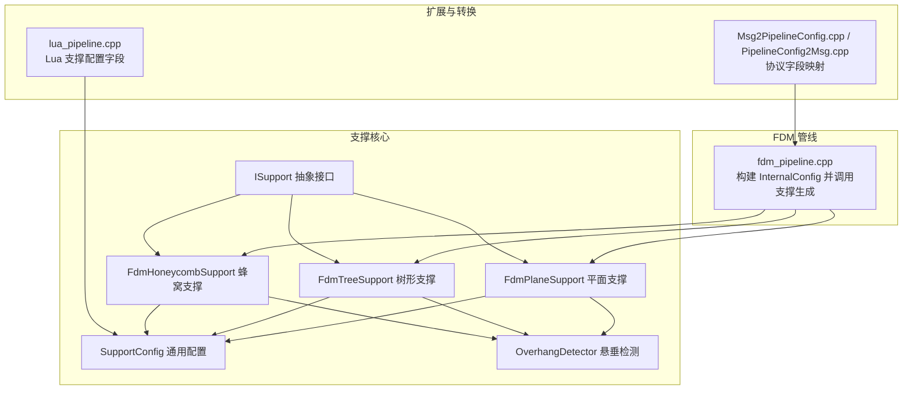
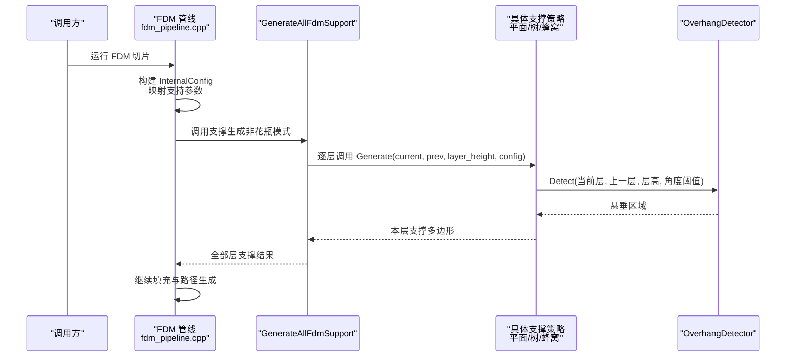
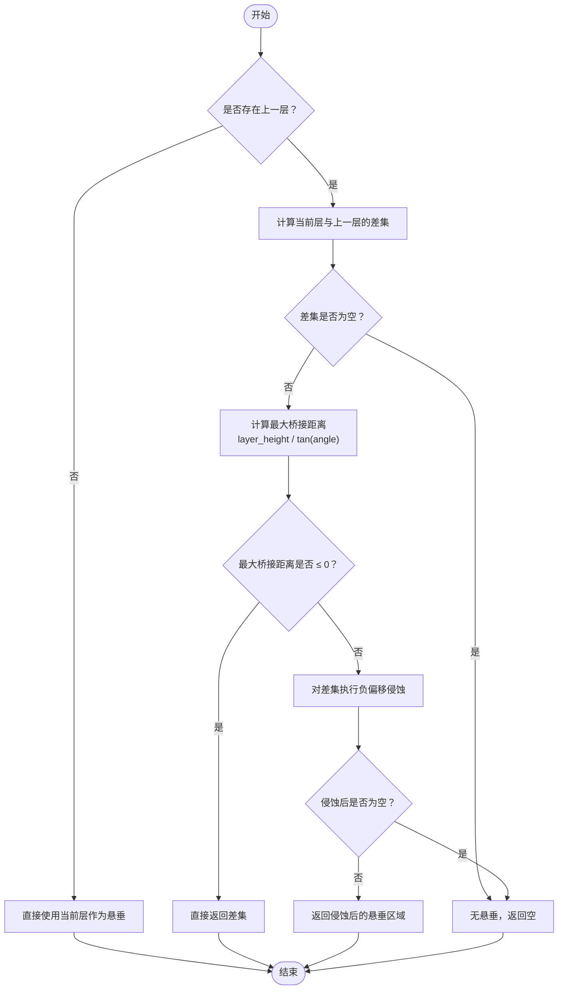
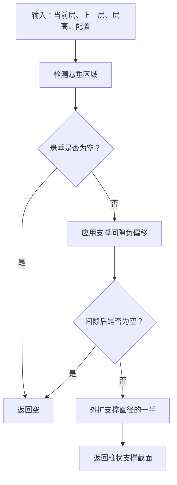
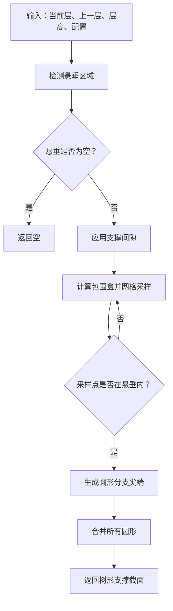
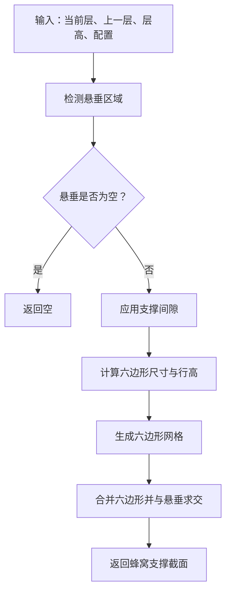
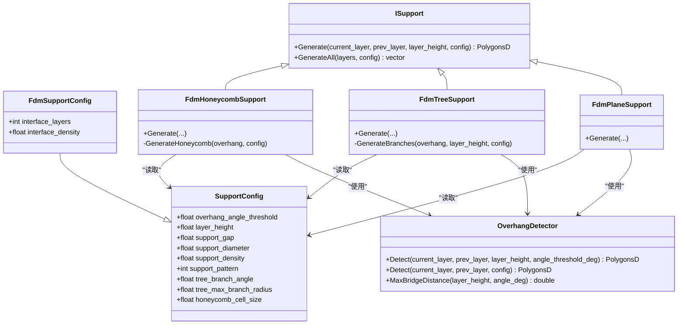
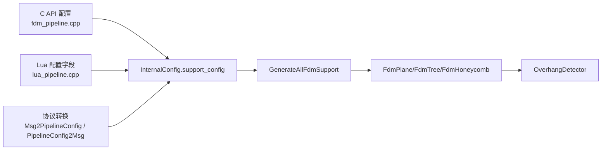

# FDM 支撑生成

<cite>
**本文引用的文件**   
- [FdmSupport.hpp](file://support/FdmSupport.hpp)
- [FdmSupport.cpp](file://support/FdmSupport.cpp)
- [ISupport.hpp](file://support/ISupport.hpp)
- [OverhangDetector.hpp](file://support/OverhangDetector.hpp)
- [OverhangDetector.cpp](file://support/OverhangDetector.cpp)
- [SupportConfig.hpp](file://support/SupportConfig.hpp)
- [fdm_pipeline.cpp](file://DllHsBaSlicer/fdm_pipeline.cpp)
- [lua_pipeline.cpp](file://LibHsBaSlicer/Extends/lua_pipeline.cpp)
- [Msg2PipelineConfig.cpp](file://convert/Msg2PipelineConfig.cpp)
- [PipelineConfig2Msg.cpp](file://convert/PipelineConfig2Msg.cpp)
- [support_test.cpp](file://tests\Support\support_test.cpp)
</cite>

## 目录
1. [引言](#引言)
2. [项目结构](#项目结构)
3. [核心组件](#核心组件)
4. [架构总览](#架构总览)
5. [详细组件分析](#详细组件分析)
6. [依赖关系分析](#依赖关系分析)
7. [性能与调优](#性能与调优)
8. [故障排除](#故障排除)
9. [结论](#结论)
10. [附录：参数与示例](#附录参数与示例)

## 引言
本文面向 FDM 切片管线中的“支撑生成”能力，系统说明平面支撑、树形支撑、蜂窝支撑的配置参数、生成算法、悬垂检测原理与阈值设置，并给出不同模型结构的配置示例、参数调优方法以及移除性与最佳实践建议。文档内容严格基于源码实现，重点覆盖以下目标：
- 明确三种支撑策略的输入、处理流程与输出。
- 解释悬垂区域如何由相邻层轮廓计算得出，以及角度阈值如何影响支撑范围。
- 梳理支撑相关配置字段及其默认值、取值含义和调优方向。
- 提供可操作的配置示例与常见问题排查路径。

## 项目结构
支撑生成相关代码主要分布在 support 模块与 FDM 切片管线中：
- support 模块定义支撑抽象接口、通用配置、悬垂检测器以及 FDM 三种支撑实现。
- DllHsBaSlicer/fdm_pipeline.cpp 将外部配置映射到内部 SupportConfig，并在切片后调用支撑生成。
- LibHsBaSlicer/Extends/lua_pipeline.cpp 暴露 Lua 脚本可调用的支撑配置字段。
- convert 模块负责协议消息与管道配置的字段转换。

图表来源
- [ISupport.hpp:14-45](file://support/ISupport.hpp#L14-L45)
- [SupportConfig.hpp:14-34](file://support/SupportConfig.hpp#L14-L34)
- [OverhangDetector.hpp:14-50](file://support/OverhangDetector.hpp#L14-L50)
- [FdmSupport.hpp:19-63](file://support/FdmSupport.hpp#L19-L63)
- [fdm_pipeline.cpp:142-197](file://DllHsBaSlicer/fdm_pipeline.cpp#L142-L197)
- [lua_pipeline.cpp:163-171](file://LibHsBaSlicer/Extends/lua_pipeline.cpp#L163-L171)
- [Msg2PipelineConfig.cpp:55-59](file://convert/Msg2PipelineConfig.cpp#L55-L59)
- [PipelineConfig2Msg.cpp:34-38](file://convert/PipelineConfig2Msg.cpp#L34-L38)

章节来源
- [ISupport.hpp:14-45](file://support/ISupport.hpp#L14-L45)
- [SupportConfig.hpp:14-34](file://support/SupportConfig.hpp#L14-L34)
- [OverhangDetector.hpp:14-50](file://support/OverhangDetector.hpp#L14-L50)
- [FdmSupport.hpp:19-63](file://support/FdmSupport.hpp#L19-L63)
- [fdm_pipeline.cpp:142-197](file://DllHsBaSlicer/fdm_pipeline.cpp#L142-L197)
- [lua_pipeline.cpp:163-171](file://LibHsBaSlicer/Extends/lua_pipeline.cpp#L163-L171)
- [Msg2PipelineConfig.cpp:55-59](file://convert/Msg2PipelineConfig.cpp#L55-L59)
- [PipelineConfig2Msg.cpp:34-38](file://convert/PipelineConfig2Msg.cpp#L34-L38)

## 核心组件
- 支撑抽象接口 ISupport：定义单层的 Generate 方法与全层 GenerateAll 方法，所有支撑策略统一通过该接口被调用。
- 通用配置 SupportConfig：包含悬垂角度阈值、层高、支撑间隙、支撑直径、填充密度、支撑模式、树分支角度、最大分支半径、蜂窝单元尺寸等。
- FDM 专用配置 FdmSupportConfig：在通用配置基础上增加界面层数量与界面层密度。
- 悬垂检测 OverhangDetector：根据当前层与上一层轮廓差集，结合层高与角度阈值计算最大桥接距离，并通过负偏移过滤可桥接的小悬垂。
- FDM 支撑实现：
  - FdmPlaneSupport：对悬垂区域应用间隙后外扩支撑直径的一半，形成柱状支撑截面。
  - FdmTreeSupport：在悬垂区域内按间距采样点生成圆形分支尖端，合并重叠圆得到树形支撑截面。
  - FdmHoneycombSupport：在悬垂区域内生成平顶六边形蜂窝网格，并与悬垂区域求交得到蜂窝支撑截面。

章节来源
- [ISupport.hpp:14-45](file://support/ISupport.hpp#L14-L45)
- [SupportConfig.hpp:14-34](file://support/SupportConfig.hpp#L14-L34)
- [OverhangDetector.hpp:14-50](file://support/OverhangDetector.hpp#L14-L50)
- [FdmSupport.hpp:19-63](file://support/FdmSupport.hpp#L19-L63)

## 架构总览
FDM 切片管线在模型切片完成后进入支撑阶段：若启用支撑且非花瓶模式，则调用 GenerateAllFdmSupport；若使用自定义 Lua 支撑脚本，则调用 GenerateAllLuaSupport。支撑生成器统一接收当前层、上一层、层高与 SupportConfig，返回该层的支撑多边形集合。

图表来源
- [fdm_pipeline.cpp:281-305](file://DllHsBaSlicer/fdm_pipeline.cpp#L281-L305)
- [FdmSupport.cpp:48-76](file://support/FdmSupport.cpp#L48-L76)
- [FdmSupport.cpp:145-168](file://support/FdmSupport.cpp#L145-L168)
- [FdmSupport.cpp:244-267](file://support/FdmSupport.cpp#L244-L267)
- [OverhangDetector.cpp:41-87](file://support/OverhangDetector.cpp#L41-L87)

## 详细组件分析

### 悬垂检测原理与阈值
悬垂检测的核心是判断当前层轮廓相对于上一层轮廓的“悬空部分”，并根据层高与角度阈值决定哪些悬垂需要支撑：
- 若无上一层，则整个当前层视为悬垂。
- 否则计算当前层与上一层的差集，得到潜在悬垂区域。
- 根据层高与角度阈值计算最大桥接距离：当角度大于等于 90° 时不产生悬垂；角度小于等于 0° 时全部为悬垂；其他情况用层高除以角度的正切值得到最大水平桥接距离。
- 对差集区域执行负偏移（侵蚀），以过滤掉可在喷嘴跨度内桥接的小悬垂；最终返回剩余需支撑的区域。

图表来源
- [OverhangDetector.cpp:23-39](file://support/OverhangDetector.cpp#L23-L39)
- [OverhangDetector.cpp:41-87](file://support/OverhangDetector.cpp#L41-L87)

章节来源
- [OverhangDetector.hpp:14-50](file://support/OverhangDetector.hpp#L14-L50)
- [OverhangDetector.cpp:23-87](file://support/OverhangDetector.cpp#L23-L87)

### 平面支撑（FdmPlaneSupport）
平面支撑从悬垂区域生成简单的柱状支撑：
- 先调用悬垂检测获取悬垂区域。
- 应用支撑间隙（负偏移）使支撑与模型分离。
- 将间隙后的区域外扩支撑直径的一半，形成圆形截面的柱状支撑。
- 返回合并后的支撑多边形。

图表来源
- [FdmSupport.cpp:48-76](file://support/FdmSupport.cpp#L48-L76)

章节来源
- [FdmSupport.hpp:19-24](file://support/FdmSupport.hpp#L19-L24)
- [FdmSupport.cpp:48-76](file://support/FdmSupport.cpp#L48-L76)

### 树形支撑（FdmTreeSupport）
树形支撑在悬垂区域内按固定间距采样点，生成圆形分支尖端，再合并重叠圆：
- 先检测悬垂区域并应用间隙。
- 在悬垂区域的包围盒内按支撑直径的倍数进行网格采样。
- 对每个位于悬垂区域内的采样点生成一个圆形（半径为支撑直径的一半）。
- 将所有圆形合并，得到树形支撑的截面分布。

图表来源
- [FdmSupport.cpp:81-143](file://support/FdmSupport.cpp#L81-L143)
- [FdmSupport.cpp:145-168](file://support/FdmSupport.cpp#L145-L168)

章节来源
- [FdmSupport.hpp:33-44](file://support/FdmSupport.hpp#L33-L44)
- [FdmSupport.cpp:81-168](file://support/FdmSupport.cpp#L81-L168)

### 蜂窝支撑（FdmHoneycombSupport）
蜂窝支撑在悬垂区域内生成平顶六边形蜂窝网格，并与悬垂区域求交：
- 先检测悬垂区域并应用间隙。
- 根据蜂窝单元尺寸计算六边形的宽度与高度。
- 在包围盒内按行交错生成六边形单元格。
- 将所有六边形合并后与悬垂区域求交，得到蜂窝支撑截面。

图表来源
- [FdmSupport.cpp:173-242](file://support/FdmSupport.cpp#L173-L242)
- [FdmSupport.cpp:244-267](file://support/FdmSupport.cpp#L244-L267)

章节来源
- [FdmSupport.hpp:52-63](file://support/FdmSupport.hpp#L52-L63)
- [FdmSupport.cpp:173-267](file://support/FdmSupport.cpp#L173-L267)

### 支撑类图

图表来源
- [ISupport.hpp:14-45](file://support/ISupport.hpp#L14-L45)
- [SupportConfig.hpp:14-34](file://support/SupportConfig.hpp#L14-L34)
- [OverhangDetector.hpp:14-50](file://support/OverhangDetector.hpp#L14-L50)
- [FdmSupport.hpp:19-63](file://support/FdmSupport.hpp#L19-L63)

## 依赖关系分析
- FDM 管线依赖支撑生成：BuildConfig 将外部配置映射到 InternalConfig.support_config，随后在切片阶段结束后调用 GenerateAllFdmSupport 或 GenerateAllLuaSupport。
- 支撑生成器依赖 OverhangDetector 与几何库（Clipper2）：所有策略均先检测悬垂，再进行间隙、膨胀、网格化、求交等操作。
- Lua 扩展暴露支撑配置字段：overhang_angle、support_diameter、support_density、tree_branch_angle、honeycomb_cell_size 等，供脚本动态调整。
- 协议转换层保证 C API 与内部配置的一致性：Msg2PipelineConfig 与 PipelineConfig2Msg 负责字段映射。

图表来源
- [fdm_pipeline.cpp:142-197](file://DllHsBaSlicer/fdm_pipeline.cpp#L142-L197)
- [lua_pipeline.cpp:163-171](file://LibHsBaSlicer/Extends/lua_pipeline.cpp#L163-L171)
- [Msg2PipelineConfig.cpp:55-59](file://convert/Msg2PipelineConfig.cpp#L55-L59)
- [PipelineConfig2Msg.cpp:34-38](file://convert/PipelineConfig2Msg.cpp#L34-L38)

章节来源
- [fdm_pipeline.cpp:142-197](file://DllHsBaSlicer/fdm_pipeline.cpp#L142-L197)
- [lua_pipeline.cpp:163-171](file://LibHsBaSlicer/Extends/lua_pipeline.cpp#L163-L171)
- [Msg2PipelineConfig.cpp:55-59](file://convert/Msg2PipelineConfig.cpp#L55-L59)
- [PipelineConfig2Msg.cpp:34-38](file://convert/PipelineConfig2Msg.cpp#L34-L38)

## 性能与调优
- 悬垂角度阈值：增大阈值会减少悬垂区域，从而减少支撑体积；减小阈值会增加支撑范围，提高悬垂质量但可能增加打印时间与材料消耗。
- 支撑直径：增大直径可提高支撑强度，但会增加移除难度与表面痕迹；减小直径可降低移除难度，但可能降低支撑稳定性。
- 支撑间隙：增大间隙有助于支撑移除，但可能导致模型表面出现凹陷或拉丝；减小间隙可减少表面缺陷，但可能增加粘连。
- 支撑密度：用于描述支撑填充密度，影响支撑重量与强度；过高密度会增加材料与时间，过低密度可能不足以支撑悬垂。
- 蜂窝单元尺寸：较大单元尺寸减少支撑材料但降低局部刚度；较小单元尺寸提升支撑均匀性但增加复杂度。
- 树分支角度与最大分支半径：用于控制树形分支的生长特性；角度越大分支越分散，半径越大分支越粗壮。
- 界面层数量与密度：FDM 专用，界面层靠近模型侧，较高密度与适当数量可改善表面质量与支撑移除性。

调优建议：
- 对于薄壁悬垂：优先降低支撑直径与间隙，避免过度支撑导致表面粗糙。
- 对于大跨度悬垂：适当增大支撑直径与蜂窝单元尺寸，确保支撑刚度。
- 对于易移除需求：提高支撑间隙与界面层密度，必要时增加界面层数量。
- 对于高精度表面：降低支撑密度与蜂窝单元尺寸，配合较小的支撑直径。

[本节为通用指导，不直接分析具体文件]

## 故障排除
- 无支撑生成：检查是否处于花瓶模式（spiral_mode），该模式下禁用支撑；确认 enable_support 已启用；检查悬垂角度阈值是否过大导致无悬垂。
- 支撑过密或过多：降低支撑密度、增大支撑直径对应的间距（树形支撑采样间距与直径相关）、增大蜂窝单元尺寸。
- 支撑难以移除：增大支撑间隙与界面层密度，或减少支撑直径；对树形支撑可适当增大分支角度以降低连接强度。
- 支撑强度不足：增大支撑直径、降低蜂窝单元尺寸、提高界面层密度或增加界面层数量。
- 模型表面出现凹陷：减小支撑间隙，或提高界面层密度与数量。

章节来源
- [fdm_pipeline.cpp:281-305](file://DllHsBaSlicer/fdm_pipeline.cpp#L281-L305)
- [FdmSupport.cpp:48-76](file://support/FdmSupport.cpp#L48-L76)
- [FdmSupport.cpp:145-168](file://support/FdmSupport.cpp#L145-L168)
- [FdmSupport.cpp:244-267](file://support/FdmSupport.cpp#L244-L267)

## 结论
FDM 支撑生成以统一的 ISupport 接口组织，通过 OverhangDetector 精确识别需要支撑的悬垂区域，再由平面、树形、蜂窝三种策略分别生成对应截面。配置集中在 SupportConfig 与 FdmSupportConfig，便于在不同工艺与模型结构下灵活调优。实际使用中应结合悬垂角度阈值、支撑直径、间隙、密度与蜂窝单元尺寸等参数，平衡支撑强度、表面质量与移除性。

[本节为总结性内容，不直接分析具体文件]

## 附录：参数与示例

### 支撑配置参数表
| 参数 | 类型 | 默认值 | 含义 | 调优方向 |
|---|---:|---:|---|---|
| overhang_angle_threshold | float | 45.0 | 悬垂角度阈值（度） | 增大减少支撑，减小增加支撑 |
| layer_height | float | 0.2 | 层高（mm） | 与角度阈值共同决定最大桥接距离 |
| support_gap | float | 0.5 | 支撑与模型间隙（mm） | 增大利于移除，减小改善表面 |
| support_diameter | float | 2.0 | 支撑柱直径（mm） | 增大增强支撑，减小易移除 |
| support_density | float | 0.3 | 支撑填充密度 [0,1] | 增大增强支撑，减小节省材料 |
| support_pattern | int | 0 | 支撑模式：0=平面，1=树，2=蜂窝 | 根据悬垂形态选择 |
| tree_branch_angle | float | 30.0 | 树分支角度（度） | 增大分支更分散 |
| tree_max_branch_radius | float | 5.0 | 树最大分支半径（mm） | 增大分支更粗壮 |
| honeycomb_cell_size | float | 5.0 | 蜂窝单元尺寸（mm） | 增大减少材料，减小提升均匀性 |
| interface_layers | int | 2 | FDM 界面层数量 | 增大改善表面与移除性 |
| interface_density | float | 0.5 | FDM 界面层密度 [0,1] | 增大改善表面与移除性 |
| tip_diameter | float | 0.3 | SLA 支撑尖端直径（mm） | 减小更易移除 |
| raft_thickness | float | 0.5 | SLA 底筏厚度（mm） | 根据底面质量调整 |

章节来源
- [SupportConfig.hpp:14-43](file://support/SupportConfig.hpp#L14-L43)
- [lua_pipeline.cpp:163-171](file://LibHsBaSlicer/Extends/lua_pipeline.cpp#L163-L171)
- [lua_pipeline.cpp:520-537](file://LibHsBaSlicer/Extends/lua_pipeline.cpp#L520-L537)

### 不同模型结构的支撑配置示例
- 薄壁悬垂（如细杆、薄翼）：
  - 支撑模式：平面或树形
  - 支撑直径：较小（例如接近喷嘴直径）
  - 支撑间隙：适中偏小，避免表面凹陷
  - 蜂窝单元尺寸：较小以提升均匀性
- 大跨度悬垂（如长臂、悬挑结构）：
  - 支撑模式：树形或蜂窝
  - 支撑直径：中等至较大
  - 蜂窝单元尺寸：中等，兼顾强度与材料
  - 界面层数量与密度：适当提高以改善表面
- 复杂曲面悬垂（如球体下半部）：
  - 支撑模式：树形（多点接触）
  - 支撑直径：中等
  - 树分支角度：适中，避免过于密集
  - 支撑间隙：适中，便于移除

[本节为概念性示例，不直接分析具体文件]

### 支撑移除性分析与最佳实践
- 移除性关键因素：支撑间隙、界面层密度与数量、支撑直径、支撑模式。
- 最佳实践：
  - 优先使用较大的支撑间隙与界面层密度，以降低粘连。
  - 对易损表面，减少支撑直径与支撑密度，避免留下明显痕迹。
  - 对高强度需求，采用树形或多点支撑，并适当增大蜂窝单元尺寸以提高整体刚度。
  - 在 Lua 脚本中动态调整支撑参数，针对不同区域采用差异化策略。

[本节为通用指导，不直接分析具体文件]

### 单元测试参考
- 平面支撑测试验证悬垂环形面积与支撑外扩半径的关系。
- 树形支撑测试验证无悬垂时无支撑、有悬垂时生成分支。
- 蜂窝支撑测试验证无悬垂时无支撑、有悬垂时生成蜂窝结构。

章节来源
- [support_test.cpp:112-128](file://tests\Support\support_test.cpp#L112-L128)
- [support_test.cpp:137-159](file://tests\Support\support_test.cpp#L137-L159)
- [support_test.cpp:168-189](file://tests\Support\support_test.cpp#L168-L189)