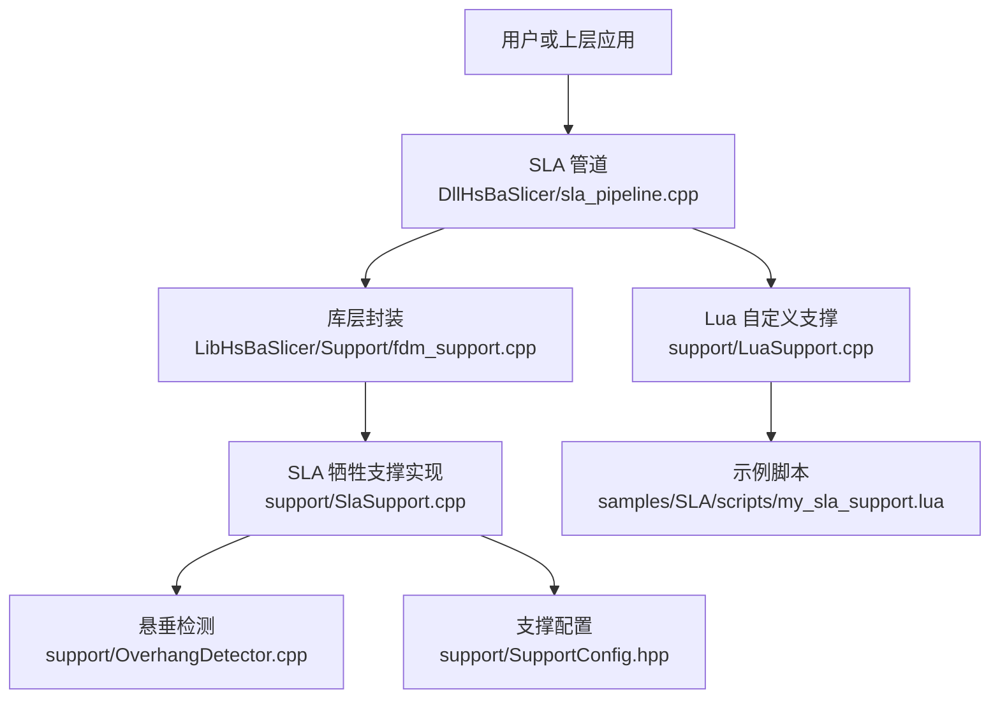
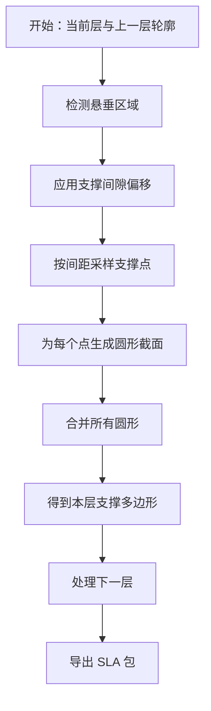
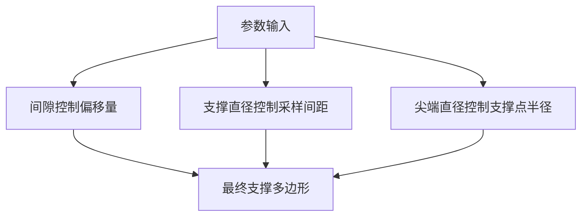
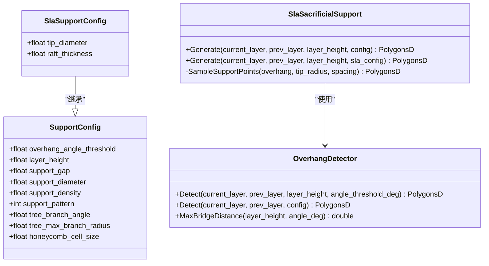
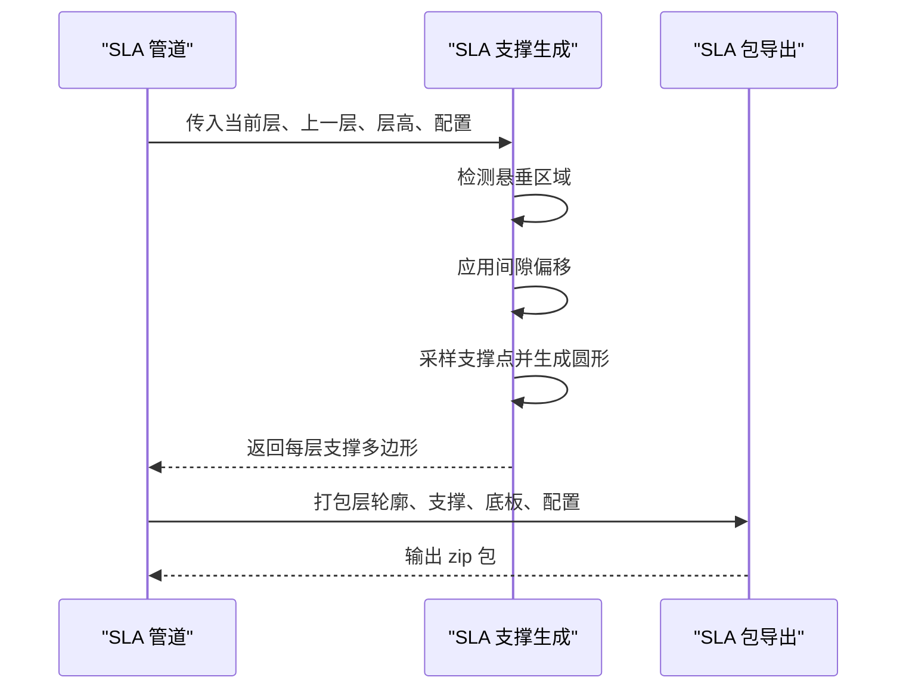
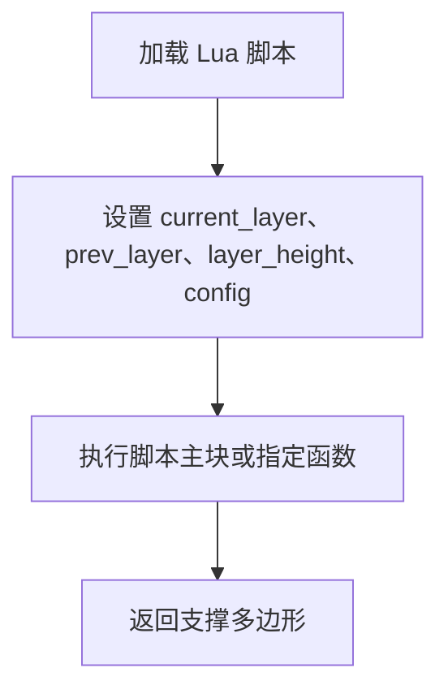
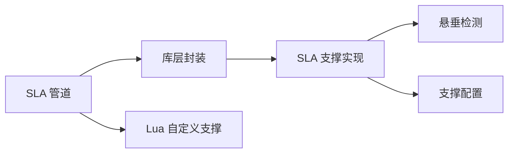

# SLA 支撑生成

<cite>
**本文引用的文件**   
- [support/SlaSupport.hpp](file://support/SlaSupport.hpp)
- [support/SlaSupport.cpp](file://support/SlaSupport.cpp)
- [support/SupportConfig.hpp](file://support/SupportConfig.hpp)
- [support/OverhangDetector.hpp](file://support/OverhangDetector.hpp)
- [support/OverhangDetector.cpp](file://support/OverhangDetector.cpp)
- [support/LuaSupport.hpp](file://support/LuaSupport.hpp)
- [support/LuaSupport.cpp](file://support/LuaSupport.cpp)
- [samples/SLA/scripts/my_sla_support.lua](file://samples/SLA/scripts/my_sla_support.lua)
- [LibHsBaSlicer/Support/fdm_support.cpp](file://LibHsBaSlicer/Support/fdm_support.cpp)
- [DllHsBaSlicer/sla_pipeline.cpp](file://DllHsBaSlicer/sla_pipeline.cpp)
- [pipelinetypes/pipeline_types.h](file://pipelinetypes/pipeline_types.h)
- [tests/Support/fdm_support_lib_test.cpp](file://tests/Support/fdm_support_lib_test.cpp)
</cite>

## 目录
1. [简介](#简介)
2. [项目结构中的 SLA 支撑位置](#项目结构中的-sla-支撑位置)
3. [核心概念与数据流](#核心概念与数据流)
4. [牺牲型支撑参数配置](#牺牲型支撑参数配置)
5. [支撑点直径、间隙、密度等参数的影响](#支撑点直径间隙密度等参数的影响)
6. [支撑生成算法详解](#支撑生成算法详解)
7. [不同树脂材料的支撑配置示例](#不同树脂材料的支撑配置示例)
8. [支撑与模型的结合方式及去除特性](#支撑与模型的结合方式及去除特性)
9. [Lua 自定义支撑脚本用法](#lua-自定义支撑脚本用法)
10. [SLA 工艺特有的支撑优化建议](#sla-工艺特有的支撑优化建议)
11. [依赖关系分析](#依赖关系分析)
12. [常见问题与排错](#常见问题与排错)
13. [结论](#结论)

## 简介
本文面向使用 HsBaSlicer 进行 SLA（光固化）切片和支撑生成的用户，重点说明“牺牲型支撑”的使用方法、参数含义、生成算法、与模型的关系，以及不同树脂材料下的推荐配置。文档同时覆盖内置算法、Lua 自定义支撑脚本、SLA 管道如何调用支撑模块，以及支撑在导出包中的组织方式。

## 项目结构中的 SLA 支撑位置
SLA 支撑相关代码主要分布在以下位置：
- 支撑算法实现：`support/SlaSupport.*`
- 通用支撑配置：`support/SupportConfig.hpp`
- 悬垂检测：`support/OverhangDetector.*`
- Lua 自定义支撑：`support/LuaSupport.*` 与 `samples/SLA/scripts/my_sla_support.lua`
- 库层统一入口：`LibHsBaSlicer/Support/fdm_support.cpp`
- SLA 管道集成：`DllHsBaSlicer/sla_pipeline.cpp`
- C 接口与默认值：`pipelinetypes/pipeline_types.h`
- 测试用例参考：`tests/Support/fdm_support_lib_test.cpp`

**图表来源**
- [DllHsBaSlicer/sla_pipeline.cpp:386-420](file://DllHsBaSlicer/sla_pipeline.cpp#L386-L420)
- [LibHsBaSlicer/Support/fdm_support.cpp:54-59](file://LibHsBaSlicer/Support/fdm_support.cpp#L54-L59)
- [support/SlaSupport.cpp:81-123](file://support/SlaSupport.cpp#L81-L123)
- [support/OverhangDetector.cpp:41-80](file://support/OverhangDetector.cpp#L41-L80)
- [support/SupportConfig.hpp:14-43](file://support/SupportConfig.hpp#L14-L43)
- [support/LuaSupport.cpp:113-177](file://support/LuaSupport.cpp#L113-L177)
- [samples/SLA/scripts/my_sla_support.lua:32-75](file://samples/SLA/scripts/my_sla_support.lua#L32-L75)

**章节来源**
- [DllHsBaSlicer/sla_pipeline.cpp:386-420](file://DllHsBaSlicer/sla_pipeline.cpp#L386-L420)
- [LibHsBaSlicer/Support/fdm_support.cpp:54-59](file://LibHsBaSlicer/Support/fdm_support.cpp#L54-L59)
- [support/SlaSupport.hpp:13-42](file://support/SlaSupport.hpp#L13-L42)
- [support/SlaSupport.cpp:1-135](file://support/SlaSupport.cpp#L1-L135)
- [support/SupportConfig.hpp:14-43](file://support/SupportConfig.hpp#L14-L43)
- [support/OverhangDetector.hpp:14-50](file://support/OverhangDetector.hpp#L14-L50)
- [support/OverhangDetector.cpp:23-87](file://support/OverhangDetector.cpp#L23-L87)
- [support/LuaSupport.hpp:21-40](file://support/LuaSupport.hpp#L21-L40)
- [support/LuaSupport.cpp:19-90](file://support/LuaSupport.cpp#L19-L90)
- [samples/SLA/scripts/my_sla_support.lua:1-75](file://samples/SLA/scripts/my_sla_support.lua#L1-L75)
- [pipelinetypes/pipeline_types.h:146-153](file://pipelinetypes/pipeline_types.h#L146-L153)
- [pipelinetypes/pipeline_types.h:789-825](file://pipelinetypes/pipeline_types.h#L789-L825)
- [tests/Support/fdm_support_lib_test.cpp:73-84](file://tests/Support/fdm_support_lib_test.cpp#L73-L84)

## 核心概念与数据流
SLA 支撑生成的核心流程如下：
1. 输入当前层轮廓 `current_layer` 与上一层轮廓 `prev_layer`，以及层高 `layer_height`。
2. 根据悬垂角度阈值计算需要支撑的悬垂区域。
3. 对悬垂区域按支撑间隙做负偏移，得到支撑接触区。
4. 在支撑接触区内按间距采样支撑点，每个点生成一个圆形截面。
5. 将所有圆形并集，得到该层的支撑多边形。
6. 所有层结果汇总后进入导出阶段，与模型层、底板一起输出到 SLA 包中。

**图表来源**
- [support/SlaSupport.cpp:81-123](file://support/SlaSupport.cpp#L81-L123)
- [support/OverhangDetector.cpp:41-80](file://support/OverhangDetector.cpp#L41-L80)
- [DllHsBaSlicer/sla_pipeline.cpp:427-447](file://DllHsBaSlicer/sla_pipeline.cpp#L427-L447)

**章节来源**
- [support/SlaSupport.cpp:81-123](file://support/SlaSupport.cpp#L81-L123)
- [support/OverhangDetector.cpp:41-80](file://support/OverhangDetector.cpp#L41-L80)
- [DllHsBaSlicer/sla_pipeline.cpp:427-447](file://DllHsBaSlicer/sla_pipeline.cpp#L427-L447)

## 牺牲型支撑参数配置
SLA 牺牲型支撑由 `SlaSupportConfig` 继承自通用 `SupportConfig`，并在 SLA 管道中从 `HsBaSlaPipelineConfig_t` 映射而来。

| 参数 | 类型 | 默认值 | 含义 | 对支撑的影响 |
|---|---:|---:|---|---|
| `overhang_angle_threshold` | float | 45.0 | 悬垂角度阈值（度） | 角度越小，越容易判定悬垂；角度越大，需要支撑的区域越少 |
| `layer_height` | float | 0.2 | 层高（mm） | 影响悬垂最大桥接距离计算 |
| `support_gap` | float | 0.5 | 支撑与模型间隙（mm） | 间隙越大，支撑与模型表面离得越远，去除更容易但可能降低支撑稳定性 |
| `support_diameter` | float | 2.0 | 支撑柱直径（mm） | 决定支撑点间距与支撑强度；当前实现用其作为采样间距 |
| `support_density` | float | 0.3 | 支撑填充密度 [0,1] | 通用支撑密度字段；当前 SLA 牺牲支撑实现未直接使用 |
| `support_pattern` | int | 0 | 支撑模式：0=平面/牺牲柱，1=树，2=蜂窝 | SLA 管道支持牺牲柱与锥形两种模式枚举 |
| `tip_diameter` | float | 0.3 | 支撑尖端直径（mm） | 牺牲支撑尖端更小，便于去除 |
| `raft_thickness` | float | 0.5 | 底板厚度（mm） | 与底板相关，不直接影响每层支撑截面 |

SLA 管道默认配置中，支撑相关字段默认值为：
- `enable_support = 1`
- `overhang_angle = 45.0f`
- `support_gap = 0.5f`
- `support_diameter = 2.0f`
- `support_density = 0.3f`
- `support_pattern = HSBA_SLA_SUPPORT_SACRIFICIAL`

**章节来源**
- [support/SupportConfig.hpp:14-43](file://support/SupportConfig.hpp#L14-L43)
- [pipelinetypes/pipeline_types.h:146-153](file://pipelinetypes/pipeline_types.h#L146-L153)
- [pipelinetypes/pipeline_types.h:789-825](file://pipelinetypes/pipeline_types.h#L789-L825)
- [DllHsBaSlicer/sla_pipeline.cpp:392-398](file://DllHsBaSlicer/sla_pipeline.cpp#L392-L398)

## 支撑点直径、间隙、密度等参数的影响
- **支撑点直径**：在 SLA 牺牲支撑实现中，`support_diameter` 被用作支撑点之间的采样间距。也就是说，支撑点不是按固定网格随机分布，而是以 `support_diameter × 2` 作为 x/y 方向步长。增大该值会减少支撑点数量，降低支撑密度；减小该值会增加支撑点数量，提高支撑强度但增加打印体积。
- **支撑间隙**：实现中对悬垂区域执行负偏移，偏移量为 `support_gap`。间隙越大，支撑与模型表面距离越大，去除时更容易分离，但过大会导致悬垂部分缺乏足够支撑；间隙过小则支撑与模型粘连更紧，去除难度增加。
- **支撑密度**：通用配置中包含 `support_density`，但在当前 SLA 牺牲支撑实现中并未直接参与每层支撑截面的生成逻辑。它更多是通用支撑配置的一部分，可用于 FDM 或其他扩展场景。
- **支撑尖端直径**：`tip_diameter` 用于生成支撑点的圆形半径，即 `tip_radius = tip_diameter / 2`。较小的尖端直径有助于后期去除支撑，但会降低单点支撑面积。

**图表来源**
- [support/SlaSupport.cpp:91-109](file://support/SlaSupport.cpp#L91-L109)

**章节来源**
- [support/SlaSupport.cpp:91-109](file://support/SlaSupport.cpp#L91-L109)
- [support/SupportConfig.hpp:14-43](file://support/SupportConfig.hpp#L14-L43)

## 支撑生成算法详解
SLA 牺牲支撑的核心类是 `SlaSacrificialSupport`，提供两层接口：
- 基于通用 `SupportConfig` 的 `Generate`
- 基于 SLA 专用 `SlaSupportConfig` 的静态 `Generate`

内部关键步骤包括：
1. 调用 `OverhangDetector::Detect` 获取悬垂区域。
2. 将悬垂区域整数化后执行负偏移，得到带间隙的支撑区域。
3. 计算支撑点半径 `tip_radius = tip_diameter / 2`。
4. 计算支撑点间距 `spacing = support_diameter × 2`。
5. 在支撑区域内按间距扫描，若点在悬垂区域内，则生成一个圆形多边形。
6. 对所有圆形执行并集操作，得到最终支撑多边形。

**图表来源**
- [support/SupportConfig.hpp:14-43](file://support/SupportConfig.hpp#L14-L43)
- [support/OverhangDetector.hpp:14-50](file://support/OverhangDetector.hpp#L14-L50)
- [support/SlaSupport.hpp:13-42](file://support/SlaSupport.hpp#L13-L42)

**章节来源**
- [support/SlaSupport.hpp:13-42](file://support/SlaSupport.hpp#L13-L42)
- [support/SlaSupport.cpp:38-123](file://support/SlaSupport.cpp#L38-L123)
- [support/OverhangDetector.cpp:23-87](file://support/OverhangDetector.cpp#L23-L87)

## 不同树脂材料的支撑配置示例
以下示例基于源码中的默认值和字段定义，给出不同树脂场景下的推荐思路。注意：这些是使用方法建议，并非源码中硬编码的材料配方。

| 树脂类型 | 推荐配置思路 | 说明 |
|---|---|---|
| 标准光敏树脂 | `overhang_angle = 45`，`support_gap = 0.5`，`support_diameter = 2.0`，`tip_diameter = 0.3` | 使用默认值即可；牺牲支撑适合大多数常规模型 |
| 高韧性树脂 | 适当增大 `support_diameter`，减小 `support_gap` | 韧性树脂更易变形，需要更强支撑且接触更紧密 |
| 高收缩树脂 | 增大 `support_diameter`，适度增大 `support_gap` | 收缩易翘边，需更强支撑；稍大间隙便于去除粘附面 |
| 透明树脂 | 保持较小 `tip_diameter`，避免过多支撑点 | 透明件对支撑痕迹敏感，应尽量减少可见支撑面积 |
| 快速成型树脂 | 使用默认值或略小 `support_diameter` | 快速成型通常不需要过密支撑，优先保证效率 |

测试用例中也展示了 SLA 支撑生成的基本调用方式：设置 `support_gap`、`tip_diameter`、`support_diameter`，然后调用 `GenerateAllSlaSupport`，返回的支撑层数应与输入层数一致。

**章节来源**
- [pipelinetypes/pipeline_types.h:789-825](file://pipelinetypes/pipeline_types.h#L789-L825)
- [tests/Support/fdm_support_lib_test.cpp:73-84](file://tests/Support/fdm_support_lib_test.cpp#L73-L84)

## 支撑与模型的结合方式及去除特性
SLA 牺牲支撑的设计目标是“易于去除”。其特点包括：
- 支撑横截面为圆形，逐层并集形成细柱状支撑。
- 支撑尖端直径小于支撑柱直径，便于后期手工或工具去除。
- 通过 `support_gap` 控制支撑与模型表面的距离，平衡支撑强度与去除难度。
- 在导出阶段，支撑图像可包含在 SLA 包中，便于查看支撑分布。

**图表来源**
- [DllHsBaSlicer/sla_pipeline.cpp:386-447](file://DllHsBaSlicer/sla_pipeline.cpp#L386-L447)
- [support/SlaSupport.cpp:81-123](file://support/SlaSupport.cpp#L81-L123)

**章节来源**
- [support/SlaSupport.hpp:13-19](file://support/SlaSupport.hpp#L13-L19)
- [support/SlaSupport.cpp:104-123](file://support/SlaSupport.cpp#L104-L123)
- [DllHsBaSlicer/sla_pipeline.cpp:427-447](file://DllHsBaSlicer/sla_pipeline.cpp#L427-L447)

## Lua 自定义支撑脚本用法
当内置算法不能满足需求时，可通过 Lua 脚本完全替换支撑生成逻辑。Lua 环境提供：
- 全局变量：`current_layer`、`prev_layer`、`layer_height`、`config`
- PolygonOperations 函数：偏移、并集、差集、交集、画圆、面积
- Support 模块：创建 SLA 支撑生成器、调用生成器、检测悬垂、获取默认配置

示例脚本 `my_sla_support.lua` 演示了：
1. 首层跳过支撑。
2. 使用 `Support.detect_overhang` 检测悬垂区域。
3. 使用 `Support.new_sla()` 和 `Support.generate()` 调用内置 SLA 支撑生成器。
4. 可选地根据面积过滤支撑结果。

**图表来源**
- [support/LuaSupport.cpp:19-90](file://support/LuaSupport.cpp#L19-L90)
- [support/LuaSupport.cpp:113-177](file://support/LuaSupport.cpp#L113-L177)
- [samples/SLA/scripts/my_sla_support.lua:32-75](file://samples/SLA/scripts/my_sla_support.lua#L32-L75)

**章节来源**
- [support/LuaSupport.hpp:21-40](file://support/LuaSupport.hpp#L21-L40)
- [support/LuaSupport.cpp:19-90](file://support/LuaSupport.cpp#L19-L90)
- [support/LuaSupport.cpp:113-177](file://support/LuaSupport.cpp#L113-L177)
- [samples/SLA/scripts/my_sla_support.lua:1-75](file://samples/SLA/scripts/my_sla_support.lua#L1-L75)

## SLA 工艺特有的支撑优化建议
结合源码实现与 SLA 工艺特点，可总结以下优化建议：
- **合理设置悬垂角度阈值**：对于复杂悬垂结构可适当降低阈值以增加支撑覆盖；对于简单结构可提高阈值以减少支撑。
- **调整支撑间隙**：追求易去除时增大 `support_gap`；追求稳定性时减小 `support_gap`。
- **控制支撑点密度**：通过 `support_diameter` 控制采样间距；大跨度悬垂可适当减小该值以提高支撑密度。
- **控制支撑尖端尺寸**：使用较小 `tip_diameter` 以降低去除难度，但需避免支撑点过小导致支撑失效。
- **利用 Lua 脚本定制**：对特殊几何体（如薄壁、悬臂、镂空）编写脚本，按需过滤支撑点或调整支撑区域。
- **关注导出包中的支撑图像**：通过检查支撑图像确认支撑分布是否合理，必要时迭代参数。

[本节为通用优化建议，不直接分析具体源码行]

## 依赖关系分析
SLA 支撑模块的依赖关系如下：
- `SlaSacrificialSupport` 依赖 `OverhangDetector` 检测悬垂区域。
- `SlaSacrificialSupport` 依赖 `SupportConfig` 与 `SlaSupportConfig` 读取参数。
- `LibHsBaSlicer/Support/fdm_support.cpp` 暴露 `GenerateAllSlaSupport`，供上层调用。
- `DllHsBaSlicer/sla_pipeline.cpp` 将 `HsBaSlaPipelineConfig_t` 映射为 `SlaSupportConfig`，并调用支撑生成。
- Lua 支撑通过 `LuaSupport` 注入 2D 与 Support 模块，允许用户自定义支撑逻辑。

**图表来源**
- [DllHsBaSlicer/sla_pipeline.cpp:392-418](file://DllHsBaSlicer/sla_pipeline.cpp#L392-L418)
- [LibHsBaSlicer/Support/fdm_support.cpp:54-59](file://LibHsBaSlicer/Support/fdm_support.cpp#L54-L59)
- [support/SlaSupport.cpp:81-123](file://support/SlaSupport.cpp#L81-L123)
- [support/OverhangDetector.cpp:41-80](file://support/OverhangDetector.cpp#L41-L80)
- [support/LuaSupport.cpp:113-177](file://support/LuaSupport.cpp#L113-L177)

**章节来源**
- [DllHsBaSlicer/sla_pipeline.cpp:392-418](file://DllHsBaSlicer/sla_pipeline.cpp#L392-L418)
- [LibHsBaSlicer/Support/fdm_support.cpp:54-59](file://LibHsBaSlicer/Support/fdm_support.cpp#L54-L59)
- [support/SlaSupport.cpp:81-123](file://support/SlaSupport.cpp#L81-L123)
- [support/OverhangDetector.cpp:41-80](file://support/OverhangDetector.cpp#L41-L80)
- [support/LuaSupport.cpp:113-177](file://support/LuaSupport.cpp#L113-L177)

## 常见问题与排错
- **没有生成支撑**：检查 `enable_support` 是否为真；确认悬垂角度阈值是否过大；检查悬垂区域是否为空。
- **支撑与模型粘连严重**：增大 `support_gap`；检查 `support_diameter` 是否过小导致支撑点过密。
- **支撑强度不足**：减小 `support_diameter` 以增加支撑点密度；适当减小 `support_gap` 增强接触。
- **Lua 脚本报错**：检查脚本路径是否正确；确认脚本返回的是多边形表；检查 `generate_support` 函数是否存在。
- **导出包缺少支撑图像**：确认 `include_support_images` 在导出时启用；检查 `enable_support` 是否开启。

**章节来源**
- [DllHsBaSlicer/sla_pipeline.cpp:386-447](file://DllHsBaSlicer/sla_pipeline.cpp#L386-L447)
- [support/LuaSupport.cpp:141-177](file://support/LuaSupport.cpp#L141-L177)

## 结论
HsBaSlicer 的 SLA 牺牲型支撑通过悬垂检测、间隙偏移、采样点生成与并集操作，实现了适合树脂打印的细柱状支撑。用户可以通过 `HsBaSlaPipelineConfig_t` 调整悬垂角度、支撑间隙、支撑直径、支撑密度与支撑模式，也可以通过 Lua 脚本完全自定义支撑生成逻辑。在实际使用中，应根据树脂材料特性、模型几何特征和后处理要求，综合调整参数以获得更好的支撑效果与去除体验。