# 支撑生成系统

<cite>
**本文引用的文件**   
- [ISupport.hpp](file://support/ISupport.hpp)
- [ISupport.cpp](file://support/ISupport.cpp)
- [SupportConfig.hpp](file://support/SupportConfig.hpp)
- [OverhangDetector.hpp](file://support/OverhangDetector.hpp)
- [OverhangDetector.cpp](file://support/OverhangDetector.cpp)
- [FdmSupport.hpp](file://support/FdmSupport.hpp)
- [FdmSupport.cpp](file://support/FdmSupport.cpp)
- [SlaSupport.hpp](file://support/SlaSupport.hpp)
- [SlaSupport.cpp](file://support/SlaSupport.cpp)
- [LuaSupport.hpp](file://support/LuaSupport.hpp)
- [LuaSupport.cpp](file://support/LuaSupport.cpp)
- [LuaAdapter.hpp](file://support/LuaAdapter.hpp)
- [LuaAdapter.cpp](file://support/LuaAdapter.cpp)
- [support_test.cpp](file://tests/Support/support_test.cpp)
</cite>

## 目录
1. [项目概述与快速开始](#项目概述与快速开始)
2. [架构总览](#架构总览)
3. [核心概念](#核心概念)
4. [核心模块详解](#核心模块详解)
5. [高级主题](#高级主题)
6. [Lua 脚本系统](#lua-脚本系统)
7. [API 参考文档](#api-参考文档)
8. [集成指南](#集成指南)
9. [开发·测试与贡献](#开发测试与贡献)
10. [扩展开发指南](#扩展开发指南)
11. [示例与教程](#示例与教程)
12. [部署·故障排除与FAQ](#部署故障排除与faq)
13. [附录](#附录)

## 项目概述与快速开始
本章节面向首次接触 HsBaSlicer 支撑生成系统的用户，说明支撑生成的目标、输入输出、常用流程以及如何在 C++ 和 Lua 两种环境下使用。

- 支撑生成系统的目标是：根据当前层与上一层的轮廓，检测悬空区域，并生成该层的支撑横截面多边形。
- 输入包括：
  - 当前层轮廓集合
  - 上一层轮廓集合（首层为空）
  - 层高
  - 支撑配置对象或表
- 输出为：当前层的支撑横截面多边形集合。
- 在 C++ 中，通过实现 `ISupport` 接口或使用内置的平面、树形、蜂窝、SLA 支撑类调用 `Generate`；批量处理可使用 `GenerateAll`。
- 在 Lua 中，通过全局 `Support` 表创建支撑对象，然后调用 `Support.generate` 或 `Support.detect_overhang`。

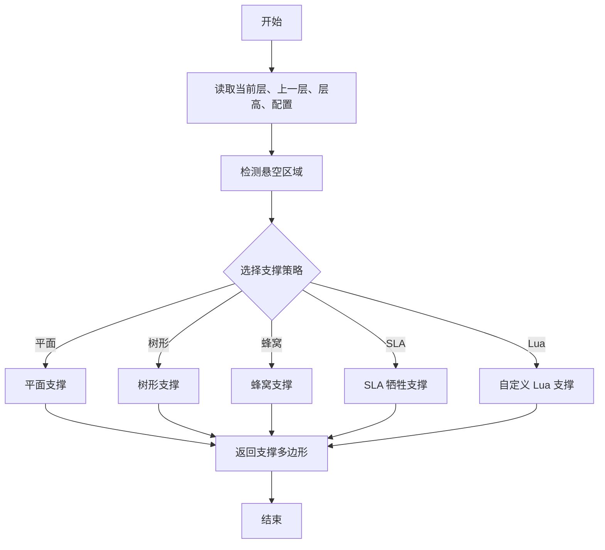

[本节不直接分析具体源码文件]

## 架构总览
支撑生成系统采用抽象接口加多种实现的架构：所有支撑算法统一继承自 `ISupport`，并通过 `SupportConfig` 共享配置；悬空检测由 `OverhangDetector` 提供；Lua 绑定通过 `LuaAdapter` 暴露工厂函数和通用方法。

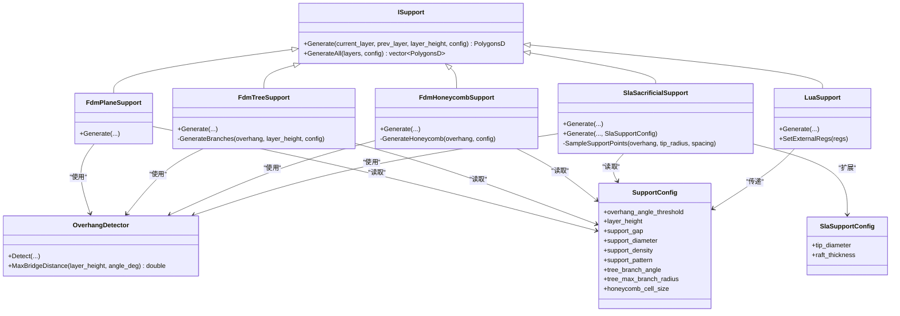

**图示来源**
- [ISupport.hpp:22-44](file://support/ISupport.hpp#L22-L44)
- [FdmSupport.hpp:19-63](file://support/FdmSupport.hpp#L19-L63)
- [SlaSupport.hpp:20-42](file://support/SlaSupport.hpp#L20-L42)
- [LuaSupport.hpp:40-81](file://support/LuaSupport.hpp#L40-L81)
- [OverhangDetector.hpp:20-49](file://support/OverhangDetector.hpp#L20-L49)
- [SupportConfig.hpp:14-43](file://support/SupportConfig.hpp#L14-L43)

**章节来源**
- [ISupport.hpp:22-44](file://support/ISupport.hpp#L22-L44)
- [FdmSupport.hpp:19-63](file://support/FdmSupport.hpp#L19-L63)
- [SlaSupport.hpp:20-42](file://support/SlaSupport.hpp#L20-L42)
- [LuaSupport.hpp:40-81](file://support/LuaSupport.hpp#L40-L81)
- [OverhangDetector.hpp:20-49](file://support/OverhangDetector.hpp#L20-L49)
- [SupportConfig.hpp:14-43](file://support/SupportConfig.hpp#L14-L43)

## 核心概念
- 支撑生成接口：`ISupport` 定义每层支撑生成入口 `Generate`，并提供默认批量实现 `GenerateAll`。
- 悬空检测：`OverhangDetector::Detect` 基于当前层与上一层的几何差集，结合层高与角度阈值计算可桥接距离，过滤不需要支撑的小悬空。
- 配置体系：`SupportConfig` 是通用配置；`FdmSupportConfig` 增加界面层参数；`SlaSupportConfig` 增加针尖直径和底板厚度。
- 支撑类型：
  - 平面支撑：将悬空区域收缩间隙后膨胀为柱状横截面。
  - 树形支撑：在悬空区域内采样分支点，生成圆形分支横截面。
  - 蜂窝支撑：用六边形网格填充悬空区域。
  - SLA 牺牲支撑：以较小针尖直径和固定间距采样支撑点，形成易去除的细柱支撑。
  - Lua 自定义支撑：允许用户用 Lua 脚本完全替换内置算法。

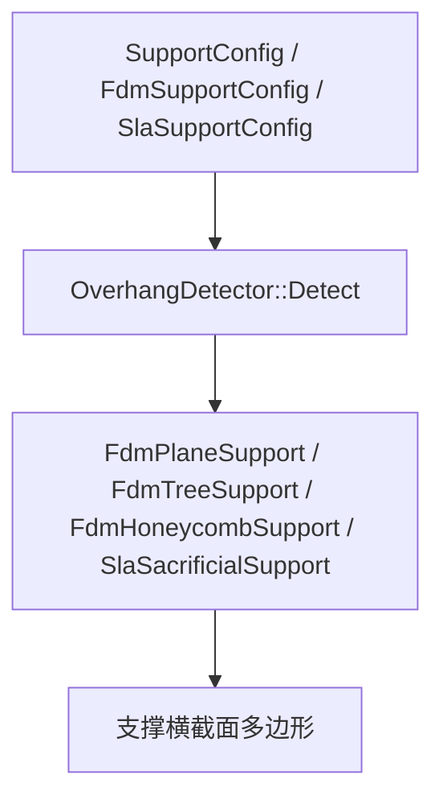

**图示来源**
- [SupportConfig.hpp:14-43](file://support/SupportConfig.hpp#L14-L43)
- [OverhangDetector.cpp:41-87](file://support/OverhangDetector.cpp#L41-L87)
- [FdmSupport.cpp:48-76](file://support/FdmSupport.cpp#L48-L76)
- [FdmSupport.cpp:145-168](file://support/FdmSupport.cpp#L145-L168)
- [FdmSupport.cpp:244-266](file://support/FdmSupport.cpp#L244-L266)
- [SlaSupport.cpp:81-133](file://support/SlaSupport.cpp#L81-L133)

**章节来源**
- [ISupport.hpp:22-44](file://support/ISupport.hpp#L22-L44)
- [OverhangDetector.hpp:20-49](file://support/OverhangDetector.hpp#L20-L49)
- [SupportConfig.hpp:14-43](file://support/SupportConfig.hpp#L14-L43)

## 核心模块详解

### 抽象接口与批量生成
`ISupport` 是所有支撑生成器的抽象基类，核心方法是 `Generate`；默认实现 `GenerateAll` 会按层迭代调用 `Generate`，首层使用空的上层轮廓。

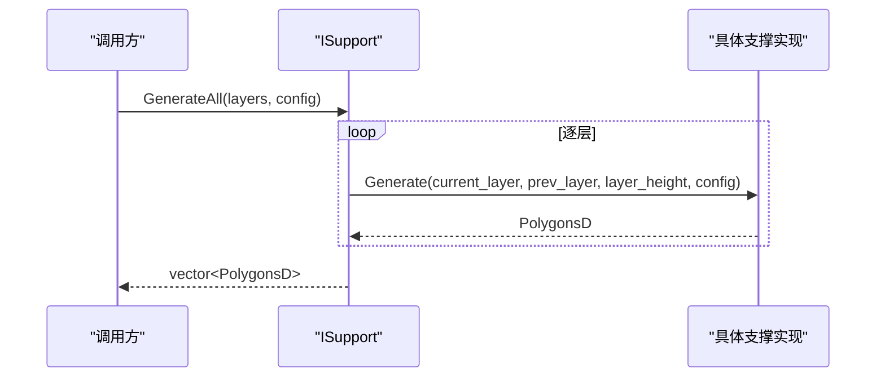

**图示来源**
- [ISupport.cpp:9-21](file://support/ISupport.cpp#L9-L21)
- [ISupport.hpp:35-44](file://support/ISupport.hpp#L35-L44)

**章节来源**
- [ISupport.hpp:22-44](file://support/ISupport.hpp#L22-L44)
- [ISupport.cpp:9-21](file://support/ISupport.cpp#L9-L21)

### 悬空检测
`OverhangDetector` 负责计算需要支撑的区域：
- 若没有上一层，则当前层整体视为悬空。
- 否则计算当前层与上一层的差集。
- 根据层高和角度阈值计算最大桥接距离，对差集进行负偏移侵蚀，过滤可桥接的小悬空。

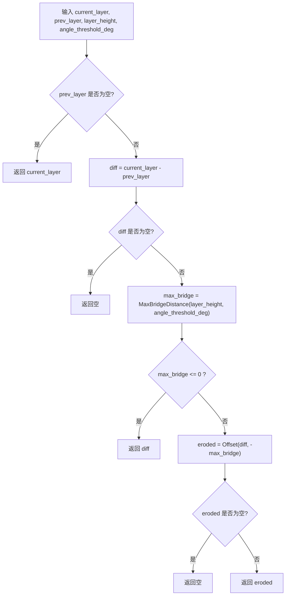

**图示来源**
- [OverhangDetector.cpp:23-39](file://support/OverhangDetector.cpp#L23-L39)
- [OverhangDetector.cpp:41-87](file://support/OverhangDetector.cpp#L41-L87)

**章节来源**
- [OverhangDetector.hpp:20-49](file://support/OverhangDetector.hpp#L20-L49)
- [OverhangDetector.cpp:23-87](file://support/OverhangDetector.cpp#L23-L87)

### FDM 平面支撑
平面支撑流程：
1. 调用 `OverhangDetector::Detect` 获取悬空区域。
2. 应用 `support_gap` 收缩模型边界，避免支撑粘连。
3. 将收缩后的区域膨胀 `support_diameter / 2`，得到柱状支撑横截面。

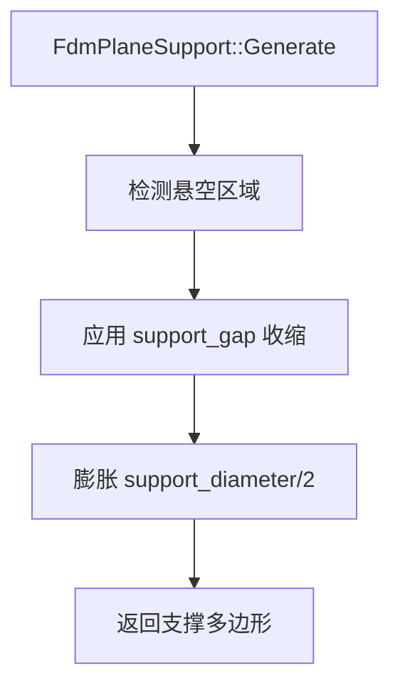

**图示来源**
- [FdmSupport.cpp:48-76](file://support/FdmSupport.cpp#L48-L76)

**章节来源**
- [FdmSupport.hpp:19-24](file://support/FdmSupport.hpp#L19-L24)
- [FdmSupport.cpp:48-76](file://support/FdmSupport.cpp#L48-L76)

### FDM 树形支撑
树形支撑流程：
1. 检测悬空区域并应用间隙。
2. 在悬空区域的包围盒内按间距采样候选点。
3. 判断点是否在悬空区域内，若是则生成圆形分支横截面。
4. 合并重叠圆形，得到最终支撑点集合。

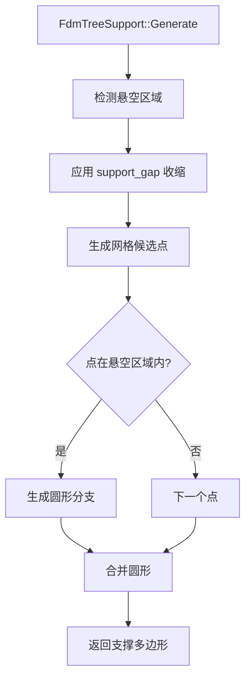

**图示来源**
- [FdmSupport.cpp:81-143](file://support/FdmSupport.cpp#L81-L143)
- [FdmSupport.cpp:145-168](file://support/FdmSupport.cpp#L145-L168)

**章节来源**
- [FdmSupport.hpp:26-44](file://support/FdmSupport.hpp#L26-L44)
- [FdmSupport.cpp:81-168](file://support/FdmSupport.cpp#L81-L168)

### FDM 蜂窝支撑
蜂窝支撑流程：
1. 检测悬空区域并应用间隙。
2. 根据 `honeycomb_cell_size` 生成平顶六边形网格。
3. 将六边形网格与悬空区域求交，得到蜂窝状支撑。

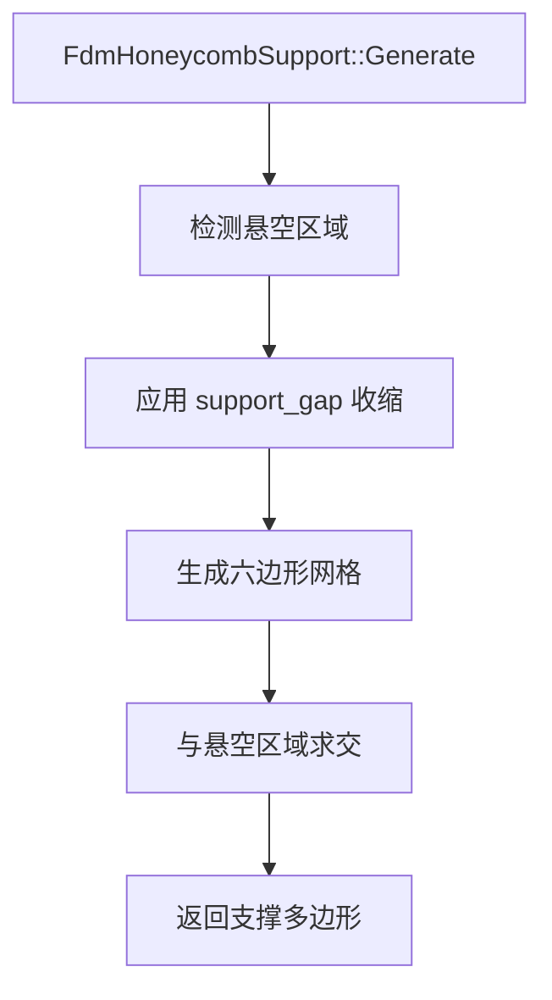

**图示来源**
- [FdmSupport.cpp:173-241](file://support/FdmSupport.cpp#L173-L241)
- [FdmSupport.cpp:244-266](file://support/FdmSupport.cpp#L244-L266)

**章节来源**
- [FdmSupport.hpp:46-63](file://support/FdmSupport.hpp#L46-L63)
- [FdmSupport.cpp:173-266](file://support/FdmSupport.cpp#L173-L266)

### SLA 牺牲支撑
SLA 牺牲支撑流程：
1. 检测悬空区域并应用间隙。
2. 使用 `tip_diameter` 作为针尖半径，以 `support_diameter * 2` 为间距采样支撑点。
3. 将所有支撑点圆形合并，得到支撑横截面。

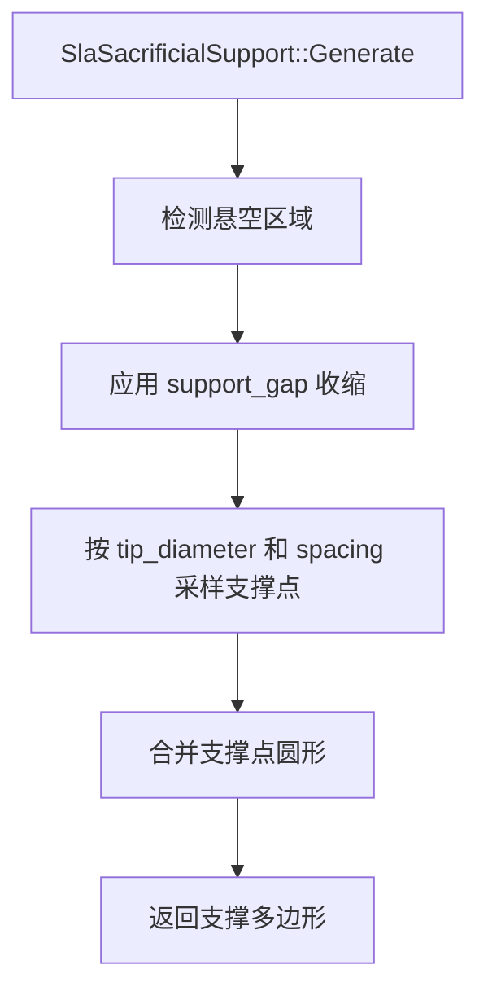

**图示来源**
- [SlaSupport.cpp:38-79](file://support/SlaSupport.cpp#L38-L79)
- [SlaSupport.cpp:81-133](file://support/SlaSupport.cpp#L81-L133)

**章节来源**
- [SlaSupport.hpp:20-42](file://support/SlaSupport.hpp#L20-L42)
- [SlaSupport.cpp:38-133](file://support/SlaSupport.cpp#L38-L133)

### 配置结构体
`SupportConfig` 是所有支撑生成器共享的配置；`FdmSupportConfig` 和 `SlaSupportConfig` 分别扩展 FDM 和 SLA 专用参数。

| 字段 | 类型 | 含义 | 调优建议 |
|---|---|---|---|
| overhang_angle_threshold | float | 悬空角度阈值，单位度 | 增大可减少支撑，减小会增加支撑覆盖 |
| layer_height | float | 层高，单位毫米 | 与打印层高一致 |
| support_gap | float | 支撑与模型间隙，单位毫米 | 增大有利于脱模，过小可能粘连 |
| support_diameter | float | 支撑柱直径，单位毫米 | 影响支撑强度和材料用量 |
| support_density | float | 支撑填充密度，范围 0 到 1 | 控制内部填充强度 |
| support_pattern | int | 支撑模式：0=平面，1=树形，2=蜂窝 | 与具体实现配合使用 |
| tree_branch_angle | float | 树形分支角度，单位度 | 影响分支扩散程度 |
| tree_max_branch_radius | float | 树形最大分支半径，单位毫米 | 控制分支粗细上限 |
| honeycomb_cell_size | float | 蜂窝单元尺寸，单位毫米 | 越小支撑越密，越大越轻 |
| interface_layers | int | FDM 界面层数 | 改善支撑与模型分离面 |
| interface_density | float | FDM 界面层填充密度 | 调整界面强度 |
| tip_diameter | float | SLA 针尖直径，单位毫米 | 越小越易去除 |
| raft_thickness | float | SLA 底板厚度，单位毫米 | 影响底板粘附力 |

**章节来源**
- [SupportConfig.hpp:14-43](file://support/SupportConfig.hpp#L14-L43)

## 高级主题
- 批量生成：优先使用 `ISupport::GenerateAll`，它会自动处理首层无上层的情况，并按层高迭代调用 `Generate`。
- 悬空检测复用：所有内置支撑都复用 `OverhangDetector::Detect`，因此调整角度阈值和层高会影响所有支撑类型。
- 几何操作：支撑生成大量使用 Clipper2 的并集、交集、差集和偏移操作，因此间隙、直径、单元尺寸等参数会直接影响几何运算结果。
- 性能特征：
  - 平面支撑主要依赖偏移和膨胀，复杂度较低。
  - 树形支撑需要在包围盒内采样点并进行点包含测试，点越多计算量越大。
  - 蜂窝支撑需要生成大量六边形并与悬空区域求交，单元尺寸越小计算量越高。
  - SLA 支撑通过采样点生成圆形并合并，间距越小点越多，合并开销越大。

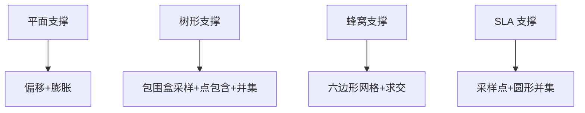

[本节为通用性能讨论，不直接分析具体源码文件]

## Lua 脚本系统
Lua 侧通过 `Support` 全局表暴露支撑工厂、通用生成方法和悬空检测方法。脚本可以：
- 使用 `Support.new_plane`、`Support.new_tree`、`Support.new_honeycomb`、`Support.new_sla` 创建内置支撑对象。
- 使用 `Support.new_lua` 或 `Support.new_lua_file` 创建自定义 Lua 支撑对象。
- 使用 `Support.generate` 调用任意支撑对象的 `Generate`。
- 使用 `Support.detect_overhang` 直接检测悬空区域。
- 使用 `Support.default_config` 获取默认配置表。

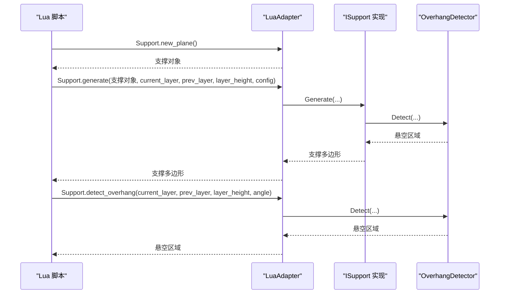

**图示来源**
- [LuaAdapter.cpp:110-172](file://support/LuaAdapter.cpp#L110-L172)
- [LuaAdapter.cpp:174-213](file://support/LuaAdapter.cpp#L174-L213)
- [LuaAdapter.cpp:253-276](file://support/LuaAdapter.cpp#L253-L276)

**章节来源**
- [LuaAdapter.hpp:13-30](file://support/LuaAdapter.hpp#L13-L30)
- [LuaAdapter.cpp:110-276](file://support/LuaAdapter.cpp#L110-L276)

## API 参考文档

### Support 类的构造函数
以下构造函数用于创建不同支撑类型：

| 构造方式 | 用途 | 参数说明 | 返回值 |
|---|---|---|---|
| new_plane | 创建 FDM 平面支撑 | 无参 | 支撑对象 |
| new_tree | 创建 FDM 树形支撑 | 无参 | 支撑对象 |
| new_honeycomb | 创建 FDM 蜂窝支撑 | 无参 | 支撑对象 |
| new_sla | 创建 SLA 牺牲支撑 | 无参 | 支撑对象 |
| new_lua | 创建内联 Lua 自定义支撑 | script：Lua 代码字符串；funcName：可选，默认 generate_support | 支撑对象 |
| new_lua_file | 从文件加载 Lua 自定义支撑 | path：脚本路径；funcName：要调用的函数名 | 支撑对象 |

这些构造函数由 `LuaAdapter` 注册到全局 `Support` 表中，供 Lua 脚本调用。

**章节来源**
- [LuaAdapter.cpp:110-172](file://support/LuaAdapter.cpp#L110-L172)
- [LuaAdapter.hpp:13-30](file://support/LuaAdapter.hpp#L13-L30)

### SupportConfig 配置参数与调优
`SupportConfig` 字段已在“核心概念”表格中列出。调优要点如下：
- 提高 `overhang_angle_threshold` 可以减少支撑数量，但可能留下未支撑的悬空。
- 增大 `support_gap` 可降低支撑与模型粘连风险，但过大会导致支撑悬空。
- 增大 `support_diameter` 可提高支撑强度，但会增加材料和时间。
- 对于树形支撑，合理设置 `tree_branch_angle` 和 `tree_max_branch_radius` 可平衡支撑覆盖与材料消耗。
- 对于蜂窝支撑，减小 `honeycomb_cell_size` 可增加支撑密度，但显著增加计算量。
- 对于 SLA 支撑，减小 `tip_diameter` 便于后期去除，但需保证足够强度。

**章节来源**
- [SupportConfig.hpp:14-43](file://support/SupportConfig.hpp#L14-L43)
- [LuaAdapter.cpp:43-108](file://support/LuaAdapter.cpp#L43-L108)

### generate 方法使用方式
`generate` 是 Lua 侧的统一调用入口，对应 C++ 中 `ISupport::Generate`。

Lua 调用形式：
- `Support.generate(support_obj, current_layer, prev_layer, layer_height, config_table)`
- 返回值为支撑多边形表。

C++ 调用形式：
- 对任意 `ISupport` 实例调用 `Generate(current_layer, prev_layer, layer_height, config)`。
- 批量调用可使用 `GenerateAll(layers, config)`。

**章节来源**
- [LuaAdapter.cpp:174-200](file://support/LuaAdapter.cpp#L174-L200)
- [ISupport.hpp:35-44](file://support/ISupport.hpp#L35-L44)
- [ISupport.cpp:9-21](file://support/ISupport.cpp#L9-L21)

### detect_overhang 方法使用方式
`detect_overhang` 直接调用 `OverhangDetector::Detect`，适合在自定义脚本中复用悬空检测逻辑。

Lua 调用形式：
- `Support.detect_overhang(current_layer, prev_layer, layer_height, angle_deg)`
- 返回值为悬空区域多边形表。

C++ 调用形式：
- `OverhangDetector::Detect(current_layer, prev_layer, layer_height, angle_threshold_deg)`
- 或使用带 `SupportConfig` 的重载。

**章节来源**
- [LuaAdapter.cpp:202-213](file://support/LuaAdapter.cpp#L202-L213)
- [OverhangDetector.hpp:31-49](file://support/OverhangDetector.hpp#L31-L49)
- [OverhangDetector.cpp:41-87](file://support/OverhangDetector.cpp#L41-L87)

### 不同支撑类型的配置示例与效果对比
以下为概念性示例，展示如何设置配置并预期效果：

| 支撑类型 | 推荐配置方向 | 预期效果 |
|---|---|---|
| 平面支撑 | 中等 `support_diameter`，适中 `support_gap` | 简单柱状支撑，适合大面积悬空 |
| 树形支撑 | 合理 `tree_branch_angle`，适中 `tree_max_branch_radius` | 分支式支撑，减少材料，适合复杂悬空 |
| 蜂窝支撑 | 较大 `honeycomb_cell_size` | 轻量蜂窝支撑，适合大区域低密度支撑 |
| SLA 牺牲支撑 | 小 `tip_diameter`，适中 `support_diameter` | 细柱支撑，易于去除，适合树脂打印 |

实际效果取决于模型几何、层高、角度阈值和间隙设置。建议在调试时先使用默认配置，再逐步调整关键参数。

[本节为概念性示例，不直接分析具体源码文件]

## 集成指南
- 在 C++ 中集成：
  - 构建 `SupportConfig` 或子类配置。
  - 选择 `FdmPlaneSupport`、`FdmTreeSupport`、`FdmHoneycombSupport`、`SlaSacrificialSupport` 或自定义 `ISupport` 实现。
  - 调用 `Generate` 或 `GenerateAll`。
- 在 Lua 中集成：
  - 调用 `RegisterLuaSupport` 注册 `Support` 表。
  - 使用 `Support.new_*` 创建支撑对象。
  - 使用 `Support.generate` 或 `Support.detect_overhang` 执行生成或检测。
- 在测试中验证：
  - 参考测试用例中的脚本，检查工厂函数、`generate` 和 `detect_overhang` 是否返回表类型。

**章节来源**
- [support_test.cpp:360-385](file://tests/Support/support_test.cpp#L360-L385)

## 开发·测试与贡献
- 新增支撑类型时：
  - 继承 `ISupport` 并实现 `Generate`。
  - 如需 Lua 暴露，可在 `LuaAdapter` 中添加新工厂函数。
  - 更新 `LuaAdapter.cpp` 中的支持库注册表。
- 单元测试：
  - 可通过 Lua 测试脚本验证 `Support` 表方法。
  - 也可通过 C++ 测试直接调用 `ISupport` 和 `OverhangDetector`。

**章节来源**
- [LuaAdapter.cpp:253-276](file://support/LuaAdapter.cpp#L253-L276)
- [support_test.cpp:360-385](file://tests/Support/support_test.cpp#L360-L385)

## 扩展开发指南
自定义支撑脚本的开发方法：
- 使用 `Support.new_lua(script, funcName)` 传入内联脚本。
- 使用 `Support.new_lua_file(path, funcName)` 从文件加载脚本。
- 脚本可访问的全局变量：
  - `current_layer`：当前层多边形表。
  - `prev_layer`：上一层多边形表。
  - `layer_height`：层高。
  - `config`：支撑配置表。
- 脚本应返回支撑多边形表，或定义指定函数名返回多边形表。
- 可通过 `LuaSupport::SetExternalRegs` 注入额外 Lua 注册函数，扩展 2D 或 3D 能力。

回调机制：
- `LuaSupport::Generate` 在初始化 Lua 环境后，依次调用外部注册函数。
- 加载脚本后执行主块，若指定函数名则调用该函数。
- 最后从 Lua 栈或全局变量解析支撑多边形。

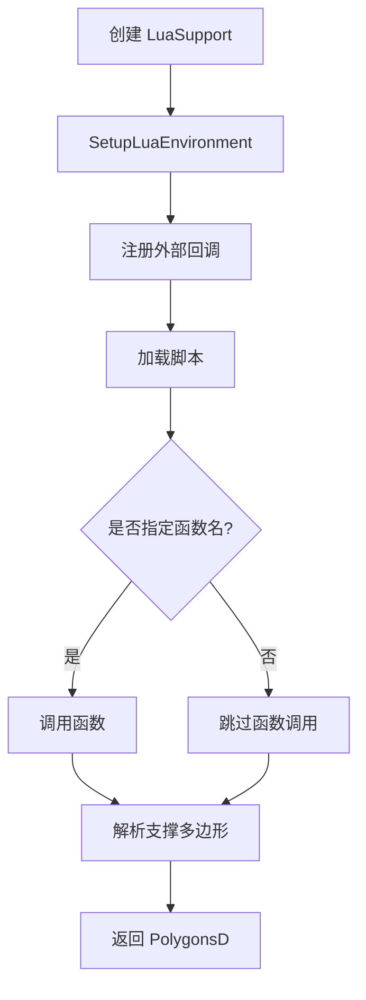

**图示来源**
- [LuaSupport.cpp:113-178](file://support/LuaSupport.cpp#L113-L178)
- [LuaSupport.hpp:63-81](file://support/LuaSupport.hpp#L63-L81)

**章节来源**
- [LuaSupport.hpp:40-81](file://support/LuaSupport.hpp#L40-L81)
- [LuaSupport.cpp:19-90](file://support/LuaSupport.cpp#L19-L90)
- [LuaSupport.cpp:113-178](file://support/LuaSupport.cpp#L113-L178)

## 示例与教程
- Lua 测试脚本展示了如何注册 `Support` 表、创建各类型支撑对象、调用 `generate` 和 `detect_overhang`，并检查结果是否为表类型。
- 开发者可在此基础上扩展自己的支撑脚本，例如：
  - 使用 `Support.detect_overhang` 自行决定支撑区域。
  - 使用 2D 多边形操作函数组合支撑形状。
  - 通过 `config` 读取用户配置。

**章节来源**
- [support_test.cpp:360-385](file://tests/Support/support_test.cpp#L360-L385)

## 部署·故障排除与FAQ

### 常见问题
- 支撑为空：
  - 检查 `overhang_angle_threshold` 是否过大，导致悬空被过滤。
  - 检查 `support_gap` 是否过大，导致收缩后区域消失。
  - 检查 `honeycomb_cell_size` 是否不合理，导致蜂窝网格无法覆盖。
- 支撑过多或材料浪费：
  - 增大 `overhang_angle_threshold`。
  - 增大 `support_diameter` 的间距或降低密度。
  - 对树形支撑调整 `tree_branch_angle` 和 `tree_max_branch_radius`。
- Lua 脚本报错：
  - 检查脚本语法和函数名是否正确。
  - 确认 `current_layer`、`prev_layer`、`layer_height`、`config` 是否传入正确。
  - 检查 `Support.generate` 和 `Support.detect_overhang` 的参数顺序。

### 性能优化建议
- 减少不必要的几何运算：
  - 在 `overhang` 为空时尽早返回。
  - 合理设置 `support_gap`，避免过度偏移。
- 控制采样密度：
  - 树形支撑和 SLA 支撑的采样间距与 `support_diameter` 相关，过大间距可能导致支撑不足，过小则计算量大。
- 蜂窝单元尺寸：
  - 蜂窝支撑的计算量随单元数量增长，建议根据模型尺寸调整 `honeycomb_cell_size`。
- 批量生成：
  - 使用 `GenerateAll` 避免重复编写逐层循环。

### 错误处理
- Lua 脚本加载和执行错误会被包装为运行时异常。
- `LuaSupport::Generate` 在 Lua 状态创建失败、脚本加载失败、函数调用失败时会抛出异常。
- `LuaAdapter::l_generate` 捕获 C++ 异常并转换为 Lua 错误。

**章节来源**
- [LuaSupport.cpp:113-178](file://support/LuaSupport.cpp#L113-L178)
- [LuaAdapter.cpp:174-200](file://support/LuaAdapter.cpp#L174-L200)

## 附录
- 支撑生成系统的关键文件：
  - 抽象接口：`ISupport.hpp`、`ISupport.cpp`
  - 配置：`SupportConfig.hpp`
  - 悬空检测：`OverhangDetector.hpp`、`OverhangDetector.cpp`
  - FDM 支撑：`FdmSupport.hpp`、`FdmSupport.cpp`
  - SLA 支撑：`SlaSupport.hpp`、`SlaSupport.cpp`
  - Lua 自定义支撑：`LuaSupport.hpp`、`LuaSupport.cpp`
  - Lua 绑定：`LuaAdapter.hpp`、`LuaAdapter.cpp`
  - 测试：`tests/Support/support_test.cpp`

[本节为索引性内容，不直接分析具体源码文件]