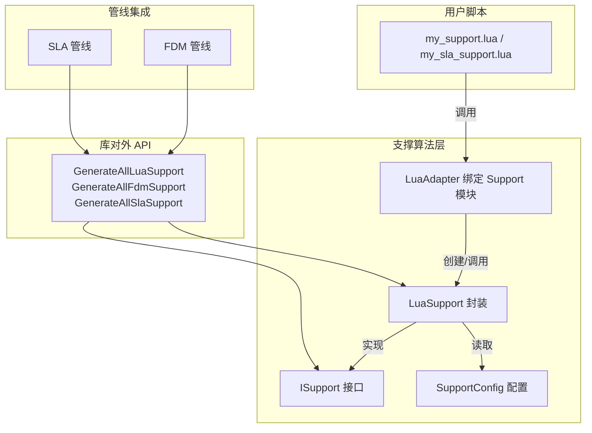
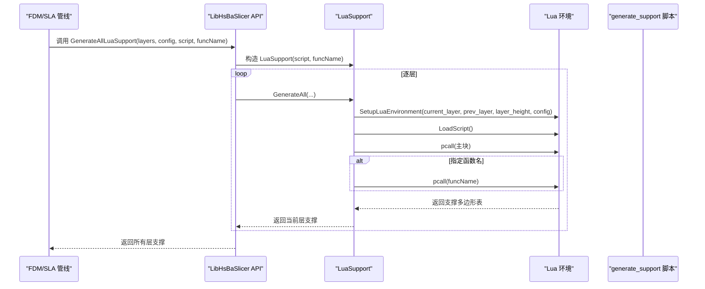
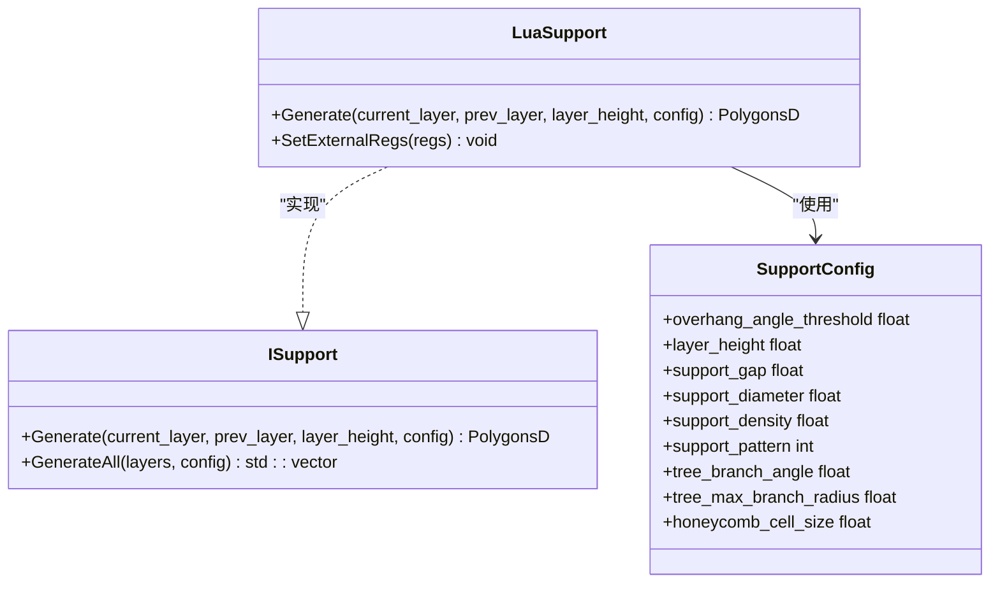
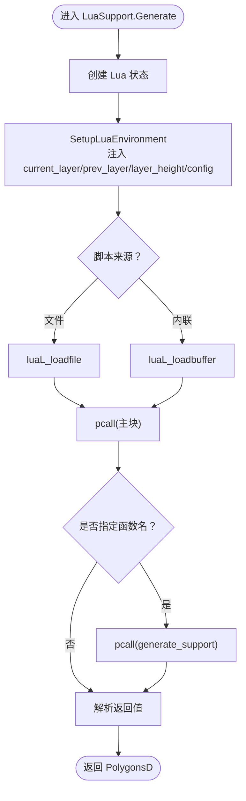
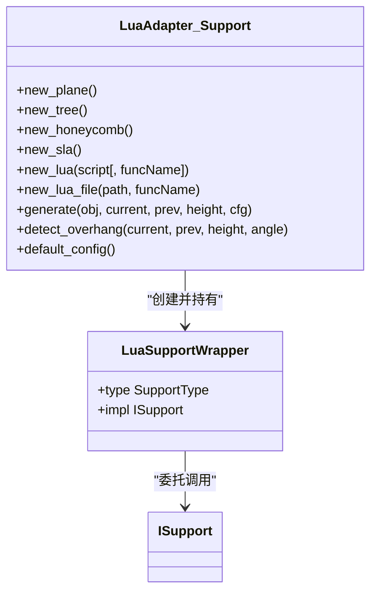
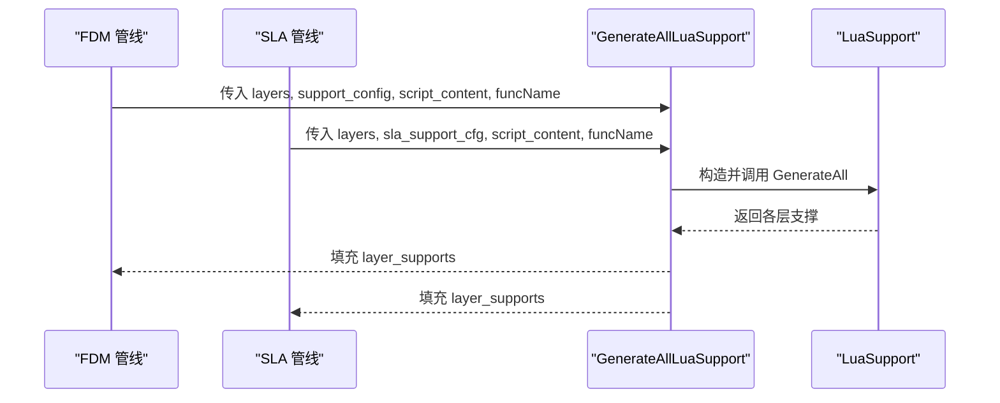
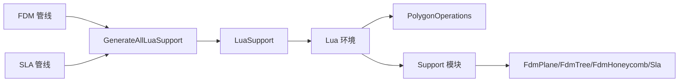
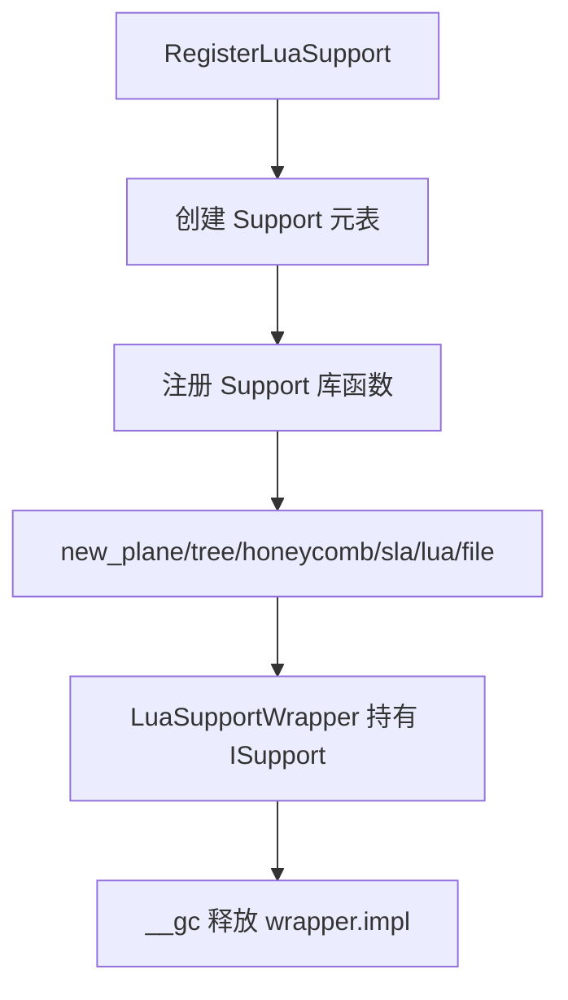

# 自定义支撑脚本

<cite>
**本文引用的文件**   
- [samples/FDM/scripts/my_support.lua](file://samples/FDM/scripts/my_support.lua)
- [samples/SLA/scripts/my_sla_support.lua](file://samples/SLA/scripts/my_sla_support.lua)
- [support/LuaSupport.hpp](file://support/LuaSupport.hpp)
- [support/LuaSupport.cpp](file://support/LuaSupport.cpp)
- [support/LuaAdapter.cpp](file://support/LuaAdapter.cpp)
- [support/ISupport.hpp](file://support/ISupport.hpp)
- [support/ISupport.cpp](file://support/ISupport.cpp)
- [support/SupportConfig.hpp](file://support/SupportConfig.hpp)
- [LibHsBaSlicer/Support/fdm_support.cpp](file://LibHsBaSlicer/Support/fdm_support.cpp)
- [DllHsBaSlicer/fdm_pipeline.cpp](file://DllHsBaSlicer/fdm_pipeline.cpp)
- [DllHsBaSlicer/sla_pipeline.cpp](file://DllHsBaSlicer/sla_pipeline.cpp)
</cite>

## 目录
1. [引言](#引言)
2. [项目结构](#项目结构)
3. [核心组件](#核心组件)
4. [架构总览](#架构总览)
5. [详细组件分析](#详细组件分析)
6. [依赖关系分析](#依赖关系分析)
7. [性能与优化建议](#性能与优化建议)
8. [故障排除指南](#故障排除指南)
9. [结论](#结论)
10. [附录：完整示例与最佳实践](#附录完整示例与最佳实践)

## 引言
本文面向需要编写“自定义支撑脚本”的用户，目标是说明如何编写 generate_support 函数、如何使用 Lua 环境中的全局变量 current_layer、prev_layer、layer_height、config，以及支撑生成器的注册机制和生命周期管理。文档同时提供调试技巧与性能优化建议，并给出可直接参考的 FDM 与 SLA 两个完整示例路径。

## 项目结构
围绕“自定义支撑脚本”，仓库中与支撑相关的代码主要分布在以下位置：
- 支撑抽象接口与默认实现：support/ISupport.*
- Lua 自定义支撑封装：support/LuaSupport.*
- Lua 绑定（Support 模块）：support/LuaAdapter.cpp
- 配置结构体：support/SupportConfig.hpp
- LibHsBaSlicer 对外 API：LibHsBaSlicer/Support/fdm_support.cpp
- DllHsBaSlicer 管线集成：DllHsBaSlicer/fdm_pipeline.cpp、DllHsBaSlicer/sla_pipeline.cpp
- 示例脚本：samples/FDM/scripts/my_support.lua、samples/SLA/scripts/my_sla_support.lua

图表来源
- [support/ISupport.hpp:14-45](file://support/ISupport.hpp#L14-L45)
- [support/LuaSupport.hpp:19-81](file://support/LuaSupport.hpp#L19-L81)
- [support/LuaAdapter.cpp:253-276](file://support/LuaAdapter.cpp#L253-L276)
- [support/SupportConfig.hpp:14-43](file://support/SupportConfig.hpp#L14-L43)
- [LibHsBaSlicer/Support/fdm_support.cpp:61-75](file://LibHsBaSlicer/Support/fdm_support.cpp#L61-L75)
- [DllHsBaSlicer/fdm_pipeline.cpp:291-304](file://DllHsBaSlicer/fdm_pipeline.cpp#L291-L304)
- [DllHsBaSlicer/sla_pipeline.cpp:400-419](file://DllHsBaSlicer/sla_pipeline.cpp#L400-L419)

章节来源
- [support/ISupport.hpp:14-45](file://support/ISupport.hpp#L14-L45)
- [support/LuaSupport.hpp:19-81](file://support/LuaSupport.hpp#L19-L81)
- [support/LuaAdapter.cpp:253-276](file://support/LuaAdapter.cpp#L253-L276)
- [support/SupportConfig.hpp:14-43](file://support/SupportConfig.hpp#L14-L43)
- [LibHsBaSlicer/Support/fdm_support.cpp:61-75](file://LibHsBaSlicer/Support/fdm_support.cpp#L61-L75)
- [DllHsBaSlicer/fdm_pipeline.cpp:291-304](file://DllHsBaSlicer/fdm_pipeline.cpp#L291-L304)
- [DllHsBaSlicer/sla_pipeline.cpp:400-419](file://DllHsBaSlicer/sla_pipeline.cpp#L400-L419)

## 核心组件
- ISupport：定义每层支撑生成的统一接口 Generate 与批量接口 GenerateAll。
- LuaSupport：将 Lua 脚本包装为 ISupport 实现，负责创建 Lua 状态、注入全局变量、加载脚本、调用函数并解析返回结果。
- LuaAdapter（Support 模块）：向 Lua 暴露 Support.new_plane/new_tree/new_honeycomb/new_sla/new_lua/new_lua_file、Support.generate、Support.detect_overhang、Support.default_config 等函数。
- SupportConfig：通用支撑配置，包含悬垂角度阈值、层高、间隙、直径、密度、模式、树分支参数、蜂窝尺寸等。
- LibHsBaSlicer API：提供 GenerateAllLuaSupport 等函数，供上层管线调用。
- DllHsBaSlicer 管线：在 FDM/SLA 管线中根据配置选择内置支撑或 Lua 自定义支撑。

章节来源
- [support/ISupport.hpp:14-45](file://support/ISupport.hpp#L14-L45)
- [support/ISupport.cpp:9-21](file://support/ISupport.cpp#L9-L21)
- [support/LuaSupport.hpp:19-81](file://support/LuaSupport.hpp#L19-L81)
- [support/LuaSupport.cpp:19-90](file://support/LuaSupport.cpp#L19-L90)
- [support/LuaAdapter.cpp:43-108](file://support/LuaAdapter.cpp#L43-L108)
- [support/LuaAdapter.cpp:110-241](file://support/LuaAdapter.cpp#L110-L241)
- [support/SupportConfig.hpp:14-43](file://support/SupportConfig.hpp#L14-L43)
- [LibHsBaSlicer/Support/fdm_support.cpp:61-75](file://LibHsBaSlicer/Support/fdm_support.cpp#L61-L75)

## 架构总览
下图展示从管线到脚本执行的端到端流程：

图表来源
- [LibHsBaSlicer/Support/fdm_support.cpp:61-75](file://LibHsBaSlicer/Support/fdm_support.cpp#L61-L75)
- [support/LuaSupport.cpp:113-178](file://support/LuaSupport.cpp#L113-L178)
- [support/LuaSupport.cpp:67-90](file://support/LuaSupport.cpp#L67-L90)

## 详细组件分析

### 支撑生成器接口与默认批量逻辑
- ISupport::Generate：接收当前层、上一层、层高与配置，返回当前层支撑截面。
- ISupport::GenerateAll：默认按层迭代，首层 prev_layer 为空。

图表来源
- [support/ISupport.hpp:22-45](file://support/ISupport.hpp#L22-L45)
- [support/ISupport.cpp:9-21](file://support/ISupport.cpp#L9-L21)
- [support/LuaSupport.hpp:40-81](file://support/LuaSupport.hpp#L40-L81)
- [support/SupportConfig.hpp:14-43](file://support/SupportConfig.hpp#L14-L43)

章节来源
- [support/ISupport.hpp:22-45](file://support/ISupport.hpp#L22-L45)
- [support/ISupport.cpp:9-21](file://support/ISupport.cpp#L9-L21)
- [support/LuaSupport.hpp:40-81](file://support/LuaSupport.hpp#L40-L81)
- [support/SupportConfig.hpp:14-43](file://support/SupportConfig.hpp#L14-L43)

### Lua 支撑封装与环境注入
LuaSupport 负责：
- 创建独立 Lua 状态；
- 注入 PolygonOperations 与 Support 模块；
- 设置全局变量 current_layer、prev_layer、layer_height、config；
- 加载脚本（内联或文件），执行主块；
- 若指定函数名则调用该函数；
- 解析返回值（支持直接返回或全局 support_polys）。

图表来源
- [support/LuaSupport.cpp:113-178](file://support/LuaSupport.cpp#L113-L178)
- [support/LuaSupport.cpp:67-90](file://support/LuaSupport.cpp#L67-L90)

章节来源
- [support/LuaSupport.cpp:19-90](file://support/LuaSupport.cpp#L19-L90)
- [support/LuaSupport.cpp:113-178](file://support/LuaSupport.cpp#L113-L178)

### Support 模块（Lua 绑定）
Support 模块向脚本暴露：
- new_plane/new_tree/new_honeycomb/new_sla：创建内置生成器对象；
- new_lua/new_lua_file：用脚本内容或文件路径创建 Lua 支撑对象；
- generate(obj, current_layer, prev_layer, layer_height, config_table)：调用具体生成器；
- detect_overhang(current_layer, prev_layer, layer_height, angle_deg)：检测悬垂区域；
- default_config()：返回默认配置表。

图表来源
- [support/LuaAdapter.cpp:110-241](file://support/LuaAdapter.cpp#L110-L241)
- [support/LuaAdapter.cpp:253-276](file://support/LuaAdapter.cpp#L253-L276)

章节来源
- [support/LuaAdapter.cpp:43-108](file://support/LuaAdapter.cpp#L43-L108)
- [support/LuaAdapter.cpp:110-241](file://support/LuaAdapter.cpp#L110-L241)
- [support/LuaAdapter.cpp:253-276](file://support/LuaAdapter.cpp#L253-L276)

### 管线集成与脚本入口
- FDM 管线：当启用支撑且存在 support_lua_script 时，读取脚本内容并以 support_lua_func（默认 generate_support）作为函数名调用 GenerateAllLuaSupport。
- SLA 管线：同样支持通过 support_lua_script 与 support_lua_func 切换至 Lua 自定义支撑。

图表来源
- [DllHsBaSlicer/fdm_pipeline.cpp:291-304](file://DllHsBaSlicer/fdm_pipeline.cpp#L291-L304)
- [DllHsBaSlicer/sla_pipeline.cpp:400-419](file://DllHsBaSlicer/sla_pipeline.cpp#L400-L419)
- [LibHsBaSlicer/Support/fdm_support.cpp:61-75](file://LibHsBaSlicer/Support/fdm_support.cpp#L61-L75)

章节来源
- [DllHsBaSlicer/fdm_pipeline.cpp:291-304](file://DllHsBaSlicer/fdm_pipeline.cpp#L291-L304)
- [DllHsBaSlicer/sla_pipeline.cpp:400-419](file://DllHsBaSlicer/sla_pipeline.cpp#L400-L419)
- [LibHsBaSlicer/Support/fdm_support.cpp:61-75](file://LibHsBaSlicer/Support/fdm_support.cpp#L61-L75)

## 依赖关系分析
- 耦合性：
  - LuaSupport 强依赖 Lua 环境与 2D/LuaAdapter 提供的多边形操作；
  - LuaAdapter 将 C++ 支撑实现（FdmPlaneSupport/FdmTreeSupport/FdmHoneycombSupport/SlaSacrificialSupport）以 userdata 形式暴露给 Lua；
  - 管线仅依赖 LibHsBaSlicer API，不直接感知 Lua 细节。
- 外部依赖：
  - 2D 多边形操作（offsetOperation、union、difference、intersection、makeCircle、area）由 2D/LuaAdapter 提供；
  - 3D 扩展函数通过 Get3DFunctions 注入到 Lua 环境。

图表来源
- [support/LuaSupport.cpp:10-13](file://support/LuaSupport.cpp#L10-L13)
- [support/LuaAdapter.cpp:11-16](file://support/LuaAdapter.cpp#L11-L16)
- [LibHsBaSlicer/Support/fdm_support.cpp:61-75](file://LibHsBaSlicer/Support/fdm_support.cpp#L61-L75)

章节来源
- [support/LuaSupport.cpp:10-13](file://support/LuaSupport.cpp#L10-L13)
- [support/LuaAdapter.cpp:11-16](file://support/LuaAdapter.cpp#L11-L16)
- [LibHsBaSlicer/Support/fdm_support.cpp:61-75](file://LibHsBaSlicer/Support/fdm_support.cpp#L61-L75)

## 性能与优化建议
- 避免不必要的几何计算：
  - 首层 prev_layer 为空时直接返回空结果，减少无意义计算。
- 合理设置支撑密度与直径：
  - 较大的 support_diameter 与 support_density 会显著增加多边形数量与后续路径生成成本。
- 优先使用内置检测与生成器：
  - 使用 Support.detect_overhang 与 Support.generate 可复用 C++ 高性能实现，避免在 Lua 层重复实现复杂几何。
- 控制脚本复杂度：
  - 尽量在 Lua 层只做轻量过滤与后处理，复杂几何运算下沉到 C++ 或通过 Support 模块调用。
- 批量生成：
  - 使用 GenerateAll 而非逐层手动循环，内部已做 reserve 与顺序遍历优化。

[本节为通用指导，不直接分析具体文件]

## 故障排除指南
- 脚本无法读取：
  - 检查 support_lua_script 路径是否正确；管线会在读取失败时返回错误信息。
- 函数名未找到：
  - 确保脚本定义了 generate_support 或 pipeline 配置的 support_lua_func 指向的函数名。
- 返回值格式错误：
  - 脚本需返回“多边形表”（同 current_layer 格式），或设置全局 support_polys；否则将返回空结果。
- Lua 运行时报错：
  - 查看 RuntimeError 消息，定位脚本语法或运行时异常。

章节来源
- [DllHsBaSlicer/sla_pipeline.cpp:400-419](file://DllHsBaSlicer/sla_pipeline.cpp#L400-L419)
- [support/LuaSupport.cpp:141-178](file://support/LuaSupport.cpp#L141-L178)

## 结论
通过 Lua 自定义支撑脚本，用户可以完全替换内置支撑算法，灵活控制支撑策略。核心在于正确实现 generate_support 函数，合理使用 current_layer、prev_layer、layer_height、config 等全局变量，并通过 Support 模块调用内置能力。管线层对脚本透明，只需配置脚本路径与函数名即可无缝接入。

[本节为总结，不直接分析具体文件]

## 附录：完整示例与最佳实践

### 接口规范：generate_support
- 函数签名约定：function generate_support()
- 输入：通过全局变量获取
  - current_layer：当前层多边形表
  - prev_layer：上一层多边形表（首层为空）
  - layer_height：层高（mm）
  - config：支撑配置表，字段包括 overhang_angle_threshold、layer_height、support_gap、support_diameter、support_density、support_pattern、tree_branch_angle、tree_max_branch_radius、honeycomb_cell_size
- 输出：支撑截面多边形表（与 current_layer 同构）

章节来源
- [support/LuaSupport.hpp:28-38](file://support/LuaSupport.hpp#L28-L38)
- [support/LuaSupport.cpp:19-49](file://support/LuaSupport.cpp#L19-L49)
- [support/SupportConfig.hpp:14-43](file://support/SupportConfig.hpp#L14-L43)

### 可用全局变量与用法
- current_layer：用于识别当前层轮廓，结合 prev_layer 进行悬垂检测。
- prev_layer：首层为空，常用于快速判断是否需要支撑。
- layer_height：用于几何比例与悬垂角度换算。
- config：
  - overhang_angle_threshold：悬垂角度阈值（度）
  - layer_height：层高（mm）
  - support_gap：支撑与模型间隙（mm）
  - support_diameter：支撑柱直径（mm）
  - support_density：支撑填充密度 [0,1]
  - support_pattern：支撑模式（0=平面，1=树状，2=蜂窝）
  - tree_branch_angle：树分支角度（度）
  - tree_max_branch_radius：树最大分支半径（mm）
  - honeycomb_cell_size：蜂窝单元尺寸（mm）

章节来源
- [support/LuaSupport.cpp:19-49](file://support/LuaSupport.cpp#L19-L49)
- [support/SupportConfig.hpp:14-43](file://support/SupportConfig.hpp#L14-L43)

### 完整示例
- FDM 自定义支撑脚本示例路径：
  - [samples/FDM/scripts/my_support.lua](file://samples/FDM/scripts/my_support.lua)
- SLA 自定义支撑脚本示例路径：
  - [samples/SLA/scripts/my_sla_support.lua](file://samples/SLA/scripts/my_sla_support.lua)

章节来源
- [samples/FDM/scripts/my_support.lua:1-83](file://samples/FDM/scripts/my_support.lua#L1-L83)
- [samples/SLA/scripts/my_sla_support.lua:1-76](file://samples/SLA/scripts/my_sla_support.lua#L1-L76)

### 支撑生成器注册机制与生命周期
- 注册：
  - RegisterLuaSupport 创建 Support 元表与库，并将 Support 设为全局模块。
- 生命周期：
  - 每个 Support.new_* 返回一个 userdata，内部持有 ISupport 实现；
  - __gc 回调释放 LuaSupportWrapper，从而销毁底层实现。

图表来源
- [support/LuaAdapter.cpp:243-276](file://support/LuaAdapter.cpp#L243-L276)
- [support/LuaAdapter.cpp:110-172](file://support/LuaAdapter.cpp#L110-L172)

章节来源
- [support/LuaAdapter.cpp:243-276](file://support/LuaAdapter.cpp#L243-L276)
- [support/LuaAdapter.cpp:110-172](file://support/LuaAdapter.cpp#L110-L172)

### 调试技巧
- 打印中间结果：
  - 在脚本中使用 PolygonOperations.area 等工具验证多边形面积与形状。
- 逐步缩小范围：
  - 先用 Support.detect_overhang 确认悬垂区域是否符合预期，再调用 Support.generate。
- 利用默认配置：
  - 使用 Support.default_config() 获取默认值，再按需覆盖关键字段。
- 观察管线日志：
  - 管线在脚本读取失败或执行异常时会返回错误信息，便于定位问题。

章节来源
- [support/LuaAdapter.cpp:215-241](file://support/LuaAdapter.cpp#L215-L241)
- [support/LuaSupport.cpp:141-178](file://support/LuaSupport.cpp#L141-L178)
- [DllHsBaSlicer/sla_pipeline.cpp:400-419](file://DllHsBaSlicer/sla_pipeline.cpp#L400-L419)