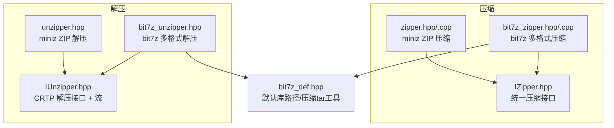
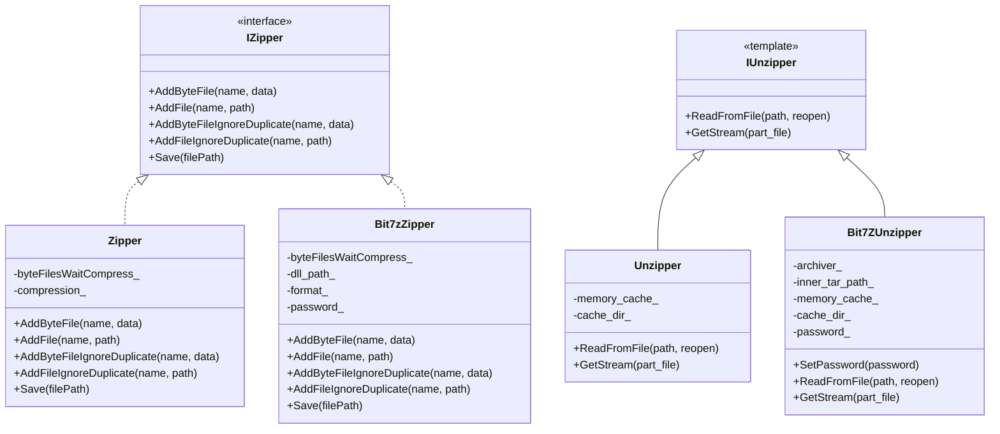
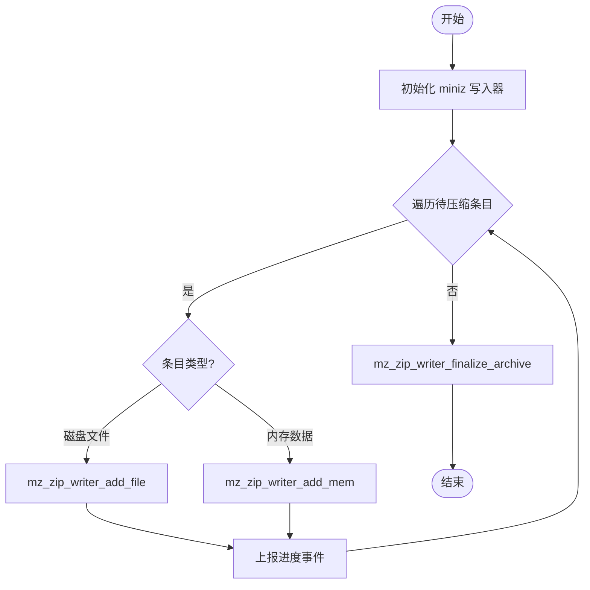
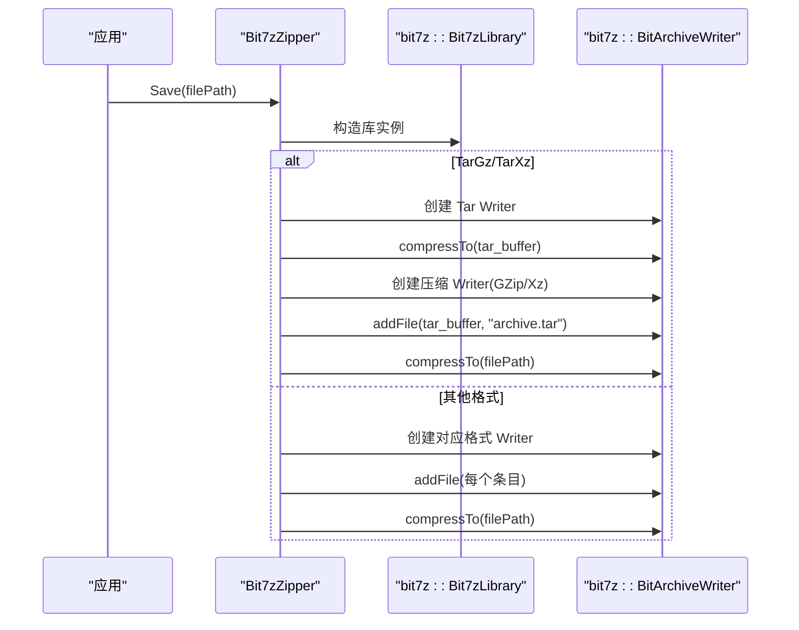
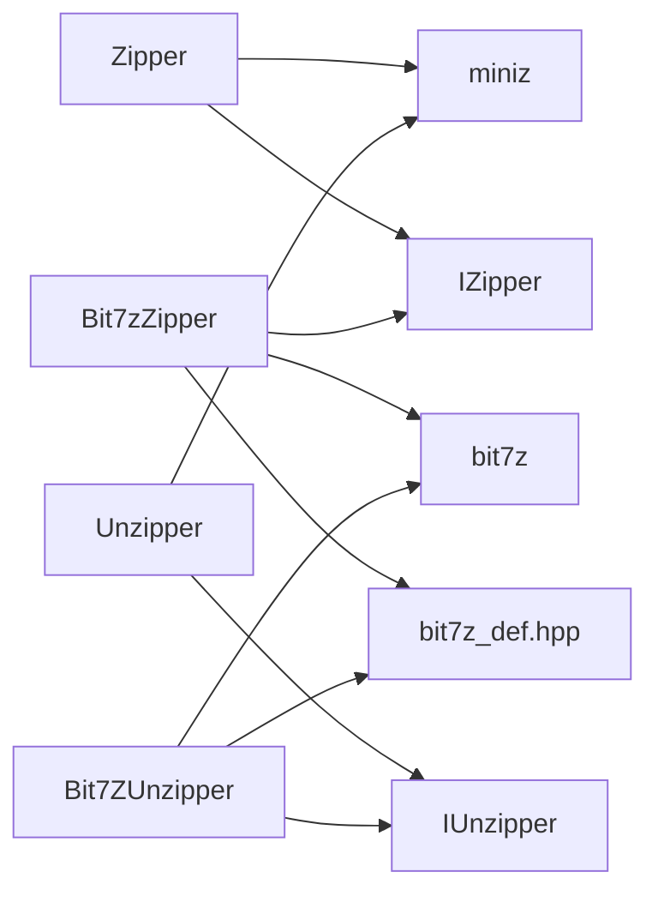

# 压缩解压

<cite>
**本文引用的文件**   
- [fileoperator/IZipper.hpp](file://fileoperator/IZipper.hpp)
- [fileoperator/zipper.hpp](file://fileoperator/zipper.hpp)
- [fileoperator/zipper.cpp](file://fileoperator/zipper.cpp)
- [fileoperator/bit7z_zipper.hpp](file://fileoperator/bit7z_zipper.hpp)
- [fileoperator/bit7z_zipper.cpp](file://fileoperator/bit7z_zipper.cpp)
- [fileoperator/bit7z_def.hpp](file://fileoperator/bit7z_def.hpp)
- [fileoperator/IUnzipper.hpp](file://fileoperator/IUnzipper.hpp)
- [fileoperator/unzipper.hpp](file://fileoperator/unzipper.hpp)
- [fileoperator/bit7z_unzipper.hpp](file://fileoperator/bit7z_unzipper.hpp)
</cite>

## 目录
1. [简介](#简介)
2. [项目结构](#项目结构)
3. [核心组件](#核心组件)
4. [架构总览](#架构总览)
5. [详细组件分析](#详细组件分析)
6. [依赖关系分析](#依赖关系分析)
7. [性能与调优](#性能与调优)
8. [故障排除指南](#故障排除指南)
9. [结论](#结论)
10. [附录：API 参考与用法示例](#附录api-参考与用法示例)

## 简介
本章节面向需要在 HsBaSlicer 中进行“压缩”和“解压”的开发者，系统性说明以下能力：
- 使用 Zipper（基于 miniz）与 Bit7zZipper（基于 bit7z）进行 ZIP、7Z、XZ、BZIP2、GZIP、TAR、TarGz、TarXz 等格式的打包。
- 使用 Unzipper（基于 miniz）与 Bit7ZUnzipper（基于 bit7z）进行流式读取与内存/临时文件混合缓存的解压。
- 对比两类实现的 API 差异与兼容性，并给出批量文件压缩、内存数据压缩的实际调用流程。
- 提供压缩率优化、速度调优与大文件处理的性能建议。

## 项目结构
与压缩解压相关的代码集中在 fileoperator 模块中，采用“接口 + 多后端实现”的设计：
- IZipper：统一的压缩接口抽象。
- Zipper：基于 miniz 的 ZIP 压缩实现。
- Bit7zZipper：基于 bit7z 的多格式压缩实现（受编译开关 HSBA_USE_BIT7Z 控制）。
- IUnzipper：统一的解压 CRTP 接口与流封装 UnzipperStream。
- Unzipper：基于 miniz 的 ZIP 解压实现。
- Bit7ZUnzipper：基于 bit7z 的多格式解压实现（受编译开关 HSBA_USE_BIT7Z 控制）。
- bit7z_def.hpp：bit7z 相关默认库路径与压缩 tar 检测工具。

图示来源
- [fileoperator/IZipper.hpp:14-57](file://fileoperator/IZipper.hpp#L14-L57)
- [fileoperator/zipper.hpp:34-87](file://fileoperator/zipper.hpp#L34-L87)
- [fileoperator/bit7z_zipper.hpp:48-126](file://fileoperator/bit7z_zipper.hpp#L48-L126)
- [fileoperator/IUnzipper.hpp:24-198](file://fileoperator/IUnzipper.hpp#L24-L198)
- [fileoperator/unzipper.hpp:19-77](file://fileoperator/unzipper.hpp#L19-L77)
- [fileoperator/bit7z_unzipper.hpp:20-104](file://fileoperator/bit7z_unzipper.hpp#L20-L104)
- [fileoperator/bit7z_def.hpp:22-72](file://fileoperator/bit7z_def.hpp#L22-L72)

章节来源
- [fileoperator/IZipper.hpp:14-57](file://fileoperator/IZipper.hpp#L14-L57)
- [fileoperator/zipper.hpp:34-87](file://fileoperator/zipper.hpp#L34-L87)
- [fileoperator/bit7z_zipper.hpp:48-126](file://fileoperator/bit7z_zipper.hpp#L48-L126)
- [fileoperator/IUnzipper.hpp:24-198](file://fileoperator/IUnzipper.hpp#L24-L198)
- [fileoperator/unzipper.hpp:19-77](file://fileoperator/unzipper.hpp#L19-L77)
- [fileoperator/bit7z_unzipper.hpp:20-104](file://fileoperator/bit7z_unzipper.hpp#L20-L104)
- [fileoperator/bit7z_def.hpp:22-72](file://fileoperator/bit7z_def.hpp#L22-L72)

## 核心组件
- IZipper：定义 AddByteFile/AddFile/AddByteFileIgnoreDuplicate/AddFileIgnoreDuplicate/Save 五个方法，屏蔽后端差异。
- Zipper：基于 miniz 的 ZIP 压缩器，支持内存与磁盘文件两种输入源，提供进度事件；另提供 MiniZExtractFile/MiniZExtractFileToBuffer 两个独立解压辅助函数。
- Bit7zZipper：基于 bit7z 的多格式压缩器，支持 Zip/SevenZip/XZ/BZIP2/GZIP/TAR/TarGz/TarXz 写入，RAR/ISO/Z 仅读；支持密码保护；TarGz/TarXz 通过两阶段内存打包生成。
- IUnzipper：CRTP 接口，暴露 ReadFromFile/GetStream 两个公共方法，内部委托派生类实现。
- Unzipper：基于 miniz 的 ZIP 解压器，支持内存缓存与临时文件缓存，可配置最大内存占用。
- Bit7ZUnzipper：基于 bit7z 的多格式解压器，支持密码设置，自动处理 .tar.gz/.tgz/.tar.xz/.txz 的嵌套 tar 解压。

章节来源
- [fileoperator/IZipper.hpp:14-57](file://fileoperator/IZipper.hpp#L14-L57)
- [fileoperator/zipper.hpp:34-87](file://fileoperator/zipper.hpp#L34-L87)
- [fileoperator/bit7z_zipper.hpp:48-126](file://fileoperator/bit7z_zipper.hpp#L48-L126)
- [fileoperator/IUnzipper.hpp:160-198](file://fileoperator/IUnzipper.hpp#L160-L198)
- [fileoperator/unzipper.hpp:19-77](file://fileoperator/unzipper.hpp#L19-L77)
- [fileoperator/bit7z_unzipper.hpp:20-104](file://fileoperator/bit7z_unzipper.hpp#L20-L104)

## 架构总览
下图展示压缩与解压两条主线的交互关系，以及各后端的职责边界。

图示来源
- [fileoperator/IZipper.hpp:14-57](file://fileoperator/IZipper.hpp#L14-L57)
- [fileoperator/zipper.hpp:34-87](file://fileoperator/zipper.hpp#L34-L87)
- [fileoperator/bit7z_zipper.hpp:48-126](file://fileoperator/bit7z_zipper.hpp#L48-L126)
- [fileoperator/IUnzipper.hpp:160-198](file://fileoperator/IUnzipper.hpp#L160-L198)
- [fileoperator/unzipper.hpp:19-77](file://fileoperator/unzipper.hpp#L19-L77)
- [fileoperator/bit7z_unzipper.hpp:20-104](file://fileoperator/bit7z_unzipper.hpp#L20-L104)

## 详细组件分析

### 压缩器：Zipper（miniz）
- 功能要点
  - 支持内存字符串与磁盘文件两种输入源。
  - 重复名称处理：Add* 抛异常；Add*IgnoreDuplicate 自动追加 “_duplicate”。
  - 保存时按条目逐个添加，并通过 EventSource 上报进度。
  - 提供 MiniZExtractFile/MiniZExtractFileToBuffer 两个独立解压辅助函数。
- 关键流程（保存）
  - 初始化 miniz 写入器 -> 遍历待压缩条目 -> 根据类型选择 add_file/add_mem -> 最终化归档 -> 释放资源。
- 错误处理
  - 构造时若传入未定义或未知压缩级别会抛出 NotSupportedError。
  - Save 失败抛出 IOError。

图示来源
- [fileoperator/zipper.cpp:114-158](file://fileoperator/zipper.cpp#L114-L158)
- [fileoperator/zipper.cpp:163-174](file://fileoperator/zipper.cpp#L163-L174)

章节来源
- [fileoperator/zipper.hpp:34-87](file://fileoperator/zipper.hpp#L34-L87)
- [fileoperator/zipper.cpp:21-42](file://fileoperator/zipper.cpp#L21-L42)
- [fileoperator/zipper.cpp:50-108](file://fileoperator/zipper.cpp#L50-L108)
- [fileoperator/zipper.cpp:114-174](file://fileoperator/zipper.cpp#L114-L174)

### 压缩器：Bit7zZipper（bit7z）
- 功能要点
  - 支持多种容器格式：Zip、SevenZip、XZ、BZIP2、GZIP、TAR、TarGz、TarXz。
  - TarGz/TarXz 通过两阶段内存打包（先 tar，再压缩）直接输出目标后缀。
  - 支持密码保护，保存失败抛出 IOError。
  - 对 RAR/ISO/Z 仅提供解压（不写入）。
- 关键流程（保存）
  - 根据 format_ 选择对应 BitArchiveWriter -> 统一 AddAllWaitFiles 添加条目 -> 压缩到文件或缓冲区。
  - TarGz/TarXz 走 SaveCompressedTar：先生成 tar buffer，再以压缩格式写入。
- 特殊处理
  - 压缩 tar 检测与内层 tar 临时文件由 bit7z_def.hpp 提供工具。

图示来源
- [fileoperator/bit7z_zipper.cpp:191-255](file://fileoperator/bit7z_zipper.cpp#L191-L255)
- [fileoperator/bit7z_zipper.cpp:257-300](file://fileoperator/bit7z_zipper.cpp#L257-L300)
- [fileoperator/bit7z_def.hpp:47-72](file://fileoperator/bit7z_def.hpp#L47-L72)

章节来源
- [fileoperator/bit7z_zipper.hpp:48-126](file://fileoperator/bit7z_zipper.hpp#L48-L126)
- [fileoperator/bit7z_zipper.cpp:129-189](file://fileoperator/bit7z_zipper.cpp#L129-L189)
- [fileoperator/bit7z_zipper.cpp:191-300](file://fileoperator/bit7z_zipper.cpp#L191-L300)
- [fileoperator/bit7z_def.hpp:47-72](file://fileoperator/bit7z_def.hpp#L47-L72)

### 解压器：Unzipper（miniz）
- 功能要点
  - 基于 miniz 的 ZIP 解压，支持内存缓存与临时文件缓存。
  - 可通过静态方法 SetMaxMemSize 调整最大内存占用。
  - 通过 GetStream 返回 UnzipperStream，支持从内存缓冲或临时文件读取。
- 典型流程
  - ReadFromFile 打开归档 -> 按需将条目解压到内存或临时文件 -> 通过 GetStream 提供 std::istream 访问。

章节来源
- [fileoperator/unzipper.hpp:19-77](file://fileoperator/unzipper.hpp#L19-L77)
- [fileoperator/IUnzipper.hpp:24-158](file://fileoperator/IUnzipper.hpp#L24-L158)

### 解压器：Bit7ZUnzipper（bit7z）
- 功能要点
  - 基于 bit7z 的多格式解压，支持密码设置。
  - 自动识别 .tar.gz/.tgz/.tar.xz/.txz，透明地打开内层 tar 一次性解压。
  - 同样支持内存缓存与临时文件缓存，并提供 SetMaxMemSize 控制内存上限。
- 典型流程
  - Create(dll_path) 构造 -> SetPassword(可选) -> ReadFromFile -> GetStream 获取流。

章节来源
- [fileoperator/bit7z_unzipper.hpp:20-104](file://fileoperator/bit7z_unzipper.hpp#L20-L104)
- [fileoperator/bit7z_def.hpp:47-72](file://fileoperator/bit7z_def.hpp#L47-L72)

## 依赖关系分析
- 压缩侧
  - Zipper 依赖 miniz 与 IZipper 接口。
  - Bit7zZipper 依赖 bit7z 与 IZipper 接口，并通过 bit7z_def.hpp 获取平台默认库路径与压缩 tar 工具。
- 解压侧
  - Unzipper 依赖 miniz 与 IUnzipper 接口。
  - Bit7ZUnzipper 依赖 bit7z 与 IUnzipper 接口，并使用 bit7z_def.hpp 的工具处理压缩 tar。

图示来源
- [fileoperator/zipper.hpp:34-87](file://fileoperator/zipper.hpp#L34-L87)
- [fileoperator/bit7z_zipper.hpp:48-126](file://fileoperator/bit7z_zipper.hpp#L48-L126)
- [fileoperator/unzipper.hpp:19-77](file://fileoperator/unzipper.hpp#L19-L77)
- [fileoperator/bit7z_unzipper.hpp:20-104](file://fileoperator/bit7z_unzipper.hpp#L20-L104)
- [fileoperator/bit7z_def.hpp:22-72](file://fileoperator/bit7z_def.hpp#L22-L72)

章节来源
- [fileoperator/zipper.hpp:34-87](file://fileoperator/zipper.hpp#L34-L87)
- [fileoperator/bit7z_zipper.hpp:48-126](file://fileoperator/bit7z_zipper.hpp#L48-L126)
- [fileoperator/unzipper.hpp:19-77](file://fileoperator/unzipper.hpp#L19-L77)
- [fileoperator/bit7z_unzipper.hpp:20-104](file://fileoperator/bit7z_unzipper.hpp#L20-L104)
- [fileoperator/bit7z_def.hpp:22-72](file://fileoperator/bit7z_def.hpp#L22-L72)

## 性能与调优
- 压缩率与速度权衡
  - Zipper（miniz）：通过 MinizCompression 枚举选择 No/Fast/Tight，分别对应最小体积/最快速度/最高压缩比。
  - Bit7zZipper（bit7z）：不同格式天然具备不同压缩特性；TarGz/TarXz 为两阶段内存打包，适合需要标准归档后缀的场景。
- 大文件处理
  - 解压侧：Unzipper/Bit7ZUnzipper 支持内存缓存与临时文件缓存，可通过 SetMaxMemSize 限制内存占用，避免 OOM。
  - 压缩侧：Bit7zZipper 在 TarGz/TarXz 场景下会在内存中构建 tar 缓冲，需注意内存峰值。
- 进度与可观测性
  - Zipper/Bit7zZipper 均通过 EventSource 上报每条目进度，便于 UI 或日志跟踪。
- 密码与安全性
  - Bit7zZipper/Bit7ZUnzipper 支持密码保护；注意在跨进程或脚本环境中安全传递密码。

[本节为通用性能指导，不直接分析具体源码文件]

## 故障排除指南
- 常见异常
  - NotSupportedError：Zipper 构造时传入未定义或未知压缩级别；Bit7zZipper 保存时遇到不支持的格式。
  - InvalidArgumentError：重复文件名且未使用 IgnoreDuplicate 变体。
  - IOError：文件读写失败、归档无法最终化、解压失败等。
- 排查建议
  - 检查输入路径编码转换（UTF-8 到本地编码）是否成功。
  - 确认 bit7z DLL 路径是否正确（Windows/macOS/Linux 默认路径见 bit7z_def.hpp）。
  - 对于 .tar.gz/.tgz/.tar.xz/.txz，确保使用 Bit7zZipper/Bit7ZUnzipper 以启用内层 tar 透明处理。

章节来源
- [fileoperator/zipper.cpp:21-42](file://fileoperator/zipper.cpp#L21-L42)
- [fileoperator/zipper.cpp:114-129](file://fileoperator/zipper.cpp#L114-L129)
- [fileoperator/bit7z_zipper.cpp:191-255](file://fileoperator/bit7z_zipper.cpp#L191-L255)
- [fileoperator/bit7z_def.hpp:22-43](file://fileoperator/bit7z_def.hpp#L22-L43)

## 结论
- 若仅需 ZIP 压缩/解压且希望轻量依赖，优先选择 Zipper/Unzipper（miniz）。
- 若需要多格式支持（7Z/XZ/BZIP2/GZIP/TAR/TarGz/TarXz）、密码保护或更好的生态兼容，选择 Bit7zZipper/Bit7ZUnzipper（bit7z），并注意依赖 7z DLL 的正确部署。
- 在大文件场景中，合理配置解压侧内存上限，并利用流式读取避免一次性加载全部数据。

[本节为总结性内容，不直接分析具体源码文件]

## 附录：API 参考与用法示例

### API 差异与兼容性对照
- IZipper 统一接口
  - AddByteFile/AddFile：添加内存/磁盘文件，重复名抛异常。
  - AddByteFileIgnoreDuplicate/AddFileIgnoreDuplicate：重复名自动追加 “_duplicate”。
  - Save：写出归档。
- Zipper（miniz）
  - 构造：支持 MinizCompression 枚举（No/Fast/Tight）。
  - 解压辅助：MiniZExtractFile/MiniZExtractFileToBuffer。
- Bit7zZipper（bit7z）
  - 构造：支持指定 dll_path、ZipperFormat、password。
  - 支持格式：Zip/SevenZip/XZ/BZIP2/GZIP/TAR/TarGz/TarXz（写入）；RAR/ISO/Z（仅读）。
  - TarGz/TarXz：两阶段内存打包生成目标后缀。
- IUnzipper 统一接口
  - ReadFromFile/GetStream：打开归档并按需获取流。
- Unzipper（miniz）
  - 静态 SetMaxMemSize：设置最大内存占用。
- Bit7ZUnzipper（bit7z）
  - SetPassword：设置密码。
  - 静态 SetMaxMemSize：设置最大内存占用。
  - 自动处理压缩 tar（.tar.gz/.tgz/.tar.xz/.txz）。

章节来源
- [fileoperator/IZipper.hpp:14-57](file://fileoperator/IZipper.hpp#L14-L57)
- [fileoperator/zipper.hpp:22-87](file://fileoperator/zipper.hpp#L22-L87)
- [fileoperator/bit7z_zipper.hpp:48-126](file://fileoperator/bit7z_zipper.hpp#L48-L126)
- [fileoperator/IUnzipper.hpp:160-198](file://fileoperator/IUnzipper.hpp#L160-L198)
- [fileoperator/unzipper.hpp:19-77](file://fileoperator/unzipper.hpp#L19-L77)
- [fileoperator/bit7z_unzipper.hpp:20-104](file://fileoperator/bit7z_unzipper.hpp#L20-L104)

### 批量文件压缩示例（概念流程）
- 步骤
  - 选择后端：Zipper 或 Bit7zZipper。
  - 循环遍历文件列表，调用 AddFile 或 AddFileIgnoreDuplicate。
  - 调用 Save 写出归档。
  - 订阅进度事件以更新 UI 或记录日志。
- 适用场景
  - 大量小文件打包（如资源包、配置文件集合）。
  - 需要标准 ZIP 时使用 Zipper；需要多格式或密码保护时使用 Bit7zZipper。

[本节为概念流程，不直接分析具体源码文件]

### 内存数据压缩示例（概念流程）
- 步骤
  - 准备内存数据（std::string 或字节向量）。
  - 调用 AddByteFile 或 AddByteFileIgnoreDuplicate 加入归档。
  - 调用 Save 写出归档。
- 适用场景
  - 动态生成的文本/二进制内容打包（如日志、快照、序列化结果）。

[本节为概念流程，不直接分析具体源码文件]

### 压缩率优化与速度调优方法
- Zipper（miniz）
  - 使用 MinizCompression::Fast 提升速度；使用 Tight 提升压缩率。
- Bit7zZipper（bit7z）
  - 选择合适格式：Zip 通用性好；7Z/XZ/BZIP2/GZIP 通常具有更高压缩率；TarGz/TarXz 适合标准归档需求。
  - 避免不必要的中间拷贝：尽量直接添加磁盘文件而非先复制到内存。
- 大文件
  - 解压侧：降低 SetMaxMemSize 以避免 OOM；必要时启用临时文件缓存。
  - 压缩侧：Bit7zZipper 的 TarGz/TarXz 会先在内存构建 tar，应评估内存峰值。

[本节为通用指导，不直接分析具体源码文件]

### 大文件处理的性能考虑
- 解压
  - 使用 Unzipper/Bit7ZUnzipper 的流式读取，避免一次性加载整个文件。
  - 合理设置 SetMaxMemSize，结合业务内存预算。
- 压缩
  - 优先直接添加磁盘文件，减少内存拷贝。
  - 对 TarGz/TarXz 注意两阶段内存打包带来的峰值内存。

[本节为通用指导，不直接分析具体源码文件]