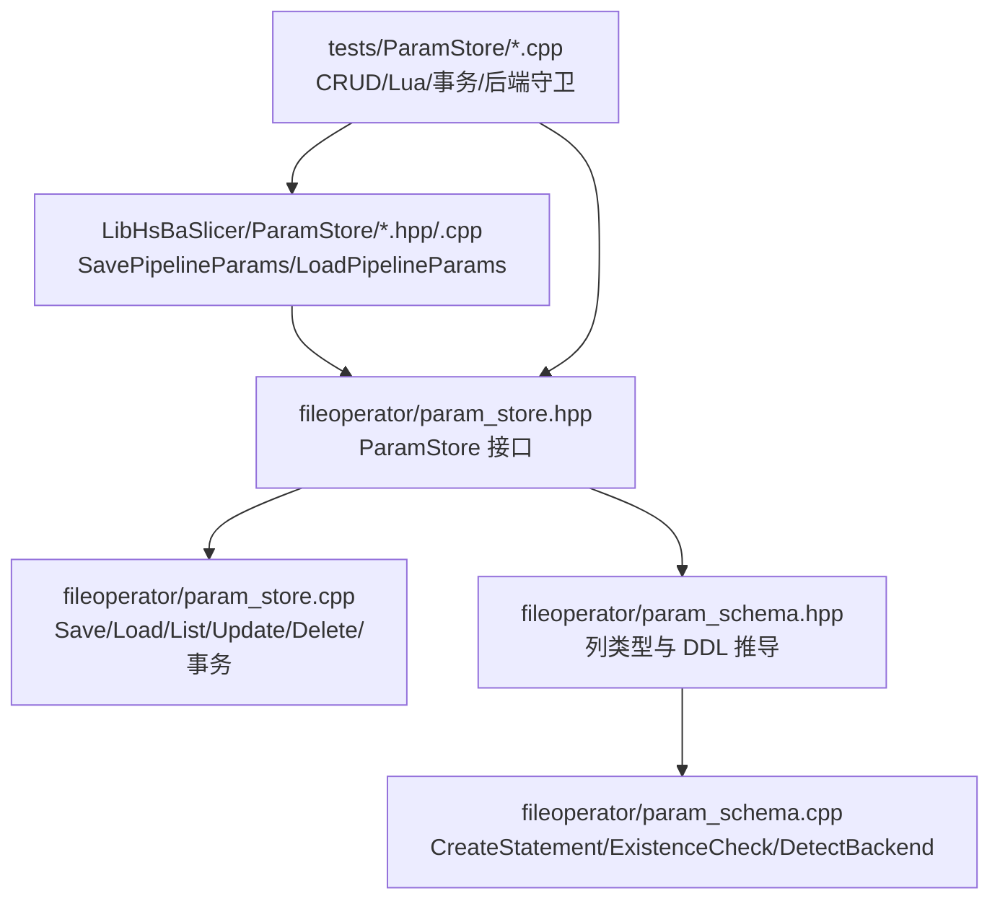
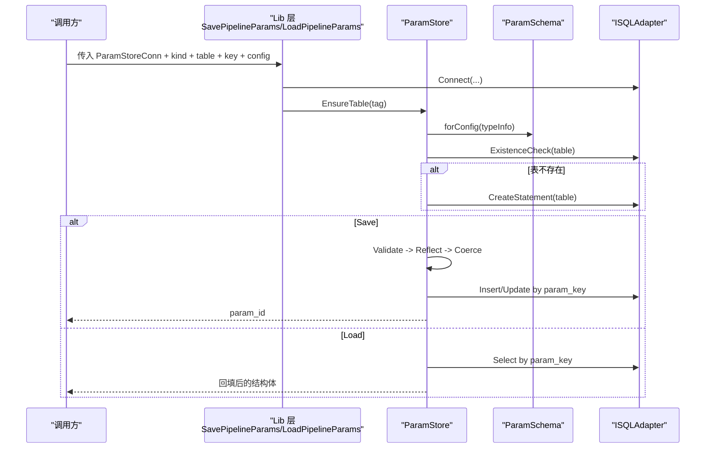
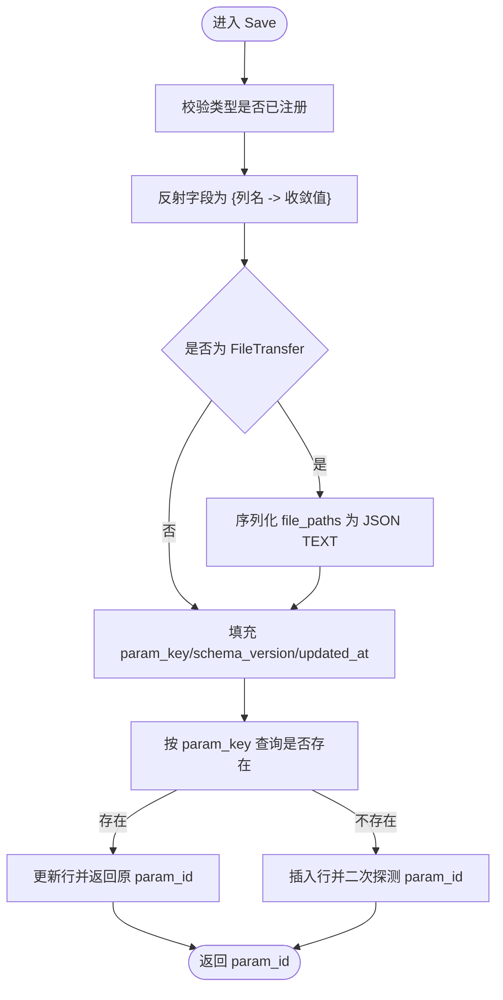
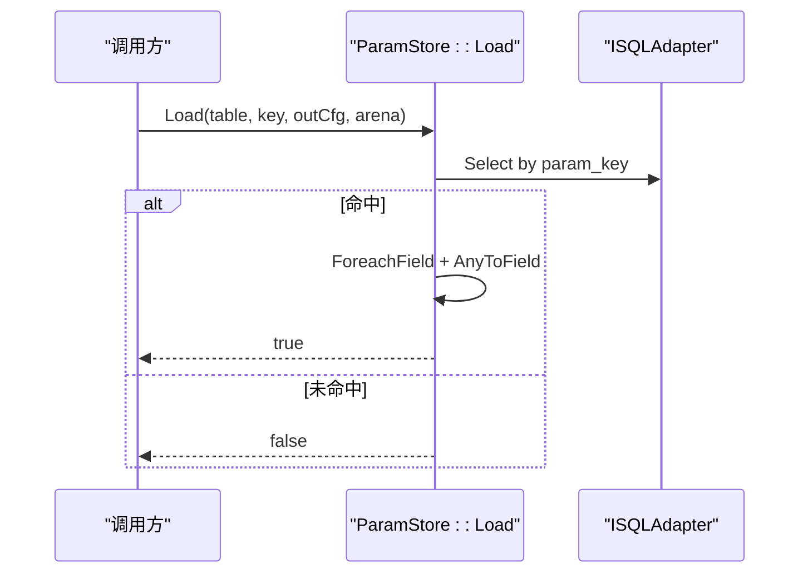
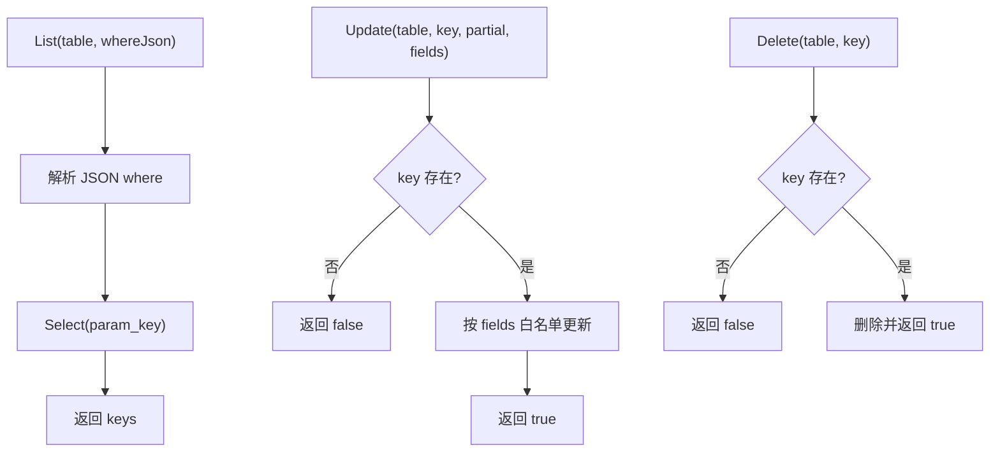
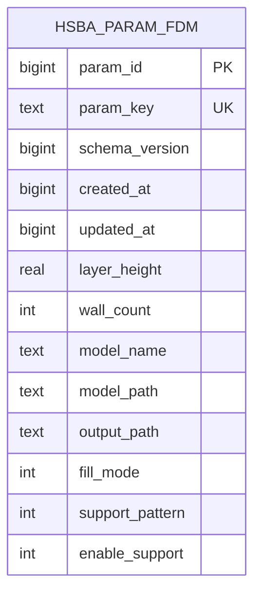
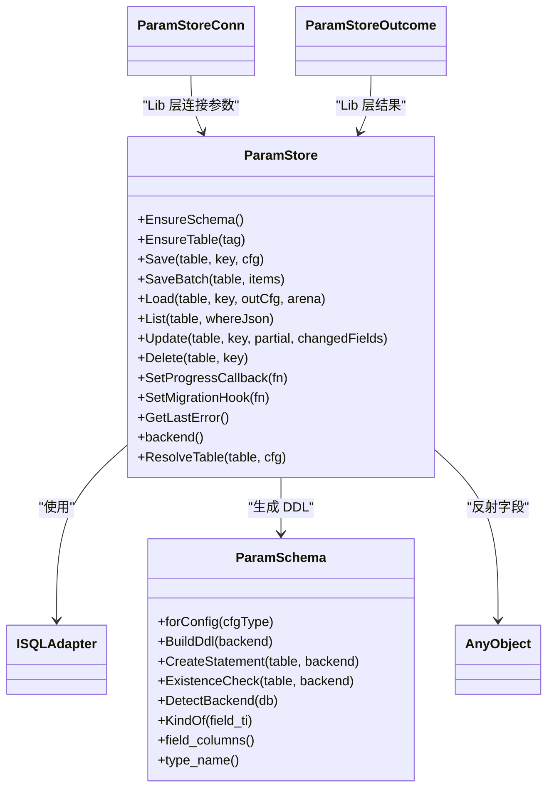
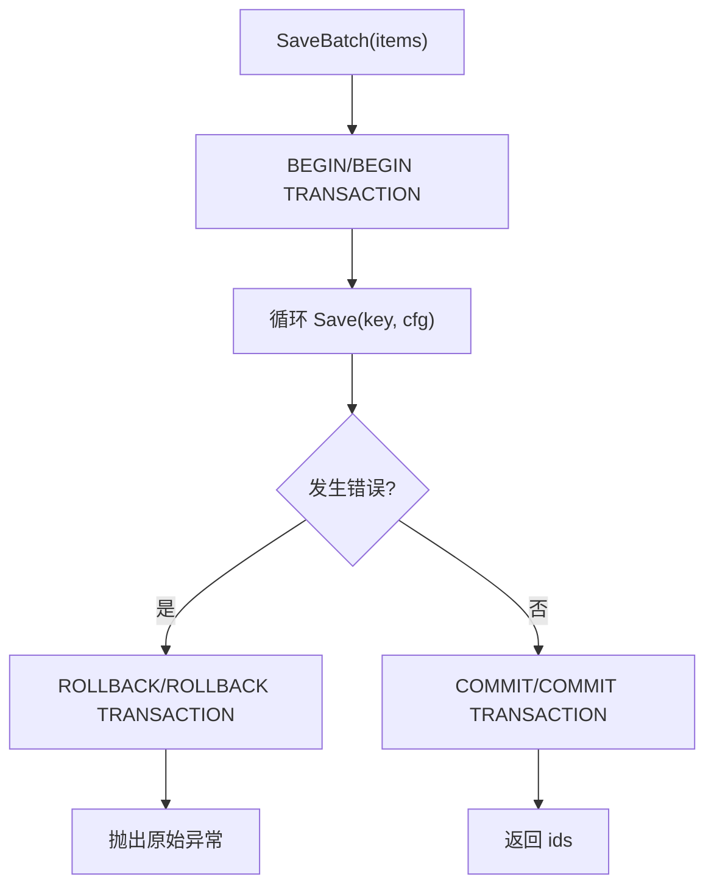
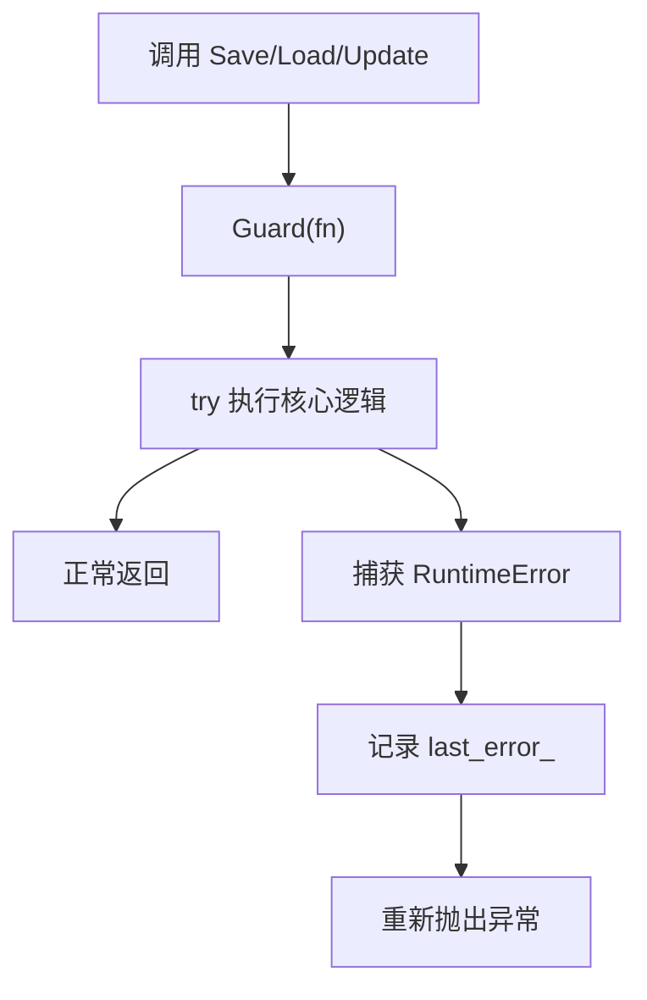

# 参数存储

<cite>
**本文引用的文件**   
- [param_store.hpp](file://fileoperator\param_store.hpp)
- [param_store.cpp](file://fileoperator\param_store.cpp)
- [param_schema.hpp](file://fileoperator\param_schema.hpp)
- [param_schema.cpp](file://fileoperator\param_schema.cpp)
- [param_store_ops.hpp](file://LibHsBaSlicer\ParamStore\param_store_ops.hpp)
- [param_store_ops.cpp](file://LibHsBaSlicer\ParamStore\param_store_ops.cpp)
- [param_store_test.cpp](file://tests\ParamStore\param_store_test.cpp)
</cite>

## 目录
1. [简介](#简介)
2. [项目结构](#项目结构)
3. [核心组件](#核心组件)
4. [架构总览](#架构总览)
5. [详细组件分析](#详细组件分析)
6. [依赖关系分析](#依赖关系分析)
7. [性能与一致性](#性能与一致性)
8. [参数验证与数据完整性](#参数验证与数据完整性)
9. [备份与恢复最佳实践](#备份与恢复最佳实践)
10. [故障排除](#故障排除)
11. [结论](#结论)

## 简介
本页面聚焦 HsBaSlicer 的参数持久化子系统，围绕 `ParamStore` 类及其 Lib/Dll 封装层展开。该子系统把各流水线工艺参数（例如 FDM、SLA、SLM、TDP、WAAM、LOM、FileTransfer 等配置）以“每类型一张宽表”的方式写入 SQLite / MySQL / PostgreSQL，并通过业务键 `param_key` 实现按 key 的 upsert、读取、列表、增量更新和删除。

核心能力包括：
- 通过反射自动推导字段列定义并生成 DDL。
- Save 提供“校验 → 反射 → 收敛 → Upsert”的分阶段流程。
- Load 将数据库行回填到调用方提供的 C 结构体。
- List 支持基于 JSON where 条件的键查询。
- Update 仅更新指定字段。
- Delete 按 key 删除记录。
- SaveBatch 在事务中批量保存，失败时回滚。
- 统一错误处理：异常不被吞掉，同时记录 `last_error_`。

## 项目结构
参数存储相关代码主要分布在以下位置：
- `fileoperator/`：核心实现，包含 `ParamStore`、`ParamSchema`、SQL 适配器和反射/类型收敛工具。
- `LibHsBaSlicer/ParamStore/`：面向库使用者的轻量封装，暴露 `SavePipelineParams`、`LoadPipelineParams`、`FreeLoadedConfigStrings`。
- `tests/ParamStore/`：覆盖反射、往返、SQLite CRUD、Lua 冒烟、批量事务、后端守卫等用例。

**图表来源**
- [param_store.hpp:33-93](file://fileoperator\param_store.hpp#L33-L93)
- [param_store.cpp:177-412](file://fileoperator\param_store.cpp#L177-L412)
- [param_schema.hpp:58-92](file://fileoperator\param_schema.hpp#L58-L92)
- [param_schema.cpp:120-192](file://fileoperator\param_schema.cpp#L120-L192)
- [param_store_ops.hpp:75-89](file://LibHsBaSlicer\ParamStore\param_store_ops.hpp#L75-L89)

**章节来源**
- [param_store.hpp:1-109](file://fileoperator\param_store.hpp#L1-L109)
- [param_store_ops.hpp:1-94](file://LibHsBaSlicer\ParamStore\param_store_ops.hpp#L1-L94)

## 核心组件
本节说明参数存储的核心 API 与职责边界。

### ParamStore 类
`ParamStore` 是参数持久化的主类，绑定一个 `ISQLAdapter`，负责：
- 表与 schema 管理：`EnsureSchema()`、`EnsureTable(tag)`。
- 完整 CRUD：`Save`、`Load`、`List`、`Update`、`Delete`。
- 批量操作：`SaveBatch`。
- 进度回调：`SetProgressCallback`。
- 迁移钩子：`SetMigrationHook`。
- 错误信息：`GetLastError()`。
- 后端识别：`backend()`。
- 表名解析：`ResolveTable(table, cfg)`。

关键方法语义如下：
| 方法 | 输入 | 返回 | 行为 |
|---|---|---|---|
| `EnsureSchema` | 无 | 无 | 为所有已注册 PipelineConfig 类型创建表（幂等）。 |
| `EnsureTable` | `PipelineConfigTag` | 无 | 为指定 tag 创建表。 |
| `Save` | `table`、`key`、`AnyObject(cfg)` | `int64_t param_id` | 校验类型、反射字段、收敛类型、Upsert 一行。 |
| `SaveBatch` | `table`、`(key, AnyObject)` 列表 | `vector<int64_t>` | 事务内循环 Save，失败回滚。 |
| `Load` | `table`、`key`、`AnyObject(outCfg)`、`StringArena` | `bool` | 按 key 查行，回填到 outCfg；未命中返回 false。 |
| `List` | `table`、`whereJson` | `vector<string>` | 解析 JSON where，返回匹配的 `param_key`。 |
| `Update` | `table`、`key`、`partial`、`changedFields` | `bool` | 只更新 `changedFields` 中的字段；不存在则返回 false。 |
| `Delete` | `table`、`key` | `bool` | 存在则删除并返回 true，否则 false。 |

**章节来源**
- [param_store.hpp:33-93](file://fileoperator\param_store.hpp#L33-L93)

### Lib 层封装：`SavePipelineParams` / `LoadPipelineParams`
Lib 层不直接暴露 `ParamStore`，而是提供：
- `ParamStoreConn`：连接参数（SQLite 路径或 MySQL/PostgreSQL 主机、端口、用户、密码、数据库）。
- `ParamStoreOutcome`：`success`、`paramId`、`error`。
- `SavePipelineParams`：连接后端、构造 `ParamStore`、确保表、调用 Save。
- `LoadPipelineParams`：连接后端、构造 `ParamStore`、确保表、Load 后转换字符串所有权。
- `FreeLoadedConfigStrings`：释放 Load 产生的堆字符串。

**章节来源**
- [param_store_ops.hpp:47-89](file://LibHsBaSlicer\ParamStore\param_store_ops.hpp#L47-L89)
- [param_store_ops.cpp:133-317](file://LibHsBaSlicer\ParamStore\param_store_ops.cpp#L133-L317)

## 架构总览
参数存储采用分层设计：Lib 层对外暴露稳定接口，内部委托给 `ParamStore`；`ParamStore` 通过 `ParamSchema` 自动生成表结构，并通过 SQL 适配器访问具体数据库。

**图表来源**
- [param_store_ops.cpp:133-219](file://LibHsBaSlicer\ParamStore\param_store_ops.cpp#L133-L219)
- [param_store.cpp:142-175](file://fileoperator\param_store.cpp#L142-L175)
- [param_schema.cpp:135-192](file://fileoperator\param_schema.cpp#L135-L192)

## 详细组件分析

### ParamStore 的 Save 流程
Save 是参数持久化的入口，执行分阶段处理：
1. 校验：确认 `cfg` 是已注册的 PipelineConfig 类型。
2. 反射：遍历字段，使用 `FieldToAny` 转换为收敛后的 `std::any`。
3. 特殊字段处理：对 FileTransfer 的 `file_paths` 额外序列化为 JSON TEXT。
4. 元数据填充：写入 `param_key`、`schema_version`、`updated_at`，插入时再写 `created_at`。
5. Upsert：先按 `param_key` 查询；存在则更新，不存在则插入并二次探测 `param_id`。

**图表来源**
- [param_store.cpp:177-240](file://fileoperator\param_store.cpp#L177-L240)

**章节来源**
- [param_store.cpp:177-240](file://fileoperator\param_store.cpp#L177-L240)

### ParamStore 的 Load 流程
Load 根据 key 读取一行，并把列值映射回目标结构体：
- 校验类型是否已注册。
- 解析表名。
- 按 `param_key` 查询。
- 若命中，遍历结构体字段，从行中查找同名列并调用 `AnyToField` 回填。
- 缺失列保留目标结构体的原始值。
- 未命中返回 false。

**图表来源**
- [param_store.cpp:289-318](file://fileoperator\param_store.cpp#L289-L318)

**章节来源**
- [param_store.cpp:289-318](file://fileoperator\param_store.cpp#L289-L318)

### ParamStore 的 List、Update、Delete
- `List`：要求非空 table；可选解析 JSON where；返回匹配行的 `param_key`。
- `Update`：校验类型、解析表名、检查 key 是否存在；反射 partial 并按 `changedFields` 白名单更新；最后更新时间戳。
- `Delete`：要求非空 table；检查 key 是否存在；存在则删除并返回 true。

**图表来源**
- [param_store.cpp:321-412](file://fileoperator\param_store.cpp#L321-L412)

**章节来源**
- [param_store.cpp:321-412](file://fileoperator\param_store.cpp#L321-L412)

### 参数表 Schema 设计与字段定义
每个 PipelineConfig 类型对应一张宽表，固定元数据列如下：

| 列名 | 含义 | 类型特征 | 约束 |
|---|---|---|---|
| `param_id` | 自增主键 | SQLite INTEGER AUTOINCREMENT；MySQL BIGINT AUTO_INCREMENT；PostgreSQL BIGSERIAL PRIMARY KEY | 主键 |
| `param_key` | 业务唯一键 | SQLite/PG TEXT NOT NULL UNIQUE；MySQL VARCHAR(512) NOT NULL UNIQUE | 唯一键 |
| `schema_version` | 参数 schema 版本 | BIGINT NOT NULL | 必填 |
| `created_at` | 创建时间 | BIGINT（秒） | 插入时写入 |
| `updated_at` | 更新时间 | BIGINT（秒） | 插入/更新时写入 |
| 业务字段 | 由 Config 结构体字段反射而来 | Double/Int64/Text 映射到 REAL/DOUBLE/DOUBLE PRECISION、BIGINT、TEXT | 可空 |

字段列类型映射规则：
- `float` / `double` → Double 列。
- `const char*` / `string` → Text 列。
- `int` / `int64_t` / 枚举 → Int64 列。

DDL 生成会按固定顺序输出列，避免哈希导致列顺序漂移。

**图表来源**
- [param_schema.cpp:120-192](file://fileoperator\param_schema.cpp#L120-L192)
- [param_schema.cpp:71-87](file://fileoperator\param_schema.cpp#L71-L87)

**章节来源**
- [param_schema.hpp:58-92](file://fileoperator\param_schema.hpp#L58-L92)
- [param_schema.cpp:18-68](file://fileoperator\param_schema.cpp#L18-L68)
- [param_schema.cpp:120-192](file://fileoperator\param_schema.cpp#L120-L192)

### 参数持久化的完整示例
下面给出基于源码测试的最小使用范式，涵盖配置模板、默认值、保存、加载、列表、更新、删除。

#### 使用 Lib 层 API 的端到端步骤
1. 准备连接参数：
   - SQLite：设置 `backend=Sqlite`、`sqlitePath`。
   - MySQL/PostgreSQL：设置 host/user/password/database/port，并确保编译宏启用对应后端。
2. 初始化配置结构体：
   - 使用各流水线配置的默认构造函数（例如 `HsBaFdmConfigDefault()`）。
3. 保存参数：
   - 调用 `SavePipelineParams(conn, kind, "", "business_key", &cfg)`。
   - 成功时 `success=true`，`paramId>0`。
4. 加载参数：
   - 调用 `LoadPipelineParams(conn, kind, "", "business_key", &out)`。
   - 成功后需调用 `FreeLoadedConfigStrings(kind, &out)` 释放字符串内存。
5. 列表/更新/删除：
   - 可通过底层 `ParamStore` 或 Lua 层进行更灵活查询。

参考用例路径：
- [param_store_test.cpp:356-396](file://tests\ParamStore\param_store_test.cpp#L356-L396)
- [param_store_test.cpp:398-447](file://tests\ParamStore\param_store_test.cpp#L398-L447)

#### 使用 ParamStore 的直接步骤
1. 创建 SQL 适配器并连接数据库。
2. 构造 `ParamStore(db)`。
3. 调用 `EnsureSchema()` 或 `EnsureTable(tag)`。
4. 使用 `AnyObject(GetTypeInfo<HsBaFdmPipelineConfig_t>(), &cfg)` 包装配置。
5. 调用 `Save`、`Load`、`List`、`Update`、`Delete`。

参考用例路径：
- [param_store_test.cpp:155-224](file://tests\ParamStore\param_store_test.cpp#L155-L224)

**章节来源**
- [param_store_test.cpp:155-224](file://tests\ParamStore\param_store_test.cpp#L155-L224)
- [param_store_test.cpp:356-396](file://tests\ParamStore\param_store_test.cpp#L356-L396)
- [param_store_test.cpp:398-447](file://tests\ParamStore\param_store_test.cpp#L398-L447)

## 依赖关系分析
参数存储模块依赖以下组件：
- `base/any_object.hpp`：用于反射遍历结构体字段。
- `fileoperator/param_convert.hpp`：字段与 `std::any` 之间的收敛转换。
- `fileoperator/param_reflect.hpp`：PipelineConfig 类型注册与 TypeInfo 查询。
- `fileoperator/param_schema.hpp/.cpp`：列类型推导与 DDL 生成。
- `fileoperator/sql_adapter.hpp`：统一 SQL 接口（SQLite/MySQL/PostgreSQL）。

**图表来源**
- [param_store.hpp:33-93](file://fileoperator\param_store.hpp#L33-L93)
- [param_schema.hpp:58-92](file://fileoperator\param_schema.hpp#L58-L92)
- [param_store_ops.hpp:47-89](file://LibHsBaSlicer\ParamStore\param_store_ops.hpp#L47-L89)

**章节来源**
- [param_store.hpp:1-109](file://fileoperator\param_store.hpp#L1-L109)
- [param_schema.hpp:1-96](file://fileoperator\param_schema.hpp#L1-L96)
- [param_store_ops.hpp:1-94](file://LibHsBaSlicer\ParamStore\param_store_ops.hpp#L1-L94)

## 性能与一致性
- 批量事务：`SaveBatch` 显式开启事务，失败时回滚，保证原子性。
- 幂等建表：`EnsureSchema`/`EnsureTable` 通过存在性检查避免重复建表。
- 后端差异：
  - SQLite：`IF NOT EXISTS` + `AUTOINCREMENT`。
  - MySQL：`IF NOT EXISTS` + `AUTO_INCREMENT` + InnoDB + utf8mb4。
  - PostgreSQL：依赖前置 `ExistenceCheck`，使用 `BIGSERIAL`。
- 进度回调：Save/Load/List/Update/Delete 均通过 `Raise(percent, stage)` 上报进度。

**图表来源**
- [param_store.cpp:242-287](file://fileoperator\param_store.cpp#L242-L287)

**章节来源**
- [param_store.cpp:242-287](file://fileoperator\param_store.cpp#L242-L287)

## 参数验证与数据完整性
参数验证和数据完整性主要通过以下机制保证：
- 类型注册校验：Save/Load/Update 前检查 `IsPipelineConfigType`，未注册类型抛异常。
- 字段收敛转换：`FieldToAny` / `AnyToField` 保证 C 结构体字段与 `std::any` 之间一致。
- 唯一键约束：`param_key` 在各后端均有唯一约束，防止重复 key。
- 元数据一致性：`schema_version`、`created_at`、`updated_at` 由系统维护。
- 错误传播：`Guard` 捕获 `RuntimeError`，记录 `last_error_` 后重新抛出，避免吞错。
- 后端守卫：Lib 层在未编译进 MySQL/PostgreSQL 时返回 `success=false` 而非崩溃。

**图表来源**
- [param_store.cpp:92-120](file://fileoperator\param_store.cpp#L92-L120)

**章节来源**
- [param_store.cpp:92-120](file://fileoperator\param_store.cpp#L92-L120)
- [param_store_ops.cpp:123-129](file://LibHsBaSlicer\ParamStore\param_store_ops.cpp#L123-L129)

## 备份与恢复最佳实践
虽然参数存储本身不提供备份 API，但结合其特性可以形成可靠实践：

- 使用 SQLite 时：
  - 关闭连接后复制 `.db` 文件作为快照。
  - 使用 `List` 导出 key 列表，配合 `Load` 做应用级备份。
- 使用 MySQL/PostgreSQL 时：
  - 使用数据库原生备份工具（如 `mysqldump`、`pg_dump`）。
  - 利用 `schema_version` 字段区分不同参数 schema 版本。
- 恢复策略：
  - 优先恢复数据库快照。
  - 若应用级备份可用，可按 key 批量 `Save` 恢复。
- 迁移建议：
  - 升级 `schema_version` 时，先在测试环境验证 DDL 与数据往返。
  - 使用 `SetMigrationHook` 扩展迁移逻辑（当前为轻量指针钩子）。

参考用例路径：
- [param_store_test.cpp:330-354](file://tests\ParamStore\param_store_test.cpp#L330-L354)

**章节来源**
- [param_store_test.cpp:330-354](file://tests\ParamStore\param_store_test.cpp#L330-L354)

## 故障排除
常见问题与定位方式：

| 现象 | 可能原因 | 排查建议 |
|---|---|---|
| Save 返回错误且 success=false | 类型未注册、后端不可用、连接失败 | 检查 `RegisterPipelineConfigTypes`、`ParamStoreConn`、编译宏 |
| Load 返回未找到 | key 不存在 | 先用 `List` 确认 key |
| Update 返回 false | key 不存在 | 先 Save 或检查 key |
| Delete 返回 false | key 不存在 | 先 List 确认 |
| MySQL/PostgreSQL 不可用 | 未编译进后端 | 查看 `HSBA_USE_MYSQL` / `HSBA_USE_PGSQL` |
| 批量保存部分成功 | 事务回滚 | 检查中间项类型是否正确 |

参考用例路径：
- [param_store_test.cpp:449-516](file://tests\ParamStore\param_store_test.cpp#L449-L516)

**章节来源**
- [param_store_test.cpp:449-516](file://tests\ParamStore\param_store_test.cpp#L449-L516)

## 结论
HsBaSlicer 的参数存储子系统通过反射与类型收敛实现了“零手写 DDL”的参数持久化方案。`ParamStore` 提供完整的 CRUD 与批量事务能力，`ParamSchema` 负责跨后端 DDL 生成，Lib 层封装则让上层调用更简洁安全。对于生产环境，建议结合数据库原生备份与 `schema_version` 管理参数演进，并通过单元测试覆盖关键路径。