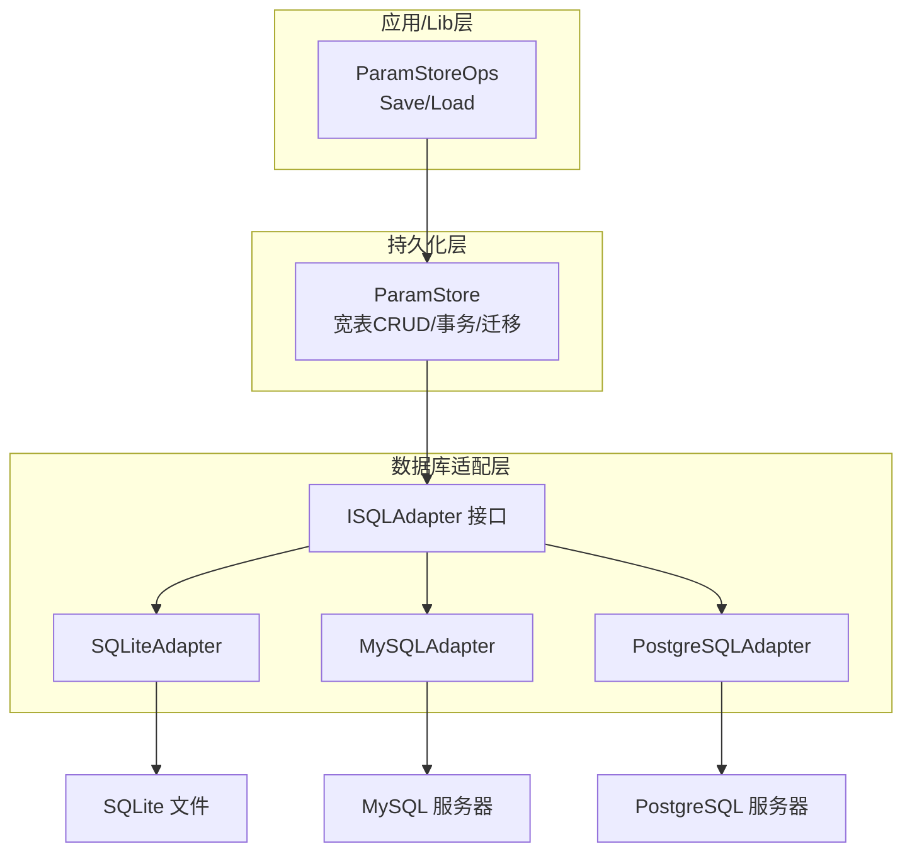
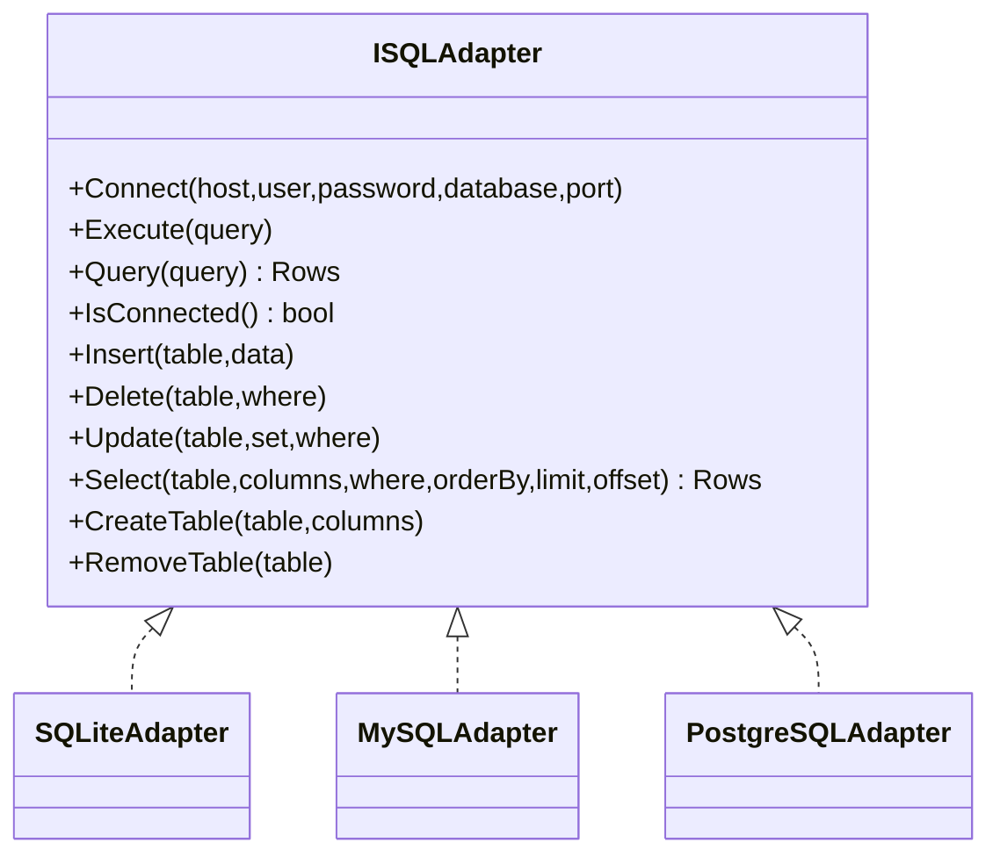
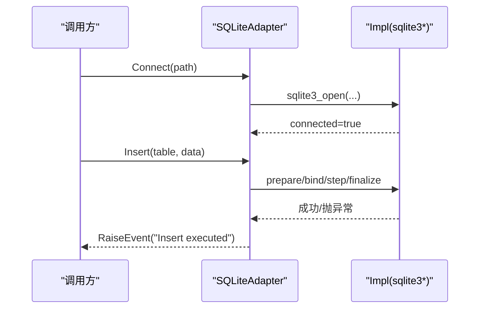
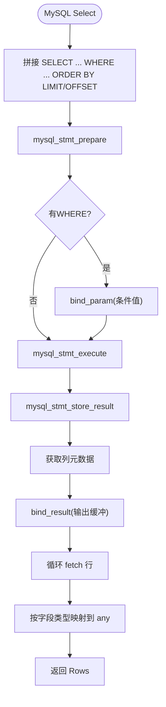
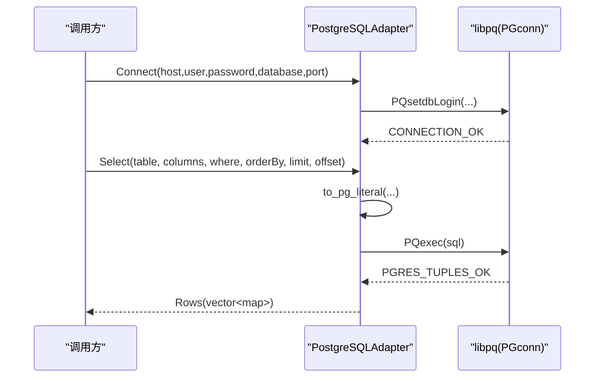
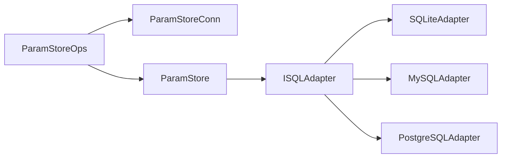
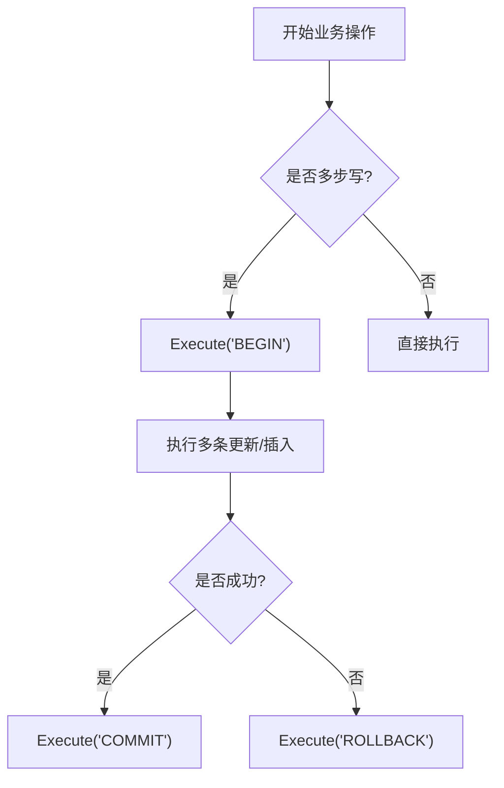
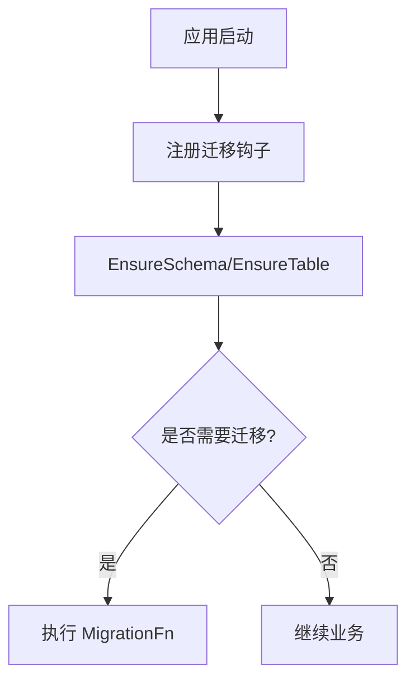

# 数据库适配器

<cite>
**本文引用的文件**   
- [sql_adapter.hpp](file://fileoperator/sql_adapter.hpp)
- [sql_adapter.cpp](file://fileoperator/sql_adapter.cpp)
- [param_store_ops.hpp](file://LibHsBaSlicer/ParamStore/param_store_ops.hpp)
- [param_store_ops.cpp](file://LibHsBaSlicer/ParamStore/param_store_ops.cpp)
- [param_store.hpp](file://fileoperator/param_store.hpp)
- [sql_adapter.md（中文文档）](file://docs/zh/fileoperator/sql_adapter.md)
</cite>

## 目录
1. [简介](#简介)
2. [项目结构](#项目结构)
3. [核心组件](#核心组件)
4. [架构总览](#架构总览)
5. [详细组件分析](#详细组件分析)
6. [依赖关系分析](#依赖关系分析)
7. [性能与并发特性](#性能与并发特性)
8. [事务与错误处理](#事务与错误处理)
9. [迁移与版本管理](#迁移与版本管理)
10. [连接池与重试策略](#连接池与重试策略)
11. [安全最佳实践](#安全最佳实践)
12. [故障排除指南](#故障排除指南)
13. [结论](#结论)

## 简介
本文件面向 HsBaSlicer 中的 SQL 适配器子系统，系统性说明 SQLite、MySQL、PostgreSQL 三种数据库适配器的使用方法、连接参数、SQL 执行与查询结果处理、事务控制机制，以及 ParamStore 宽表持久化流程。文档同时给出连接池与重试策略建议、迁移与版本管理思路、性能优化与安全最佳实践，帮助开发者在 C++ 层和 Lib 层统一使用数据库能力。

## 项目结构
SQL 适配器位于 fileoperator 模块，提供统一的 ISQLAdapter 接口及 SQLite/MySQL/PostgreSQL 实现；Lib 层通过 ParamStoreConn 选择后端并调用 SavePipelineParams / LoadPipelineParams；ParamStore 负责宽表 CRUD、事务包装与迁移钩子。

**图示来源**
- [param_store_ops.cpp:133-219](file://LibHsBaSlicer/ParamStore/param_store_ops.cpp#L133-L219)
- [param_store.hpp:33-105](file://fileoperator/param_store.hpp#L33-L105)
- [sql_adapter.hpp:36-129](file://fileoperator/sql_adapter.hpp#L36-L129)

**章节来源**
- [sql_adapter.hpp:1-610](file://fileoperator/sql_adapter.hpp#L1-L610)
- [param_store_ops.hpp:38-56](file://LibHsBaSlicer/ParamStore/param_store_ops.hpp#L38-L56)
- [param_store.hpp:33-105](file://fileoperator/param_store.hpp#L33-L105)

## 核心组件
- ISQLAdapter：统一数据库操作接口，定义 Connect/Execute/Query/Insert/Delete/Update/Select/CreateTable/RemoveTable 等。
- SQLiteAdapter：基于 sqlite3 的线程安全实现，支持文件路径连接与接口兼容重载。
- MySQLAdapter：基于 mysql_stmt API 的参数化实现，支持条件、分页、LOB/Blob。
- PostgreSQLAdapter：基于 libpq 的实现，支持类型映射与字节数组处理。
- ParamStore：面向 PipelineConfig 的宽表存储，封装 EnsureSchema/EnsureTable/Save/Load/List/Update/Delete 及批量事务。
- ParamStoreOps（Lib 层）：根据 ParamBackend 选择具体适配器，统一异常收敛为 ParamStoreOutcome。

**章节来源**
- [sql_adapter.hpp:36-129](file://fileoperator/sql_adapter.hpp#L36-L129)
- [sql_adapter.cpp:42-142](file://fileoperator/sql_adapter.cpp#L42-L142)
- [sql_adapter.cpp:734-844](file://fileoperator/sql_adapter.cpp#L734-L844)
- [sql_adapter.cpp:1649-1761](file://fileoperator/sql_adapter.cpp#L1649-L1761)
- [param_store.hpp:33-105](file://fileoperator/param_store.hpp#L33-L105)
- [param_store_ops.cpp:133-219](file://LibHsBaSlicer/ParamStore/param_store_ops.cpp#L133-L219)

## 架构总览
ISQLAdapter 抽象了不同数据库的差异，上层仅依赖接口。SQLite 直接以文件路径连接；MySQL/PostgreSQL 通过 host/user/password/database/port 连接。所有适配器均抛出 SQLAdapterError 派生异常，便于统一捕获与日志记录。

**图示来源**
- [sql_adapter.hpp:36-129](file://fileoperator/sql_adapter.hpp#L36-L129)
- [sql_adapter.hpp:216-257](file://fileoperator/sql_adapter.hpp#L216-L257)
- [sql_adapter.hpp:259-292](file://fileoperator/sql_adapter.hpp#L259-L292)
- [sql_adapter.hpp:301-328](file://fileoperator/sql_adapter.hpp#L301-L328)

## 详细组件分析

### SQLite 适配器
- 连接方式：Connect(path) 或接口兼容的 Connect(host,user,password,database,port)。
- 线程安全：内部使用 shared_mutex 保护关键方法。
- 参数绑定：INSERT/UPDATE/DELETE/SELECT 均使用 ? 占位符与 sqlite3_bind_* 绑定，避免 SQL 注入。
- 结果集：Rows 为 vector<unordered_map<string, any>>，整数统一归一化为 int64_t，浮点为 double，文本为 string，BLOB 为 vector<unsigned char>，NULL 为 std::any()。
- 事件：通过 EventSource 触发 Connected/Execute/Query/Insert/Update/Delete/Table created/removed 等事件。

**图示来源**
- [sql_adapter.cpp:42-142](file://fileoperator/sql_adapter.cpp#L42-L142)
- [sql_adapter.cpp:149-189](file://fileoperator/sql_adapter.cpp#L149-L189)
- [sql_adapter.cpp:191-278](file://fileoperator/sql_adapter.cpp#L191-L278)

**章节来源**
- [sql_adapter.hpp:216-257](file://fileoperator/sql_adapter.hpp#L216-L257)
- [sql_adapter.cpp:42-142](file://fileoperator/sql_adapter.cpp#L42-L142)
- [sql_adapter.cpp:149-189](file://fileoperator/sql_adapter.cpp#L149-L189)
- [sql_adapter.cpp:191-278](file://fileoperator/sql_adapter.cpp#L191-L278)
- [sql_adapter.cpp:491-665](file://fileoperator/sql_adapter.cpp#L491-L665)

### MySQL 适配器
- 连接方式：Connect(host,user,password,database,port)，默认端口常量 MYSQL_DEFAULT_PORT=3306。
- 参数化：广泛使用 mysql_stmt_prepare/bind_param/execute，支持 NULL、整型、浮点、字符串、BLOB。
- 查询：mysql_stmt_store_result + bind_result，按字段元数据动态绑定输出缓冲区，返回 Rows。
- 事务：未暴露显式事务 API，可通过 Execute("BEGIN"/"COMMIT"/"ROLLBACK") 组合使用。
- 事件：同 SQLiteAdapter，统一通过 EventSource 上报。

**图示来源**
- [sql_adapter.cpp:1299-1590](file://fileoperator/sql_adapter.cpp#L1299-L1590)

**章节来源**
- [sql_adapter.hpp:259-292](file://fileoperator/sql_adapter.hpp#L259-L292)
- [sql_adapter.cpp:734-844](file://fileoperator/sql_adapter.cpp#L734-L844)
- [sql_adapter.cpp:849-878](file://fileoperator/sql_adapter.cpp#L849-L878)
- [sql_adapter.cpp:880-1016](file://fileoperator/sql_adapter.cpp#L880-L1016)
- [sql_adapter.cpp:1140-1297](file://fileoperator/sql_adapter.cpp#L1140-L1297)
- [sql_adapter.cpp:1299-1590](file://fileoperator/sql_adapter.cpp#L1299-L1590)

### PostgreSQL 适配器
- 连接方式：Connect(host,user,password,database,port)，默认端口常量 POSTGRESQL_DEFAULT_PORT=5432。
- 类型映射：INT2/INT4/INT8、FLOAT4/FLOAT8、TEXT/VARCHAR、BYTEA 等 Oid 映射到 any。
- 字面量：to_pg_literal 对字符串进行转义，对 BYTEA 生成 E'\\x...' 格式。
- 查询：PQexec 后解析 PQresult，逐行构建 Rows。
- 事务：同 MySQL，通过 Execute("BEGIN"/"COMMIT"/"ROLLBACK") 组合。

**图示来源**
- [sql_adapter.cpp:1649-1761](file://fileoperator/sql_adapter.cpp#L1649-L1761)
- [sql_adapter.cpp:1795-1852](file://fileoperator/sql_adapter.cpp#L1795-L1852)
- [sql_adapter.cpp:1989-2129](file://fileoperator/sql_adapter.cpp#L1989-L2129)

**章节来源**
- [sql_adapter.hpp:301-328](file://fileoperator/sql_adapter.hpp#L301-L328)
- [sql_adapter.cpp:1649-1761](file://fileoperator/sql_adapter.cpp#L1649-L1761)
- [sql_adapter.cpp:1795-1852](file://fileoperator/sql_adapter.cpp#L1795-L1852)
- [sql_adapter.cpp:1853-1931](file://fileoperator/sql_adapter.cpp#L1853-L1931)
- [sql_adapter.cpp:1932-1988](file://fileoperator/sql_adapter.cpp#L1932-L1988)
- [sql_adapter.cpp:1989-2129](file://fileoperator/sql_adapter.cpp#L1989-L2129)

### 管道操作符与流式API
- 支持 operator| 直接执行 SQL 字符串或结构化操作（SQLSelect/SQLInsert/SQLDelete/SQLUpdate/SQLCreateTable/SQLRemoveTable），简化链式调用。

**章节来源**
- [sql_adapter.hpp:330-607](file://fileoperator/sql_adapter.hpp#L330-L607)

## 依赖关系分析
- Lib 层 ParamStoreOps 根据 ParamBackend 选择 SQLite/MySQL/PostgreSQL 适配器，构造对应 db 实例并调用 DoSave/DoLoad。
- ParamStore 持有 ISQLAdapter 引用，负责表结构确保、宽表读写、批量事务与迁移钩子。
- 适配器之间无相互依赖，仅共同实现 ISQLAdapter。

**图示来源**
- [param_store_ops.cpp:133-219](file://LibHsBaSlicer/ParamStore/param_store_ops.cpp#L133-L219)
- [param_store.hpp:33-105](file://fileoperator/param_store.hpp#L33-L105)
- [sql_adapter.hpp:36-129](file://fileoperator/sql_adapter.hpp#L36-L129)

**章节来源**
- [param_store_ops.hpp:38-56](file://LibHsBaSlicer/ParamStore/param_store_ops.hpp#L38-L56)
- [param_store_ops.cpp:133-219](file://LibHsBaSlicer/ParamStore/param_store_ops.cpp#L133-L219)
- [param_store.hpp:33-105](file://fileoperator/param_store.hpp#L33-L105)

## 性能与并发特性
- 线程安全：各适配器方法内使用 std::scoped_lock 保护共享状态，保证单实例并发安全。
- 语句复用：MySQL 使用 mysql_stmt 预编译与参数绑定，减少重复解析开销。
- 结果集处理：MySQL/PostgreSQL 按字段元数据动态绑定输出缓冲，避免多次分配。
- 类型归一化：整数统一为 int64_t，浮点为 double，降低跨平台 any_cast 差异。
- 建议：
  - 高并发场景下，由上层维护连接池（见“连接池与重试策略”）。
  - 大批量写入优先使用 ParamStore.SaveBatch 包裹事务。
  - 大结果集读取时按需限制 LIMIT/OFFSET，避免一次性加载过多数据。

**章节来源**
- [sql_adapter.cpp:149-189](file://fileoperator/sql_adapter.cpp#L149-L189)
- [sql_adapter.cpp:849-878](file://fileoperator/sql_adapter.cpp#L849-L878)
- [sql_adapter.cpp:1299-1590](file://fileoperator/sql_adapter.cpp#L1299-L1590)
- [sql_adapter.cpp:1766-1790](file://fileoperator/sql_adapter.cpp#L1766-L1790)

## 事务与错误处理
- 事务：
  - 适配器未暴露专用事务 API，可通过 Execute("BEGIN TRANSACTION"/"COMMIT"/"ROLLBACK") 组合实现。
  - ParamStore.SaveBatch 在内部以事务包装批量保存，失败回滚并抛出异常。
- 错误模型：
  - SQLAdapterError 及其派生类（NotConnectedError/QueryError/ConnectionError/TimeoutError/PermissionDeniedError/InvalidArgumentError）统一表达错误。
  - Lib 层将 SQLAdapterError 收敛为 ParamStoreOutcome.error，不吞异常语义但转换为结构化结果。

**图示来源**
- [sql_adapter.cpp:70-83](file://fileoperator/sql_adapter.cpp#L70-L83)
- [param_store.hpp:60-62](file://fileoperator/param_store.hpp#L60-L62)

**章节来源**
- [sql_adapter.hpp:131-208](file://fileoperator/sql_adapter.hpp#L131-L208)
- [param_store.hpp:60-62](file://fileoperator/param_store.hpp#L60-L62)
- [param_store_ops.cpp:48-79](file://LibHsBaSlicer/ParamStore/param_store_ops.cpp#L48-L79)

## 迁移与版本管理
- ParamStore 提供 SetMigrationHook(MigrationFn) 钩子，可在特定后端/表/版本上执行迁移逻辑。
- 建议在应用启动阶段注册迁移钩子，检查 schema 版本并执行增量迁移脚本。
- 结合 EnsureSchema/EnsureTable 保证基础表存在，再运行自定义迁移。

**图示来源**
- [param_store.hpp:39-40](file://fileoperator/param_store.hpp#L39-L40)
- [param_store.hpp:81-84](file://fileoperator/param_store.hpp#L81-L84)

**章节来源**
- [param_store.hpp:39-40](file://fileoperator/param_store.hpp#L39-L40)
- [param_store.hpp:81-84](file://fileoperator/param_store.hpp#L81-L84)

## 连接池与重试策略
- 当前适配器未内置连接池，每次调用 SavePipelineParams/LoadPipelineParams 会创建新的适配器实例并连接。
- 推荐方案：
  - 连接池：由上层维护一组已连接的适配器实例，按后端类型分发，配合 LRU/最小空闲数/最大连接数策略。
  - 重试：对 SQLAdapterConnectionError/SQLAdapterTimeoutError 实施指数退避重试，对不可重试错误（如权限、语法）立即失败。
  - 健康检查：定期 IsConnected 或轻量 Query("SELECT 1") 探测连接有效性，失效则重建。
- 注意：SQLite 文件路径连接需考虑并发写入锁；MySQL/PostgreSQL 应配置合理的 max_connections 与超时。

[本节为通用指导，不直接分析具体文件]

## 安全最佳实践
- 参数化查询：SQLite/MySQL 已全面使用 ? 占位符绑定；PostgreSQL 使用 to_pg_literal 转义字符串与字节数组。
- 权限最小化：数据库账户仅授予必要权限，避免使用 root/admin。
- 输入校验：对 table/column 名称进行白名单校验，防止注入。
- 敏感信息：不在日志中打印密码与完整连接串；使用环境变量或密钥管理服务。
- 传输加密：远程数据库启用 TLS/SSL（由驱动或连接参数控制）。

**章节来源**
- [sql_adapter.cpp:191-278](file://fileoperator/sql_adapter.cpp#L191-L278)
- [sql_adapter.cpp:880-1016](file://fileoperator/sql_adapter.cpp#L880-L1016)
- [sql_adapter.cpp:1795-1852](file://fileoperator/sql_adapter.cpp#L1795-L1852)

## 故障排除指南
- 常见异常：
  - SQLAdapterNotConnectedError：未连接即执行操作。
  - SQLAdapterConnectionError：连接失败（主机/端口/认证/权限）。
  - SQLAdapterQueryError：SQL 语法错误或执行失败。
  - SQLAdapterTimeoutError/PermissionDeniedError/InvalidArgumentError：超时、权限不足、参数非法。
- 排查步骤：
  - 确认 IsConnected 状态与连接参数。
  - 检查 SQL 语句与参数绑定顺序。
  - 查看 RaiseEvent 日志或接入外部日志系统。
  - 对 MySQL/PostgreSQL 使用客户端工具验证连接与权限。
- 参考示例：
  - 中文文档包含基本操作、管道操作符、MySQL/PostgreSQL 示例、事务与事件监听示例。

**章节来源**
- [sql_adapter.hpp:131-208](file://fileoperator/sql_adapter.hpp#L131-L208)
- [sql_adapter.md（中文文档）:21-334](file://docs/zh/fileoperator/sql_adapter.md#L21-L334)

## 结论
HsBaSlicer 的 SQL 适配器通过 ISQLAdapter 统一了 SQLite/MySQL/PostgreSQL 的操作接口，提供了参数化查询、类型归一化、事件通知与线程安全的基础能力。Lib 层 ParamStoreOps 与 ParamStore 进一步封装了宽表持久化、批量事务与迁移钩子。生产环境建议在上层实现连接池与健康检查，结合重试策略与严格的安全实践，以获得稳定高效的数据库访问体验。