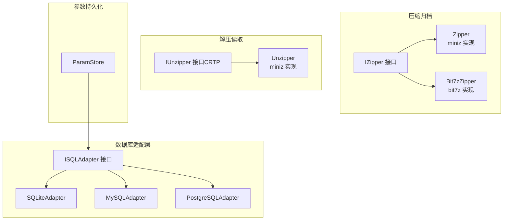
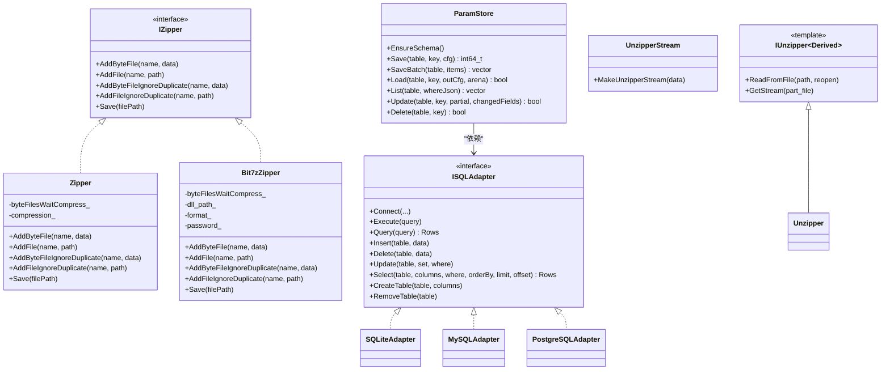
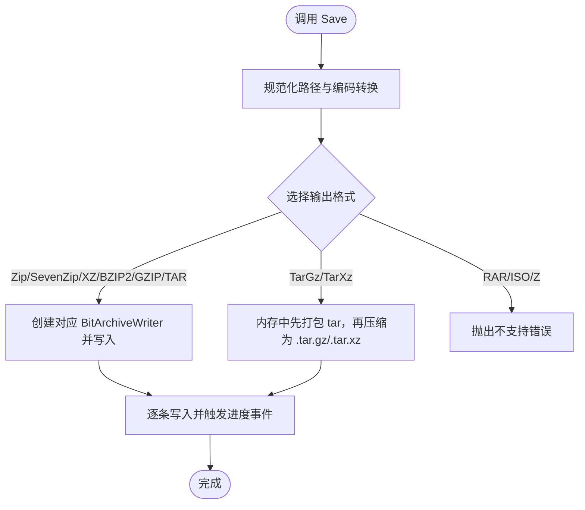
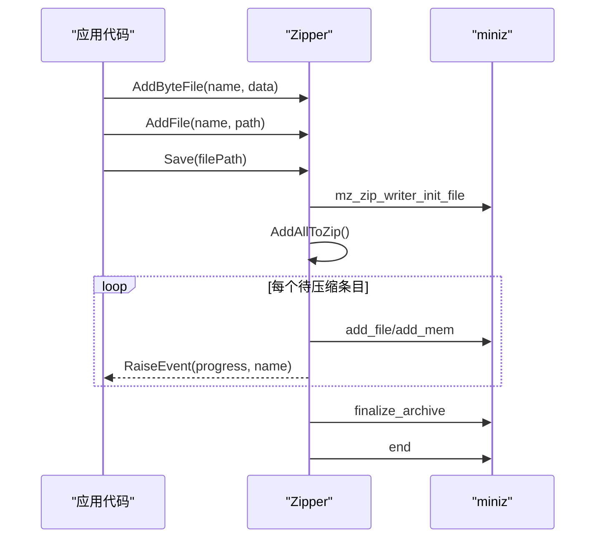
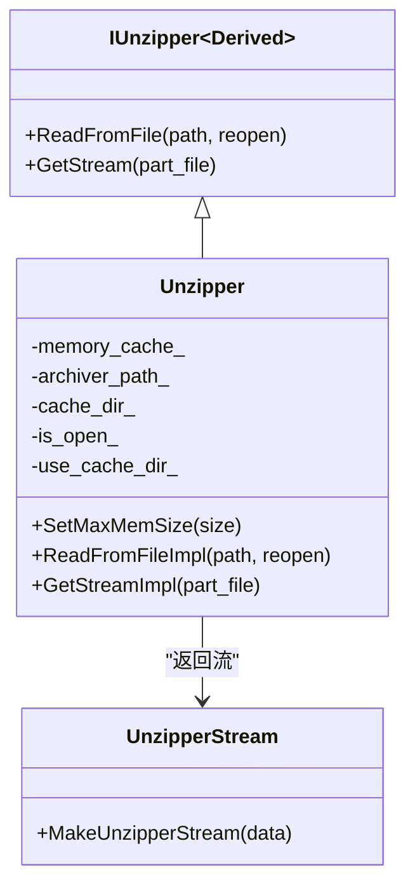
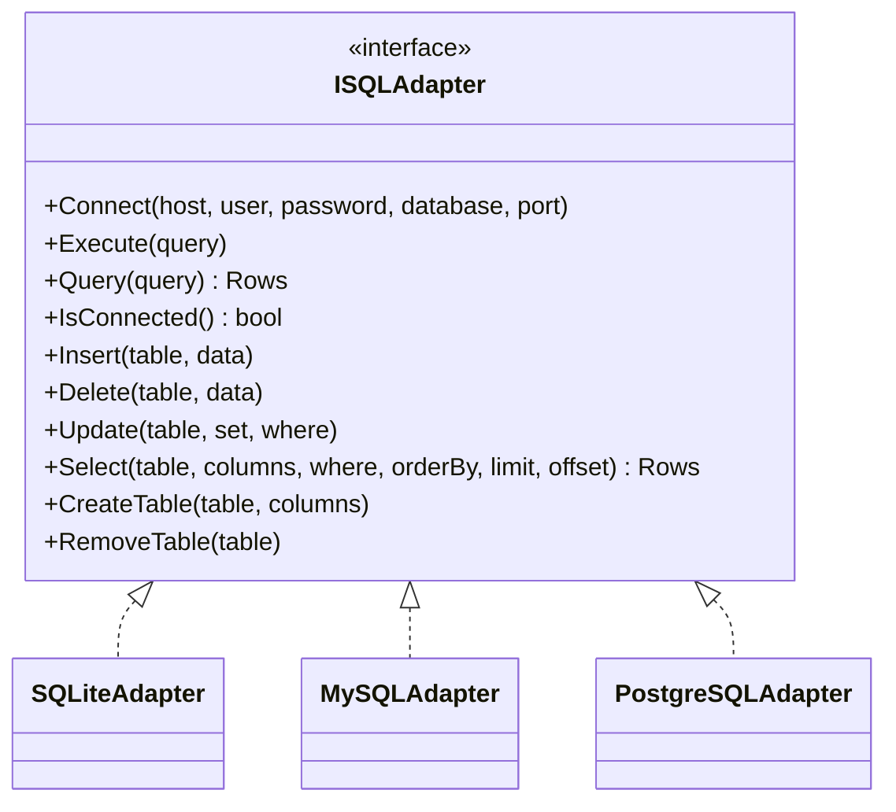
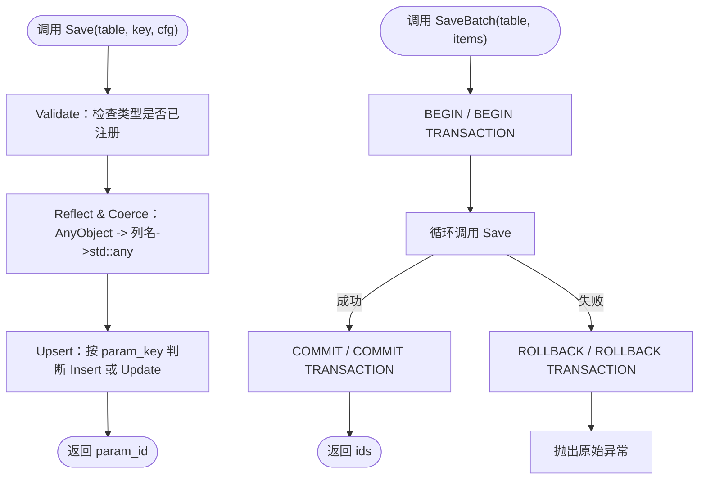

# 文件操作库

<cite>
**本文引用的文件**   
- [fileoperator/zipper.hpp](file://fileoperator/zipper.hpp)
- [fileoperator/zipper.cpp](file://fileoperator/zipper.cpp)
- [fileoperator/bit7z_zipper.hpp](file://fileoperator/bit7z_zipper.hpp)
- [fileoperator/bit7z_zipper.cpp](file://fileoperator/bit7z_zipper.cpp)
- [fileoperator/IZipper.hpp](file://fileoperator/IZipper.hpp)
- [fileoperator/unzipper.hpp](file://fileoperator/unzipper.hpp)
- [fileoperator/IUnzipper.hpp](file://fileoperator/IUnzipper.hpp)
- [fileoperator/sql_adapter.hpp](file://fileoperator/sql_adapter.hpp)
- [fileoperator/sql_adapter.cpp](file://fileoperator/sql_adapter.cpp)
- [fileoperator/param_store.hpp](file://fileoperator/param_store.hpp)
- [fileoperator/param_store.cpp](file://fileoperator/param_store.cpp)
</cite>

## 目录
1. [项目概述与快速开始](#项目概述与快速开始)
2. [架构总览](#架构总览)
3. [核心概念](#核心概念)
4. [核心模块详解](#核心模块详解)
5. [高级主题](#高级主题)
6. [API 参考文档](#api-参考文档)
7. [集成指南](#集成指南)
8. [开发·测试与贡献](#开发·测试与贡献)
9. [扩展开发指南](#扩展开发指南)
10. [示例与教程](#示例与教程)
11. [部署·故障排除与FAQ](#部署·故障排除与faq)
12. [附录](#附录)

## 项目概述与快速开始
本文件操作库为 HsBaSlicer 提供三类基础能力：
- 压缩归档：基于 miniz 的 Zipper 与可选的 Bit7zZipper，支持 ZIP、7z、XZ、BZIP2、GZIP、TAR、TarGz、TarXz 等格式。
- 数据库访问：统一的 ISQLAdapter 接口，包含 SQLiteAdapter、MySQLAdapter、PostgreSQLAdapter 三种后端。
- 参数持久化：ParamStore 将流水线配置结构体反射为宽表行，提供 Save/Load/List/Update/Delete 及批量事务写入。

快速开始建议：
- 若只需轻量 ZIP 打包，优先使用 Zipper；需要多格式或密码保护时启用 HSBA_USE_BIT7Z 并使用 Bit7zZipper。
- 本地单机场景使用 SQLiteAdapter；分布式或多进程并发场景考虑 MySQL/PostgreSQL。
- 对工艺参数进行结构化持久化时，通过 ParamStore 绑定到任意 ISQLAdapter。

[本节不直接分析具体源码文件]

## 架构总览
文件操作库采用“接口 + 多实现”的分层设计：
- IZipper 抽象出压缩归档的统一 API，Zipper 与 Bit7zZipper 分别作为两种后端实现。
- IUnzipper 以 CRTP 形式定义解压流式读取接口，Unzipper 提供基于 miniz 的实现。
- SQL 层通过 ISQLAdapter 统一 SQLite/MySQL/PostgreSQL 的 CRUD 与管道式查询构造。
- ParamStore 位于上层，依赖 ISQLAdapter 完成配置对象的反射、校验、转换与 Upsert。

**图示来源**
- [fileoperator/IZipper.hpp:14-57](file://fileoperator/IZipper.hpp#L14-L57)
- [fileoperator/zipper.hpp:20-87](file://fileoperator/zipper.hpp#L20-L87)
- [fileoperator/bit7z_zipper.hpp:48-126](file://fileoperator/bit7z_zipper.hpp#L48-L126)
- [fileoperator/IUnzipper.hpp:160-198](file://fileoperator/IUnzipper.hpp#L160-L198)
- [fileoperator/unzipper.hpp:17-77](file://fileoperator/unzipper.hpp#L17-L77)
- [fileoperator/sql_adapter.hpp:30-129](file://fileoperator/sql_adapter.hpp#L30-L129)
- [fileoperator/sql_adapter.hpp:216-328](file://fileoperator/sql_adapter.hpp#L216-L328)
- [fileoperator/param_store.hpp:30-105](file://fileoperator/param_store.hpp#L30-L105)

**章节来源**
- [fileoperator/IZipper.hpp:14-57](file://fileoperator/IZipper.hpp#L14-L57)
- [fileoperator/sql_adapter.hpp:30-129](file://fileoperator/sql_adapter.hpp#L30-L129)
- [fileoperator/param_store.hpp:30-105](file://fileoperator/param_store.hpp#L30-L105)

## 核心概念
- 压缩器抽象 IZipper：统一 AddByteFile/AddFile/Save 等入口，屏蔽底层 miniz 或 bit7z 差异。
- 解压流 IUnzipper：以 CRTP 暴露 ReadFromFile/GetStream，配合 UnzipperStream 提供 std::istream 风格的读取。
- SQL 适配器 ISQLAdapter：统一 Connect/Execute/Query/Insert/Update/Delete/Select/CreateTable/RemoveTable，并支持管道式 SQLSelect/SQLInsert/SQLUpdate/SQLDelete/SQLCreateTable/SQLRemoveTable。
- 参数存储 ParamStore：以 AnyObject 驱动字段遍历，将配置对象映射为宽表行，提供 EnsureSchema/Save/Load/List/Update/Delete 与 SaveBatch 事务封装。

关键类型与关系如下：

**图示来源**
- [fileoperator/IZipper.hpp:14-57](file://fileoperator/IZipper.hpp#L14-L57)
- [fileoperator/zipper.hpp:40-87](file://fileoperator/zipper.hpp#L40-L87)
- [fileoperator/bit7z_zipper.hpp:74-126](file://fileoperator/bit7z_zipper.hpp#L74-L126)
- [fileoperator/IUnzipper.hpp:160-198](file://fileoperator/IUnzipper.hpp#L160-L198)
- [fileoperator/unzipper.hpp:17-77](file://fileoperator/unzipper.hpp#L17-L77)
- [fileoperator/sql_adapter.hpp:30-129](file://fileoperator/sql_adapter.hpp#L30-L129)
- [fileoperator/sql_adapter.hpp:216-328](file://fileoperator/sql_adapter.hpp#L216-L328)
- [fileoperator/param_store.hpp:30-105](file://fileoperator/param_store.hpp#L30-L105)

**章节来源**
- [fileoperator/IZipper.hpp:14-57](file://fileoperator/IZipper.hpp#L14-L57)
- [fileoperator/IUnzipper.hpp:160-198](file://fileoperator/IUnzipper.hpp#L160-L198)
- [fileoperator/sql_adapter.hpp:30-129](file://fileoperator/sql_adapter.hpp#L30-L129)
- [fileoperator/param_store.hpp:30-105](file://fileoperator/param_store.hpp#L30-L105)

## 核心模块详解

### 压缩归档模块：Zipper 与 Bit7zZipper
- Zipper 基于 miniz，提供无压缩、快速压缩、紧密压缩等级别，支持内存字节与磁盘文件添加，并在保存过程中按条目触发进度事件。
- Bit7zZipper 在编译宏 HSBA_USE_BIT7Z 开启后生效，支持 Zip/SevenZip/XZ/BZIP2/GZIP/TAR/TarGz/TarXz/RAR/ISO/Z 等格式，其中 TarGz/TarXz 通过两段式内存打包生成最终压缩包。

**图示来源**
- [fileoperator/bit7z_zipper.cpp:191-255](file://fileoperator/bit7z_zipper.cpp#L191-L255)
- [fileoperator/bit7z_zipper.cpp:286-300](file://fileoperator/bit7z_zipper.cpp#L286-L300)

#### Zipper 类要点
- 构造函数接受 MinizCompression 枚举，Undefine/Unknown 会抛出不支持异常。
- AddByteFile/AddFile 拒绝重复名称；AddByteFileIgnoreDuplicate/AddFileIgnoreDuplicate 自动追加 “_duplicate”。
- Save 内部初始化 miniz writer，逐个添加条目，失败时抛出 IOError。

**图示来源**
- [fileoperator/zipper.cpp:114-129](file://fileoperator/zipper.cpp#L114-L129)
- [fileoperator/zipper.cpp:137-158](file://fileoperator/zipper.cpp#L137-L158)

**章节来源**
- [fileoperator/zipper.hpp:20-87](file://fileoperator/zipper.hpp#L20-L87)
- [fileoperator/zipper.cpp:21-42](file://fileoperator/zipper.cpp#L21-L42)
- [fileoperator/zipper.cpp:50-73](file://fileoperator/zipper.cpp#L50-L73)
- [fileoperator/zipper.cpp:80-108](file://fileoperator/zipper.cpp#L80-L108)
- [fileoperator/zipper.cpp:114-129](file://fileoperator/zipper.cpp#L114-L129)
- [fileoperator/zipper.cpp:137-174](file://fileoperator/zipper.cpp#L137-L174)

#### Bit7zZipper 类要点
- 默认 SevenZip 格式，可通过构造函数指定 dll_path、format、password。
- AddByteFile/AddFile 拒绝重复名称；IgnoreDuplicate 版本自动重命名。
- Save 根据 ZipperFormat 分支处理，TarGz/TarXz 走两段式内存打包流程。
- 所有压缩失败均包装为 IOError。

**章节来源**
- [fileoperator/bit7z_zipper.hpp:74-126](file://fileoperator/bit7z_zipper.hpp#L74-L126)
- [fileoperator/bit7z_zipper.cpp:129-155](file://fileoperator/bit7z_zipper.cpp#L129-L155)
- [fileoperator/bit7z_zipper.cpp:157-189](file://fileoperator/bit7z_zipper.cpp#L157-L189)
- [fileoperator/bit7z_zipper.cpp:191-255](file://fileoperator/bit7z_zipper.cpp#L191-L255)
- [fileoperator/bit7z_zipper.cpp:257-300](file://fileoperator/bit7z_zipper.cpp#L257-L300)

### 解压读取模块：Unzipper 与 IUnzipper
- IUnzipper 是 CRTP 模板接口，提供 ReadFromFile/GetStream，由具体实现派生类注入私有方法。
- Unzipper 基于 miniz，支持内存缓存与临时文件缓存，并通过 UnzipperStream 提供 std::istream 风格读取。

**图示来源**
- [fileoperator/IUnzipper.hpp:160-198](file://fileoperator/IUnzipper.hpp#L160-L198)
- [fileoperator/unzipper.hpp:17-77](file://fileoperator/unzipper.hpp#L17-L77)
- [fileoperator/unzipper.hpp:29-77](file://fileoperator/unzipper.hpp#L29-L77)

**章节来源**
- [fileoperator/IUnzipper.hpp:160-198](file://fileoperator/IUnzipper.hpp#L160-L198)
- [fileoperator/unzipper.hpp:17-77](file://fileoperator/unzipper.hpp#L17-L77)

### 数据库适配层：ISQLAdapter 与 SQLiteAdapter/MySQLAdapter/PostgreSQLAdapter
- ISQLAdapter 定义统一的连接、执行、查询、插入、删除、更新、选择、建表、删表接口，结果类型为 Rows（键值映射向量）。
- SQLiteAdapter 面向 sqlite3，线程安全，支持管道式 SQLSelect/SQLInsert/SQLUpdate/SQLDelete/SQLCreateTable/SQLRemoveTable。
- MySQLAdapter/PostgreSQLAdapter 在相应宏开启后提供相同接口，端口常量分别为 MYSQL_DEFAULT_PORT 与 POSTGRESQL_DEFAULT_PORT。

**图示来源**
- [fileoperator/sql_adapter.hpp:30-129](file://fileoperator/sql_adapter.hpp#L30-L129)
- [fileoperator/sql_adapter.hpp:216-328](file://fileoperator/sql_adapter.hpp#L216-L328)

**章节来源**
- [fileoperator/sql_adapter.hpp:30-129](file://fileoperator/sql_adapter.hpp#L30-L129)
- [fileoperator/sql_adapter.hpp:216-328](file://fileoperator/sql_adapter.hpp#L216-L328)
- [fileoperator/sql_adapter.cpp:42-142](file://fileoperator/sql_adapter.cpp#L42-L142)

### 参数持久化模块：ParamStore
- ParamStore 绑定一个 ISQLAdapter，负责注册 PipelineConfig 类型、确保表结构、反射配置对象为列值、校验与转换、Upsert、批量事务写入、加载、列表、部分更新与删除。
- Save 流程分为 Validate -> Reflect & Coerce -> Upsert 阶段，并触发进度回调。
- SaveBatch 使用 BEGIN/COMMIT/ROLLBACK 包裹多条 Save，失败时回滚并保留原始异常。

**图示来源**
- [fileoperator/param_store.cpp:177-240](file://fileoperator/param_store.cpp#L177-L240)
- [fileoperator/param_store.cpp:242-287](file://fileoperator/param_store.cpp#L242-L287)

**章节来源**
- [fileoperator/param_store.hpp:30-105](file://fileoperator/param_store.hpp#L30-L105)
- [fileoperator/param_store.cpp:177-240](file://fileoperator/param_store.cpp#L177-L240)
- [fileoperator/param_store.cpp:242-287](file://fileoperator/param_store.cpp#L242-L287)

## 高级主题

### 错误处理与资源管理
- 压缩归档：
  - Zipper：构造阶段对非法压缩级别抛出 NotSupportedError；保存阶段失败抛出 IOError；重复名称抛出 InvalidArgumentError。
  - Bit7zZipper：不支持格式抛出 NotSupportedError；压缩失败包装为 IOError。
- 数据库：
  - 连接失败抛出 SQLAdapterConnectionError；未连接操作抛出 SQLAdapterNotConnectedError；SQL 执行失败抛出 SQLAdapterQueryError；参数非法抛出 SQLAdapterInvalidArgumentError；权限问题抛出 SQLAdapterPermissionDeniedError；超时抛出 SQLAdapterTimeoutError。
  - SQLiteAdapter 内部 Impl 析构时关闭 sqlite3 句柄，避免资源泄漏。
- 解压：
  - UnzipperStream 在析构时关闭底层 ifstream，防止文件描述符泄漏。

**章节来源**
- [fileoperator/zipper.cpp:21-42](file://fileoperator/zipper.cpp#L21-L42)
- [fileoperator/zipper.cpp:114-129](file://fileoperator/zipper.cpp#L114-L129)
- [fileoperator/bit7z_zipper.cpp:191-255](file://fileoperator/bit7z_zipper.cpp#L191-L255)
- [fileoperator/sql_adapter.hpp:131-208](file://fileoperator/sql_adapter.hpp#L131-L208)
- [fileoperator/sql_adapter.cpp:42-69](file://fileoperator/sql_adapter.cpp#L42-L69)
- [fileoperator/IUnzipper.hpp:90-102](file://fileoperator/IUnzipper.hpp#L90-L102)

### 性能优化建议与最佳实践
- 压缩归档：
  - 大文件优先使用磁盘文件 AddFile，减少内存占用；小片段数据使用 AddByteFile。
  - 合理选择压缩级别：Fast 适合速度敏感场景，Tight 适合体积敏感场景。
  - Bit7zZipper 的 TarGz/TarXz 通过两段式内存打包，注意中间 tar 缓冲的峰值内存。
- 数据库：
  - 使用参数化查询（Insert/Update/Delete/Select 内部已使用占位符），避免 SQL 注入与重复解析。
  - 批量写入使用 SaveBatch，利用事务降低 IO 开销。
  - 查询尽量指定 columns 与 WHERE，必要时使用 ORDER BY/LIMIT/OFFSET 控制结果集大小。
- 参数持久化：
  - 首次运行调用 EnsureSchema 确保表结构存在。
  - Load 时传入 StringArena 以复用 char* 缓冲区，减少分配。
  - 仅更新必要字段时使用 Update(changedFields)，减少冗余写放大。

[本节为通用指导，不直接分析具体源码文件]

## API 参考文档

### 压缩归档 API
- IZipper：
  - AddByteFile(name, data)
  - AddFile(name, path)
  - AddByteFileIgnoreDuplicate(name, data)
  - AddFileIgnoreDuplicate(name, path)
  - Save(filePath)
- Zipper：
  - 构造函数：Zipper(MinizCompression compression)
  - 压缩级别：MinizCompression{Undefine, No, Fast, Tight, Unknown}
- Bit7zZipper：
  - 构造函数：Bit7zZipper()、Bit7zZipper(dll_path, format, password)
  - 格式枚举：ZipperFormat{Undefine, Zip, SevenZip, XZ, BZIP2, GZIP, TAR, TarGz, TarXz, RAR, ISO, Z, Unknown}

**章节来源**
- [fileoperator/IZipper.hpp:14-57](file://fileoperator/IZipper.hpp#L14-L57)
- [fileoperator/zipper.hpp:20-87](file://fileoperator/zipper.hpp#L20-L87)
- [fileoperator/bit7z_zipper.hpp:48-126](file://fileoperator/bit7z_zipper.hpp#L48-L126)

### 数据库 API
- ISQLAdapter：
  - Connect(host, user, password, database, port)
  - Execute(query)
  - Query(query) -> Rows
  - IsConnected() -> bool
  - Insert(table, data)
  - Delete(table, data)
  - Update(table, set, where)
  - Select(table, columns, where, orderBy, limit, offset) -> Rows
  - CreateTable(table, columns)
  - RemoveTable(table)
- SQLiteAdapter：
  - Connect(path)
  - Connect(host, user, password, database, port)（兼容接口）
- MySQLAdapter/PostgreSQLAdapter：
  - Connect(host, user, password, database, port)

管道式辅助结构：
- SQLSelect、SQLInsert、SQLDelete、SQLUpdate、SQLCreateTable、SQLRemoveTable

**章节来源**
- [fileoperator/sql_adapter.hpp:30-129](file://fileoperator/sql_adapter.hpp#L30-L129)
- [fileoperator/sql_adapter.hpp:216-328](file://fileoperator/sql_adapter.hpp#L216-L328)
- [fileoperator/sql_adapter.hpp:330-607](file://fileoperator/sql_adapter.hpp#L330-L607)

### 参数持久化 API
- ParamStore：
  - EnsureSchema()
  - EnsureTable(tag)
  - Save(table, key, cfg) -> int64_t
  - SaveBatch(table, items) -> vector<int64_t>
  - Load(table, key, outCfg, arena) -> bool
  - List(table, whereJson) -> vector<string>
  - Update(table, key, partial, changedFields) -> bool
  - Delete(table, key) -> bool
  - SetProgressCallback(fn)
  - SetMigrationHook(fn)
  - GetLastError() -> string
  - backend() -> Backend
  - ResolveTable(table, cfg) -> string

**章节来源**
- [fileoperator/param_store.hpp:30-105](file://fileoperator/param_store.hpp#L30-L105)
- [fileoperator/param_store.cpp:177-240](file://fileoperator/param_store.cpp#L177-L240)
- [fileoperator/param_store.cpp:242-287](file://fileoperator/param_store.cpp#L242-L287)
- [fileoperator/param_store.cpp:289-319](file://fileoperator/param_store.cpp#L289-L319)
- [fileoperator/param_store.cpp:321-358](file://fileoperator/param_store.cpp#L321-L358)
- [fileoperator/param_store.cpp:360-392](file://fileoperator/param_store.cpp#L360-L392)
- [fileoperator/param_store.cpp:394-413](file://fileoperator/param_store.cpp#L394-L413)

## 集成指南
- 构建选项：
  - 启用 Bit7zZipper：HSBA_USE_BIT7Z
  - 启用 MySQL：HSBA_USE_MYSQL
  - 启用 PostgreSQL：HSBA_USE_PGSQL
- 典型集成步骤：
  - 初始化日志与配置（如有）。
  - 选择压缩器：Zipper 或 Bit7zZipper，按需设置压缩级别或格式。
  - 初始化数据库：SQLiteAdapter 指向本地文件；MySQL/PostgreSQL 提供 host/user/password/database/port。
  - 初始化 ParamStore：传入 ISQLAdapter 引用，必要时设置进度回调与迁移钩子。
  - 调用 EnsureSchema 确保表结构，随后进行 Save/Load/List/Update/Delete。

[本节为通用指导，不直接分析具体源码文件]

## 开发·测试与贡献
- 单元测试覆盖：
  - ParamStore：反射完整性、类型收敛往返、SQLite CRUD、Lua 冒烟、批量事务回滚、Lib 层写入读取往返、C 导出冒烟、后端可用性守卫。
- 建议新增用例：
  - 针对 Bit7zZipper 的多格式 Save 与密码保护。
  - 针对 MySQL/PostgreSQL 的连接与基本 CRUD。
  - 针对解压流的内存与文件路径双路径验证。

[本节为通用指导，不直接分析具体源码文件]

## 扩展开发指南
- 新增压缩后端：
  - 实现 IZipper 接口，遵循 AddByteFile/AddFile/Save 语义，妥善处理重复名称与进度事件。
- 新增解压后端：
  - 继承 IUnzipper<T>，实现 ReadFromFileImpl/GetStreamImpl，并确保 UnzipperStream 正确释放资源。
- 新增数据库后端：
  - 实现 ISQLAdapter，保持 Rows 类型一致，保证参数化查询与错误分类。
- 扩展 ParamStore：
  - 注册新的 PipelineConfig 类型，确保反射与类型转换逻辑可用。

[本节为通用指导，不直接分析具体源码文件]

## 示例与教程

### 压缩归档示例
- 使用 Zipper 创建 ZIP：
  - 构造 Zipper(MinizCompression::Tight)。
  - 调用 AddFile/AddByteFile 添加文件。
  - 调用 Save 输出 archive.zip。
- 使用 Bit7zZipper 创建 TarGz：
  - 构造 Bit7zZipper(HSBA_7Z_DLL, ZipperFormat::TarGz, "")。
  - 调用 AddFile/AddByteFile。
  - 调用 Save 输出 archive.tar.gz。

**章节来源**
- [fileoperator/zipper.cpp:114-129](file://fileoperator/zipper.cpp#L114-L129)
- [fileoperator/bit7z_zipper.cpp:191-255](file://fileoperator/bit7z_zipper.cpp#L191-L255)

### 数据库操作示例
- SQLite 基本操作：
  - db.Connect("example.db")。
  - db.CreateTable("users", {...})。
  - db.Insert("users", {...})。
  - auto results = db.Select("users", {"id","name","age","email"}, {}, std::nullopt, -1, 0)。
  - db.Update("users", {{"email", "..."}}, {{"name", "张三"}})。
  - db.Delete("users", {{"name", "李四"}})。
  - db.RemoveTable("users")。
- MySQL/PostgreSQL：
  - 在对应宏开启后，使用 Connect(host,user,password,database,port) 并执行相同 CRUD。

**章节来源**
- [fileoperator/sql_adapter.cpp:149-189](file://fileoperator/sql_adapter.cpp#L149-L189)
- [fileoperator/sql_adapter.cpp:191-278](file://fileoperator/sql_adapter.cpp#L191-L278)
- [fileoperator/sql_adapter.cpp:285-369](file://fileoperator/sql_adapter.cpp#L285-L369)
- [fileoperator/sql_adapter.cpp:371-489](file://fileoperator/sql_adapter.cpp#L371-L489)
- [fileoperator/sql_adapter.cpp:491-665](file://fileoperator/sql_adapter.cpp#L491-L665)
- [fileoperator/sql_adapter.cpp:667-731](file://fileoperator/sql_adapter.cpp#L667-L731)

### 参数持久化示例
- 初始化与建表：
  - ParamStore store(db);
  - store.EnsureSchema();
- 保存与加载：
  - int64_t id = store.Save("table", "key", cfg);
  - bool ok = store.Load("table", "key", outCfg, arena);
- 列表与更新：
  - auto keys = store.List("table", whereJson);
  - bool updated = store.Update("table", "key", partial, changedFields);
- 删除与批量：
  - bool deleted = store.Delete("table", "key");
  - auto ids = store.SaveBatch("table", items);

**章节来源**
- [fileoperator/param_store.cpp:177-240](file://fileoperator/param_store.cpp#L177-L240)
- [fileoperator/param_store.cpp:242-287](file://fileoperator/param_store.cpp#L242-L287)
- [fileoperator/param_store.cpp:289-319](file://fileoperator/param_store.cpp#L289-L319)
- [fileoperator/param_store.cpp:321-358](file://fileoperator/param_store.cpp#L321-L358)
- [fileoperator/param_store.cpp:360-392](file://fileoperator/param_store.cpp#L360-L392)
- [fileoperator/param_store.cpp:394-413](file://fileoperator/param_store.cpp#L394-L413)

## 部署·故障排除与FAQ
- 常见问题：
  - 压缩失败：检查路径与权限；确认压缩级别或格式有效；查看 IOError 详情。
  - 数据库连接失败：检查主机、端口、用户名、密码与数据库名；捕获 SQLAdapterConnectionError。
  - 查询失败：检查 SQL 语法与参数类型；捕获 SQLAdapterQueryError。
  - 参数持久化失败：确认 EnsureSchema 已执行；检查 ParamStore::GetLastError 与异常信息。
- 资源泄漏排查：
  - 确保 UnzipperStream 生命周期内正确关闭底层文件。
  - SQLiteAdapter 内部 Impl 析构会自动关闭连接，但应避免重复 Connect。

**章节来源**
- [fileoperator/zipper.cpp:114-129](file://fileoperator/zipper.cpp#L114-L129)
- [fileoperator/bit7z_zipper.cpp:191-255](file://fileoperator/bit7z_zipper.cpp#L191-L255)
- [fileoperator/sql_adapter.cpp:42-69](file://fileoperator/sql_adapter.cpp#L42-L69)
- [fileoperator/IUnzipper.hpp:90-102](file://fileoperator/IUnzipper.hpp#L90-L102)

## 附录
- 常量与默认值：
  - MYSQL_DEFAULT_PORT = 3306
  - POSTGRESQL_DEFAULT_PORT = 5432
- 类型说明：
  - Rows：std::vector<std::unordered_map<std::string, std::any>>
  - MinizCompression：Undefine/No/Fast/Tight/Unknown
  - ZipperFormat：Undefine/Zip/SevenZip/XZ/BZIP2/GZIP/TAR/TarGz/TarXz/RAR/ISO/Z/Unknown

**章节来源**
- [fileoperator/sql_adapter.hpp:24-28](file://fileoperator/sql_adapter.hpp#L24-L28)
- [fileoperator/sql_adapter.hpp:39-40](file://fileoperator/sql_adapter.hpp#L39-L40)
- [fileoperator/zipper.hpp:25-32](file://fileoperator/zipper.hpp#L25-L32)
- [fileoperator/bit7z_zipper.hpp:54-72](file://fileoperator/bit7z_zipper.hpp#L54-L72)