# 切片操作

<cite>
**本文引用的文件**   
- [lua_pipeline.cpp](file://LibHsBaSlicer/Extends/lua_pipeline.cpp)
- [mesh_slice.hpp](file://LibHsBaSlicer/Slice/mesh_slice.hpp)
- [mesh_slice.cpp](file://LibHsBaSlicer/Slice/mesh_slice.cpp)
- [FullTopoModel.hpp](file://meshmodel/FullTopoModel.hpp)
- [FloatPolygons.hpp](file://2D/FloatPolygons.hpp)
- [FloatPolygons.cpp](file://2D/FloatPolygons.cpp)
- [IntPolygon.hpp](file://2D/IntPolygon.hpp)
- [pipeline_types.h](file://pipelinetypes/pipeline_types.h)
- [fdm_pipeline.cpp](file://DllHsBaSlicer/fdm_pipeline.cpp)
- [sla_pipeline.cpp](file://DllHsBaSlicer/sla_pipeline.cpp)
- [waam_pipeline.cpp](file://DllHsBaSlicer/waam_pipeline.cpp)
</cite>

## 目录
1. [引言](#引言)
2. [项目结构中的切片位置](#项目结构中的切片位置)
3. [核心 API：layerCount、layerZ、slice、sliceUnsafe](#核心-apilayercount-layerz-slice-sliceunsafe)
4. [切片算法原理与精度控制](#切片算法原理与精度控制)
5. [开放轮廓处理策略与容错机制](#开放轮廓处理策略与容错机制)
6. [不同层高设置的切片效果对比](#不同层高设置的切片效果对比)
7. [性能优化与内存管理建议](#性能优化与内存管理建议)
8. [常见问题排查](#常见问题排查)
9. [结论](#结论)

## 引言
本文聚焦 HsBaSlicer 的切片子系统，围绕 Lua 扩展层暴露的 `HsBa.layerCount`、`HsBa.layerZ`、`HsBa.slice`、`HsBa.sliceUnsafe` 四个函数展开，说明其参数语义、返回值类型、内部调用链、切片算法复杂度、精度控制方式、开放轮廓处理策略，以及多层高场景下的使用建议。同时结合 FDM、SLA、WAAM 等管线对切片的实际使用方式，给出性能优化和内存管理实践。

## 项目结构中的切片位置
切片能力在仓库中分为三层：
- Lua 扩展层：对外暴露 `HsBa.layerCount`、`HsBa.layerZ`、`HsBa.slice`、`HsBa.sliceUnsafe`。
- C++ 切片接口层：提供 `Slice`、`UnSafeSlice`、`NormalizeUnSafePolygons`、`BuildSliceTopology`、`SliceLayer` 等稳定 API。
- 模型拓扑层：由 `FullTopoModel` 实现具体网格切片、快速切片、Lua 驱动切片等方法。

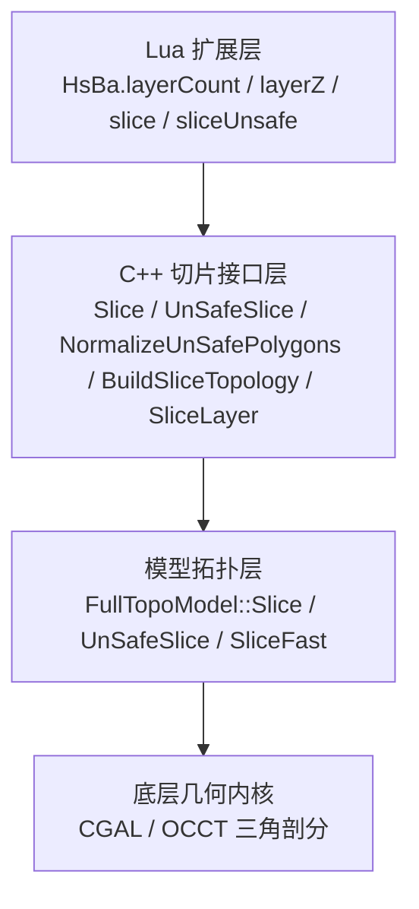

**图表来源**
- [lua_pipeline.cpp:401-461](file://LibHsBaSlicer/Extends/lua_pipeline.cpp#L401-L461)
- [mesh_slice.hpp:22-103](file://LibHsBaSlicer/Slice/mesh_slice.hpp#L22-L103)
- [FullTopoModel.hpp:104-114](file://meshmodel/FullTopoModel.hpp#L104-L114)

**章节来源**
- [lua_pipeline.cpp:401-461](file://LibHsBaSlicer/Extends/lua_pipeline.cpp#L401-L461)
- [mesh_slice.hpp:22-103](file://LibHsBaSlicer/Slice/mesh_slice.hpp#L22-L103)
- [FullTopoModel.hpp:104-114](file://meshmodel/FullTopoModel.hpp#L104-L114)

## 核心 API：layerCount、layerZ、slice、sliceUnsafe

### HsBa.layerCount(name, layerHeight, firstLayerHeight)
- 作用：根据模型 Z 向包围盒高度、首层层高和常规层高，计算总层数。
- 输入：
  - `name`：已加载模型名称。
  - `layerHeight`：常规层高，必须大于 0。
  - `firstLayerHeight`：首层层高。
- 输出：整数层数。
- 行为要点：
  - 若模型不存在或层高非法，返回 Lua 错误。
  - 若模型高度小于等于 0，返回 0。
  - 层数计算公式为：先扣除首层层高，剩余高度按常规层高向上取整；即使剩余部分不足一层，也至少计为 1 层。

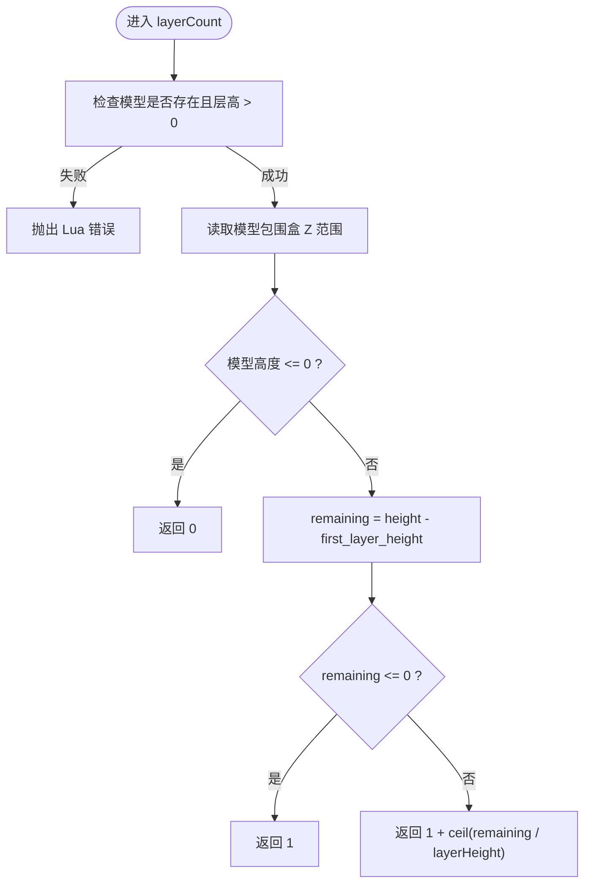

**图表来源**
- [lua_pipeline.cpp:401-422](file://LibHsBaSlicer/Extends/lua_pipeline.cpp#L401-L422)

**章节来源**
- [lua_pipeline.cpp:401-422](file://LibHsBaSlicer/Extends/lua_pipeline.cpp#L401-L422)

### HsBa.layerZ(index0based, layerHeight, firstLayerHeight)
- 作用：根据层级索引计算绝对 Z 坐标。
- 输入：
  - `index0based`：从 0 开始的层级索引。
  - `layerHeight`：常规层高。
  - `firstLayerHeight`：首层层高。
- 输出：浮点 Z 坐标。
- 行为要点：
  - 第 0 层直接返回首层层高。
  - 其他层返回 `firstLayerHeight + index * layerHeight`。

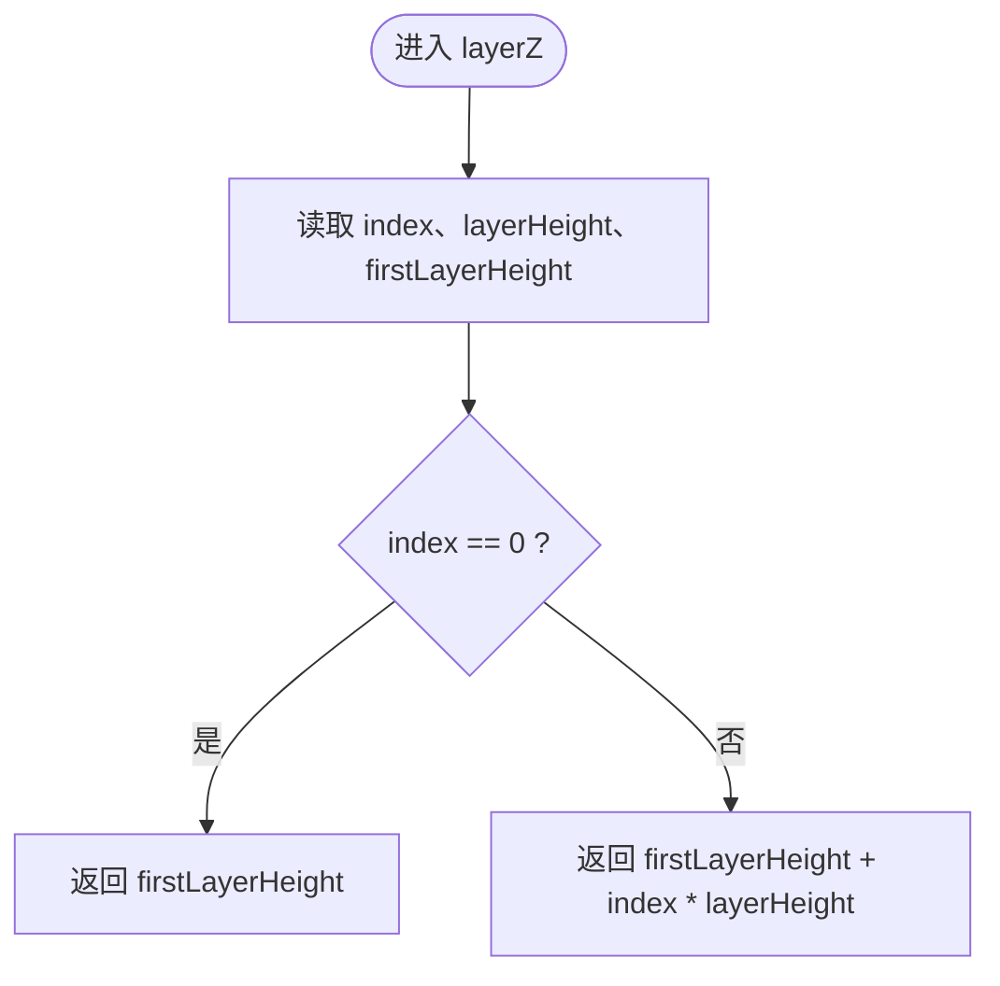

**图表来源**
- [lua_pipeline.cpp:424-433](file://LibHsBaSlicer/Extends/lua_pipeline.cpp#L424-L433)

**章节来源**
- [lua_pipeline.cpp:424-433](file://LibHsBaSlicer/Extends/lua_pipeline.cpp#L424-L433)

### HsBa.slice(name, z)
- 作用：在指定 Z 高度进行安全切片，仅返回闭合轮廓的多边形。
- 输入：
  - `name`：已加载模型名称。
  - `z`：切片高度（毫米）。
- 输出：双精度多边形表。
- 内部流程：
  - 查找模型，未找到则抛错。
  - 调用 C++ 切片接口 `Slice(model, float(z))`。
  - 将内部整型多边形转换为双精度多边形后返回。

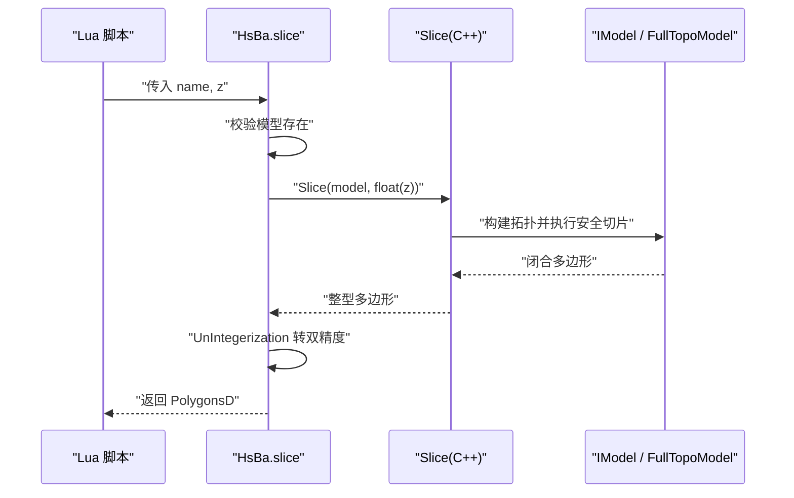

**图表来源**
- [lua_pipeline.cpp:435-447](file://LibHsBaSlicer/Extends/lua_pipeline.cpp#L435-L447)
- [mesh_slice.cpp:46-54](file://LibHsBaSlicer/Slice/mesh_slice.cpp#L46-L54)
- [FullTopoModel.hpp:104-114](file://meshmodel/FullTopoModel.hpp#L104-L114)

**章节来源**
- [lua_pipeline.cpp:435-447](file://LibHsBaSlicer/Extends/lua_pipeline.cpp#L435-L447)
- [mesh_slice.cpp:46-54](file://LibHsBaSlicer/Slice/mesh_slice.cpp#L46-L54)

### HsBa.sliceUnsafe(name, z)
- 作用：在指定 Z 高度进行不安全切片，可能包含开放轮廓；返回结果会经过标准化处理。
- 输入：
  - `name`：已加载模型名称。
  - `z`：切片高度（毫米）。
- 输出：双精度多边形表。
- 内部流程：
  - 查找模型，未找到则抛错。
  - 调用 C++ 切片接口 `UnSafeSlice(model, float(z))`。
  - 通过 `NormalizeUnSafePolygons` 过滤开放轮廓和非简单多边形，并将整型坐标转为双精度。

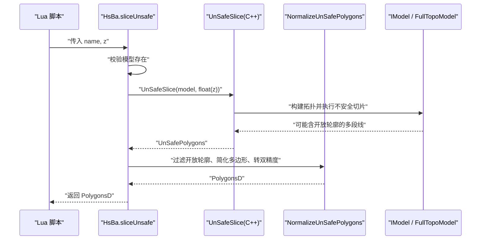

**图表来源**
- [lua_pipeline.cpp:449-461](file://LibHsBaSlicer/Extends/lua_pipeline.cpp#L449-L461)
- [mesh_slice.cpp:86-104](file://LibHsBaSlicer/Slice/mesh_slice.cpp#L86-L104)

**章节来源**
- [lua_pipeline.cpp:449-461](file://LibHsBaSlicer/Extends/lua_pipeline.cpp#L449-L461)
- [mesh_slice.cpp:86-104](file://LibHsBaSlicer/Slice/mesh_slice.cpp#L86-L104)

## 切片算法原理与精度控制

### 安全切片与不安全切片
- 安全切片 `Slice`：只保留闭合轮廓，丢弃开放轮廓。适用于需要严格闭合环的场景，如 SLA 底片生成、FDM 外壁填充等。
- 不安全切片 `UnSafeSlice`：保留开放轮廓，适合材料送丝类工艺（例如 WAAM）或需要分析非闭合截线的场景。

两者都基于 `FullTopoModel` 提供的切片方法，区别在于是否允许开放轮廓进入结果集。

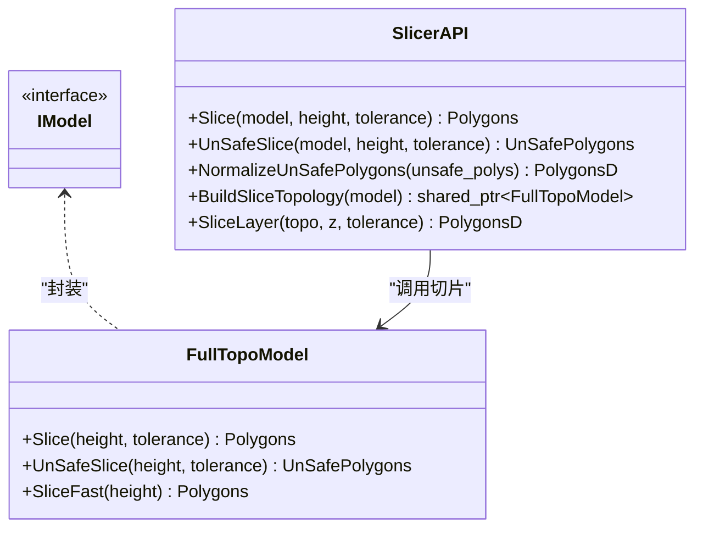

**图表来源**
- [FullTopoModel.hpp:104-114](file://meshmodel/FullTopoModel.hpp#L104-L114)
- [mesh_slice.hpp:22-103](file://LibHsBaSlicer/Slice/mesh_slice.hpp#L22-L103)

### 精度控制：tolerance 与 integerization
- `tolerance`：坐标容差，用于点合并与几何判断。默认值为 `0.001`。该值影响切片时相邻点是否被视为重合，从而影响多边形拓扑质量。
- `integerization`：二维坐标缩放因子，定义为 `1e6`。内部多边形以整型存储，避免浮点误差累积；对外返回时再转换回双精度。

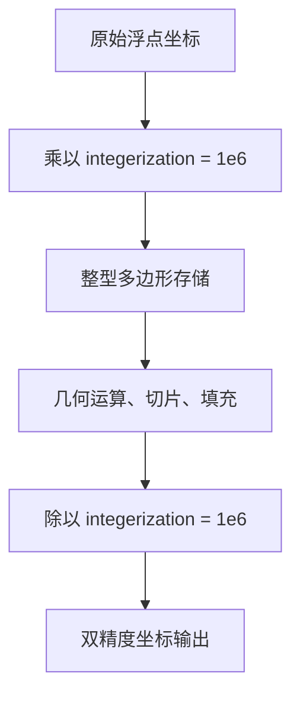

**图表来源**
- [IntPolygon.hpp:17](file://2D/IntPolygon.hpp#L17)
- [FloatPolygons.cpp:184-221](file://2D/FloatPolygons.cpp#L184-L221)

**章节来源**
- [mesh_slice.hpp:22-103](file://LibHsBaSlicer/Slice/mesh_slice.hpp#L22-L103)
- [IntPolygon.hpp:17](file://2D/IntPolygon.hpp#L17)
- [FloatPolygons.cpp:184-221](file://2D/FloatPolygons.cpp#L184-L221)

### 复杂性与数据流
- 单次切片复杂度：注释指出常见切片算法复杂度相同，但排除拓扑重建时间后，由于 `FullTopoModel` 已经重建拓扑，因此逐层切片不再重复构建拓扑。
- 数据流：Lua 层 → C++ 切片接口 → `FullTopoModel` → 几何内核（CGAL/OCCT）→ 多边形结果 → 坐标归一化 → Lua 表。

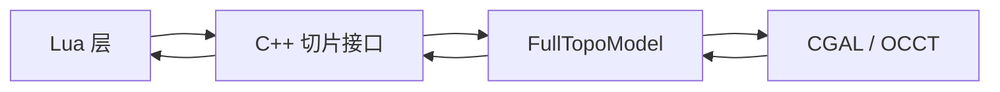

**图表来源**
- [FullTopoModel.hpp:104-114](file://meshmodel/FullTopoModel.hpp#L104-L114)
- [mesh_slice.cpp:46-64](file://LibHsBaSlicer/Slice/mesh_slice.cpp#L46-L64)

**章节来源**
- [FullTopoModel.hpp:104-114](file://meshmodel/FullTopoModel.hpp#L104-L114)
- [mesh_slice.cpp:46-64](file://LibHsBaSlicer/Slice/mesh_slice.cpp#L46-L64)

## 开放轮廓处理策略与容错机制

### 开放轮廓的处理
- `Slice`：安全切片，忽略开放轮廓，只返回闭合多边形。
- `UnSafeSlice`：返回可能包含开放轮廓的结果；随后通过 `NormalizeUnSafePolygons` 进行清理：
  - 跳过非闭合路径。
  - 跳过顶点数少于 3 的路径。
  - 对路径进行简单多边形规范化。
  - 将整型坐标转换为双精度。

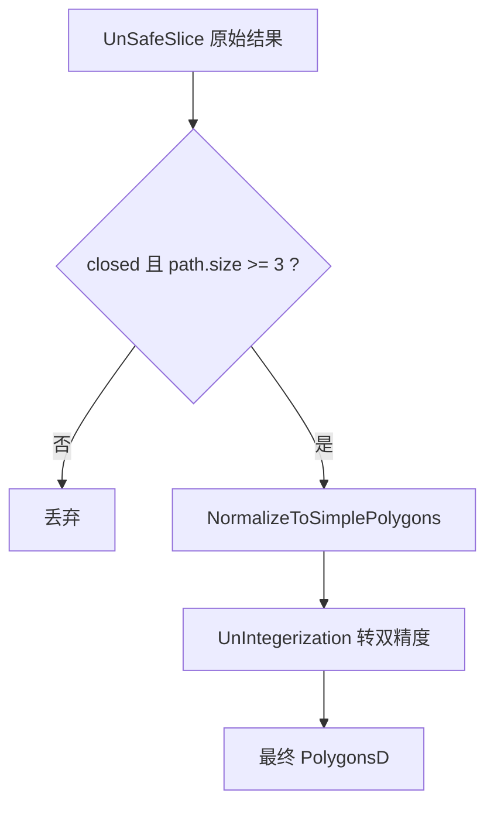

**图表来源**
- [mesh_slice.cpp:86-104](file://LibHsBaSlicer/Slice/mesh_slice.cpp#L86-L104)

**章节来源**
- [mesh_slice.cpp:86-104](file://LibHsBaSlicer/Slice/mesh_slice.cpp#L86-L104)

### 容错机制
- Lua 层：
  - 模型不存在时抛出 Lua 错误。
  - `layerCount` 对无效模型或非法层高进行检查并报错。
- C++ 层：
  - 所有切片入口通过 `GuardSlice` 包装，捕获外部异常（如 CGAL、OCCT 异常），将其转换为项目统一的 `IOError`。
  - 项目自身 `RuntimeError` 透传，便于上层区分业务错误与底层几何错误。

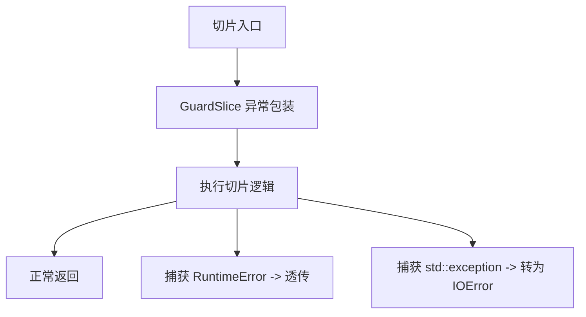

**图表来源**
- [mesh_slice.cpp:17-44](file://LibHsBaSlicer/Slice/mesh_slice.cpp#L17-L44)

**章节来源**
- [mesh_slice.cpp:17-44](file://LibHsBaSlicer/Slice/mesh_slice.cpp#L17-L44)

## 不同层高设置的切片效果对比

### 层高配置字段
在多工艺管线中，层高相关配置包括：
- `layer_height`：常规层高。
- `first_layer_height`：首层层高。
- `total_layers`：总层数。

这些字段在 SLA、FDM、WAAM 管线中均被使用，用于计算每层 Z 坐标并驱动切片。

```mermaid
table
| 配置项 | 含义 | 典型用途 |
| --- | --- | --- |
| layer_height | 常规层高 | 决定除首层外的层高间距 |
| first_layer_height | 首层层高 | 决定第一层 Z 坐标及附着质量 |
| total_layers | 总层数 | 控制切片循环次数 |
```

**章节来源**
- [pipeline_types.h:178-198](file://pipelinetypes/pipeline_types.h#L178-L198)

### 层高对切片的影响
- 较小层高：
  - 优点：Z 方向分辨率更高，曲面更平滑。
  - 缺点：层数增加，切片与后续处理耗时上升，内存占用增大。
- 较大层高：
  - 优点：层数减少，速度更快。
  - 缺点：Z 方向阶梯效应明显，细节丢失。

### 不同管线的层高使用
- FDM：
  - 使用 `GetLayerZ` 计算每层 Z，再通过 `SliceLayer` 并行切片。
- SLA：
  - 同样使用 `GetLayerZ` 与 `SliceLayer`，并在切片完成后生成底板。
- WAAM：
  - 保持开放轮廓，切片结果用于焊道层生成。

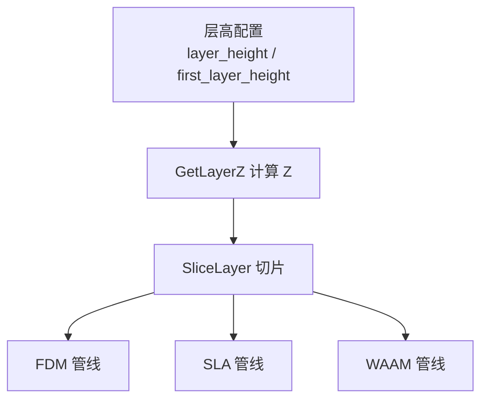

**图表来源**
- [fdm_pipeline.cpp:252-279](file://DllHsBaSlicer/fdm_pipeline.cpp#L252-L279)
- [sla_pipeline.cpp:331-358](file://DllHsBaSlicer/sla_pipeline.cpp#L331-L358)
- [waam_pipeline.cpp:199-231](file://DllHsBaSlicer/waam_pipeline.cpp#L199-L231)

**章节来源**
- [fdm_pipeline.cpp:252-279](file://DllHsBaSlicer/fdm_pipeline.cpp#L252-L279)
- [sla_pipeline.cpp:331-358](file://DllHsBaSlicer/sla_pipeline.cpp#L331-L358)
- [waam_pipeline.cpp:199-231](file://DllHsBaSlicer/waam_pipeline.cpp#L199-L231)

## 性能优化与内存管理建议

### 复用拓扑结构
- 推荐做法：使用 `BuildSliceTopology` 一次性构建拓扑，然后对多层调用 `SliceLayer`。
- 原因：每次直接调用 `UnSafeSlice(model, z)` 会重建完整拓扑，复杂度为 O(total_faces)；复用拓扑可避免重复构建，提升多层切片性能。
- 并发安全：`SliceLayer` 仅读取共享拓扑，多线程并行切片时每个线程写入各自输出槽即可。

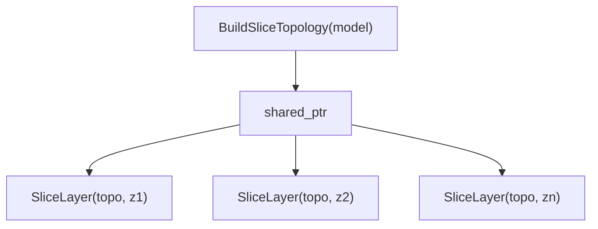

**图表来源**
- [mesh_slice.hpp:79-103](file://LibHsBaSlicer/Slice/mesh_slice.hpp#L79-L103)
- [mesh_slice.cpp:106-116](file://LibHsBaSlicer/Slice/mesh_slice.cpp#L106-L116)

**章节来源**
- [mesh_slice.hpp:79-103](file://LibHsBaSlicer/Slice/mesh_slice.hpp#L79-L103)
- [mesh_slice.cpp:106-116](file://LibHsBaSlicer/Slice/mesh_slice.cpp#L106-L116)

### 并行切片
- FDM、SLA、WAAM 管线均采用 `ParallelForLayers` 并行切片，每层独立且只读共享拓扑，显著提升吞吐。
- 建议：
  - 优先使用 `BuildSliceTopology` + `SliceLayer`。
  - 合理设置并行度，避免过多线程导致缓存抖动。
  - 对超大模型，考虑分层批处理，避免单批次内存峰值过高。

**章节来源**
- [fdm_pipeline.cpp:252-279](file://DllHsBaSlicer/fdm_pipeline.cpp#L252-L279)
- [sla_pipeline.cpp:331-358](file://DllHsBaSlicer/sla_pipeline.cpp#L331-L358)
- [waam_pipeline.cpp:199-231](file://DllHsBaSlicer/waam_pipeline.cpp#L199-L231)

### 坐标精度与内存
- 内部使用整型多边形存储，缩放因子 `integerization = 1e6`，可减少浮点误差并降低内存占用。
- 对外返回前统一转换为双精度，保证 Lua 层精度需求。
- 建议：
  - 在 Lua 层尽量使用 `sliceUnsafe` 配合 `NormalizeUnSafePolygons` 的逻辑，避免手动处理开放轮廓。
  - 对仅需闭合轮廓的场景，优先使用 `slice`，减少后续清洗成本。

**章节来源**
- [IntPolygon.hpp:17](file://2D/IntPolygon.hpp#L17)
- [FloatPolygons.cpp:184-221](file://2D/FloatPolygons.cpp#L184-L221)
- [lua_pipeline.cpp:435-461](file://LibHsBaSlicer/Extends/lua_pipeline.cpp#L435-L461)

## 常见问题排查

### 模型未加载
- 现象：调用 `slice` 或 `sliceUnsafe` 时报错。
- 原因：模型名称不存在或未成功加载。
- 处理：确认模型加载顺序，确保 `name` 对应有效模型。

**章节来源**
- [lua_pipeline.cpp:435-461](file://LibHsBaSlicer/Extends/lua_pipeline.cpp#L435-L461)

### 层高非法
- 现象：`layerCount` 报“invalid model or layer height”。
- 原因：模型不存在或 `layerHeight <= 0`。
- 处理：检查层高参数是否为正数，并确认模型已加载。

**章节来源**
- [lua_pipeline.cpp:401-422](file://LibHsBaSlicer/Extends/lua_pipeline.cpp#L401-L422)

### 几何内核异常
- 现象：切片过程中抛出底层异常。
- 原因：CGAL 或 OCCT 几何计算失败。
- 处理：检查模型拓扑完整性，适当调整 `tolerance`，或改用 `SliceFast` 进行拓扑完整性检查。

**章节来源**
- [mesh_slice.cpp:17-44](file://LibHsBaSlicer/Slice/mesh_slice.cpp#L17-L44)
- [FullTopoModel.hpp:112-114](file://meshmodel/FullTopoModel.hpp#L112-L114)

## 结论
HsBaSlicer 的切片系统通过 Lua 扩展层提供简洁 API，并通过 C++ 切片接口与 `FullTopoModel` 实现稳定、可扩展的几何切片能力。`layerCount` 与 `layerZ` 负责层高与 Z 坐标计算，`slice` 与 `sliceUnsafe` 分别面向闭合轮廓与开放轮廓场景。通过 `BuildSliceTopology` 与 `SliceLayer` 可显著优化多层切片性能，而 `integerization` 与 `tolerance` 共同保障精度与稳定性。在不同工艺管线中，层高配置与切片策略需结合具体需求权衡精度、速度与内存占用。