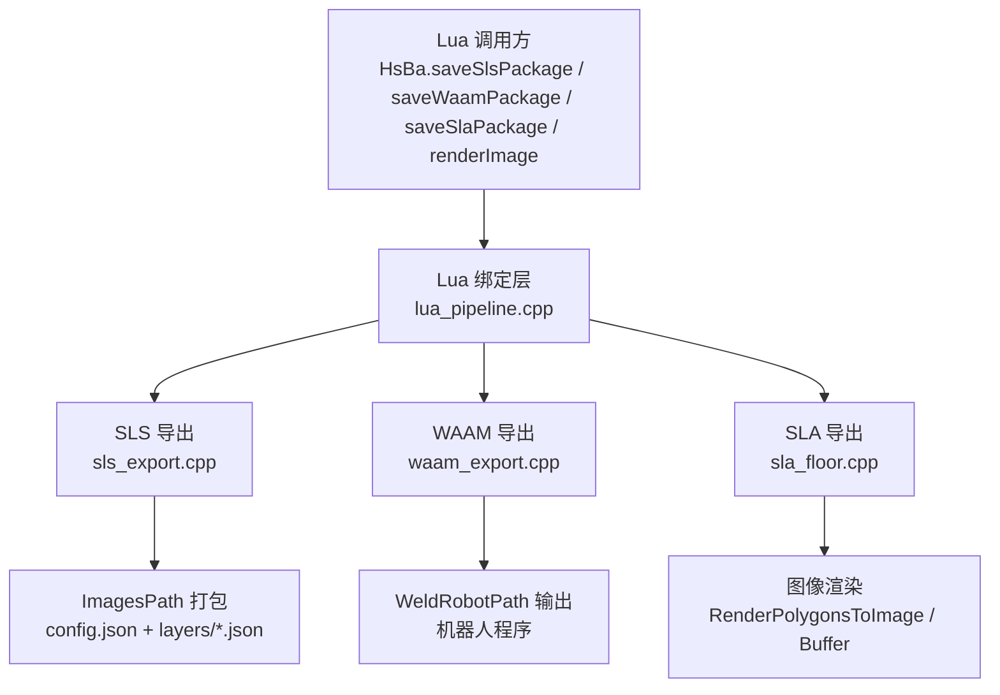
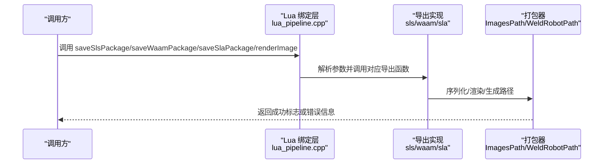
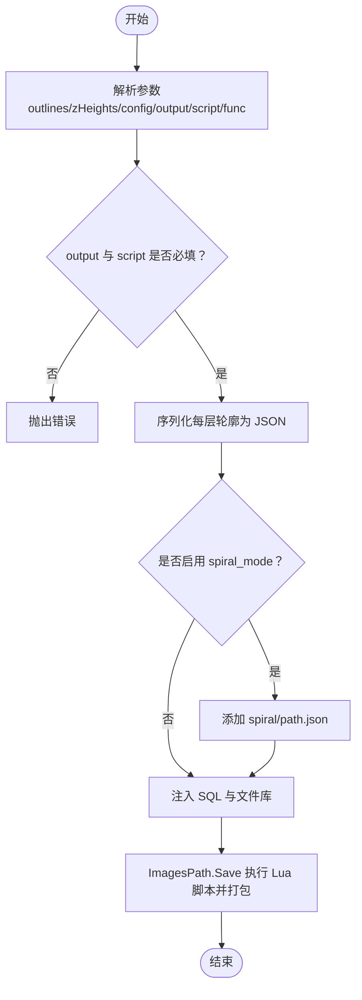
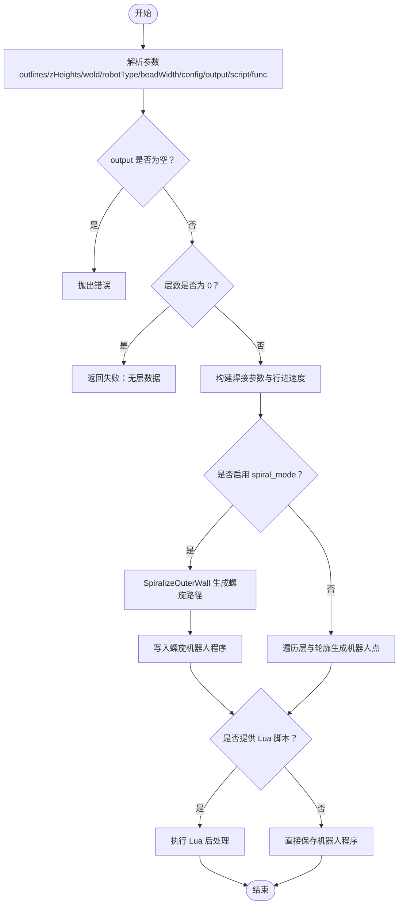
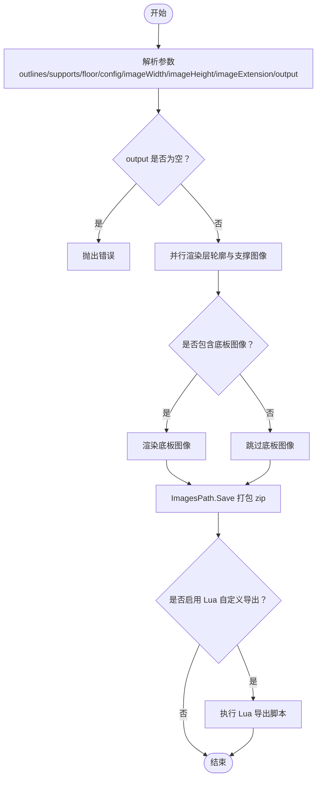
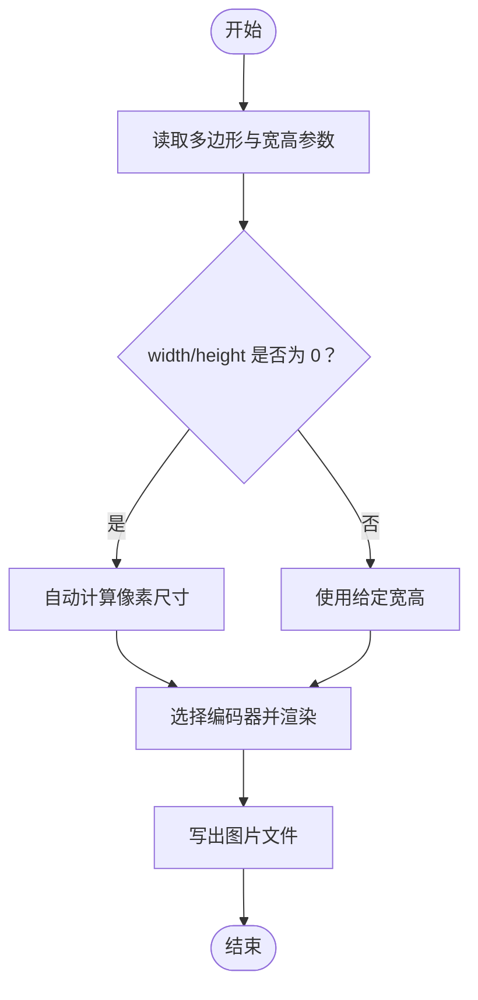
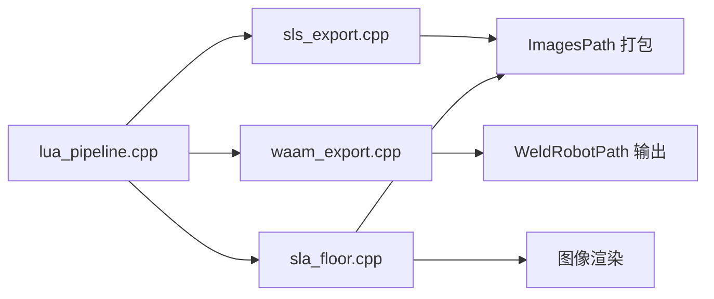
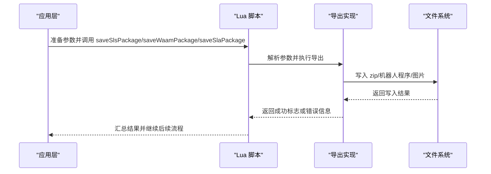

# 导出功能

<cite>
**本文引用的文件**   
- [lua_pipeline.cpp](file://LibHsBaSlicer/Extends/lua_pipeline.cpp)
- [sla_floor.hpp](file://LibHsBaSlicer/Floor/sla_floor.hpp)
- [sla_floor.cpp](file://LibHsBaSlicer/Floor/sla_floor.cpp)
- [waam_export.hpp](file://LibHsBaSlicer/Path/waam_export.hpp)
- [waam_export.cpp](file://LibHsBaSlicer/Path/waam_export.cpp)
- [sls_export.hpp](file://LibHsBaSlicer/Path/sls_export.hpp)
- [sls_export.cpp](file://LibHsBaSlicer/Path/sls_export.cpp)
- [hsba_pipeline.d.lua](file://types/hsba_pipeline.d.lua)
- [my_sls_export.lua](file://samples/Custom/scripts/my_sls_export.lua)
</cite>

## 目录
1. [简介](#简介)
2. [项目结构](#项目结构)
3. [核心组件](#核心组件)
4. [架构总览](#架构总览)
5. [详细组件分析](#详细组件分析)
6. [依赖关系分析](#依赖关系分析)
7. [性能与质量控制](#性能与质量控制)
8. [故障排除指南](#故障排除指南)
9. [结论](#结论)
10. [附录：批量与自定义导出示例](#附录批量与自定义导出示例)

## 简介
本文聚焦 HsBaSlicer 的导出能力，围绕以下 Lua API 与底层实现展开：
- saveSlsPackage：将 SLS 层轮廓打包为可被脚本控制的压缩包。
- saveWaamPackage：生成 WAAM 机器人语言程序（ABB/KUKA/FANUC），支持螺旋连续焊道模式。
- saveSlaPackage：将 SLA 切片、支撑、底板渲染为图像并打包为 zip。
- renderImage：将多边形渲染为图片文件，供脚本或上层流程使用。

文档同时说明不同工艺的输出格式、参数配置、批量导出与自定义导出方式，并解释图像渲染与图层管理机制，最后给出性能优化与质量控制建议。

## 项目结构
导出相关代码主要分布在以下模块：
- LibHsBaSlicer/Extends/lua_pipeline.cpp：Lua 侧导出函数绑定与参数解析。
- LibHsBaSlicer/Floor/sla_floor.{hpp,cpp}：SLA 图像渲染与包导出。
- LibHsBaSlicer/Path/waam_export.{hpp,cpp}：WAAM 机器人路径导出。
- LibHsBaSlicer/Path/sls_export.{hpp,cpp}：SLS 数据序列化与打包。
- types/hsba_pipeline.d.lua：Lua 类型定义与导出阶段入口约定。
- samples/Custom/scripts/my_sls_export.lua：SLS 自定义导出脚本示例。

**图示来源**
- [lua_pipeline.cpp:695-828](file://LibHsBaSlicer/Extends/lua_pipeline.cpp#L695-L828)
- [sls_export.cpp:79-143](file://LibHsBaSlicer/Path/sls_export.cpp#L79-L143)
- [waam_export.cpp:61-189](file://LibHsBaSlicer/Path/waam_export.cpp#L61-L189)
- [sla_floor.cpp:468-608](file://LibHsBaSlicer/Floor/sla_floor.cpp#L468-L608)

**章节来源**
- [lua_pipeline.cpp:695-828](file://LibHsBaSlicer/Extends/lua_pipeline.cpp#L695-L828)
- [sla_floor.hpp:118-195](file://LibHsBaSlicer/Floor/sla_floor.hpp#L118-L195)
- [waam_export.hpp:17-72](file://LibHsBaSlicer/Path/waam_export.hpp#L17-L72)
- [sls_export.hpp:54-56](file://LibHsBaSlicer/Path/sls_export.hpp#L54-L56)

## 核心组件
本节概述四个导出函数的职责、输入参数与输出产物。

- saveSlsPackage
  - 作用：将每层轮廓序列化为 JSON，并封装到 zip；可选通过 Lua 脚本完成最终打包与数据库注册。
  - 关键参数：outlines、zHeights、config、output、script、func。
  - 输出：zip 压缩包，包含 config.json 与 layers/N.json；若启用 spiral_mode，还会提供 spiral/path.json。
  - 失败行为：返回布尔值；内部错误可通过 error_out 获取（C++ 接口）。

- saveWaamPackage
  - 作用：根据层轮廓与焊接参数生成机器人语言程序；支持螺旋模式（整层外轮廓合并为连续上升焊道）。
  - 关键参数：outlines、zHeights、weld{current,voltage,wireFeedSpeed,gasFlowRate,travelSpeed,process}、robotType、beadWidth、config、output、script、func。
  - 输出：机器人程序文件（如 .txt/.rs 等，取决于后端）；失败时返回布尔值与错误详情字符串。

- saveSlaPackage
  - 作用：将层轮廓、支撑、底板渲染为图像，并打包为 zip；支持 Lua 自定义导出逻辑。
  - 关键参数：outlines、supports、floor、config、imageWidth、imageHeight、imageExtension、output。
  - 输出：zip 压缩包，包含 config.json、layers/N.ext、floor/floor_raft.ext、supports/layer_N.ext。

- renderImage
  - 作用：将多边形渲染为图片文件；宽度/高度为 0 时自动计算像素尺寸。
  - 关键参数：polygons、width、height、path。
  - 输出：图片文件（扩展名决定格式：png/jpg/svg）。

**章节来源**
- [lua_pipeline.cpp:695-828](file://LibHsBaSlicer/Extends/lua_pipeline.cpp#L695-L828)
- [sla_floor.hpp:118-195](file://LibHsBaSlicer/Floor/sla_floor.hpp#L118-L195)
- [waam_export.hpp:17-72](file://LibHsBaSlicer/Path/waam_export.hpp#L17-L72)
- [sls_export.hpp:54-56](file://LibHsBaSlicer/Path/sls_export.hpp#L54-L56)

## 架构总览
导出流程从 Lua 侧进入，经绑定层解析参数后调用各工艺导出实现。SLA 走图像渲染与 ImagesPath 打包；SLS 走 JSON 序列化与 ImagesPath 打包；WAAM 走 WeldRobotPath 生成机器人程序。

**图示来源**
- [lua_pipeline.cpp:695-828](file://LibHsBaSlicer/Extends/lua_pipeline.cpp#L695-L828)
- [sls_export.cpp:79-143](file://LibHsBaSlicer/Path/sls_export.cpp#L79-L143)
- [waam_export.cpp:61-189](file://LibHsBaSlicer/Path/waam_export.cpp#L61-L189)
- [sla_floor.cpp:468-608](file://LibHsBaSlicer/Floor/sla_floor.cpp#L468-L608)

## 详细组件分析

### SLS 导出：saveSlsPackage
- 参数解析
  - outlines：层轮廓数组。
  - zHeights：每层 Z 高度数组。
  - config：JSON 配置内容。
  - output：输出 zip 路径（必填）。
  - script：自定义导出脚本路径（必填）。
  - func：Lua 导出函数名，默认 export_sls。
- 处理逻辑
  - 将每层轮廓序列化为 JSON，并以 wrapper JSON 形式写入 layers/N.json，附带 layer 序号与 z_height。
  - 若启用 spiral_mode，额外生成 spiral/path.json。
  - 注入 SQL 适配器与文件操作库，交由 Lua 脚本完成最终打包与数据库注册。
- 输出产物
  - zip 包内包含 config.json、layers/N.json，以及可选 spiral/path.json。

**图示来源**
- [lua_pipeline.cpp:695-728](file://LibHsBaSlicer/Extends/lua_pipeline.cpp#L695-L728)
- [sls_export.cpp:79-143](file://LibHsBaSlicer/Path/sls_export.cpp#L79-L143)

**章节来源**
- [lua_pipeline.cpp:695-728](file://LibHsBaSlicer/Extends/lua_pipeline.cpp#L695-L728)
- [sls_export.cpp:79-143](file://LibHsBaSlicer/Path/sls_export.cpp#L79-L143)
- [sls_export.hpp:54-56](file://LibHsBaSlicer/Path/sls_export.hpp#L54-L56)

### WAAM 导出：saveWaamPackage
- 参数解析
  - outlines：每层沉积轮廓。
  - zHeights：每层 Z 高度。
  - weld：焊接参数子表（current、voltage、wireFeedSpeed、gasFlowRate、travelSpeed、process）。
  - robotType：机器人类型（0=ABB、1=KUKA、2=FANUC、其他=Unknown）。
  - beadWidth：焊道宽度（mm）。
  - config：可选配置内容。
  - output：输出机器人程序路径（必填）。
  - script：可选自定义脚本路径。
  - func：Lua 导出函数名，默认 export_waam。
- 处理逻辑
  - 校验层数非空。
  - 构建基础焊接参数与行进速度。
  - 若启用 spiral_mode，尝试将每层外轮廓合并为连续上升螺旋焊道；否则逐层逐轮廓生成机器人点。
  - 支持 Lua 脚本对生成的机器人程序进行后处理。
- 输出产物
  - 机器人语言程序文件；失败时返回布尔值与错误详情字符串。

**图示来源**
- [lua_pipeline.cpp:730-787](file://LibHsBaSlicer/Extends/lua_pipeline.cpp#L730-L787)
- [waam_export.cpp:61-189](file://LibHsBaSlicer/Path/waam_export.cpp#L61-L189)

**章节来源**
- [lua_pipeline.cpp:730-787](file://LibHsBaSlicer/Extends/lua_pipeline.cpp#L730-L787)
- [waam_export.hpp:17-72](file://LibHsBaSlicer/Path/waam_export.hpp#L17-L72)
- [waam_export.cpp:61-189](file://LibHsBaSlicer/Path/waam_export.cpp#L61-L189)

### SLA 导出：saveSlaPackage 与 renderImage
- 参数解析
  - outlines：每层层轮廓。
  - supports：每层支撑多边形（可为空）。
  - floor：底板多边形（可为空）。
  - config：JSON 配置内容。
  - imageWidth/imageHeight：图像宽高（0 表示自动）。
  - imageExtension：图像扩展名（默认 .png）。
  - output：输出 zip 路径（必填）。
- 处理逻辑
  - 使用 ForLayersParallel 并行渲染层轮廓与支撑图像。
  - 可选渲染底板图像。
  - 通过 ImagesPath 将图像与 config.json 打包为 zip。
  - 支持 Lua 自定义导出逻辑，注入 2D 与文件操作库。
- 输出产物
  - zip 包内包含 config.json、layers/N.ext、floor/floor_raft.ext、supports/layer_N.ext。

**图示来源**
- [lua_pipeline.cpp:789-828](file://LibHsBaSlicer/Extends/lua_pipeline.cpp#L789-L828)
- [sla_floor.cpp:468-608](file://LibHsBaSlicer/Floor/sla_floor.cpp#L468-L608)

**章节来源**
- [lua_pipeline.cpp:789-828](file://LibHsBaSlicer/Extends/lua_pipeline.cpp#L789-L828)
- [sla_floor.hpp:118-195](file://LibHsBaSlicer/Floor/sla_floor.hpp#L118-L195)
- [sla_floor.cpp:468-608](file://LibHsBaSlicer/Floor/sla_floor.cpp#L468-L608)

### 图像渲染机制：renderImage
- 作用：将多边形渲染为图片文件；当 width/height 为 0 时自动计算像素尺寸。
- 实现要点
  - 基于 FitPixelSize 计算像素大小与目标宽高。
  - 支持 ToImage 写出文件与 ToImageBuffer 写出内存缓冲。
  - 扩展名决定编码器（png/jpg/svg）。

**图示来源**
- [lua_pipeline.cpp:818-828](file://LibHsBaSlicer/Extends/lua_pipeline.cpp#L818-L828)
- [sla_floor.cpp:357-381](file://LibHsBaSlicer/Floor/sla_floor.cpp#L357-L381)

**章节来源**
- [lua_pipeline.cpp:818-828](file://LibHsBaSlicer/Extends/lua_pipeline.cpp#L818-L828)
- [sla_floor.hpp:118-151](file://LibHsBaSlicer/Floor/sla_floor.hpp#L118-L151)
- [sla_floor.cpp:357-381](file://LibHsBaSlicer/Floor/sla_floor.cpp#L357-L381)

## 依赖关系分析
- Lua 绑定层（lua_pipeline.cpp）负责参数解析与错误提示，并调用具体导出实现。
- SLS 导出依赖 ImagesPath 进行 JSON 序列化与打包，并可注入 SQL 适配器。
- WAAM 导出依赖 WeldRobotPath 与螺旋算法生成机器人程序。
- SLA 导出依赖图像渲染与 ImagesPath 打包，支持 Lua 自定义导出。

**图示来源**
- [lua_pipeline.cpp:695-828](file://LibHsBaSlicer/Extends/lua_pipeline.cpp#L695-L828)
- [sls_export.cpp:79-143](file://LibHsBaSlicer/Path/sls_export.cpp#L79-L143)
- [waam_export.cpp:61-189](file://LibHsBaSlicer/Path/waam_export.cpp#L61-L189)
- [sla_floor.cpp:468-608](file://LibHsBaSlicer/Floor/sla_floor.cpp#L468-L608)

**章节来源**
- [lua_pipeline.cpp:695-828](file://LibHsBaSlicer/Extends/lua_pipeline.cpp#L695-L828)
- [sls_export.cpp:79-143](file://LibHsBaSlicer/Path/sls_export.cpp#L79-L143)
- [waam_export.cpp:61-189](file://LibHsBaSlicer/Path/waam_export.cpp#L61-L189)
- [sla_floor.cpp:468-608](file://LibHsBaSlicer/Floor/sla_floor.cpp#L468-L608)

## 性能与质量控制
- 并行渲染
  - SLA 导出使用 ForLayersParallel 并行渲染层轮廓与支撑图像，提升吞吐。
  - 可通过环境变量 HSBA_PIPELINE_THREADS 控制线程数；单线程或单层时退化为串行循环。
- 内存缓冲渲染
  - 使用 RenderPolygonsToImageBuffer 避免中间文件读写，减少 I/O 开销。
- 质量建议
  - 合理设置 imageWidth/imageHeight，避免过小导致细节丢失或过大导致体积膨胀。
  - 选择合适的 imageExtension（png 无损但体积较大，jpg 有损但体积小）。
  - 对于 SLS，确保每层轮廓闭合且有效，避免生成无效 JSON。
  - 对于 WAAM，检查 robotType 与 process 匹配设备能力；spiral_mode 需要至少一个闭合外轮廓。

[本节为通用指导，不直接分析具体文件]

## 故障排除指南
- saveSlsPackage
  - 错误：缺少 output 或 script 字段。
  - 排查：确认传入 table 包含必填字段；检查脚本路径是否正确。
- saveWaamPackage
  - 错误：缺少 output 字段；层数为 0。
  - 排查：确认 output 存在；确保 outlines 非空；检查 robotType 与 process 配置。
- saveSlaPackage
  - 错误：缺少 output 字段。
  - 排查：确认 output 存在；检查图像扩展名与宽高设置。
- renderImage
  - 错误：多边形为空或宽高参数非法。
  - 排查：确保 polygons 非空；width/height 为 0 时会自动计算，但仍需保证多边形有效。

**章节来源**
- [lua_pipeline.cpp:695-828](file://LibHsBaSlicer/Extends/lua_pipeline.cpp#L695-L828)
- [waam_export.cpp:61-189](file://LibHsBaSlicer/Path/waam_export.cpp#L61-L189)
- [sla_floor.cpp:468-608](file://LibHsBaSlicer/Floor/sla_floor.cpp#L468-L608)

## 结论
HsBaSlicer 的导出体系以 Lua 绑定层为核心，统一了 SLS、WAAM、SLA 三种工艺的导出入口。SLS 强调脚本可控的数据打包；WAAM 强调机器人程序生成与螺旋焊道模式；SLA 强调图像渲染与图层管理。通过并行渲染、内存缓冲与 ImagesPath 打包，系统在性能与可扩展性之间取得平衡。用户可根据需求选择内置导出或自定义 Lua 脚本，以满足多样化生产场景。

[本节为总结性内容，不直接分析具体文件]

## 附录：批量与自定义导出示例
- 批量导出
  - 在流水线中多次调用 saveSlsPackage/saveWaamPackage/saveSlaPackage，分别传入不同的 outlines、zHeights、config 与 output，即可批量生成多个导出结果。
  - 对于 SLA，可在一次调用中传入多层轮廓与支撑，系统会并行渲染并打包。
- 自定义导出
  - SLS：提供 script 与 func，Lua 脚本中可使用 Zipper、Cipher、SQLiteAdapter 等库完成最终打包与数据库注册。参考示例 my_sls_export.lua。
  - SLA：通过 SaveSlaPackageLua 注入 2D 与文件操作库，Lua 脚本可访问 config、images、output_path 等全局变量。
  - WAAM：通过 Lua 脚本对生成的机器人程序进行后处理，修改轨迹或参数。

**图示来源**
- [lua_pipeline.cpp:695-828](file://LibHsBaSlicer/Extends/lua_pipeline.cpp#L695-L828)
- [my_sls_export.lua:1-29](file://samples/Custom/scripts/my_sls_export.lua#L1-L29)

**章节来源**
- [lua_pipeline.cpp:695-828](file://LibHsBaSlicer/Extends/lua_pipeline.cpp#L695-L828)
- [my_sls_export.lua:1-29](file://samples/Custom/scripts/my_sls_export.lua#L1-L29)
- [hsba_pipeline.d.lua:556-594](file://types/hsba_pipeline.d.lua#L556-L594)