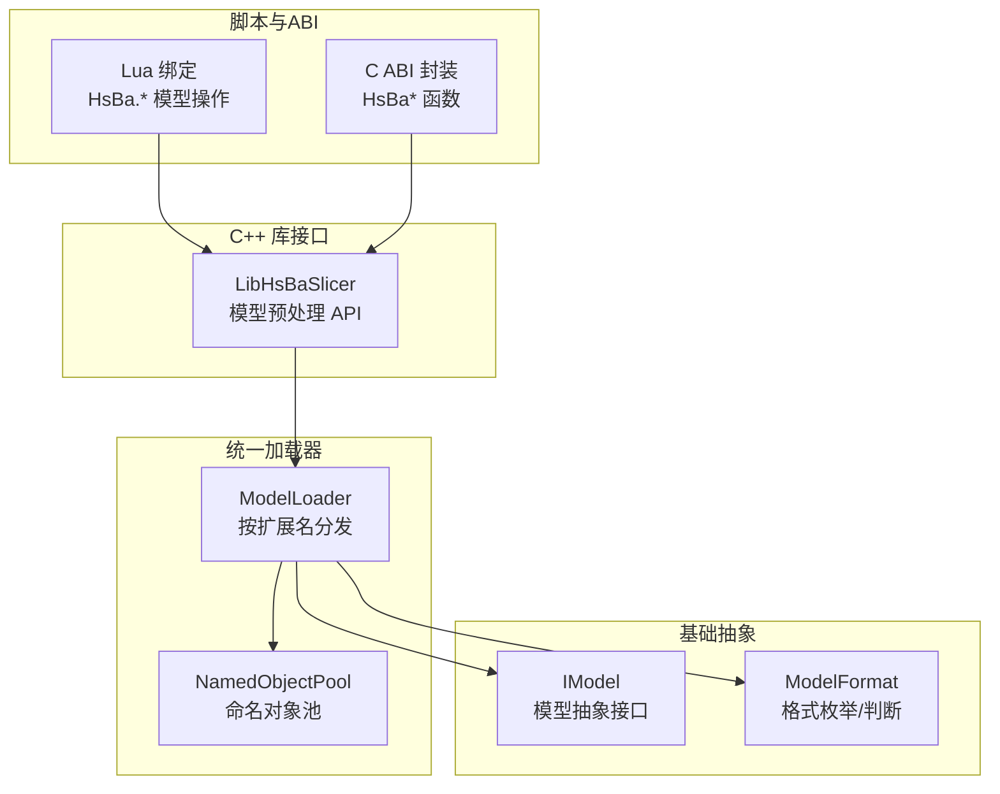
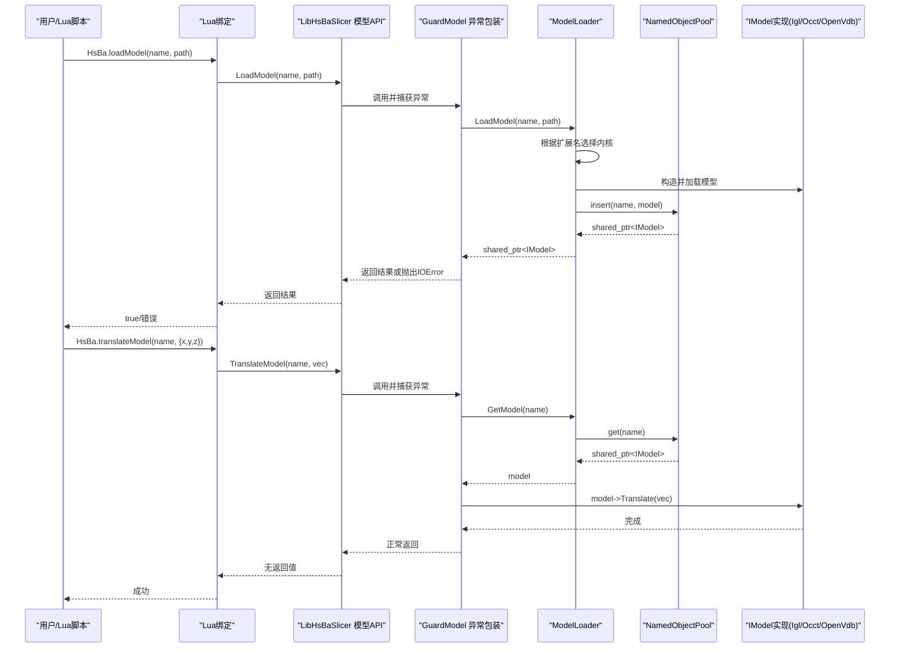
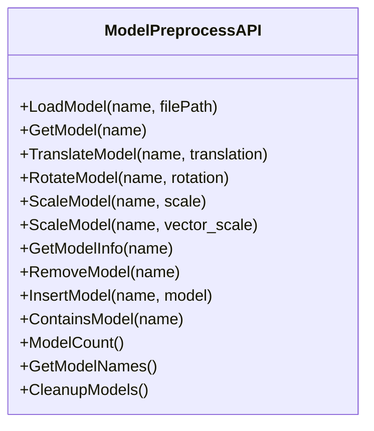
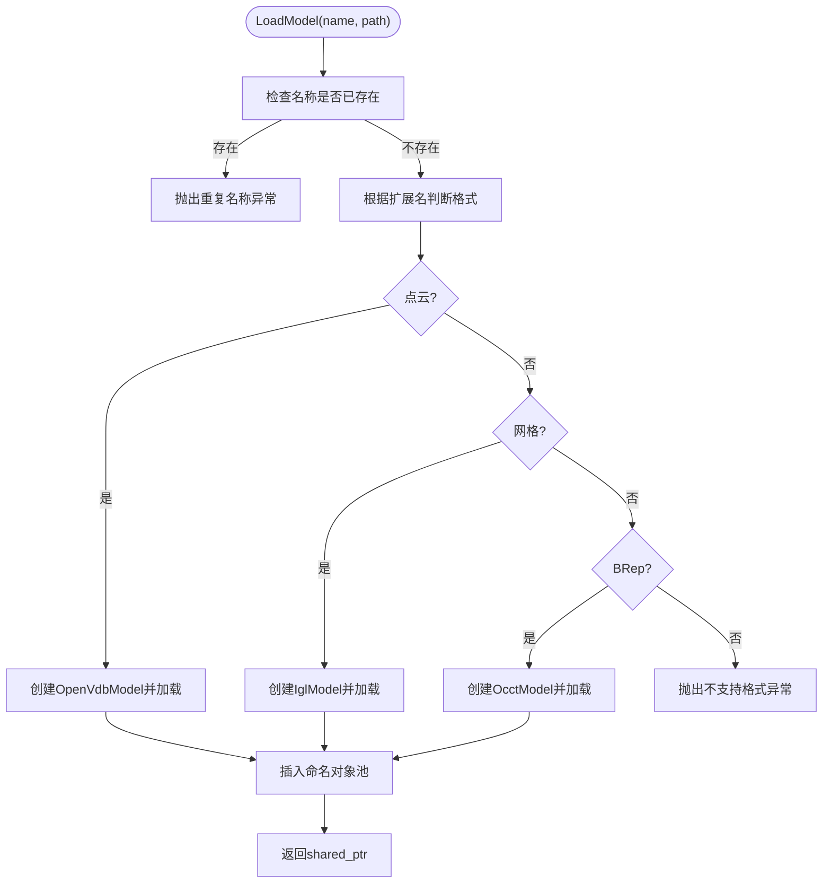
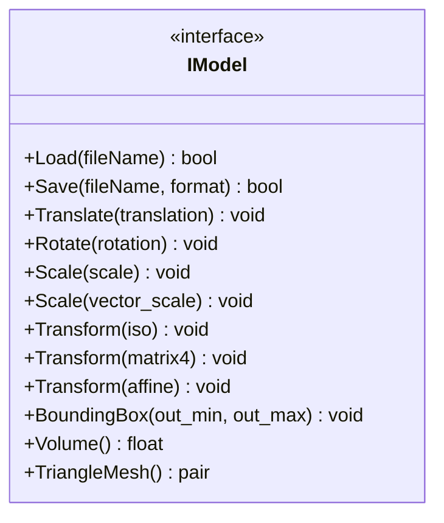
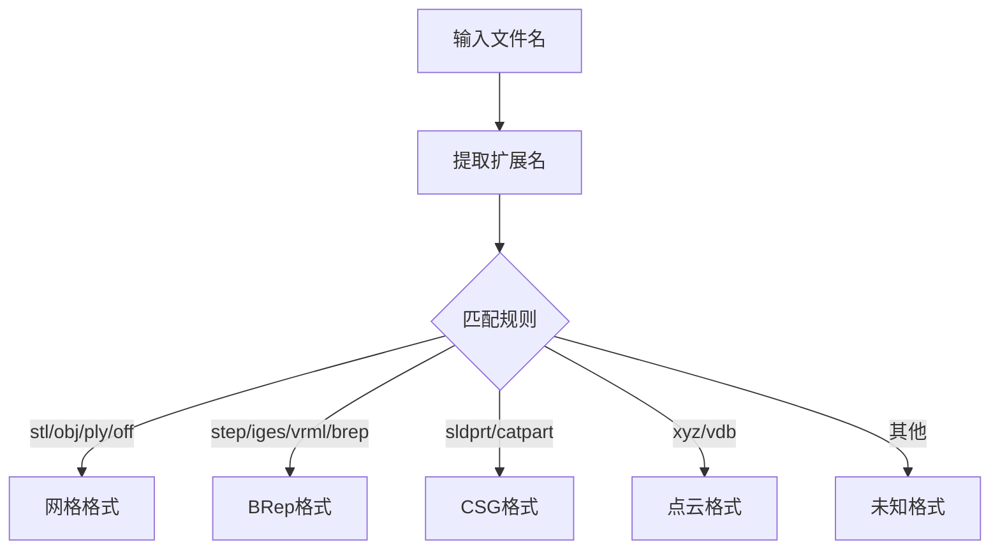
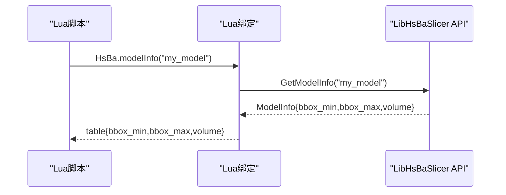
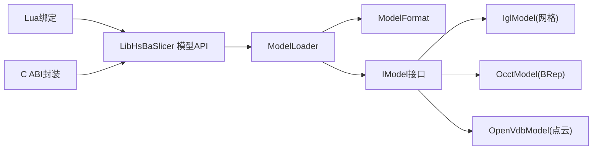

# 模型管理

<cite>
**本文引用的文件**   
- [model_preprocess.hpp](file://LibHsBaSlicer/Preprocess/model_preprocess.hpp)
- [model_preprocess.cpp](file://LibHsBaSlicer/Preprocess/model_preprocess.cpp)
- [ModelLoader.hpp](file://preprocess/ModelLoader.hpp)
- [ModelLoader.cpp](file://preprocess/ModelLoader.cpp)
- [IModel.hpp](file://base/IModel.hpp)
- [ModelFormat.hpp](file://base/ModelFormat.hpp)
- [ModelFormat.cpp](file://base/ModelFormat.cpp)
- [object_pool.hpp](file://base/object_pool.hpp)
- [lua_pipeline.cpp](file://LibHsBaSlicer/Extends/lua_pipeline.cpp)
- [model_preprocess.cpp](file://DllHsBaSlicer/model_preprocess.cpp)
</cite>

## 目录
1. [简介](#简介)
2. [项目结构](#项目结构)
3. [核心组件](#核心组件)
4. [架构总览](#架构总览)
5. [详细组件分析](#详细组件分析)
6. [依赖关系分析](#依赖关系分析)
7. [性能与内存管理](#性能与内存管理)
8. [故障排除指南](#故障排除指南)
9. [结论](#结论)
10. [附录：API 参考与示例](#附录api-参考与示例)

## 简介
本页面聚焦 HsBaSlicer 的“模型管理”能力，覆盖以下目标：
- 说明如何使用 loadModel、modelInfo、translateModel、rotateModel、scaleModel、removeModel、modelNames 等函数。
- 解释模型坐标系变换（平移、旋转、缩放）与几何属性获取（包围盒、体积）。
- 提供模型预处理与变换的完整流程示例。
- 说明模型缓存与内存管理机制（命名对象池、线程局部加载器、引用计数）。
- 列出支持的模型文件格式，并给出性能优化建议。

## 项目结构
模型管理相关代码分布在三层：
- C++ 库接口层：LibHsBaSlicer/Preprocess 暴露统一的模型加载、变换、查询 API。
- 统一加载器与命名对象池：preprocess/ModelLoader 负责按扩展名分发到具体内核（网格/实体/点云），并通过 NamedObjectPool 管理模型生命周期。
- 基础抽象与格式工具：base/IModel 定义模型抽象接口；base/ModelFormat 提供格式枚举与判断工具。
- Lua 脚本绑定：LibHsBaSlicer/Extends/lua_pipeline.cpp 将上述能力暴露给 Lua 脚本。
- C ABI 封装：DllHsBaSlicer/model_preprocess.cpp 为外部语言提供稳定 C 接口。

图示来源
- [model_preprocess.hpp:32-120](file://LibHsBaSlicer/Preprocess/model_preprocess.hpp#L32-L120)
- [ModelLoader.hpp:23-92](file://preprocess/ModelLoader.hpp#L23-L92)
- [IModel.hpp:110-139](file://base/IModel.hpp#L110-L139)
- [ModelFormat.hpp:19-93](file://base/ModelFormat.hpp#L19-L93)
- [lua_pipeline.cpp:343-390](file://LibHsBaSlicer/Extends/lua_pipeline.cpp#L343-L390)
- [model_preprocess.cpp:31-224](file://DllHsBaSlicer/model_preprocess.cpp#L31-L224)

章节来源
- [model_preprocess.hpp:32-120](file://LibHsBaSlicer/Preprocess/model_preprocess.hpp#L32-L120)
- [ModelLoader.hpp:23-92](file://preprocess/ModelLoader.hpp#L23-L92)
- [IModel.hpp:110-139](file://base/IModel.hpp#L110-L139)
- [ModelFormat.hpp:19-93](file://base/ModelFormat.hpp#L19-L93)
- [lua_pipeline.cpp:343-390](file://LibHsBaSlicer/Extends/lua_pipeline.cpp#L343-L390)
- [model_preprocess.cpp:31-224](file://DllHsBaSlicer/model_preprocess.cpp#L31-L224)

## 核心组件
- 模型预处理 API（LibHsBaSlicer）
  - 加载与查询：LoadModel、GetModel、GetModelInfo、ContainsModel、ModelCount、GetModelNames、CleanupModels。
  - 变换：TranslateModel、RotateModel、ScaleModel（标量/向量）。
  - 生命周期：RemoveModel、InsertModel。
- 统一加载器 ModelLoader
  - 根据扩展名选择内核：网格（STL/OBJ/PLY/OFF）→ IglModel；BRep（STEP/IGES/VRML/BREP）→ OcctModel；点云（XYZ/VDB）→ OpenVdbModel。
  - 通过 NamedObjectPool 管理模型名称到 shared_ptr<IModel> 的映射。
- 模型抽象 IModel
  - 统一接口：Load/Save、Transform/Translate/Rotate/Scale、BoundingBox/Volume、TriangleMesh。
- 格式工具 ModelFormat
  - 枚举与判断：IsMeshFormat/IsBrepFormat/IsCSGFormat/IsPointCloudFormat，以及从文件名推断格式。
- Lua 绑定
  - 暴露 HsBa.loadModel、HsBa.modelInfo、HsBa.translateModel、HsBa.rotateModel、HsBa.scaleModel、HsBa.removeModel、HsBa.modelNames。
- C ABI 封装
  - 对外提供 HsBaLoadModel/HsBaGetModel/HsBaTranslateModel/HsBaRotateModel/HsBaScaleModelUniform/HsBaScaleModel/HsBaGetModelInfo 等函数。

章节来源
- [model_preprocess.hpp:32-120](file://LibHsBaSlicer/Preprocess/model_preprocess.hpp#L32-L120)
- [ModelLoader.hpp:23-92](file://preprocess/ModelLoader.hpp#L23-L92)
- [IModel.hpp:110-139](file://base/IModel.hpp#L110-L139)
- [ModelFormat.hpp:19-93](file://base/ModelFormat.hpp#L19-L93)
- [lua_pipeline.cpp:343-390](file://LibHsBaSlicer/Extends/lua_pipeline.cpp#L343-L390)
- [model_preprocess.cpp:31-224](file://DllHsBaSlicer/model_preprocess.cpp#L31-L224)

## 架构总览
下图展示一次典型的“加载-变换-查询-清理”调用链，涵盖 Lua/C 调用、C++ 库、统一加载器与底层模型实现。

图示来源
- [lua_pipeline.cpp:343-390](file://LibHsBaSlicer/Extends/lua_pipeline.cpp#L343-L390)
- [model_preprocess.cpp:55-76](file://LibHsBaSlicer/Preprocess/model_preprocess.cpp#L55-L76)
- [ModelLoader.cpp:45-84](file://preprocess/ModelLoader.cpp#L45-L84)
- [object_pool.hpp:99-115](file://base/object_pool.hpp#L99-L115)

## 详细组件分析

### 模型预处理 API（LibHsBaSlicer）
- 加载与查询
  - LoadModel(name, filePath)：加载模型并放入内部池，支持网格/BRep/点云（取决于编译选项）。
  - GetModel(name)：按名称获取已加载模型的共享指针。
  - GetModelInfo(name)：返回包围盒最小/最大坐标与体积。
  - ContainsModel(name)、ModelCount()、GetModelNames()、CleanupModels()：池管理与清理。
- 变换
  - TranslateModel(name, translation)：沿三维向量平移。
  - RotateModel(name, rotation)：以四元数旋转。
  - ScaleModel(name, scale)：均匀缩放；ScaleModel(name, Vector3f)：非均匀缩放。
- 生命周期
  - RemoveModel(name)：从池中移除。
  - InsertModel(name, model)：插入已有模型实例。

图示来源
- [model_preprocess.hpp:32-120](file://LibHsBaSlicer/Preprocess/model_preprocess.hpp#L32-L120)
- [model_preprocess.cpp:55-161](file://LibHsBaSlicer/Preprocess/model_preprocess.cpp#L55-L161)

章节来源
- [model_preprocess.hpp:32-120](file://LibHsBaSlicer/Preprocess/model_preprocess.hpp#L32-L120)
- [model_preprocess.cpp:55-161](file://LibHsBaSlicer/Preprocess/model_preprocess.cpp#L55-L161)

### 统一加载器 ModelLoader
- 功能要点
  - 按扩展名自动选择内核：
    - 网格：STL/OBJ/PLY/OFF → IglModel。
    - BRep：STEP/IGES/VRML/BREP → OcctModel（需启用 USE_OCCT）。
    - 点云：XYZ/VDB → OpenVdbModel（需启用 USE_OPENVDB）。
  - 使用 NamedObjectPool 管理模型名称到 shared_ptr<IModel> 的映射。
  - 提供布尔运算、壳化、点云处理等高级能力（条件编译）。
- 关键流程
  - LoadModel：检查名称冲突 → 解析扩展名 → 创建对应模型 → 插入池。
  - GetModel/RemoveModel/ContainsModel/ModelCount/GetModelNames/Cleanup：委托给池。

图示来源
- [ModelLoader.cpp:45-84](file://preprocess/ModelLoader.cpp#L45-L84)
- [ModelLoader.hpp:47-92](file://preprocess/ModelLoader.hpp#L47-L92)

章节来源
- [ModelLoader.cpp:45-84](file://preprocess/ModelLoader.cpp#L45-L84)
- [ModelLoader.hpp:47-92](file://preprocess/ModelLoader.hpp#L47-L92)

### 模型抽象 IModel 与几何属性
- 接口能力
  - 加载/保存：Load/Save。
  - 变换：Translate/Rotate/Scale/Transform（等距/矩阵/仿射）。
  - 几何属性：BoundingBox（AABox）、Volume（体积）、TriangleMesh（三角网格）。
- 坐标系与变换语义
  - 所有变换均作用于模型自身坐标系，顺序由具体实现决定；通常先平移后旋转再缩放。
  - 四元数旋转遵循右手系；缩放支持均匀与非均匀。

图示来源
- [IModel.hpp:110-139](file://base/IModel.hpp#L110-L139)

章节来源
- [IModel.hpp:110-139](file://base/IModel.hpp#L110-L139)

### 模型格式支持与判断
- 支持的格式类别
  - 网格：STL(O/ASCII/Binary)、OBJ、PLY(ASCII/Binary/Unknown)、OFF。
  - BRep：STEP、IGES、VRML、BREP。
  - CSG：SLDPRT、CATPART。
  - 点云：XYZ、VDB。
- 工具函数
  - ModelTypeFromExtName(file_name)：从扩展名推断格式。
  - IsMeshFormat/IsBrepFormat/IsCSGFormat/IsPointCloudFormat：判断格式类别。

图示来源
- [ModelFormat.cpp:14-85](file://base/ModelFormat.cpp#L14-L85)
- [ModelFormat.hpp:19-93](file://base/ModelFormat.hpp#L19-L93)

章节来源
- [ModelFormat.cpp:14-85](file://base/ModelFormat.cpp#L14-L85)
- [ModelFormat.hpp:19-93](file://base/ModelFormat.hpp#L19-L93)

### Lua 脚本绑定
- 暴露的模型管理函数
  - HsBa.loadModel(name, path)：加载模型。
  - HsBa.modelInfo(name)：返回包含 bbox_min、bbox_max、volume 的表。
  - HsBa.translateModel(name, {x,y,z})：平移。
  - HsBa.rotateModel(name, {x,y,z,w})：四元数旋转。
  - HsBa.scaleModel(name, s) 或 (name, {x,y,z})：均匀或非均匀缩放。
  - HsBa.removeModel(name)：从池中移除。
  - HsBa.modelNames()：返回当前池中所有模型名的数组。

图示来源
- [lua_pipeline.cpp:343-390](file://LibHsBaSlicer/Extends/lua_pipeline.cpp#L343-L390)
- [model_preprocess.cpp:117-131](file://LibHsBaSlicer/Preprocess/model_preprocess.cpp#L117-L131)

章节来源
- [lua_pipeline.cpp:343-390](file://LibHsBaSlicer/Extends/lua_pipeline.cpp#L343-L390)
- [model_preprocess.cpp:117-131](file://LibHsBaSlicer/Preprocess/model_preprocess.cpp#L117-L131)

### C ABI 封装
- 对外函数
  - HsBaLoadModel/HsBaGetModel/HsBaRemoveModel/HsBaContainsModel/HsBaModelCount/HsBaCleanupModels。
  - HsBaTranslateModel/HsBaRotateModel/HsBaScaleModelUniform/HsBaScaleModel。
  - HsBaGetModelInfo：输出包围盒与体积。
- 特点
  - 所有异常在 C 边界被吞掉或转换为返回值，避免跨边界传播 C++ 异常。
  - 返回的句柄为 void*，内部持有 shared_ptr<IModel> 的堆分配指针，需配合释放接口使用。

章节来源
- [model_preprocess.cpp:31-224](file://DllHsBaSlicer/model_preprocess.cpp#L31-L224)

## 依赖关系分析
- 模块耦合
  - LibHsBaSlicer 模型预处理 API 依赖 ModelLoader 与 base 抽象。
  - ModelLoader 依赖 ModelFormat 进行格式判断，并组合多种 IModel 实现。
  - Lua 绑定与 C ABI 封装分别依赖 LibHsBaSlicer API。
- 外部依赖
  - Eigen：用于向量、四元数与矩阵运算。
  - 可选后端：OCCT（BRep）、CGAL（布尔运算）、OpenVDB（点云）。

图示来源
- [lua_pipeline.cpp:343-390](file://LibHsBaSlicer/Extends/lua_pipeline.cpp#L343-L390)
- [model_preprocess.cpp:31-224](file://DllHsBaSlicer/model_preprocess.cpp#L31-L224)
- [ModelLoader.cpp:45-84](file://preprocess/ModelLoader.cpp#L45-L84)
- [IModel.hpp:110-139](file://base/IModel.hpp#L110-L139)

章节来源
- [lua_pipeline.cpp:343-390](file://LibHsBaSlicer/Extends/lua_pipeline.cpp#L343-L390)
- [model_preprocess.cpp:31-224](file://DllHsBaSlicer/model_preprocess.cpp#L31-L224)
- [ModelLoader.cpp:45-84](file://preprocess/ModelLoader.cpp#L45-L84)
- [IModel.hpp:110-139](file://base/IModel.hpp#L110-L139)

## 性能与内存管理
- 命名对象池 NamedObjectPool
  - 容量控制：通过模板参数 MaxSize 限制池大小；达到上限时尝试清理未激活对象。
  - 激活状态：基于 shared_ptr 引用计数判断对象是否仍被外部持有；仅当 use_count==1 视为不活跃。
  - 并发安全：读写使用 shared_mutex，读多写少场景下提升吞吐。
- 线程局部加载器
  - 每个线程拥有独立的 ModelLoader 实例，避免多线程竞争同一池。
- 异常与错误路径
  - GuardModel 将第三方库异常统一转换为 IOError，确保 C/C++ 边界行为一致。
- 优化建议
  - 合理设置 HSBA_MODEL_POOL_SIZE，避免频繁扩容与清理。
  - 批量加载模型，减少重复 IO；对大模型优先使用网格或实体表示，按需再转换。
  - 使用 GetModelInfo 预先评估模型尺寸与体积，再进行昂贵的布尔运算或壳化。
  - 在 Lua 中尽量复用模型名称，避免重复加载。
  - 对于点云，先 Downsample/RemoveOutliers 再重建网格，降低计算量。

章节来源
- [object_pool.hpp:22-283](file://base/object_pool.hpp#L22-L283)
- [model_preprocess.cpp:18-53](file://LibHsBaSlicer/Preprocess/model_preprocess.cpp#L18-L53)
- [ModelLoader.hpp:23-29](file://preprocess/ModelLoader.hpp#L23-L29)

## 故障排除指南
- 常见错误与定位
  - 名称重复：LoadModel/InsertModel 抛出 InvalidArgumentError，检查 name 唯一性。
  - 不支持格式：LoadModel 抛出 InvalidArgumentError，确认扩展名是否在支持列表内。
  - 后端不可用：BRep/点云/布尔运算在缺少 OCCT/OpenVDB/CGAL 时抛出 NotSupportedError。
  - 模型不存在：GetModel/查询类 API 返回空指针或抛出 InvalidArgumentError，检查名称是否正确。
- 调试建议
  - 使用 ContainsModel 与 ModelCount 快速诊断池状态。
  - 使用 CleanupModels 主动回收未激活对象，观察 ActiveCount/InactiveCount 变化。
  - 在 Lua 中打印 modelNames 与 modelInfo，确认模型是否加载成功且几何属性合理。

章节来源
- [ModelLoader.cpp:45-84](file://preprocess/ModelLoader.cpp#L45-L84)
- [model_preprocess.cpp:117-161](file://LibHsBaSlicer/Preprocess/model_preprocess.cpp#L117-L161)
- [object_pool.hpp:71-115](file://base/object_pool.hpp#L71-L115)

## 结论
HsBaSlicer 的模型管理子系统通过清晰的层次划分与稳定的 API 设计，提供了统一的模型加载、变换、查询与生命周期管理能力。借助命名对象池与线程局部加载器，系统在并发与内存管理方面具备良好表现。结合格式判断工具与丰富的后端实现，用户可以在网格、实体与点云之间灵活切换，并在 Lua 或 C ABI 环境中便捷地调用模型预处理能力。

## 附录：API 参考与示例

### API 速查表（Lua）
- HsBa.loadModel(name, path)：加载模型，失败抛错。
- HsBa.modelInfo(name)：返回 { bbox_min={x,y,z}, bbox_max={x,y,z}, volume }。
- HsBa.translateModel(name, {x,y,z})：平移。
- HsBa.rotateModel(name, {x,y,z,w})：四元数旋转。
- HsBa.scaleModel(name, s) 或 (name, {x,y,z})：均匀或非均匀缩放。
- HsBa.removeModel(name)：从池中移除。
- HsBa.modelNames()：返回模型名数组。

章节来源
- [lua_pipeline.cpp:343-390](file://LibHsBaSlicer/Extends/lua_pipeline.cpp#L343-L390)
- [model_preprocess.cpp:117-131](file://LibHsBaSlicer/Preprocess/model_preprocess.cpp#L117-L131)

### 完整示例流程（Lua）
- 步骤
  1) 加载模型：HsBa.loadModel("part", "path/to/file.stl")。
  2) 查询信息：info = HsBa.modelInfo("part")，检查 bbox 与 volume。
  3) 变换模型：HsBa.translateModel("part", {tx, ty, tz})；HsBa.rotateModel("part", {qx,qy,qz,qw})；HsBa.scaleModel("part", s 或 {sx,sy,sz})。
  4) 列举模型：names = HsBa.modelNames()。
  5) 清理：HsBa.removeModel("part") 或 HsBa.cleanupModels()（若可用）。

章节来源
- [lua_pipeline.cpp:343-390](file://LibHsBaSlicer/Extends/lua_pipeline.cpp#L343-L390)
- [model_preprocess.cpp:55-161](file://LibHsBaSlicer/Preprocess/model_preprocess.cpp#L55-L161)

### 支持的模型文件格式
- 网格：STL（ASCII/Binary）、OBJ、PLY（ASCII/Binary/Unknown）、OFF。
- BRep：STEP、IGES、VRML、BREP。
- CSG：SLDPRT、CATPART。
- 点云：XYZ、VDB。

章节来源
- [ModelFormat.cpp:14-85](file://base/ModelFormat.cpp#L14-L85)
- [ModelFormat.hpp:19-93](file://base/ModelFormat.hpp#L19-L93)