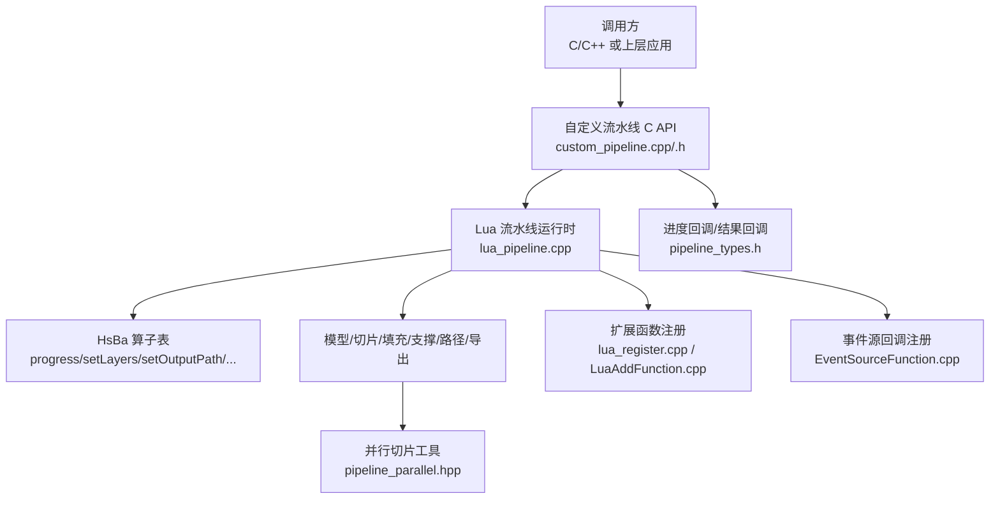
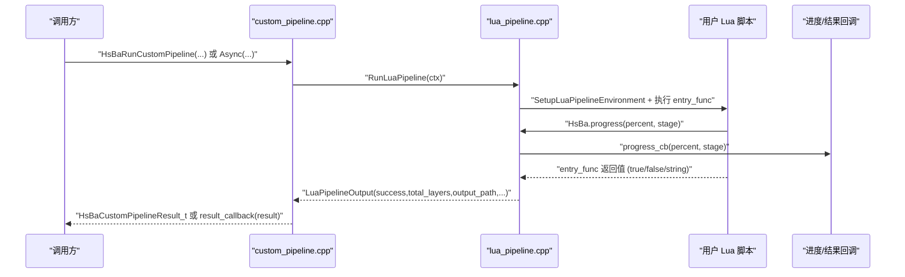
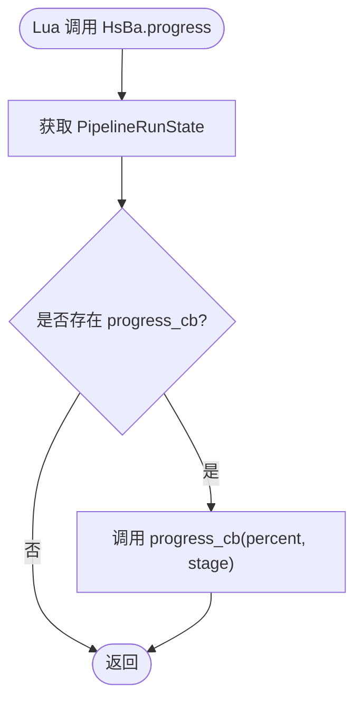
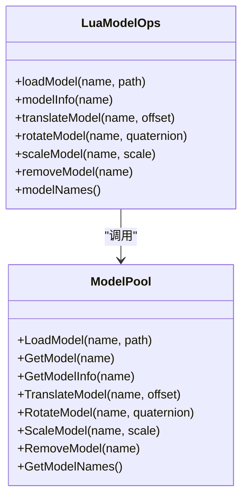
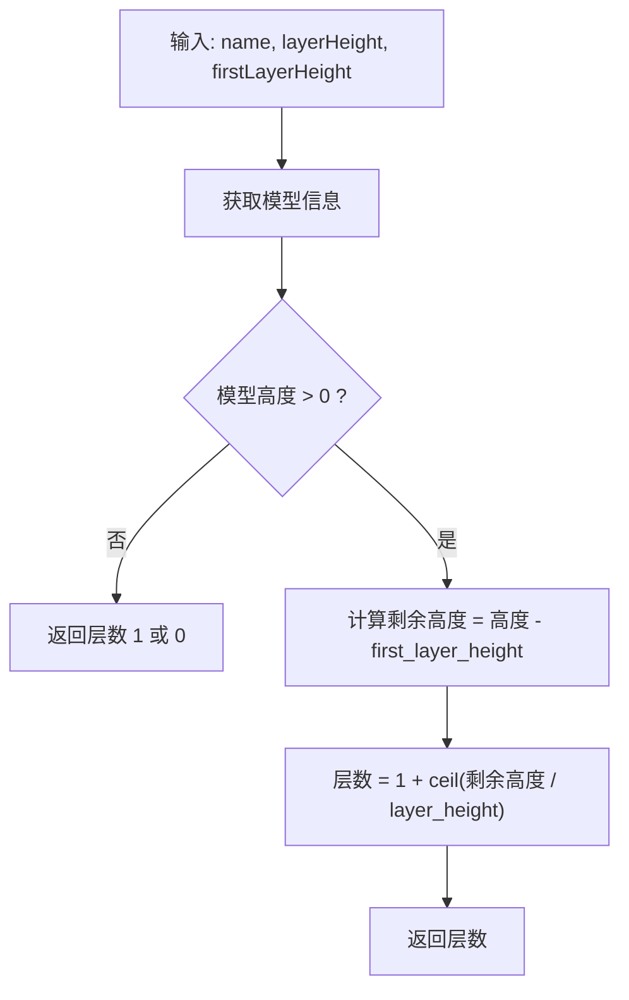
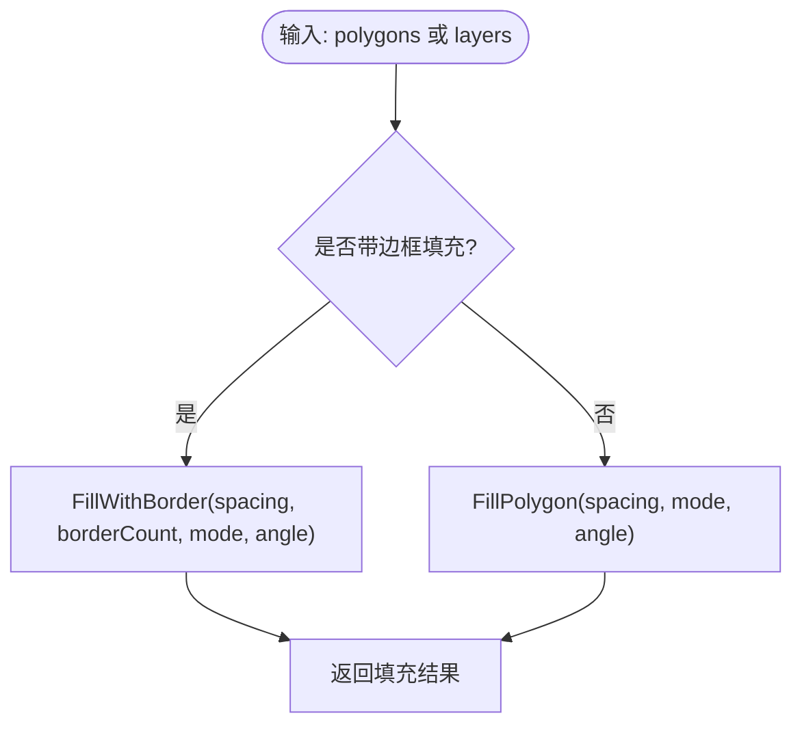
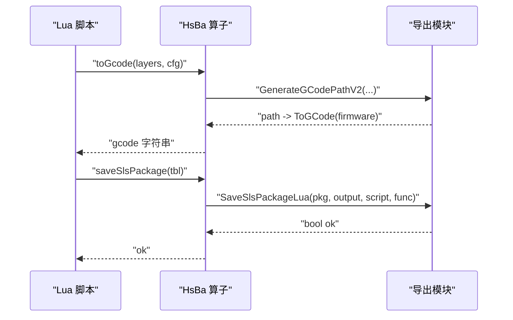
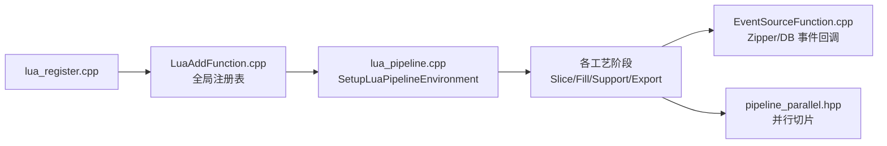
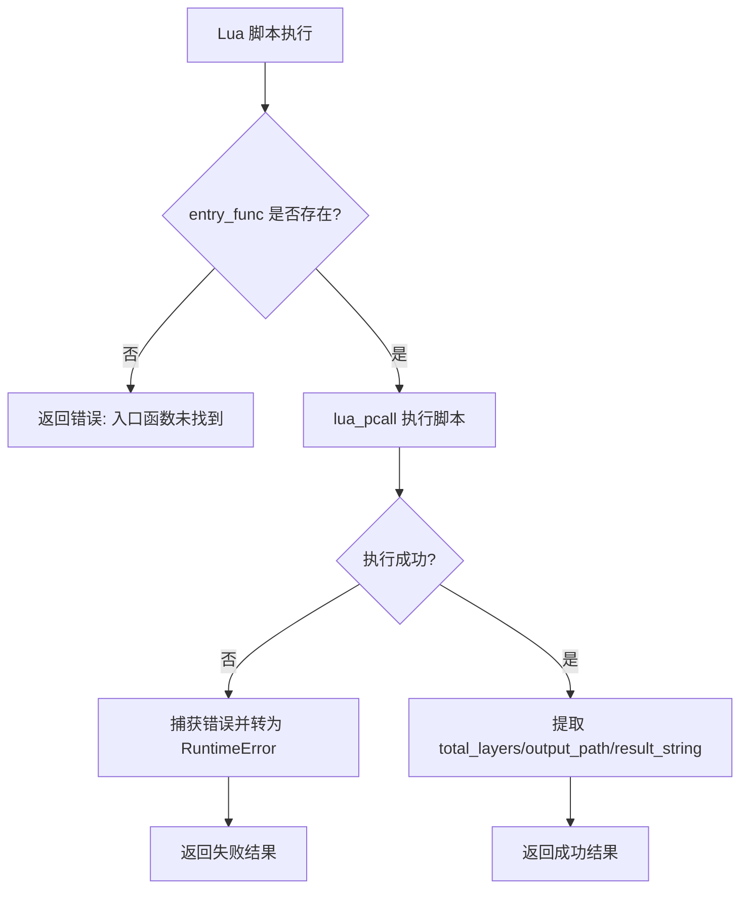

# 流水线控制

<cite>
**本文引用的文件**   
- [pipeline_types.h](file://pipelinetypes/pipeline_types.h)
- [hsba_pipeline.d.lua](file://types/hsba_pipeline.d.lua)
- [lua_pipeline.cpp](file://LibHsBaSlicer/Extends/lua_pipeline.cpp)
- [custom_pipeline.cpp](file://DllHsBaSlicer/custom_pipeline.cpp)
- [custom_pipeline.h](file://DllHsBaSlicer/custom_pipeline.h)
- [lua_register.cpp](file://DllHsBaSlicer/lua_register.cpp)
- [LuaAddFunction.cpp](file://LibHsBaSlicer/Extends/LuaAddFunction.cpp)
- [EventSourceFunction.cpp](file://LibHsBaSlicer/Extends/EventSourceFunction.cpp)
- [pipeline_parallel.hpp](file://DllHsBaSlicer/pipeline_parallel.hpp)
- [fdm_pipeline.cpp](file://DllHsBaSlicer/fdm_pipeline.cpp)
- [sla_pipeline.cpp](file://DllHsBaSlicer/sla_pipeline.cpp)
- [tdp_pipeline.cpp](file://DllHsBaSlicer/tdp_pipeline.cpp)
- [my_fdm_pipeline.lua](file://samples/Custom/scripts/my_fdm_pipeline.lua)
- [my_sls_pipeline.lua](file://samples/Custom/scripts/my_sls_pipeline.lua)
</cite>

## 目录
1. [引言](#引言)
2. [项目结构](#项目结构)
3. [核心组件](#核心组件)
4. [架构总览](#架构总览)
5. [详细组件分析](#详细组件分析)
6. [依赖关系分析](#依赖关系分析)
7. [性能与优化](#性能与优化)
8. [故障排除指南](#故障排除指南)
9. [结论](#结论)
10. [附录：完整流水线示例与最佳实践](#附录完整流水线示例与最佳实践)

## 引言
本文聚焦 HsBaSlicer 的“流水线控制”能力，围绕全局对象 `HsBa`、C/C++ 暴露的 C ABI 接口、以及 Lua 驱动的全自定义流水线展开。内容覆盖：
- 进度上报、层数设置、输出路径管理等通用方法；
- 模型加载、切片、填充、支撑生成、路径输出等工艺步骤函数；
- 同步与异步执行机制、错误处理策略；
- 基于源码的流水线优化与监控最佳实践。

## 项目结构
从“流水线控制”视角，关键代码分布在以下模块：
- 类型定义与回调契约：`pipelinetypes/pipeline_types.h`
- Lua 脚本 IDE 类型提示与 API 清单：`types/hsba_pipeline.d.lua`
- Lua 环境、算子表 `HsBa` 实现：`LibHsBaSlicer/Extends/lua_pipeline.cpp`
- 外部扩展函数注册入口：`DllHsBaSlicer/lua_register.cpp`、`LibHsBaSlicer/Extends/LuaAddFunction.cpp`
- 事件源回调注册：`LibHsBaSlicer/Extends/EventSourceFunction.cpp`
- 自定义流水线 C API 与协程驱动：`DllHsBaSlicer/custom_pipeline.cpp`、`custom_pipeline.h`
- 并行切片工具：`DllHsBaSlicer/pipeline_parallel.hpp`
- 内置工艺流水线（FDM/SLA/TDP 等）：`DllHsBaSlicer/fdm_pipeline.cpp`、`sla_pipeline.cpp`、`tdp_pipeline.cpp`
- 示例脚本：`samples/Custom/scripts/my_fdm_pipeline.lua`、`samples/Custom/scripts/my_sls_pipeline.lua`

**图示来源**
- [custom_pipeline.cpp:117-201](file://DllHsBaSlicer/custom_pipeline.cpp#L117-L201)
- [lua_pipeline.cpp:866-958](file://LibHsBaSlicer/Extends/lua_pipeline.cpp#L866-L958)
- [pipeline_types.h:129-140](file://pipelinetypes/pipeline_types.h#L129-L140)

**章节来源**
- [pipeline_types.h:129-140](file://pipelinetypes/pipeline_types.h#L129-L140)
- [lua_pipeline.cpp:866-958](file://LibHsBaSlicer/Extends/lua_pipeline.cpp#L866-L958)
- [custom_pipeline.cpp:117-201](file://DllHsBaSlicer/custom_pipeline.cpp#L117-L201)

## 核心组件
本节梳理与“流水线控制”直接相关的核心组件及其职责。

### 全局对象 `HsBa` 与通用方法
- 进度上报：`HsBa.progress(percent, stage?)`
- 层数设置：`HsBa.setLayers(n)`
- 输出路径设置：`HsBa.setOutputPath(path)`
- 文件读写：`HsBa.readFile(path)`、`HsBa.writeFile(path, content)`

这些方法在 Lua 侧由 `lua_pipeline.cpp` 中的 `Lp_progress`、`Lp_setLayers`、`Lp_setOutputPath`、`Lp_readFile`、`Lp_writeFile` 实现，并通过 `InstallHsBaTable` 挂载为全局表 `HsBa`。

**章节来源**
- [lua_pipeline.cpp:228-288](file://LibHsBaSlicer/Extends/lua_pipeline.cpp#L228-L288)
- [lua_pipeline.cpp:866-872](file://LibHsBaSlicer/Extends/lua_pipeline.cpp#L866-L872)
- [hsba_pipeline.d.lua:294-318](file://types/hsba_pipeline.d.lua#L294-L318)

### 模型预处理与切片
- 模型管理：`loadModel`、`modelInfo`、`translateModel`、`rotateModel`、`scaleModel`、`removeModel`、`modelNames`
- 切片计算：`layerCount`、`layerZ`、`slice`、`sliceUnsafe`
- 坐标转换：`toInt`、`toDouble`

这些函数封装了 LibHsBaSlicer 的模型池、几何预处理与网格切片能力，并在 Lua 环境中以 `HsBa.*` 暴露。

**章节来源**
- [lua_pipeline.cpp:290-478](file://LibHsBaSlicer/Extends/lua_pipeline.cpp#L290-L478)
- [hsba_pipeline.d.lua:320-394](file://types/hsba_pipeline.d.lua#L320-L394)

### 填充与支撑
- 填充：`fill(polys[, options])`，支持 line/simpleZigzag/zigzag 模式及壁厚圈数
- FDM 支撑：`fdmSupport(layers, config)`
- SLA 支撑：`slaSupport(layers, config)`
- SLA 地板/Raft：`floor(bottomPolygons, config)`

上述逻辑分别调用底层填充算法与支撑生成器，并返回逐层多边形集合。

**章节来源**
- [lua_pipeline.cpp:480-556](file://LibHsBaSlicer/Extends/lua_pipeline.cpp#L480-L556)
- [hsba_pipeline.d.lua:396-424](file://types/hsba_pipeline.d.lua#L396-L424)

### 路径输出与打包导出
- 螺旋化外壁：`spiralize(sections[, options])`
- G-code 输出：`toGcode(layers, cfg)`
- SLS/SLM/LOM/TDP 打包：`saveSlsPackage(tbl)`
- WAAM 机器人程序：`saveWaamPackage(tbl)`
- SLA 图像打包：`saveSlaPackage(tbl)`
- 渲染图片：`renderImage(polys, width, height, path)`

这些函数将中间数据转换为最终工艺产物（G-code、zip、机器人程序、图片）。

**章节来源**
- [lua_pipeline.cpp:558-828](file://LibHsBaSlicer/Extends/lua_pipeline.cpp#L558-L828)
- [hsba_pipeline.d.lua:426-463](file://types/hsba_pipeline.d.lua#L426-L463)

## 架构总览
下图展示“自定义流水线”从 C API 到 Lua 运行时的整体流程，包括进度回调与结果回调。

**图示来源**
- [custom_pipeline.cpp:117-201](file://DllHsBaSlicer/custom_pipeline.cpp#L117-L201)
- [lua_pipeline.cpp:903-1043](file://LibHsBaSlicer/Extends/lua_pipeline.cpp#L903-L1043)
- [pipeline_types.h:129-140](file://pipelinetypes/pipeline_types.h#L129-L140)

## 详细组件分析

### 全局对象 `HsBa` 的流水线控制方法
- 进度上报：`HsBa.progress(percent, stage?)`
  - 实现：`Lp_progress` 读取当前运行状态，若存在 `progress_cb` 则调用之。
  - 用途：在 Lua 脚本中按阶段汇报进度，供上层 UI 或日志系统消费。
- 层数设置：`HsBa.setLayers(n)`
  - 实现：写入 Registry 槽位 `REG_LAYERS`，最终被 `RunLuaPipeline` 读取并回填到 `total_layers`。
- 输出路径设置：`HsBa.setOutputPath(path)`
  - 实现：写入 Registry 槽位 `REG_OUTPATH`，最终被 `RunLuaPipeline` 读取并回填到 `output_path`。
- 文件读写：`readFile`、`writeFile`
  - 实现：直接操作文件系统，失败时返回 nil 或抛出 Lua 错误。

**图示来源**
- [lua_pipeline.cpp:228-239](file://LibHsBaSlicer/Extends/lua_pipeline.cpp#L228-L239)

**章节来源**
- [lua_pipeline.cpp:228-288](file://LibHsBaSlicer/Extends/lua_pipeline.cpp#L228-L288)
- [lua_pipeline.cpp:903-1043](file://LibHsBaSlicer/Extends/lua_pipeline.cpp#L903-L1043)

### 模型加载与变换
- `loadModel(name, path)`：若同名模型已存在则复用，否则加载新模型；失败抛错。
- `modelInfo(name)`：返回包围盒与体积等信息。
- `translateModel`、`rotateModel`、`scaleModel`：对模型池中的模型进行几何变换。
- `removeModel`、`modelNames`：清理与枚举模型。

**图示来源**
- [lua_pipeline.cpp:290-397](file://LibHsBaSlicer/Extends/lua_pipeline.cpp#L290-L397)

**章节来源**
- [lua_pipeline.cpp:290-397](file://LibHsBaSlicer/Extends/lua_pipeline.cpp#L290-L397)

### 切片与坐标转换
- `layerCount(name, layerHeight, firstLayerHeight)`：根据模型高度与层高计算总层数。
- `layerZ(index, layerHeight, firstLayerHeight)`：计算第 index 层的 Z 高度。
- `slice(name, z)`：安全切片，仅返回闭合轮廓。
- `sliceUnsafe(name, z)`：不安全切片，可能丢弃开放轮廓但会归一化。
- `toInt`、`toDouble`：整数/浮点多边形互转。

**图示来源**
- [lua_pipeline.cpp:401-422](file://LibHsBaSlicer/Extends/lua_pipeline.cpp#L401-L422)

**章节来源**
- [lua_pipeline.cpp:399-478](file://LibHsBaSlicer/Extends/lua_pipeline.cpp#L399-L478)

### 填充与支撑生成
- 填充：`fill(polys[, options])`
  - 支持 spacing、mode（line/simpleZigzag/zigzag）、angle、borderCount。
  - 当 borderCount > 0 时使用带边框填充，否则使用普通填充。
- FDM 支撑：`fdmSupport(layers, config)`
  - 配置包含 overhang_angle、support_gap、support_diameter、support_density、support_pattern、interface_layers、interface_density 等。
- SLA 支撑：`slaSupport(layers, config)`
  - 额外支持 tip_diameter、raft_thickness。
- SLA 地板：`floor(bottomPolygons, config)`
  - 配置包含 raft_offset、border_width、fill_spacing、fill_angle_deg、border_count、use_convex_hull、concave_hull_points。

**图示来源**
- [lua_pipeline.cpp:480-508](file://LibHsBaSlicer/Extends/lua_pipeline.cpp#L480-L508)

**章节来源**
- [lua_pipeline.cpp:480-556](file://LibHsBaSlicer/Extends/lua_pipeline.cpp#L480-L556)

### 路径输出与打包导出
- 螺旋化外壁：`spiralize(sections[, options])`
  - 接受逐层闭合轮廓，输出连续 3D 点列，适用于挤出类工艺。
- G-code 输出：`toGcode(layers, cfg)`
  - 组装每层 outlines/fills/supports/zHeight，生成 G-code 字符串。
- 打包导出：
  - `saveSlsPackage(tbl)`：SLS/SLM/LOM/TDP 的 zip 打包，需指定 output 与 script。
  - `saveWaamPackage(tbl)`：WAAM 机器人程序输出，可附加 weld 参数与 robotType。
  - `saveSlaPackage(tbl)`：SLA 图像打包，支持 imageWidth/imageHeight/imageExtension。
  - `renderImage(polys, width, height, path)`：将多边形渲染为图片。

**图示来源**
- [lua_pipeline.cpp:622-728](file://LibHsBaSlicer/Extends/lua_pipeline.cpp#L622-L728)

**章节来源**
- [lua_pipeline.cpp:558-828](file://LibHsBaSlicer/Extends/lua_pipeline.cpp#L558-L828)

## 依赖关系分析
- 外部扩展函数注册：通过 `lua_register.cpp` 暴露 `HsBaAdd2DFunction`、`HsBaAdd3DFunction`、`HsBaAddFileFunction`、`HsBaAddEventCallback`，内部维护全局注册表，便于各模块按需注入。
- 事件源回调：`EventSourceFunction.cpp` 提供 Zipper 与数据库事件回调注册，供压缩/IO 过程触发进度或状态更新。
- 并行切片：`pipeline_parallel.hpp` 提供 `ParallelForLayers`，支持环境变量 `HSBA_PIPELINE_THREADS` 控制线程数，用于层间并行切片。

**图示来源**
- [lua_register.cpp:1-43](file://DllHsBaSlicer/lua_register.cpp#L1-L43)
- [LuaAddFunction.cpp:1-68](file://LibHsBaSlicer/Extends/LuaAddFunction.cpp#L1-L68)
- [EventSourceFunction.cpp:1-33](file://LibHsBaSlicer/Extends/EventSourceFunction.cpp#L1-L33)
- [pipeline_parallel.hpp:38-76](file://DllHsBaSlicer/pipeline_parallel.hpp#L38-L76)

**章节来源**
- [lua_register.cpp:1-43](file://DllHsBaSlicer/lua_register.cpp#L1-L43)
- [LuaAddFunction.cpp:1-68](file://LibHsBaSlicer/Extends/LuaAddFunction.cpp#L1-L68)
- [EventSourceFunction.cpp:1-33](file://LibHsBaSlicer/Extends/EventSourceFunction.cpp#L1-L33)
- [pipeline_parallel.hpp:38-76](file://DllHsBaSlicer/pipeline_parallel.hpp#L38-L76)

## 性能与优化
- 并行切片：通过 `HSBA_PIPELINE_THREADS` 环境变量控制工作线程数，默认取硬件并发数；当值为 1 或层数为 1 时回退串行路径，便于对比验证。
- 进度上报粒度：建议在耗时阶段（如切片循环）按固定步长上报进度，避免频繁回调造成开销。
- 内存与对象池：模型池与 AnyObject 类型注册在流水线启动时统一安装，减少重复初始化成本。
- 导出优化：优先使用批量打包接口（如 `saveSlsPackage`、`saveSlaPackage`），减少多次 IO。

**章节来源**
- [pipeline_parallel.hpp:38-76](file://DllHsBaSlicer/pipeline_parallel.hpp#L38-L76)
- [lua_pipeline.cpp:903-958](file://LibHsBaSlicer/Extends/lua_pipeline.cpp#L903-L958)

## 故障排除指南
- Lua 脚本错误：
  - 入口函数未找到：`RunLuaPipeline` 会在找不到 entry_func 时返回错误消息。
  - 脚本执行异常：`lua_pcall` 捕获错误并转为 `RuntimeError`，最终写入 `error_message`。
- 文件读写失败：
  - `readFile` 打开失败返回 nil；`writeFile` 打开失败抛出 Lua 错误。
- 模型相关错误：
  - 模型不存在或加载失败会抛出 Lua 错误，需在脚本中检查返回值或捕获错误。
- 导出参数缺失：
  - `saveSlsPackage`、`saveWaamPackage`、`saveSlaPackage` 对必填字段（如 output/script）进行校验，缺失时报错。

**图示来源**
- [lua_pipeline.cpp:995-1043](file://LibHsBaSlicer/Extends/lua_pipeline.cpp#L995-L1043)

**章节来源**
- [lua_pipeline.cpp:995-1043](file://LibHsBaSlicer/Extends/lua_pipeline.cpp#L995-L1043)

## 结论
HsBaSlicer 的流水线控制以 `HsBa` 全局对象为核心，结合 C ABI 与 Lua 运行时，提供了从模型预处理、切片、填充、支撑生成到路径输出与打包导出的完整能力。通过进度回调、层数与输出路径回报机制，上层应用可实现细粒度的监控与控制。同时，并行切片与模块化扩展注册机制为性能优化与功能扩展提供了坚实基础。

## 附录：完整流水线示例与最佳实践

### 完整流水线控制示例（FDM）
参考示例脚本展示了如何：
- 加载模型、计算层数、逐层切片；
- 生成支撑与填充；
- 组装每层路径数据并生成 G-code；
- 写文件并设置输出路径；
- 上报进度。

**章节来源**
- [my_fdm_pipeline.lua:117-154](file://samples/Custom/scripts/my_fdm_pipeline.lua#L117-L154)

### 完整流水线控制示例（SLS）
参考示例脚本展示了如何：
- 加载模型、计算层数；
- 逐层切片并记录 Z 高度；
- 上报进度；
- 设置层数与输出路径。

**章节来源**
- [my_sls_pipeline.lua:28-61](file://samples/Custom/scripts/my_sls_pipeline.lua#L28-L61)

### 异步执行与错误处理最佳实践
- 使用 `HsBaRunCustomPipelineAsync` 进行非阻塞执行，配合 `result_callback` 接收结果。
- 在 Lua 脚本中使用 `HsBa.progress` 定期上报进度，避免 UI 卡顿。
- 对文件 IO、模型加载、导出打包等易错点进行 try/catch 或返回值检查。
- 利用 `HSBA_PIPELINE_THREADS` 调整并行度，平衡吞吐与资源占用。

**章节来源**
- [custom_pipeline.h:34-55](file://DllHsBaSlicer/custom_pipeline.h#L34-L55)
- [custom_pipeline.cpp:176-201](file://DllHsBaSlicer/custom_pipeline.cpp#L176-L201)
- [pipeline_types.h:129-140](file://pipelinetypes/pipeline_types.h#L129-L140)