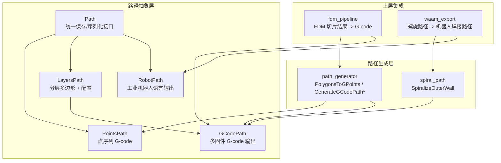
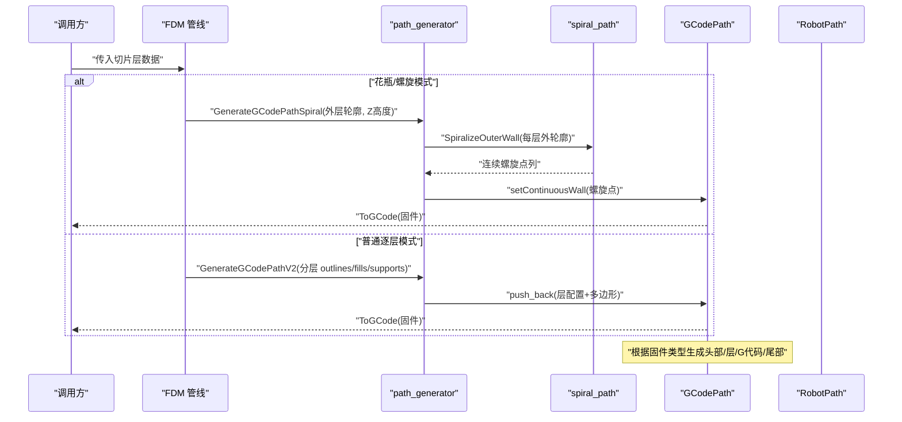
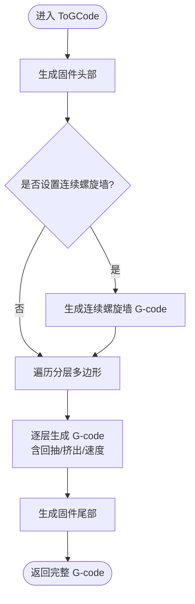
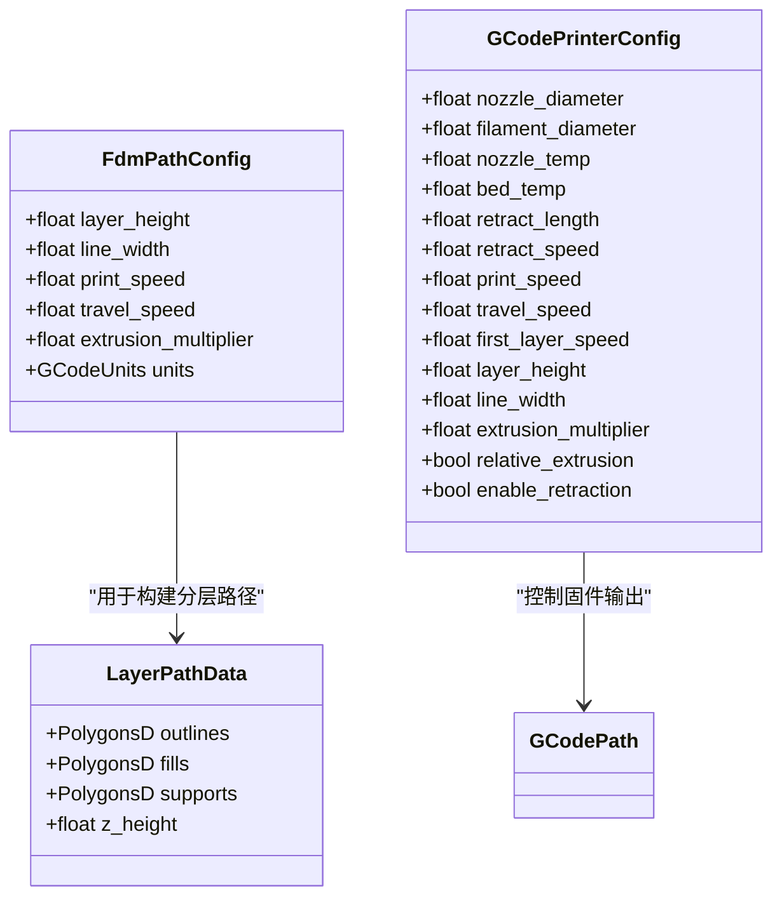
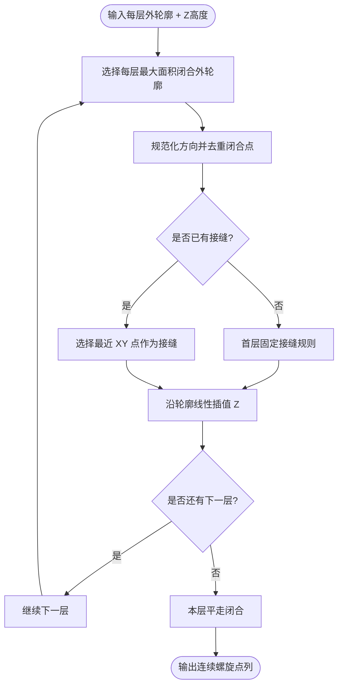
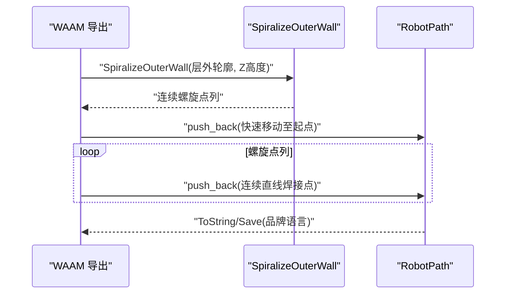
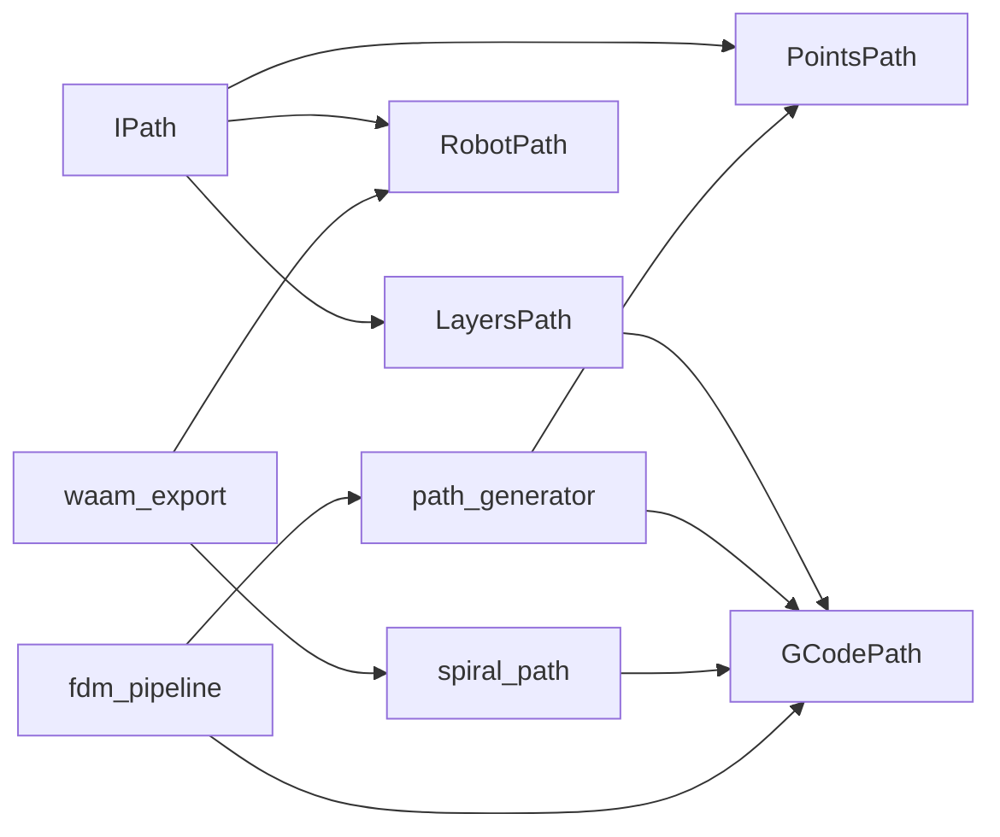

# 路径输出

<cite>
**本文引用的文件**   
- [path_generator.hpp](file://LibHsBaSlicer/Path/path_generator.hpp)
- [path_generator.cpp](file://LibHsBaSlicer/Path/path_generator.cpp)
- [spiral_path.hpp](file://LibHsBaSlicer/Path/spiral_path.hpp)
- [spiral_path.cpp](file://LibHsBaSlicer/Path/spiral_path.cpp)
- [gcodepath.hpp](file://paths/gcodepath.hpp)
- [gcodepath.cpp](file://paths/gcodepath.cpp)
- [layerspath.hpp](file://paths/layerspath.hpp)
- [pointspath.hpp](file://paths/pointspath.hpp)
- [IPath.hpp](file://paths/IPath.hpp)
- [robotpath.hpp](file://paths/robotpath.hpp)
- [fdm_pipeline.cpp](file://DllHsBaSlicer/fdm_pipeline.cpp)
- [waam_export.cpp](file://LibHsBaSlicer/Path/waam_export.cpp)
- [path_generator_test.cpp](file://tests/PathsOut/path_generator_test.cpp)
</cite>

## 目录
1. [引言](#引言)
2. [项目结构](#项目结构)
3. [核心组件](#核心组件)
4. [架构总览](#架构总览)
5. [详细组件分析](#详细组件分析)
6. [依赖关系分析](#依赖关系分析)
7. [性能与优化建议](#性能与优化建议)
8. [故障排除指南](#故障排除指南)
9. [结论](#结论)
10. [附录：API 与参数速查](#附录api-与参数速查)

## 引言
本文聚焦 HsBaSlicer 的“路径输出”能力，重点说明以下内容：
- 如何使用 `toGcode`、`GenerateGCodePath`、`GenerateGCodePathV2`、`GenerateGCodePathSpiral` 等函数生成 G-code。
- 螺旋化模式（spiralize）和花瓶模式（vase mode）的特殊处理逻辑。
- G-code 生成器与机器人路径生成器的工作原理。
- Marlin、RepRap、Klipper 三种固件格式的输出差异。
- 路径优化和后处理的实践建议，包括 Lua 后处理脚本的使用方式。

## 项目结构
路径输出相关代码主要分布在以下模块：
- LibHsBaSlicer/Path：FDM 路径生成、螺旋外壁生成、WAAM 导出等。
- paths：通用路径抽象接口、点序列路径、分层路径、G-code 路径、机器人路径等。
- DllHsBaSlicer：FDM 管线中调用路径生成并输出 G-code。
- tests：对路径生成、螺旋路径、G-code 输出的单元测试。

**图表来源**
- [IPath.hpp:20-65](file://paths/IPath.hpp#L20-L65)
- [pointspath.hpp:44-94](file://paths/pointspath.hpp#L44-L94)
- [layerspath.hpp:17-60](file://paths/layerspath.hpp#L17-L60)
- [gcodepath.hpp:62-107](file://paths/gcodepath.hpp#L62-L107)
- [robotpath.hpp:54-104](file://paths/robotpath.hpp#L54-L104)
- [path_generator.hpp:20-91](file://LibHsBaSlicer/Path/path_generator.hpp#L20-L91)
- [spiral_path.hpp:16-58](file://LibHsBaSlicer/Path/spiral_path.hpp#L16-L58)
- [fdm_pipeline.cpp:392-425](file://DllHsBaSlicer/fdm_pipeline.cpp#L392-L425)
- [waam_export.cpp:85-111](file://LibHsBaSlicer/Path/waam_export.cpp#L85-L111)

**章节来源**
- [IPath.hpp:20-65](file://paths/IPath.hpp#L20-L65)
- [pointspath.hpp:44-94](file://paths/pointspath.hpp#L44-L94)
- [layerspath.hpp:17-60](file://paths/layerspath.hpp#L17-L60)
- [gcodepath.hpp:62-107](file://paths/gcodepath.hpp#L62-L107)
- [robotpath.hpp:54-104](file://paths/robotpath.hpp#L54-L104)
- [path_generator.hpp:20-91](file://LibHsBaSlicer/Path/path_generator.hpp#L20-L91)
- [spiral_path.hpp:16-58](file://LibHsBaSlicer/Path/spiral_path.hpp#L16-L58)
- [fdm_pipeline.cpp:392-425](file://DllHsBaSlicer/fdm_pipeline.cpp#L392-L425)
- [waam_export.cpp:85-111](file://LibHsBaSlicer/Path/waam_export.cpp#L85-L111)

## 核心组件
- **IPath**：所有路径输出对象的统一抽象，提供 Save/ToString 系列方法，支持原生输出和 Lua 后处理。
- **PointsPath**：基于有序 GPoint 序列的 G-code 路径，适合低层路径点和运动指令的直接序列化。
- **LayersPath**：按层存储多边形集合与自由配置字符串，便于高层路径组织。
- **GCodePath**：继承 LayersPath，面向 FDM 打印机的多固件 G-code 输出，支持连续螺旋外壁。
- **RobotPath**：面向工业机器人的品牌语言程序输出，支持 ABB/KUKA/FANUC。
- **path_generator**：提供 PolygonsToGPoints、GenerateGCodePath、GenerateGCodePathV2、GenerateGCodePathSpiral 等 API。
- **spiral_path**：实现 SpiralizeOuterWall，将每层外轮廓合并为一条连续上升的螺旋路径。

**章节来源**
- [IPath.hpp:20-65](file://paths/IPath.hpp#L20-L65)
- [pointspath.hpp:44-94](file://paths/pointspath.hpp#L44-L94)
- [layerspath.hpp:17-60](file://paths/layerspath.hpp#L17-L60)
- [gcodepath.hpp:62-107](file://paths/gcodepath.hpp#L62-L107)
- [robotpath.hpp:54-104](file://paths/robotpath.hpp#L54-L104)
- [path_generator.hpp:20-91](file://LibHsBaSlicer/Path/path_generator.hpp#L20-L91)
- [spiral_path.hpp:16-58](file://LibHsBaSlicer/Path/spiral_path.hpp#L16-L58)

## 架构总览
路径输出从“几何多边形”到“目标设备可执行代码”的典型流程如下：

**图表来源**
- [fdm_pipeline.cpp:392-425](file://DllHsBaSlicer/fdm_pipeline.cpp#L392-L425)
- [path_generator.cpp:97-140](file://LibHsBaSlicer/Path/path_generator.cpp#L97-L140)
- [spiral_path.cpp:88-163](file://LibHsBaSlicer/Path/spiral_path.cpp#L88-L163)
- [gcodepath.cpp:332-350](file://paths/gcodepath.cpp#L332-L350)

## 详细组件分析

### G-code 生成器：GCodePath 与 ToGCode
GCodePath 是面向 FDM 打印机的 G-code 输出核心类，负责：
- 根据固件类型生成头部（温度、归位、挤出模式、风扇等）。
- 将分层多边形转换为逐层 G-code，包含移动、回抽、挤出计算。
- 在花瓶/螺旋模式下优先输出连续螺旋外壁，再输出可选的逐层数据。
- 支持通过 Lua 脚本进行后处理，返回最终 G-code 字符串或 result 变量。

关键行为：
- `ToGCode(firmware)`：组装 Header + ContinuousWall + Layers + Footer。
- `SaveGCode(path, firmware)`：写入二进制文件。
- `ToGCode(firmware, script, lua_reg)`：基础 G-code 生成后运行 Lua 脚本，注入 gcode、firmware、printer_config 等全局变量。

**图表来源**
- [gcodepath.cpp:332-350](file://paths/gcodepath.cpp#L332-L350)
- [gcodepath.cpp:291-330](file://paths/gcodepath.cpp#L291-L330)
- [gcodepath.cpp:211-289](file://paths/gcodepath.cpp#L211-L289)

**章节来源**
- [gcodepath.hpp:62-107](file://paths/gcodepath.hpp#L62-L107)
- [gcodepath.cpp:57-67](file://paths/gcodepath.cpp#L57-L67)
- [gcodepath.cpp:69-158](file://paths/gcodepath.cpp#L69-L158)
- [gcodepath.cpp:160-209](file://paths/gcodepath.cpp#L160-L209)
- [gcodepath.cpp:211-289](file://paths/gcodepath.cpp#L211-L289)
- [gcodepath.cpp:291-350](file://paths/gcodepath.cpp#L291-L350)
- [gcodepath.cpp:353-455](file://paths/gcodepath.cpp#L353-L455)

### 路径生成器：PolygonsToGPoints 与 GenerateGCodePath*
path_generator 提供两类路径生成方式：
- **PointsPath 路径**：`GenerateGCodePath` 将每层的 outlines、fills、supports 转为 GPoint 序列，适合底层路径操作。
- **GCodePath 路径**：`GenerateGCodePathV2` 将每层多边形组合并附加 Z 高度配置，交给 GCodePath 做固件输出。
- **螺旋路径**：`GenerateGCodePathSpiral` 调用 SpiralizeOuterWall 生成连续螺旋外壁，并通过 setContinuousWall 注入 GCodePath。

参数要点：
- `FdmPathConfig`：层厚、线宽、打印速度、移动速度、挤出倍率、单位。
- `LayerPathData`：每层的 outlines、fills、supports、z_height。
- `GCodePrinterConfig`：喷嘴直径、线材直径、温度、回抽、速度、相对/绝对挤出等。

**图表来源**
- [path_generator.hpp:23-31](file://LibHsBaSlicer/Path/path_generator.hpp#L23-L31)
- [path_generator.hpp:36-42](file://LibHsBaSlicer/Path/path_generator.hpp#L36-L42)
- [gcodepath.hpp:32-49](file://paths/gcodepath.hpp#L32-L49)

**章节来源**
- [path_generator.hpp:20-91](file://LibHsBaSlicer/Path/path_generator.hpp#L20-L91)
- [path_generator.cpp:14-61](file://LibHsBaSlicer/Path/path_generator.cpp#L14-L61)
- [path_generator.cpp:63-95](file://LibHsBaSlicer/Path/path_generator.cpp#L63-L95)
- [path_generator.cpp:97-118](file://LibHsBaSlicer/Path/path_generator.cpp#L97-L118)
- [path_generator.cpp:120-140](file://LibHsBaSlicer/Path/path_generator.cpp#L120-L140)

### 螺旋化与花瓶模式：SpiralizeOuterWall 与连续外壁
螺旋化模式的核心是 SpiralizeOuterWall：
- 每层选择面积最大的闭合外轮廓作为“外壁”。
- 规范化外轮廓方向（逆时针），去除重复闭合顶点。
- 对齐接缝（seam）：首层使用固定规则确定起点，后续层选择距离上一层接缝最近的顶点，保持单条固定接缝线。
- 沿每层轮廓线性插值 Z，使 Z 随一圈旋转上升一个层高，形成连续螺旋。
- 最后一层不连接下一层，因此在本层高度上平走闭合。

花瓶模式则通过 GenerateGCodePathSpiral 将螺旋点列注入 GCodePath 的 continuous_wall_，并在 ToGCode 中优先输出该连续墙，从而避免逐层回抽和跳跃。

**图表来源**
- [spiral_path.cpp:88-163](file://LibHsBaSlicer/Path/spiral_path.cpp#L88-L163)
- [spiral_path.cpp:16-52](file://LibHsBaSlicer/Path/spiral_path.cpp#L16-L52)
- [spiral_path.cpp:54-85](file://LibHsBaSlicer/Path/spiral_path.cpp#L54-L85)

**章节来源**
- [spiral_path.hpp:16-58](file://LibHsBaSlicer/Path/spiral_path.hpp#L16-L58)
- [spiral_path.cpp:16-52](file://LibHsBaSlicer/Path/spiral_path.cpp#L16-L52)
- [spiral_path.cpp:54-85](file://LibHsBaSlicer/Path/spiral_path.cpp#L54-L85)
- [spiral_path.cpp:88-163](file://LibHsBaSlicer/Path/spiral_path.cpp#L88-L163)
- [path_generator.cpp:120-140](file://LibHsBaSlicer/Path/path_generator.cpp#L120-L140)
- [gcodepath.cpp:291-330](file://paths/gcodepath.cpp#L291-L330)

### 机器人路径生成器：RobotPath 与 WAAM 螺旋路径
RobotPath 是面向工业机器人的路径输出类，支持：
- 多种运动命令类型（MoveJ/MoveL/MoveC 等）。
- 多个机器人品牌语言（ABB/KUKA/FANUC）。
- 通过 Save/ToString 系列方法输出品牌特定程序，并支持 Lua 后处理。

在 WAAM（电弧增材制造）场景中，waam_export 使用 SpiralizeOuterWall 生成螺旋路径，并将其转换为机器人连续焊接路径：
- 先快速移动到螺旋起点。
- 然后以连续直线移动（MoveL）输出焊接路径，保持无回抽、无中断。

**图表来源**
- [waam_export.cpp:85-111](file://LibHsBaSlicer/Path/waam_export.cpp#L85-L111)
- [robotpath.hpp:54-104](file://paths/robotpath.hpp#L54-L104)

**章节来源**
- [robotpath.hpp:15-52](file://paths/robotpath.hpp#L15-L52)
- [robotpath.hpp:54-104](file://paths/robotpath.hpp#L54-L104)
- [waam_export.cpp:85-111](file://LibHsBaSlicer/Path/waam_export.cpp#L85-L111)

### 不同固件格式的 G-code 输出示例说明
GCodePath 针对 Marlin、RepRap、Klipper 分别生成不同的头部和尾部：
- **Marlin**：M104/M140 设置温度，G28 归位，M109/M190 等待温度，M82/M83 设置挤出模式，G1 抬升 Z，结尾回抽、抬 Z、归 X/Y、关闭电机。
- **RepRap**：类似 Marlin，但额外开启风扇（M106 S255），结尾关闭风扇。
- **Klipper**：使用 SET_FAN_SPEED、SET_PRESSURE_ADVANCE、M220/M221 等 Klipper 特有命令，结尾同样回抽、抬 Z、归 X/Y、关闭电机。

注意：
- 相对挤出（relative_extrusion=true）时，E 值为增量；绝对挤出时为累计 E。
- 第一层使用 first_layer_speed，其他层使用 print_speed。
- 回抽（retract）可在移动前插入，提升表面质量。

**章节来源**
- [gcodepath.cpp:69-158](file://paths/gcodepath.cpp#L69-L158)
- [gcodepath.cpp:160-209](file://paths/gcodepath.cpp#L160-L209)
- [gcodepath.cpp:211-289](file://paths/gcodepath.cpp#L211-L289)

### 路径优化与后处理最佳实践
- **Lua 后处理脚本**：
  - 使用 `ToGCode(firmware, script, lua_reg)` 注入 gcode、firmware、printer_config 等全局变量。
  - 脚本可返回字符串或设置 result 变量，否则回退为基础 G-code。
  - 适用于批量替换命令、添加注释、调整速度/温度、插入自定义段。
- **路径优化建议**：
  - 合理设置 line_width、layer_height、extrusion_multiplier，确保挤出体积与线材截面积匹配。
  - 启用 enable_retraction 可减少拉丝，但需权衡回抽次数对效率的影响。
  - 对于花瓶模式，优先使用 GenerateGCodePathSpiral，避免逐层回抽和跳跃。
  - 对于机器人路径，尽量保持连续 MoveL，减少 MoveJ 切换，提高焊接稳定性。

**章节来源**
- [gcodepath.cpp:364-455](file://paths/gcodepath.cpp#L364-L455)
- [gcodepath.cpp:57-67](file://paths/gcodepath.cpp#L57-L67)
- [gcodepath.cpp:211-289](file://paths/gcodepath.cpp#L211-L289)

## 依赖关系分析
路径输出模块之间的依赖关系如下：

**图表来源**
- [IPath.hpp:20-65](file://paths/IPath.hpp#L20-L65)
- [pointspath.hpp:44-94](file://paths/pointspath.hpp#L44-L94)
- [layerspath.hpp:17-60](file://paths/layerspath.hpp#L17-L60)
- [gcodepath.hpp:62-107](file://paths/gcodepath.hpp#L62-L107)
- [robotpath.hpp:54-104](file://paths/robotpath.hpp#L54-L104)
- [path_generator.hpp:20-91](file://LibHsBaSlicer/Path/path_generator.hpp#L20-L91)
- [spiral_path.hpp:16-58](file://LibHsBaSlicer/Path/spiral_path.hpp#L16-L58)
- [fdm_pipeline.cpp:392-425](file://DllHsBaSlicer/fdm_pipeline.cpp#L392-L425)
- [waam_export.cpp:85-111](file://LibHsBaSlicer/Path/waam_export.cpp#L85-L111)

**章节来源**
- [IPath.hpp:20-65](file://paths/IPath.hpp#L20-L65)
- [pointspath.hpp:44-94](file://paths/pointspath.hpp#L44-L94)
- [layerspath.hpp:17-60](file://paths/layerspath.hpp#L17-L60)
- [gcodepath.hpp:62-107](file://paths/gcodepath.hpp#L62-L107)
- [robotpath.hpp:54-104](file://paths/robotpath.hpp#L54-L104)
- [path_generator.hpp:20-91](file://LibHsBaSlicer/Path/path_generator.hpp#L20-L91)
- [spiral_path.hpp:16-58](file://LibHsBaSlicer/Path/spiral_path.hpp#L16-L58)
- [fdm_pipeline.cpp:392-425](file://DllHsBaSlicer/fdm_pipeline.cpp#L392-L425)
- [waam_export.cpp:85-111](file://LibHsBaSlicer/Path/waam_export.cpp#L85-L111)

## 性能与优化建议
- **挤出计算**：CalcExtrusion 使用线宽×层厚×段长÷线材截面积×挤出倍率，确保体积守恒。
- **速度设置**：kSpeedFactor=60 将 mm/s 转换为 mm/min，符合多数固件要求。
- **回抽策略**：enable_retraction=true 时在非首段移动前插入回抽/释放，提升表面质量但增加指令数。
- **螺旋模式**：连续外壁避免逐层回抽，适合均匀截面模型，提升表面质量和强度。
- **Lua 后处理**：仅在需要时启用，避免不必要的 Lua 初始化开销。

[本节为通用性能讨论，不直接分析具体文件]

## 故障排除指南
- **G-code 为空或异常**：
  - 检查是否设置了连续螺旋墙且点数不足（至少两个点）。
  - 检查分层多边形是否为空或无效（少于 3 个顶点）。
- **Lua 后处理失败**：
  - 确认脚本加载状态和调用状态，错误信息会抛出 RuntimeError。
  - 检查 printer_config 字段是否正确注入。
- **文件写入失败**：
  - SaveGCode 打开文件失败时会抛出 RuntimeError，检查路径权限和磁盘空间。

**章节来源**
- [gcodepath.cpp:353-362](file://paths/gcodepath.cpp#L353-L362)
- [gcodepath.cpp:364-455](file://paths/gcodepath.cpp#L364-L455)
- [spiral_path.cpp:88-163](file://LibHsBaSlicer/Path/spiral_path.cpp#L88-L163)

## 结论
HsBaSlicer 的路径输出系统提供了从几何多边形到目标设备代码的完整链路：
- 通过 path_generator 将分层多边形转换为 PointsPath 或 GCodePath。
- 通过 spiral_path 实现螺旋化外壁，支持花瓶模式。
- 通过 GCodePath 输出 Marlin/RepRap/Klipper 三种固件格式。
- 通过 RobotPath 输出工业机器人语言，支持 WAAM 等工艺。
- 通过 Lua 后处理机制灵活定制输出内容。

在实际使用中，应根据模型特征选择合适的路径生成方式，并结合固件特性和工艺需求优化速度和挤出参数。

[本节为总结性内容，不直接分析具体文件]

## 附录：API 与参数速查

### 主要函数与用途
- `PolygonsToGPoints(polys, z, config, is_extrude)`：将二维多边形转换为 GPoint 序列。
- `GenerateGCodePath(layer_data, config)`：生成 PointsPath，适合底层路径操作。
- `GenerateGCodePathV2(layer_data, config, printer_config)`：生成 GCodePath，支持多固件输出。
- `GenerateGCodePathSpiral(layer_outlines, layer_zs, printer_config)`：生成带连续螺旋墙的 GCodePath。
- `GCodePath::ToGCode(firmware)`：生成指定固件的 G-code 字符串。
- `GCodePath::SaveGCode(path, firmware)`：保存 G-code 到文件。
- `GCodePath::ToGCode(firmware, script, lua_reg)`：带 Lua 后处理的 G-code 生成。

**章节来源**
- [path_generator.hpp:50-91](file://LibHsBaSlicer/Path/path_generator.hpp#L50-L91)
- [path_generator.cpp:14-140](file://LibHsBaSlicer/Path/path_generator.cpp#L14-L140)
- [gcodepath.hpp:74-96](file://paths/gcodepath.hpp#L74-L96)
- [gcodepath.cpp:332-455](file://paths/gcodepath.cpp#L332-L455)

### 关键数据结构
- `FdmPathConfig`：FDM 路径配置，包含层厚、线宽、速度、挤出倍率、单位。
- `LayerPathData`：单层路径数据，包含 outlines、fills、supports、z_height。
- `GCodePrinterConfig`：打印机配置，包含喷嘴/线材尺寸、温度、回抽、速度、挤出模式等。
- `SpiralPoint`：螺旋路径点，包含 x/y/z。
- `PathPoint3D`：连续墙点，用于 GCodePath 的 continuous_wall_。

**章节来源**
- [path_generator.hpp:23-42](file://LibHsBaSlicer/Path/path_generator.hpp#L23-L42)
- [gcodepath.hpp:32-60](file://paths/gcodepath.hpp#L32-L60)
- [spiral_path.hpp:16-29](file://LibHsBaSlicer/Path/spiral_path.hpp#L16-L29)

### 测试用例参考
- `generate_gcode_path_builds_points_path`：验证 GenerateGCodePath 能构建 PointsPath。
- `generate_gcode_path_v2_per_layer`：验证 GenerateGCodePathV2 生成 GCodePath 且无连续墙。
- `generate_gcode_path_spiral_continuous_wall`：验证 GenerateGCodePathSpiral 生成带连续墙的 GCodePath。

**章节来源**
- [path_generator_test.cpp:77-106](file://tests/PathsOut/path_generator_test.cpp#L77-L106)
- [path_generator_test.cpp:108-119](file://tests/PathsOut/path_generator_test.cpp#L108-L119)