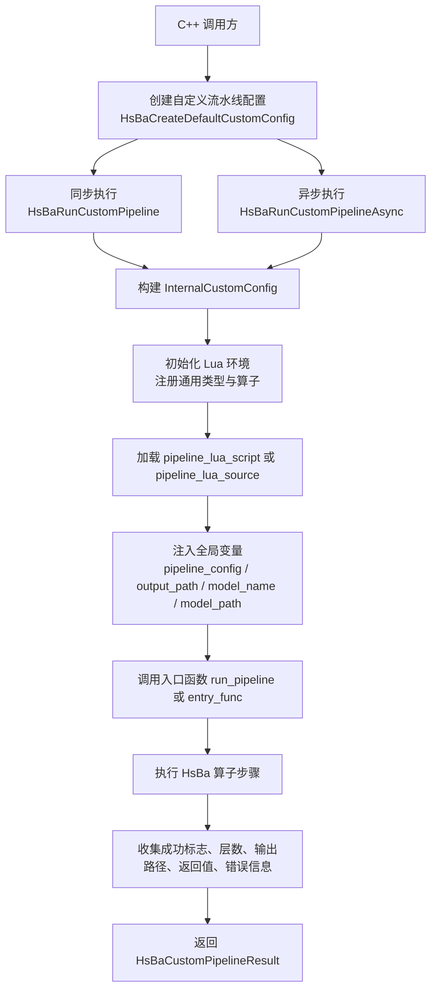
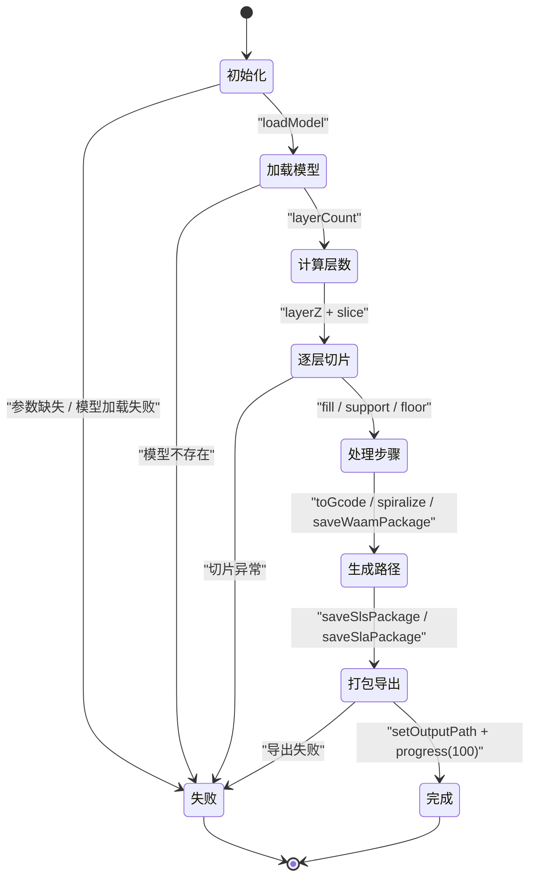
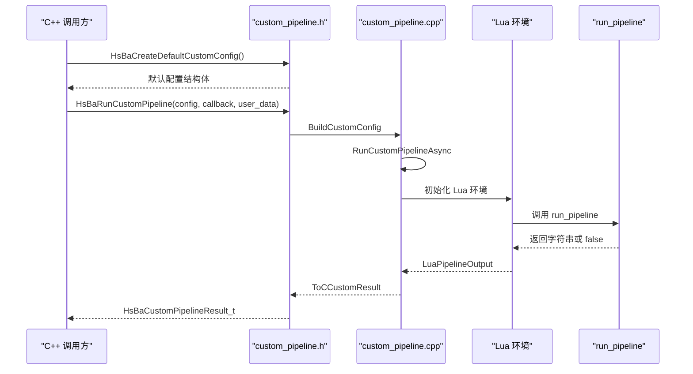
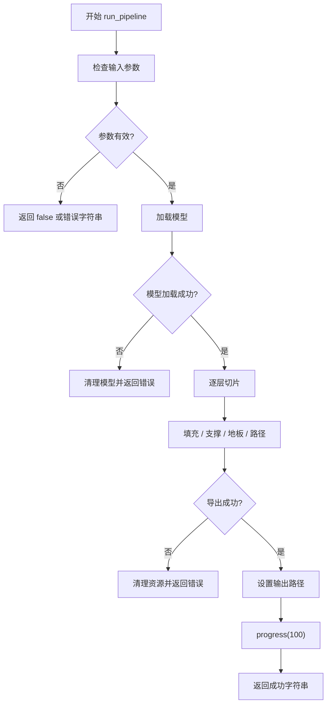
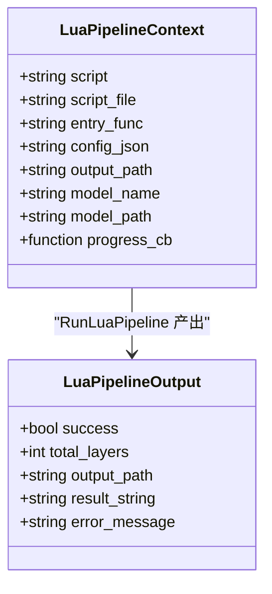
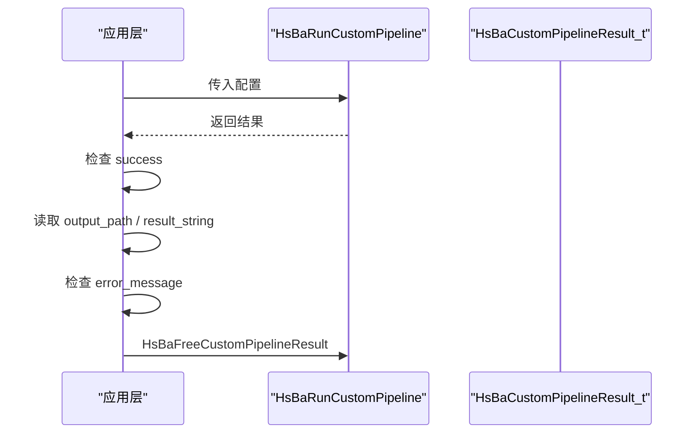
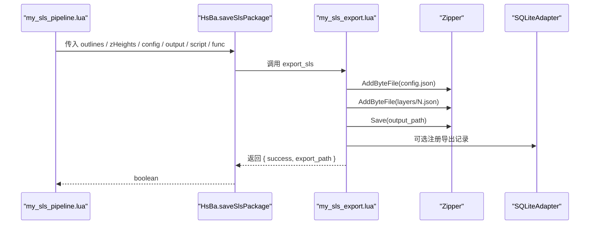

# Custom 流水线环境

<cite>
**本文引用的文件**   
- [custom_pipeline.h](file://DllHsBaSlicer/custom_pipeline.h)
- [custom_pipeline.cpp](file://DllHsBaSlicer/custom_pipeline.cpp)
- [pipeline_types.h](file://pipelinetypes/pipeline_types.h)
- [lua_pipeline.hpp](file://LibHsBaSlicer/Extends/lua_pipeline.hpp)
- [hsba_pipeline.d.lua](file://types/hsba_pipeline.d.lua)
- [my_fdm_pipeline.lua](file://samples/Custom/scripts/my_fdm_pipeline.lua)
- [my_sla_pipeline.lua](file://samples/Custom/scripts/my_sla_pipeline.lua)
- [my_sls_pipeline.lua](file://samples/Custom/scripts/my_sls_pipeline.lua)
- [my_slm_pipeline.lua](file://samples/Custom/scripts/my_slm_pipeline.lua)
- [my_lom_pipeline.lua](file://samples/Custom/scripts/my_lom_pipeline.lua)
- [my_tdp_pipeline.lua](file://samples/Custom/scripts/my_tdp_pipeline.lua)
- [my_waam_pipeline.lua](file://samples/Custom/scripts/my_waam_pipeline.lua)
- [my_sls_export.lua](file://samples/Custom/scripts/my_sls_export.lua)
</cite>

## 目录
1. [项目概述与快速开始](#项目概述与快速开始)
2. [架构总览](#架构总览)
3. [核心概念](#核心概念)
4. [核心模块详解](#核心模块详解)
5. [高级主题](#高级主题)
6. [Lua 脚本系统](#lua-脚本系统)
7. [API 参考文档](#api-参考文档)
8. [集成指南](#集成指南)
9. [开发·测试与贡献](#开发·测试与贡献)
10. [扩展开发指南](#扩展开发指南)
11. [示例与教程](#示例与教程)
12. [部署·故障排除与FAQ](#部署·故障排除与faq)
13. [附录](#附录)

## 项目概述与快速开始

Custom 流水线是 HsBaSlicer 中完全由 Lua 脚本驱动的工艺编排入口。C++ 侧通过 `HsBaRunCustomPipeline` 或异步接口加载 Lua 脚本，创建包含全局变量和 `HsBa` 算子表的执行环境，并调用脚本中的 `run_pipeline`（或自定义 `entry_func`）完成模型加载、切片、支撑、填充、路径生成、打包导出等任意流程。

与传统内置流水线不同，Custom 流水线不固定阶段顺序：脚本自行决定“加载模型 → 切片 → 支撑 → 填充 → G-code / 机器人路径 / zip 包”的完整编排逻辑。它适用于 FDM、SLA、SLS、SLM、LOM、TDP、WAAM 等多种工艺，也适合实验性新工艺的快速验证。

### 快速开始步骤

1. 准备一个 Lua 脚本，实现 `run_pipeline()` 函数。
2. 在脚本中使用全局变量 `model_name`、`model_path`、`output_path`、`pipeline_config`。
3. 使用 `HsBa.loadModel` 加载模型，用 `HsBa.layerCount`、`HsBa.layerZ`、`HsBa.slice` 进行切片。
4. 根据需要调用 `HsBa.fill`、`HsBa.fdmSupport`、`HsBa.slaSupport`、`HsBa.floor`、`HsBa.toGcode`、`HsBa.spiralize`。
5. 使用 `HsBa.saveSlsPackage`、`HsBa.saveWaamPackage`、`HsBa.saveSlaPackage` 输出结果。
6. 通过 `HsBa.setProgress` 上报进度，通过 `HsBa.setOutputPath` 设置最终输出路径。
7. C++ 侧调用 `HsBaRunCustomPipeline` 或 `HsBaRunCustomPipelineAsync` 执行脚本。

**章节来源**
- [custom_pipeline.h:17-55](file://DllHsBaSlicer/custom_pipeline.h#L17-L55)
- [custom_pipeline.cpp:118-163](file://DllHsBaSlicer/custom_pipeline.cpp#L118-L163)
- [hsba_pipeline.d.lua:465-487](file://types/hsba_pipeline.d.lua#L465-L487)

## 架构总览

Custom 流水线的执行链路可以概括为：



**图表来源**
- [custom_pipeline.cpp:86-163](file://DllHsBaSlicer/custom_pipeline.cpp#L86-L163)
- [lua_pipeline.hpp:34-51](file://LibHsBaSlicer/Extends/lua_pipeline.hpp#L34-L51)

### 关键组件职责

| 组件 | 职责 |
|---|---|
| `HsBaCustomPipelineConfig_t` | C 结构体，传入 Lua 脚本路径、源码、入口函数名、JSON 配置、模型名、模型路径、默认输出路径 |
| `InternalCustomConfig` | C++ 内部配置结构，负责空指针到字符串的安全转换 |
| `LuaPipelineContext` | Lua 执行上下文，持有脚本、入口函数、配置 JSON、输出路径、模型信息和进度回调 |
| `LuaPipelineOutput` | Lua 执行结果，包括成功标志、总层数、输出路径、返回值字符串、错误消息 |
| `HsBaCustomPipelineResult_t` | C 接口返回结果，调用方需调用 `HsBaFreeCustomPipelineResult` 释放内存 |

**章节来源**
- [pipeline_types.h:698-726](file://pipelinetypes/pipeline_types.h#L698-L726)
- [custom_pipeline.cpp:23-44](file://DllHsBaSlicer/custom_pipeline.cpp#L23-L44)
- [lua_pipeline.hpp:34-51](file://LibHsBaSlicer/Extends/lua_pipeline.hpp#L34-L51)

## 核心概念

### Custom 流水线与内置流水线的区别

内置流水线（FDM、SLA、SLS、SLM、LOM、TDP、WAAM）的阶段顺序通常由 C++ 控制，Lua 主要替换支撑、填充、地板或导出行为；Custom 流水线则把整个流程交给 Lua，C++ 只负责运行 `run_pipeline`。

| 流水线类型 | 阶段控制权 | Lua 主要作用 |
|---|---|---|
| 内置 FDM | C++ 固定阶段 | 可替换支撑、填充、导出 |
| 内置 SLA | C++ 固定阶段 | 可替换地板、支撑、导出 |
| 内置 SLS/SLM/LOM/TDP | C++ 固定阶段 | 导出脚本决定最终格式 |
| 内置 WAAM | C++ 固定阶段 | 机器人代码生成 |
| Custom | Lua 完全控制 | 自由编排所有步骤 |

### 全局变量语义

Custom 流水线环境中存在以下全局变量：

| 全局变量 | 类型 | 说明 |
|---|---|---|
| `pipeline_entry` | string | 入口函数名，默认 `"run_pipeline"` |
| `pipeline_config` | string | C++ 传入的 JSON 配置字符串 |
| `output_path` | string | C++ 传入的默认输出路径 |
| `model_name` | string | C++ 传入的模型名称 |
| `model_path` | string | C++ 传入的模型文件路径 |

这些变量由 `LuaPipelineContext` 注入，并在脚本中作为默认值来源。典型用法是先判断是否为空，再回退到脚本内默认值。

**章节来源**
- [hsba_pipeline.d.lua:465-487](file://types/hsba_pipeline.d.lua#L465-L487)
- [lua_pipeline.hpp:34-38](file://LibHsBaSlicer/Extends/lua_pipeline.hpp#L34-L38)
- [my_fdm_pipeline.lua:52-57](file://samples/Custom/scripts/my_fdm_pipeline.lua#L52-L57)
- [my_sls_pipeline.lua:30-38](file://samples/Custom/scripts/my_sls_pipeline.lua#L30-L38)

### 流水线状态管理

Custom 流水线的状态主要由以下机制共同表达：

1. **脚本内部状态**：局部变量保存模型名、层数、轮廓数组、Z 高度数组、输出路径等。
2. **HsBa.setLayers**：向 C++ 报告总层数，用于进度条和结果统计。
3. **HsBa.setProgress**：上报百分比和阶段描述。
4. **HsBa.setOutputPath**：设置最终输出路径。
5. **HsBaCustomPipelineResult_t**：C++ 侧返回成功标志、总层数、输出路径、返回值、错误消息和耗时。



**图表来源**
- [my_fdm_pipeline.lua:52-170](file://samples/Custom/scripts/my_fdm_pipeline.lua#L52-L170)
- [my_sls_pipeline.lua:30-100](file://samples/Custom/scripts/my_sls_pipeline.lua#L30-L100)
- [custom_pipeline.cpp:118-163](file://DllHsBaSlicer/custom_pipeline.cpp#L118-L163)

**章节来源**
- [hsba_pipeline.d.lua:296-307](file://types/hsba_pipeline.d.lua#L296-L307)
- [custom_pipeline.cpp:23-31](file://DllHsBaSlicer/custom_pipeline.cpp#L23-L31)
- [pipeline_types.h:711-719](file://pipelinetypes/pipeline_types.h#L711-L719)

## 核心模块详解

### C++ 自定义流水线接口

C++ 暴露的自定义流水线接口位于 `DllHsBaSlicer/custom_pipeline.h` 和 `custom_pipeline.cpp`。对外提供三个核心能力：

1. 创建默认配置。
2. 同步执行。
3. 异步执行。
4. 释放结果内存。



**图表来源**
- [custom_pipeline.h:17-62](file://DllHsBaSlicer/custom_pipeline.h#L17-L62)
- [custom_pipeline.cpp:171-213](file://DllHsBaSlicer/custom_pipeline.cpp#L171-L213)

### 配置结构体

`HsBaCustomPipelineConfig_t` 是 C 兼容的配置结构体，关键字段如下：

| 字段 | 类型 | 是否可为空 | 说明 |
|---|---|---:|---|
| `pipeline_lua_script` | `const char*` | 是 | Lua 脚本文件路径 |
| `pipeline_lua_source` | `const char*` | 是 | 直接传入的 Lua 源码 |
| `entry_func` | `const char*` | 是 | 入口函数名，默认 `run_pipeline` |
| `config_json` | `const char*` | 是 | 注入到 `pipeline_config` 的 JSON 字符串 |
| `model_name` | `const char*` | 是 | 模型名称 |
| `model_path` | `const char*` | 是 | 模型文件路径 |
| `output_path` | `const char*` | 是 | 默认输出路径 |

注意：`pipeline_lua_script` 和 `pipeline_lua_source` 至少需要提供一个，否则 C++ 会返回错误消息。

**章节来源**
- [pipeline_types.h:698-704](file://pipelinetypes/pipeline_types.h#L698-L704)
- [custom_pipeline.cpp:86-99](file://DllHsBaSlicer/custom_pipeline.cpp#L86-L99)
- [custom_pipeline.cpp:127-133](file://DllHsBaSlicer/custom_pipeline.cpp#L127-L133)

### 结果结构体

`HsBaCustomPipelineResult_t` 是 C 兼容的结果结构体：

| 字段 | 类型 | 说明 |
|---|---|---|
| `success` | `int` | 成功标志，0 表示失败，1 表示成功 |
| `total_layers` | `int` | 脚本通过 `HsBa.setLayers` 报告的层数 |
| `output_path` | `char*` | 脚本通过 `HsBa.setOutputPath` 设置的输出路径 |
| `result_string` | `char*` | `run_pipeline` 返回的字符串 |
| `error_message` | `char*` | 错误消息 |
| `elapsed_seconds` | `double` | 执行耗时秒数 |

调用方必须调用 `HsBaFreeCustomPipelineResult` 释放 `output_path`、`result_string`、`error_message`。

**章节来源**
- [pipeline_types.h:711-719](file://pipelinetypes/pipeline_types.h#L711-L719)
- [custom_pipeline.cpp:203-213](file://DllHsBaSlicer/custom_pipeline.cpp#L203-L213)

## 高级主题

### 错误处理策略

Custom 流水线的错误可以分为三类：

1. **C++ 层错误**：例如未提供脚本路径或源码。
2. **Lua 执行错误**：例如语法错误、运行时异常。
3. **业务逻辑错误**：例如模型不存在、切片为空、导出失败。

推荐处理方式：

- 在脚本开头校验 `model_path` 是否存在。
- 对 `HsBa.loadModel`、`HsBa.saveSlsPackage`、`HsBa.saveWaamPackage`、`HsBa.saveSlaPackage` 的返回值做分支处理。
- 使用 `HsBa.progress` 标注失败阶段。
- 返回 `false` 或带错误信息的字符串。
- C++ 层检查 `HsBaCustomPipelineResult_t.success` 和 `error_message`。



**图表来源**
- [my_fdm_pipeline.lua:52-170](file://samples/Custom/scripts/my_fdm_pipeline.lua#L52-L170)
- [my_sls_pipeline.lua:30-100](file://samples/Custom/scripts/my_sls_pipeline.lua#L30-L100)
- [my_waam_pipeline.lua:22-92](file://samples/Custom/scripts/my_waam_pipeline.lua#L22-L92)

**章节来源**
- [custom_pipeline.cpp:127-133](file://DllHsBaSlicer/custom_pipeline.cpp#L127-L133)
- [my_sls_export.lua:18-19](file://samples/Custom/scripts/my_sls_export.lua#L18-L19)

### 性能优化技巧

1. **避免重复切片**：先计算 `layerCount`，再用 `layerZ` 和 `slice` 按层获取轮廓。
2. **分批上报进度**：大循环中每隔若干层调用一次 `HsBa.progress`，避免频繁回调开销。
3. **及时释放模型**：流水线结束时调用 `HsBa.removeModel`。
4. **合理设置层高**：过细层高会显著增加层数和切片时间。
5. **避免在 Lua 中构造超大字符串**：优先使用 `Zipper.AddByteFile` 写入二进制数据。
6. **使用异步接口**：UI 或主线程应使用 `HsBaRunCustomPipelineAsync`，避免阻塞。
7. **复用配置表**：将常用参数封装为本地 `param` 函数，减少重复判断。

**章节来源**
- [my_fdm_pipeline.lua:85-103](file://samples/Custom/scripts/my_fdm_pipeline.lua#L85-L103)
- [my_sls_pipeline.lua:55-61](file://samples/Custom/scripts/my_sls_pipeline.lua#L55-L61)
- [custom_pipeline.cpp:185-201](file://DllHsBaSlicer/custom_pipeline.cpp#L185-L201)

## Lua 脚本系统

### 执行环境

Lua 环境由 `LibHsBaSlicer/Extends/lua_pipeline.hpp` 中的 `LuaPipelineContext` 驱动。它负责：

- 打开标准库。
- 安装通用 AnyObject 类型。
- 注册 2D/3D/File 相关算子。
- 创建全局 `HsBa` 表。
- 注入全局变量。
- 调用入口函数。
- 收集输出。



**图表来源**
- [lua_pipeline.hpp:34-51](file://LibHsBaSlicer/Extends/lua_pipeline.hpp#L34-L51)

**章节来源**
- [lua_pipeline.hpp:34-61](file://LibHsBaSlicer/Extends/lua_pipeline.hpp#L34-L61)

### 全局变量与入口函数

| 名称 | 类型 | 默认值 | 用途 |
|---|---|---|---|
| `pipeline_entry` | string | `"run_pipeline"` | 指定入口函数名 |
| `pipeline_config` | string | `""` | C++ 传入的 JSON 配置 |
| `output_path` | string | `""` | 默认输出路径 |
| `model_name` | string | `""` | 模型名 |
| `model_path` | string | `""` | 模型路径 |

脚本应始终对空串做防御性判断，例如：

```text
local name = (model_name and #model_name > 0) and model_name or "custom_model"
```

**章节来源**
- [hsba_pipeline.d.lua:469-487](file://types/hsba_pipeline.d.lua#L469-L487)
- [my_fdm_pipeline.lua:52-57](file://samples/Custom/scripts/my_fdm_pipeline.lua#L52-L57)

### 内置阶段脚本环境

除了 Custom 流水线，HsBaSlicer 还提供多种内置阶段脚本环境，它们共享部分全局变量和工具表：

| 阶段 | 入口函数 | 主要全局变量 | 主要工具 |
|---|---|---|---|
| FDM 支撑 | `generate_support()` | `current_layer`, `prev_layer`, `layer_height`, `config` | `PolygonOperations`, `Support`, `PathOptimize` |
| FDM 填充 | `generate_fill(polys)` | `polys` 作为参数 | `PolygonOperations`, `PolygonFill`, `PathOptimize` |
| SLA 地板 | `generate_floor(bottomLayer, floorCfg)` | `bottomLayer`, `floorCfg` | `PolygonOperations`, `PolygonFill` |
| SLS/SLM/LOM/TDP 导出 | `export_sls()` / `export_slm()` / `export_lom()` / `export_tdp()` | `config`, `images`, `funcName` | `Zipper`, `Cipher`, 数据库适配器 |
| SLA 导出 | `export_sla()` | 同 SLS 导出环境 | `ImagesPath.Save` 风格环境 |
| WAAM 机器人路径 | `export_waam()` | `header`, `startProgramFunc`, `endProgramFunc`, `points` | 返回机器人程序文本 |

**章节来源**
- [hsba_pipeline.d.lua:489-623](file://types/hsba_pipeline.d.lua#L489-L623)

## API 参考文档

### run_pipeline 函数规范

`run_pipeline` 是 Custom 流水线的默认入口函数。C++ 侧可通过 `entry_func` 覆盖该名称。

| 项目 | 说明 |
|---|---|
| 函数名 | `run_pipeline`（可被 `entry_func` 覆盖） |
| 参数 | 无 |
| 返回值 | 成功时返回字符串；失败时返回 `false` 或 `nil` |
| 副作用 | 可调用 `HsBa` 算子、修改全局状态、写文件、设置输出路径 |
| 进度上报 | 通过 `HsBa.progress(percent, stage)` |
| 层数上报 | 通过 `HsBa.setLayers(n)` |
| 输出路径 | 通过 `HsBa.setOutputPath(path)` |

推荐返回格式：

- 成功：`"Lua FDM 流水线完成: N 层, 输出 path.gcode"`
- 失败：`false` 或 `"错误原因"`

**章节来源**
- [custom_pipeline.h:23-36](file://DllHsBaSlicer/custom_pipeline.h#L23-L36)
- [custom_pipeline.cpp:135-142](file://DllHsBaSlicer/custom_pipeline.cpp#L135-L142)
- [hsba_pipeline.d.lua:469-471](file://types/hsba_pipeline.d.lua#L469-L471)

### HsBa 算子表

`HsBa` 是 Custom 流水线环境的核心算子表，涵盖模型操作、切片、坐标转换、填充、支撑、地板、路径输出和导出功能。

#### 通用步骤

| 函数 | 参数 | 返回值 | 说明 |
|---|---|---|---|
| `HsBa.progress(percent, stage?)` | `integer`, `string?` | 无 | 上报进度百分比和阶段描述 |
| `HsBa.setLayers(n)` | `integer` | 无 | 设置总层数 |
| `HsBa.setOutputPath(path)` | `string` | 无 | 设置输出路径 |
| `HsBa.readFile(path)` | `string` | `string|nil` | 读取文件内容 |
| `HsBa.writeFile(path, content)` | `string`, `string` | `boolean` | 写入文件 |

#### 模型操作

| 函数 | 参数 | 返回值 | 说明 |
|---|---|---|---|
| `HsBa.loadModel(name, path)` | `string`, `string` | `boolean` | 加载 3D 模型到模型池 |
| `HsBa.modelInfo(name)` | `string` | `ModelInfo` | 获取模型包围盒、体积等信息 |
| `HsBa.translateModel(name, offset)` | `string`, `Point3D` | 无 | 平移模型 |
| `HsBa.rotateModel(name, quaternion)` | `string`, `Quaternion` | 无 | 旋转模型 |
| `HsBa.scaleModel(name, scale)` | `string`, `number|Point3D` | 无 | 缩放模型 |
| `HsBa.removeModel(name)` | `string` | 无 | 从模型池移除模型 |
| `HsBa.modelNames()` | 无 | `string[]` | 获取当前模型池中所有模型名 |

#### 切片操作

| 函数 | 参数 | 返回值 | 说明 |
|---|---|---|---|
| `HsBa.layerCount(name, layerHeight, firstLayerHeight)` | `string`, `number`, `number` | `integer` | 计算模型总层数 |
| `HsBa.layerZ(index, layerHeight, firstLayerHeight)` | `integer`, `number`, `number` | `number` | 计算第 index 层的 Z 高度 |
| `HsBa.slice(name, z)` | `string`, `number` | `Polygons` | 安全切片，返回闭合轮廓 |
| `HsBa.sliceUnsafe(name, z)` | `string`, `number` | `Polygons` | 不安全切片，可能丢弃开放轮廓 |

#### 坐标转换

| 函数 | 参数 | 返回值 | 说明 |
|---|---|---|---|
| `HsBa.toInt(polys)` | `Polygons` | `Polygons` | 浮点多边形转整数 |
| `HsBa.toDouble(polys)` | `Polygons` | `Polygons` | 整数多边形转浮点 |

#### 填充操作

| 函数 | 参数 | 返回值 | 说明 |
|---|---|---|---|
| `HsBa.fill(polys, options?)` | `Polygons`, `FillOptions?` | `Polygons` | 填充多边形 |

`FillOptions` 支持：

| 字段 | 类型 | 默认值 | 说明 |
|---|---|---:|---|
| `spacing` | `number?` | `0.4` | 填充间距 |
| `mode` | `string?` | `"zigzag"` | `"line"` \| `"zigzag"` \| `"simpleZigzag"` |
| `angle` | `number?` | `45.0` | 填充角度 |
| `borderCount` | `integer?` | `0` | 壁厚圈数 |

#### 支撑生成

| 函数 | 参数 | 返回值 | 说明 |
|---|---|---|---|
| `HsBa.fdmSupport(layers, config?)` | `LayerList`, `SupportOptions?` | `LayerList` | 生成 FDM 支撑 |
| `HsBa.slaSupport(layers, config?)` | `LayerList`, `SupportOptions?` | `LayerList` | 生成 SLA 支撑 |

`SupportOptions` 支持：

| 字段 | 类型 | 默认值 | 说明 |
|---|---|---:|---|
| `layer_height` | `number?` | — | 层高 |
| `overhang_angle` | `number?` | — | 悬垂角度阈值 |
| `support_gap` | `number?` | — | 支撑间隙 |
| `support_diameter` | `number?` | — | 支撑直径 |
| `support_density` | `number?` | — | 支撑密度 |
| `support_pattern` | `integer?` | — | 支撑模式 |
| `tree_branch_angle` | `number?` | — | 树状支撑分支角度 |
| `tree_max_branch_radius` | `number?` | — | 树状支撑最大分支半径 |
| `honeycomb_cell_size` | `number?` | — | 蜂窝支撑单元尺寸 |
| `interface_layers` | `integer?` | — | FDM 专用界面层数 |
| `interface_density` | `number?` | — | FDM 专用界面密度 |
| `tip_diameter` | `number?` | — | SLA 专用支撑尖端直径 |
| `raft_thickness` | `number?` | — | SLA 专用筏板厚度 |

#### 路径输出

| 函数 | 参数 | 返回值 | 说明 |
|---|---|---|---|
| `HsBa.spiralize(sections, options?)` | `LayerList`, `SpiralizeOptions?` | `Point3D[]` | 螺旋化外壁，用于 FDM 花瓶模式 |
| `HsBa.toGcode(layers, config)` | `LayerPathInput[]`, `GcodeOptions` | `string` | 生成 G-code |

`LayerPathInput` 支持：

| 字段 | 类型 | 默认值 | 说明 |
|---|---|---:|---|
| `outlines` | `Polygons?` | — | 每层轮廓 |
| `fills` | `Polygons?` | — | 每层填充 |
| `supports` | `Polygons?` | — | 每层支撑 |
| `zHeight` | `number?` | — | 层高 Z 值 |

`GcodeOptions` 支持：

| 字段 | 类型 | 默认值 | 说明 |
|---|---|---:|---|
| `layerHeight` | `number?` | — | 层高 |
| `lineWidth` | `number?` | — | 线宽 |
| `printSpeed` | `number?` | — | 打印速度 |
| `travelSpeed` | `number?` | — | 移动速度 |
| `extrusionMultiplier` | `number?` | — | 挤出倍率 |
| `firmware` | `string?` | — | 固件类型 |
| `nozzleDiameter` | `number?` | — | 喷嘴直径 |
| `filamentDiameter` | `number?` | — | 耗材直径 |
| `nozzleTemp` | `number?` | — | 喷嘴温度 |
| `bedTemp` | `number?` | — | 热床温度 |
| `retractLength` | `number?` | — | 回抽长度 |
| `retractSpeed` | `number?` | — | 回抽速度 |

#### 导出功能

| 函数 | 参数 | 返回值 | 说明 |
|---|---|---|---|
| `HsBa.saveSlsPackage(input)` | `SlsPackageInput` | `boolean` | 打包 SLS/SLM/LOM/TDP 输出 |
| `HsBa.saveWaamPackage(input)` | `WaamPackageInput` | `boolean, string?` | 打包 WAAM 机器人路径输出 |
| `HsBa.saveSlaPackage(input)` | `SlaPackageInput` | `boolean` | 打包 SLA 输出 |
| `HsBa.renderImage(polys, width, height, path)` | `Polygons`, `integer`, `integer`, `string` | `boolean` | 渲染多边形为图片 |

`SlsPackageInput` 支持：

| 字段 | 类型 | 默认值 | 说明 |
|---|---|---:|---|
| `outlines` | `LayerList` | — | 每层轮廓 |
| `zHeights` | `number[]` | — | 每层 Z 高度 |
| `config` | `string` | — | JSON 配置 |
| `output` | `string` | — | 输出 zip 路径 |
| `script` | `string` | — | 导出 Lua 脚本路径 |
| `func` | `string?` | `"export_sls"` | 导出函数名 |

`WaamPackageInput` 支持：

| 字段 | 类型 | 默认值 | 说明 |
|---|---|---:|---|
| `outlines` | `LayerList` | — | 每层轮廓 |
| `zHeights` | `number[]` | — | 每层 Z 高度 |
| `weld` | `WaamWeldParams?` | — | 焊接参数 |
| `robotType` | `integer?` | — | 机器人类型：0=ABB, 1=KUKA, 2=FANUC |
| `beadWidth` | `number?` | — | 焊道宽度 |
| `config` | `string?` | — | JSON 配置 |
| `output` | `string` | — | 输出文件路径 |
| `script` | `string?` | — | 自定义代码生成脚本 |
| `func` | `string?` | `"export_waam"` | 导出函数名 |

`SlaPackageInput` 支持：

| 字段 | 类型 | 默认值 | 说明 |
|---|---|---:|---|
| `outlines` | `LayerList` | — | 每层轮廓 |
| `supports` | `LayerList?` | — | 每层支撑 |
| `floor` | `Polygons?` | — | 地板/Raft |
| `config` | `string?` | — | JSON 配置 |
| `output` | `string` | — | 输出 zip 路径 |
| `imageWidth` | `integer?` | — | 图片宽度 |
| `imageHeight` | `integer?` | — | 图片高度 |
| `imageExtension` | `string?` | `".png"` | 图片扩展名 |

**章节来源**
- [hsba_pipeline.d.lua:189-463](file://types/hsba_pipeline.d.lua#L189-L463)

### 完整 Custom 流水线脚本示例

以下示例展示如何编排完整的 FDM 处理流程：

1. 使用 `model_name`、`model_path`、`output_path` 作为默认值。
2. 加载模型并获取模型信息。
3. 计算层数并上报。
4. 逐层切片并记录 Z 高度。
5. 根据层号动态调整填充角度。
6. 可选生成 FDM 支撑。
7. 组装 `LayerPathInput` 列表。
8. 调用 `HsBa.toGcode` 生成 G-code。
9. 使用 `HsBa.writeFile` 写出文件。
10. 设置输出路径、移除模型、上报完成进度。

参考实现路径：

- [my_fdm_pipeline.lua:52-170](file://samples/Custom/scripts/my_fdm_pipeline.lua#L52-L170)

其他工艺示例：

- SLA：[my_sla_pipeline.lua:27-104](file://samples/Custom/scripts/my_sla_pipeline.lua#L27-L104)
- SLS：[my_sls_pipeline.lua:30-100](file://samples/Custom/scripts/my_sls_pipeline.lua#L30-L100)
- SLM：[my_slm_pipeline.lua:22-92](file://samples/Custom/scripts/my_slm_pipeline.lua#L22-L92)
- LOM：[my_lom_pipeline.lua:19-90](file://samples/Custom/scripts/my_lom_pipeline.lua#L19-L90)
- TDP：[my_tdp_pipeline.lua:20-90](file://samples/Custom/scripts/my_tdp_pipeline.lua#L20-L90)
- WAAM：[my_waam_pipeline.lua:22-92](file://samples/Custom/scripts/my_waam_pipeline.lua#L22-L92)

**章节来源**
- [my_fdm_pipeline.lua:52-170](file://samples/Custom/scripts/my_fdm_pipeline.lua#L52-L170)
- [my_sla_pipeline.lua:27-104](file://samples/Custom/scripts/my_sla_pipeline.lua#L27-L104)
- [my_sls_pipeline.lua:30-100](file://samples/Custom/scripts/my_sls_pipeline.lua#L30-L100)
- [my_slm_pipeline.lua:22-92](file://samples/Custom/scripts/my_slm_pipeline.lua#L22-L92)
- [my_lom_pipeline.lua:19-90](file://samples/Custom/scripts/my_lom_pipeline.lua#L19-L90)
- [my_tdp_pipeline.lua:20-90](file://samples/Custom/scripts/my_tdp_pipeline.lua#L20-L90)
- [my_waam_pipeline.lua:22-92](file://samples/Custom/scripts/my_waam_pipeline.lua#L22-L92)

## 集成指南

### C++ 集成步骤

1. 包含 `DllHsBaSlicer/custom_pipeline.h`。
2. 调用 `HsBaCreateDefaultCustomConfig` 创建默认配置。
3. 设置 `pipeline_lua_script` 或 `pipeline_lua_source`。
4. 可选设置 `entry_func`、`config_json`、`model_name`、`model_path`、`output_path`。
5. 调用 `HsBaRunCustomPipeline` 同步执行，或 `HsBaRunCustomPipelineAsync` 异步执行。
6. 检查 `HsBaCustomPipelineResult_t.success`。
7. 使用 `error_message` 诊断失败原因。
8. 调用 `HsBaFreeCustomPipelineResult` 释放结果。



**图表来源**
- [custom_pipeline.h:17-62](file://DllHsBaSlicer/custom_pipeline.h#L17-L62)
- [custom_pipeline.cpp:171-213](file://DllHsBaSlicer/custom_pipeline.cpp#L171-L213)

**章节来源**
- [custom_pipeline.h:17-62](file://DllHsBaSlicer/custom_pipeline.h#L17-L62)
- [custom_pipeline.cpp:171-213](file://DllHsBaSlicer/custom_pipeline.cpp#L171-L213)

### 与导出脚本集成

对于 SLS/SLM/LOM/TDP，Custom 流水线通常调用 `HsBa.saveSlsPackage`，并指定一个导出脚本。导出脚本接收 `config` 和 `images`，并负责写入 zip 和可选数据库记录。



**图表来源**
- [my_sls_pipeline.lua:80-89](file://samples/Custom/scripts/my_sls_pipeline.lua#L80-L89)
- [my_sls_export.lua:21-75](file://samples/Custom/scripts/my_sls_export.lua#L21-L75)

**章节来源**
- [my_sls_pipeline.lua:80-89](file://samples/Custom/scripts/my_sls_pipeline.lua#L80-L89)
- [my_sls_export.lua:1-76](file://samples/Custom/scripts/my_sls_export.lua#L1-L76)

## 开发·测试与贡献

### 调试方法

1. **打印日志**：在 `run_pipeline` 各阶段使用 `print` 输出模型信息、层数、输出路径。
2. **分步执行**：先实现最小流程：加载模型 → 切片一层 → 写文件。
3. **逐步启用功能**：依次启用填充、支撑、G-code、打包。
4. **检查返回值**：对 `HsBa.loadModel`、`HsBa.saveSlsPackage`、`HsBa.saveWaamPackage`、`HsBa.saveSlaPackage` 做分支判断。
5. **查看错误消息**：C++ 侧检查 `error_message`。
6. **使用进度回调**：在 UI 中显示 `stage` 描述，帮助定位卡住阶段。
7. **隔离导出脚本**：先单独测试 `my_sls_export.lua`，再与主流水线集成。

**章节来源**
- [my_sls_export.lua:47-66](file://samples/Custom/scripts/my_sls_export.lua#L47-L66)
- [custom_pipeline.cpp:143-149](file://DllHsBaSlicer/custom_pipeline.cpp#L143-L149)

### 最佳实践

1. **始终校验输入**：不要假设 `model_path` 一定存在。
2. **始终清理模型**：流水线结束或失败分支都应调用 `HsBa.removeModel`。
3. **始终设置输出路径**：即使失败也应尽量保留可诊断信息。
4. **始终上报进度**：让调用方知道流水线仍在运行。
5. **避免硬编码路径**：优先使用 `output_path` 和相对路径。
6. **区分内置流水线与 Custom 流水线**：如果阶段顺序固定，优先考虑内置流水线；只有需要灵活编排时才用 Custom。
7. **保持导出脚本稳定**：导出脚本不应随意改变 zip 内部结构，否则下游解析会失败。

**章节来源**
- [my_fdm_pipeline.lua:166-170](file://samples/Custom/scripts/my_fdm_pipeline.lua#L166-L170)
- [my_sls_pipeline.lua:96-100](file://samples/Custom/scripts/my_sls_pipeline.lua#L96-L100)
- [my_waam_pipeline.lua:88-92](file://samples/Custom/scripts/my_waam_pipeline.lua#L88-L92)

## 扩展开发指南

### 新增 HsBa 算子

若要在 Custom 流水线中新增算子，通常需要：

1. 在 Lua 绑定层注册函数。
2. 在类型定义文件中补充 IDE 类型提示。
3. 在示例脚本中演示用法。
4. 在文档中更新 API 参考。

当前 `HsBa` 的类型定义集中在 `types/hsba_pipeline.d.lua`，便于 IDE 补全和导航。

**章节来源**
- [hsba_pipeline.d.lua:189-463](file://types/hsba_pipeline.d.lua#L189-L463)

### 新增导出脚本

新增导出脚本时应遵循：

1. 明确 `config` 和 `images` 的结构。
2. 使用 `Zipper` 或 `Bit7zZipper` 写入 zip。
3. 返回 `table`，不要返回字符串，否则会覆盖 zip 文件。
4. 可选使用 `SQLiteAdapter`、`MySQLAdapter`、`PostgreSQLAdapter` 持久化导出记录。
5. 在 `my_sls_export.lua` 基础上扩展，保持向后兼容。

**章节来源**
- [my_sls_export.lua:18-19](file://samples/Custom/scripts/my_sls_export.lua#L18-L19)
- [hsba_pipeline.d.lua:547-580](file://types/hsba_pipeline.d.lua#L547-L580)

## 示例与教程

### FDM 完整流水线

FDM Custom 流水线展示了最完整的处理链：模型加载、切片、填充、支撑、G-code 生成、文件写入。

参考路径：

- [my_fdm_pipeline.lua:52-170](file://samples/Custom/scripts/my_fdm_pipeline.lua#L52-L170)

关键点：

- 使用 `HsBa.fill` 生成填充。
- 使用 `HsBa.fdmSupport` 生成支撑。
- 使用 `HsBa.toGcode` 生成 G-code。
- 使用 `HsBa.writeFile` 写出文件。
- 使用 `HsBa.setProgress` 上报进度。

### SLA 完整流水线

SLA Custom 流水线展示了支撑、地板、层图渲染和 zip 打包。

参考路径：

- [my_sla_pipeline.lua:27-104](file://samples/Custom/scripts/my_sla_pipeline.lua#L27-L104)

关键点：

- 使用 `HsBa.slaSupport` 生成支撑。
- 使用 `HsBa.floor` 生成地板。
- 使用 `HsBa.saveSlaPackage` 打包层图、支撑图和地板图。

### 粉末床与金属工艺流水线

SLS、SLM、LOM、TDP 都复用 `HsBa.saveSlsPackage`，差异主要在 `config.json` 的工艺参数。

参考路径：

- [my_sls_pipeline.lua:30-100](file://samples/Custom/scripts/my_sls_pipeline.lua#L30-L100)
- [my_slm_pipeline.lua:22-92](file://samples/Custom/scripts/my_slm_pipeline.lua#L22-L92)
- [my_lom_pipeline.lua:19-90](file://samples/Custom/scripts/my_lom_pipeline.lua#L19-L90)
- [my_tdp_pipeline.lua:20-90](file://samples/Custom/scripts/my_tdp_pipeline.lua#L20-L90)

### WAAM 机器人路径流水线

WAAM 流水线输出机器人程序而非 zip 包，重点在于焊接参数和机器人类型。

参考路径：

- [my_waam_pipeline.lua:22-92](file://samples/Custom/scripts/my_waam_pipeline.lua#L22-L92)

关键点：

- 使用 `HsBa.saveWaamPackage`。
- 设置 `weld`、`robotType`、`beadWidth`。
- 返回布尔值和可选错误信息。

**章节来源**
- [my_fdm_pipeline.lua:52-170](file://samples/Custom/scripts/my_fdm_pipeline.lua#L52-L170)
- [my_sla_pipeline.lua:27-104](file://samples/Custom/scripts/my_sla_pipeline.lua#L27-L104)
- [my_sls_pipeline.lua:30-100](file://samples/Custom/scripts/my_sls_pipeline.lua#L30-L100)
- [my_slm_pipeline.lua:22-92](file://samples/Custom/scripts/my_slm_pipeline.lua#L22-L92)
- [my_lom_pipeline.lua:19-90](file://samples/Custom/scripts/my_lom_pipeline.lua#L19-L90)
- [my_tdp_pipeline.lua:20-90](file://samples/Custom/scripts/my_tdp_pipeline.lua#L20-L90)
- [my_waam_pipeline.lua:22-92](file://samples/Custom/scripts/my_waam_pipeline.lua#L22-L92)

## 部署·故障排除与FAQ

### 常见问题

| 问题 | 可能原因 | 解决方法 |
|---|---|---|
| 流水线立即失败 | 未提供 `pipeline_lua_script` 或 `pipeline_lua_source` | 至少设置其中一个 |
| 找不到模型 | `model_path` 错误或模型格式不支持 | 检查路径和模型文件 |
| 切片结果为空 | 层高过大、模型太小、Z 不在模型范围内 | 调整层高或使用 `bbox_min.z` 作为起点 |
| 导出失败 | 导出脚本返回字符串覆盖 zip | 导出脚本返回 `table` |
| 输出路径为空 | 未调用 `HsBa.setOutputPath` | 在成功分支设置输出路径 |
| 进度不更新 | 未在脚本中调用 `HsBa.progress` | 在关键阶段调用进度上报 |
| 内存泄漏 | 未释放 `HsBaCustomPipelineResult_t` | 调用 `HsBaFreeCustomPipelineResult` |

**章节来源**
- [custom_pipeline.cpp:127-133](file://DllHsBaSlicer/custom_pipeline.cpp#L127-L133)
- [my_sls_export.lua:18-19](file://samples/Custom/scripts/my_sls_export.lua#L18-L19)
- [custom_pipeline.cpp:203-213](file://DllHsBaSlicer/custom_pipeline.cpp#L203-L213)

### FAQ

**问：Custom 流水线和内置流水线应该如何选择？**  
答：如果阶段顺序固定且只需替换支撑、填充或导出，优先使用内置流水线；如果需要完全自定义阶段顺序、工艺策略或输出格式，使用 Custom 流水线。

**问：`pipeline_config` 和 `machine` 有什么区别？**  
答：`pipeline_config` 是 C++ 传入的 JSON 字符串，通常作为包内配置文件；`machine` 是某些示例脚本中使用的预置参数表，属于脚本约定，并非所有流水线都保证存在。

**问：为什么导出脚本不能返回字符串？**  
答：因为 C++ 会把入口函数的字符串返回值当作结果字符串，可能覆盖 zip 文件。导出脚本应返回 `table`，并通过 `Zipper.Save` 写出文件。

**问：如何调试 Lua 脚本？**  
答：结合 `print`、`pcall`、进度回调、错误消息和最小可复现脚本逐步定位问题。

**章节来源**
- [hsba_pipeline.d.lua:469-487](file://types/hsba_pipeline.d.lua#L469-L487)
- [my_sls_export.lua:18-19](file://samples/Custom/scripts/my_sls_export.lua#L18-L19)

## 附录

### 全局变量速查表

| 变量 | 类型 | 默认值 | 典型用途 |
|---|---|---|---|
| `pipeline_entry` | string | `"run_pipeline"` | 入口函数名 |
| `pipeline_config` | string | `""` | 工艺 JSON 配置 |
| `output_path` | string | `""` | 默认输出路径 |
| `model_name` | string | `""` | 模型名 |
| `model_path` | string | `""` | 模型路径 |

### HsBa 算子分类速查表

| 分类 | 代表函数 |
|---|---|
| 进度与状态 | `progress`, `setLayers`, `setOutputPath` |
| 文件操作 | `readFile`, `writeFile` |
| 模型操作 | `loadModel`, `modelInfo`, `translateModel`, `rotateModel`, `scaleModel`, `removeModel`, `modelNames` |
| 切片操作 | `layerCount`, `layerZ`, `slice`, `sliceUnsafe` |
| 坐标转换 | `toInt`, `toDouble` |
| 填充操作 | `fill` |
| 支撑生成 | `fdmSupport`, `slaSupport` |
| 路径输出 | `spiralize`, `toGcode` |
| 导出功能 | `saveSlsPackage`, `saveWaamPackage`, `saveSlaPackage`, `renderImage` |

**章节来源**
- [hsba_pipeline.d.lua:290-463](file://types/hsba_pipeline.d.lua#L290-L463)