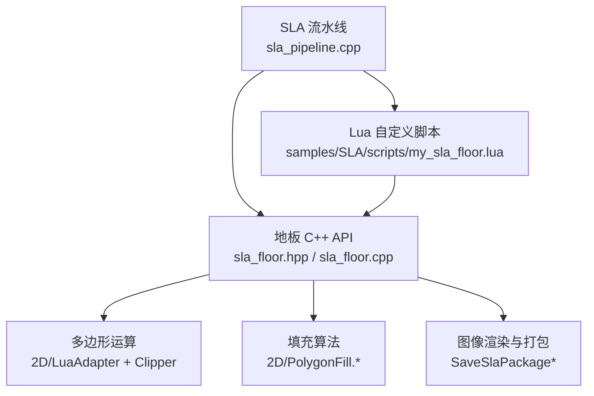
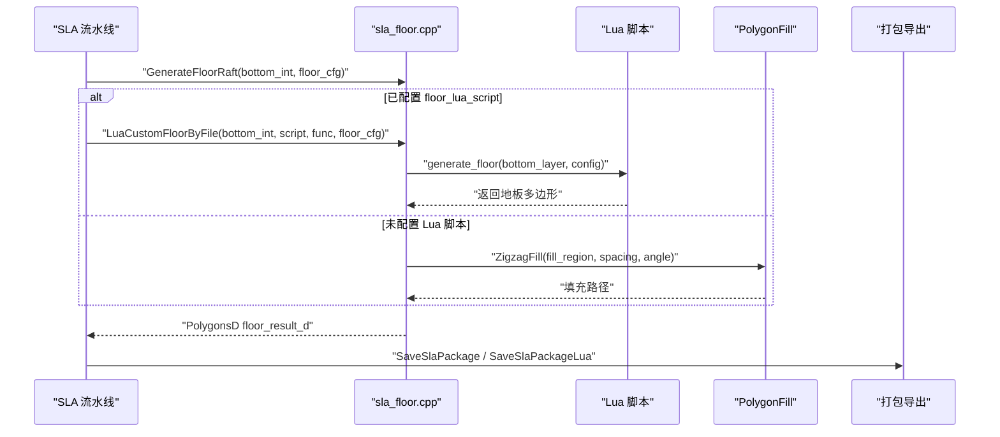
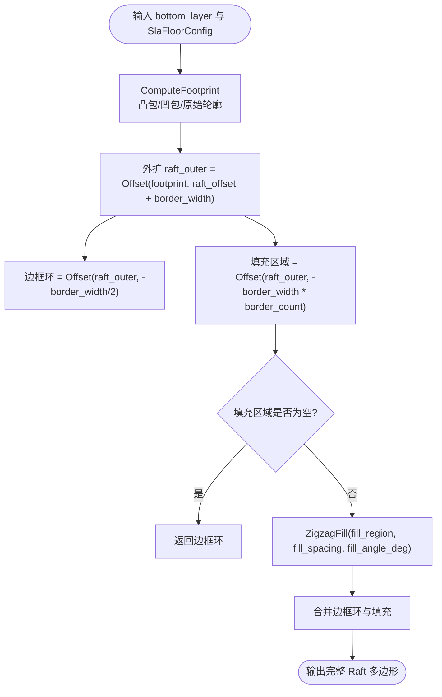
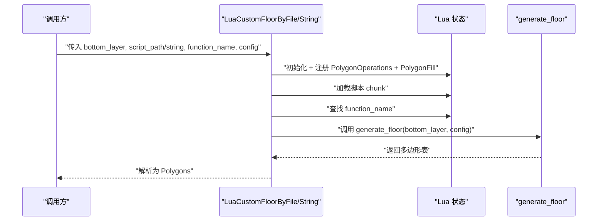
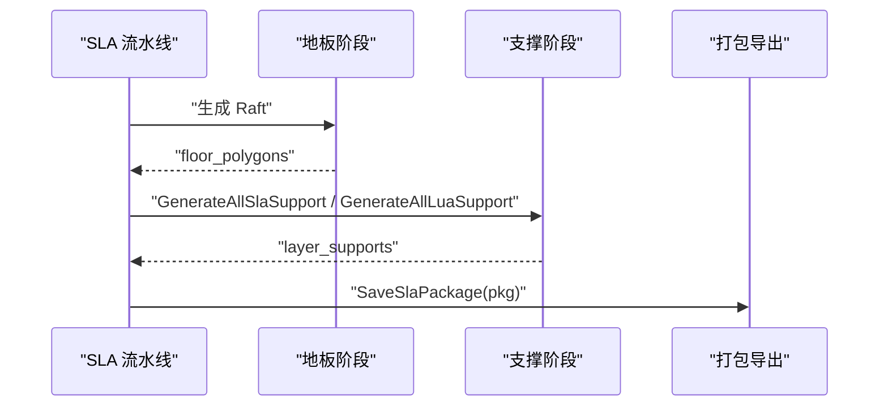
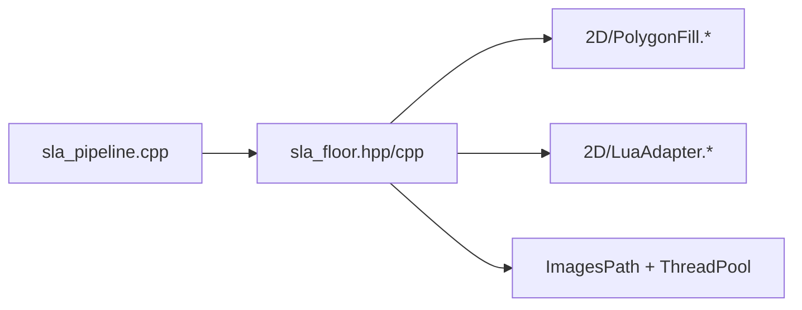

# 内置阶段 - 地板生成

<cite>
**本文引用的文件**   
- [sla_floor.hpp](file://LibHsBaSlicer/Floor/sla_floor.hpp)
- [sla_floor.cpp](file://LibHsBaSlicer/Floor/sla_floor.cpp)
- [hsba_pipeline.d.lua](file://types/hsba_pipeline.d.lua)
- [my_sla_floor.lua](file://samples/SLA/scripts/my_sla_floor.lua)
- [sla_pipeline.cpp](file://DllHsBaSlicer/sla_pipeline.cpp)
- [PolygonFill.hpp](file://2D/PolygonFill.hpp)
- [PolygonFill.cpp](file://2D/PolygonFill.cpp)
</cite>

## 目录
1. [简介](#简介)
2. [项目结构定位](#项目结构定位)
3. [核心概念与接口总览](#核心概念与接口总览)
4. [架构总览](#架构总览)
5. [详细组件分析](#详细组件分析)
6. [依赖关系分析](#依赖关系分析)
7. [性能与实现特性](#性能与实现特性)
8. [调试技巧与最佳实践](#调试技巧与最佳实践)
9. [结论](#结论)
10. [附录：配置字段与脚本约定速查](#附录配置字段与脚本约定速查)

## 简介
本文档面向 SLA 切片流水线中的“地板/Raft 生成”内置阶段，重点说明 Lua 脚本环境中的 `generate_floor(bottomLayer, floorCfg)` 函数契约、`FloorConfig`（源码中为 `SlaFloorConfig`）配置结构、以及如何使用 `PolygonOperations` 与 `PolygonFill` 库实现自定义地板算法。文档还解释 SLA 流水线如何将底层多边形转换为 Raft，并与支撑系统、图像渲染和打包导出集成。

## 项目结构定位
SLA 地板生成功能由三层组成：
- C++ 核心 API：位于 `LibHsBaSlicer/Floor`，提供 `GenerateFloorRaft`、`GenerateFloorBorder`、`GenerateFloorFill`、`LuaCustomFloorByFile`、`LuaCustomFloorByString` 等接口。
- 流水线集成层：位于 `DllHsBaSlicer/sla_pipeline.cpp`，负责把用户配置映射到 `SlaFloorConfig`，并调用 C++ 核心或 Lua 自定义脚本。
- Lua 脚本环境与示例：类型定义在 `types/hsba_pipeline.d.lua`，示例脚本在 `samples/SLA/scripts/my_sla_floor.lua`。

**图表来源**
- [sla_pipeline.cpp:360-383](file://DllHsBaSlicer/sla_pipeline.cpp#L360-L383)
- [sla_floor.hpp:24-116](file://LibHsBaSlicer/Floor/sla_floor.hpp#L24-L116)
- [sla_floor.cpp:33-117](file://LibHsBaSlicer/Floor/sla_floor.cpp#L33-L117)
- [PolygonFill.hpp:20-58](file://2D/PolygonFill.hpp#L20-L58)

**章节来源**
- [sla_floor.hpp:24-116](file://LibHsBaSlicer/Floor/sla_floor.hpp#L24-L116)
- [sla_pipeline.cpp:360-383](file://DllHsBaSlicer/sla_pipeline.cpp#L360-L383)

## 核心概念与接口总览
### `generate_floor(bottomLayer, floorCfg)` 函数契约
- 入口名称：`generate_floor`。
- 参数：
  - `bottomLayer`：底层多边形数组，格式为 `{ { {x=..,y=..}, ... }, ... }`。
  - `floorCfg`：地板配置表，字段与 `SlaFloorConfig` 一一对应。
- 返回值：地板多边形数组，格式同 `bottomLayer`。
- 可用库：
  - `PolygonOperations`：偏移、并集、差集、交集、凸包等。
  - `PolygonFill`：`offsetFill`、`lineFill`、`simpleZigzagFill`、`zigzagFill`、`compositeOffsetFill`、`hybridFill`、`offsetOnly`。

该契约在类型声明与示例脚本中明确描述；C++ 胶水层通过 `LuaCustomFloorByFile` 或 `LuaCustomFloorByString` 加载脚本、注册库、传入参数并解析返回结果。

**章节来源**
- [hsba_pipeline.d.lua:528-538](file://types/hsba_pipeline.d.lua#L528-L538)
- [my_sla_floor.lua:1-31](file://samples/SLA/scripts/my_sla_floor.lua#L1-L31)
- [sla_floor.cpp:148-227](file://LibHsBaSlicer/Floor/sla_floor.cpp#L148-L227)

### `SlaFloorConfig` 配置结构
| 字段 | 类型 | 默认值 | 含义 |
|---|---|---:|---|
| `raft_offset` | double | 2.0 | Raft 相对模型底面轮廓的向外偏移量（毫米） |
| `border_width` | double | 1.0 | 边框环宽度（毫米） |
| `fill_spacing` | double | 0.5 | 内部填充线间距（毫米） |
| `fill_angle_deg` | double | 0.0 | 填充图案角度（度） |
| `border_count` | int | 2 | 向内偏移生成的边框环数量 |
| `use_convex_hull` | bool | false | 是否使用凸包替代直接底面轮廓 |
| `concave_hull_points` | int | 0 | 凹包简化额外点数（0 表示禁用） |

这些字段在 C++ 头文件中定义，并在胶水层被推送到 Lua 配置表中。

**章节来源**
- [sla_floor.hpp:24-33](file://LibHsBaSlicer/Floor/sla_floor.hpp#L24-L33)
- [sla_floor.cpp:121-145](file://LibHsBaSlicer/Floor/sla_floor.cpp#L121-L145)

## 架构总览
SLA 流水线在切片完成后进入“地板阶段”，从第一层轮廓提取底层多边形，然后：
- 若配置了 Lua 地板脚本，则调用 `LuaCustomFloorByFile` 执行 `generate_floor`。
- 否则调用内置 `GenerateFloorRaft` 生成完整 Raft。
- 随后进入支撑阶段，最后打包导出层图像、Raft 图像、支撑图像与配置文件。

**图表来源**
- [sla_pipeline.cpp:360-383](file://DllHsBaSlicer/sla_pipeline.cpp#L360-L383)
- [sla_floor.cpp:90-117](file://LibHsBaSlicer/Floor/sla_floor.cpp#L90-L117)
- [sla_floor.cpp:148-227](file://LibHsBaSlicer/Floor/sla_floor.cpp#L148-L227)

## 详细组件分析

### 内置地板生成器：接触区域、边框与填充
`GenerateFloorContact` 计算与构建平台接触的地板区域，支持凸包与凹包简化。  
`GenerateFloorBorder` 基于外扩 Raft 边界与内缩边界之差生成边框环。  
`GenerateFloorFill` 在边框内侧区域生成之字形填充。  
`GenerateFloorRaft` 组合边框环与内部填充，形成完整 Raft。

**图表来源**
- [sla_floor.cpp:33-46](file://LibHsBaSlicer/Floor/sla_floor.cpp#L33-L46)
- [sla_floor.cpp:54-88](file://LibHsBaSlicer/Floor/sla_floor.cpp#L54-L88)
- [sla_floor.cpp:90-117](file://LibHsBaSlicer/Floor/sla_floor.cpp#L90-L117)

**章节来源**
- [sla_floor.cpp:33-117](file://LibHsBaSlicer/Floor/sla_floor.cpp#L33-L117)

### Lua 自定义地板脚本环境
胶水层创建独立 Lua 状态，注册基础库、多边形运算库与填充库，再加载脚本并调用目标函数。参数传递采用表格形式，返回值按 `{ { {x,y}, ... }, ... }` 解析为整数坐标多边形。

**图表来源**
- [sla_floor.cpp:148-227](file://LibHsBaSlicer/Floor/sla_floor.cpp#L148-L227)
- [sla_floor.cpp:230-313](file://LibHsBaSlicer/Floor/sla_floor.cpp#L230-L313)

**章节来源**
- [sla_floor.cpp:148-313](file://LibHsBaSlicer/Floor/sla_floor.cpp#L148-L313)

### 多边形运算与填充库能力
- `PolygonOperations`（通过 `RegisterLuaPolygonOperations` 暴露）：
  - `offsetOperation(polys, delta)`：正值为膨胀，负值为收缩。
  - `union(polys_a, polys_b)`：并集。
  - `difference(polys_a, polys_b)`：差集。
  - `intersection(polys_a, polys_b)`：交集。
  - `convexHullOperation(polys)`：凸包。
- `PolygonFill`（通过 `RegisterLuaPolygonFillFunctions` 暴露）：
  - `offsetFill`：基于偏移的内缩填充。
  - `lineFill`：平行线填充。
  - `simpleZigzagFill`：简单之字形填充。
  - `zigzagFill`：改进角点处理的之字形填充。
  - `compositeOffsetFill`：复合偏移填充（边框+内部）。
  - `hybridFill`：混合填充。
  - `offsetOnly`：仅偏移。

这些能力在 `2D/PolygonFill.cpp` 中注册，并在 `sla_floor.cpp` 的 Lua 胶水层中被启用。

**章节来源**
- [PolygonFill.cpp:488-502](file://2D/PolygonFill.cpp#L488-L502)
- [PolygonFill.hpp:20-58](file://2D/PolygonFill.hpp#L20-L58)
- [sla_floor.cpp:158-160](file://LibHsBaSlicer/Floor/sla_floor.cpp#L158-L160)

### 多种地板模式实现思路
以下模式均可通过 `generate_floor` 脚本实现，结合 `PolygonOperations` 与 `PolygonFill`：

- **平面 Raft 地板**：直接使用 `bottomLayer` 作为 footprint，外扩 `raft_offset` 得到 Raft 外边界，内缩 `border_width` 得到内边界，差集生成边框，再用 `zigzagFill` 填充内部。
- **蜂窝地板**：先构造六边形网格单元，再通过 `union` 合并为连续区域，最后用 `offsetFill` 或 `lineFill` 进行细密填充。
- **网格地板**：将 footprint 划分为矩形网格，对每个网格分别做 `offsetFill` 或 `lineFill`，再用 `union` 合并。
- **同心环地板**：对 footprint 多次内缩生成多个同心环，对每个环使用 `offsetFill` 或 `lineFill`，最终合并。
- **定向条纹地板**：使用 `lineFill` 指定 `fill_angle_deg`，配合不同 `fill_spacing` 控制密度。
- **混合边框+填充地板**：先用 `difference` 生成边框环，再用 `offsetOnly` 或 `compositeOffsetFill` 生成内部填充，最后 `union` 合并。

示例脚本展示了最基础的“凸包可选 + 外扩 Raft + 边框差集 + 之字填充”流程，可作为其他模式的起点。

**章节来源**
- [my_sla_floor.lua:33-63](file://samples/SLA/scripts/my_sla_floor.lua#L33-L63)
- [PolygonFill.hpp:20-58](file://2D/PolygonFill.hpp#L20-L58)

### 与支撑系统的集成方式
SLA 流水线在地板生成后进入支撑阶段：
- 若启用支撑，则根据过hang角度阈值、层高、支撑间隙、支撑直径、支撑密度、支撑图案等参数生成逐层支撑多边形。
- 最终打包时，若启用支撑图像，会将每层支撑多边形渲染为图像并写入 zip。

**图表来源**
- [sla_pipeline.cpp:386-420](file://DllHsBaSlicer/sla_pipeline.cpp#L386-L420)
- [sla_pipeline.cpp:427-458](file://DllHsBaSlicer/sla_pipeline.cpp#L427-L458)

**章节来源**
- [sla_pipeline.cpp:386-458](file://DllHsBaSlicer/sla_pipeline.cpp#L386-L458)

## 依赖关系分析
- `sla_pipeline.cpp` 依赖 `sla_floor.hpp` 提供的 C++ API，并将用户配置映射为 `SlaFloorConfig`。
- `sla_floor.cpp` 依赖 `2D/PolygonFill.*` 与 `2D/LuaAdapter.*`，并通过 Clipper 系列操作完成偏移、差集等几何运算。
- Lua 脚本环境依赖 `RegisterLuaPolygonOperations` 与 `RegisterLuaPolygonFillFunctions` 暴露的函数。
- 打包导出依赖 `ImagesPath` 与线程池并行渲染层图像、Raft 图像与支撑图像。

**图表来源**
- [sla_pipeline.cpp:360-383](file://DllHsBaSlicer/sla_pipeline.cpp#L360-L383)
- [sla_floor.cpp:18-27](file://LibHsBaSlicer/Floor/sla_floor.cpp#L18-L27)
- [sla_floor.cpp:468-529](file://LibHsBaSlicer/Floor/sla_floor.cpp#L468-L529)

**章节来源**
- [sla_pipeline.cpp:360-383](file://DllHsBaSlicer/sla_pipeline.cpp#L360-L383)
- [sla_floor.cpp:18-27](file://LibHsBaSlicer/Floor/sla_floor.cpp#L18-L27)

## 性能与实现特性
- 内置 Raft 生成使用偏移与差集等布尔运算，时间复杂度主要受多边形顶点数与偏移次数影响。
- 填充算法 `ZigzagFill` 针对复杂形状优化角点处理与桥接逻辑，避免直线穿越缺口。
- 打包导出阶段对层图像、Raft 图像与支撑图像进行并行渲染，线程数可通过环境变量 `HSBA_PIPELINE_THREADS` 控制。
- Lua 脚本执行开销包括状态创建、脚本加载、参数序列化与结果反序列化，适合离线定制而非高频热路径。

**章节来源**
- [sla_floor.cpp:320-381](file://LibHsBaSlicer/Floor/sla_floor.cpp#L320-L381)
- [sla_floor.cpp:400-465](file://LibHsBaSlicer/Floor/sla_floor.cpp#L400-L465)

## 调试技巧与最佳实践
- 优先验证 `bottomLayer` 数据：确保其为非空多边形数组，且每个多边形至少包含三个点。
- 逐步缩小问题范围：先在脚本中使用 `PolygonOperations.convexHullOperation` 简化轮廓，确认 Raft 外边界是否正确。
- 检查边框与填充区域：分别打印 `raft_outer` 与 `raft_inner`，确认 `border_width` 与 `border_count` 不会产生空区域。
- 调整填充参数：增大 `fill_spacing` 减少填充密度，调整 `fill_angle_deg` 改变方向，观察填充质量。
- 使用内置 Raft 对比：关闭 Lua 脚本，调用 `GenerateFloorRaft` 生成参考结果，再与脚本输出对比差异。
- 日志与异常：Lua 脚本错误会抛出运行时异常，注意捕获并记录错误信息；C++ 侧对脚本加载、函数查找、参数解析均有错误提示。
- 性能调优：对于大型模型，优先减少多边形顶点数，避免过多嵌套偏移；必要时使用凸包或凹包简化。

**章节来源**
- [sla_floor.cpp:166-190](file://LibHsBaSlicer/Floor/sla_floor.cpp#L166-L190)
- [sla_floor.cpp:248-276](file://LibHsBaSlicer/Floor/sla_floor.cpp#L248-L276)

## 结论
SLA 地板生成内置阶段提供了清晰的 Lua 脚本接口 `generate_floor(bottomLayer, floorCfg)`，并以 `SlaFloorConfig` 统一配置 Raft 偏移、边框、填充与轮廓简化策略。C++ 核心 API 与 `PolygonFill` 库共同实现了高效、可定制的地板生成流程，同时与支撑系统与打包导出无缝集成。通过示例脚本与调试建议，用户可以快速实现平面、蜂窝、网格等多种地板模式，并在保证质量的前提下优化性能。

## 附录：配置字段与脚本约定速查
- `generate_floor(bottomLayer, floorCfg)`：
  - `bottomLayer`：`{ { {x=..,y=..}, ... }, ... }`
  - `floorCfg`：`raft_offset`、`border_width`、`fill_spacing`、`fill_angle_deg`、`border_count`、`use_convex_hull`、`concave_hull_points`
  - 返回：地板多边形表，格式同 `bottomLayer`
- 可用库：
  - `PolygonOperations`：`offsetOperation`、`union`、`difference`、`intersection`、`convexHullOperation`
  - `PolygonFill`：`offsetFill`、`lineFill`、`simpleZigzagFill`、`zigzagFill`、`compositeOffsetFill`、`hybridFill`、`offsetOnly`

**章节来源**
- [hsba_pipeline.d.lua:528-538](file://types/hsba_pipeline.d.lua#L528-L538)
- [my_sla_floor.lua:1-31](file://samples/SLA/scripts/my_sla_floor.lua#L1-L31)
- [sla_floor.hpp:24-33](file://LibHsBaSlicer/Floor/sla_floor.hpp#L24-L33)