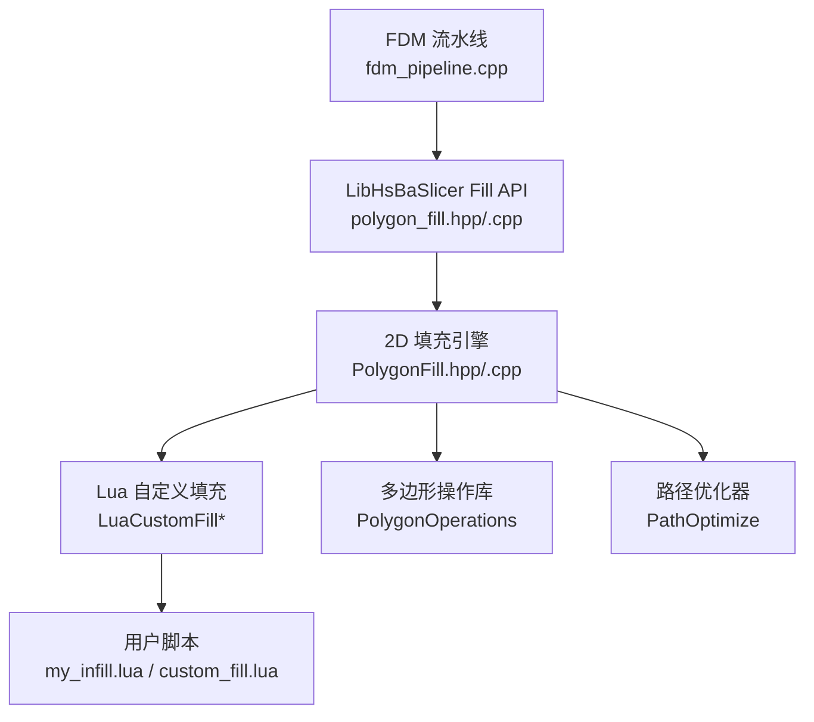
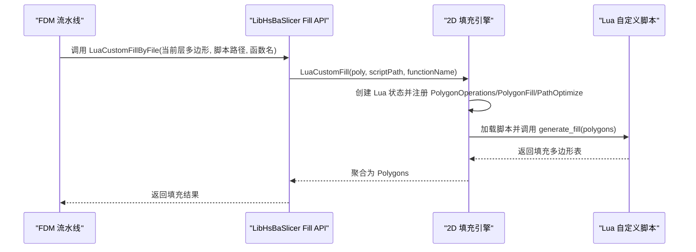
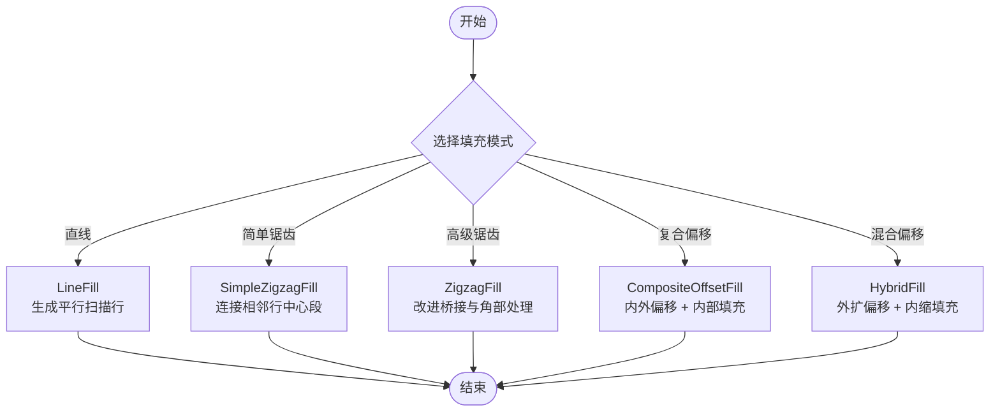
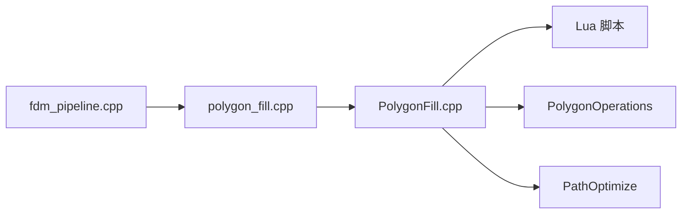

# 内置阶段 - 填充生成

<cite>
**本文引用的文件**   
- [2D/PolygonFill.hpp](file://2D/PolygonFill.hpp)
- [2D/PolygonFill.cpp](file://2D/PolygonFill.cpp)
- [LibHsBaSlicer/Fill/polygon_fill.hpp](file://LibHsBaSlicer/Fill/polygon_fill.hpp)
- [LibHsBaSlicer/Fill/polygon_fill.cpp](file://LibHsBaSlicer/Fill/polygon_fill.cpp)
- [types/hsba_pipeline.d.lua](file://types/hsba_pipeline.d.lua)
- [samples/FDM/scripts/my_infill.lua](file://samples/FDM/scripts/my_infill.lua)
- [tests/PolygonFill/custom_fill.lua](file://tests/PolygonFill/custom_fill.lua)
- [tests/PolygonFill/polygon_fill_test.cpp](file://tests/PolygonFill/polygon_fill_test.cpp)
- [DllHsBaSlicer/fdm_pipeline.cpp](file://DllHsBaSlicer/fdm_pipeline.cpp)
</cite>

## 目录
1. [引言](#引言)
2. [项目结构](#项目结构)
3. [核心组件](#核心组件)
4. [架构总览](#架构总览)
5. [详细组件分析](#详细组件分析)
6. [依赖关系分析](#依赖关系分析)
7. [性能与优化](#性能与优化)
8. [故障排除指南](#故障排除指南)
9. [结论](#结论)
10. [附录](#附录)

## 引言
本文面向 FDM 填充生成阶段的脚本环境与内置算法，目标是帮助开发者理解并扩展 generate_fill(polys) 的接口规范、FillOptions 配置项、PolygonOperations 与 PolygonFill 库的使用方式，以及多种填充模式的实现与性能优化方法。文档同时给出与内置算法的对比思路，并提供调试与排错建议。

## 项目结构
FDM 填充相关代码主要分布在以下位置：
- 2D 几何与填充算法：2D/PolygonFill.hpp、2D/PolygonFill.cpp
- LibHsBaSlicer 对外 C++ API：LibHsBaSlicer/Fill/polygon_fill.hpp、polygon_fill.cpp
- Lua 类型定义与阶段环境说明：types/hsba_pipeline.d.lua
- FDM 流水线调用入口：DllHsBaSlicer/fdm_pipeline.cpp
- 示例与测试：samples/FDM/scripts/my_infill.lua、tests/PolygonFill/*

**图示来源**
- [DllHsBaSlicer/fdm_pipeline.cpp:320-362](file://DllHsBaSlicer/fdm_pipeline.cpp#L320-L362)
- [LibHsBaSlicer/Fill/polygon_fill.cpp:13-48](file://LibHsBaSlicer/Fill/polygon_fill.cpp#L13-L48)
- [2D/PolygonFill.cpp:1493-1584](file://2D/PolygonFill.cpp#L1493-L1584)

**章节来源**
- [2D/PolygonFill.hpp:1-141](file://2D/PolygonFill.hpp#L1-L141)
- [2D/PolygonFill.cpp:1-800](file://2D/PolygonFill.cpp#L1-L800)
- [LibHsBaSlicer/Fill/polygon_fill.hpp:1-58](file://LibHsBaSlicer/Fill/polygon_fill.hpp#L1-L58)
- [LibHsBaSlicer/Fill/polygon_fill.cpp:1-52](file://LibHsBaSlicer/Fill/polygon_fill.cpp#L1-L52)
- [types/hsba_pipeline.d.lua:198-203](file://types/hsba_pipeline.d.lua#L198-L203)
- [types/hsba_pipeline.d.lua:515-525](file://types/hsba_pipeline.d.lua#L515-L525)
- [samples/FDM/scripts/my_infill.lua:1-89](file://samples/FDM/scripts/my_infill.lua#L1-L89)
- [tests/PolygonFill/custom_fill.lua:1-16](file://tests/PolygonFill/custom_fill.lua#L1-L16)
- [tests/PolygonFill/polygon_fill_test.cpp:500-540](file://tests/PolygonFill/polygon_fill_test.cpp#L500-L540)
- [DllHsBaSlicer/fdm_pipeline.cpp:320-362](file://DllHsBaSlicer/fdm_pipeline.cpp#L320-L362)

## 核心组件
- 填充模式枚举与函数接口：OffsetFill、LineFill、SimpleZigzagFill、ZigzagFill、CompositeOffsetFill、HybridFill、LuaCustomFill/LuaCustomFillString。
- LibHsBaSlicer 封装：FillPolygon、FillWithBorder、LuaCustomFillByFile。
- Lua 类型定义：FillOptions、PolygonOperations、PolygonFill、PathOptimize、generate_fill 签名。
- FDM 流水线集成：通过 infill_lua_func 与 infill_lua_script 调用用户脚本。

关键职责划分：
- 2D 层负责具体几何算法与 Lua 胶水。
- LibHsBaSlicer 提供稳定 C++ API，并在 Lua 环境中注入 PathOptimize。
- types/hsba_pipeline.d.lua 描述 FillOptions 与 generate_fill 的 IDE 类型提示。
- fdm_pipeline.cpp 将用户脚本与填充流程串联。

**章节来源**
- [2D/PolygonFill.hpp:20-136](file://2D/PolygonFill.hpp#L20-L136)
- [LibHsBaSlicer/Fill/polygon_fill.hpp:17-53](file://LibHsBaSlicer/Fill/polygon_fill.hpp#L17-L53)
- [types/hsba_pipeline.d.lua:198-203](file://types/hsba_pipeline.d.lua#L198-L203)
- [types/hsba_pipeline.d.lua:515-525](file://types/hsba_pipeline.d.lua#L515-L525)
- [DllHsBaSlicer/fdm_pipeline.cpp:320-362](file://DllHsBaSlicer/fdm_pipeline.cpp#L320-L362)

## 架构总览
下图展示从 FDM 流水线到 2D 填充引擎再到 Lua 自定义脚本的调用链。

**图示来源**
- [DllHsBaSlicer/fdm_pipeline.cpp:320-362](file://DllHsBaSlicer/fdm_pipeline.cpp#L320-L362)
- [LibHsBaSlicer/Fill/polygon_fill.cpp:35-48](file://LibHsBaSlicer/Fill/polygon_fill.cpp#L35-L48)
- [2D/PolygonFill.cpp:1493-1584](file://2D/PolygonFill.cpp#L1493-L1584)

## 详细组件分析

### generate_fill(polys) 接口规范
- 入口函数名：generate_fill（可通过配置覆盖）。
- 输入参数 polys：当前层多边形（已扣除壁厚区域），类型为 Polygons（多边形数组）。
- 返回值：填充多边形表（Polygons），每个元素为一个多边形或折线。
- 可用库：PolygonOperations、PolygonFill、PathOptimize。
- 注意：胶水以函数参数传入 polys，不使用全局变量；层号与配置在 Fill 阶段不可用。

IDE 类型定义中明确：
- 入口函数：generate_fill(current_layer)
- 参数：current_layer 为 Polygons
- 返回：Polygons

**章节来源**
- [types/hsba_pipeline.d.lua:515-525](file://types/hsba_pipeline.d.lua#L515-L525)
- [samples/FDM/scripts/my_infill.lua:1-20](file://samples/FDM/scripts/my_infill.lua#L1-L20)
- [tests/PolygonFill/custom_fill.lua:1-16](file://tests/PolygonFill/custom_fill.lua#L1-L16)

### FillOptions 配置选项
FillOptions 用于 HsBa.fill(polys, options) 等高层调用，字段如下：
- spacing：填充间距，默认 0.4
- mode：填充模式，可选 "line"|"zigzag"|"simpleZigzag"，默认 "zigzag"
- angle：填充角度（度），默认 45.0
- borderCount：壁厚圈数，默认 0

这些字段与底层 FillMode 和 LineFill/SimpleZigzagFill/ZigzagFill 的参数对应。

**章节来源**
- [types/hsba_pipeline.d.lua:198-203](file://types/hsba_pipeline.d.lua#L198-L203)
- [2D/PolygonFill.hpp:27-58](file://2D/PolygonFill.hpp#L27-L58)
- [LibHsBaSlicer/Fill/polygon_fill.cpp:13-33](file://LibHsBaSlicer/Fill/polygon_fill.cpp#L13-L33)

### PolygonOperations 与 PolygonFill 库使用
- PolygonOperations：提供布尔运算（union/intersection/difference/xor）、偏移（offsetOperation）、凸包/凹包、面积计算、基础图形构造（矩形、圆、椭圆、正多边形）等。
- PolygonFill：提供 offsetFill、lineFill、simpleZigzagFill、zigzagFill、compositeOffsetFill、hybridFill、offsetOnly 等填充函数。
- 在 Lua 自定义脚本中可直接调用这些函数进行裁剪、偏移、组合等操作。

示例参考：
- my_infill.lua 使用 PO.intersection 将平行线与轮廓做交集，得到有效填充区域。
- tests/PolygonFill/custom_fill.lua 返回两条对角线作为填充折线。

**章节来源**
- [types/hsba_pipeline.d.lua:35-62](file://types/hsba_pipeline.d.lua#L35-L62)
- [samples/FDM/scripts/my_infill.lua:18-87](file://samples/FDM/scripts/my_infill.lua#L18-L87)
- [tests/PolygonFill/custom_fill.lua:7-13](file://tests/PolygonFill/custom_fill.lua#L7-L13)

### 多种填充模式实现示例
- 直线填充（LineFill）：按角度生成平行扫描行，输出独立线段集合。
- 简单锯齿形填充（SimpleZigzagFill）：连接相邻扫描行的中心段，形成蛇形路径。
- 高级锯齿形填充（ZigzagFill）：改进角部处理与桥接逻辑，避免穿越空洞。
- 复合偏移填充（CompositeOffsetFill）：对原始多边形进行内外偏移，并对各偏移层应用内部填充。
- 混合填充（HybridFill）：先应用外扩偏移，再向内偏移至某一层后对剩余区域填充。

**图示来源**
- [2D/PolygonFill.cpp:44-160](file://2D/PolygonFill.cpp#L44-L160)
- [2D/PolygonFill.cpp:543-800](file://2D/PolygonFill.cpp#L543-L800)
- [2D/PolygonFill.cpp:803-1370](file://2D/PolygonFill.cpp#L803-L1370)
- [2D/PolygonFill.cpp:1372-1491](file://2D/PolygonFill.cpp#L1372-L1491)

**章节来源**
- [2D/PolygonFill.hpp:27-102](file://2D/PolygonFill.hpp#L27-L102)
- [2D/PolygonFill.cpp:44-160](file://2D/PolygonFill.cpp#L44-L160)
- [2D/PolygonFill.cpp:543-800](file://2D/PolygonFill.cpp#L543-L800)
- [2D/PolygonFill.cpp:803-1370](file://2D/PolygonFill.cpp#L803-L1370)
- [2D/PolygonFill.cpp:1372-1491](file://2D/PolygonFill.cpp#L1372-L1491)

### 自定义填充算法开发指南
- 编写 generate_fill(poly) 函数，接收当前层多边形并返回填充多边形表。
- 使用 PolygonOperations 进行几何操作（如 intersection、offsetOperation）。
- 使用 PolygonFill 提供的内置函数快速生成常见填充模式。
- 使用 PathOptimize 优化路径顺序以减少空行程。

示例要点：
- my_infill.lua 计算边界框、生成平行线、与轮廓求交。
- custom_fill.lua 直接返回两条对角线。
- tests/PolygonFill/polygon_fill_test.cpp 验证 Lua 环境中 PathOptimize 可用。

**章节来源**
- [samples/FDM/scripts/my_infill.lua:20-87](file://samples/FDM/scripts/my_infill.lua#L20-L87)
- [tests/PolygonFill/custom_fill.lua:7-13](file://tests/PolygonFill/custom_fill.lua#L7-L13)
- [tests/PolygonFill/polygon_fill_test.cpp:500-540](file://tests/PolygonFill/polygon_fill_test.cpp#L500-L540)

## 依赖关系分析
- FDM 流水线通过 infill_lua_func 与 infill_lua_script 调用用户脚本。
- LibHsBaSlicer 的 LuaCustomFillByFile 在 Lua 环境中注册 PolygonOperations、PolygonFill 与 PathOptimize。
- 2D 填充引擎提供核心算法与 Lua 胶水，支持字符串脚本与文件脚本两种加载方式。

**图示来源**
- [DllHsBaSlicer/fdm_pipeline.cpp:320-362](file://DllHsBaSlicer/fdm_pipeline.cpp#L320-L362)
- [LibHsBaSlicer/Fill/polygon_fill.cpp:35-48](file://LibHsBaSlicer/Fill/polygon_fill.cpp#L35-L48)
- [2D/PolygonFill.cpp:1493-1584](file://2D/PolygonFill.cpp#L1493-L1584)

**章节来源**
- [DllHsBaSlicer/fdm_pipeline.cpp:320-362](file://DllHsBaSlicer/fdm_pipeline.cpp#L320-L362)
- [LibHsBaSlicer/Fill/polygon_fill.cpp:35-48](file://LibHsBaSlicer/Fill/polygon_fill.cpp#L35-L48)
- [2D/PolygonFill.cpp:1493-1584](file://2D/PolygonFill.cpp#L1493-L1584)

## 性能与优化
- 扫描行生成（LineFilling）：通过投影与矩形裁剪计算扫描行，复杂度与扫描行数及多边形顶点数相关。
- 锯齿形填充（SimpleZigzagFill/ZigzagFill）：包含二分查找与连通分量合并，需关注点在内判断与桥接逻辑的性能。
- 偏移填充（OffsetFill/CompositeOffsetFill/HybridFill）：多次 Offset 操作可能带来较大开销，应合理设置 outwardCount/inwardCount 与 offsetStep。
- 路径优化：使用 PathOptimize.optimizeRegions/optimizePolygons 减少空行程，提升打印效率。

优化建议：
- 调整 spacing 与 lineThickness 平衡填充密度与计算量。
- 对复杂形状优先使用 HybridFill 或 CompositeOffsetFill 控制边界质量。
- 在 Lua 脚本中先用 PolygonOperations 裁剪无效区域，再调用填充函数。
- 使用 PathOptimize 对生成的路径进行顺序优化。

**章节来源**
- [2D/PolygonFill.cpp:44-160](file://2D/PolygonFill.cpp#L44-L160)
- [2D/PolygonFill.cpp:543-800](file://2D/PolygonFill.cpp#L543-L800)
- [2D/PolygonFill.cpp:803-1370](file://2D/PolygonFill.cpp#L803-L1370)
- [2D/PolygonFill.cpp:1372-1491](file://2D/PolygonFill.cpp#L1372-L1491)
- [tests/PolygonFill/polygon_fill_test.cpp:500-540](file://tests/PolygonFill/polygon_fill_test.cpp#L500-L540)

## 故障排除指南
常见问题与定位方法：
- Lua 脚本未返回表：检查 generate_fill 是否返回 Polygons 表。
- 找不到函数名：确认 infill_lua_func 与脚本中函数名一致。
- PathOptimize 不可用：确保通过 LuaCustomFillByFile 加载脚本，该入口会注册 PathOptimize。
- 填充结果为空：检查 spacing 是否为正，多边形是否有效。

调试技巧：
- 使用 tests/PolygonFill/custom_fill.lua 的最小化脚本验证环境。
- 在 Lua 脚本中输出中间结果（如边界框、扫描线数量）辅助定位。
- 使用 tests/PolygonFill/polygon_fill_test.cpp 中的断言用例验证顶点是否在轮廓内。

**章节来源**
- [2D/PolygonFill.cpp:1493-1584](file://2D/PolygonFill.cpp#L1493-L1584)
- [tests/PolygonFill/polygon_fill_test.cpp:500-540](file://tests/PolygonFill/polygon_fill_test.cpp#L500-L540)
- [tests/PolygonFill/custom_fill.lua:1-16](file://tests/PolygonFill/custom_fill.lua#L1-L16)

## 结论
FDM 填充生成阶段提供了丰富的内置算法与灵活的 Lua 扩展能力。开发者可通过 FillOptions 配置常用参数，使用 PolygonOperations 与 PolygonFill 库构建自定义填充策略，并结合 PathOptimize 优化路径顺序。理解 generate_fill(polys) 的接口规范与数据流，有助于高效开发与调试填充算法。

## 附录
- 内置填充函数签名与行为参见 2D/PolygonFill.hpp 与 2D/PolygonFill.cpp。
- LibHsBaSlicer 对外 API 参见 LibHsBaSlicer/Fill/polygon_fill.hpp 与 polygon_fill.cpp。
- Lua 类型定义与阶段环境参见 types/hsba_pipeline.d.lua。
- 示例脚本参见 samples/FDM/scripts/my_infill.lua 与 tests/PolygonFill/custom_fill.lua。