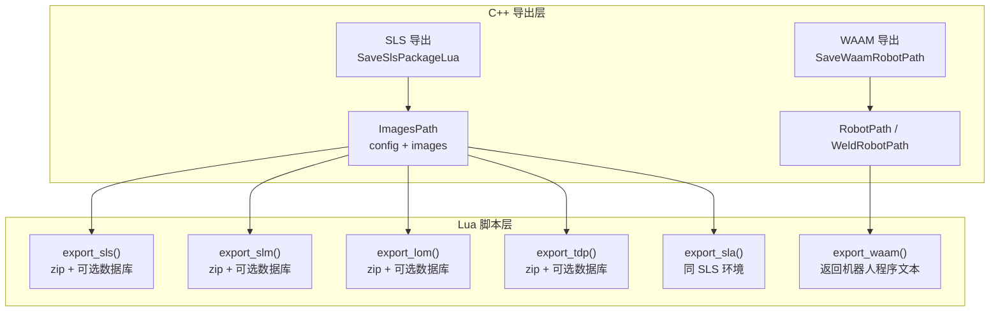
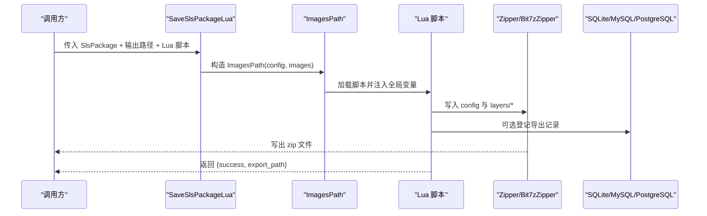
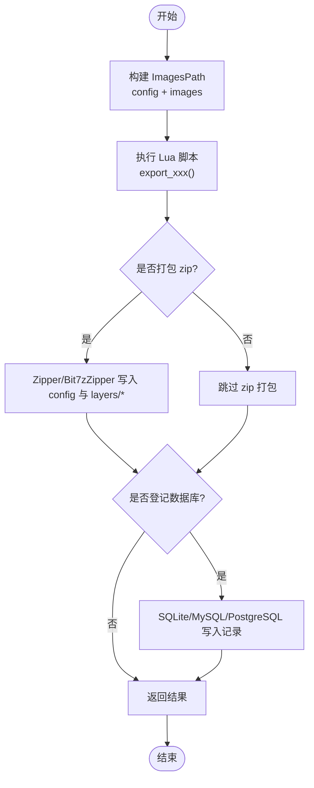
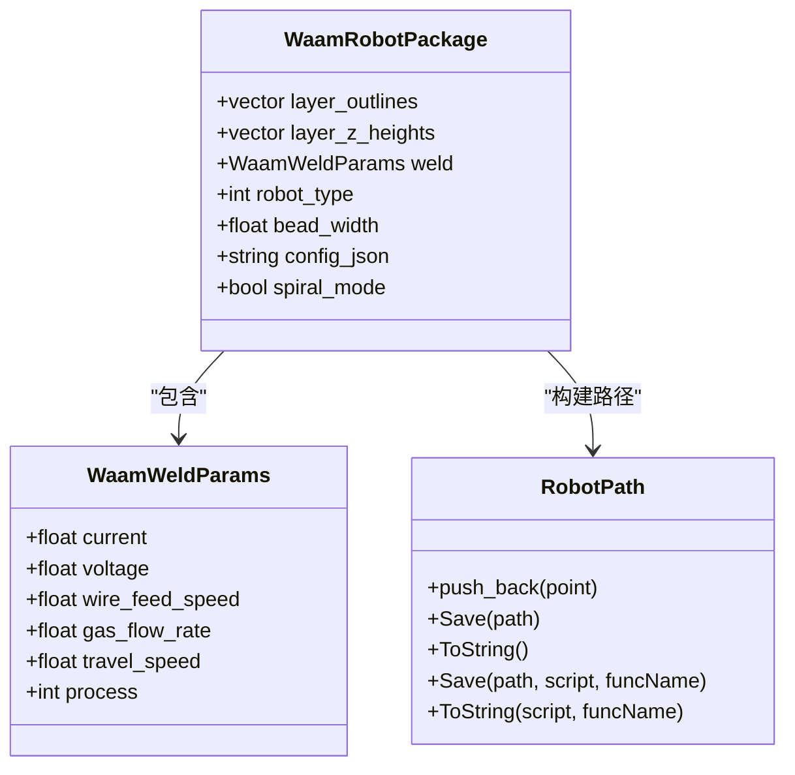
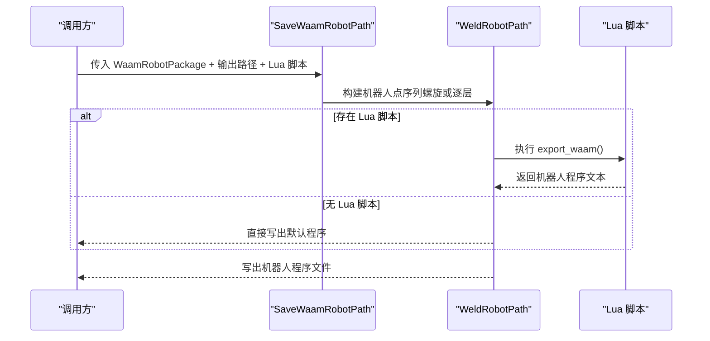
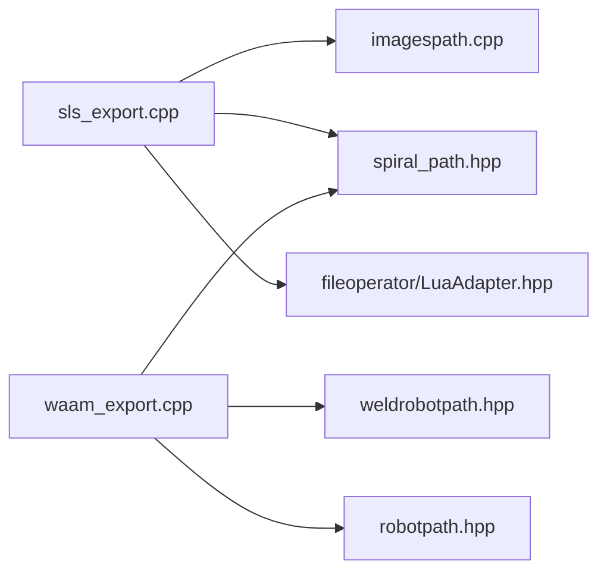

# 内置阶段 - 导出阶段

<cite>
**本文引用的文件**   
- [hsba_pipeline.d.lua](file://types/hsba_pipeline.d.lua)
- [sls_export.hpp](file://LibHsBaSlicer/Path/sls_export.hpp)
- [sls_export.cpp](file://LibHsBaSlicer/Path/sls_export.cpp)
- [imagespath.hpp](file://paths/imagespath.hpp)
- [imagespath.cpp](file://paths/imagespath.cpp)
- [waam_export.hpp](file://LibHsBaSlicer/Path/waam_export.hpp)
- [waam_export.cpp](file://LibHsBaSlicer/Path/waam_export.cpp)
- [robotpath.hpp](file://paths/robotpath.hpp)
- [robotpath.cpp](file://paths/robotpath.cpp)
- [my_sls_export.lua](file://samples/SLS/scripts/my_sls_export.lua)
- [my_slm_export.lua](file://samples/SLM/scripts/my_slm_export.lua)
- [my_lom_export.lua](file://samples/LOM/scripts/my_lom_export.lua)
- [my_tdp_export.lua](file://samples/TDP/scripts/my_tdp_export.lua)
- [my_waam_path.lua](file://samples/WAAM/scripts/my_waam_path.lua)
</cite>

## 目录
1. [引言](#引言)
2. [项目结构](#项目结构)
3. [核心组件](#核心组件)
4. [架构总览](#架构总览)
5. [详细组件分析](#详细组件分析)
6. [依赖关系分析](#依赖关系分析)
7. [性能考虑](#性能考虑)
8. [故障排除指南](#故障排除指南)
9. [结论](#结论)
10. [附录](#附录)

## 引言
本页面聚焦于 HsBaSlicer 的“导出阶段”内置脚本环境，覆盖 SLS、SLM、LOM、TDP、SLA 与 WAAM 六类导出流程。文档将详细说明以下导出入口函数及其 Lua 环境：
- export_sls()
- export_slm()
- export_lom()
- export_tdp()
- export_sla()
- export_waam()

同时解释 ExportConfig、ExportImage、WaamPoint 等数据结构，以及 images、funcName、header、startProgramFunc、endProgramFunc、points 等全局变量的使用方式。最后给出基于 Zipper、Bit7zZipper、Cipher、SQLiteAdapter、MySQLAdapter、PostgreSQLAdapter 的文件操作与数据持久化示例，并总结错误处理与性能优化技巧。

## 项目结构
导出阶段的实现由 C++ 层（库接口）与 Lua 脚本层共同组成：
- C++ 层提供导出包类型、图像/机器人路径输出抽象、Lua 环境注入与打包逻辑。
- Lua 层提供各工艺导出的具体实现，负责写入 zip、可选数据库登记或生成机器人程序文本。

**图表来源**
- [sls_export.cpp:79-133](file://LibHsBaSlicer/Path/sls_export.cpp#L79-L133)
- [imagespath.cpp:49-203](file://paths/imagespath.cpp#L49-L203)
- [waam_export.cpp:61-179](file://LibHsBaSlicer/Path/waam_export.cpp#L61-L179)
- [robotpath.cpp:139-210](file://paths/robotpath.cpp#L139-L210)

**章节来源**
- [sls_export.hpp:17-56](file://LibHsBaSlicer/Path/sls_export.hpp#L17-L56)
- [imagespath.hpp:16-61](file://paths/imagespath.hpp#L16-L61)
- [waam_export.hpp:17-72](file://LibHsBaSlicer/Path/waam_export.hpp#L17-L72)
- [robotpath.hpp:15-104](file://paths/robotpath.hpp#L15-L104)

## 核心组件
本节梳理导出阶段的关键 API 与数据结构。

### 导出入口函数与环境
- export_sls()、export_slm()、export_lom()、export_tdp()、export_sla()
  - 运行在 ImagesPath 提供的 Lua 环境中。
  - 可用全局变量：
    - config: { path, configStr }
    - images: [{ path, data }]
    - output_path: 字符串
    - funcName: 字符串（用于指定导出函数名）
  - 返回值约定：必须返回 table 或 nil；若返回字符串会覆盖已写出的 zip 文件。
- export_waam()
  - 运行在 RobotPath 提供的 Lua 环境中。
  - 可用全局变量：
    - header: 头部说明
    - startProgramFunc: 起始程序名
    - endProgramFunc: 结束程序名
    - points: [{ end:{x,y,z}, middle:{x,y,z}, velocity, type }]
  - 返回值约定：返回完整机器人程序文本字符串。

**章节来源**
- [hsba_pipeline.d.lua:547-623](file://types/hsba_pipeline.d.lua#L547-L623)
- [imagespath.cpp:129-203](file://paths/imagespath.cpp#L129-L203)
- [robotpath.cpp:139-210](file://paths/robotpath.cpp#L139-L210)

### 关键数据结构
- ExportConfig
  - path: 配置文件名（如 "config.json"）
  - configStr: JSON 配置内容
- ExportImage
  - path: 文件名（如 "layers/N.json"）
  - data: 多边形 JSON 数据
- WaamWeldParams
  - current, voltage, wire_feed_speed, gas_flow_rate, travel_speed, process
- WaamRobotPackage
  - layer_outlines, layer_z_heights, weld, robot_type, bead_width, config_json, spiral_mode
- WaamPoint（Lua 侧）
  - end: {x,y,z}
  - middle: {x,y,z}
  - velocity: number
  - type: "MoveJ"|"MoveL"

**章节来源**
- [hsba_pipeline.d.lua:547-619](file://types/hsba_pipeline.d.lua#L547-L619)
- [waam_export.hpp:23-52](file://LibHsBaSlicer/Path/waam_export.hpp#L23-L52)

### 工具库与适配器
- Zipper
  - AddByteFile(name, data), AddFile(name, filePath), Save(path)
- Bit7zZipper（需编译启用 HSBA_USE_BIT7Z）
  - 同上接口，支持 7z 压缩
- Cipher
  - base64_encode/decode, hex_encode/decode
- SQLiteAdapter
  - new(), Connect(path), Execute(sql), Query(sql), Insert(table, data), Update(table, data, where), Delete(table, where), CreateTable(sql)
- MySQLAdapter（需编译启用 HSBA_USE_MYSQL）
  - new(), Connect(host, user, pass, db, port?), ...
- PostgreSQLAdapter（需编译启用 HSBA_USE_PGSQL）
  - new(), Connect(host, user, pass, db, port?), ...

**章节来源**
- [hsba_pipeline.d.lua:107-175](file://types/hsba_pipeline.d.lua#L107-L175)

## 架构总览
导出阶段整体分为两条主线：
- 图像型导出（SLS/SLM/LOM/TDP/SLA）：通过 ImagesPath 将 config 与 images 打包为 zip，并由 Lua 脚本决定最终归档内容与数据库登记。
- 机器人路径导出（WAAM）：通过 RobotPath/WeldRobotPath 构建机器人指令序列，再由 Lua 脚本生成目标控制器语言程序文本。

**图表来源**
- [sls_export.cpp:79-133](file://LibHsBaSlicer/Path/sls_export.cpp#L79-L133)
- [imagespath.cpp:129-203](file://paths/imagespath.cpp#L129-L203)

## 详细组件分析

### SLS/SLM/LOM/TDP/SLA 导出（图像型）
- C++ 层
  - SlsPackage 包含层轮廓、层高、JSON 配置与可选螺旋模式。
  - SaveSlsPackageLua 将每层多边形序列化为 JSON，并通过 ImagesPath.Save 执行 Lua 脚本。
- Lua 层
  - export_sls/export_slm/export_lom/export_tdp/export_sla 均遵循相同环境：
    - 使用 Zipper/Bit7zZipper 将 config 与 images 打包为 zip。
    - 可调用 SQLiteAdapter/MySQLAdapter/PostgreSQLAdapter 登记导出历史。
    - 必须返回 table{success, export_path} 或 nil。

**图表来源**
- [sls_export.cpp:79-133](file://LibHsBaSlicer/Path/sls_export.cpp#L79-L133)
- [imagespath.cpp:49-203](file://paths/imagespath.cpp#L49-L203)

**章节来源**
- [sls_export.hpp:17-56](file://LibHsBaSlicer/Path/sls_export.hpp#L17-L56)
- [sls_export.cpp:26-133](file://LibHsBaSlicer/Path/sls_export.cpp#L26-L133)
- [imagespath.cpp:49-203](file://paths/imagespath.cpp#L49-L203)
- [my_sls_export.lua:23-79](file://samples/SLS/scripts/my_sls_export.lua#L23-L79)
- [my_slm_export.lua:15-34](file://samples/SLM/scripts/my_slm_export.lua#L15-L34)
- [my_lom_export.lua:10-35](file://samples/LOM/scripts/my_lom_export.lua#L10-L35)
- [my_tdp_export.lua:15-62](file://samples/TDP/scripts/my_tdp_export.lua#L15-L62)

### WAAM 导出（机器人路径）
- C++ 层
  - WaamRobotPackage 携带层轮廓、层高、焊接参数、机器人品牌、焊道宽度、配置 JSON 与螺旋模式。
  - SaveWaamRobotPath 根据螺旋模式或逐层轮廓构建 WeldRobotPath，并可选择执行 Lua 脚本进行后处理。
- Lua 层
  - export_waam() 接收 header、startProgramFunc、endProgramFunc、points，返回机器人程序文本。

**图表来源**
- [waam_export.hpp:23-52](file://LibHsBaSlicer/Path/waam_export.hpp#L23-L52)
- [robotpath.hpp:44-104](file://paths/robotpath.hpp#L44-L104)

**图表来源**
- [waam_export.cpp:61-179](file://LibHsBaSlicer/Path/waam_export.cpp#L61-L179)
- [robotpath.cpp:139-210](file://paths/robotpath.cpp#L139-L210)

**章节来源**
- [waam_export.hpp:17-72](file://LibHsBaSlicer/Path/waam_export.hpp#L17-L72)
- [waam_export.cpp:61-179](file://LibHsBaSlicer/Path/waam_export.cpp#L61-L179)
- [robotpath.hpp:15-104](file://paths/robotpath.hpp#L15-L104)
- [robotpath.cpp:139-210](file://paths/robotpath.cpp#L139-L210)
- [my_waam_path.lua:17-45](file://samples/WAAM/scripts/my_waam_path.lua#L17-L45)

## 依赖关系分析
- ImagesPath 依赖：
  - fileoperator/LuaAdapter（注册 Zipper、Bit7zZipper）
  - cipher/LuaAdapter（注册 Cipher）
  - fileoperator/bit7z_zipper、fileoperator/zipper（压缩实现）
- SLS 导出依赖：
  - paths/imagespath（图像包）
  - spiral_path（可选螺旋路径）
  - fileoperator/LuaAdapter（注册 SQL 适配器）
- WAAM 导出依赖：
  - paths/weldrobotpath（机器人路径）
  - spiral_path（螺旋模式）
  - paths/robotpath（通用机器人路径抽象）

**图表来源**
- [sls_export.cpp:14-18](file://LibHsBaSlicer/Path/sls_export.cpp#L14-L18)
- [waam_export.cpp:11-13](file://LibHsBaSlicer/Path/waam_export.cpp#L11-L13)
- [imagespath.cpp:15-19](file://paths/imagespath.cpp#L15-L19)

**章节来源**
- [sls_export.cpp:14-18](file://LibHsBaSlicer/Path/sls_export.cpp#L14-L18)
- [waam_export.cpp:11-13](file://LibHsBaSlicer/Path/waam_export.cpp#L11-L13)
- [imagespath.cpp:15-19](file://paths/imagespath.cpp#L15-L19)

## 性能考虑
- 压缩器选择
  - 默认 Zipper 适用于大多数场景；当需要更高压缩率或兼容 7z 时，可使用 Bit7zZipper（需编译启用 HSBA_USE_BIT7Z）。
- 大文件与内存占用
  - ImagesPath.AddImage 以字符串形式存储 image_str，建议在 Lua 中避免重复拼接大字符串；必要时分块写入或使用 Bit7zZipper 的流式能力（如果后端支持）。
- 数据库登记
  - 数据库登记失败不应阻断主流程；建议使用 pcall 包裹 SQL 操作，并在失败时仅记录警告。
- 螺旋模式
  - 当 spiral_mode=true 且每层至少有一个闭合轮廓时，可将外层壁合并为连续上升焊道，减少机器人抬刀与电弧中断次数，提升效率。

[本节为通用指导，不直接分析具体文件]

## 故障排除指南
- Lua 脚本返回字符串覆盖 zip
  - 现象：导出 zip 被覆盖为脚本返回的字符串内容。
  - 原因：图像型导出脚本返回了字符串而非 table/nil。
  - 解决：确保 export_sls/export_slm/export_lom/export_tdp/export_sla 返回 table{success, export_path} 或 nil。
- Lua 加载或运行时错误
  - 现象：抛出 RuntimeError，提示 Lua load error 或 runtime error。
  - 原因：脚本语法错误或运行时异常。
  - 解决：检查脚本语法与全局变量是否存在；使用 pcall 捕获异常并打印错误信息。
- 数据库连接失败
  - 现象：SQLite/MySQL/PostgreSQL 连接或执行失败。
  - 原因：驱动未编译启用、连接参数错误或权限不足。
  - 解决：确认编译选项（HSBA_USE_MYSQL、HSBA_USE_PGSQL），检查连接参数与表结构。
- WAAM 螺旋模式退化
  - 现象：spiral_mode=true 但未生成螺旋路径，回退到逐层沉积。
  - 原因：某一层没有闭合轮廓或轮廓点数不足。
  - 解决：确保每层至少有一个闭合轮廓，且点数足够。

**章节来源**
- [imagespath.cpp:102-127](file://paths/imagespath.cpp#L102-L127)
- [imagespath.cpp:178-203](file://paths/imagespath.cpp#L178-L203)
- [waam_export.cpp:67-75](file://LibHsBaSlicer/Path/waam_export.cpp#L67-L75)
- [waam_export.cpp:181-188](file://LibHsBaSlicer/Path/waam_export.cpp#L181-L188)

## 结论
导出阶段通过 C++ 层提供稳定的数据包与 Lua 环境，使不同工艺（SLS/SLM/LOM/TDP/SLA/WAAM）能够以统一的方式完成文件打包与机器人代码生成。脚本作者只需关注业务逻辑：如何组织 config 与 images，如何使用 Zipper/Cipher/SQL 适配器，以及如何生成目标机器人程序文本。遵循返回值约定与错误处理最佳实践，可获得稳定高效的导出体验。

[本节为总结性内容，不直接分析具体文件]

## 附录

### 完整实现示例索引
- SLS 层图打包与数据库登记
  - [my_sls_export.lua:23-79](file://samples/SLS/scripts/my_sls_export.lua#L23-L79)
- SLM 金属工艺参数归档
  - [my_slm_export.lua:15-34](file://samples/SLM/scripts/my_slm_export.lua#L15-L34)
- LOM 板材轮廓归档
  - [my_lom_export.lua:10-35](file://samples/LOM/scripts/my_lom_export.lua#L10-L35)
- TDP 粘结剂喷射轮廓归档
  - [my_tdp_export.lua:15-62](file://samples/TDP/scripts/my_tdp_export.lua#L15-L62)
- WAAM 机器人代码生成
  - [my_waam_path.lua:17-45](file://samples/WAAM/scripts/my_waam_path.lua#L17-L45)

**章节来源**
- [my_sls_export.lua:23-79](file://samples/SLS/scripts/my_sls_export.lua#L23-L79)
- [my_slm_export.lua:15-34](file://samples/SLM/scripts/my_slm_export.lua#L15-L34)
- [my_lom_export.lua:10-35](file://samples/LOM/scripts/my_lom_export.lua#L10-L35)
- [my_tdp_export.lua:15-62](file://samples/TDP/scripts/my_tdp_export.lua#L15-L62)
- [my_waam_path.lua:17-45](file://samples/WAAM/scripts/my_waam_path.lua#L17-L45)