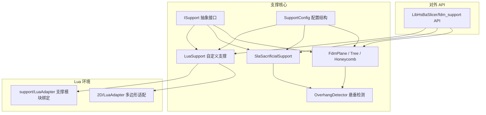
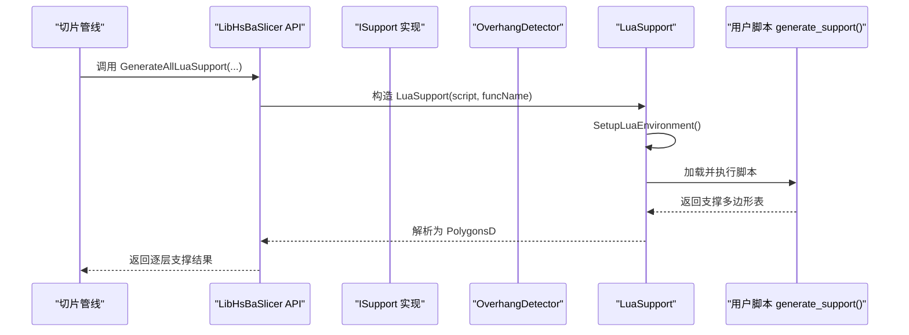
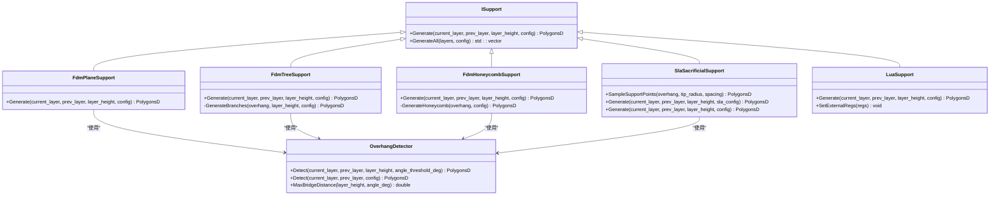
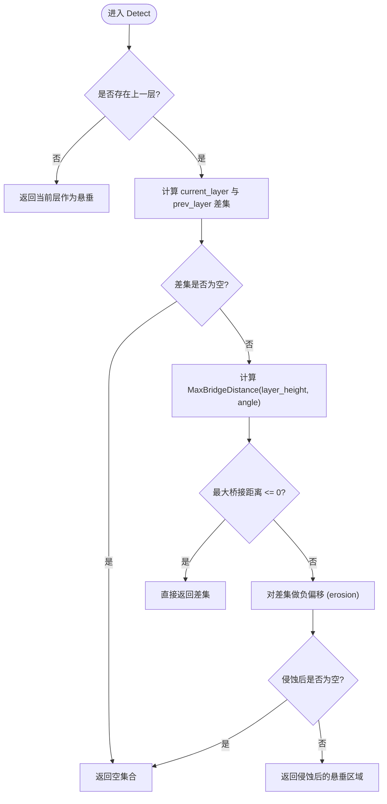
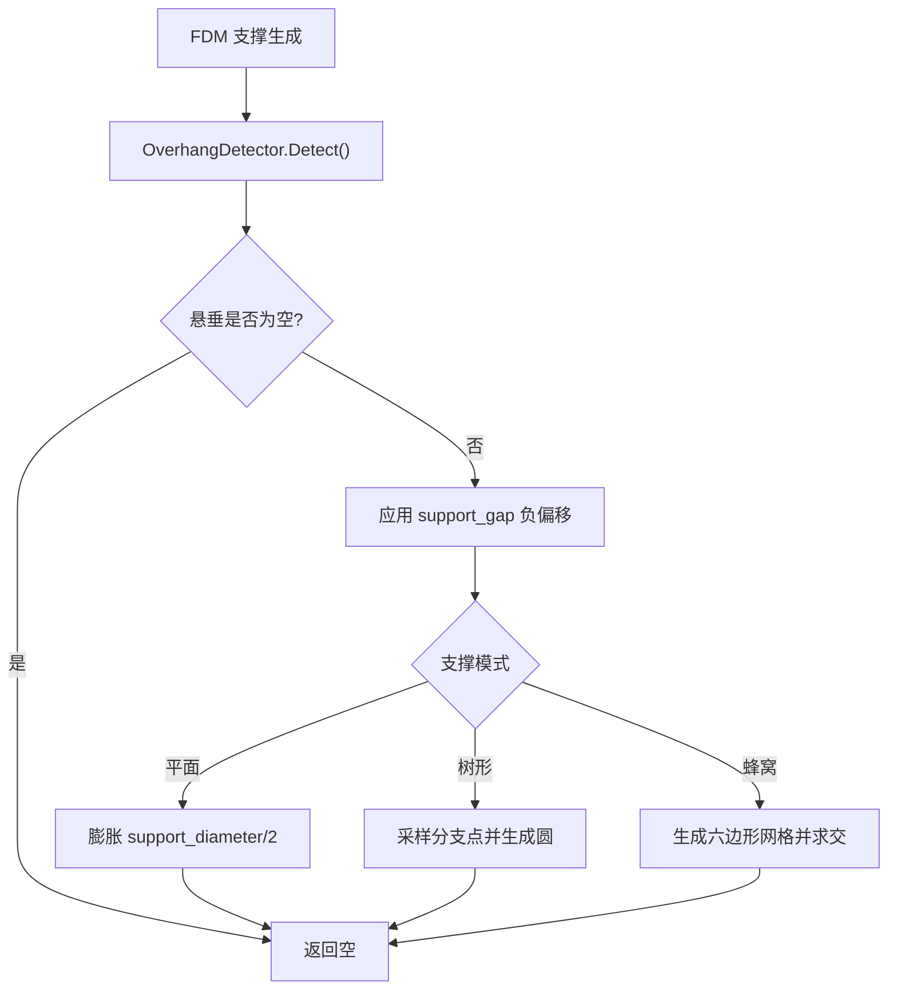
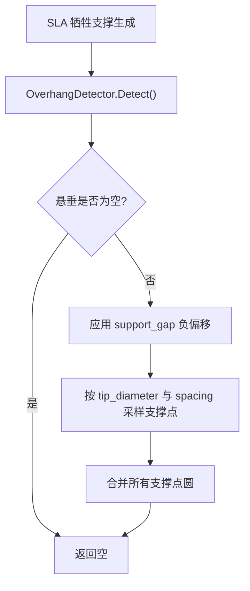
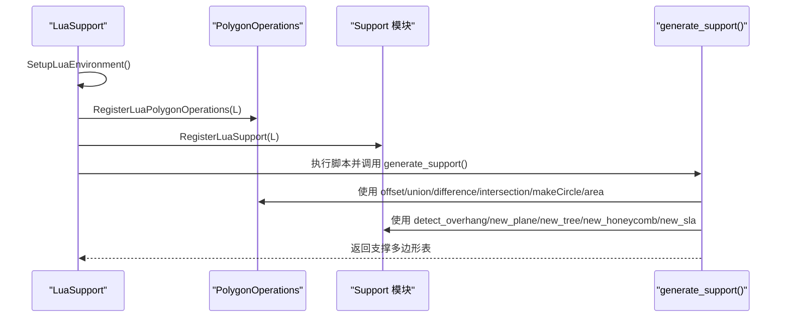
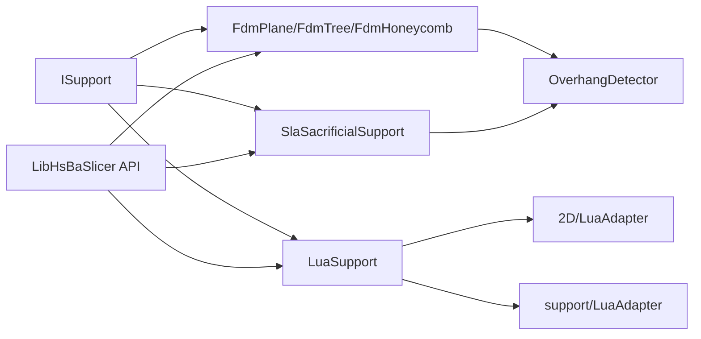

# 内置阶段 - 支撑生成

<cite>
**本文引用的文件**   
- [support/SupportConfig.hpp](file://support/SupportConfig.hpp)
- [support/ISupport.hpp](file://support/ISupport.hpp)
- [support/LuaSupport.hpp](file://support/LuaSupport.hpp)
- [support/LuaSupport.cpp](file://support/LuaSupport.cpp)
- [support/FdmSupport.hpp](file://support/FdmSupport.hpp)
- [support/FdmSupport.cpp](file://support/FdmSupport.cpp)
- [support/SlaSupport.cpp](file://support/SlaSupport.cpp)
- [support/OverhangDetector.hpp](file://support/OverhangDetector.hpp)
- [support/OverhangDetector.cpp](file://support/OverhangDetector.cpp)
- [2D/LuaAdapter.hpp](file://2D/LuaAdapter.hpp)
- [support/LuaAdapter.hpp](file://support/LuaAdapter.hpp)
- [LibHsBaSlicer/support/fdm_support.hpp](file://LibHsBaSlicer/support/fdm_support.hpp)
- [LibHsBaSlicer/support/fdm_support.cpp](file://LibHsBaSlicer/support/fdm_support.cpp)
- [samples/SLA/scripts/my_sla_support.lua](file://samples/SLA/scripts/my_sla_support.lua)
- [docs/en/lua_pipeline_api.md](file://docs/en/lua_pipeline_api.md)
</cite>

## 目录
1. [引言](#引言)
2. [项目结构](#项目结构)
3. [核心组件](#核心组件)
4. [架构总览](#架构总览)
5. [详细组件分析](#详细组件分析)
6. [依赖关系分析](#依赖关系分析)
7. [性能与调试建议](#性能与调试建议)
8. [常见问题排查](#常见问题排查)
9. [结论](#结论)

## 引言
本文面向 FDM 与 SLA 切片流水线中的“支撑生成”内置阶段，系统性说明：
- 支撑生成器的统一接口 `ISupport::Generate`。
- Lua 自定义支撑脚本环境，包括全局变量 `current_layer`、`prev_layer`、`layer_height`、`config`。
- 约定入口函数 `generate_support()` 的调用契约。
- `SupportConfig` 配置结构的完整字段语义。
- 悬垂检测机制与 FDM/SLA 支撑策略。
- 如何在自定义脚本中使用 `PolygonOperations` 与路径优化能力实现复杂支撑逻辑。
- 调试技巧与性能优化建议。

## 项目结构
支撑相关代码主要位于 `support/` 目录，并通过 `LibHsBaSlicer/support/fdm_support.*` 暴露 C++ API；Lua 脚本支撑环境由 `LuaSupport` 构建，并在 FDM/SLA 管线中通过 `GenerateAllLuaSupport` 驱动。

**图表来源**
- [support/ISupport.hpp:22-44](file://support/ISupport.hpp#L22-L44)
- [support/FdmSupport.hpp:13-42](file://support/FdmSupport.hpp#L13-L42)
- [support/SlaSupport.cpp:38-133](file://support/SlaSupport.cpp#L38-L133)
- [support/LuaSupport.hpp:21-67](file://support/LuaSupport.hpp#L21-L67)
- [support/OverhangDetector.hpp:14-49](file://support/OverhangDetector.hpp#L14-L49)
- [2D/LuaAdapter.hpp:76-81](file://2D/LuaAdapter.hpp#L76-L81)
- [support/LuaAdapter.hpp:13-30](file://support/LuaAdapter.hpp#L13-L30)
- [LibHsBaSlicer/support/fdm_support.hpp:19-67](file://LibHsBaSlicer/support/fdm_support.hpp#L19-L67)

**章节来源**
- [support/ISupport.hpp:22-44](file://support/ISupport.hpp#L22-L44)
- [support/SupportConfig.hpp:14-43](file://support/SupportConfig.hpp#L14-L43)
- [LibHsBaSlicer/support/fdm_support.hpp:19-67](file://LibHsBaSlicer/support/fdm_support.hpp#L19-L67)

## 核心组件
- `ISupport`：定义单层支撑生成接口 `Generate(current_layer, prev_layer, layer_height, config)`，并提供默认的全层迭代实现 `GenerateAll`。
- `SupportConfig`：通用支撑配置，包含悬垂角度阈值、层高、间隙、直径、密度、图案等。
- `FdmPlaneSupport`、`FdmTreeSupport`、`FdmHoneycombSupport`：FDM 平面柱、树形、蜂窝三种支撑策略。
- `SlaSacrificialSupport`：SLA 牺牲型细柱支撑。
- `OverhangDetector`：基于层高与角度阈值的悬垂区域检测。
- `LuaSupport`：支持用户以 Lua 脚本完全替换内置支撑算法，并注入 `current_layer`、`prev_layer`、`layer_height`、`config` 等全局变量。

**章节来源**
- [support/ISupport.hpp:22-44](file://support/ISupport.hpp#L22-L44)
- [support/SupportConfig.hpp:14-43](file://support/SupportConfig.hpp#L14-L43)
- [support/FdmSupport.hpp:13-42](file://support/FdmSupport.hpp#L13-L42)
- [support/SlaSupport.cpp:81-133](file://support/SlaSupport.cpp#L81-L133)
- [support/OverhangDetector.hpp:14-49](file://support/OverhangDetector.hpp#L14-L49)
- [support/LuaSupport.hpp:21-67](file://support/LuaSupport.hpp#L21-L67)

## 架构总览
支撑生成的整体流程如下：
- C++ 管线根据配置选择具体支撑生成器（平面/树/蜂窝/SLA）。
- 每个生成器先调用 `OverhangDetector::Detect` 计算需要支撑的区域。
- 对悬垂区域应用间隙偏移，再按策略生成支撑截面。
- 若启用 Lua 自定义支撑，则通过 `LuaSupport` 创建独立 Lua 状态，注入全局变量与辅助库，执行脚本约定的 `generate_support()` 函数，并收集返回的多边形结果。

**图表来源**
- [LibHsBaSlicer/support/fdm_support.cpp:61-69](file://LibHsBaSlicer/support/fdm_support.cpp#L61-L69)
- [support/LuaSupport.cpp:67-90](file://support/LuaSupport.cpp#L67-L90)
- [support/LuaSupport.cpp:113-177](file://support/LuaSupport.cpp#L113-L177)

**章节来源**
- [LibHsBaSlicer/support/fdm_support.cpp:14-31](file://LibHsBaSlicer/support/fdm_support.cpp#L14-L31)
- [support/LuaSupport.cpp:67-90](file://support/LuaSupport.cpp#L67-L90)
- [support/LuaSupport.cpp:113-177](file://support/LuaSupport.cpp#L113-L177)

## 详细组件分析

### 支撑生成器接口与实现类图

**图表来源**
- [support/ISupport.hpp:22-44](file://support/ISupport.hpp#L22-L44)
- [support/FdmSupport.hpp:13-42](file://support/FdmSupport.hpp#L13-L42)
- [support/FdmSupport.cpp:48-76](file://support/FdmSupport.cpp#L48-L76)
- [support/FdmSupport.cpp:81-168](file://support/FdmSupport.cpp#L81-L168)
- [support/FdmSupport.cpp:173-267](file://support/FdmSupport.cpp#L173-L267)
- [support/SlaSupport.cpp:38-133](file://support/SlaSupport.cpp#L38-L133)
- [support/LuaSupport.hpp:21-67](file://support/LuaSupport.hpp#L21-L67)
- [support/OverhangDetector.hpp:14-49](file://support/OverhangDetector.hpp#L14-L49)

**章节来源**
- [support/ISupport.hpp:22-44](file://support/ISupport.hpp#L22-L44)
- [support/FdmSupport.hpp:13-42](file://support/FdmSupport.hpp#L13-L42)
- [support/SlaSupport.cpp:38-133](file://support/SlaSupport.cpp#L38-L133)
- [support/LuaSupport.hpp:21-67](file://support/LuaSupport.hpp#L21-L67)
- [support/OverhangDetector.hpp:14-49](file://support/OverhangDetector.hpp#L14-L49)

### 悬垂检测机制
悬垂检测的核心逻辑：
- 若无上一层，则当前层全部视为悬垂。
- 否则计算当前层与上一层的差集，得到未支撑区域。
- 根据层高与角度阈值计算最大可桥接距离，并对差集进行负偏移（侵蚀）过滤小悬垂。
- 最终返回需要支撑的多边形集合。

**图表来源**
- [support/OverhangDetector.cpp:23-39](file://support/OverhangDetector.cpp#L23-L39)
- [support/OverhangDetector.cpp:41-87](file://support/OverhangDetector.cpp#L41-L87)

**章节来源**
- [support/OverhangDetector.cpp:23-87](file://support/OverhangDetector.cpp#L23-L87)

### FDM 支撑策略
- 平面支撑：将悬垂区域按 `support_gap` 收缩后，再以 `support_diameter/2` 膨胀形成柱状截面。
- 树形支撑：在悬垂区域内按间距采样点，生成圆形分支尖端，后续层间连接由上层逻辑处理。
- 蜂窝支撑：在悬垂区域内生成平顶六边形网格，并与悬垂区域交集得到支撑截面。

**图表来源**
- [support/FdmSupport.cpp:48-76](file://support/FdmSupport.cpp#L48-L76)
- [support/FdmSupport.cpp:81-168](file://support/FdmSupport.cpp#L81-L168)
- [support/FdmSupport.cpp:173-267](file://support/FdmSupport.cpp#L173-L267)

**章节来源**
- [support/FdmSupport.cpp:48-76](file://support/FdmSupport.cpp#L48-L76)
- [support/FdmSupport.cpp:81-168](file://support/FdmSupport.cpp#L81-L168)
- [support/FdmSupport.cpp:173-267](file://support/FdmSupport.cpp#L173-L267)

### SLA 牺牲支撑策略
SLA 牺牲支撑采用较小尖端直径与较大间距，在悬垂区域内采样支撑点并合并为支撑截面。

**图表来源**
- [support/SlaSupport.cpp:38-79](file://support/SlaSupport.cpp#L38-L79)
- [support/SlaSupport.cpp:81-133](file://support/SlaSupport.cpp#L81-L133)

**章节来源**
- [support/SlaSupport.cpp:38-133](file://support/SlaSupport.cpp#L38-L133)

### Lua 自定义支撑环境与 `generate_support()` 接口规范
- 全局变量：
  - `current_layer`：当前层多边形表。
  - `prev_layer`：上一层多边形表（首层为空）。
  - `layer_height`：层高（mm）。
  - `config`：支撑配置表，字段来自 `SupportConfig`。
- 约定入口函数：`generate_support()`，返回支撑多边形表或设置全局 `support_polys`。
- 可用库：
  - `PolygonOperations`：多边形操作（偏移、并集、差集、交集、圆形生成、面积等）。
  - `Support`：内置支撑生成器封装（新建平面/树/蜂窝/SLA 生成器、检测悬垂、默认配置等）。
  - 外部 2D/3D 函数池：由 C++ 在 `LuaSupport` 初始化时注册。

**图表来源**
- [support/LuaSupport.cpp:67-90](file://support/LuaSupport.cpp#L67-L90)
- [support/LuaSupport.cpp:113-177](file://support/LuaSupport.cpp#L113-L177)
- [2D/LuaAdapter.hpp:76-81](file://2D/LuaAdapter.hpp#L76-L81)
- [support/LuaAdapter.hpp:13-30](file://support/LuaAdapter.hpp#L13-L30)
- [docs/en/lua_pipeline_api.md:219-232](file://docs/en/lua_pipeline_api.md#L219-L232)

**章节来源**
- [support/LuaSupport.hpp:21-67](file://support/LuaSupport.hpp#L21-L67)
- [support/LuaSupport.cpp:67-90](file://support/LuaSupport.cpp#L67-L90)
- [support/LuaSupport.cpp:113-177](file://support/LuaSupport.cpp#L113-L177)
- [2D/LuaAdapter.hpp:76-81](file://2D/LuaAdapter.hpp#L76-L81)
- [support/LuaAdapter.hpp:13-30](file://support/LuaAdapter.hpp#L13-L30)
- [docs/en/lua_pipeline_api.md:219-232](file://docs/en/lua_pipeline_api.md#L219-L232)

### `SupportConfig` 配置结构字段说明
| 字段 | 类型 | 默认值 | 含义 |
|---|---:|---:|---|
| `overhang_angle_threshold` | float | 45.0 | 悬垂角度阈值（度），用于判断是否需要支撑 |
| `layer_height` | float | 0.2 | 层高（mm） |
| `support_gap` | float | 0.5 | 支撑与模型之间的间隙（mm） |
| `support_diameter` | float | 2.0 | 支撑柱直径（mm） |
| `support_density` | float | 0.3 | 支撑填充密度 [0,1] |
| `support_pattern` | int | 0 | 支撑模式：0=平面，1=树形，2=蜂窝 |
| `tree_branch_angle` | float | 30.0 | 树形支撑分支角度（度） |
| `tree_max_branch_radius` | float | 5.0 | 树形支撑最大分支半径（mm） |
| `honeycomb_cell_size` | float | 5.0 | 蜂窝支撑单元尺寸（mm） |

此外还有 FDM 与 SLA 专用扩展：
- `FdmSupportConfig`：增加 `interface_layers`（界面层数）、`interface_density`（界面层密度）。
- `SlaSupportConfig`：增加 `tip_diameter`（支撑尖端直径）、`raft_thickness`（底板厚度）。

**章节来源**
- [support/SupportConfig.hpp:14-43](file://support/SupportConfig.hpp#L14-L43)

### 自定义支撑算法示例思路
以下示例展示如何在 Lua 脚本中组合 `PolygonOperations` 与 `Support` 模块，实现更复杂的支撑逻辑。注意：此处不粘贴具体代码内容，仅给出步骤与参考路径。

- 步骤一：读取全局变量
  - 从 `current_layer`、`prev_layer`、`layer_height`、`config` 获取输入。
  - 参考：[support/LuaSupport.cpp:67-90](file://support/LuaSupport.cpp#L67-L90)

- 步骤二：检测悬垂区域
  - 使用 `Support.detect_overhang(current_layer, prev_layer, layer_height, config.overhang_angle_threshold)`。
  - 参考：[support/LuaAdapter.hpp:13-30](file://support/LuaAdapter.hpp#L13-L30)

- 步骤三：多边形预处理
  - 使用 `offsetOperation` 调整悬垂区域大小。
  - 使用 `union`、`difference`、`intersection` 合并或裁剪支撑区域。
  - 使用 `makeCircle` 生成支撑点或柱体截面。
  - 使用 `area` 评估支撑面积，决定是否生成支撑。
  - 参考：[2D/LuaAdapter.hpp:76-81](file://2D/LuaAdapter.hpp#L76-L81)

- 步骤四：可选地复用内置生成器
  - 使用 `Support.new_plane()`、`new_tree()`、`new_honeycomb()`、`new_sla()` 创建生成器对象。
  - 使用 `Support.generate(obj, current_layer, prev_layer, layer_height, cfg)` 调用内置算法。
  - 参考：[support/LuaAdapter.hpp:13-30](file://support/LuaAdapter.hpp#L13-L30)

- 步骤五：返回结果
  - 在 `generate_support()` 中返回支撑多边形表，或设置全局 `support_polys`。
  - 参考：[support/LuaSupport.cpp:51-65](file://support/LuaSupport.cpp#L51-L65)

- 参考脚本注释：
  - [samples/SLA/scripts/my_sla_support.lua:1-29](file://samples/SLA/scripts/my_sla_support.lua#L1-L29)

**章节来源**
- [support/LuaSupport.cpp:51-65](file://support/LuaSupport.cpp#L51-L65)
- [support/LuaSupport.cpp:67-90](file://support/LuaSupport.cpp#L67-L90)
- [2D/LuaAdapter.hpp:76-81](file://2D/LuaAdapter.hpp#L76-L81)
- [support/LuaAdapter.hpp:13-30](file://support/LuaAdapter.hpp#L13-L30)
- [samples/SLA/scripts/my_sla_support.lua:1-29](file://samples/SLA/scripts/my_sla_support.lua#L1-L29)

## 依赖关系分析
- `ISupport` 是所有支撑生成器的抽象基类，FDM/SLA/Lua 均实现该接口。
- FDM/SLA 生成器依赖 `OverhangDetector` 进行悬垂检测。
- `LuaSupport` 依赖 `2D/LuaAdapter` 提供多边形转换与操作函数，以及 `support/LuaAdapter` 暴露 `Support` 模块。
- 对外 API `LibHsBaSlicer/support/fdm_support.*` 根据 `support_pattern` 选择具体生成器，并支持 Lua 自定义支撑。

**图表来源**
- [support/ISupport.hpp:22-44](file://support/ISupport.hpp#L22-L44)
- [support/FdmSupport.hpp:13-42](file://support/FdmSupport.hpp#L13-L42)
- [support/SlaSupport.cpp:81-133](file://support/SlaSupport.cpp#L81-L133)
- [support/LuaSupport.hpp:21-67](file://support/LuaSupport.hpp#L21-L67)
- [support/OverhangDetector.hpp:14-49](file://support/OverhangDetector.hpp#L14-L49)
- [2D/LuaAdapter.hpp:76-81](file://2D/LuaAdapter.hpp#L76-L81)
- [support/LuaAdapter.hpp:13-30](file://support/LuaAdapter.hpp#L13-L30)
- [LibHsBaSlicer/support/fdm_support.hpp:19-67](file://LibHsBaSlicer/support/fdm_support.hpp#L19-L67)

**章节来源**
- [support/ISupport.hpp:22-44](file://support/ISupport.hpp#L22-L44)
- [support/FdmSupport.hpp:13-42](file://support/FdmSupport.hpp#L13-L42)
- [support/SlaSupport.cpp:81-133](file://support/SlaSupport.cpp#L81-L133)
- [support/LuaSupport.hpp:21-67](file://support/LuaSupport.hpp#L21-L67)
- [support/OverhangDetector.hpp:14-49](file://support/OverhangDetector.hpp#L14-L49)
- [2D/LuaAdapter.hpp:76-81](file://2D/LuaAdapter.hpp#L76-L81)
- [support/LuaAdapter.hpp:13-30](file://support/LuaAdapter.hpp#L13-L30)
- [LibHsBaSlicer/support/fdm_support.hpp:19-67](file://LibHsBaSlicer/support/fdm_support.hpp#L19-L67)

## 性能与调试建议
- 悬垂检测性能：
  - 合理设置 `overhang_angle_threshold`，避免过小导致过多支撑区域。
  - 对于大面积悬垂，优先使用 `Support.detect_overhang` 而非自行实现几何差集。
- 多边形操作优化：
  - 尽量批量调用 `union`、`difference`、`intersection`，减少中间结果数量。
  - 使用 `offsetOperation` 控制间隙与膨胀幅度，避免过小的几何运算。
- Lua 脚本调试：
  - 在 `generate_support()` 中逐步打印关键中间结果（如悬垂区域面积、支撑点数）。
  - 使用 `Support.default_config()` 获取默认配置，确保参数范围合理。
- 路径优化结合：
  - 若支撑生成后需要路径排序优化，可在填充阶段使用 `PathOptimize.optimizeRegions` 或 `optimizePolygons`。
  - 参考文档中对 `PathOptimize` 的说明与用法。

**章节来源**
- [support/OverhangDetector.cpp:23-87](file://support/OverhangDetector.cpp#L23-L87)
- [2D/LuaAdapter.hpp:76-81](file://2D/LuaAdapter.hpp#L76-L81)
- [docs/en/lua_pipeline_api.md:161-177](file://docs/en/lua_pipeline_api.md#L161-L177)

## 常见问题排查
- 脚本未返回支撑结果：
  - 检查 `generate_support()` 是否返回多边形表或设置了全局 `support_polys`。
  - 参考：[support/LuaSupport.cpp:51-65](file://support/LuaSupport.cpp#L51-L65)
- 悬垂检测结果为空：
  - 检查 `overhang_angle_threshold` 是否过大，导致所有悬垂被过滤。
  - 参考：[support/OverhangDetector.cpp:23-39](file://support/OverhangDetector.cpp#L23-L39)
- 支撑与模型粘连：
  - 调整 `support_gap`，确保支撑与模型之间有足够的间隙。
  - 参考：[support/FdmSupport.cpp:59-76](file://support/FdmSupport.cpp#L59-L76)
- SLA 支撑点过密或过疏：
  - 调整 `tip_diameter` 与 `spacing`，平衡支撑强度与材料消耗。
  - 参考：[support/SlaSupport.cpp:104-123](file://support/SlaSupport.cpp#L104-L123)

**章节来源**
- [support/LuaSupport.cpp:51-65](file://support/LuaSupport.cpp#L51-L65)
- [support/OverhangDetector.cpp:23-39](file://support/OverhangDetector.cpp#L23-L39)
- [support/FdmSupport.cpp:59-76](file://support/FdmSupport.cpp#L59-L76)
- [support/SlaSupport.cpp:104-123](file://support/SlaSupport.cpp#L104-L123)

## 结论
支撑生成系统在 HsBaSlicer 中通过统一的 `ISupport` 接口、灵活的 `SupportConfig` 配置、健壮的悬垂检测机制，以及可扩展的 Lua 自定义脚本环境，为 FDM 与 SLA 提供了强大而可控的支撑生成能力。开发者可根据具体需求选择合适的内置策略，或通过 `PolygonOperations` 与 `Support` 模块编写自定义算法，实现复杂场景下的最优支撑方案。