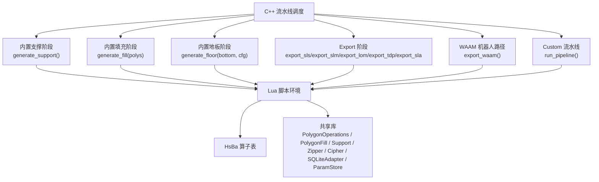
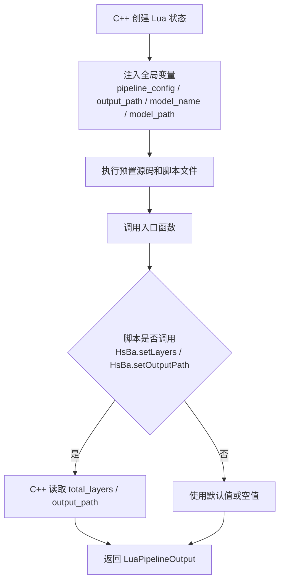
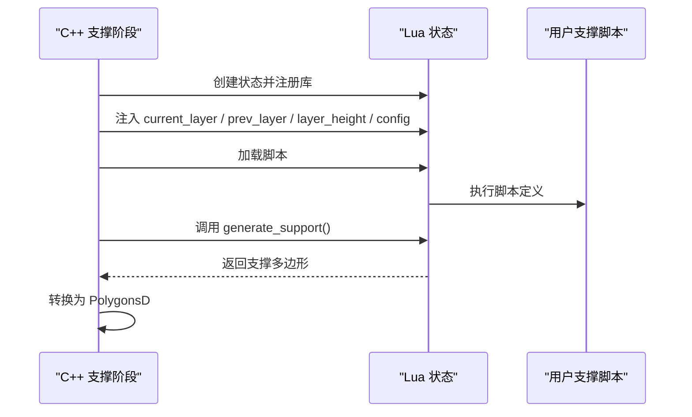
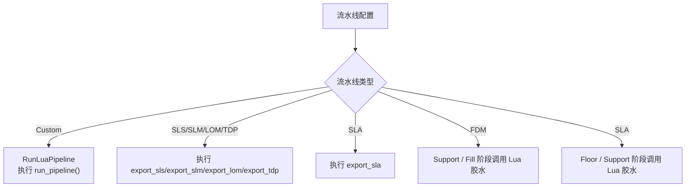
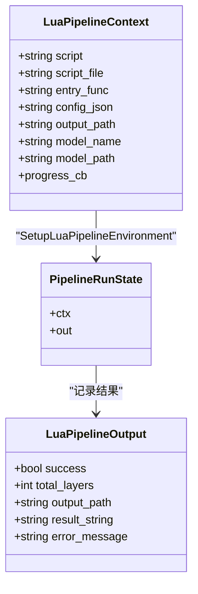
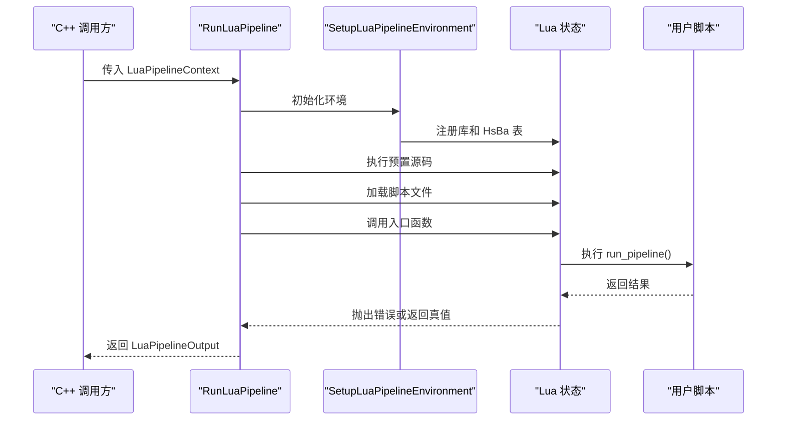

# 脚本环境

<cite>
**本文引用的文件**   
- [hsba_pipeline.d.lua](file://types/hsba_pipeline.d.lua)
- [lua_pipeline.cpp](file://LibHsBaSlicer/Extends/lua_pipeline.cpp)
- [lua_pipeline.hpp](file://LibHsBaSlicer/Extends/lua_pipeline.hpp)
- [custom_pipeline.proto](file://proto/custom_pipeline.proto)
- [pipeline_types.h](file://pipelinetypes/pipeline_types.h)
- [LuaSupport.cpp](file://support/LuaSupport.cpp)
- [LuaAdapter.cpp](file://support/LuaAdapter.cpp)
- [sla_floor.cpp](file://LibHsBaSlicer/Floor/sla_floor.cpp)
- [sla_floor.hpp](file://LibHsBaSlicer/Floor/sla_floor.hpp)
- [my_fdm_pipeline.lua](file://samples/Custom/scripts/my_fdm_pipeline.lua)
- [my_sla_pipeline.lua](file://samples/Custom/scripts/my_sla_pipeline.lua)
- [my_sls_export.lua](file://samples/Custom/scripts/my_sls_export.lua)
- [my_infill.lua](file://samples/FDM/scripts/my_infill.lua)
- [my_support.lua](file://samples/FDM/scripts/my_support.lua)
- [my_sla_floor.lua](file://samples/SLA/scripts/my_sla_floor.lua)
</cite>

## 目录
1. [项目概述与快速开始](#项目概述与快速开始)
2. [架构总览](#架构总览)
3. [核心概念](#核心概念)
4. [核心模块详解](#核心模块详解)
5. [高级主题](#高级主题)
6. [Lua 脚本系统](#lua-脚本系统)
7. [API 参考文档](#api-参考文档)
8. [集成指南](#集成指南)
9. [开发·测试与贡献](#开发测试与贡献)
10. [扩展开发指南](#扩展开发指南)
11. [示例与教程](#示例与教程)
12. [部署·故障排除与FAQ](#部署故障排除与faq)
13. [附录](#附录)

## 项目概述与快速开始
HsBaSlicer 的脚本环境围绕“工艺流水线”组织：不同工艺（FDM、SLA、SLS、SLM、LOM、TDP、WAAM）都有固定阶段，而 Custom 流水线允许完全由 Lua 编排阶段顺序。脚本环境提供三类能力：
- 全局算子表 `HsBa`：模型加载、切片、填充、支撑、地板、路径生成、打包导出等。
- 共享库：多边形几何、填充模式、路径优化、压缩、加密、数据库、参数存储等。
- 内置阶段脚本环境：FDM Support、FDM Fill、SLA Floor、Export、WAAM RobotPath，每个环境有明确的入口函数、全局变量和可用库。

对于初学者，建议从以下顺序入手：
1. 阅读类型定义文件，了解各环境的入口函数、全局变量和可用库。
2. 运行 samples 中的 FDM Support、FDM Fill、SLA Floor 示例脚本。
3. 使用 Custom 流水线脚本理解完整流程编排。
4. 根据业务需求编写自定义 Export 或机器人路径脚本。

**章节来源**
- [hsba_pipeline.d.lua:9-18](file://types/hsba_pipeline.d.lua#L9-L18)
- [hsba_pipeline.d.lua:189-292](file://types/hsba_pipeline.d.lua#L189-L292)

## 架构总览
HsBaSlicer 的脚本执行分为两条主线：
- 内置阶段脚本：C++ 在特定阶段调用 Lua 胶水，注入当前层数据、配置和工具库，然后调用用户脚本函数。
- Custom 流水线：C++ 创建独立 Lua 状态，注册通用库和 `HsBa` 表，执行预置源码和脚本文件，再调用入口函数。

**图表来源**
- [lua_pipeline.cpp:903-958](file://LibHsBaSlicer/Extends/lua_pipeline.cpp#L903-L958)
- [lua_pipeline.cpp:960-1046](file://LibHsBaSlicer/Extends/lua_pipeline.cpp#L960-L1046)
- [LuaSupport.cpp:67-90](file://support/LuaSupport.cpp#L67-L90)
- [hsba_pipeline.d.lua:465-624](file://types/hsba_pipeline.d.lua#L465-L624)

**章节来源**
- [lua_pipeline.cpp:903-1046](file://LibHsBaSlicer/Extends/lua_pipeline.cpp#L903-L1046)
- [LuaSupport.cpp:67-178](file://support/LuaSupport.cpp#L67-L178)
- [hsba_pipeline.d.lua:465-624](file://types/hsba_pipeline.d.lua#L465-L624)

## 核心概念
### 流水线步骤与脚本环境映射
| 工艺 | 主要阶段 | 可替换或自定义的脚本环境 | 入口函数或调用方式 |
|---|---|---|---|
| FDM | Preprocess → Slice → Support → Fill → PathOutput | Support、Fill | `generate_support()`、`generate_fill(polys)` |
| SLA | Preprocess → Slice → Floor → Support → Export | Floor、Support、Export | `generate_floor(bottom, cfg)`、`generate_support()`、`export_sla()` |
| SLS | Preprocess → Slice → Export | Export | `export_sls()` |
| SLM | Preprocess → Slice → Export | Export | `export_slm()` |
| LOM | Preprocess → Slice → Export | Export | `export_lom()` |
| TDP | Preprocess → Slice → Export | Export | `export_tdp()` |
| WAAM | Preprocess → Slice → RobotPath | RobotPath | `export_waam()` |
| Custom | 完全由 Lua 编排 | 所有阶段通过 `HsBa` 暴露 | `run_pipeline()` |

**章节来源**
- [hsba_pipeline.d.lua:9-18](file://types/hsba_pipeline.d.lua#L9-L18)
- [hsba_pipeline.d.lua:489-624](file://types/hsba_pipeline.d.lua#L489-L624)

### 全局变量与状态管理
Custom 流水线环境中，C++ 向 Lua 注入以下全局变量：
- `pipeline_entry`：入口函数名，默认 `"run_pipeline"`。
- `pipeline_config`：C++ 传入的 JSON 配置字符串。
- `output_path`：默认输出路径。
- `model_name`：模型名。
- `model_path`：模型文件路径。

脚本可通过 `HsBa.setLayers(n)` 设置总层数，通过 `HsBa.setOutputPath(path)` 设置输出路径。C++ 侧读取这些值作为流水线结果的一部分。

**图表来源**
- [lua_pipeline.cpp:960-1046](file://LibHsBaSlicer/Extends/lua_pipeline.cpp#L960-L1046)
- [hsba_pipeline.d.lua:469-487](file://types/hsba_pipeline.d.lua#L469-L487)

**章节来源**
- [lua_pipeline.hpp:34-51](file://LibHsBaSlicer/Extends/lua_pipeline.hpp#L34-L51)
- [lua_pipeline.cpp:960-1046](file://LibHsBaSlicer/Extends/lua_pipeline.cpp#L960-L1046)
- [hsba_pipeline.d.lua:469-487](file://types/hsba_pipeline.d.lua#L469-L487)

## 核心模块详解
### Custom 流水线环境
Custom 流水线是“完全由 Lua 驱动的流水线”，C++ 只负责：
- 创建 Lua 状态。
- 注册通用库和 `HsBa` 表。
- 执行预置源码和脚本文件。
- 调用入口函数并收集结果。

可用能力包括：
- 模型操作：`loadModel`、`modelInfo`、`translateModel`、`rotateModel`、`scaleModel`、`removeModel`、`modelNames`。
- 切片操作：`layerCount`、`layerZ`、`slice`、`sliceUnsafe`。
- 坐标转换：`toInt`、`toDouble`。
- 填充：`fill`。
- 支撑：`fdmSupport`、`slaSupport`。
- 地板：`floor`。
- 路径输出：`spiralize`、`toGcode`。
- 导出：`saveSlsPackage`、`saveWaamPackage`、`saveSlaPackage`、`renderImage`。
- 进度上报：`progress`。
- 文件读写：`readFile`、`writeFile`。

**章节来源**
- [hsba_pipeline.d.lua:189-463](file://types/hsba_pipeline.d.lua#L189-L463)
- [lua_pipeline.cpp:903-958](file://LibHsBaSlicer/Extends/lua_pipeline.cpp#L903-L958)

### FDM Support 环境
FDM Support 阶段的脚本环境特点：
- 入口函数：`generate_support()`。
- 全局变量：`current_layer`、`prev_layer`、`layer_height`、`config`。
- 可用库：`PolygonOperations`、`Support`、`PathOptimize`。
- 返回值：支撑截面多边形表。

C++ 在支撑阶段会：
1. 创建独立 Lua 状态。
2. 注册 `PolygonOperations` 和 `Support`。
3. 注入 `current_layer`、`prev_layer`、`layer_height`、`config`。
4. 加载脚本并执行。
5. 如果指定函数名，则调用该函数。
6. 从返回值或全局 `support_polys` 提取支撑多边形。

**图表来源**
- [LuaSupport.cpp:67-90](file://support/LuaSupport.cpp#L67-L90)
- [LuaSupport.cpp:113-178](file://support/LuaSupport.cpp#L113-L178)

**章节来源**
- [hsba_pipeline.d.lua:489-513](file://types/hsba_pipeline.d.lua#L489-L513)
- [LuaSupport.cpp:67-178](file://support/LuaSupport.cpp#L67-L178)

### FDM Fill 环境
FDM Fill 阶段的脚本环境特点：
- 入口函数：`generate_fill(polys)`。
- 参数：当前层多边形（已扣除壁厚区域）。
- 返回值：填充多边形。
- 可用库：`PolygonOperations`、`PolygonFill`、`PathOptimize`。
- 注意：胶水以函数参数传入数据，不使用全局变量；层号和配置不可用，应使用脚本内默认值。

**章节来源**
- [hsba_pipeline.d.lua:515-525](file://types/hsba_pipeline.d.lua#L515-L525)

### SLA Floor 环境
SLA Floor 阶段的脚本环境特点：
- 入口函数：`generate_floor(bottomLayer, floorCfg)`。
- 参数：底层多边形、地板配置。
- 返回值：地板多边形。
- 可用库：`PolygonOperations`、`PolygonFill`。
- 注意：胶水以函数参数传入数据，不使用全局变量。

C++ 实现中，地板脚本会：
1. 创建 Lua 状态。
2. 注册 `PolygonOperations` 和 `PolygonFill`。
3. 加载脚本文件。
4. 获取并调用 `generate_floor`。
5. 将底层多边形转为浮点格式后传入。

**章节来源**
- [hsba_pipeline.d.lua:527-538](file://types/hsba_pipeline.d.lua#L527-L538)
- [sla_floor.cpp:148-182](file://LibHsBaSlicer/Floor/sla_floor.cpp#L148-L182)
- [sla_floor.hpp:99-116](file://LibHsBaSlicer/Floor/sla_floor.hpp#L99-L116)

### Export 环境
Export 环境用于 SLS、SLM、LOM、TDP、SLA 的导出阶段：
- 入口函数：`export_sls()`、`export_slm()`、`export_lom()`、`export_tdp()`、`export_sla()`。
- 全局变量：`config`、`images`、`funcName`、`output_path`。
- 可用库：`Zipper`、`Bit7zZipper`、`Cipher`、`SQLiteAdapter`、`MySQLAdapter`、`PostgreSQLAdapter`。
- 重要约定：Export 脚本若返回字符串，C++ 会用该字符串覆盖写入 `output_path`，因此必须返回 table 或 nil，避免破坏 zip 文件。

Export 阶段的 `config` 类型为 `ExportConfig`：
- `path`：配置文件路径，例如 `"config.json"`。
- `configStr`：JSON 配置内容。

`images` 为层图片数据数组：
- `path`：例如 `"layers/0.json"`。
- `data`：多边形 JSON 数据。

**章节来源**
- [hsba_pipeline.d.lua:540-591](file://types/hsba_pipeline.d.lua#L540-L591)

### WAAM RobotPath 环境
WAAM RobotPath 阶段的脚本环境特点：
- 入口函数：`export_waam()`。
- 返回值：完整的机器人程序文本。
- 全局变量：`header`、`startProgramFunc`、`endProgramFunc`、`points`。
- `points` 元素包含 `end`、`middle`、`velocity`、`type`。

**章节来源**
- [hsba_pipeline.d.lua:593-623](file://types/hsba_pipeline.d.lua#L593-L623)

## 高级主题
### 环境切换机制
HsBaSlicer 支持多种脚本环境，切换方式如下：
- 内置阶段：C++ 在对应阶段调用 Lua 胶水，自动注入相应全局变量和库。
- Custom 流水线：通过 `custom_pipe_config_pipeline_lua_script`、`custom_pipe_config_pipeline_lua_source`、`custom_pipe_config_entry_func` 指定脚本文件、预置源码和入口函数。
- 导出阶段：通过 `export_lua_script` 和 `export_lua_func` 指定导出脚本和函数名。

**图表来源**
- [custom_pipeline.proto:9-18](file://proto/custom_pipeline.proto#L9-L18)
- [pipeline_types.h:275-283](file://pipelinetypes/pipeline_types.h#L275-L283)
- [lua_pipeline.cpp:960-1046](file://LibHsBaSlicer/Extends/lua_pipeline.cpp#L960-L1046)

**章节来源**
- [custom_pipeline.proto:9-18](file://proto/custom_pipeline.proto#L9-L18)
- [pipeline_types.h:275-283](file://pipelinetypes/pipeline_types.h#L275-L283)
- [lua_pipeline.cpp:960-1046](file://LibHsBaSlicer/Extends/lua_pipeline.cpp#L960-L1046)

### 状态管理机制
Custom 流水线的状态由两部分组成：
- Lua 层状态：脚本通过 `HsBa.progress`、`HsBa.setLayers`、`HsBa.setOutputPath` 更新进度、层数和输出路径。
- C++ 层状态：`LuaPipelineContext` 保存输入配置，`LuaPipelineOutput` 保存成功标志、总层数、输出路径、结果字符串和错误信息。

**图表来源**
- [lua_pipeline.hpp:34-51](file://LibHsBaSlicer/Extends/lua_pipeline.hpp#L34-L51)
- [lua_pipeline.cpp:943-958](file://LibHsBaSlicer/Extends/lua_pipeline.cpp#L943-L958)
- [lua_pipeline.cpp:1020-1034](file://LibHsBaSlicer/Extends/lua_pipeline.cpp#L1020-L1034)

**章节来源**
- [lua_pipeline.hpp:34-51](file://LibHsBaSlicer/Extends/lua_pipeline.hpp#L34-L51)
- [lua_pipeline.cpp:943-1034](file://LibHsBaSlicer/Extends/lua_pipeline.cpp#L943-L1034)

## Lua 脚本系统
### 共享库概览
所有流水线环境均可使用的共享库包括：
- `PolygonOperations`：布尔运算、偏移、凸包、凹包、面积、几何构造、文字转多边形。
- `PolygonFill`：偏移填充、平行线填充、之字形填充、复合填充、混合填充。
- `PathOptimize`：路径顺序优化。
- `Support`：支撑生成器、悬垂检测、默认配置。
- `Zipper` / `Bit7zZipper`：压缩包操作。
- `Cipher`：Base64、Hex 编码解码。
- `SQLiteAdapter` / `MySQLAdapter` / `PostgreSQLAdapter`：数据库适配器。
- `ParamStore`：工艺参数持久化存储。

**章节来源**
- [hsba_pipeline.d.lua:31-187](file://types/hsba_pipeline.d.lua#L31-L187)
- [lua_pipeline.cpp:924-941](file://LibHsBaSlicer/Extends/lua_pipeline.cpp#L924-L941)

### 多边形几何与填充
多边形几何操作由 `2D/LuaAdapter.cpp` 实现，提供：
- 布尔运算：`union`、`intersection`、`difference`、`xor`。
- 偏移：`offsetOperation`。
- 凸包与凹包：`convexHullOperation`、`concaveHullOperation`。
- 面积：`area`。
- 几何构造：`makeRectangle`、`makeCircle`、`makeEllipse`、`makeRegularPolygon`。
- 文字转多边形：`textToPolygons`。

填充模式由 `PolygonFill` 暴露，支持多种填充策略，适用于 FDM Fill 和 SLA Floor。

**章节来源**
- [LuaAdapter.cpp:22-200](file://2D/LuaAdapter.cpp#L22-L200)
- [hsba_pipeline.d.lua:35-62](file://types/hsba_pipeline.d.lua#L35-L62)

### 支撑系统
支撑系统通过 `Support` 模块暴露：
- 创建支撑对象：`new_plane`、`new_tree`、`new_honeycomb`、`new_sla`、`new_lua`、`new_lua_file`。
- 生成支撑：`generate(obj, current, prev, height, cfg)`。
- 悬垂检测：`detect_overhang(current, prev, height, angle)`。
- 默认配置：`default_config()`。

C++ 侧将 `SupportConfig` 字段映射到 Lua 表，包括悬垂角度阈值、层高、支撑间隙、支撑直径、支撑密度、支撑模式、树分支角度、树最大分支半径、蜂窝单元尺寸。

**章节来源**
- [hsba_pipeline.d.lua:79-105](file://types/hsba_pipeline.d.lua#L79-L105)
- [LuaSupport.cpp:19-49](file://support/LuaSupport.cpp#L19-L49)
- [LuaAdapter.cpp:258-276](file://support/LuaAdapter.cpp#L258-L276)

### 导出与打包
Export 阶段依赖 `Zipper` 或 `Bit7zZipper` 生成压缩包，并通过 `Cipher` 进行加密或哈希处理。SLS 导出示例展示了如何：
1. 创建 Zipper。
2. 写入配置文件。
3. 写入每层轮廓数据。
4. 写入说明文件。
5. 保存 zip。
6. 可选地注册 SQLite 数据库记录。

**章节来源**
- [my_sls_export.lua:21-75](file://samples/Custom/scripts/my_sls_export.lua#L21-L75)
- [hsba_pipeline.d.lua:107-125](file://types/hsba_pipeline.d.lua#L107-L125)
- [hsba_pipeline.d.lua:127-175](file://types/hsba_pipeline.d.lua#L127-L175)

## API 参考文档
### HsBa 全局算子表
| 类别 | 方法 | 用途 | 关键参数 |
|---|---|---|---|
| 通用 | `progress(percent, stage?)` | 上报进度 | 百分比、阶段描述 |
| 通用 | `setLayers(n)` | 设置总层数 | 层数 |
| 通用 | `setOutputPath(path)` | 设置输出路径 | 路径 |
| 通用 | `readFile(path)` | 读取文件 | 文件路径 |
| 通用 | `writeFile(path, content)` | 写入文件 | 路径、内容 |
| 预处理 | `loadModel(name, path)` | 加载模型 | 模型名、路径 |
| 预处理 | `modelInfo(name)` | 获取模型信息 | 模型名 |
| 预处理 | `translateModel(name, offset)` | 平移模型 | 模型名、偏移 |
| 预处理 | `rotateModel(name, quaternion)` | 旋转模型 | 模型名、四元数 |
| 预处理 | `scaleModel(name, scale)` | 缩放模型 | 模型名、比例 |
| 预处理 | `removeModel(name)` | 移除模型 | 模型名 |
| 预处理 | `modelNames()` | 获取模型名列表 | 无 |
| 切片 | `layerCount(name, layerHeight, firstLayerHeight)` | 计算层数 | 模型名、层高、首层层高 |
| 切片 | `layerZ(index, layerHeight, firstLayerHeight)` | 计算 Z 高度 | 索引、层高、首层层高 |
| 切片 | `slice(name, z)` | 安全切片 | 模型名、Z 高度 |
| 切片 | `sliceUnsafe(name, z)` | 不安全切片 | 模型名、Z 高度 |
| 坐标 | `toInt(polys)` | 浮点多边形转整数 | 多边形 |
| 坐标 | `toDouble(polys)` | 整点多边形转浮点 | 多边形 |
| 填充 | `fill(polys, options?)` | 填充多边形 | 多边形、填充选项 |
| 支撑 | `fdmSupport(layers, config?)` | 生成 FDM 支撑 | 层列表、支撑选项 |
| 支撑 | `slaSupport(layers, config?)` | 生成 SLA 支撑 | 层列表、支撑选项 |
| 地板 | `floor(bottomPolygons, config?)` | 生成 SLA 地板 | 底层多边形、地板配置 |
| 路径 | `spiralize(sections, options?)` | 螺旋化外壁 | 层段、螺旋选项 |
| 路径 | `toGcode(layers, config)` | 生成 G-code | 层路径输入、G-code 选项 |
| 导出 | `saveSlsPackage(input)` | 打包 SLS/SLM/LOM/TDP | 包输入 |
| 导出 | `saveWaamPackage(input)` | 打包 WAAM 机器人路径 | 包输入 |
| 导出 | `saveSlaPackage(input)` | 打包 SLA 输出 | 包输入 |
| 导出 | `renderImage(polys, width, height, path)` | 渲染多边形为图片 | 多边形、宽高、路径 |

**章节来源**
- [hsba_pipeline.d.lua:290-463](file://types/hsba_pipeline.d.lua#L290-L463)

### 内置阶段入口函数
| 环境 | 入口函数 | 参数 | 返回值 |
|---|---|---|---|
| FDM Support | `generate_support()` | 无 | 支撑截面多边形 |
| FDM Fill | `generate_fill(polys)` | 当前层多边形 | 填充多边形 |
| SLA Floor | `generate_floor(bottomLayer, floorCfg)` | 底层多边形、地板配置 | 地板多边形 |
| SLS Export | `export_sls()` | 无 | `{ success, export_path }` |
| SLM Export | `export_slm()` | 无 | `{ success, export_path }` |
| LOM Export | `export_lom()` | 无 | `{ success, export_path }` |
| TDP Export | `export_tdp()` | 无 | `{ success, export_path }` |
| SLA Export | `export_sla()` | 无 | `{ success, export_path }` |
| WAAM RobotPath | `export_waam()` | 无 | 机器人程序文本 |
| Custom | `run_pipeline()` | 无 | 字符串或布尔值 |

**章节来源**
- [hsba_pipeline.d.lua:469-624](file://types/hsba_pipeline.d.lua#L469-L624)

### 配置结构体
| 结构体 | 字段 | 说明 |
|---|---|---|
| `SupportConfig` | `overhang_angle_threshold` | 悬垂角度阈值 |
| `SupportConfig` | `layer_height` | 层高 |
| `SupportConfig` | `support_gap` | 支撑间隙 |
| `SupportConfig` | `support_diameter` | 支撑直径 |
| `SupportConfig` | `support_density` | 支撑密度 |
| `SupportConfig` | `support_pattern` | 支撑模式 |
| `SupportConfig` | `tree_branch_angle` | 树分支角度 |
| `SupportConfig` | `tree_max_branch_radius` | 树最大分支半径 |
| `SupportConfig` | `honeycomb_cell_size` | 蜂窝单元尺寸 |
| `FloorConfig` | `raft_offset` | Raft 偏移 |
| `FloorConfig` | `border_width` | 边框宽度 |
| `FloorConfig` | `fill_spacing` | 填充间距 |
| `FloorConfig` | `fill_angle_deg` | 填充角度 |
| `FloorConfig` | `border_count` | 边框圈数 |
| `FloorConfig` | `use_convex_hull` | 是否使用凸包 |
| `FloorConfig` | `concave_hull_points` | 凹包额外点数 |
| `ExportConfig` | `path` | 配置文件路径 |
| `ExportConfig` | `configStr` | JSON 配置内容 |

**章节来源**
- [hsba_pipeline.d.lua:79-105](file://types/hsba_pipeline.d.lua#L79-L105)
- [hsba_pipeline.d.lua:219-227](file://types/hsba_pipeline.d.lua#L219-L227)
- [hsba_pipeline.d.lua:547-549](file://types/hsba_pipeline.d.lua#L547-L549)

## 集成指南
### 在 C++ 中调用 Custom 流水线
C++ 通过 `RunLuaPipeline` 调用 Custom 流水线：
1. 创建 Lua 状态。
2. 调用 `SetupLuaPipelineEnvironment` 注册库和全局变量。
3. 执行预置源码和脚本文件。
4. 查找并调用入口函数。
5. 捕获错误并返回 `LuaPipelineOutput`。

**图表来源**
- [lua_pipeline.cpp:960-1046](file://LibHsBaSlicer/Extends/lua_pipeline.cpp#L960-L1046)

**章节来源**
- [lua_pipeline.cpp:960-1046](file://LibHsBaSlicer/Extends/lua_pipeline.cpp#L960-L1046)

### 在 Custom 流水线中编排 FDM 流程
FDM Custom 流水线示例展示了完整流程：
1. 加载模型。
2. 计算层数并设置总层数。
3. 逐层切片。
4. 每层填充。
5. 条件生成支撑。
6. 组装路径数据。
7. 生成 G-code。
8. 写入文件。
9. 设置输出路径并上报进度。

**章节来源**
- [my_fdm_pipeline.lua:52-171](file://samples/Custom/scripts/my_fdm_pipeline.lua#L52-L171)

### 在 Custom 流水线中编排 SLA 流程
SLA Custom 流水线示例展示了完整流程：
1. 加载模型。
2. 计算层数。
3. 逐层切片。
4. 生成 SLA 支撑。
5. 生成地板。
6. 打包层图、支撑图、地板图和配置。
7. 设置输出路径并上报进度。

**章节来源**
- [my_sla_pipeline.lua:27-104](file://samples/Custom/scripts/my_sla_pipeline.lua#L27-L104)

## 开发·测试与贡献
### 调试建议
- 使用 `HsBa.progress` 分阶段上报进度，便于定位卡住或失败的阶段。
- 在 Custom 流水线中打印模型信息、层数、输出路径，确认 C++ 注入的全局变量是否正确。
- 在 Export 脚本中使用 `pcall` 包裹数据库操作，避免数据库失败影响导出结果。
- 检查 Export 脚本返回值是否为 table，避免字符串覆盖 zip 文件。

**章节来源**
- [my_sls_export.lua:47-66](file://samples/Custom/scripts/my_sls_export.lua#L47-L66)
- [lua_pipeline.cpp:995-1034](file://LibHsBaSlicer/Extends/lua_pipeline.cpp#L995-L1034)

### 错误处理最佳实践
- Custom 流水线入口函数返回 false 或 nil 表示失败，C++ 会设置 `error_message`。
- 内置阶段脚本抛出 Lua 错误时，C++ 会捕获并包装为 `RuntimeError`。
- 支撑脚本应检查 `prev_layer` 是否为空，首层通常不需要支撑。
- 填充脚本应检查输入多边形是否为空，避免无效计算。
- 地板脚本应优先使用配置字段并提供默认值，增强鲁棒性。

**章节来源**
- [lua_pipeline.cpp:1005-1040](file://LibHsBaSlicer/Extends/lua_pipeline.cpp#L1005-L1040)
- [my_support.lua:32-45](file://samples/FDM/scripts/my_support.lua#L32-L45)
- [my_infill.lua:20-23](file://samples/FDM/scripts/my_infill.lua#L20-L23)
- [my_sla_floor.lua:35-41](file://samples/SLA/scripts/my_sla_floor.lua#L35-L41)

## 扩展开发指南
### 注册自定义 Lua 函数
C++ 支持通过外部注册函数扩展 Lua 环境：
- `add2DFunction`：注册 2D Lua 函数，可在 Support、Fill、SLA Output 阶段使用。
- `add3DFunction`：注册 3D Lua 函数。
- `addFileFunction`：注册文件操作 Lua 函数。
- `addEventCallback`：注册事件回调。

在支撑阶段，`LuaSupport::SetExternalRegs` 允许注入额外的 2D+3D 函数。

**章节来源**
- [ModuleHsBaSlicer/hsba_slicer.cppm:1184-1214](file://ModuleHsBaSlicer/hsba_slicer.cppm#L1184-L1214)
- [LuaSupport.cpp:108-111](file://support/LuaSupport.cpp#L108-L111)

### 扩展 Export 逻辑
Export 脚本可以：
- 使用 `Zipper` 或 `Bit7zZipper` 生成压缩包。
- 使用 `Cipher` 对数据进行 Base64 或 Hex 编码。
- 使用 `SQLiteAdapter`、`MySQLAdapter`、`PostgreSQLAdapter` 记录导出历史。
- 使用 `ParamStore` 持久化工艺参数。

**章节来源**
- [hsba_pipeline.d.lua:107-187](file://types/hsba_pipeline.d.lua#L107-L187)
- [my_sls_export.lua:21-75](file://samples/Custom/scripts/my_sls_export.lua#L21-L75)

## 示例与教程
### FDM Support 示例
`my_support.lua` 展示了如何使用内置支撑生成器：
1. 检查首层。
2. 使用 `Support.detect_overhang` 检测悬垂区域。
3. 根据配置选择支撑模式。
4. 使用 `Support.generate` 生成支撑。
5. 可选地对支撑结果进行偏移处理。

**章节来源**
- [my_support.lua:32-82](file://samples/FDM/scripts/my_support.lua#L32-L82)

### FDM Fill 示例
`my_infill.lua` 展示了自定义填充逻辑：
1. 检查输入多边形是否为空。
2. 计算边界框。
3. 生成平行线填充。
4. 与当前层轮廓做交集裁剪。

**章节来源**
- [my_infill.lua:20-88](file://samples/FDM/scripts/my_infill.lua#L20-L88)

### SLA Floor 示例
`my_sla_floor.lua` 展示了自定义地板生成逻辑：
1. 选择凸包或直接使用原始轮廓。
2. 向外偏移生成 Raft 外边界。
3. 向内收缩生成内边界。
4. 生成边框环。
5. 生成内部填充。
6. 合并边框和填充。

**章节来源**
- [my_sla_floor.lua:35-62](file://samples/SLA/scripts/my_sla_floor.lua#L35-L62)

### Custom FDM 流水线示例
`my_fdm_pipeline.lua` 展示了完整 FDM 流水线编排，包括模型加载、切片、填充、支撑、G-code 生成和文件写入。

**章节来源**
- [my_fdm_pipeline.lua:52-171](file://samples/Custom/scripts/my_fdm_pipeline.lua#L52-L171)

### Custom SLA 流水线示例
`my_sla_pipeline.lua` 展示了完整 SLA 流水线编排，包括模型加载、切片、支撑、地板和打包。

**章节来源**
- [my_sla_pipeline.lua:27-104](file://samples/Custom/scripts/my_sla_pipeline.lua#L27-L104)

### Custom SLS 导出示例
`my_sls_export.lua` 展示了 SLS 导出脚本，包括 zip 打包、README 写入和 SQLite 注册。

**章节来源**
- [my_sls_export.lua:21-75](file://samples/Custom/scripts/my_sls_export.lua#L21-L75)

## 部署·故障排除与FAQ
### 常见问题
- **入口函数未找到**：C++ 会报告 `"Lua entry function 'xxx' not found in script"`。检查脚本是否定义了正确的入口函数。
- **脚本文件无法打开**：C++ 会报告 `"Failed to open Lua script file: xxx"`。检查脚本路径是否正确。
- **Export 脚本返回字符串导致 zip 被覆盖**：Export 脚本必须返回 table，不要返回字符串。
- **支撑脚本首层报错**：检查 `prev_layer` 是否为空，首层通常无需支撑。
- **填充脚本输入为空**：检查 `current_layer` 是否为空，避免无效计算。

**章节来源**
- [lua_pipeline.cpp:998-1009](file://LibHsBaSlicer/Extends/lua_pipeline.cpp#L998-L1009)
- [lua_pipeline.cpp:982-988](file://LibHsBaSlicer/Extends/lua_pipeline.cpp#L982-L988)
- [my_support.lua:32-45](file://samples/FDM/scripts/my_support.lua#L32-L45)
- [my_infill.lua:20-23](file://samples/FDM/scripts/my_infill.lua#L20-L23)

### 性能考虑
- 在 Custom 流水线中分批上报进度，避免频繁 IO。
- 在 Export 脚本中批量写入 zip，避免多次 Save。
- 使用 `PathOptimize` 减少空行程，提升路径效率。
- 在支撑和填充阶段优先使用内置算法，必要时再用 Lua 自定义逻辑。

[本节为通用指导，不直接分析具体文件]

## 附录
### 流水线类型与协议
Custom 流水线通过 protobuf 配置：
- `custom_pipe_config_pipeline_lua_script`：脚本文件路径。
- `custom_pipe_config_pipeline_lua_source`：预置源码。
- `custom_pipe_config_entry_func`：入口函数名。
- `custom_pipe_config_config_json`：JSON 配置。
- `custom_pipe_config_model_name`：模型名。
- `custom_pipe_config_model_path`：模型路径。
- `custom_pipe_config_output_path`：输出路径。

SLS 流水线通过 C++ 结构体配置：
- `export_lua_script`：导出脚本路径。
- `export_lua_func`：导出函数名。
- `output_path`：输出路径。

**章节来源**
- [custom_pipeline.proto:9-18](file://proto/custom_pipeline.proto#L9-L18)
- [pipeline_types.h:275-283](file://pipelinetypes/pipeline_types.h#L275-L283)

### 类型定义导航
IDE 类型定义文件 `hsba_pipeline.d.lua` 提供了完整的 Lua 类型提示，包括：
- 基础几何类型：Point2D、Point3D、Quaternion、Polygon、Polygons、LayerList。
- 共享库类型：PolygonOperations、PolygonFill、PathOptimize、Support、Zipper、Bit7zZipper、Cipher、SQLiteAdapter、MySQLAdapter、PostgreSQLAdapter、ParamStore。
- HsBa 算子表类型。
- 各流水线阶段类型注解。

**章节来源**
- [hsba_pipeline.d.lua:20-663](file://types/hsba_pipeline.d.lua#L20-L663)