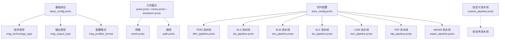
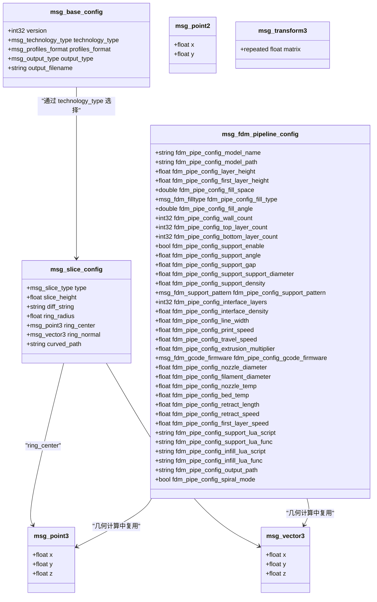
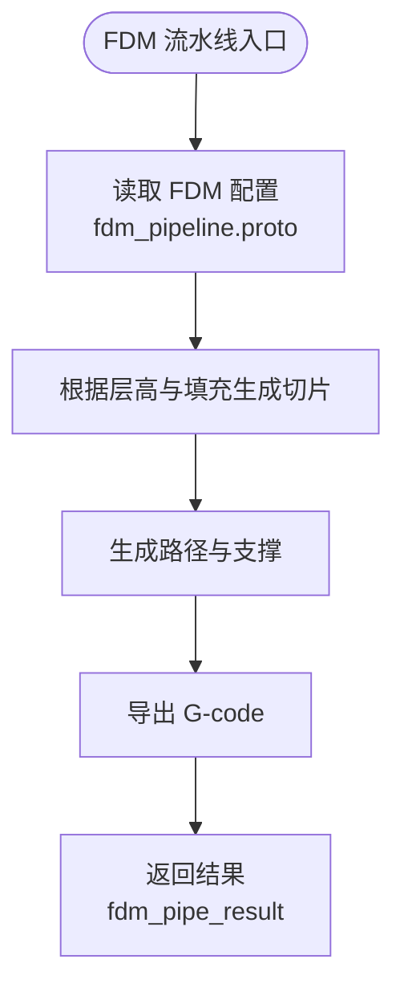
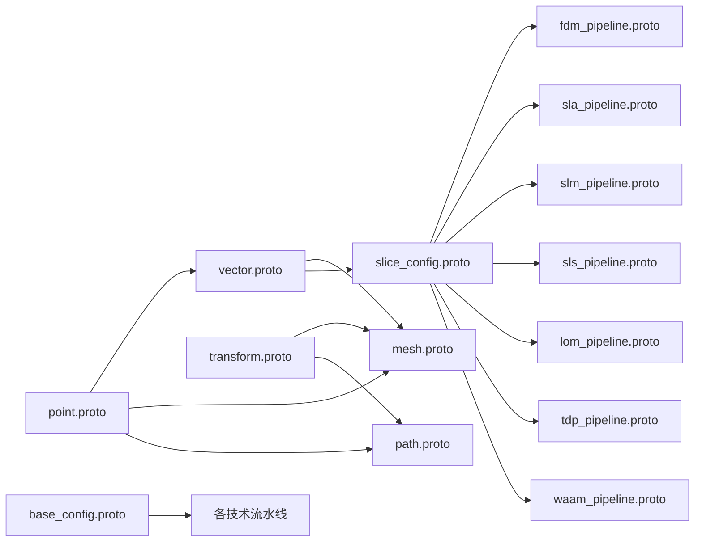

# Protobuf 接口

<cite>
**本文引用的文件**   
- [proto/base_config.proto](file://proto/base_config.proto)
- [proto/mesh.proto](file://proto/mesh.proto)
- [proto/path.proto](file://proto/path.proto)
- [proto/point.proto](file://proto/point.proto)
- [proto/vector.proto](file://proto/vector.proto)
- [proto/transform.proto](file://proto/transform.proto)
- [proto/slice_config.proto](file://proto/slice_config.proto)
- [proto/fdm_pipeline.proto](file://proto/fdm_pipeline.proto)
- [proto/sla_pipeline.proto](file://proto/sla_pipeline.proto)
- [proto/slm_pipeline.proto](file://proto/slm_pipeline.proto)
- [proto/sls_pipeline.proto](file://proto/sls_pipeline.proto)
- [proto/lom_pipeline.proto](file://proto/lom_pipeline.proto)
- [proto/tdp_pipeline.proto](file://proto/tdp_pipeline.proto)
- [proto/waam_pipeline.proto](file://proto/waam_pipeline.proto)
- [proto/custom_pipeline.proto](file://proto/custom_pipeline.proto)
</cite>

## 目录
1. [项目概述与快速开始](#项目概述与快速开始)
2. [架构总览](#架构总览)
3. [核心概念](#核心概念)
4. [核心模块详解](#核心模块详解)
5. [高级主题](#高级主题)
6. [Lua 脚本系统](#lua-脚本系统)
7. [API 参考文档](#api-参考文档)
8. [集成指南](#集成指南)
9. [开发·测试与贡献](#开发·测试与贡献)
10. [扩展开发指南](#扩展开发指南)
11. [示例与教程](#示例与教程)
12. [部署·故障排除与FAQ](#部署·故障排除与faq)
13. [附录](#附录)

## 项目概述与快速开始
本文件为 HsBaSlicer 的 Protobuf 消息定义提供完整 API 文档。它覆盖所有 .proto 文件中定义的 message、enum、字段含义和数据约束，并说明 FDM、SLA、SLS、SLM、LOM、TDP、WAAM 以及自定义 Lua 流水线配置消息的结构、依赖关系、转换规则、序列化使用方式、版本兼容策略和迁移指南。

HsBaSlicer 的 Protobuf 命名空间统一为 HsbaProto，基础几何类型（点、向量、变换）、网格、路径、切片配置与各技术栈流水线配置相互组合，形成从模型输入到工艺输出的一体化数据契约。

**图示来源**
- [proto/base_config.proto:5-131](file://proto/base_config.proto#L5-L131)
- [proto/point.proto:5-16](file://proto/point.proto#L5-L16)
- [proto/vector.proto:5-24](file://proto/vector.proto#L5-L24)
- [proto/transform.proto:5-21](file://proto/transform.proto#L5-L21)
- [proto/mesh.proto:8-31](file://proto/mesh.proto#L8-L31)
- [proto/path.proto:7-15](file://proto/path.proto#L7-L15)
- [proto/slice_config.proto:8-27](file://proto/slice_config.proto#L8-L27)
- [proto/fdm_pipeline.proto:26-81](file://proto/fdm_pipeline.proto#L26-L81)
- [proto/sla_pipeline.proto:18-67](file://proto/sla_pipeline.proto#L18-L67)
- [proto/slm_pipeline.proto:33-65](file://proto/slm_pipeline.proto#L33-L65)
- [proto/sls_pipeline.proto:5-33](file://proto/sls_pipeline.proto#L5-L33)
- [proto/lom_pipeline.proto:13-46](file://proto/lom_pipeline.proto#L13-L46)
- [proto/tdp_pipeline.proto:15-47](file://proto/tdp_pipeline.proto#L15-L47)
- [proto/waam_pipeline.proto:49-89](file://proto/waam_pipeline.proto#L49-L89)
- [proto/custom_pipeline.proto:9-31](file://proto/custom_pipeline.proto#L9-L31)

**章节来源**
- [proto/base_config.proto:1-132](file://proto/base_config.proto#L1-L132)
- [proto/mesh.proto:1-31](file://proto/mesh.proto#L1-L31)
- [proto/path.proto:1-15](file://proto/path.proto#L1-L15)
- [proto/point.proto:1-16](file://proto/point.proto#L1-L16)
- [proto/vector.proto:1-24](file://proto/vector.proto#L1-L24)
- [proto/transform.proto:1-21](file://proto/transform.proto#L1-L21)
- [proto/slice_config.proto:1-27](file://proto/slice_config.proto#L1-L27)
- [proto/fdm_pipeline.proto:1-81](file://proto/fdm_pipeline.proto#L1-L81)
- [proto/sla_pipeline.proto:1-67](file://proto/sla_pipeline.proto#L1-L67)
- [proto/slm_pipeline.proto:1-65](file://proto/slm_pipeline.proto#L1-L65)
- [proto/sls_pipeline.proto:1-33](file://proto/sls_pipeline.proto#L1-L33)
- [proto/lom_pipeline.proto:1-46](file://proto/lom_pipeline.proto#L1-L46)
- [proto/tdp_pipeline.proto:1-47](file://proto/tdp_pipeline.proto#L1-L47)
- [proto/waam_pipeline.proto:1-89](file://proto/waam_pipeline.proto#L1-L89)
- [proto/custom_pipeline.proto:1-31](file://proto/custom_pipeline.proto#L1-L31)

## 架构总览
HsBaSlicer 的 Protobuf 体系以“基础协议 + 几何基元 + 切片配置 + 技术流水线”分层组织：
- 基础协议层：定义全局协议版本、技术类型、输出类型、配置格式等通用枚举与根配置。
- 几何基元层：定义二维/三维点、向量、四元数与变换矩阵，供网格、路径、切片等复用。
- 切片配置层：描述切片模式、层高、环形切片参数、曲面切片路径等。
- 技术流水线层：针对 FDM、SLA、SLS、SLM、LOM、TDP、WAAM 分别定义配置与结果消息；同时提供完全由 Lua 驱动的自定义流水线。

**图示来源**
- [proto/base_config.proto:125-132](file://proto/base_config.proto#L125-L132)
- [proto/point.proto:5-16](file://proto/point.proto#L5-L16)
- [proto/vector.proto:11-16](file://proto/vector.proto#L11-L16)
- [proto/slice_config.proto:18-27](file://proto/slice_config.proto#L18-L27)
- [proto/fdm_pipeline.proto:26-72](file://proto/fdm_pipeline.proto#L26-L72)

**章节来源**
- [proto/base_config.proto:1-132](file://proto/base_config.proto#L1-L132)
- [proto/point.proto:1-16](file://proto/point.proto#L1-L16)
- [proto/vector.proto:1-24](file://proto/vector.proto#L1-L24)
- [proto/slice_config.proto:1-27](file://proto/slice_config.proto#L1-L27)
- [proto/fdm_pipeline.proto:1-81](file://proto/fdm_pipeline.proto#L1-L81)

## 核心概念
本节梳理 Protobuf 中的基础枚举与通用数据结构，帮助读者理解后续各技术流水线配置的数据语义。

### 基础协议与通用枚举
- 协议版本：msg_base_config.version 用于标识协议版本，便于向后兼容。
- 技术类型：msg_technology_type 表示 FFF/FDM、SLA、SLM、SLS、LOM、3DP、WAAM 或未知技术。
- 支撑类型：msg_support_type 支持平面、树形、蜂窝或未知支撑。
- 材料/光源/保护气体：按技术域划分，如 FFF 材料、SLA 树脂与 UV 光、SLM 金属粉末与激光/电子束、WAAM 材料与焊接工艺等。
- 输出类型：msg_output_type 支持 G-code、AMF/3MF、机器人语言、Zipper 文件或未知输出。
- 配置格式：msg_profiles_format 支持 JSON、XML、INI、YAML 或未知格式。

这些枚举在 base_config.proto 中集中定义，被各技术流水线共享或映射。

**章节来源**
- [proto/base_config.proto:5-131](file://proto/base_config.proto#L5-L131)

### 几何基元
- 二维点：msg_point2 包含 x、y。
- 三维点：msg_point3 包含 x、y、z。
- 二维/三维/四维向量：msg_vector2、msg_vector3、msg_vector4。
- 四元数与变换矩阵：msg_quaternion、msg_transform2、msg_transform3。

几何基元被 mesh、path、slice_config 等结构复用，保证跨模块坐标一致性。

**章节来源**
- [proto/point.proto:5-16](file://proto/point.proto#L5-L16)
- [proto/vector.proto:5-24](file://proto/vector.proto#L5-L24)
- [proto/transform.proto:5-21](file://proto/transform.proto#L5-L21)

### 网格与路径
- 网格：msg_stlmeshes 与 msg_topo_trimeshes 分别表达三角面片集合与拓扑索引集合，均包含法向量信息。
- 路径：msg_path2 与 msg_path3 是点的有序序列，用于轨迹、轮廓或沉积路径。

**章节来源**
- [proto/mesh.proto:8-31](file://proto/mesh.proto#L8-L31)
- [proto/path.proto:7-15](file://proto/path.proto#L7-L15)

### 切片配置
- 切片类型：msg_slice_type 支持相同高度、不同高度字符串描述、曲面切片、环形切片、无切片或未知类型。
- 关键参数：slice_height、diff_string、ring_radius、ring_center、ring_normal、curved_path。

切片配置为各技术流水线提供统一的几何切分语义。

**章节来源**
- [proto/slice_config.proto:8-27](file://proto/slice_config.proto#L8-L27)

## 核心模块详解
本节逐项说明各技术流水线的配置与结果消息，包括字段含义、单位、取值范围与典型用途。

### FDM 流水线
FDM 流水线配置 msg_fdm_pipeline_config 涵盖模型名称与路径、层高、填充间距、填充类型与角度、壁厚、顶底层层数、支撑开关与参数、线宽、打印速度、回抽、喷嘴/耗材直径、温度、固件目标、Lua 脚本入口与输出路径等。结果 msg_fdm_pipe_result 包含成功标志、总层数、G-code 内容、错误信息与耗时。

**图示来源**
- [proto/fdm_pipeline.proto:26-81](file://proto/fdm_pipeline.proto#L26-L81)

**章节来源**
- [proto/fdm_pipeline.proto:1-81](file://proto/fdm_pipeline.proto#L1-L81)

### SLA 流水线
SLA 流水线配置 sla_pipe_config 包含模型信息、层高、曝光时间、升降距离与速度、底板参数、支撑开关与参数、Lua 脚本入口、输出图像类型与尺寸等。结果 sla_pipe_result 包含成功标志、总层数、导出路径、错误信息与耗时。

**章节来源**
- [proto/sla_pipeline.proto:1-67](file://proto/sla_pipeline.proto#L1-L67)

### SLM 流水线
SLM 流水线配置 slm_pipe_config 描述金属粉末床工艺：层高、激光功率、扫描速度、 Hatch 间距与旋转、粉床温度、材料、光源、保护气体、Lua 导出脚本与输出路径。结果 slm_pipe_result 结构与 SLA/SLS 类似。

**章节来源**
- [proto/slm_pipeline.proto:1-65](file://proto/slm_pipeline.proto#L1-L65)

### SLS 流水线
SLS 流水线配置 sls_pipe_config 描述选择性激光烧结：层高、激光功率、扫描速度、Hatch 参数、粉床温度、Lua 导出脚本与输出路径。结果 sls_pipe_result 结构与 SLA/SLS 类似。

**章节来源**
- [proto/sls_pipeline.proto:1-33](file://proto/sls_pipeline.proto#L1-L33)

### LOM 流水线
LOM 流水线配置 lom_pipe_config 描述层压制造：层高（板材厚度）、切割速度与偏移、切割功率、粘接温度/压力/时间、封边开关、切割模式、Lua 导出脚本与输出路径。结果 lom_pipe_result 结构与 SLA/SLS 类似。

**章节来源**
- [proto/lom_pipeline.proto:1-46](file://proto/lom_pipeline.proto#L1-L46)

### TDP 流水线
TDP 流水线配置 tdp_pipe_config 描述粘结剂喷射：层高、喷头数量、滴距、粘结剂饱和度、固化时间、粉床温度、粘结模式、Lua 导出脚本、输出路径与螺旋模式。结果 tdp_pipe_result 结构与 SLA/SLS 类似。

**章节来源**
- [proto/tdp_pipeline.proto:1-47](file://proto/tdp_pipeline.proto#L1-L47)

### WAAM 流水线
WAAM 流水线配置 waam_pipe_config 描述机器人电弧/激光增材：层高（焊道高）、焊道宽度、行走速度、送丝速度、电流电压、保护气流量、材料、焊接工艺、保护方式、保护气体、层间温度、机器人控制器类型、可选路径 Lua 脚本、输出机器人程序路径与螺旋模式。结果 waam_pipe_result 包含输出机器人程序路径。

**章节来源**
- [proto/waam_pipeline.proto:1-89](file://proto/waam_pipeline.proto#L1-L89)

### 自定义 Lua 流水线
自定义流水线配置 custom_pipe_config 仅暴露最小必要参数：流水线 Lua 脚本路径、内联源码、入口函数名、自由 JSON 配置、模型名称与路径、默认输出路径。结果 custom_pipe_result 由脚本通过 HsBa.setLayers()/HsBa.setOutputPath() 报告层数与输出路径，并返回字符串结果与错误信息。

**章节来源**
- [proto/custom_pipeline.proto:1-31](file://proto/custom_pipeline.proto#L1-L31)

## 高级主题
### 消息依赖关系图
以下图展示主要消息之间的依赖关系，便于理解数据流转与耦合度。

**图示来源**
- [proto/point.proto:5-16](file://proto/point.proto#L5-L16)
- [proto/vector.proto:5-24](file://proto/vector.proto#L5-L24)
- [proto/transform.proto:5-21](file://proto/transform.proto#L5-L21)
- [proto/mesh.proto:8-31](file://proto/mesh.proto#L8-L31)
- [proto/path.proto:7-15](file://proto/path.proto#L7-L15)
- [proto/slice_config.proto:8-27](file://proto/slice_config.proto#L8-L27)
- [proto/base_config.proto:5-131](file://proto/base_config.proto#L5-L131)
- [proto/fdm_pipeline.proto:26-81](file://proto/fdm_pipeline.proto#L26-L81)
- [proto/sla_pipeline.proto:18-67](file://proto/sla_pipeline.proto#L18-L67)
- [proto/slm_pipeline.proto:33-65](file://proto/slm_pipeline.proto#L33-L65)
- [proto/sls_pipeline.proto:5-33](file://proto/sls_pipeline.proto#L5-L33)
- [proto/lom_pipeline.proto:13-46](file://proto/lom_pipeline.proto#L13-L46)
- [proto/tdp_pipeline.proto:15-47](file://proto/tdp_pipeline.proto#L15-L47)
- [proto/waam_pipeline.proto:49-89](file://proto/waam_pipeline.proto#L49-L89)

### 转换规则
- 几何坐标：所有点与向量均以浮点数表示，单位通常为毫米（mm），角度单位为度（°），时间与速度单位在各流水线注释中明确。
- 网格与拓扑：三角面片既可直接存储顶点坐标，也可通过索引引用公共顶点列表，以平衡内存与重复利用率。
- 路径序列：路径为点序列，常用于轮廓、填充轨迹或机器人沉积轨迹。
- 切片语义：相同高度切片适用于常规层切；不同高度切片通过 diff_string 描述分段高度；曲面切片通过 mesh 文件路径指定；环形切片通过半径、中心与法向定义。

**章节来源**
- [proto/mesh.proto:8-31](file://proto/mesh.proto#L8-L31)
- [proto/path.proto:7-15](file://proto/path.proto#L7-L15)
- [proto/slice_config.proto:8-27](file://proto/slice_config.proto#L8-L27)

## Lua 脚本系统
- FDM：支持支撑与填充 Lua 脚本及函数名，允许用户自定义支撑生成与填充算法。
- SLA：支持支撑、底板与导出 Lua 脚本及函数名，允许用户自定义支撑、底板与最终导出逻辑。
- SLM/SLS/LOM/TDP/WAAM：均要求提供导出 Lua 脚本路径与函数名，用于将内部切片与路径数据转换为设备可执行格式（如 G-code、机器人程序、图像切片等）。
- 自定义流水线：完全由 Lua 驱动，入口函数名可配置，JSON 配置作为 pipeline_config 暴露给脚本。

最佳实践：
- 将脚本路径与函数名放在对应流水线的 *_lua_script 与 *_lua_func 字段。
- 对于 WAAM，若机器人类型为 unknown，需提供 path_lua_script 与 path_lua_func 以生成机器人路径。
- 自定义流水线可通过 config_json 传递任意结构化参数，便于灵活扩展。

**章节来源**
- [proto/fdm_pipeline.proto:64-67](file://proto/fdm_pipeline.proto#L64-L67)
- [proto/sla_pipeline.proto:47-52](file://proto/sla_pipeline.proto#L47-L52)
- [proto/slm_pipeline.proto:51-54](file://proto/slm_pipeline.proto#L51-L54)
- [proto/sls_pipeline.proto:19-22](file://proto/sls_pipeline.proto#L19-L22)
- [proto/lom_pipeline.proto:32-35](file://proto/lom_pipeline.proto#L32-L35)
- [proto/tdp_pipeline.proto:31-34](file://proto/tdp_pipeline.proto#L31-L34)
- [proto/waam_pipeline.proto:73-78](file://proto/waam_pipeline.proto#L73-L78)
- [proto/custom_pipeline.proto:9-18](file://proto/custom_pipeline.proto#L9-L18)

## API 参考文档
本节按技术栈列出配置与结果消息的关键字段与约束，便于快速查阅。

### 基础协议
- msg_base_config
  - version：协议版本号。
  - technology_type：技术类型（FFF/FDM、SLA、SLM、SLS、LOM、3DP、WAAM、未知）。
  - profiles_format：配置文件格式（JSON/XML/INI/YAML/未知）。
  - output_type：输出类型（G-code/AMF/3MF/机器人语言/Zipper/未知）。
  - output_filename：输出文件名。

**章节来源**
- [proto/base_config.proto:125-132](file://proto/base_config.proto#L125-L132)

### 几何与网格
- msg_point2：x、y。
- msg_point3：x、y、z。
- msg_vector2/3/4：x/y/z/w。
- msg_quaternion：x/y/z/w。
- msg_transform2/3：matrix 数组。
- msg_stlmeshes：三角面片集合，每个面片含三个顶点与法向量。
- msg_topo_trimeshes：顶点表与三角面片索引表，每个面片含三个顶点索引与法向量。

**章节来源**
- [proto/point.proto:5-16](file://proto/point.proto#L5-L16)
- [proto/vector.proto:5-24](file://proto/vector.proto#L5-L24)
- [proto/transform.proto:5-21](file://proto/transform.proto#L5-L21)
- [proto/mesh.proto:8-31](file://proto/mesh.proto#L8-L31)

### 路径
- msg_path2：二维点序列。
- msg_path3：三维点序列。

**章节来源**
- [proto/path.proto:7-15](file://proto/path.proto#L7-L15)

### 切片配置
- msg_slice_config
  - type：切片类型（Same/Diff/Curved/Ring/None/Unknown）。
  - slice_height：层高（mm）。
  - diff_string：不同高度分段描述字符串。
  - ring_radius：环半径（mm）。
  - ring_center：环中心点。
  - ring_normal：环法向量。
  - curved_path：曲面切片 mesh 文件路径。

**章节来源**
- [proto/slice_config.proto:8-27](file://proto/slice_config.proto#L8-L27)

### FDM
- msg_fdm_pipeline_config：模型名称/路径、层高/首层层高、填充间距/类型/角度、壁厚、顶底层层数、支撑开关/角度/间隙/直径/密度/图案、界面层数/密度、线宽、打印速度/移动速度/挤出倍率、固件目标、喷嘴/耗材直径、温度、回抽长度/速度、首层速度、支撑与填充 Lua 脚本/函数、输出路径、花瓶模式。
- msg_fdm_pipe_result：成功标志、总层数、G-code 内容、错误信息、耗时。

**章节来源**
- [proto/fdm_pipeline.proto:26-81](file://proto/fdm_pipeline.proto#L26-L81)

### SLA
- sla_pipe_config：模型名称/路径、层高/首层层高、底部/正常曝光时间、底部/普通抬升距离与速度、回抽速度、底板偏移/边框宽度/填充间距/角度/边框数量/凸包开关、支撑开关/悬垂角度/间隙/直径/密度/图案、支撑/底板/导出 Lua 脚本/函数、输出路径、输出图像类型/宽高。
- sla_pipe_result：成功标志、总层数、导出路径、错误信息、耗时。

**章节来源**
- [proto/sla_pipeline.proto:18-67](file://proto/sla_pipeline.proto#L18-L67)

### SLM
- slm_pipe_config：模型名称/路径、层高/首层层高、激光功率、扫描速度、Hatch 间距/旋转、粉床温度、材料、光源、保护气体、导出 Lua 脚本/函数、输出路径。
- slm_pipe_result：成功标志、总层数、导出路径、错误信息、耗时。

**章节来源**
- [proto/slm_pipeline.proto:33-65](file://proto/slm_pipeline.proto#L33-L65)

### SLS
- sls_pipe_config：模型名称/路径、层高/首层层高、激光功率、扫描速度、Hatch 间距/旋转、粉床温度、导出 Lua 脚本/函数、输出路径。
- sls_pipe_result：成功标志、总层数、导出路径、错误信息、耗时。

**章节来源**
- [proto/sls_pipeline.proto:5-33](file://proto/sls_pipeline.proto#L5-L33)

### LOM
- lom_pipe_config：模型名称/路径、层高/首层层高、切割速度/偏移/功率、粘接温度/压力/时间、封边开关、切割模式、导出 Lua 脚本/函数、输出路径。
- lom_pipe_result：成功标志、总层数、导出路径、错误信息、耗时。

**章节来源**
- [proto/lom_pipeline.proto:13-46](file://proto/lom_pipeline.proto#L13-L46)

### TDP
- tdp_pipe_config：模型名称/路径、层高/首层层高、喷头数量、滴距、粘结剂饱和度、固化时间、粉床温度、粘结模式、导出 Lua 脚本/函数、输出路径、螺旋模式。
- tdp_pipe_result：成功标志、总层数、导出路径、错误信息、耗时。

**章节来源**
- [proto/tdp_pipeline.proto:15-47](file://proto/tdp_pipeline.proto#L15-L47)

### WAAM
- waam_pipe_config：模型名称/路径、层高/首层层高、焊道宽度、行走速度、送丝速度、电流/电压、保护气流量、材料、焊接工艺、保护方式、保护气体、层间温度、机器人类型、路径 Lua 脚本/函数、输出路径、螺旋模式。
- waam_pipe_result：成功标志、总层数、输出机器人程序路径、错误信息、耗时。

**章节来源**
- [proto/waam_pipeline.proto:49-89](file://proto/waam_pipeline.proto#L49-L89)

### 自定义流水线
- custom_pipe_config：流水线 Lua 脚本路径、内联源码、入口函数名、JSON 配置、模型名称/路径、默认输出路径。
- custom_pipe_result：成功标志、总层数、输出路径、结果字符串、错误信息、耗时。

**章节来源**
- [proto/custom_pipeline.proto:9-31](file://proto/custom_pipeline.proto#L9-L31)

## 集成指南
### 序列化与反序列化
- 二进制格式：使用 protobuf 编译器生成的二进制编解码器进行高效传输与持久化。
- 文本格式：可使用文本格式（如 JSON）进行调试与可读性检查，但注意精度与性能差异。
- 建议：网络传输优先使用二进制；日志与调试使用文本；生产环境避免频繁文本转换。

### 版本兼容性策略
- 使用 msg_base_config.version 标识协议版本。
- 新增字段应使用更大的 field number，保持旧客户端忽略新字段。
- 对必填字段谨慎处理，必要时提供默认值或兼容解析逻辑。
- 对枚举值新增时保留未知值分支，避免破坏旧实现。

### 迁移指南
- 当引入新的技术流水线或扩展现有流水线字段时，先评估下游解析器的兼容性。
- 对 Lua 脚本接口变更需同步更新脚本样例与文档。
- 对输出格式（G-code、机器人程序、图像切片）变更需确保导出脚本适配新版本。

**章节来源**
- [proto/base_config.proto:125-132](file://proto/base_config.proto#L125-L132)
- [proto/custom_pipeline.proto:9-31](file://proto/custom_pipeline.proto#L9-L31)

## 开发·测试与贡献
- 建议在单元测试中覆盖各流水线的配置构建与结果解析。
- 对 Lua 脚本接口进行端到端测试，验证脚本路径、函数名与 JSON 配置的传递。
- 对几何与切片逻辑进行边界测试，尤其是环形切片与曲面切片路径。

[本节为通用指导，不直接分析具体文件]

## 扩展开发指南
- 新增技术流水线：参照现有 *_pipeline.proto 结构，定义配置与结果消息，并在 base_config.proto 中补充技术枚举。
- 扩展几何类型：在 point.proto、vector.proto、transform.proto 中扩展，并确保 mesh、path、slice_config 正确引用。
- 扩展 Lua 接口：在相应流水线中添加 *_lua_script 与 *_lua_func 字段，并在自定义流水线中提供入口函数与 JSON 配置机制。

**章节来源**
- [proto/base_config.proto:5-131](file://proto/base_config.proto#L5-L131)
- [proto/point.proto:5-16](file://proto/point.proto#L5-L16)
- [proto/vector.proto:5-24](file://proto/vector.proto#L5-L24)
- [proto/transform.proto:5-21](file://proto/transform.proto#L5-L21)
- [proto/custom_pipeline.proto:9-31](file://proto/custom_pipeline.proto#L9-L31)

## 示例与教程
- FDM 示例：构建 msg_fdm_pipeline_config，设置模型路径、层高、填充类型与支撑参数，调用流水线后检查 msg_fdm_pipe_result 的 G-code 内容与耗时。
- SLA 示例：构建 sla_pipe_config，设置曝光参数与底板参数，选择输出图像类型与尺寸，检查导出路径。
- WAAM 示例：构建 waam_pipe_config，设置机器人类型与路径 Lua 脚本，生成机器人程序路径。

[本节为概念性示例，不直接分析具体文件]

## 部署·故障排除与FAQ
常见问题与建议：
- 解析失败：检查 protocol buffer 版本与字段编号是否匹配；确认 msg_base_config.version 与实现一致。
- 输出为空：检查 Lua 脚本路径与函数名是否正确；确认输出路径存在且可写。
- 几何异常：校验点与向量单位一致性；检查切片配置中的环半径、中心与法向是否合理。
- 性能问题：优先使用二进制序列化；避免频繁文本转换；对大网格使用拓扑索引以减少重复顶点。

**章节来源**
- [proto/base_config.proto:125-132](file://proto/base_config.proto#L125-L132)
- [proto/mesh.proto:8-31](file://proto/mesh.proto#L8-L31)
- [proto/slice_config.proto:8-27](file://proto/slice_config.proto#L8-L27)

## 附录
- 术语表：
  - FDM：熔融沉积成型。
  - SLA：立体光刻。
  - SLM：选择性激光熔化。
  - SLS：选择性激光烧结。
  - LOM：层压制造。
  - TDP：三维打印/粘结剂喷射。
  - WAAM：电弧/激光增材制造。
- 单位约定：
  - 长度：毫米（mm）。
  - 角度：度（°）。
  - 时间：秒（s）。
  - 速度：毫米每秒（mm/s）或米每分钟（m/min，视字段而定）。
  - 温度：摄氏度（°C）。
  - 功率：瓦特（W）。
  - 电流/电压：安培（A）/伏特（V）。
  - 流量：升每分钟（L/min）。

[本节为通用附录，不直接分析具体文件]