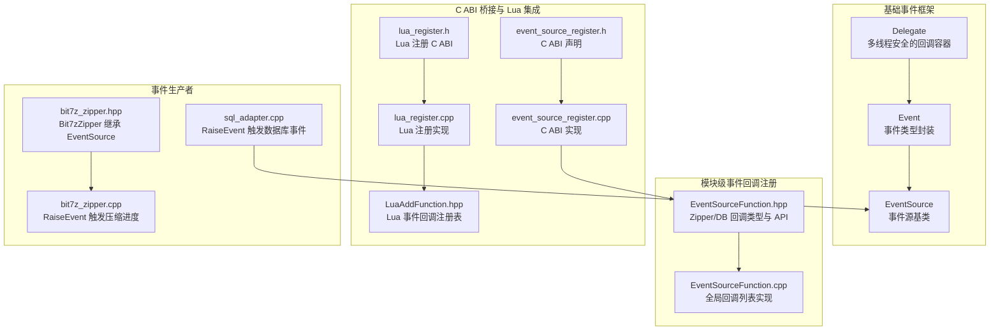
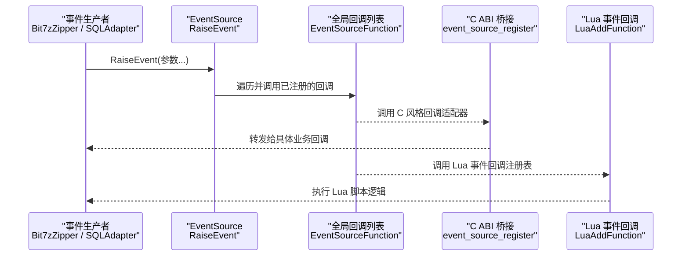
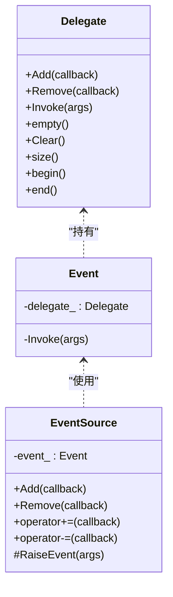
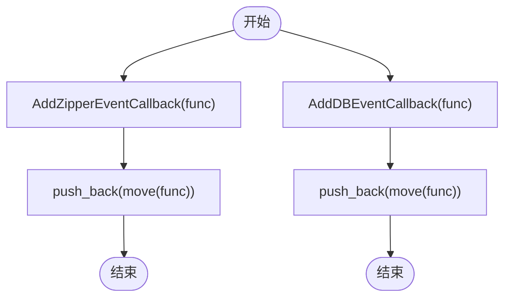
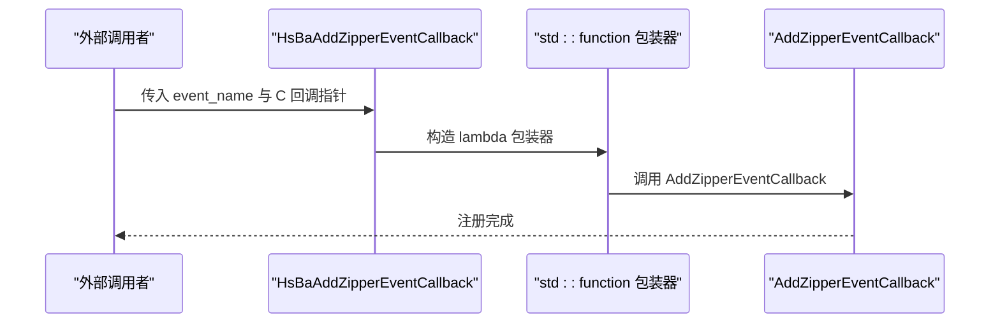
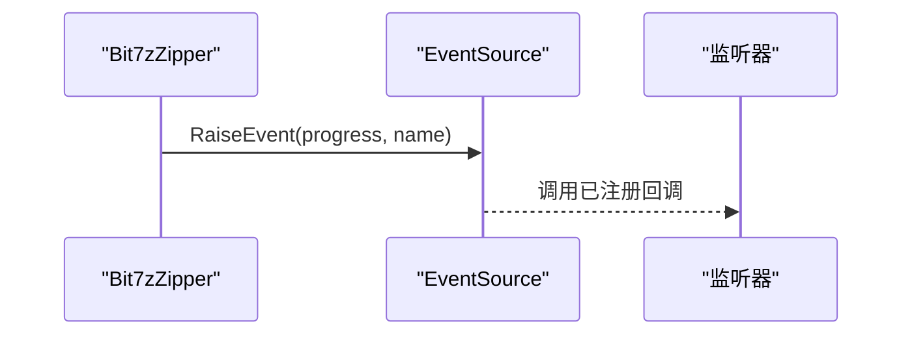
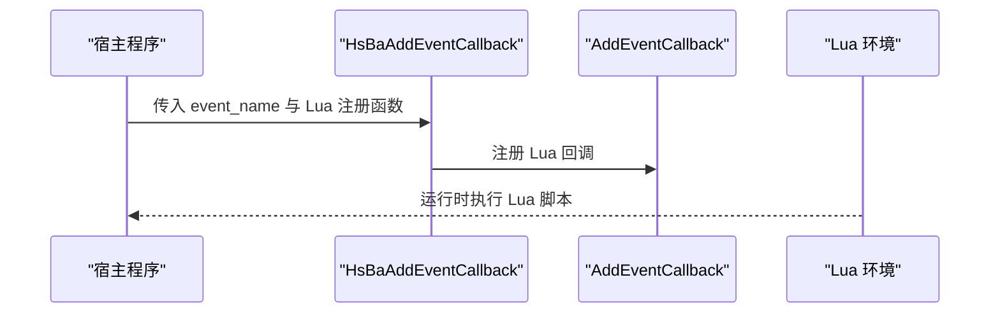
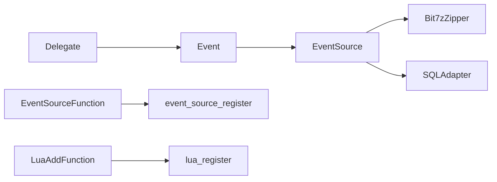

# 事件系统

<cite>
**本文引用的文件**   
- [delegate.hpp](file://base/delegate.hpp)
- [EventSourceFunction.hpp](file://LibHsBaSlicer/Extends/EventSourceFunction.hpp)
- [EventSourceFunction.cpp](file://LibHsBaSlicer/Extends/EventSourceFunction.cpp)
- [event_source_register.h](file://DllHsBaSlicer/event_source_register.h)
- [event_source_register.cpp](file://DllHsBaSlicer/event_source_register.cpp)
- [bit7z_zipper.hpp](file://fileoperator/bit7z_zipper.hpp)
- [bit7z_zipper.cpp](file://fileoperator/bit7z_zipper.cpp)
- [sql_adapter.cpp](file://fileoperator/sql_adapter.cpp)
- [LuaAddFunction.hpp](file://LibHsBaSlicer/Extends/LuaAddFunction.hpp)
- [lua_register.h](file://DllHsBaSlicer/lua_register.h)
- [lua_register.cpp](file://DllHsBaSlicer/lua_register.cpp)
- [lua_pipeline.cpp](file://LibHsBaSlicer/Extends/lua_pipeline.cpp)
</cite>

## 目录
1. [简介](#简介)
2. [项目结构](#项目结构)
3. [核心组件](#核心组件)
4. [架构总览](#架构总览)
5. [详细组件分析](#详细组件分析)
6. [依赖关系分析](#依赖关系分析)
7. [性能与并发特性](#性能与并发特性)
8. [最佳实践](#最佳实践)
9. [故障排除指南](#故障排除指南)
10. [结论](#结论)
11. [附录：API 参考](#附录api-参考)

## 简介
本文件系统性梳理 HsBaSlicer 的事件系统，覆盖以下目标：
- 事件源注册机制、回调函数绑定与事件分发机制
- EventSourceFunction 类（模块级事件回调注册）的使用方法
- delegate 模板在事件系统中的实现原理
- 事件处理最佳实践：异步处理、错误处理、性能考虑
- 长时间运行切片任务中的进度更新与状态变化示例
- 事件系统与 Lua 脚本的集成方式

## 项目结构
事件系统由三层组成：
- 基础事件框架：基于 delegate 模板的 EventSource 通用事件源
- 模块级事件回调注册：EventSourceFunction 提供 Zipper 与数据库事件的全局回调列表
- C ABI 桥接与 Lua 集成：DllHsBaSlicer 暴露 C 接口，LuaAddFunction 提供 Lua 侧事件回调注册

**图表来源**
- [delegate.hpp:27-167](file://base/delegate.hpp#L27-L167)
- [delegate.hpp:169-243](file://base/delegate.hpp#L169-L243)
- [EventSourceFunction.hpp:16-42](file://LibHsBaSlicer/Extends/EventSourceFunction.hpp#L16-L42)
- [EventSourceFunction.cpp:7-33](file://LibHsBaSlicer/Extends/EventSourceFunction.cpp#L7-L33)
- [event_source_register.h:9-20](file://DllHsBaSlicer/event_source_register.h#L9-L20)
- [event_source_register.cpp:9-34](file://DllHsBaSlicer/event_source_register.cpp#L9-L34)
- [lua_register.h:11-31](file://DllHsBaSlicer/lua_register.h#L11-L31)
- [lua_register.cpp:9-42](file://DllHsBaSlicer/lua_register.cpp#L9-L42)
- [LuaAddFunction.hpp:19-75](file://LibHsBaSlicer/Extends/LuaAddFunction.hpp#L19-L75)
- [bit7z_zipper.hpp:79-102](file://fileoperator/bit7z_zipper.hpp#L79-L102)
- [bit7z_zipper.cpp:259-274](file://fileoperator/bit7z_zipper.cpp#L259-L274)
- [sql_adapter.cpp:150-188](file://fileoperator/sql_adapter.cpp#L150-L188)

**章节来源**
- [delegate.hpp:27-167](file://base/delegate.hpp#L27-L167)
- [delegate.hpp:169-243](file://base/delegate.hpp#L169-L243)
- [EventSourceFunction.hpp:16-42](file://LibHsBaSlicer/Extends/EventSourceFunction.hpp#L16-L42)
- [EventSourceFunction.cpp:7-33](file://LibHsBaSlicer/Extends/EventSourceFunction.cpp#L7-L33)
- [event_source_register.h:9-20](file://DllHsBaSlicer/event_source_register.h#L9-L20)
- [event_source_register.cpp:9-34](file://DllHsBaSlicer/event_source_register.cpp#L9-L34)
- [lua_register.h:11-31](file://DllHsBaSlicer/lua_register.h#L11-L31)
- [lua_register.cpp:9-42](file://DllHsBaSlicer/lua_register.cpp#L9-L42)
- [LuaAddFunction.hpp:19-75](file://LibHsBaSlicer/Extends/LuaAddFunction.hpp#L19-L75)
- [bit7z_zipper.hpp:79-102](file://fileoperator/bit7z_zipper.hpp#L79-L102)
- [bit7z_zipper.cpp:259-274](file://fileoperator/bit7z_zipper.cpp#L259-L274)
- [sql_adapter.cpp:150-188](file://fileoperator/sql_adapter.cpp#L150-L188)

## 核心组件
- Delegate：线程安全的回调容器，支持 Add/Remove/Invoke/Clear/size/empty 等操作，内部使用 shared_mutex 保护回调列表。
- Event：对特定签名事件的封装，持有 Delegate 实例并对外隐藏 Invoke。
- EventSource：面向派生类的通用事件源基类，提供 Add/operator+= 注册监听器，以及 RaiseEvent 触发事件。
- EventSourceFunction：模块级 Zipper 与数据库事件回调注册 API，维护全局回调列表并提供访问方法。
- C ABI 桥接：event_source_register 暴露 HsBaAddZipperEventCallback/HsBaAddDBEventCallback，将 C 风格回调适配到 C++ 回调列表。
- Lua 集成：LuaAddFunction 提供 AddEventCallback/GetEventCallbacks；lua_register 暴露 HsBaAddEventCallback 供外部注入 Lua 事件回调。

**章节来源**
- [delegate.hpp:27-167](file://base/delegate.hpp#L27-L167)
- [delegate.hpp:169-243](file://base/delegate.hpp#L169-L243)
- [EventSourceFunction.hpp:16-42](file://LibHsBaSlicer/Extends/EventSourceFunction.hpp#L16-L42)
- [EventSourceFunction.cpp:7-33](file://LibHsBaSlicer/Extends/EventSourceFunction.cpp#L7-L33)
- [event_source_register.h:9-20](file://DllHsBaSlicer/event_source_register.h#L9-L20)
- [event_source_register.cpp:9-34](file://DllHsBaSlicer/event_source_register.cpp#L9-L34)
- [LuaAddFunction.hpp:19-75](file://LibHsBaSlicer/Extends/LuaAddFunction.hpp#L19-L75)
- [lua_register.h:11-31](file://DllHsBaSlicer/lua_register.h#L11-L31)
- [lua_register.cpp:9-42](file://DllHsBaSlicer/lua_register.cpp#L9-L42)

## 架构总览
事件系统的整体流程如下：
- 事件生产者（如 Bit7zZipper、SQLAdapter）通过继承 EventSource 并使用 RaiseEvent 触发事件
- 模块级回调注册（EventSourceFunction）维护全局回调列表，供外部订阅 Zipper/DB 事件
- C ABI 层（event_source_register）将 C 风格回调包装为 C++ std::function 并加入全局列表
- Lua 侧通过 LuaAddFunction 注册事件回调，并在运行时被调用以执行 Lua 逻辑

**图表来源**
- [bit7z_zipper.cpp:259-274](file://fileoperator/bit7z_zipper.cpp#L259-L274)
- [sql_adapter.cpp:150-188](file://fileoperator/sql_adapter.cpp#L150-L188)
- [EventSourceFunction.cpp:7-33](file://LibHsBaSlicer/Extends/EventSourceFunction.cpp#L7-L33)
- [event_source_register.cpp:9-34](file://DllHsBaSlicer/event_source_register.cpp#L9-L34)
- [LuaAddFunction.hpp:60-75](file://LibHsBaSlicer/Extends/LuaAddFunction.hpp#L60-L75)

## 详细组件分析

### 基础事件框架：Delegate、Event、EventSource
- Delegate
  - 线程安全：Add/Invoke/Clear/size/empty 等方法使用 shared_mutex 保护回调列表
  - 回调移除：Remove 标记为废弃，因为 std::function 没有 operator==
  - 调用策略：根据返回类型是否为 void、是否可加和决定结果聚合方式
- Event
  - 仅持有 Delegate 实例，对外暴露 Invoke 的私有版本，限制直接访问
- EventSource
  - 提供 Add/operator+= 注册监听器
  - Remove/operator-= 标记为废弃
  - RaiseEvent 用于触发事件，内部委托给 Event.Invoke

**图表来源**
- [delegate.hpp:27-167](file://base/delegate.hpp#L27-L167)
- [delegate.hpp:169-243](file://base/delegate.hpp#L169-L243)

**章节来源**
- [delegate.hpp:27-167](file://base/delegate.hpp#L27-L167)
- [delegate.hpp:169-243](file://base/delegate.hpp#L169-L243)

### 模块级事件回调注册：EventSourceFunction
- 回调类型
  - ZipperEventCallback：void(double, std::string_view)，用于压缩进度与阶段描述
  - DBEventCallback：void(std::string_view, std::string_view)，用于数据库事件键值对
- API
  - AddZipperEventCallback/AddDBEventCallback：添加回调
  - GetZipperEventCallback/GetDBEventCallback：获取全局回调列表引用
- 实现
  - 使用模块内静态 vector 存储回调，Add 时 move 语义减少拷贝

**图表来源**
- [EventSourceFunction.hpp:16-42](file://LibHsBaSlicer/Extends/EventSourceFunction.hpp#L16-L42)
- [EventSourceFunction.cpp:7-33](file://LibHsBaSlicer/Extends/EventSourceFunction.cpp#L7-L33)

**章节来源**
- [EventSourceFunction.hpp:16-42](file://LibHsBaSlicer/Extends/EventSourceFunction.hpp#L16-L42)
- [EventSourceFunction.cpp:7-33](file://LibHsBaSlicer/Extends/EventSourceFunction.cpp#L7-L33)

### C ABI 桥接：event_source_register
- 暴露 C 接口
  - HsBaAddZipperEventCallback(event_name, func)
  - HsBaAddDBEventCallback(event_name, func)
- 实现要点
  - 将 C 风格回调包装为 C++ std::function，并根据 event_name 过滤分发
  - 调用 HsBa::Slicer::AddZipperEventCallback/AddDBEventCallback 加入全局列表

**图表来源**
- [event_source_register.h:9-20](file://DllHsBaSlicer/event_source_register.h#L9-L20)
- [event_source_register.cpp:9-34](file://DllHsBaSlicer/event_source_register.cpp#L9-L34)

**章节来源**
- [event_source_register.h:9-20](file://DllHsBaSlicer/event_source_register.h#L9-L20)
- [event_source_register.cpp:9-34](file://DllHsBaSlicer/event_source_register.cpp#L9-L34)

### 事件生产者：Bit7zZipper 与 SQLAdapter
- Bit7zZipper
  - 继承 Utils::EventSource<Bit7zZipper, void, double, std::string_view>
  - 在压缩过程中按条目触发 RaiseEvent(progress, name)
- SQLAdapter
  - 在连接、查询、插入、删除、更新等关键操作后触发 RaiseEvent(key, value)

**图表来源**
- [bit7z_zipper.hpp:79-102](file://fileoperator/bit7z_zipper.hpp#L79-L102)
- [bit7z_zipper.cpp:259-274](file://fileoperator/bit7z_zipper.cpp#L259-L274)
- [sql_adapter.cpp:150-188](file://fileoperator/sql_adapter.cpp#L150-L188)

**章节来源**
- [bit7z_zipper.hpp:79-102](file://fileoperator/bit7z_zipper.hpp#L79-L102)
- [bit7z_zipper.cpp:259-274](file://fileoperator/bit7z_zipper.cpp#L259-L274)
- [sql_adapter.cpp:150-188](file://fileoperator/sql_adapter.cpp#L150-L188)

### Lua 事件回调集成
- LuaAddFunction
  - AddEventCallback(event_name, func)：注册 Lua 事件回调
  - GetEventCallbacks(event_name)：获取指定事件名的回调列表
- lua_register
  - HsBaAddEventCallback(event_name, func)：C ABI 入口，调用 AddEventCallback
- lua_pipeline
  - 在执行 Lua 脚本时捕获错误并报告，确保事件回调异常不会破坏主流程

**图表来源**
- [LuaAddFunction.hpp:60-75](file://LibHsBaSlicer/Extends/LuaAddFunction.hpp#L60-L75)
- [lua_register.h:11-31](file://DllHsBaSlicer/lua_register.h#L11-L31)
- [lua_register.cpp:9-42](file://DllHsBaSlicer/lua_register.cpp#L9-L42)
- [lua_pipeline.cpp:991-1023](file://LibHsBaSlicer/Extends/lua_pipeline.cpp#L991-L1023)

**章节来源**
- [LuaAddFunction.hpp:60-75](file://LibHsBaSlicer/Extends/LuaAddFunction.hpp#L60-L75)
- [lua_register.h:11-31](file://DllHsBaSlicer/lua_register.h#L11-L31)
- [lua_register.cpp:9-42](file://DllHsBaSlicer/lua_register.cpp#L9-L42)
- [lua_pipeline.cpp:991-1023](file://LibHsBaSlicer/Extends/lua_pipeline.cpp#L991-L1023)

## 依赖关系分析
- Delegate 是 Event 与 EventSource 的基础，提供线程安全的回调管理
- EventSourceFunction 独立于 Delegate，提供模块级全局回调列表
- event_source_register 依赖 EventSourceFunction，将 C 回调适配为 C++ 回调
- LuaAddFunction 与 lua_register 共同构成 Lua 事件回调注册体系
- Bit7zZipper 与 SQLAdapter 依赖 EventSource 触发事件

**图表来源**
- [delegate.hpp:27-167](file://base/delegate.hpp#L27-L167)
- [delegate.hpp:169-243](file://base/delegate.hpp#L169-L243)
- [EventSourceFunction.hpp:16-42](file://LibHsBaSlicer/Extends/EventSourceFunction.hpp#L16-L42)
- [event_source_register.cpp:9-34](file://DllHsBaSlicer/event_source_register.cpp#L9-L34)
- [LuaAddFunction.hpp:19-75](file://LibHsBaSlicer/Extends/LuaAddFunction.hpp#L19-L75)
- [lua_register.cpp:9-42](file://DllHsBaSlicer/lua_register.cpp#L9-L42)
- [bit7z_zipper.hpp:79-102](file://fileoperator/bit7z_zipper.hpp#L79-L102)
- [sql_adapter.cpp:150-188](file://fileoperator/sql_adapter.cpp#L150-L188)

**章节来源**
- [delegate.hpp:27-167](file://base/delegate.hpp#L27-L167)
- [delegate.hpp:169-243](file://base/delegate.hpp#L169-L243)
- [EventSourceFunction.hpp:16-42](file://LibHsBaSlicer/Extends/EventSourceFunction.hpp#L16-L42)
- [event_source_register.cpp:9-34](file://DllHsBaSlicer/event_source_register.cpp#L9-L34)
- [LuaAddFunction.hpp:19-75](file://LibHsBaSlicer/Extends/LuaAddFunction.hpp#L19-L75)
- [lua_register.cpp:9-42](file://DllHsBaSlicer/lua_register.cpp#L9-L42)
- [bit7z_zipper.hpp:79-102](file://fileoperator/bit7z_zipper.hpp#L79-L102)
- [sql_adapter.cpp:150-188](file://fileoperator/sql_adapter.cpp#L150-L188)

## 性能与并发特性
- Delegate 使用 shared_mutex 保护回调列表，避免读写竞争
- Invoke 会复制回调列表以避免在迭代期间修改导致的未定义行为
- 回调移除（Remove）标记为废弃，建议通过生命周期管理或弱引用替代
- 全局回调列表（EventSourceFunction）为简单 vector，频繁增删可能带来性能开销，建议在初始化阶段批量注册

[本节为一般性指导，不直接分析具体文件]

## 最佳实践
- 事件监听器的注册与注销
  - 优先使用 Add/operator+= 注册监听器
  - 避免使用 Remove/operator-=，因其依赖 std::function 比较，已被标记废弃
  - 对于长生命周期对象，建议使用 RAII 或作用域管理确保监听器正确清理
- 异步事件处理
  - 在回调中避免阻塞操作，必要时将耗时任务投递到线程池或协程
  - 注意回调执行的线程上下文，避免跨线程访问非线程安全资源
- 错误处理
  - 在 Lua 回调中使用 pcall 包裹脚本执行，捕获并记录错误
  - 在 C++ 回调中捕获异常，避免影响事件分发主流程
- 性能考虑
  - 减少高频事件中的字符串拷贝，尽量使用 string_view
  - 批量注册回调，避免在热路径中频繁 push_back
  - 对高频率事件进行节流或合并，降低 UI 或日志压力

[本节为一般性指导，不直接分析具体文件]

## 故障排除指南
- 回调未被触发
  - 检查是否正确调用 AddZipperEventCallback/AddDBEventCallback
  - 确认事件生产者确实调用了 RaiseEvent
- Lua 回调报错
  - 检查 lua_pipeline 的错误捕获逻辑，确认错误消息输出
  - 验证 Lua 脚本中函数名与注册名一致
- 内存泄漏或悬挂指针
  - 避免在回调中保存临时对象的裸指针
  - 使用智能指针或弱引用管理对象生命周期

**章节来源**
- [lua_pipeline.cpp:991-1023](file://LibHsBaSlicer/Extends/lua_pipeline.cpp#L991-L1023)

## 结论
HsBaSlicer 的事件系统以 Delegate/Event/EventSource 为基础，结合模块级全局回调注册与 C ABI 桥接，提供了灵活且可扩展的事件机制。通过合理设计回调生命周期、异步处理与错误处理，可以在长时间运行的切片任务中稳定地获取进度更新与状态变化，并与 Lua 脚本无缝集成。

[本节为总结性内容，不直接分析具体文件]

## 附录：API 参考
- EventSourceFunction
  - ZipperEventCallback：void(double, std::string_view)
  - DBEventCallback：void(std::string_view, std::string_view)
  - AddZipperEventCallback/AddDBEventCallback：注册回调
  - GetZipperEventCallback/GetDBEventCallback：获取回调列表
- C ABI
  - HsBaAddZipperEventCallback/HsBaAddDBEventCallback：C 风格回调注册
- Lua 集成
  - AddEventCallback/GetEventCallbacks：Lua 事件回调注册与查询
  - HsBaAddEventCallback：C ABI 入口

**章节来源**
- [EventSourceFunction.hpp:16-42](file://LibHsBaSlicer/Extends/EventSourceFunction.hpp#L16-L42)
- [event_source_register.h:9-20](file://DllHsBaSlicer/event_source_register.h#L9-L20)
- [LuaAddFunction.hpp:60-75](file://LibHsBaSlicer/Extends/LuaAddFunction.hpp#L60-L75)
- [lua_register.h:11-31](file://DllHsBaSlicer/lua_register.h#L11-L31)