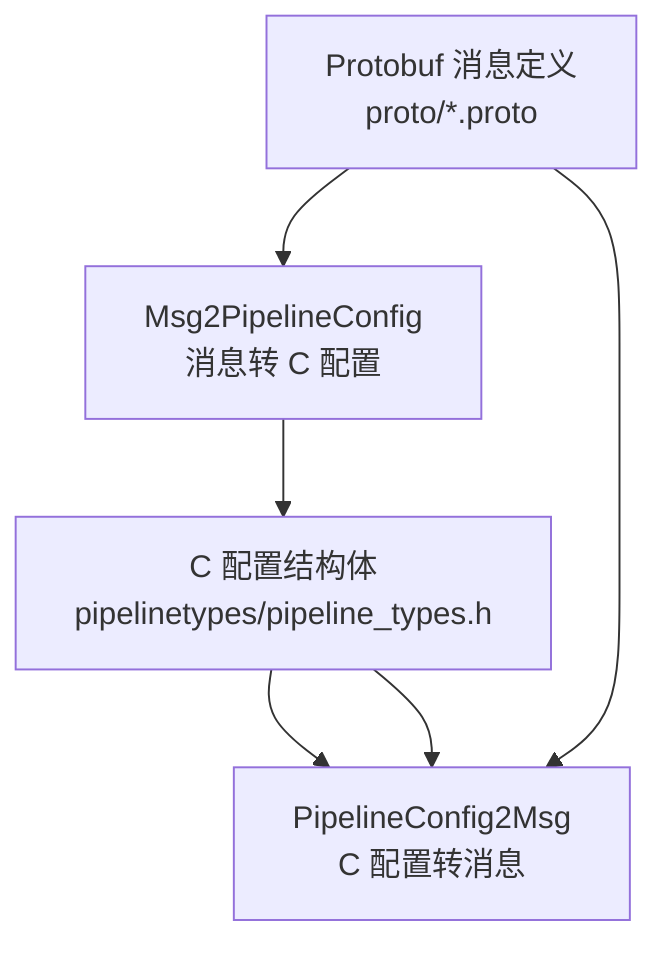
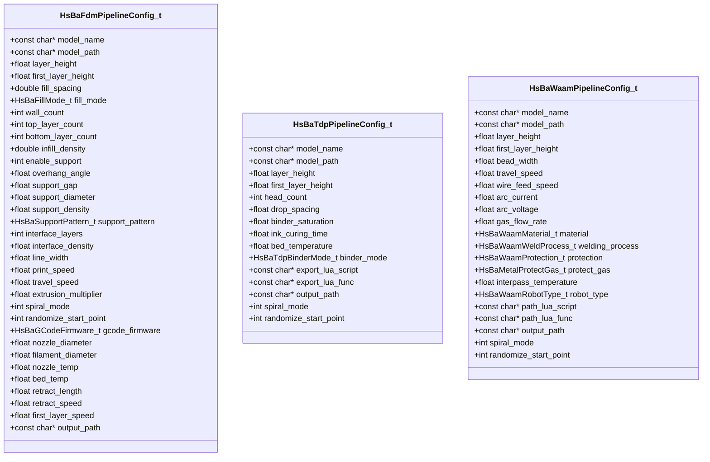
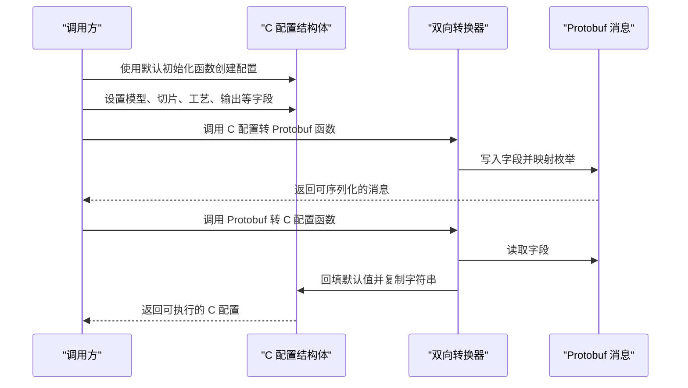
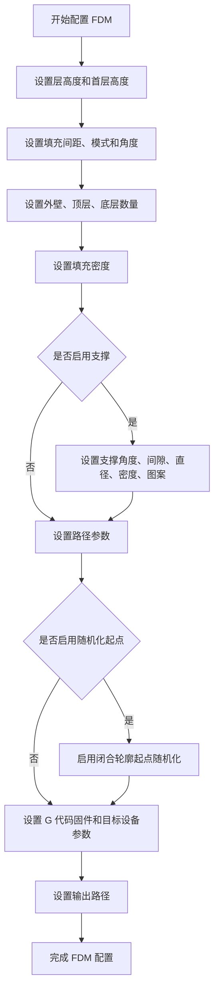
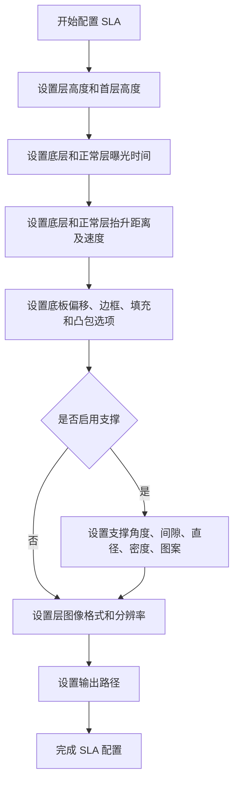
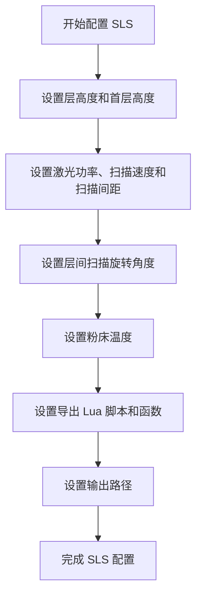
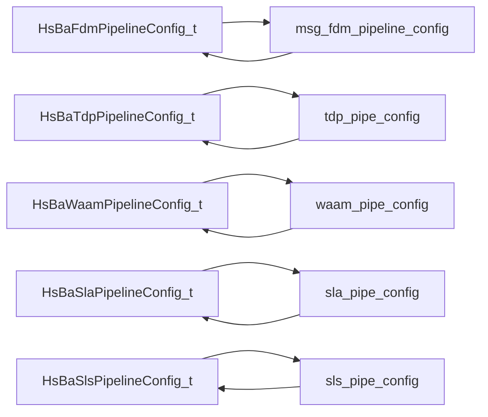
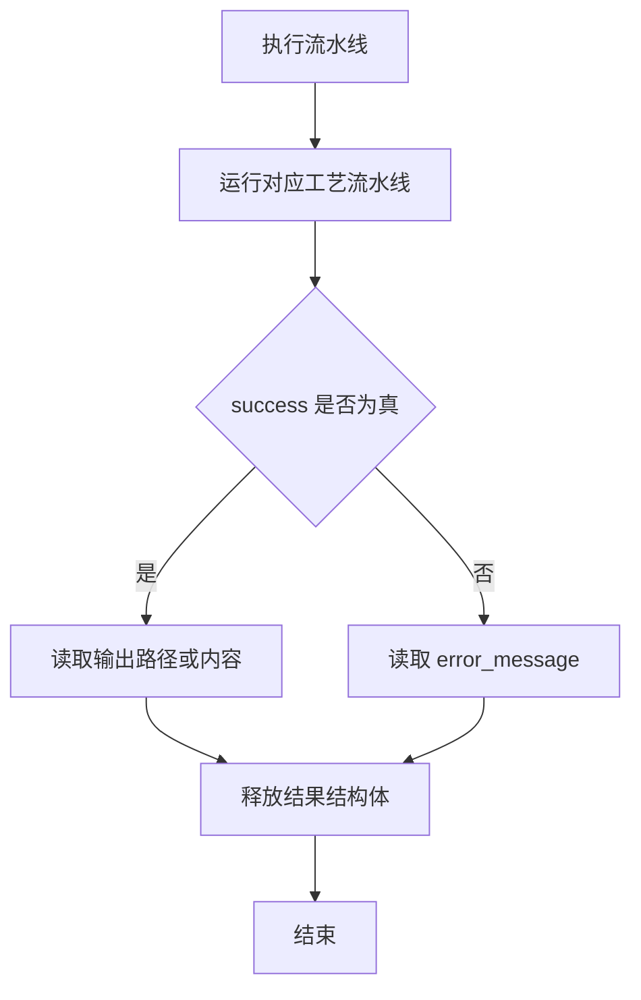

# 流水线配置类型

<cite>
**本文引用的文件**   
- [pipeline_types.h](file://pipelinetypes/pipeline_types.h)
- [fdm_pipeline.proto](file://proto/fdm_pipeline.proto)
- [tdp_pipeline.proto](file://proto/tdp_pipeline.proto)
- [waam_pipeline.proto](file://proto/waam_pipeline.proto)
- [Msg2PipelineConfig.hpp](file://convert/Msg2PipelineConfig.hpp)
- [Msg2PipelineConfig.cpp](file://convert/Msg2PipelineConfig.cpp)
- [PipelineConfig2Msg.hpp](file://convert/PipelineConfig2Msg.hpp)
- [PipelineConfig2Msg.cpp](file://convert/PipelineConfig2Msg.cpp)
- [fdm_pipeline.cpp](file://DllHsBaSlicer/fdm_pipeline.cpp)
- [tdp_pipeline.cpp](file://DllHsBaSlicer/tdp_pipeline.cpp)
- [waam_pipeline.cpp](file://DllHsBaSlicer/waam_pipeline.cpp)
</cite>

## 更新摘要
**变更内容**   
- 新增 `randomize_start_point` 配置字段到 FDM、TDP、WAAM 流水线配置结构体
- 更新 Protobuf 定义以支持新的随机化起点功能
- 添加字段转换逻辑和默认值初始化
- 详细说明随机化起点的技术实现和应用场景

## 目录
1. [引言](#引言)
2. [项目结构定位](#项目结构定位)
3. [核心配置类型总览](#核心配置类型总览)
4. [架构与数据流](#架构与数据流)
5. [FDM 熔融沉积成型流水线配置](#fdm-熔融沉积成型流水线配置)
6. [SLA 光固化流水线配置](#sla-光固化流水线配置)
7. [SLS 选择性激光烧结流水线配置](#sls-选择性激光烧结流水线配置)
8. [其他工艺流水线配置](#其他工艺流水线配置)
9. [跨语言 Protobuf 映射关系](#跨语言-protobuf-映射关系)
10. [字段依赖、取值范围与约束](#字段依赖取值范围与约束)
11. [配置验证规则与常见错误处理](#配置验证规则与常见错误处理)
12. [实际配置示例](#实际配置示例)
13. [性能与内存管理注意事项](#性能与内存管理注意事项)
14. [结论](#结论)

## 引言

HsBaSlicer 的"流水线配置类型"是面向不同 3D 打印工艺的 C 兼容结构体集合，用于描述模型输入、切片参数、支撑、填充、层图像、激光/电弧工艺、机器人路径以及输出格式等完整加工信息。这些结构体同时对应 Protobuf 消息定义，构成跨语言、跨进程的数据交换契约。

本文聚焦以下目标：
- 完整记录 `HsBaFdmPipelineConfig_t`、`HsBaSlaPipelineConfig_t`、`HsBaSlsPipelineConfig_t` 等配置结构体的字段、数据类型、默认值、取值范围和语义。
- 说明各字段之间的依赖关系和约束条件。
- 给出 C 结构体与 Protobuf 消息的双向转换关系。
- 提供配置验证规则和常见错误处理方法。
- 通过实际配置示例展示如何为 FDM、SLA、SLS 等不同工艺设置合理参数。
- **新增**：详细说明 `randomize_start_point` 随机化起点功能在 FDM/TDP/WAAM 工艺中的应用。

## 项目结构定位

流水线配置类型在仓库中的关键位置如下：

| 类别 | 文件 | 作用 |
|---|---|---|
| C 兼容配置定义 | `pipelinetypes/pipeline_types.h` | 所有流水线配置结构体、枚举、结果结构和默认初始化函数 |
| FDM Protobuf 定义 | `proto/fdm_pipeline.proto` | FDM 配置与结果的 Protobuf 消息 |
| TDP Protobuf 定义 | `proto/tdp_pipeline.proto` | TDP 配置与结果的 Protobuf 消息 |
| WAAM Protobuf 定义 | `proto/waam_pipeline.proto` | WAAM 配置与结果的 Protobuf 消息 |
| Protobuf 到 C 配置转换接口 | `convert/Msg2PipelineConfig.hpp` | 声明从 Protobuf 消息转换为 C 配置结构体的函数 |
| Protobuf 到 C 配置转换实现 | `convert/Msg2PipelineConfig.cpp` | 具体转换逻辑，包括字符串分配和默认值回填 |
| C 配置到 Protobuf 转换接口 | `convert/PipelineConfig2Msg.hpp` | 声明从 C 配置结构体转换为 Protobuf 消息的函数 |
| C 配置到 Protobuf 转换实现 | `convert/PipelineConfig2Msg.cpp` | 具体转换逻辑，包括空指针保护和枚举映射 |



**图表来源**
- [pipeline_types.h:56-113](file://pipelinetypes/pipeline_types.h#L56-L113)
- [fdm_pipeline.proto:26-72](file://proto/fdm_pipeline.proto#L26-L72)
- [Msg2PipelineConfig.hpp:24-32](file://convert/Msg2PipelineConfig.hpp#L24-L32)
- [PipelineConfig2Msg.hpp:24-28](file://convert/PipelineConfig2Msg.hpp#L24-L28)

**章节来源**
- [pipeline_types.h:5-12](file://pipelinetypes/pipeline_types.h#L5-L12)
- [Msg2PipelineConfig.hpp:1-20](file://convert/Msg2PipelineConfig.hpp#L1-L20)
- [PipelineConfig2Msg.hpp:1-20](file://convert/PipelineConfig2Msg.hpp#L1-L20)

## 核心配置类型总览

HsBaSlicer 目前支持的主要流水线配置类型包括：

| 工艺 | C 配置结构体 | Protobuf 消息 | 主要输出 |
|---|---|---|---|
| FDM 熔融沉积成型 | `HsBaFdmPipelineConfig_t` | `msg_fdm_pipeline_config` | G 代码文本 |
| SLA 光固化 | `HsBaSlaPipelineConfig_t` | `sla_pipe_config` | 层图像压缩包或导出文件 |
| SLS 选择性激光烧结 | `HsBaSlsPipelineConfig_t` | `sls_pipe_config` | Lua 导出脚本生成的文件 |
| SLM 金属粉末床熔化 | `HsBaSlmPipelineConfig_t` | `slm_pipe_config` | Lua 导出脚本生成的文件 |
| LOM 分层实体制造 | `HsBaLomPipelineConfig_t` | `lom_pipe_config` | Lua 导出脚本生成的文件 |
| 3DP 粘结剂喷射 | `HsBaTdpPipelineConfig_t` | `tdp_pipe_config` | Lua 导出脚本生成的文件 |
| WAAM 电弧增材制造 | `HsBaWaamPipelineConfig_t` | `waam_pipe_config` | 机器人程序文件 |
| 自定义 Lua 流水线 | `HsBaCustomPipelineConfig_t` | `custom_pipe_config` | Lua 脚本返回的输出路径和结果字符串 |
| 文件传输流水线 | `HsBaFileTransferPipelineConfig_t` | `file_transfer_pipe_config` | 远程服务传输结果 |

每个配置结构体都包含模型名称、模型路径、层高度、首层高度等基础切片字段；不同工艺再叠加自身特有的物理参数、材料参数、设备参数和 Lua 扩展点。



**图表来源**
- [pipeline_types.h:56-113](file://pipelinetypes/pipeline_types.h#L56-L113)
- [pipeline_types.h:483-500](file://pipelinetypes/pipeline_types.h#L483-L500)
- [pipeline_types.h:582-605](file://pipelinetypes/pipeline_types.h#L582-L605)

**章节来源**
- [pipeline_types.h:56-113](file://pipelinetypes/pipeline_types.h#L56-L113)
- [pipeline_types.h:483-500](file://pipelinetypes/pipeline_types.h#L483-L500)
- [pipeline_types.h:582-605](file://pipelinetypes/pipeline_types.h#L582-L605)

## 架构与数据流

流水线配置的生命周期通常分为三个阶段：

1. **配置构造阶段**：调用方根据工艺选择对应的配置结构体，并使用默认初始化函数填充初始值，再覆盖需要调整的业务字段。
2. **序列化阶段**：将 C 配置结构体转换为 Protobuf 消息，用于跨语言、跨进程或持久化存储。
3. **反序列化阶段**：从 Protobuf 消息恢复为 C 配置结构体，供 C++ 流水线执行。



**图表来源**
- [Msg2PipelineConfig.cpp:35-83](file://convert/Msg2PipelineConfig.cpp#L35-L83)
- [PipelineConfig2Msg.cpp:10-77](file://convert/PipelineConfig2Msg.cpp#L10-L77)

**章节来源**
- [Msg2PipelineConfig.cpp:17-31](file://convert/Msg2PipelineConfig.cpp#L17-L31)
- [PipelineConfig2Msg.cpp:10-77](file://convert/PipelineConfig2Msg.cpp#L10-L77)

## FDM 熔融沉积成型流水线配置

### 结构体定义与职责

`HsBaFdmPipelineConfig_t` 是 FDM 工艺的核心配置结构体，涵盖模型信息、切片参数、填充模式、支撑结构、路径参数、G 代码固件目标和输出路径。

关键字段分组如下：

| 分组 | 字段 | 类型 | 默认值 | 说明 |
|---|---|---|---:|---|
| 模型 | `model_name` | `const char*` | NULL | 模型名称 |
| 模型 | `model_path` | `const char*` | NULL | 模型文件路径 |
| 切片 | `layer_height` | `float` | 0.2 | 层高度，单位毫米 |
| 切片 | `first_layer_height` | `float` | 0.25 | 首层高度，单位毫米 |
| 填充 | `fill_spacing` | `double` | 0.4 | 填充线间距，单位毫米 |
| 填充 | `fill_mode` | `HsBaFillMode_t` | `HSBA_FILL_ZIGZAG` | 填充模式 |
| 填充 | `fill_angle` | `double` | 45.0 | 填充角度，单位度 |
| 外壳 | `wall_count` | `int` | 3 | 外壁轮廓数量 |
| 外壳 | `top_layer_count` | `int` | 3 | 顶层实心层数 |
| 外壳 | `bottom_layer_count` | `int` | 3 | 底层实心层数 |
| 填充密度 | `infill_density` | `double` | 0.2 | 填充密度，范围 `[0,1]` |
| 支撑开关 | `enable_support` | `int` | 1 | 是否启用支撑 |
| 支撑阈值 | `overhang_angle` | `float` | 45.0 | 悬垂角度阈值，单位度 |
| 支撑间隙 | `support_gap` | `float` | 0.5 | 支撑与模型间隙，单位毫米 |
| 支撑直径 | `support_diameter` | `float` | 2.0 | 支撑柱直径，单位毫米 |
| 支撑密度 | `support_density` | `float` | 0.3 | 支撑填充密度，范围 `[0,1]` |
| 支撑图案 | `support_pattern` | `HsBaSupportPattern_t` | `HSBA_SUPPORT_PLANE` | 支撑图案 |
| 界面层 | `interface_layers` | `int` | 2 | 支撑界面层数 |
| 界面密度 | `interface_density` | `float` | 0.5 | 支撑界面密度，范围 `[0,1]` |
| 路径 | `line_width` | `float` | 0.4 | 挤出线宽，单位毫米 |
| 路径 | `print_speed` | `float` | 50.0 | 打印速度，单位毫米每秒 |
| 路径 | `travel_speed` | `float` | 100.0 | 移动速度，单位毫米每秒 |
| 路径 | `extrusion_multiplier` | `float` | 1.0 | 挤出倍率 |
| 路径 | `spiral_mode` | `int` | 0 | 螺旋外壁模式 |
| **路径** | **`randomize_start_point`** | **`int`** | **0** | **随机化闭合轮廓起点（0=false, 1=true），每层确定性的随机起点错开挤出接缝** |
| G 代码固件 | `gcode_firmware` | `HsBaGCodeFirmware_t` | `HSBA_GCODE_MARLIN` | 目标固件 |
| 喷嘴 | `nozzle_diameter` | `float` | 0.4 | 喷嘴直径，单位毫米 |
| 耗材 | `filament_diameter` | `float` | 1.75 | 耗材直径，单位毫米 |
| 温度 | `nozzle_temp` | `float` | 200.0 | 喷嘴温度，单位摄氏度 |
| 温度 | `bed_temp` | `float` | 60.0 | 热床温度，单位摄氏度 |
| 回抽 | `retract_length` | `float` | 1.0 | 回抽长度，单位毫米 |
| 回抽 | `retract_speed` | `float` | 40.0 | 回抽速度，单位毫米每秒 |
| 首层速度 | `first_layer_speed` | `float` | 20.0 | 首层速度，单位毫米每秒 |
| 输出 | `output_path` | `const char*` | NULL | G 代码输出路径 |

### FDM 枚举类型

| 枚举 | 值 | 含义 |
|---|---:|---|
| `HsBaFillMode_t` | 0 | 平行线填充 |
| `HsBaFillMode_t` | 1 | 简单之字形填充 |
| `HsBaFillMode_t` | 2 | 高级之字形填充 |
| `HsBaSupportPattern_t` | 0 | 柱状支撑 |
| `HsBaSupportPattern_t` | 1 | 树状支撑 |
| `HsBaSupportPattern_t` | 2 | 蜂窝支撑 |
| `HsBaGCodeFirmware_t` | 0 | Marlin 固件 |
| `HsBaGCodeFirmware_t` | 1 | RepRap / RRF 固件 |
| `HsBaGCodeFirmware_t` | 2 | Klipper 固件 |

### FDM 随机化起点功能详解

**新增功能**：`randomize_start_point` 字段用于控制闭合轮廓和偏移环的起点随机化。

#### 技术实现原理

当启用 `randomize_start_point` 时，系统会：

1. **逐层确定性随机**：每层使用固定的种子值（层号 + 1）生成随机起点
2. **边缘内部采样**：在轮廓边的内部均匀采样随机分裂点
3. **接缝错位**：错开层间和嵌套环的挤出接缝位置
4. **几何变换**：通过 `RandomizePathStartPoints` 函数旋转轮廓起点

#### 应用场景

- **减少应力集中**：避免同一位置的挤出接缝累积导致结构弱点
- **改善表面质量**：分散可见的接缝痕迹
- **提升机械强度**：均匀分布内应力，提高零件整体强度

#### 实现细节

```cpp
// FDM 填充阶段的随机化实现
if (cfg.randomize_start_point)
{
    // 错开挤出接缝：将轮廓/偏移环旋转到每层确定性的随机起点
    layer_fills[i] = UnIntegerization(RandomizePathStartPoints(fill_result, static_cast<std::uint64_t>(i) + 1ULL));
}
```

**章节来源**
- [pipeline_types.h:56-113](file://pipelinetypes/pipeline_types.h#L56-L113)
- [pipeline_types.h:742-783](file://pipelinetypes/pipeline_types.h#L742-L783)
- [fdm_pipeline.cpp:344-350](file://DllHsBaSlicer/fdm_pipeline.cpp#L344-L350)

### FDM 字段依赖与约束

- `infill_density`、`support_density`、`interface_density` 应保持在 `[0,1]` 区间；超出该范围可能导致填充过密或支撑过稀。
- `layer_height` 与 `line_width` 存在几何一致性要求：层高度过大而线宽过小会导致层间结合不良；反之则可能产生过度堆积。
- `wall_count`、`top_layer_count`、`bottom_layer_count` 影响表面质量和材料用量；数值越大，打印时间越长。
- `spiral_mode` 开启后，外层被生成连续上升路径，通常会跳过每层填充和支撑。
- **`randomize_start_point` 与 `spiral_mode` 互斥**：螺旋模式下不生成填充，因此随机化起点功能无效。
- `gcode_firmware` 决定 G 代码输出格式；Marlin、RepRap、Klipper 对指令解释略有差异。



**图表来源**
- [pipeline_types.h:56-113](file://pipelinetypes/pipeline_types.h#L56-L113)
- [pipeline_types.h:742-783](file://pipelinetypes/pipeline_types.h#L742-L783)
- [fdm_pipeline.cpp:344-350](file://DllHsBaSlicer/fdm_pipeline.cpp#L344-L350)

**章节来源**
- [pipeline_types.h:26-31](file://pipelinetypes/pipeline_types.h#L26-L31)
- [pipeline_types.h:36-41](file://pipelinetypes/pipeline_types.h#L36-L41)
- [pipeline_types.h:46-51](file://pipelinetypes/pipeline_types.h#L46-L51)
- [pipeline_types.h:56-113](file://pipelinetypes/pipeline_types.h#L56-L113)
- [pipeline_types.h:742-783](file://pipelinetypes/pipeline_types.h#L742-L783)

## SLA 光固化流水线配置

### 结构体定义与职责

`HsBaSlaPipelineConfig_t` 用于 SLA/DLP/LCD 类光固化工艺，包含模型、切片、曝光参数、抬升参数、底板/底托、支撑、Lua 扩展点和层图像输出格式。

关键字段分组如下：

| 分组 | 字段 | 类型 | 默认值 | 说明 |
|---|---|---|---:|---|
| 模型 | `model_name` | `const char*` | NULL | 模型名称 |
| 模型 | `model_path` | `const char*` | NULL | 模型文件路径 |
| 切片 | `layer_height` | `float` | 0.05 | 层高度，单位毫米 |
| 切片 | `first_layer_height` | `float` | 0.1 | 首层高度，单位毫米 |
| 曝光 | `bottom_exposure_time` | `float` | 60.0 | 底层曝光时间，单位秒 |
| 曝光 | `normal_exposure_time` | `float` | 2.5 | 正常层曝光时间，单位秒 |
| 抬升 | `bottom_lift_distance` | `float` | 5.0 | 底层抬升距离，单位毫米 |
| 抬升 | `lift_distance` | `float` | 3.0 | 正常层抬升距离，单位毫米 |
| 抬升 | `lift_speed` | `float` | 60.0 | 抬升速度，单位毫米每秒 |
| 回抽 | `retract_speed` | `float` | 150.0 | 回抽速度，单位毫米每秒 |
| 底板 | `floor_raft_offset` | `float` | 2.0 | 底托外扩偏移，单位毫米 |
| 底板 | `floor_border_width` | `float` | 1.0 | 底板边框宽度，单位毫米 |
| 底板 | `floor_fill_spacing` | `float` | 0.5 | 底板填充间距，单位毫米 |
| 底板 | `floor_fill_angle` | `float` | 0.0 | 底板填充角度，单位度 |
| 底板 | `floor_border_count` | `int` | 2 | 底板边框圈数 |
| 底板 | `floor_use_convex_hull` | `int` | 0 | 是否使用凸包生成底板 |
| 支撑 | `enable_support` | `int` | 1 | 是否启用支撑 |
| 支撑 | `overhang_angle` | `float` | 45.0 | 悬垂角度阈值，单位度 |
| 支撑 | `support_gap` | `float` | 0.5 | 支撑与模型间隙，单位毫米 |
| 支撑 | `support_diameter` | `float` | 2.0 | 支撑柱直径，单位毫米 |
| 支撑 | `support_density` | `float` | 0.3 | 支撑填充密度，范围 `[0,1]` |
| 支撑 | `support_pattern` | `HsBaSlaSupportPattern_t` | `HSBA_SLA_SUPPORT_SACRIFICIAL` | 支撑图案 |
| 输出 | `output_path` | `const char*` | NULL | 输出压缩包或导出文件路径 |
| 图像 | `image_type` | `HsBaSlaImageType_t` | `HSBA_SLA_IMAGE_PNG` | 层图像格式 |
| 图像 | `image_width` | `int` | 0 | 图像宽度像素，0 表示自动 |
| 图像 | `image_height` | `int` | 0 | 图像高度像素，0 表示自动 |

### SLA 枚举类型

| 枚举 | 值 | 含义 |
|---|---:|---|
| `HsBaSlaSupportPattern_t` | 0 | 牺牲型细柱支撑 |
| `HsBaSlaSupportPattern_t` | 1 | 锥形支撑 |
| `HsBaSlaImageType_t` | 0 | PNG 无损图像 |
| `HsBaSlaImageType_t` | 1 | JPEG 有损图像 |
| `HsBaSlaImageType_t` | 2 | SVG 矢量图 |

### SLA 字段依赖与约束

- `bottom_exposure_time` 通常远大于 `normal_exposure_time`，因为底层需要更强粘附力。
- `bottom_lift_distance` 一般大于 `lift_distance`，避免首次剥离失败。
- `floor_raft_offset`、`floor_border_width`、`floor_border_count` 共同决定底板尺寸和强度。
- `image_type` 影响输出体积和精度：PNG 体积较大但无损，JPEG 体积小但有损，SVG 适合矢量缩放。
- `image_width` 和 `image_height` 为 0 时由系统自动计算；显式设置时需保证分辨率足够表达细节。



**图表来源**
- [pipeline_types.h:170-218](file://pipelinetypes/pipeline_types.h#L170-L218)
- [pipeline_types.h:789-825](file://pipelinetypes/pipeline_types.h#L789-L825)

**章节来源**
- [pipeline_types.h:149-163](file://pipelinetypes/pipeline_types.h#L149-L163)
- [pipeline_types.h:170-218](file://pipelinetypes/pipeline_types.h#L170-L218)
- [pipeline_types.h:789-825](file://pipelinetypes/pipeline_types.h#L789-L825)

## SLS 选择性激光烧结流水线配置

### 结构体定义与职责

`HsBaSlsPipelineConfig_t` 用于 SLS 工艺。SLS 使用粉床作为支撑和热稳定介质，因此不需要传统意义上的底板或支撑结构；最终输出格式完全由 Lua 导出脚本决定。

关键字段分组如下：

| 分组 | 字段 | 类型 | 默认值 | 说明 |
|---|---|---|---:|---|
| 模型 | `model_name` | `const char*` | NULL | 模型名称 |
| 模型 | `model_path` | `const char*` | NULL | 模型文件路径 |
| 切片 | `layer_height` | `float` | 0.1 | 层高度，单位毫米 |
| 切片 | `first_layer_height` | `float` | 0.15 | 首层高度，单位毫米 |
| 激光 | `laser_power` | `float` | 30.0 | 激光功率，单位瓦特 |
| 激光 | `scan_speed` | `float` | 2000.0 | 扫描速度，单位毫米每秒 |
| 激光 | `hatch_spacing` | `float` | 0.15 | 扫描线间距，单位毫米 |
| 激光 | `hatch_rotation` | `float` | 90.0 | 层间扫描旋转角度，单位度 |
| 粉床 | `bed_temperature` | `float` | 180.0 | 粉床温度，单位摄氏度 |
| 导出 | `export_lua_script` | `const char*` | NULL | 导出 Lua 脚本路径 |
| 导出 | `export_lua_func` | `const char*` | NULL | 导出 Lua 函数名 |
| 输出 | `output_path` | `const char*` | NULL | 输出文件路径 |

### SLS 字段依赖与约束

- SLS 不配置支撑和底板；支撑由粉床提供。
- `laser_power`、`scan_speed`、`hatch_spacing` 三者共同决定能量密度；功率过高或扫描过慢可能导致过热，功率过低或扫描过快可能导致未完全烧结。
- `hatch_rotation` 用于打乱层间扫描方向，减少各向异性。
- `bed_temperature` 需接近材料烧结温度，但低于熔点。
- `export_lua_script` 是 SLS 的关键扩展点；没有它就无法确定最终输出格式。



**图表来源**
- [pipeline_types.h:259-283](file://pipelinetypes/pipeline_types.h#L259-L283)
- [pipeline_types.h:831-847](file://pipelinetypes/pipeline_types.h#L831-L847)

**章节来源**
- [pipeline_types.h:259-283](file://pipelinetypes/pipeline_types.h#L259-L283)
- [pipeline_types.h:831-847](file://pipelinetypes/pipeline_types.h#L831-L847)

## 其他工艺流水线配置

### 3DP 粘结剂喷射

**新增功能**：`randomize_start_point` 字段用于控制粘结剂喷射过程中的沉积接缝随机化。

`HsBaTdpPipelineConfig_t` 用于 3DP 粘结剂喷射工艺，支持全彩、单通道和后烧结模式。

| 分组 | 字段 | 类型 | 默认值 | 说明 |
|---|---|---|---:|---|
| 模型 | `model_name` | `const char*` | NULL | 模型名称 |
| 模型 | `model_path` | `const char*` | NULL | 模型文件路径 |
| 切片 | `layer_height` | `float` | 0.1 | 层高度，单位毫米 |
| 切片 | `first_layer_height` | `float` | 0.12 | 首层高度，单位毫米 |
| 喷头 | `head_count` | `int` | 128 | 喷头数量 |
| 喷头 | `drop_spacing` | `float` | 0.05 | 粘结剂滴落间距，单位毫米 |
| 饱和度 | `binder_saturation` | `float` | 0.6 | 粘结剂饱和度，范围 `[0,1]` |
| 固化 | `ink_curing_time` | `float` | 1.0 | 每层固化时间，单位秒 |
| 粉床 | `bed_temperature` | `float` | 40.0 | 粉床温度，单位摄氏度 |
| 模式 | `binder_mode` | `HsBaTdpBinderMode_t` | `HSBA_TDP_SINGLE` | 粘结剂模式 |
| 导出 | `export_lua_script` | `const char*` | NULL | 导出 Lua 脚本路径 |
| 导出 | `export_lua_func` | `const char*` | NULL | 导出 Lua 函数名 |
| 输出 | `output_path` | `const char*` | NULL | 输出文件路径 |
| 路径 | `spiral_mode` | `int` | 0 | 螺旋沉积模式 |
| **路径** | **`randomize_start_point`** | **`int`** | **0** | **随机化闭合轮廓起点（0=false, 1=true），错开沉积接缝** |

#### 3DP 随机化起点实现

```cpp
// 3DP 切片阶段的随机化实现
if (cfg.randomize_start_point)
{
    // 错开沉积接缝：将每个闭合轮廓旋转到边上确定性的随机起点
    Polygons const int_polys = Integerization(layer_outlines[i]);
    layer_outlines[i] = UnIntegerization(RandomizePathStartPoints(int_polys, static_cast<std::uint64_t>(i) + 1ULL));
}
```

**章节来源**
- [pipeline_types.h:483-500](file://pipelinetypes/pipeline_types.h#L483-L500)
- [pipeline_types.h:909-928](file://pipelinetypes/pipeline_types.h#L909-L928)
- [tdp_pipeline.cpp:259-266](file://DllHsBaSlicer/tdp_pipeline.cpp#L259-L266)

### WAAM 电弧增材制造

**新增功能**：`randomize_start_point` 字段用于控制电弧增材制造中的熔敷起始缝随机化。

`HsBaWaamPipelineConfig_t` 与其他工艺不同，其输出是机器人语言程序，而不是层图像压缩包。

| 分组 | 字段 | 类型 | 默认值 | 说明 |
|---|---|---|---:|---|
| 模型 | `model_name` | `const char*` | NULL | 模型名称 |
| 模型 | `model_path` | `const char*` | NULL | 模型文件路径 |
| 切片 | `layer_height` | `float` | 0.8 | 焊道/层高度，单位毫米 |
| 切片 | `first_layer_height` | `float` | 1.0 | 首层高度，单位毫米 |
| 焊道 | `bead_width` | `float` | 1.2 | 沉积焊道宽度，单位毫米 |
| 路径 | `travel_speed` | `float` | 8.0 | 焊枪移动速度，单位毫米每秒 |
| 送丝 | `wire_feed_speed` | `float` | 5.0 | 送丝速度，单位米每分钟 |
| 电流 | `arc_current` | `float` | 180.0 | 焊接电流，单位安培 |
| 电压 | `arc_voltage` | `float` | 22.0 | 电弧电压，单位伏特 |
| 气体 | `gas_flow_rate` | `float` | 15.0 | 保护气体流量，单位升每分钟 |
| 材料 | `material` | `HsBaWaamMaterial_t` | `HSBA_WAAM_MATERIAL_STEEL` | 线材材料 |
| 工艺 | `welding_process` | `HsBaWaamWeldProcess_t` | `HSBA_WAAM_WELD_ARC` | 焊接工艺 |
| 保护 | `protection` | `HsBaWaamProtection_t` | `HSBA_WAAM_PROTECTION_SHIELD_GAS` | 保护方式 |
| 气体 | `protect_gas` | `HsBaMetalProtectGas_t` | `HSBA_METAL_GAS_ARGON` | 保护气体 |
| 温度 | `interpass_temperature` | `float` | 100.0 | 层间温度，单位摄氏度 |
| 机器人 | `robot_type` | `HsBaWaamRobotType_t` | `HSBA_WAAM_ROBOT_ABB` | 目标机器人控制器 |
| 脚本 | `path_lua_script` | `const char*` | NULL | 可选的机器人代码生成脚本 |
| 脚本 | `path_lua_func` | `const char*` | NULL | 可选的 Lua 函数名 |
| 输出 | `output_path` | `const char*` | NULL | 输出文件路径 |
| 路径 | `spiral_mode` | `int` | 0 | 连续上升焊道模式 |
| **路径** | **`randomize_start_point`** | **`int`** | **0** | **随机化闭合轮廓起点（0=false, 1=true），错开熔敷起始缝** |

#### WAAM 随机化起点实现

```cpp
// WAAM 切片阶段的随机化实现
if (cfg.randomize_start_point)
{
    // 错开熔敷起始缝：将每个闭合轮廓旋转到边上确定性的随机起点
    Polygons const int_polys = Integerization(layer_outlines[i]);
    layer_outlines[i] = UnIntegerization(RandomizePathStartPoints(int_polys, static_cast<std::uint64_t>(i) + 1ULL));
}
```

**章节来源**
- [pipeline_types.h:582-605](file://pipelinetypes/pipeline_types.h#L582-L605)
- [pipeline_types.h:934-958](file://pipelinetypes/pipeline_types.h#L934-L958)
- [waam_pipeline.cpp:227-234](file://DllHsBaSlicer/waam_pipeline.cpp#L227-L234)

### SLM 金属粉末床熔化

`HsBaSlmPipelineConfig_t` 与 SLS 流程相似，但增加金属材料、能量源和保护气体等金属加工参数。

| 字段 | 类型 | 默认值 | 说明 |
|---|---|---:|---|
| `material` | `HsBaSlmMaterial_t` | `HSBA_SLM_MATERIAL_TITANIUM` | 金属粉末材料 |
| `light_source` | `HsBaSlmLight_t` | `HSBA_SLM_LIGHT_LASER` | 能量源类型 |
| `protect_gas` | `HsBaMetalProtectGas_t` | `HSBA_METAL_GAS_ARGON` | 保护气体 |
| 其他字段 | 同 SLS | 见默认初始化函数 | 层高度、激光参数、扫描参数、粉床温度、Lua 导出、输出路径 |

### LOM 分层实体制造

`HsBaLomPipelineConfig_t` 用于纸张、薄膜等材料的热压粘合与切割。

| 字段 | 类型 | 默认值 | 说明 |
|---|---|---:|---|
| `cut_speed` | `float` | 300.0 | 切割速度，单位毫米每秒 |
| `cut_margin` | `float` | 0.5 | 轮廓偏移，单位毫米 |
| `cut_power` | `float` | 0.8 | 切割功率，范围 `[0,1]` |
| `bond_temperature` | `float` | 150.0 | 粘合温度，单位摄氏度 |
| `bond_pressure` | `float` | 1.0 | 粘合压力，单位兆帕 |
| `bond_time` | `float` | 5.0 | 每层粘合时间，单位秒 |
| `seal_contour` | `int` | 1 | 是否封边 |
| `cut_mode` | `HsBaLomCutMode_t` | `HSBA_LOM_CUT_CONTOUR` | 切割模式 |

**章节来源**
- [pipeline_types.h:320-376](file://pipelinetypes/pipeline_types.h#L320-L376)
- [pipeline_types.h:407-436](file://pipelinetypes/pipeline_types.h#L407-L436)
- [pipeline_types.h:467-496](file://pipelinetypes/pipeline_types.h#L467-L496)
- [pipeline_types.h:530-600](file://pipelinetypes/pipeline_types.h#L530-L600)
- [pipeline_types.h:853-872](file://pipelinetypes/pipeline_types.h#L853-L872)
- [pipeline_types.h:878-897](file://pipelinetypes/pipeline_types.h#L878-L897)
- [pipeline_types.h:903-921](file://pipelinetypes/pipeline_types.h#L903-L921)
- [pipeline_types.h:927-951](file://pipelinetypes/pipeline_types.h#L927-L951)

## 跨语言 Protobuf 映射关系

### FDM 映射

C 结构体字段与 Protobuf 字段的对应关系如下：

| C 字段 | Protobuf 字段 | 类型映射 |
|---|---|---|
| `model_name` | `fdm_pipe_config_model_name` | `const char*` → `string` |
| `model_path` | `fdm_pipe_config_model_path` | `const char*` → `string` |
| `layer_height` | `fdm_pipe_config_layer_height` | `float` → `float` |
| `first_layer_height` | `fdm_pipe_config_first_layer_height` | `float` → `float` |
| `fill_spacing` | `fdm_pipe_config_fill_space` | `double` → `double` |
| `fill_mode` | `fdm_pipe_config_fill_type` | `HsBaFillMode_t` → `msg_fdm_filltype` |
| `fill_angle` | `fdm_pipe_config_fill_angle` | `double` → `double` |
| `wall_count` | `fdm_pipe_config_wall_count` | `int` → `int32` |
| `top_layer_count` | `fdm_pipe_config_top_layer_count` | `int` → `int32` |
| `bottom_layer_count` | `fdm_pipe_config_bottom_layer_count` | `int` → `int32` |
| `enable_support` | `fdm_pipe_config_support_enable` | `int` → `bool` |
| `overhang_angle` | `fdm_pipe_config_support_angle` | `float` → `float` |
| `support_gap` | `fdm_pipe_config_support_gap` | `float` → `float` |
| `support_diameter` | `fdm_pipe_config_support_support_diameter` | `float` → `float` |
| `support_density` | `fdm_pipe_config_support_density` | `float` → `float` |
| `support_pattern` | `fdm_pipe_config_support_pattern` | `HsBaSupportPattern_t` → `msg_fdm_support_pattern` |
| `interface_layers` | `fdm_pipe_config_interface_layers` | `int` → `int32` |
| `interface_density` | `fdm_pipe_config_interface_density` | `float` → `float` |
| `line_width` | `fdm_pipe_config_line_width` | `float` → `float` |
| `print_speed` | `fdm_pipe_config_print_speed` | `float` → `float` |
| `travel_speed` | `fdm_pipe_config_travel_speed` | `float` → `float` |
| `extrusion_multiplier` | `fdm_pipe_config_extrusion_multiplier` | `float` → `float` |
| `gcode_firmware` | `fdm_pipe_config_gcode_firmware` | `HsBaGCodeFirmware_t` → `msg_fdm_gcode_firmware` |
| `nozzle_diameter` | `fdm_pipe_config_nozzle_diameter` | `float` → `float` |
| `filament_diameter` | `fdm_pipe_config_filament_diameter` | `float` → `float` |
| `nozzle_temp` | `fdm_pipe_config_nozzle_temp` | `float` → `float` |
| `bed_temp` | `fdm_pipe_config_bed_temp` | `float` → `float` |
| `retract_length` | `fdm_pipe_config_retract_length` | `float` → `float` |
| `retract_speed` | `fdm_pipe_config_retract_speed` | `float` → `float` |
| `first_layer_speed` | `fdm_pipe_config_first_layer_speed` | `float` → `float` |
| `support_lua_script` | `fdm_pipe_config_support_lua_script` | `const char*` → `string` |
| `support_lua_func` | `fdm_pipe_config_support_lua_func` | `const char*` → `string` |
| `infill_lua_script` | `fdm_pipe_config_infill_lua_script` | `const char*` → `string` |
| `infill_lua_func` | `fdm_pipe_config_infill_lua_func` | `const char*` → `string` |
| `output_path` | `fdm_pipe_config_output_path` | `const char*` → `string` |
| `spiral_mode` | `fdm_pipe_config_spiral_mode` | `int` → `bool` |
| **`randomize_start_point`** | **`fdm_pipe_config_randomize_start_point`** | **`int` → `bool`** |

### TDP 映射

**新增字段映射**：

| C 字段 | Protobuf 字段 | 类型映射 |
|---|---|---|
| `model_name` | `tdp_pipe_config_model_name` | `const char*` → `string` |
| `model_path` | `tdp_pipe_config_model_path` | `const char*` → `string` |
| `layer_height` | `tdp_pipe_config_layer_height` | `float` → `float` |
| `first_layer_height` | `tdp_pipe_config_first_layer_height` | `float` → `float` |
| `head_count` | `tdp_pipe_config_head_count` | `int` → `int32` |
| `drop_spacing` | `tdp_pipe_config_drop_spacing` | `float` → `float` |
| `binder_saturation` | `tdp_pipe_config_binder_saturation` | `float` → `float` |
| `ink_curing_time` | `tdp_pipe_config_ink_curing_time` | `float` → `float` |
| `bed_temperature` | `tdp_pipe_config_bed_temperature` | `float` → `float` |
| `binder_mode` | `tdp_pipe_config_binder_mode` | `HsBaTdpBinderMode_t` → `tdp_binder_mode` |
| `export_lua_script` | `tdp_pipe_config_export_lua_script` | `const char*` → `string` |
| `export_lua_func` | `tdp_pipe_config_export_lua_func` | `const char*` → `string` |
| `output_path` | `tdp_pipe_config_output_path` | `const char*` → `string` |
| `spiral_mode` | `tdp_pipe_config_spiral_mode` | `int` → `bool` |
| **`randomize_start_point`** | **`tdp_pipe_config_randomize_start_point`** | **`int` → `bool`** |

### WAAM 映射

**新增字段映射**：

| C 字段 | Protobuf 字段 | 类型映射 |
|---|---|---|
| `model_name` | `waam_pipe_config_model_name` | `const char*` → `string` |
| `model_path` | `waam_pipe_config_model_path` | `const char*` → `string` |
| `layer_height` | `waam_pipe_config_layer_height` | `float` → `float` |
| `first_layer_height` | `waam_pipe_config_first_layer_height` | `float` → `float` |
| `bead_width` | `waam_pipe_config_bead_width` | `float` → `float` |
| `travel_speed` | `waam_pipe_config_travel_speed` | `float` → `float` |
| `wire_feed_speed` | `waam_pipe_config_wire_feed_speed` | `float` → `float` |
| `arc_current` | `waam_pipe_config_arc_current` | `float` → `float` |
| `arc_voltage` | `waam_pipe_config_arc_voltage` | `float` → `float` |
| `gas_flow_rate` | `waam_pipe_config_gas_flow_rate` | `float` → `float` |
| `material` | `waam_pipe_config_material` | `HsBaWaamMaterial_t` → `waam_material` |
| `welding_process` | `waam_pipe_config_welding_process` | `HsBaWaamWeldProcess_t` → `waam_weld_process` |
| `protection` | `waam_pipe_config_protection` | `HsBaWaamProtection_t` → `waam_protection` |
| `protect_gas` | `waam_pipe_config_protect_gas` | `HsBaMetalProtectGas_t` → `waam_protect_gas` |
| `interpass_temperature` | `waam_pipe_config_interpass_temperature` | `float` → `float` |
| `robot_type` | `waam_pipe_config_robot_type` | `HsBaWaamRobotType_t` → `waam_robot_type` |
| `path_lua_script` | `waam_pipe_config_path_lua_script` | `const char*` → `string` |
| `path_lua_func` | `waam_pipe_config_path_lua_func` | `const char*` → `string` |
| `output_path` | `waam_pipe_config_output_path` | `const char*` → `string` |
| `spiral_mode` | `waam_pipe_config_spiral_mode` | `int` → `bool` |
| **`randomize_start_point`** | **`waam_pipe_config_randomize_start_point`** | **`int` → `bool`** |

### SLA 映射

| C 字段 | Protobuf 字段 | 类型映射 |
|---|---|---|
| `model_name` | `sla_pipe_config_model_name` | `const char*` → `string` |
| `model_path` | `sla_pipe_config_model_path` | `const char*` → `string` |
| `layer_height` | `sla_pipe_config_layer_height` | `float` → `float` |
| `first_layer_height` | `sla_pipe_config_first_layer_height` | `float` → `float` |
| `bottom_exposure_time` | `sla_pipe_config_bottom_exposure_time` | `float` → `float` |
| `normal_exposure_time` | `sla_pipe_config_normal_exposure_time` | `float` → `float` |
| `bottom_lift_distance` | `sla_pipe_config_bottom_lift_distance` | `float` → `float` |
| `lift_distance` | `sla_pipe_config_lift_distance` | `float` → `float` |
| `lift_speed` | `sla_pipe_config_lift_speed` | `float` → `float` |
| `retract_speed` | `sla_pipe_config_retract_speed` | `float` → `float` |
| `floor_raft_offset` | `sla_pipe_config_floor_raft_offset` | `float` → `float` |
| `floor_border_width` | `sla_pipe_config_floor_border_width` | `float` → `float` |
| `floor_fill_spacing` | `sla_pipe_config_floor_fill_spacing` | `float` → `float` |
| `floor_fill_angle` | `sla_pipe_config_floor_fill_angle` | `float` → `float` |
| `floor_border_count` | `sla_pipe_config_floor_border_count` | `int` → `int32` |
| `floor_use_convex_hull` | `sla_pipe_config_floor_use_convex_hull` | `int` → `bool` |
| `enable_support` | `sla_pipe_config_support_enable` | `int` → `bool` |
| `overhang_angle` | `sla_pipe_config_overhang_angle` | `float` → `float` |
| `support_gap` | `sla_pipe_config_support_gap` | `float` → `float` |
| `support_diameter` | `sla_pipe_config_support_diameter` | `float` → `float` |
| `support_density` | `sla_pipe_config_support_density` | `float` → `float` |
| `support_pattern` | `sla_pipe_config_support_pattern` | `HsBaSlaSupportPattern_t` → `sla_support_pattern` |
| `output_path` | `sla_pipe_config_output_path` | `const char*` → `string` |
| `image_type` | `sla_pipe_config_output_image_type` | `HsBaSlaImageType_t` → `sla_image_type` |
| `image_width` | `sla_pipe_config_output_image_width` | `int` → `int32` |
| `image_height` | `sla_pipe_config_output_image_height` | `int` → `int32` |

### SLS 映射

| C 字段 | Protobuf 字段 | 类型映射 |
|---|---|---|
| `model_name` | `sls_pipe_config_model_name` | `const char*` → `string` |
| `model_path` | `sls_pipe_config_model_path` | `const char*` → `string` |
| `layer_height` | `sls_pipe_config_layer_height` | `float` → `float` |
| `first_layer_height` | `sls_pipe_config_first_layer_height` | `float` → `float` |
| `laser_power` | `sls_pipe_config_laser_power` | `float` → `float` |
| `scan_speed` | `sls_pipe_config_scan_speed` | `float` → `float` |
| `hatch_spacing` | `sls_pipe_config_hatch_spacing` | `float` → `float` |
| `hatch_rotation` | `sls_pipe_config_hatch_rotation` | `float` → `float` |
| `bed_temperature` | `sls_pipe_config_bed_temperature` | `float` → `float` |
| `export_lua_script` | `sls_pipe_config_export_lua_script` | `const char*` → `string` |
| `export_lua_func` | `sls_pipe_config_export_lua_func` | `const char*` → `string` |
| `output_path` | `sls_pipe_config_output_path` | `const char*` → `string` |



**图表来源**
- [fdm_pipeline.proto:26-72](file://proto/fdm_pipeline.proto#L26-L72)
- [tdp_pipeline.proto:15-38](file://proto/tdp_pipeline.proto#L15-L38)
- [waam_pipeline.proto:49-80](file://proto/waam_pipeline.proto#L49-L80)
- [sla_pipeline.proto:18-58](file://proto/sla_pipeline.proto#L18-L58)
- [sls_pipeline.proto:5-23](file://proto/sls_pipeline.proto#L5-L23)
- [Msg2PipelineConfig.cpp:35-83](file://convert/Msg2PipelineConfig.cpp#L35-L83)
- [PipelineConfig2Msg.cpp:10-77](file://convert/PipelineConfig2Msg.cpp#L10-L77)

**章节来源**
- [fdm_pipeline.proto:26-72](file://proto/fdm_pipeline.proto#L26-L72)
- [tdp_pipeline.proto:15-38](file://proto/tdp_pipeline.proto#L15-L38)
- [waam_pipeline.proto:49-80](file://proto/waam_pipeline.proto#L49-L80)
- [sla_pipeline.proto:18-58](file://proto/sla_pipeline.proto#L18-L58)
- [sls_pipeline.proto:5-23](file://proto/sls_pipeline.proto#L5-L23)
- [Msg2PipelineConfig.cpp:35-83](file://convert/Msg2PipelineConfig.cpp#L35-L83)
- [PipelineConfig2Msg.cpp:10-77](file://convert/PipelineConfig2Msg.cpp#L10-L77)

## 字段依赖取值范围与约束

### 通用约束

| 约束 | 说明 |
|---|---|
| 模型路径必须有效 | `model_path` 指向的文件必须能被模型加载器读取 |
| 层高度必须为正数 | 负数或零会导致切片失败或无意义几何 |
| 密度字段应在 `[0,1]` | 填充密度、支撑密度、界面密度超过范围会改变算法行为 |
| 枚举字段必须合法 | 非法枚举值可能在下游算法中产生未定义行为 |
| Lua 脚本路径为空时使用内置算法 | 若脚本路径非空，则脚本必须存在且函数名正确 |
| 输出路径为空时由流水线决定默认输出 | 某些流水线仍会生成临时文件或日志 |

### FDM 特有约束

- `spiral_mode` 开启后，外层变为连续上升路径，通常不再逐层生成填充和支撑。
- **`randomize_start_point` 与 `spiral_mode` 互斥**：螺旋模式下不生成填充，因此随机化起点功能无效。
- `gcode_firmware` 与 `nozzle_diameter`、`filament_diameter` 共同影响 G 代码体积和兼容性。
- `first_layer_speed` 通常小于普通 `print_speed`，以保证首层粘附质量。

### TDP 特有约束

- **`randomize_start_point` 控制粘结剂沉积接缝的随机化**，适用于所有粘结剂喷射模式。
- `binder_saturation` 必须在 `[0,1]` 范围内。
- `export_lua_script` 是必要扩展点；没有导出脚本无法确定最终文件格式。

### WAAM 特有约束

- **`randomize_start_point` 控制熔敷起始缝的随机化**，适用于所有焊接工艺。
- `robot_type` 决定输出机器人语言；未知类型通常需要自定义路径脚本。
- `material`、`welding_process`、`protection` 必须与设备和材料匹配。

### SLA 特有约束

- `bottom_exposure_time` 与 `bottom_lift_distance` 共同决定底层粘附成功率。
- `floor_use_convex_hull` 控制底板是否基于模型投影凸包生成。
- `image_type` 为 SVG 时，输出不再是位图层图像，而是矢量描述。

### SLS 特有约束

- SLS 不配置支撑和底板；支撑来自粉床。
- `export_lua_script` 是必要扩展点；没有导出脚本无法确定最终文件格式。
- `hatch_rotation` 用于降低层间方向一致性带来的各向异性。

**章节来源**
- [pipeline_types.h:56-113](file://pipelinetypes/pipeline_types.h#L56-L113)
- [pipeline_types.h:483-500](file://pipelinetypes/pipeline_types.h#L483-L500)
- [pipeline_types.h:582-605](file://pipelinetypes/pipeline_types.h#L582-L605)
- [pipeline_types.h:170-218](file://pipelinetypes/pipeline_types.h#L170-L218)
- [pipeline_types.h:259-283](file://pipelinetypes/pipeline_types.h#L259-L283)
- [pipeline_types.h:359-376](file://pipelinetypes/pipeline_types.h#L359-L376)
- [pipeline_types.h:419-436](file://pipelinetypes/pipeline_types.h#L419-L436)
- [pipeline_types.h:480-496](file://pipelinetypes/pipeline_types.h#L480-L496)
- [pipeline_types.h:578-600](file://pipelinetypes/pipeline_types.h#L578-L600)

## 配置验证规则与常见错误处理

### 验证规则

建议在上层调用前执行以下验证：

1. **必填字段检查**
   - `model_path` 不应为空。
   - `output_path` 可根据业务需求设为必填或可选。
   - SLS、SLM、LOM、3DP、WAAM 的导出相关 Lua 字段应根据业务要求校验。

2. **数值范围检查**
   - 层高度、线宽、间距、直径等几何参数应为正数。
   - 密度类字段应在 `[0,1]`。
   - 功率、温度、速度等物理参数应与设备能力匹配。

3. **枚举合法性检查**
   - 填充模式、支撑图案、固件类型、图像类型、材料类型、工艺类型等枚举值应在定义范围内。

4. **依赖关系检查**
   - **FDM：`randomize_start_point` 与 `spiral_mode` 互斥**。
   - **TDP：`randomize_start_point` 适用于所有粘结剂喷射模式**。
   - **WAAM：`randomize_start_point` 适用于所有焊接工艺**。
   - `spiral_mode` 开启时，填充和支撑参数可能被忽略。
   - SLA 的 `image_type` 与 `image_width`、`image_height` 组合会影响输出体积和质量。
   - WAAM 的 `robot_type` 与 `path_lua_script`、`path_lua_func` 共同决定机器人程序生成方式。

### 常见错误与处理

| 错误场景 | 原因 | 处理方式 |
|---|---|---|
| 模型文件不存在 | `model_path` 无效 | 返回错误消息并终止流水线 |
| 层高度为零或负数 | 参数设置错误 | 拒绝配置或使用默认值并告警 |
| 密度超过 1 | 用户输入异常 | 裁剪到 1 或报错提示 |
| 枚举值非法 | 跨语言映射错误或旧版本配置 | 使用默认枚举值并记录日志 |
| Lua 脚本缺失 | 路径错误或部署不完整 | 返回错误消息，提示检查脚本路径 |
| 输出路径不可写 | 权限或磁盘问题 | 捕获错误并返回错误消息 |
| 螺旋模式与填充冲突 | 用户误用参数 | 根据实现跳过填充或提示用户 |
| **随机化起点与螺旋模式冲突** | **FDM 配置错误** | **提示用户禁用螺旋模式或随机化起点** |

### 结果结构中的错误处理

每种流水线结果结构体都包含成功标志、总层数、错误消息和执行耗时。调用方应优先检查成功标志，再读取输出内容；错误消息由流水线内部分配，调用方需按约定释放。



**图表来源**
- [pipeline_types.h:120-127](file://pipelinetypes/pipeline_types.h#L120-L127)
- [pipeline_types.h:225-232](file://pipelinetypes/pipeline_types.h#L225-L232)
- [pipeline_types.h:290-297](file://pipelinetypes/pipeline_types.h#L290-L297)

**章节来源**
- [pipeline_types.h:120-127](file://pipelinetypes/pipeline_types.h#L120-L127)
- [pipeline_types.h:225-232](file://pipelinetypes/pipeline_types.h#L225-L232)
- [pipeline_types.h:290-297](file://pipelinetypes/pipeline_types.h#L290-L297)

## 实际配置示例

以下示例以"配置思路"形式呈现，不直接粘贴源码，便于在不同语言中实现。

### FDM 典型配置

适用于桌面级 FDM 打印机，使用 Marlin 固件，常规填充和柱状支撑。

- 模型名称：任意业务标识
- 模型路径：STL 或 OBJ 文件路径
- 层高度：0.2 毫米
- 首层高度：0.25 毫米
- 填充间距：0.4 毫米
- 填充模式：高级之字形
- 填充角度：45 度
- 外壁数量：3
- 顶层数量：3
- 底层数量：3
- 填充密度：0.2
- 启用支撑：是
- 悬垂角度：45 度
- 支撑间隙：0.5 毫米
- 支撑直径：2.0 毫米
- 支撑密度：0.3
- 支撑图案：柱状支撑
- 线宽：0.4 毫米
- 打印速度：50 毫米每秒
- 移动速度：100 毫米每秒
- 挤出倍率：1.0
- 螺旋模式：关闭
- **随机化起点：启用（推荐用于提高零件强度和表面质量）**
- G 代码固件：Marlin
- 喷嘴直径：0.4 毫米
- 耗材直径：1.75 毫米
- 喷嘴温度：200 摄氏度
- 热床温度：60 摄氏度
- 回抽长度：1.0 毫米
- 回抽速度：40 毫米每秒
- 首层速度：20 毫米每秒
- 输出路径：G 代码文件路径

### TDP 典型配置

适用于粘结剂喷射工艺，启用随机化起点以错开沉积接缝。

- 模型名称：任意业务标识
- 模型路径：STL 或 OBJ 文件路径
- 层高度：0.1 毫米
- 首层高度：0.12 毫米
- 喷头数量：128
- 滴落间距：0.05 毫米
- 粘结剂饱和度：0.6
- 固化时间：1.0 秒
- 粉床温度：40 摄氏度
- 粘结剂模式：单通道
- 导出 Lua 脚本：业务自定义导出脚本路径
- 导出 Lua 函数：默认或业务指定函数名
- 螺旋模式：关闭
- **随机化起点：启用（推荐用于改善沉积接缝分布）**
- 输出路径：导出文件路径

### WAAM 典型配置

适用于钢制线材电弧增材制造，启用随机化起点以错开熔敷起始缝。

- 模型名称：任意业务标识
- 模型路径：STL 或 OBJ 文件路径
- 层高度：0.8 毫米
- 首层高度：1.0 毫米
- 焊道宽度：1.2 毫米
- 移动速度：8 毫米每秒
- 送丝速度：5 米每分钟
- 焊接电流：180 安培
- 电弧电压：22 伏特
- 保护气体流量：15 升每分钟
- 材料：钢
- 焊接工艺：电弧焊
- 保护方式：保护气体
- 保护气体：氩气
- 层间温度：100 摄氏度
- 机器人类型：ABB
- 螺旋模式：关闭
- **随机化起点：启用（推荐用于改善焊缝质量）**
- 输出路径：机器人程序文件路径

### SLA 典型配置

适用于树脂光固化打印机，PNG 层图像，牺牲型细柱支撑。

- 层高度：0.05 毫米
- 首层高度：0.1 毫米
- 底层曝光时间：60 秒
- 正常层曝光时间：2.5 秒
- 底层抬升距离：5.0 毫米
- 正常层抬升距离：3.0 毫米
- 抬升速度：60 毫米每秒
- 回抽速度：150 毫米每秒
- 底板外扩偏移：2.0 毫米
- 底板边框宽度：1.0 毫米
- 底板填充间距：0.5 毫米
- 底板填充角度：0 度
- 底板边框圈数：2
- 底板凸包：关闭
- 启用支撑：是
- 悬垂角度：45 度
- 支撑间隙：0.5 毫米
- 支撑直径：2.0 毫米
- 支撑密度：0.3
- 支撑图案：牺牲型细柱支撑
- 层图像格式：PNG
- 图像宽高：自动
- 输出路径：层图像压缩包或导出文件路径

### SLS 典型配置

适用于尼龙或金属 SLS 设备，使用默认激光参数，并通过 Lua 导出脚本决定最终文件格式。

- 层高度：0.1 毫米
- 首层高度：0.15 毫米
- 激光功率：30 瓦
- 扫描速度：2000 毫米每秒
- 扫描间距：0.15 毫米
- 层间扫描旋转：90 度
- 粉床温度：180 摄氏度
- 导出 Lua 脚本：业务自定义导出脚本路径
- 导出 Lua 函数：默认或业务指定函数名
- 输出路径：导出文件路径

### SLM 典型配置

适用于钛合金激光熔化设备，使用氩气保护。

- 层高度：0.06 毫米
- 首层高度：0.08 毫米
- 激光功率：200 瓦
- 扫描速度：1000 毫米每秒
- 扫描间距：0.1 毫米
- 层间扫描旋转：67 度
- 粉床温度：100 摄氏度
- 材料：钛合金
- 能量源：激光
- 保护气体：氩气
- 导出 Lua 脚本：业务自定义导出脚本路径
- 输出路径：导出文件路径

**章节来源**
- [pipeline_types.h:56-113](file://pipelinetypes/pipeline_types.h#L56-L113)
- [pipeline_types.h:483-500](file://pipelinetypes/pipeline_types.h#L483-L500)
- [pipeline_types.h:582-605](file://pipelinetypes/pipeline_types.h#L582-L605)
- [pipeline_types.h:170-218](file://pipelinetypes/pipeline_types.h#L170-L218)
- [pipeline_types.h:259-283](file://pipelinetypes/pipeline_types.h#L259-L283)
- [pipeline_types.h:359-376](file://pipelinetypes/pipeline_types.h#L359-L376)
- [pipeline_types.h:578-600](file://pipelinetypes/pipeline_types.h#L578-L600)

## 性能与内存管理注意事项

### 默认初始化函数

每个配置结构体都有对应的默认初始化函数，例如：

- `HsBaFdmConfigDefault()`
- `HsBaSlaConfigDefault()`
- `HsBaSlsConfigDefault()`
- `HsBaSlmConfigDefault()`
- `HsBaLomConfigDefault()`
- `HsBaTdpConfigDefault()`
- `HsBaWaamConfigDefault()`
- `HsBaFileTransferConfigDefault()`
- `HsBaCustomConfigDefault()`

推荐先调用默认初始化函数，再覆盖业务所需字段，这样可以避免遗漏字段导致未定义行为。

### Protobuf 转换中的内存分配

从 Protobuf 消息转换为 C 配置时，字符串字段会通过内存分配函数复制；调用方需要按照结果结构体的约定释放内存。例如：

- FDM 结果中的 G 代码内容和错误消息需要释放。
- SLA、SLS、SLM、LOM、3DP、WAAM 结果中的导出路径和错误消息需要释放。
- 文件传输结果中的错误消息需要释放。
- 自定义 Lua 流水线结果中的输出路径、结果字符串和错误消息需要释放。

### 性能影响

- 较大的 `wall_count`、`top_layer_count`、`bottom_layer_count` 会增加路径生成时间。
- 较小的 `fill_spacing` 或较大的 `infill_density` 会显著增加填充路径数量。
- **启用 `randomize_start_point` 会增加额外的几何计算开销**，但通常可以接受。
- SLA 的 PNG 层图像比 JPEG 更大；高分辨率图像会增加 I/O 和打包时间。
- SLS、SLM、3DP、WAAM 的 Lua 导出脚本可能成为性能瓶颈，应优化脚本逻辑。

### 随机化起点的性能考虑

- **计算开销**：每层轮廓需要进行随机起点计算和几何变换
- **确定性**：使用固定种子确保相同输入产生相同输出
- **并行安全**：随机化过程在并行切片阶段中安全执行
- **内存影响**：仅影响轮廓数据结构，不显著增加内存占用

**章节来源**
- [pipeline_types.h:742-783](file://pipelinetypes/pipeline_types.h#L742-L783)
- [pipeline_types.h:789-825](file://pipelinetypes/pipeline_types.h#L789-L825)
- [pipeline_types.h:831-847](file://pipelinetypes/pipeline_types.h#L831-L847)
- [pipeline_types.h:853-872](file://pipelinetypes/pipeline_types.h#L853-L872)
- [pipeline_types.h:878-897](file://pipelinetypes/pipeline_types.h#L878-L897)
- [pipeline_types.h:903-921](file://pipelinetypes/pipeline_types.h#L903-L921)
- [pipeline_types.h:927-951](file://pipelinetypes/pipeline_types.h#L927-L951)
- [pipeline_types.h:957-983](file://pipelinetypes/pipeline_types.h#L957-L983)
- [Msg2PipelineConfig.cpp:17-31](file://convert/Msg2PipelineConfig.cpp#L17-L31)

## 结论

HsBaSlicer 的流水线配置类型以 C 兼容结构体为核心，统一抽象了不同 3D 打印工艺的配置入口。FDM、SLA、SLS 分别对应不同的物理过程和设备参数，而 SLM、LOM、3DP、WAAM 和自定义 Lua 流水线则进一步扩展了工业级增材制造场景。

**重要更新**：新增的 `randomize_start_point` 配置字段为 FDM、TDP、WAAM 三种线成型工艺提供了先进的起点随机化功能，通过逐层确定性随机算法错开挤出/沉积/熔敷接缝，显著提升零件的机械强度和表面质量。

使用这些配置类型时，建议遵循以下原则：

1. 始终使用默认初始化函数创建配置。
2. 只修改业务必需字段，保留其余默认值。
3. 在跨语言交换前进行参数校验。
4. 明确区分 C 配置结构体和 Protobuf 消息的职责边界。
5. 正确处理结果结构体中的内存分配和错误消息。
6. 根据工艺特性选择合适的 Lua 扩展点，避免把全部逻辑硬编码在 C++ 侧。
7. **对于 FDM/TDP/WAAM 工艺，考虑启用 `randomize_start_point` 以提升产品质量**。
8. **注意 FDM 中 `randomize_start_point` 与 `spiral_mode` 的互斥关系**。

通过这些规范，可以在保证安全性的前提下，灵活地为不同 3D 打印技术配置合适的切片、支撑、路径和输出参数，并利用最新的随机化起点功能优化打印质量。