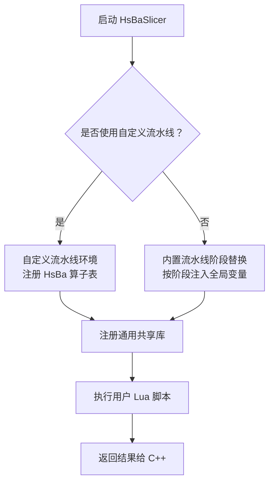
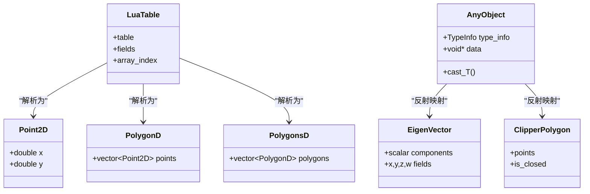
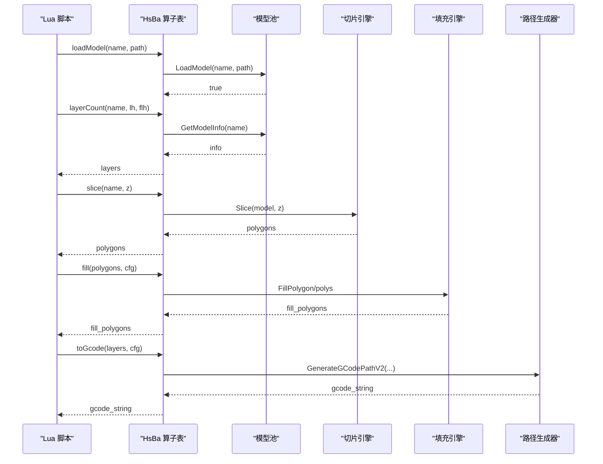
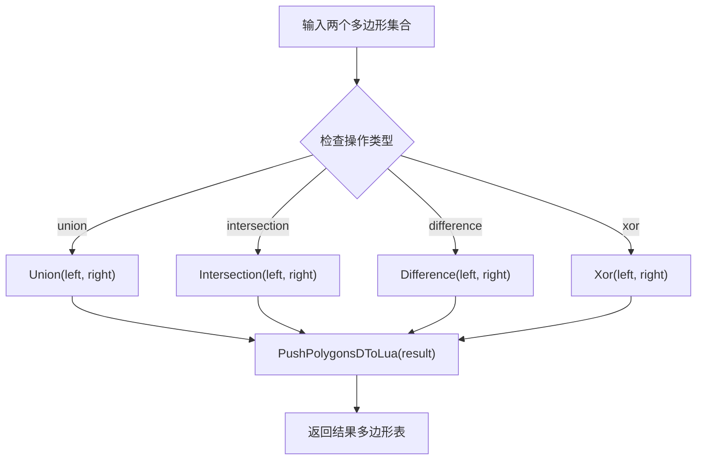
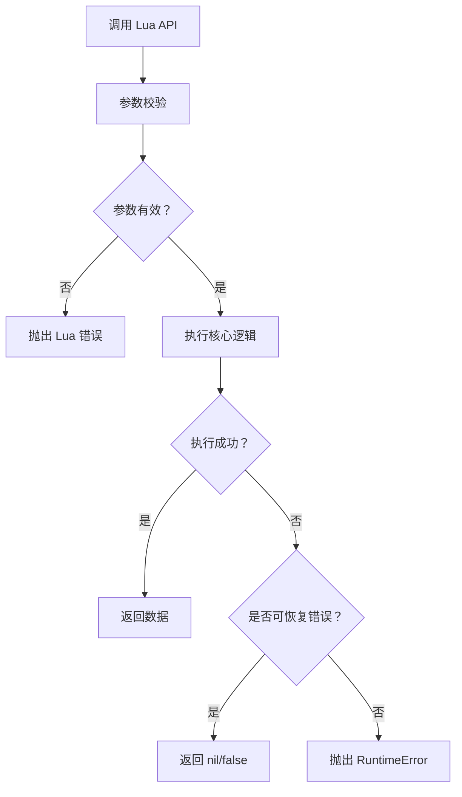
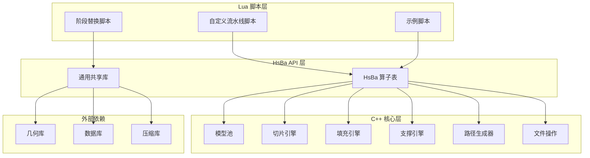
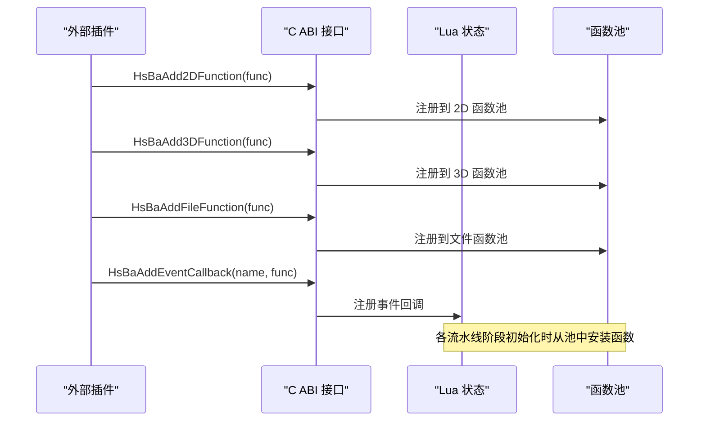

# Lua API 参考

<cite>
**本文引用的文件**   
- [lua_pipeline.cpp](file://LibHsBaSlicer/Extends/lua_pipeline.cpp)
- [LuaAdapter.hpp](file://2D/LuaAdapter.hpp)
- [LuaAdapter.cpp](file://2D/LuaAdapter.cpp)
- [LuaCommonTypes.hpp](file://LibHsBaSlicer/Extends/LuaCommonTypes.hpp)
- [lua_register.h](file://DllHsBaSlicer/lua_register.h)
- [LuaSupport.hpp](file://support/LuaSupport.hpp)
- [LuaSupport.cpp](file://support/LuaSupport.cpp)
- [LuaAdapter.hpp](file://fileoperator/LuaAdapter.hpp)
- [LuaAdapter.cpp](file://fileoperator/LuaAdapter.cpp)
- [my_fdm_pipeline.lua](file://samples/Custom/scripts/my_fdm_pipeline.lua)
- [my_infill.lua](file://samples/FDM/scripts/my_infill.lua)
- [my_sls_export.lua](file://samples/SLS/scripts/my_sls_export.lua)
</cite>

## 目录

1. [文档目标与适用范围](#文档目标与适用范围)
2. [两种 Lua 运行环境](#两种-lua-运行环境)
3. [Lua 与 C++ 数据类型映射机制](#lua-与-c-数据类型映射机制)
4. [通用几何数据类型规范](#通用几何数据类型规范)
5. [A 类 API：自定义流水线算子表 `HsBa`](#a-类-api自定义流水线算子表-hsba)
6. [B 类 API：通用共享库](#b-类-api通用共享库)
7. [C 类 API：内置流水线阶段替换脚本](#c-类-api内置流水线阶段替换脚本)
8. [API 可用性矩阵](#api-可用性矩阵)
9. [错误处理与异常行为](#错误处理与异常行为)
10. [完整调用示例](#完整调用示例)
11. [架构总览图](#架构总览图)
12. [扩展开发入口](#扩展开发入口)
13. [常见问题排查](#常见问题排查)
14. [结论](#结论)

## 文档目标与适用范围

本文档是 HsBaSlicer 的 **Lua API 参考**，面向以下两类读者：

- 编写切片、支撑、填充、导出等 Lua 脚本的用户；
- 需要从 C++ 侧向 Lua 注入新函数、新对象或新事件回调的开发者。

它覆盖以下内容：

| 类别 | 说明 |
|------|------|
| 几何操作 | 点、线、多边形、布尔运算、偏移、凸包、凹包、面积、文本转多边形 |
| 模型处理 | 加载、查询信息、平移、旋转、缩放、移除、枚举名称 |
| 切片与坐标 | 层数计算、Z 高度、安全切片、非安全切片、整型/浮点转换 |
| 填充与支撑 | FDM/SLA 支撑、SLA 地板、填充模式、壁厚+填充 |
| 路径生成 | 螺旋路径、G-code 输出、机器人路径打包 |
| 文件与打包 | 压缩、7z 压缩、数据库访问、参数持久化 |
| 类型映射 | Lua table、基本类型、Eigen 向量/矩阵/四元数、Clipper 多边形、AnyObject |
| 错误处理 | Lua 错误、RuntimeError、返回值约定、调试输出 |

## 两种 Lua 运行环境

HsBaSlicer 中的 Lua 脚本按用途分为两类：

| 环境 | 用途 | 触发方式 | 特征 API |
|------|------|----------|----------|
| **自定义流水线（Custom Pipeline）** | 由脚本自行决定「加载→切片→支撑→填充→路径→写文件」的全部阶段与顺序 | C++ 侧调用 `run_pipeline`（或 `pipeline_entry` 指定的入口名） | 全局 `HsBa` 算子表 + 上下文全局变量 |
| **内置流水线阶段替换（Stage Hook）** | 仅替换内置流水线中某个阶段（支撑/填充/地板/导出）的算法，阶段顺序仍由 C++ 固定 | 由对应内置流水线在阶段处加载脚本并调用约定的函数 | 该阶段注入的少量全局变量 + 通用共享库 |

两类环境都会注册通用共享库，区别仅在于 `HsBa` 算子表**只在自定义流水线环境**中存在。



**图示来源**   
- [lua_pipeline.cpp:41-63](file://LibHsBaSlicer/Extends/lua_pipeline.cpp#L41-L63)
- [LuaSupport.cpp:67-90](file://support/LuaSupport.cpp#L67-L90)

**章节来源**   
- [lua_pipeline.cpp:41-63](file://LibHsBaSlicer/Extends/lua_pipeline.cpp#L41-L63)
- [LuaSupport.cpp:67-90](file://support/LuaSupport.cpp#L67-L90)

## Lua 与 C++ 数据类型映射机制

### 基础映射规则

Lua 与 C++ 之间的数据交换主要依赖三种机制：

1. **Lua table 到几何容器**：由 `2D/LuaAdapter.cpp` 中的 `LuaTableToPolygonD`、`LuaTableToPolygonsD`、`LuaTableToPolygon`、`LuaTableToPolygons` 实现。
2. **C++ 几何容器到 Lua table**：由 `PushPolygonDToLua`、`PushPolygonsDToLua`、`PushPolygonToLua`、`PushPolygonsToLua` 实现。
3. **任意值到 Lua**：由 `fileoperator/LuaAdapter.cpp` 中的 `PushAnyToLua` 实现，用于数据库查询结果和 ParamStore 字段。

### 基本类型映射

| C++ 类型 | Lua 表示 | 说明 |
|----------|----------|------|
| `int` / `int64_t` | `number` 或 `integer` | Lua 数字；插入数据库时转为 `int64_t` |
| `double` | `number` | 浮点数，单位通常为 mm |
| `std::string` | `string` | 字符串，常用于路径、JSON、SQL |
| `bool` | `boolean` | 布尔值 |
| `std::vector<unsigned char>` | `string`（二进制） | 字节数组以 Lua 字符串形式传递 |
| `nil` | `nil` | 空值，常用于失败读取或可选字段 |

### 几何类型映射

| C++ 类型 | Lua 表示 | 说明 |
|----------|----------|------|
| `Point2D` | `{ x = number, y = number }` | 双精度二维点 |
| `Point2` | `{ x = number, y = number }` | 整型点，内部乘以 `integerization` 后存储 |
| `PolygonD` | `{ {x=..,y=..}, ... }` | 双精度多边形顶点序列 |
| `PolygonsD` | `{ polygon1, polygon2, ... }` | 多边形集合，孔洞作为独立多边形存在 |
| `Polygon` | `{ {x=..,y=..}, ... }` | 整型多边形 |
| `Polygons` | `{ polygon1, polygon2, ... }` | 整型多边形集合 |

### Eigen 与 AnyObject 类型映射

`LibHsBaSlicer/Extends/LuaCommonTypes.hpp` 通过 `AnyObject` 反射系统注册常见自定义类型，包括：

| C++ 类型 | Lua 名称 | Lua 表示 |
|----------|----------|----------|
| `Eigen::Vector2f/d/i` | `Vector2f` / `Vector2d` / `Vector2i` | `{ x, y }` |
| `Eigen::Vector3f/d/i` | `Vector3f` / `Vector3d` / `Vector3i` | `{ x, y, z }` |
| `Eigen::Vector4f/d/i` | `Vector4f` / `Vector4d` / `Vector4i` | `{ x, y, z, w }` |
| `Eigen::Quaternionf/d` | `Quaternionf` / `Quaterniond` | `{ x, y, z, w }` |
| `Eigen::Matrix2d/3d/4d/Xf/Xi` | `Matrix2d` / `Matrix3d` / `Matrix4d` / `MatrixXf` / `MatrixXi` | 嵌套行序列 |
| `Clipper2::Point2D/Point2` | `Point2D` / `Point2` | `{ x, y }` |
| `Clipper2::Polygon*/Polygons*` | `PolygonD` / `PolygonsD` / `Polygon` / `Polygons` | 多边形容器 |

这些类型支持通过 `cast_<Name>` 方法从 `AnyObject` 转换为具体类型，并在 Lua 中以稳定名称暴露。



**图示来源**   
- [LuaCommonTypes.hpp:20-45](file://LibHsBaSlicer/Extends/LuaCommonTypes.hpp#L20-L45)
- [LuaCommonTypes.hpp:110-140](file://LibHsBaSlicer/Extends/LuaCommonTypes.hpp#L110-L140)
- [LuaAdapter.cpp:385-484](file://2D/LuaAdapter.cpp#L385-L484)

**章节来源**   
- [LuaCommonTypes.hpp:20-45](file://LibHsBaSlicer/Extends/LuaCommonTypes.hpp#L20-L45)
- [LuaCommonTypes.hpp:110-140](file://LibHsBaSlicer/Extends/LuaCommonTypes.hpp#L110-L140)
- [LuaAdapter.cpp:385-484](file://2D/LuaAdapter.cpp#L385-L484)
- [LuaAdapter.cpp:17-49](file://fileoperator/LuaAdapter.cpp#L17-L49)

## 通用几何数据类型规范

所有 API 使用统一的 Lua table 表示几何数据：

| 类型 | Lua 表示 | 说明 |
|------|----------|------|
| 点 Point | `{ x = 1.0, y = 2.0 }` | 字段名固定为 `x` / `y`（单位 mm，double） |
| 多边形 Polygon | `{ {x=..,y=..}, {x=..,y=..}, ... }` | 点的有序数组，闭合轮廓 |
| 多边形集合 Polygons | `{ polygon1, polygon2, ... }` | 多边形的数组；孔洞作为独立多边形存在 |
| 层列表 Layers | `{ polygons_layer0, polygons_layer1, ... }` | 逐层的多边形集合数组 |
| 3D 点 | `{ x = .., y = .., z = .. }` | 用于 `spiralize` 返回的路径 |

> **整数化说明**：布尔/填充运算内部按整数精度处理。`HsBa.toInt` / `HsBa.toDouble` 用于在整型多边形与浮点多边形之间转换；`PolygonOperations`、`PolygonFill` 接收并返回整型化数据，`HsBa.slice` / `HsBa.fill` 返回浮点多边形表。

**章节来源**   
- [lua_pipeline.cpp:185-222](file://LibHsBaSlicer/Extends/lua_pipeline.cpp#L185-L222)
- [LuaAdapter.cpp:332-484](file://2D/LuaAdapter.cpp#L332-L484)

## A 类 API：自定义流水线算子表 `HsBa`

自定义流水线是唯一拥有全局 `HsBa` 表的环境。脚本必须定义一个**入口函数**，C++ 侧调用它并据其返回值判定成败：

- 入口函数名默认为 `run_pipeline`，可由 C++ 侧的 `pipeline_entry` 全局变量覆盖。
- 返回**非空字符串** → 成功，该字符串作为结果上报 C++；返回 `true` → 成功但无结果文本；返回 `false`/`nil` 或抛出 Lua 错误 → 失败。

### A.1 C++ 注入的上下文全局变量

| 全局变量 | 类型 | 含义 |
|----------|------|------|
| `pipeline_config` | string | C++ 传入的 JSON 配置字符串（原样透传） |
| `output_path` | string | C++ 传入的默认输出路径（可能为空串） |
| `model_name` | string | C++ 传入的模型名（可能为空串） |
| `model_path` | string | C++ 传入的模型文件路径（可能为空串） |
| `pipeline_entry` | string | 入口函数名（默认 `run_pipeline`） |

> C++ 还可通过 `pipeline_lua_source` 预置一段前置脚本（prelude），在其中定义如 `machine` 等自定义全局表，随后再加载主脚本文件。

### A.2 控制与文件 IO

| 调用 | 返回 | 说明 |
|------|------|------|
| `HsBa.progress(percent[, stage])` | — | 向 C++ 上报进度百分比与阶段名 |
| `HsBa.setLayers(n)` | — | 上报总层数（回填到 C++ 结果 `total_layers`） |
| `HsBa.setOutputPath(path)` | — | 上报实际输出路径（回填到 C++ 结果 `output_path`） |
| `HsBa.readFile(path)` | string \| nil | 读取文件内容，失败返回 `nil` |
| `HsBa.writeFile(path, content)` | true | 以二进制覆盖写入文件，无法打开时抛出 Lua 错误 |

### A.3 模型管理

| 调用 | 返回 | 说明 |
|------|------|------|
| `HsBa.loadModel(name, path)` | true | 加载模型到模型池（同名已存在则复用）；失败抛出错误 |
| `HsBa.modelInfo(name)` | table | `{ bbox_min={x,y,z}, bbox_max={x,y,z}, volume }` |
| `HsBa.translateModel(name, {x,y,z})` | — | 平移模型 |
| `HsBa.rotateModel(name, {x,y,z,w})` | — | 按四元数旋转模型 |
| `HsBa.scaleModel(name, s)` 或 `(name, {x,y,z})` | — | 缩放模型（标量或逐轴） |
| `HsBa.removeModel(name)` | — | 从模型池移除 |
| `HsBa.modelNames()` | table | 返回模型池中所有模型名的数组 |

### A.4 切片

| 调用 | 返回 | 说明 |
|------|------|------|
| `HsBa.layerCount(name, layerHeight, firstLayerHeight)` | int | 依据模型高度与层高计算总层数 |
| `HsBa.layerZ(index0based, layerHeight, firstLayerHeight)` | number | 第 `index`（0 基）层的 Z 高度 |
| `HsBa.slice(name, z)` | polygons | 在高度 `z` 处切片，返回安全闭合轮廓（浮点多边形） |
| `HsBa.sliceUnsafe(name, z)` | polygons | 归一化的非安全切片，可能丢弃开口轮廓 |

### A.5 坐标转换与填充

| 调用 | 返回 | 说明 |
|------|------|------|
| `HsBa.toInt(polygons)` | polygons | 浮点多边形 → 整型多边形 |
| `HsBa.toDouble(intPolygons)` | polygons | 整型多边形 → 浮点多边形 |
| `HsBa.fill(polygons[, cfg])` | polygons | 填充。`cfg = { spacing=0.4, mode="zigzag"\|"line"\|"simpleZigzag", angle=45.0, borderCount=0 }`；`borderCount>0` 时生成壁厚+填充 |

### A.6 支撑与地板

| 调用 | 返回 | 说明 |
|------|------|------|
| `HsBa.fdmSupport(layers, cfg)` | layers | 逐层 FDM 支撑。`cfg` 字段见下 |
| `HsBa.slaSupport(layers, cfg)` | layers | 逐层 SLA 支撑 |
| `HsBa.floor(bottomPolygons, cfg)` | polygons | 生成 SLA 底部地板/raft |

`fdmSupport` / `slaSupport` 的 `cfg` 常用字段：`overhang_angle`(45)、`layer_height`(0.2)、`support_gap`(0.5)、`support_diameter`(2.0)、`support_density`(0.3)、`support_pattern`(int)、`tree_branch_angle`(30)、`tree_max_branch_radius`(5)、`honeycomb_cell_size`(5)。FDM 额外支持 `interface_layers`、`interface_density`；SLA 额外支持 `tip_diameter`、`raft_thickness`。

`floor` 的 `cfg` 字段：`raft_offset`、`border_width`、`fill_spacing`、`fill_angle_deg`、`border_count`、`use_convex_hull`、`concave_hull_points`。

### A.7 路径与 G-code

| 调用 | 返回 | 说明 |
|------|------|------|
| `HsBa.spiralize(sections[, cfg])` | path | 将逐层闭合轮廓化为单一连续 3D 螺旋路径（{x,y,z} 数组）。`cfg = { layerHeight=0.4, startZ=0, zHeights={...} }`（`zHeights` 优先）。适用于 FDM/WAAM/3DP 连续挤出 |
| `HsBa.toGcode(layers, cfg)` | string | 生成 G-code。`layers` 每元素为 `{ outlines=, fills=, supports=, zHeight= }`；`cfg = { layerHeight, lineWidth, printSpeed, travelSpeed, extrusionMultiplier, firmware="marlin"\|"reprap"\|"klipper", nozzleDiameter, filamentDiameter, nozzleTemp, bedTemp, retractLength, retractSpeed }` |

### A.8 打包与导出

| 调用 | 返回 | 说明 |
|------|------|------|
| `HsBa.saveSlsPackage(tbl)` | bool | 打包 SLS 导出。`tbl = { outlines=layers, zHeights={...}, config="json", output="x.zip", script="export.lua", func="export_sls" }`（`output`、`script` 必填，`func` 默认 `export_sls`） |
| `HsBa.saveWaamPackage(tbl)` | bool[, err] | 打包 WAAM 机器人程序。`tbl = { outlines=layers, zHeights={...}, weld={current,voltage,wireFeedSpeed,gasFlowRate,travelSpeed,process}, robotType=0, beadWidth=1.2, config="json", output="x.txt", script=, func="export_waam" }`（`output` 必填） |
| `HsBa.saveSlaPackage(tbl)` | bool | 打包 SLA 图像。`tbl = { outlines=layers, supports=layers, floor=polygons, config="json", output="x.zip", imageWidth, imageHeight, imageExtension=".png" }`（`output` 必填） |
| `HsBa.renderImage(polygons, width, height, path)` | bool | 将多边形渲染为图像文件 |



**图示来源**   
- [lua_pipeline.cpp:293-308](file://LibHsBaSlicer/Extends/lua_pipeline.cpp#L293-L308)
- [lua_pipeline.cpp:402-461](file://LibHsBaSlicer/Extends/lua_pipeline.cpp#L402-L461)
- [lua_pipeline.cpp:483-508](file://LibHsBaSlicer/Extends/lua_pipeline.cpp#L483-L508)
- [lua_pipeline.cpp:626-691](file://LibHsBaSlicer/Extends/lua_pipeline.cpp#L626-L691)

**章节来源**   
- [lua_pipeline.cpp:228-288](file://LibHsBaSlicer/Extends/lua_pipeline.cpp#L228-L288)
- [lua_pipeline.cpp:293-397](file://LibHsBaSlicer/Extends/lua_pipeline.cpp#L293-L397)
- [lua_pipeline.cpp:402-556](file://LibHsBaSlicer/Extends/lua_pipeline.cpp#L402-L556)
- [lua_pipeline.cpp:585-691](file://LibHsBaSlicer/Extends/lua_pipeline.cpp#L585-L691)
- [lua_pipeline.cpp:697-800](file://LibHsBaSlicer/Extends/lua_pipeline.cpp#L697-L800)

## B 类 API：通用共享库

以下全局库在**自定义流水线与内置阶段脚本中均可调用**。

### B.1 `PolygonOperations`（2D 布尔与构造）

| 函数 | 说明 |
|------|------|
| `booleanOperation(a, b, op)` | 通用布尔运算，`op` 为 union/intersection/difference/xor |
| `union(a, b)` / `intersection(a, b)` / `difference(a, b)` / `xor(a, b)` | 并/交/差/异或 |
| `offsetOperation(polys, delta)` | 内外偏移（delta 正为外扩） |
| `convexHullOperation(polys)` / `concaveHullOperation(polys[, ...])` | 凸包 / 凹包 |
| `area(polygon)` | 计算面积 |
| `makeRectangle(xmin, ymin, xmax, ymax)` | 生成矩形 |
| `makeCircle(cx, cy, r)` | 生成圆形 |
| `makeEllipse(...)` | 生成椭圆 |
| `makeRegularPolygon(...)` | 生成正多边形 |
| `textToPolygons(...)` | 文本转多边形轮廓 |

> `dumpPolygon` / `dumpPolygons` 仅在启用 `HSBA_POLYGON_DUMP` 编译时可用。



**图示来源**   
- [LuaAdapter.cpp:22-54](file://2D/LuaAdapter.cpp#L22-L54)

**章节来源**   
- [LuaAdapter.cpp:22-329](file://2D/LuaAdapter.cpp#L22-L329)
- [LuaAdapter.cpp:487-491](file://2D/LuaAdapter.cpp#L487-L491)

### B.2 `PolygonFill`（填充算法）

`offsetFill` / `lineFill` / `simpleZigzagFill` / `zigzagFill` / `compositeOffsetFill` / `hybridFill` / `offsetOnly` —— 输入整型多边形集合与间距/角度参数，返回填充路径多边形。

### B.3 `PathOptimize`（路径顺序优化）

| 调用 | 说明 |
|------|------|
| `PathOptimize.new()` | 创建优化器对象，方法：`addRegion(id, paths)`、`addPolygons(id, polys)`、`addRoute(...)`、`optimizeOrder()`、`buildPaths()`、`buildPolygons()`、`getFullGraph()`、`getExpandedGraph()`、`setCustomTour(...)` |
| `PathOptimize.optimizeRegions(regions)` | 填充结果模式一键优化，返回完整填充路径 |
| `PathOptimize.optimizePolygons(regions)` | 多边形模式一键优化（填充前执行），返回优化顺序的多边形集合 |

优化器对象额外暴露**全组合图**，供用户用 Lua 设计任意路径优化算法：

| 调用 | 说明 |
|------|------|
| `opt:getFullGraph()` | 区域级全组合图：`{vertices={id..}, distMatrix={{代价..}..}（不可达为 false），edges={{from,to,cost}..}, areaCount}`，即所有区域两两的门禁感知最短路径代价 |
| `opt:getExpandedGraph()` | 门级展开图：`{vertices={{areaId,gateId,isExit}..}, edges={{from,to,weight}..}（1 基下标）, vertexCount, edgeCount}` |
| `opt:setCustomTour(tour[, entryGates])` | 反馈用户计算的顺序（区域 id 数组）与可选 `{[areaId]=门禁下标}` 映射，随后 `buildPaths()`/`buildPolygons()` 复用该顺序、跳过内置遗传 TSP |

### B.4 `Support`（支撑生成工具）

| 调用 | 说明 |
|------|------|
| `Support.new_plane()` / `new_tree()` / `new_honeycomb()` / `new_sla()` | 创建对应类型的支撑生成器 |
| `Support.new_lua(path, func)` / `new_lua_file(...)` | 基于 Lua 脚本的自定义支撑生成器 |
| `Support.generate(obj, current_layer, prev_layer, layer_height, cfg)` | 用指定生成器生成支撑，返回多边形 |
| `Support.detect_overhang(current, prev, height, angle)` | 检测悬垂区域 |
| `Support.default_config()` | 返回默认支撑配置表 |

### B.5 `Cipher`（编解码）

`Cipher.base64_encode(s)` / `base64_decode(s)` / `hex_encode(s)` / `hex_decode(s)`。

### B.6 `Zipper` / `Bit7zZipper`（压缩打包）

| 调用 | 说明 |
|------|------|
| `Zipper.new()` | 创建 zip 打包对象 |
| `z:AddFile(name, path)` | 添加磁盘文件 |
| `z:AddByteFile(name, data)` | 添加内存字节内容 |
| `z:Save(path)` | 写出压缩包 |
| `Bit7zZipper.new(format, dll_path)` | 7z 格式压缩，`format` ∈ `Zip`/`SevenZip`/`XZ`/`BZIP2`/`GZIP`/`TAR`/`TarGz`/`TarXz`（需编译启用 `HSBA_USE_BIT7Z`）；`TarGz`/`TarXz` 可在一次 `Save` 调用中直接生成 `.tar.gz`/`.tar.xz` 压缩包 |

### B.7 数据库适配器（`SQLiteAdapter` / `MySQLAdapter` / `PostgreSQLAdapter`）

三者方法一致（MySQL/PostgreSQL 需编译启用对应宏）：

```lua
local db = SQLiteAdapter.new()
db:Connect("path_or_dsn")
db:CreateTable("...")          -- 或 db:Execute("SQL...")
db:Insert("table", {col = val})
db:Update("table", {col = val}, "where...")
local rows = db:Query("SELECT ...")   -- 返回行数组
db:Delete("table", "where...")
```

方法：`Connect`、`Execute`、`Query`、`Insert`、`Update`、`Delete`、`CreateTable`。

### B.8 `ParamStore`（参数持久化）

基于反射的流水线配置存取。`ParamStore.new(...)` 创建实例，实例方法：`EnsureSchema`、`SetCryptoKey`、`Save`、`Load`、`List`、`Update`、`Delete`。`SetCryptoKey(password)` 启用静态加密：口令非空时，`Save`/`Update` 将整份配置以 AES-256-CBC 加密存入 `param_blob`，`Load` 自动解密；传 `nil`/`""` 则禁用并保持明文行为。

**章节来源**   
- [LuaAdapter.cpp:52-302](file://fileoperator/LuaAdapter.cpp#L52-L302)
- [LuaAdapter.cpp:304-565](file://fileoperator/LuaAdapter.cpp#L304-L565)
- [LuaAdapter.cpp:567-800](file://fileoperator/LuaAdapter.cpp#L567-L800)

## C 类 API：内置流水线阶段替换脚本

内置流水线在特定阶段加载用户脚本以替换默认算法。**每个阶段注入不同的全局变量、约定不同的入口函数**。

### C.1 支撑阶段（FDM/SLA 自定义支撑）

由 `LuaSupport` 环境提供，注入全局变量：

| 全局变量 | 类型 | 含义 |
|----------|------|------|
| `current_layer` | polygons | 当前层多边形 |
| `prev_layer` | polygons | 上一层多边形（首层为空） |
| `layer_height` | number | 层高（mm） |
| `config` | table | 支撑配置（字段同 [A.6](#a6-支撑与地板)） |

- **约定入口函数**：`generate_support()`，返回支撑截面多边形表（格式同 `current_layer`）。
- 可用库：`PolygonOperations`、`Support`，以及 C++ 注入的 2D/3D 扩展函数池。
- 结果也可通过全局 `support_polys` 返回。

### C.2 填充阶段

- **约定入口函数**：`generate_fill(current_layer)`——当前层多边形以**参数**传入（已扣除壁厚区域），返回填充多边形表。
- 该阶段**不注入任何全局变量**（无层号/配置），请使用脚本内默认值。
- 脚本 chunk 只定义函数，**不要末尾自调用**。
- 可用库：`PolygonOperations`、`PolygonFill`、`PathOptimize`。

### C.3 地板阶段（SLA）

- 可用库：`PolygonOperations`、`PolygonFill`。
- 用于自定义 SLA 底部地板/raft 生成逻辑。

### C.4 导出阶段（SLS / SLA / SLM / LOM / 3DP / WAAM）

导出脚本在打包阶段被调用，注入全局变量：

| 全局变量 | 类型 | 含义 |
|----------|------|------|
| `config` | table | `{ path="config.json", configStr="<JSON 内容>" }` |
| `images` | array | 每元素为 `{ path="layers/N.json", data="<多边形 JSON>" }` |
| `output_path` | string | 输出文件路径 |

- **约定入口函数**：SLS 为 `export_sls()`（默认函数名，可由 `func` 字段覆盖），WAAM 为 `export_waam()`，其余按各工艺导出约定。
- 返回值：table `{ success = true/false, export_path = "..." }`。
- 可用库：`Zipper`、`Cipher`、`Bit7zZipper`（可选）、`SQLiteAdapter`/`MySQLAdapter`/`PostgreSQLAdapter`、`ParamStore`。

> **常见陷阱**：导出脚本返回值类型错误（例如误返回非预期结构）会导致 zip 文件被覆盖或写空；请严格返回 `{ success=..., export_path=... }`，并保证内部对象方法名大小写与 C++ 绑定一致。

**章节来源**   
- [LuaSupport.cpp:19-90](file://support/LuaSupport.cpp#L19-L90)
- [LuaSupport.cpp:113-178](file://support/LuaSupport.cpp#L113-L178)

## API 可用性矩阵

| API | Custom 自定义流水线 | 内置阶段脚本 |
|-----|:-------------------:|:------------:|
| `HsBa` 算子表 | ✅（完整） | ❌ |
| 上下文全局（`pipeline_config` 等） | ✅ | ❌ |
| `PolygonOperations` | ✅ | ✅（支撑/填充/地板/导出视阶段而定） |
| `Support` | ✅ | ✅（支撑阶段） |
| `PolygonFill` | ✅ | ✅（填充/地板阶段） |
| `PathOptimize` | ✅ | ✅（填充阶段） |
| `Cipher` | ✅ | ✅（导出阶段） |
| `Zipper` / `Bit7zZipper` | ✅ | ✅（导出阶段） |
| `SQLiteAdapter` / `MySQLAdapter` / `PostgreSQLAdapter` | ✅ | ✅（导出阶段） |
| `ParamStore` | ✅ | ✅（导出阶段） |

> `MySQLAdapter`、`PostgreSQLAdapter`、`Bit7zZipper` 分别在启用 `HSBA_USE_MYSQL`、`HSBA_USE_PGSQL`、`HSBA_USE_BIT7Z` 时注册。

**章节来源**   
- [lua_pipeline.cpp:1-40](file://LibHsBaSlicer/Extends/lua_pipeline.cpp#L1-L40)
- [LuaAdapter.cpp:40-62](file://fileoperator/LuaAdapter.cpp#L40-L62)

## 错误处理与异常行为

### Lua 层错误

大多数 C++ 绑定的 Lua 函数在参数校验失败时会调用 `luaL_error`，例如：

- `HsBa.readFile` 无法打开文件时返回 `nil`；
- `HsBa.writeFile` 无法打开文件时抛出 Lua 错误；
- `HsBa.loadModel` 加载失败时抛出错误；
- `HsBa.slice` / `sliceUnsafe` 模型未加载时抛出错误；
- `HsBa.toGcode` 路径生成失败时抛出错误。

### C++ 层异常

部分功能通过 `RuntimeError` 抛出异常，例如：

- `LuaSupport::Generate` 创建 Lua 状态失败；
- Lua 脚本加载失败；
- Lua 脚本运行时错误；
- 数据库操作失败；
- 压缩/解压失败。

### 返回值约定

| 场景 | 返回值 |
|------|--------|
| 成功且无数据 | `true` 或空字符串 |
| 成功且有数据 | 具体数据（字符串、table、数值等） |
| 失败且可恢复 | `nil` 或 `false` |
| 失败且不可恢复 | 抛出 Lua 错误或 C++ 异常 |



**图示来源**   
- [lua_pipeline.cpp:258-288](file://LibHsBaSlicer/Extends/lua_pipeline.cpp#L258-L288)
- [LuaSupport.cpp:113-178](file://support/LuaSupport.cpp#L113-L178)
- [LuaAdapter.cpp:70-126](file://fileoperator/LuaAdapter.cpp#L70-L126)

**章节来源**   
- [lua_pipeline.cpp:258-288](file://LibHsBaSlicer/Extends/lua_pipeline.cpp#L258-L288)
- [lua_pipeline.cpp:293-308](file://LibHsBaSlicer/Extends/lua_pipeline.cpp#L293-L308)
- [lua_pipeline.cpp:435-461](file://LibHsBaSlicer/Extends/lua_pipeline.cpp#L435-L461)
- [lua_pipeline.cpp:626-691](file://LibHsBaSlicer/Extends/lua_pipeline.cpp#L626-L691)
- [LuaSupport.cpp:113-178](file://support/LuaSupport.cpp#L113-L178)
- [LuaAdapter.cpp:70-126](file://fileoperator/LuaAdapter.cpp#L70-L126)

## 完整调用示例

### 自定义 FDM 流水线示例

以下是一个最小可运行的自定义流水线脚本，展示完整的加载、切片、填充、支撑、G-code 生成流程：

```lua
function run_pipeline()
    local name = (model_name and #model_name > 0) and model_name or "part"
    local path = (model_path and #model_path > 0) and model_path or "models/bunny.stl"
    local out  = (output_path and #output_path > 0) and output_path or "output/part.gcode"

    HsBa.progress(1, "加载模型")
    HsBa.loadModel(name, path)
    local info  = HsBa.modelInfo(name)
    local zbase = info.bbox_min.z

    local lh, flh = 0.2, 0.25
    local layers  = HsBa.layerCount(name, lh, flh)
    HsBa.setLayers(layers)

    local outlines, fills, zs = {}, {}, {}
    for i = 0, layers - 1 do
        local z = HsBa.layerZ(i, lh, flh)
        local polys = HsBa.slice(name, zbase + z)
        outlines[i + 1] = polys
        zs[i + 1]       = z
        fills[i + 1]    = HsBa.fill(polys, { spacing = 0.4, angle = 45, mode = "zigzag", borderCount = 2 })
    end

    local path_layers = {}
    for i = 1, layers do
        path_layers[i] = { outlines = outlines[i], fills = fills[i], supports = {}, zHeight = zs[i] }
    end

    local gcode = HsBa.toGcode(path_layers, {
        layerHeight = lh, lineWidth = 0.45, printSpeed = 60, travelSpeed = 150,
        firmware = "marlin", nozzleDiameter = 0.4, filamentDiameter = 1.75,
    })

    HsBa.writeFile(out, gcode)
    HsBa.setOutputPath(out)
    HsBa.removeModel(name)
    HsBa.progress(100, "完成")

    return string.format("完成：%d 层 → %s", layers, out)
end
```

### 自定义填充脚本示例

填充阶段脚本以参数形式接收当前层多边形，返回填充多边形表：

```lua
function generate_fill(current_layer)
    if #current_layer == 0 then
        return {}
    end

    local spacing = 0.4
    local angle = 45.0

    local rad = angle * math.pi / 180.0

    local min_x, min_y = math.huge, math.huge
    local max_x, max_y = -math.huge, -math.huge

    for _, poly in ipairs(current_layer) do
        for _, pt in ipairs(poly) do
            if pt.x < min_x then min_x = pt.x end
            if pt.y < min_y then min_y = pt.y end
            if pt.x > max_x then max_x = pt.x end
            if pt.y > max_y then max_y = pt.y end
        end
    end

    local margin = math.max(max_x - min_x, max_y - min_y) * 0.5
    local center_x = (min_x + max_x) / 2
    local center_y = (min_y + max_y) / 2
    local extent = math.max(max_x - min_x, max_y - min_y) / 2 + margin

    local fill_lines = {}
    local line_count = math.ceil(extent * 2 / spacing)
    local half_count = math.floor(line_count / 2)

    for i = -half_count, half_count do
        local offset = i * spacing
        local perp_x = -sin_a * offset
        local perp_y = cos_a * offset

        local x1 = center_x + perp_x - cos_a * extent
        local y1 = center_y + perp_y - sin_a * extent
        local x2 = center_x + perp_x + cos_a * extent
        local y2 = center_y + perp_y + sin_a * extent

        local half_w = spacing * 0.15
        local nx = -sin_a * half_w
        local ny = cos_a * half_w

        local line = {
            { x = x1 + nx, y = y1 + ny },
            { x = x2 + nx, y = y2 + ny },
            { x = x2 - nx, y = y2 - ny },
            { x = x1 - nx, y = y1 - ny },
        }
        table.insert(fill_lines, line)
    end

    local result = PO.intersection(fill_lines, current_layer)

    return result
end
```

### SLS 导出脚本示例

导出脚本负责打包层数据和配置文件，并可记录数据库：

```lua
function export_sls()
    local zipper = Zipper.new()

    zipper:AddByteFile(config.path, config.configStr)

    for i, img in ipairs(images) do
        zipper:AddByteFile(img.path, img.data)
    end

    local readme = "SLS Export Package\n"
    zipper:AddByteFile("README.txt", readme)

    local out_path = output_path or "sls_output.zip"
    zipper:Save(out_path)

    local db_ok, db_err = pcall(function()
        local db = SQLiteAdapter.new()
        db:Connect("sls_history.db")
        db:Execute([[
            CREATE TABLE IF NOT EXISTS sls_exports (
                id INTEGER PRIMARY KEY AUTOINCREMENT,
                output_path TEXT NOT NULL,
                total_layers INTEGER,
                export_time TEXT DEFAULT (datetime('now'))
            )
        ]])
        db:Execute(string.format(
            "INSERT INTO sls_exports (output_path, total_layers) VALUES ('%s', %d)",
            out_path, #images
        ))
    end)

    if not db_ok then
        print("[SLS Export] Warning: database registration skipped: " .. tostring(db_err))
    end

    return {
        success = true,
        export_path = out_path
    }
end

return export_sls()
```

**章节来源**   
- [my_fdm_pipeline.lua:52-171](file://samples/Custom/scripts/my_fdm_pipeline.lua#L52-L171)
- [my_infill.lua:20-88](file://samples/FDM/scripts/my_infill.lua#L20-L88)
- [my_sls_export.lua:23-79](file://samples/SLS/scripts/my_sls_export.lua#L23-L79)

## 架构总览图



**图示来源**   
- [lua_pipeline.cpp:1-40](file://LibHsBaSlicer/Extends/lua_pipeline.cpp#L1-L40)
- [LuaAdapter.cpp:487-491](file://2D/LuaAdapter.cpp#L487-L491)
- [LuaSupport.cpp:67-90](file://support/LuaSupport.cpp#L67-L90)

## 扩展开发入口

对于需要从 C++ 侧向 Lua 注入新函数的开发者，项目提供了 C ABI 注册接口：

| 函数 | 用途 |
|------|------|
| `HsBaAdd2DFunction(HsBaLuaRegFn func)` | 注册 2D 函数（支撑、填充、SLA 输出） |
| `HsBaAdd3DFunction(HsBaLuaRegFn func)` | 注册 3D 函数（切片、支撑） |
| `HsBaAddFileFunction(HsBaLuaRegFn func)` | 注册文件函数（SLS 输出、SLA 输出） |
| `HsBaAddEventCallback(event_name, func)` | 注册事件回调（如 `zipper.on_add`、`db.on_query`） |



**图示来源**   
- [lua_register.h:21-31](file://DllHsBaSlicer/lua_register.h#L21-L31)

**章节来源**   
- [lua_register.h:1-38](file://DllHsBaSlicer/lua_register.h#L1-L38)

## 常见问题排查

### 问题 1：`HsBa.loadModel` 失败

**现象**：抛出错误，提示无法加载模型。

**原因**：
- 模型路径不存在；
- 文件格式不支持；
- 模型名称冲突。

**解决方案**：
- 检查 `model_path` 是否正确；
- 确认模型文件格式；
- 使用唯一模型名称。

### 问题 2：`HsBa.slice` 返回空多边形

**现象**：切片结果为空。

**原因**：
- Z 高度超出模型范围；
- 模型本身在该高度无截面。

**解决方案**：
- 使用 `HsBa.modelInfo` 检查模型边界；
- 调整 Z 高度范围。

### 问题 3：`HsBa.toGcode` 生成失败

**现象**：抛出错误，提示路径生成失败。

**原因**：
- 层数据格式不正确；
- 配置参数无效。

**解决方案**：
- 检查每层数据结构；
- 验证配置参数。

### 问题 4：数据库连接失败

**现象**：抛出 RuntimeError。

**原因**：
- 数据库路径错误；
- 权限不足；
- 连接参数错误。

**解决方案**：
- 检查数据库路径；
- 验证连接参数；
- 确认文件权限。

**章节来源**   
- [lua_pipeline.cpp:293-308](file://LibHsBaSlicer/Extends/lua_pipeline.cpp#L293-L308)
- [lua_pipeline.cpp:435-461](file://LibHsBaSlicer/Extends/lua_pipeline.cpp#L435-L461)
- [lua_pipeline.cpp:626-691](file://LibHsBaSlicer/Extends/lua_pipeline.cpp#L626-L691)
- [LuaAdapter.cpp:312-332](file://fileoperator/LuaAdapter.cpp#L312-L332)

## 结论

HsBaSlicer 的 Lua API 提供了完整的 3D 打印流水线可编程能力，涵盖从几何操作、模型处理、切片填充到路径生成和文件导出的全流程。通过统一的数据类型映射机制，Lua 脚本可以无缝调用 C++ 核心功能，同时保持脚本语言的灵活性和易用性。

关键要点：

1. **两种运行环境**：自定义流水线提供完整控制，内置阶段替换提供局部定制。
2. **统一数据类型**：Lua table 与 C++ 几何容器之间有明确的转换规则。
3. **丰富的 API 分类**：从基础的几何操作到复杂的流水线编排，API 层次清晰。
4. **完善的错误处理**：Lua 错误与 C++ 异常相结合，提供可靠的错误反馈。
5. **可扩展架构**：通过 C ABI 接口支持第三方插件和自定义函数注入。

开发者可以根据具体需求选择合适的 API 组合，构建从简单脚本到复杂流水线的各种解决方案。