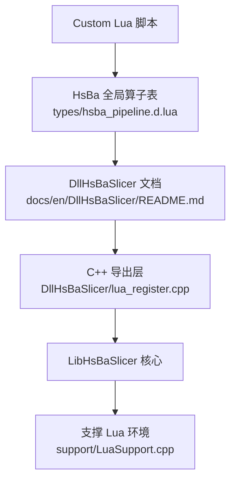
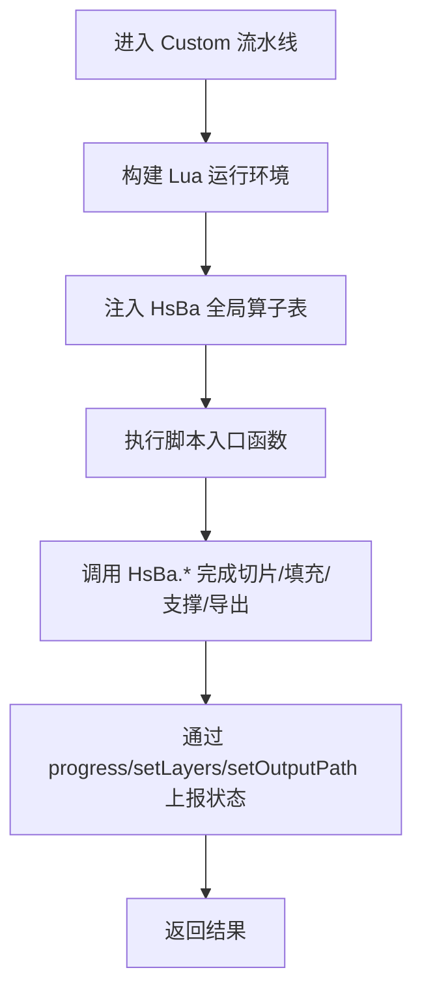
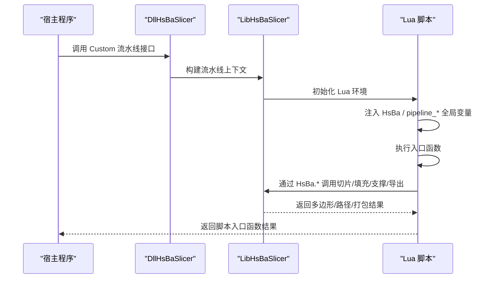
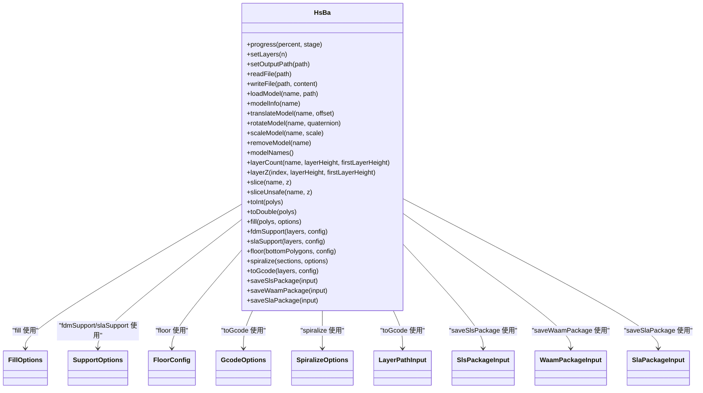

# HsBa 全局算子

<cite>
**本文引用的文件**   
- [hsba_pipeline.d.lua](file://types/hsba_pipeline.d.lua)
- [DllHsBaSlicer README.md](file://docs/en/DllHsBaSlicer/README.md)
- [lua_register.cpp](file://DllHsBaSlicer/lua_register.cpp)
- [LuaSupport.cpp](file://support/LuaSupport.cpp)
</cite>

## 目录
1. [简介](#简介)
2. [项目结构定位](#项目结构定位)
3. [核心概念与使用边界](#核心概念与使用边界)
4. [架构总览：HsBa 全局算子如何被注入 Lua](#架构总览hsba-全局算子如何被注入-lua)
5. [通用函数 API](#通用函数-api)
6. [模型操作 API](#模型操作-api)
7. [切片与坐标转换 API](#切片与坐标转换-api)
8. [填充、支撑与地板 API](#填充支撑与地板-api)
9. [路径输出与导出打包 API](#路径输出与导出打包-api)
10. [类型与配置参考](#类型与配置参考)
11. [依赖关系分析](#依赖关系分析)
12. [性能与使用建议](#性能与使用建议)
13. [故障排除](#故障排除)
14. [结论](#结论)

## 简介
本文面向 HsBaSlicer 的 **HsBa 全局算子表**，即 Custom 流水线环境中通过 `HsBa` 表暴露给 Lua 脚本的统一接口集合。该文档聚焦以下能力：
- 进度上报与流水线元信息设置：`progress`、`setLayers`、`setOutputPath`
- 模型加载与变换：`loadModel`、`modelInfo`、`translateModel`、`rotateModel`、`scaleModel`、`removeModel`
- 切片与坐标转换：`layerCount`、`layerZ`、`slice`、`sliceUnsafe`、`toInt`、`toDouble`
- 几何处理：`fill`、`fdmSupport`、`slaSupport`、`floor`
- 路径输出与导出：`spiralize`、`toGcode`、`saveSlsPackage`、`saveWaamPackage`、`saveSlaPackage`

这些函数共同构成 Custom 流水线的“积木”，脚本作者可以在不修改 C++ 源码的情况下组合 Preprocess → Slice → Support/Fill/Floor → Path/Export 等阶段。

## 项目结构定位
HsBa 全局算子的 Lua 类型定义集中在 `types/hsba_pipeline.d.lua`；C++ 侧对外暴露的 Dll 层文档在 `docs/en/DllHsBaSlicer/README.md` 中说明其作为纯 C ABI 上层封装的职责；Lua 扩展注册入口位于 `DllHsBaSlicer/lua_register.cpp`；而支撑阶段的 Lua 执行环境构造逻辑位于 `support/LuaSupport.cpp`。

**图表来源**
- [hsba_pipeline.d.lua:290-463](file://types/hsba_pipeline.d.lua#L290-L463)
- [DllHsBaSlicer README.md:456-501](file://docs/en/DllHsBaSlicer/README.md#L456-L501)
- [lua_register.cpp:1-43](file://DllHsBaSlicer/lua_register.cpp#L1-L43)
- [LuaSupport.cpp:1-180](file://support/LuaSupport.cpp#L1-L180)

**章节来源**
- [hsba_pipeline.d.lua:1-18](file://types/hsba_pipeline.d.lua#L1-L18)
- [DllHsBaSlicer README.md:1-19](file://docs/en/DllHsBaSlicer/README.md#L1-L19)

## 核心概念与使用边界
- HsBa 全局算子表是 **Custom 流水线环境** 的专用接口，不是所有 C++ 调用者都直接使用的底层 API。
- 坐标单位统一为毫米（mm）。
- 脚本返回值约定：入口函数返回真值表示成功；返回 `false`/`nil` 或抛出 Lua 错误表示失败。
- 总层数和输出路径由脚本通过 `HsBa.setLayers()` 和 `HsBa.setOutputPath()` 上报。

[本图为概念流程，不对应具体代码行]

## 架构总览：HsBa 全局算子如何被注入 Lua
从 Dll 层到 Lua 脚本的注入链路如下：
1. DllHsBaSlicer 提供 C 导出函数，用于注册 2D、3D、文件类 Lua 扩展函数以及事件回调。
2. Custom 流水线根据配置加载 Lua 脚本或内联源码，并注入 `HsBa`、`pipeline_config`、`output_path`、`model_name`、`model_path`、`pipeline_entry` 等全局变量。
3. 各阶段（如支撑）会创建独立的 Lua 状态，并将当前层、上一层、层高、配置等数据推入 Lua 全局变量。
4. 脚本通过 `HsBa` 表调用切片、填充、支撑、导出等能力。

**图表来源**
- [DllHsBaSlicer README.md:456-501](file://docs/en/DllHsBaSlicer/README.md#L456-L501)
- [lua_register.cpp:1-43](file://DllHsBaSlicer/lua_register.cpp#L1-L43)
- [LuaSupport.cpp:67-90](file://support/LuaSupport.cpp#L67-L90)

**章节来源**
- [DllHsBaSlicer README.md:456-501](file://docs/en/DllHsBaSlicer/README.md#L456-L501)
- [lua_register.cpp:1-43](file://DllHsBaSlicer/lua_register.cpp#L1-L43)

## 通用函数 API

### 进度上报：`HsBa.progress(percent, stage?)`
- 用途：向宿主报告当前进度百分比及可选阶段描述。
- 参数：
  - `percent`：整数百分比。
  - `stage`：可选字符串，描述当前阶段。
- 返回值：无明确返回值类型，主要用于状态上报。
- 典型场景：在长耗时切片、填充、支撑、导出过程中周期性调用。

**章节来源**
- [hsba_pipeline.d.lua:296-299](file://types/hsba_pipeline.d.lua#L296-L299)
- [DllHsBaSlicer README.md:490-501](file://docs/en/DllHsBaSlicer/README.md#L490-L501)

### 设置总层数：`HsBa.setLayers(n)`
- 用途：告诉流水线当前模型的总层数，便于进度条与任务规划。
- 参数：
  - `n`：整数，总层数。
- 返回值：无。
- 注意：通常与 `layerCount` 配合使用，先计算层数再设置。

**章节来源**
- [hsba_pipeline.d.lua:301-303](file://types/hsba_pipeline.d.lua#L301-L303)
- [DllHsBaSlicer README.md:490-501](file://docs/en/DllHsBaSlicer/README.md#L490-L501)

### 设置输出路径：`HsBa.setOutputPath(path)`
- 用途：设置脚本导出的默认输出路径。
- 参数：
  - `path`：字符串路径。
- 返回值：无。
- 注意：C++ 侧也会注入默认 `output_path`，脚本可覆盖。

**章节来源**
- [hsba_pipeline.d.lua:305-307](file://types/hsba_pipeline.d.lua#L305-L307)
- [DllHsBaSlicer README.md:473-488](file://docs/en/DllHsBaSlicer/README.md#L473-L488)

### 文件读取：`HsBa.readFile(path)`
- 用途：读取文件内容。
- 参数：
  - `path`：文件路径。
- 返回值：字符串或 `nil`。

**章节来源**
- [hsba_pipeline.d.lua:309-312](file://types/hsba_pipeline.d.lua#L309-L312)

### 文件写入：`HsBa.writeFile(path, content)`
- 用途：将字符串内容写入文件。
- 参数：
  - `path`：目标路径。
  - `content`：要写入的字符串。
- 返回值：布尔值，表示是否成功。

**章节来源**
- [hsba_pipeline.d.lua:314-318](file://types/hsba_pipeline.d.lua#L314-L318)

## 模型操作 API

### 加载模型：`HsBa.loadModel(name, path)`
- 用途：将 3D 模型加载到模型池，供后续切片和变换使用。
- 参数：
  - `name`：模型名称。
  - `path`：模型文件路径。
- 返回值：布尔值，表示是否加载成功。

**章节来源**
- [hsba_pipeline.d.lua:322-326](file://types/hsba_pipeline.d.lua#L322-L326)

### 获取模型信息：`HsBa.modelInfo(name)`
- 用途：查询模型的包围盒和体积等信息。
- 参数：
  - `name`：模型名称。
- 返回值：`ModelInfo` 对象，包含：
  - `bbox_min`：最小包围盒坐标。
  - `bbox_max`：最大包围盒坐标。
  - `volume`：模型体积。

**章节来源**
- [hsba_pipeline.d.lua:328-331](file://types/hsba_pipeline.d.lua#L328-L331)
- [hsba_pipeline.d.lua:193-197](file://types/hsba_pipeline.d.lua#L193-L197)

### 平移模型：`HsBa.translateModel(name, offset)`
- 用途：对模型进行三维平移。
- 参数：
  - `name`：模型名称。
  - `offset`：`Point3D`，x/y/z 偏移量。
- 返回值：无。

**章节来源**
- [hsba_pipeline.d.lua:333-336](file://types/hsba_pipeline.d.lua#L333-L336)

### 旋转模型：`HsBa.rotateModel(name, quaternion)`
- 用途：对模型进行四元数旋转。
- 参数：
  - `name`：模型名称。
  - `quaternion`：`Quaternion`，x/y/z/w。
- 返回值：无。

**章节来源**
- [hsba_pipeline.d.lua:338-341](file://types/hsba_pipeline.d.lua#L338-L341)

### 缩放模型：`HsBa.scaleModel(name, scale)`
- 用途：对模型进行统一比例或逐轴缩放。
- 参数：
  - `name`：模型名称。
  - `scale`：数字或 `Point3D`。
- 返回值：无。

**章节来源**
- [hsba_pipeline.d.lua:343-346](file://types/hsba_pipeline.d.lua#L343-L346)

### 移除模型：`HsBa.removeModel(name)`
- 用途：从模型池中移除指定模型。
- 参数：
  - `name`：模型名称。
- 返回值：无。

**章节来源**
- [hsba_pipeline.d.lua:348-350](file://types/hsba_pipeline.d.lua#L348-L350)

### 获取模型名列表：`HsBa.modelNames()`
- 用途：获取当前模型池中所有模型名称。
- 返回值：字符串数组。

**章节来源**
- [hsba_pipeline.d.lua:352-354](file://types/hsba_pipeline.d.lua#L352-L354)

## 切片与坐标转换 API

### 计算总层数：`HsBa.layerCount(name, layerHeight, firstLayerHeight)`
- 用途：根据模型和层高计算总层数。
- 参数：
  - `name`：模型名称。
  - `layerHeight`：普通层高。
  - `firstLayerHeight`：首层层高。
- 返回值：整数层数。

**章节来源**
- [hsba_pipeline.d.lua:358-363](file://types/hsba_pipeline.d.lua#L358-L363)

### 计算第 n 层 Z 高度：`HsBa.layerZ(index, layerHeight, firstLayerHeight)`
- 用途：根据索引计算对应层的 Z 坐标。
- 参数：
  - `index`：从 0 开始的层索引。
  - `layerHeight`：普通层高。
  - `firstLayerHeight`：首层层高。
- 返回值：浮点 Z 高度。

**章节来源**
- [hsba_pipeline.d.lua:365-370](file://types/hsba_pipeline.d.lua#L365-L370)

### 安全切片：`HsBa.slice(name, z)`
- 用途：对模型在指定 Z 高度进行切片，返回闭合轮廓的多边形集合。
- 参数：
  - `name`：模型名称。
  - `z`：切片 Z 高度。
- 返回值：`Polygons`，即一层多边形集合。

**章节来源**
- [hsba_pipeline.d.lua:372-376](file://types/hsba_pipeline.d.lua#L372-L376)

### 不安全切片：`HsBa.sliceUnsafe(name, z)`
- 用途：可能丢弃开放轮廓的切片方式，适用于对性能敏感且允许丢失部分轮廓的场景。
- 参数：
  - `name`：模型名称。
  - `z`：切片 Z 高度。
- 返回值：`Polygons`。

**章节来源**
- [hsba_pipeline.d.lua:378-382](file://types/hsba_pipeline.d.lua#L378-L382)

### 浮点多边形转整数：`HsBa.toInt(polys)`
- 用途：将浮点坐标多边形转换为整数坐标多边形。
- 参数：
  - `polys`：`Polygons`。
- 返回值：`Polygons`。

**章节来源**
- [hsba_pipeline.d.lua:386-389](file://types/hsba_pipeline.d.lua#L386-L389)

### 整数多边形转浮点：`HsBa.toDouble(polys)`
- 用途：将整数坐标多边形转换为浮点坐标多边形。
- 参数：
  - `polys`：`Polygons`。
- 返回值：`Polygons`。

**章节来源**
- [hsba_pipeline.d.lua:391-394](file://types/hsba_pipeline.d.lua#L391-L394)

## 填充、支撑与地板 API

### 填充：`HsBa.fill(polys, options?)`
- 用途：对单层或多边形区域生成填充路径。
- 参数：
  - `polys`：`Polygons`。
  - `options`：可选 `FillOptions`，包括间距、模式、角度、壁厚圈数等。
- 返回值：`Polygons`，填充后的路径多边形。

**章节来源**
- [hsba_pipeline.d.lua:398-402](file://types/hsba_pipeline.d.lua#L398-L402)
- [hsba_pipeline.d.lua:198-203](file://types/hsba_pipeline.d.lua#L198-L203)

### FDM 支撑：`HsBa.fdmSupport(layers, config?)`
- 用途：为 FDM 工艺生成逐层支撑。
- 参数：
  - `layers`：`LayerList`，多层多边形。
  - `config`：可选 `SupportOptions`，包括层高、悬垂角度、支撑间隙、密度、图案等。
- 返回值：`LayerList`，包含支撑层的多边形集合。

**章节来源**
- [hsba_pipeline.d.lua:406-410](file://types/hsba_pipeline.d.lua#L406-L410)
- [hsba_pipeline.d.lua:204-216](file://types/hsba_pipeline.d.lua#L204-L216)

### SLA 支撑：`HsBa.slaSupport(layers, config?)`
- 用途：为 SLA 工艺生成逐层支撑。
- 参数：
  - `layers`：`LayerList`。
  - `config`：可选 `SupportOptions`，支持 SLA 特有字段如 tip_diameter、raft_thickness。
- 返回值：`LayerList`。

**章节来源**
- [hsba_pipeline.d.lua:412-416](file://types/hsba_pipeline.d.lua#L412-L416)
- [hsba_pipeline.d.lua:204-216](file://types/hsba_pipeline.d.lua#L204-L216)

### 地板/Raft：`HsBa.floor(bottomPolygons, config?)`
- 用途：为 SLA 底层生成 Raft 或底板。
- 参数：
  - `bottomPolygons`：底层 `Polygons`。
  - `config`：可选 `FloorConfig`，包括偏移、边框宽度、填充间距、角度、凸包选项等。
- 返回值：`Polygons`，生成的地板多边形。

**章节来源**
- [hsba_pipeline.d.lua:420-424](file://types/hsba_pipeline.d.lua#L420-L424)
- [hsba_pipeline.d.lua:219-226](file://types/hsba_pipeline.d.lua#L219-L226)

## 路径输出与导出打包 API

### 螺旋化外壁：`HsBa.spiralize(sections, options?)`
- 用途：将外层轮廓螺旋化为连续上升路径，常用于花瓶模式。
- 参数：
  - `sections`：`LayerList`，逐层截面。
  - `options`：可选 `SpiralizeOptions`，包括层高、起始 Z、Z 高度数组。
- 返回值：`Point3D[]`，螺旋路径点集。

**章节来源**
- [hsba_pipeline.d.lua:428-432](file://types/hsba_pipeline.d.lua#L428-L432)
- [hsba_pipeline.d.lua:248-251](file://types/hsba_pipeline.d.lua#L248-L251)

### 生成 G-code：`HsBa.toGcode(layers, config)`
- 用途：将逐层路径输入转换为标准 G-code 文本。
- 参数：
  - `layers`：`LayerPathInput[]`，每层包含轮廓、填充、支撑、Z 高度。
  - `config`：`GcodeOptions`，包括层高、线宽、速度、挤出倍率、固件类型、喷嘴直径、耗材直径、温度、回抽等。
- 返回值：字符串形式的 G-code。

**章节来源**
- [hsba_pipeline.d.lua:434-438](file://types/hsba_pipeline.d.lua#L434-L438)
- [hsba_pipeline.d.lua:228-247](file://types/hsba_pipeline.d.lua#L228-L247)

### 打包 SLS/SLM/LOM/TDP：`HsBa.saveSlsPackage(input)`
- 用途：将层轮廓、Z 高度、配置、导出脚本打包为 zip 输出。
- 参数：
  - `input`：`SlsPackageInput`，包含 outlines、zHeights、config、output、script、func。
- 返回值：布尔值，表示是否打包成功。

**章节来源**
- [hsba_pipeline.d.lua:442-445](file://types/hsba_pipeline.d.lua#L442-L445)
- [hsba_pipeline.d.lua:253-259](file://types/hsba_pipeline.d.lua#L253-L259)

### 打包 WAAM 机器人路径：`HsBa.saveWaamPackage(input)`
- 用途：将层轮廓、Z 高度、焊接参数、机器人类型、路径脚本打包为机器人程序输出。
- 参数：
  - `input`：`WaamPackageInput`，包含 outlines、zHeights、weld、robotType、beadWidth、config、output、script、func。
- 返回值：布尔值和可选字符串，布尔值表示是否成功，字符串可用于返回附加信息。

**章节来源**
- [hsba_pipeline.d.lua:447-450](file://types/hsba_pipeline.d.lua#L447-L450)
- [hsba_pipeline.d.lua:261-278](file://types/hsba_pipeline.d.lua#L261-L278)

### 打包 SLA 输出：`HsBa.saveSlaPackage(input)`
- 用途：将层图、地板、支撑、配置打包为 zip。
- 参数：
  - `input`：`SlaPackageInput`，包含 outlines、supports、floor、config、output、imageWidth、imageHeight、imageExtension。
- 返回值：布尔值。

**章节来源**
- [hsba_pipeline.d.lua:452-455](file://types/hsba_pipeline.d.lua#L452-L455)
- [hsba_pipeline.d.lua:280-288](file://types/hsba_pipeline.d.lua#L280-L288)

## 类型与配置参考

### 基础几何类型
- `Point2D`：二维点 `{ x, y }`。
- `Point3D`：三维点 `{ x, y, z }`。
- `Quaternion`：四元数 `{ x, y, z, w }`。
- `Polygon`：二维点数组。
- `Polygons`：多边形集合，表示一层轮廓。
- `LayerList`：多层多边形集合。

**章节来源**
- [hsba_pipeline.d.lua:24-29](file://types/hsba_pipeline.d.lua#L24-L29)

### 模型信息类型：`ModelInfo`
- `bbox_min`：包围盒最小坐标。
- `bbox_max`：包围盒最大坐标。
- `volume`：模型体积。

**章节来源**
- [hsba_pipeline.d.lua:193-197](file://types/hsba_pipeline.d.lua#L193-L197)

### 填充选项：`FillOptions`
- `spacing`：填充间距，默认 0.4。
- `mode`：填充模式，默认 `"zigzag"`，可选 `"line"`、`"simpleZigzag"`。
- `angle`：填充角度，默认 45.0。
- `borderCount`：壁厚圈数，默认 0。

**章节来源**
- [hsba_pipeline.d.lua:198-203](file://types/hsba_pipeline.d.lua#L198-L203)

### 支撑选项：`SupportOptions`
- 通用字段：`layer_height`、`overhang_angle`、`support_gap`、`support_diameter`、`support_density`、`support_pattern`、`tree_branch_angle`、`tree_max_branch_radius`、`honeycomb_cell_size`。
- FDM 专用：`interface_layers`、`interface_density`。
- SLA 专用：`tip_diameter`、`raft_thickness`。

**章节来源**
- [hsba_pipeline.d.lua:204-216](file://types/hsba_pipeline.d.lua#L204-L216)

### 地板配置：`FloorConfig`
- `raft_offset`、`border_width`、`fill_spacing`、`fill_angle_deg`、`border_count`、`use_convex_hull`、`concave_hull_points`。

**章节来源**
- [hsba_pipeline.d.lua:219-226](file://types/hsba_pipeline.d.lua#L219-L226)

### G-code 选项：`GcodeOptions`
- `layerHeight`、`lineWidth`、`printSpeed`、`travelSpeed`、`extrusionMultiplier`、`firmware`、`nozzleDiameter`、`filamentDiameter`、`nozzleTemp`、`bedTemp`、`retractLength`、`retractSpeed`。

**章节来源**
- [hsba_pipeline.d.lua:228-235](file://types/hsba_pipeline.d.lua#L228-L235)

### 螺旋化选项：`SpiralizeOptions`
- `layerHeight`、`startZ`、`zHeights`。

**章节来源**
- [hsba_pipeline.d.lua:248-251](file://types/hsba_pipeline.d.lua#L248-L251)

### 层路径输入：`LayerPathInput`
- `outlines`、`fills`、`supports`、`zHeight`。

**章节来源**
- [hsba_pipeline.d.lua:242-247](file://types/hsba_pipeline.d.lua#L242-L247)

### SLS/SLM/LOM/TDP 打包输入：`SlsPackageInput`
- `outlines`、`zHeights`、`config`、`output`、`script`、`func`。

**章节来源**
- [hsba_pipeline.d.lua:253-259](file://types/hsba_pipeline.d.lua#L253-L259)

### WAAM 打包输入：`WaamPackageInput`
- `outlines`、`zHeights`、`weld`、`robotType`、`beadWidth`、`config`、`output`、`script`、`func`。

**章节来源**
- [hsba_pipeline.d.lua:261-270](file://types/hsba_pipeline.d.lua#L261-L270)

### WAAM 焊接参数：`WaamWeldParams`
- `current`、`voltage`、`wireFeedSpeed`、`gasFlowRate`、`travelSpeed`、`process`。

**章节来源**
- [hsba_pipeline.d.lua:272-278](file://types/hsba_pipeline.d.lua#L272-L278)

### SLA 打包输入：`SlaPackageInput`
- `outlines`、`supports`、`floor`、`config`、`output`、`imageWidth`、`imageHeight`、`imageExtension`。

**章节来源**
- [hsba_pipeline.d.lua:280-288](file://types/hsba_pipeline.d.lua#L280-L288)

## 依赖关系分析
HsBa 全局算子在不同流水线中的职责划分如下：

**图表来源**
- [hsba_pipeline.d.lua:193-288](file://types/hsba_pipeline.d.lua#L193-L288)
- [hsba_pipeline.d.lua:290-463](file://types/hsba_pipeline.d.lua#L290-L463)

**章节来源**
- [hsba_pipeline.d.lua:193-463](file://types/hsba_pipeline.d.lua#L193-L463)

## 性能与使用建议
- 优先使用 `layerCount` 计算总层数后调用 `setLayers`，以便宿主正确显示进度。
- 切片时若对开放轮廓不敏感，可使用 `sliceUnsafe` 提升性能；否则使用 `slice` 保证闭合轮廓。
- 填充前可根据模型特征调整 `FillOptions.spacing`、`mode`、`angle`，避免过密或方向不合理导致路径冗余。
- 支撑生成时，FDM 与 SLA 的 `SupportOptions` 不同，应根据工艺选择合适参数。
- 导出打包时，尽量提前准备 `config` JSON 和导出脚本路径，减少运行时 IO 压力。

[本节为通用建议，不直接分析具体代码行]

## 故障排除
- 如果脚本入口函数返回 `false` 或 `nil`，或抛出 Lua 错误，则视为流水线失败。
- 如果未调用 `setLayers` 或 `setOutputPath`，宿主可能无法获得正确的总层数和输出路径。
- 如果 `loadModel` 失败，后续 `modelInfo`、`slice` 等操作可能因模型不存在而异常。
- 如果导出打包失败，检查 `SlsPackageInput`、`WaamPackageInput`、`SlaPackageInput` 的路径、脚本、函数名是否正确。

**章节来源**
- [DllHsBaSlicer README.md:490-501](file://docs/en/DllHsBaSlicer/README.md#L490-L501)

## 结论
HsBa 全局算子表为 HsBaSlicer 的 Custom 流水线提供了统一的 Lua 接口集合。通过它，用户可以在不修改 C++ 源码的前提下组合模型加载、切片、填充、支撑、地板、路径生成和导出打包等步骤。理解每个函数的参数、返回值、适用工艺和配置类型，是编写稳定高效 Custom 流水线脚本的关键。