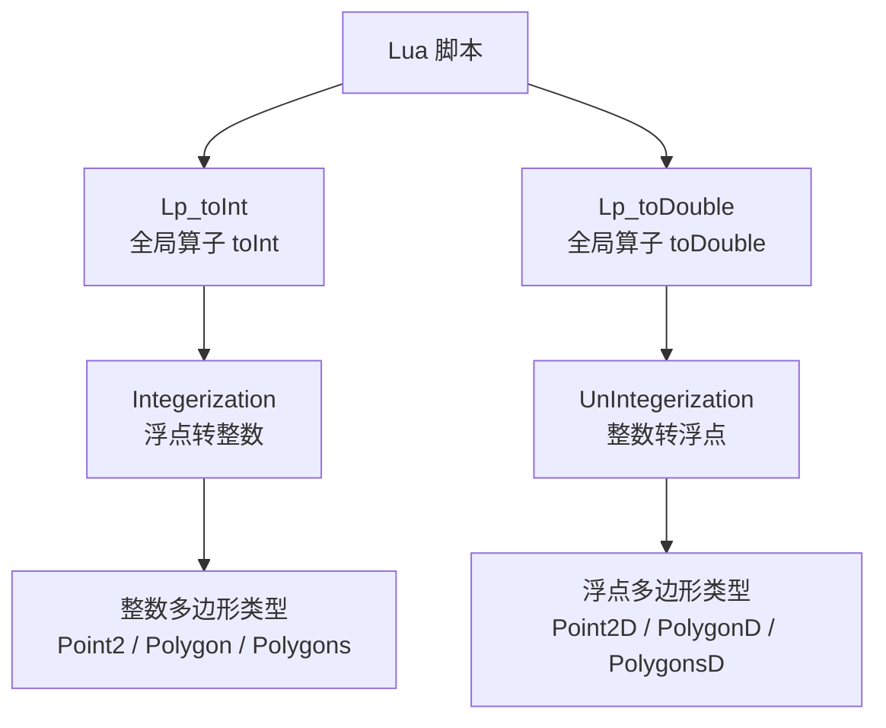
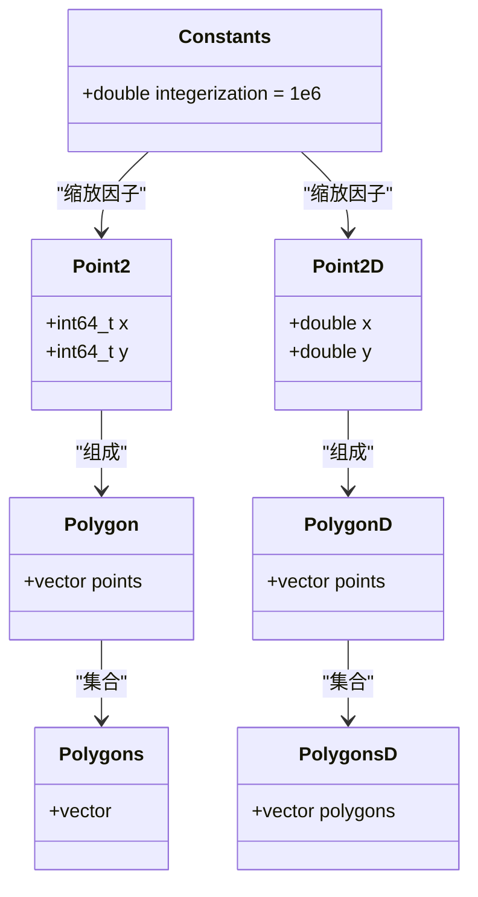
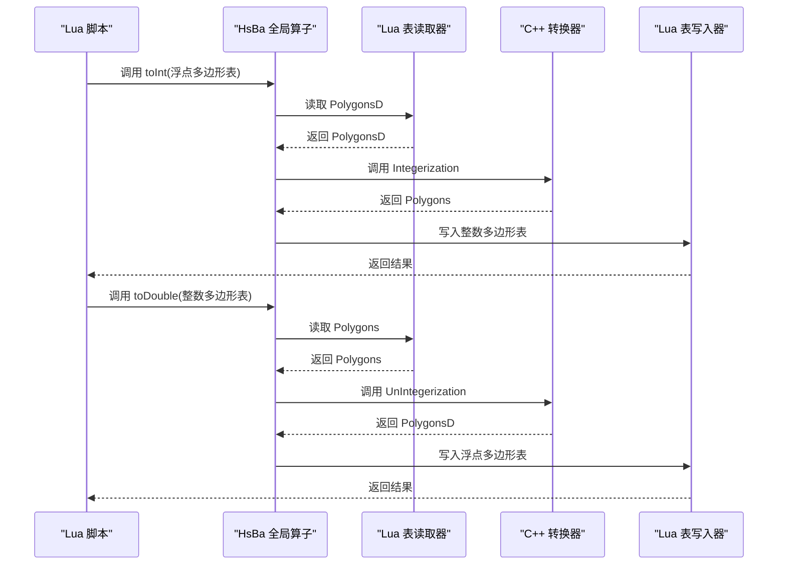
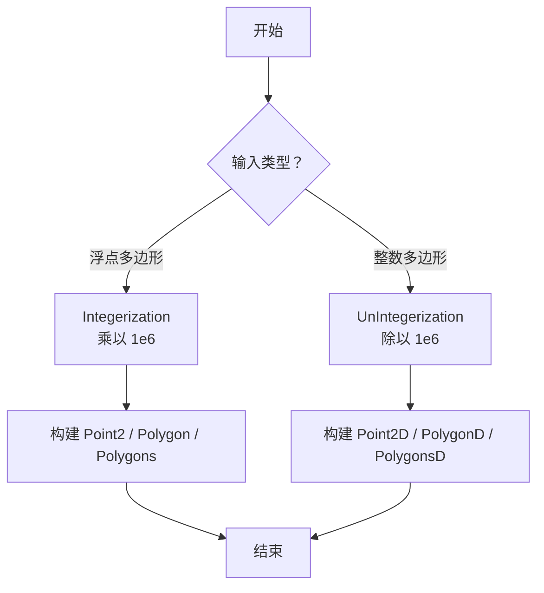
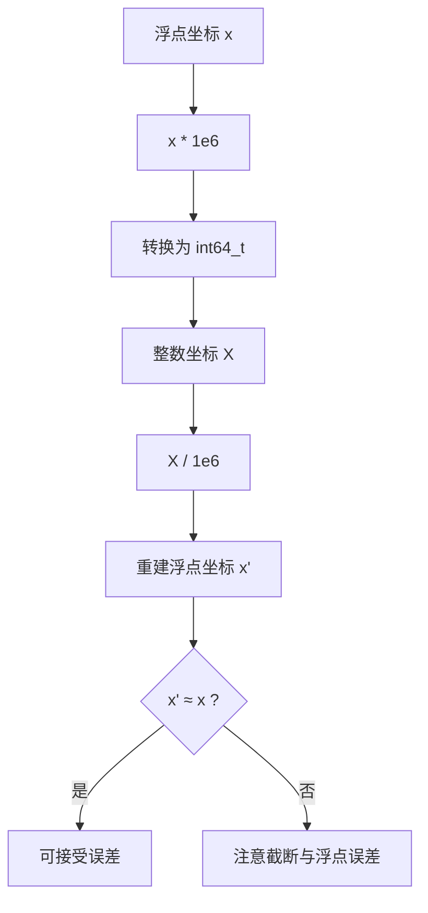
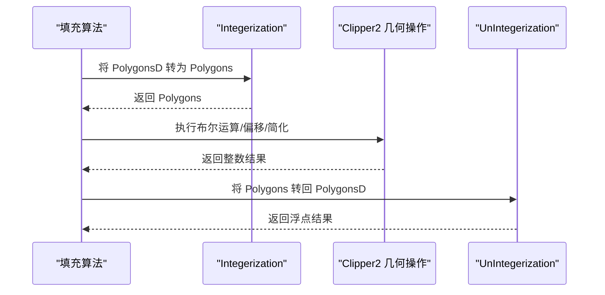
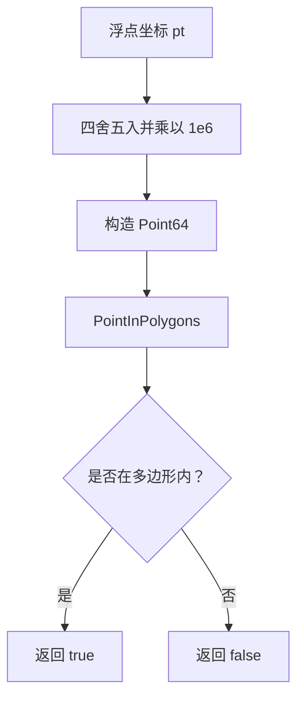
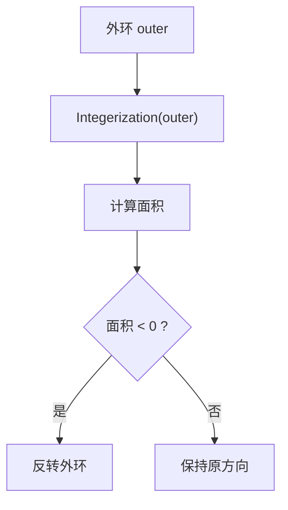
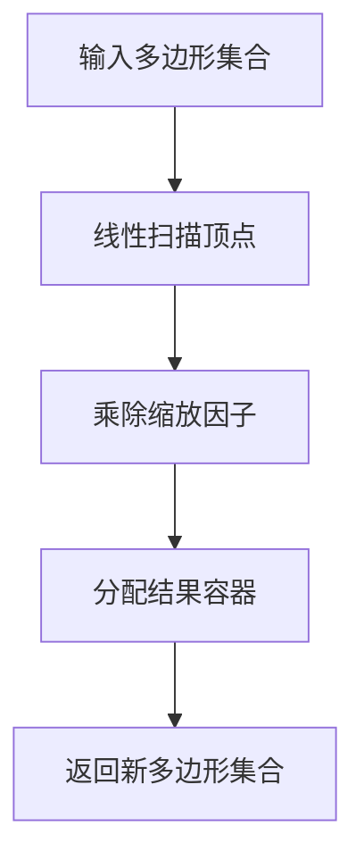

# 坐标转换函数

<cite>
**本文引用的文件**   
- [lua_pipeline.cpp](file://LibHsBaSlicer/Extends/lua_pipeline.cpp)
- [FloatPolygons.hpp](file://2D/FloatPolygons.hpp)
- [FloatPolygons.cpp](file://2D/FloatPolygons.cpp)
- [IntPolygon.hpp](file://2D/IntPolygon.hpp)
- [PolygonFill.cpp](file://2D/PolygonFill.cpp)
- [float_polygons_test.cpp](file://tests/PolygonFill/float_polygons_test.cpp)
</cite>

## 目录
1. [引言](#引言)
2. [项目结构中的坐标转换位置](#项目结构中的坐标转换位置)
3. [核心概念：浮点与整数坐标系](#核心概念浮点与整数坐标系)
4. [全局算子 toInt 与 toDouble](#全局算子-toint-与-todouble)
5. [内部实现：Integerization 与 UnIntegerization](#内部实现integerization-与-unintegerization)
6. [精度、舍入与数值范围](#精度舍入与数值范围)
7. [在不同算法中的应用场景](#在不同算法中的应用场景)
8. [性能考虑](#性能考虑)
9. [常见问题与注意事项](#常见问题与注意事项)
10. [结论](#结论)

## 引言
本文聚焦 HsBa 全局算子中的坐标转换能力，重点说明浮点到整数的 `toInt` 与整数到浮点的 `toDouble`。这两个算子通过统一的缩放因子在双精度浮点坐标与 Clipper2 的 64 位整数坐标之间转换，是切片、布尔运算、偏移、填充等几何处理流程的基础设施。文档将解释坐标精度处理、数值舍入规则、性能特征，以及在填充、轮廓检测、路径生成等算法中的使用方式与注意事项。

## 项目结构中的坐标转换位置
坐标转换在 HsBaSlicer 中分为两层：
- Lua 暴露层：提供全局算子 `HsBa.toInt` 与 `HsBa.toDouble`，供脚本调用。
- C++ 核心层：定义浮点与整数多边形类型、缩放常量，以及 `Integerization` 与 `UnIntegerization` 两个核心转换函数。

**图表来源**
- [lua_pipeline.cpp:465-478](file://LibHsBaSlicer/Extends/lua_pipeline.cpp#L465-L478)
- [FloatPolygons.hpp:196-221](file://2D/FloatPolygons.hpp#L196-L221)
- [FloatPolygons.cpp:184-221](file://2D/FloatPolygons.cpp#L184-L221)
- [IntPolygon.hpp:16-26](file://2D/IntPolygon.hpp#L16-L26)

**章节来源**
- [lua_pipeline.cpp:465-478](file://LibHsBaSlicer/Extends/lua_pipeline.cpp#L465-L478)
- [FloatPolygons.hpp:196-221](file://2D/FloatPolygons.hpp#L196-L221)
- [FloatPolygons.cpp:184-221](file://2D/FloatPolygons.cpp#L184-L221)
- [IntPolygon.hpp:16-26](file://2D/IntPolygon.hpp#L16-L26)

## 核心概念：浮点与整数坐标系
HsBaSlicer 同时维护两套二维坐标体系：
- 浮点坐标系：使用 `Point2D`、`PolygonD`、`PolygonsD`，基于 Clipper2 的双精度类型，适合几何构造、文本转轮廓、图像转轮廓等需要较高精度的输入阶段。
- 整数坐标系：使用 `Point2`、`Polygon`、`Polygons`，基于 Clipper2 的 64 位整数类型，适合布尔运算、偏移、填充等对数值稳定性要求更高的计算阶段。

两者之间的桥梁是缩放常量 `integerization`，其值为 `1e6`，表示 1 个物理单位对应 `1,000,000` 个整数单位。该设计使浮点坐标能够以微米级分辨率进入整数域，从而避免 Clipper2 布尔运算中的累积误差。

**图表来源**
- [FloatPolygons.hpp:18-25](file://2D/FloatPolygons.hpp#L18-L25)
- [IntPolygon.hpp:16-26](file://2D/IntPolygon.hpp#L16-L26)

**章节来源**
- [FloatPolygons.hpp:18-25](file://2D/FloatPolygons.hpp#L18-L25)
- [IntPolygon.hpp:16-26](file://2D/IntPolygon.hpp#L16-L26)

## 全局算子 toInt 与 toDouble
Lua 层暴露了两个全局算子：
- `HsBa.toInt(polygons)`：接收浮点多边形表，返回整数多边形表。
- `HsBa.toDouble(intPolygons)`：接收整数多边形表，返回浮点多边形表。

它们的职责非常明确：只做数据类型的边界转换，不改变几何形状；真正的数值变换由 `Integerization` 与 `UnIntegerization` 完成。

**图表来源**
- [lua_pipeline.cpp:465-478](file://LibHsBaSlicer/Extends/lua_pipeline.cpp#L465-L478)

**章节来源**
- [lua_pipeline.cpp:465-478](file://LibHsBaSlicer/Extends/lua_pipeline.cpp#L465-L478)

## 内部实现：Integerization 与 UnIntegerization
核心转换函数位于 `FloatPolygons.cpp`，并在 `FloatPolygons.hpp` 中声明。

- `Integerization(PolygonD)`：遍历每个顶点，将 `(x, y)` 乘以 `integerization`，构造 `Point2`。
- `Integerization(PolygonsD)`：对每个多边形调用单多边形版本，构建 `Polygons`。
- `UnIntegerization(Polygon)`：遍历每个顶点，将 `x`、`y` 除以 `integerization`，构造 `Point2D`。
- `UnIntegerization(Polygons)`：对每个多边形调用单多边形版本，构建 `PolygonsD`。

关键点：
- 当前实现没有显式四舍五入，而是直接进行浮点乘法和除法。
- 由于 Clipper2 内部通常期望整数坐标参与布尔运算，因此浮点输入在进入 Clipper2 前必须转换为整数。
- 从整数转回浮点时，除法会恢复原始尺度，但可能因浮点表示产生微小误差。

**图表来源**
- [FloatPolygons.cpp:184-221](file://2D/FloatPolygons.cpp#L184-L221)
- [FloatPolygons.hpp:196-221](file://2D/FloatPolygons.hpp#L196-L221)

**章节来源**
- [FloatPolygons.cpp:184-221](file://2D/FloatPolygons.cpp#L184-L221)
- [FloatPolygons.hpp:196-221](file://2D/FloatPolygons.hpp#L196-L221)

## 精度、舍入与数值范围
### 缩放因子与分辨率
- 缩放因子 `integerization = 1e6`。
- 这意味着 1 毫米可表示为 `1,000,000` 个整数单位，理论分辨率为 `1e-6` 物理单位。
- 对于典型 3D 打印模型（毫米级），该分辨率足以覆盖常见几何细节。

### 舍入行为
- `Integerization` 当前实现为直接乘法，没有显式 `round` 或 `llround`。
- 当浮点值乘以 `1e6` 后转为 `int64_t`，C++ 的隐式截断行为可能导致非预期舍入。
- 例如，若浮点值存在微小误差，`1.5 * 1e6` 可能得到 `1499999.999...`，截断后变成 `1499999`，而不是 `1500000`。
- 测试用例验证了 `1.5 * integerization` 的期望结果，说明实际使用中应尽量避免依赖隐式截断的边界情况。

**图表来源**
- [FloatPolygons.cpp:184-221](file://2D/FloatPolygons.cpp#L184-L221)
- [float_polygons_test.cpp:168-187](file://tests/PolygonFill/float_polygons_test.cpp#L168-L187)

### 数值范围
- `int64_t` 的最大值约为 `9.22e18`。
- 若坐标绝对值超过约 `9.22e12`，乘以 `1e6` 后会溢出。
- 对于常规切片和建模任务，坐标通常在毫米到厘米量级，不会接近该上限。
- 如果用户输入包含极大坐标，应先平移或缩放模型，再执行转换。

**章节来源**
- [IntPolygon.hpp:16-17](file://2D/IntPolygon.hpp#L16-L17)
- [FloatPolygons.cpp:184-221](file://2D/FloatPolygons.cpp#L184-L221)
- [float_polygons_test.cpp:168-187](file://tests/PolygonFill/float_polygons_test.cpp#L168-L187)

## 在不同算法中的应用场景
坐标转换并非孤立存在，而是贯穿多个几何算法：

### 填充算法
填充算法通常以浮点多边形作为输入，但在内部会将浮点多边形转换为整数多边形，以便调用 Clipper2 的布尔运算、偏移、简化等操作，最后再将结果转回浮点。

**图表来源**
- [PolygonFill.cpp:234-279](file://2D/PolygonFill.cpp#L234-L279)
- [PolygonFill.cpp:288-313](file://2D/PolygonFill.cpp#L288-L313)
- [PolygonFill.cpp:322-371](file://2D/PolygonFill.cpp#L322-L371)
- [PolygonFill.cpp:380-428](file://2D/PolygonFill.cpp#L380-L428)
- [PolygonFill.cpp:437-482](file://2D/PolygonFill.cpp#L437-L482)

**章节来源**
- [PolygonFill.cpp:234-279](file://2D/PolygonFill.cpp#L234-L279)
- [PolygonFill.cpp:288-313](file://2D/PolygonFill.cpp#L288-L313)
- [PolygonFill.cpp:322-371](file://2D/PolygonFill.cpp#L322-L371)
- [PolygonFill.cpp:380-428](file://2D/PolygonFill.cpp#L380-L428)
- [PolygonFill.cpp:437-482](file://2D/PolygonFill.cpp#L437-L482)

### 点包含判断
点包含判断也使用整数坐标，以避免浮点边界问题。代码中将浮点坐标乘以 `integerization` 并四舍五入后传入 Clipper2 的点包含判断。

**图表来源**
- [PolygonFill.cpp:941-946](file://2D/PolygonFill.cpp#L941-L946)

**章节来源**
- [PolygonFill.cpp:941-946](file://2D/PolygonFill.cpp#L941-L946)

### 面积与方向检查
部分逻辑会使用整数多边形的面积来判断多边形方向，例如在外环反转前检查面积为正还是负。

**图表来源**
- [PolygonFill.cpp:1042-1046](file://2D/PolygonFill.cpp#L1042-L1046)

**章节来源**
- [PolygonFill.cpp:1042-1046](file://2D/PolygonFill.cpp#L1042-L1046)

## 性能考虑
- 时间复杂度：`Integerization` 与 `UnIntegerization` 都是线性扫描，时间复杂度为 `O(n)`，其中 `n` 为顶点总数。
- 空间复杂度：输出容器大小与输入相同，额外空间主要为结果容器的分配。
- 内存分配：每次转换都会创建新的多边形集合，频繁调用会产生较多临时对象。
- 批量处理：建议对大量多边形使用批量接口，减少重复开销。
- 避免重复转换：在同一算法链中，尽量复用已转换的结果，避免多次 `Integerization` 与 `UnIntegerization`。
- 大模型优化：对于超大模型，可考虑分块处理或使用内存池减少分配压力。

**图表来源**
- [FloatPolygons.cpp:184-221](file://2D/FloatPolygons.cpp#L184-L221)

**章节来源**
- [FloatPolygons.cpp:184-221](file://2D/FloatPolygons.cpp#L184-L221)

## 常见问题与注意事项
1. **不要混用浮点与整数类型**  
   - 浮点多边形用于输入与输出展示。
   - 整数多边形用于 Clipper2 几何计算。
   - 在算法中间状态切换类型时，务必使用 `Integerization` 与 `UnIntegerization`。

2. **注意隐式截断带来的舍入风险**  
   - 当前 `Integerization` 没有显式四舍五入。
   - 对边界值敏感的场景，建议先做显式舍入，再转换。
   - 测试用例覆盖了基本往返精度，但极端浮点误差仍需警惕。

3. **坐标范围限制**  
   - `int64_t` 有上限，超大坐标会导致溢出。
   - 建议在转换前对模型进行平移或缩放，确保坐标落在安全范围内。

4. **与 Lua 表的交互成本**  
   - `toInt` 与 `toDouble` 涉及 Lua 表读取与写入。
   - 在脚本中频繁调用时，应尽量减少不必要的类型转换。

5. **与其他算法的配合**  
   - 填充、偏移、布尔运算、点包含判断等算法都依赖整数坐标。
   - 自定义算法若直接调用 Clipper2，也应遵循同样的整数化策略。

**章节来源**
- [lua_pipeline.cpp:465-478](file://LibHsBaSlicer/Extends/lua_pipeline.cpp#L465-L478)
- [FloatPolygons.cpp:184-221](file://2D/FloatPolygons.cpp#L184-L221)
- [float_polygons_test.cpp:168-187](file://tests/PolygonFill/float_polygons_test.cpp#L168-L187)
- [PolygonFill.cpp:234-279](file://2D/PolygonFill.cpp#L234-L279)
- [PolygonFill.cpp:941-946](file://2D/PolygonFill.cpp#L941-L946)

## 结论
HsBa 的坐标转换函数以 `integerization = 1e6` 为核心，将浮点坐标映射到 Clipper2 的 64 位整数坐标，从而在保证几何精度的同时提升布尔运算与偏移等操作的数值稳定性。`toInt` 与 `toDouble` 是 Lua 脚本与 C++ 几何引擎之间的统一入口，而 `Integerization` 与 `UnIntegerization` 则是底层实现的关键。使用时需注意隐式截断、坐标范围、性能开销以及与填充、点包含、面积判断等算法的配合。合理运用这些转换函数，可以在保证精度的前提下获得稳定高效的几何处理能力。