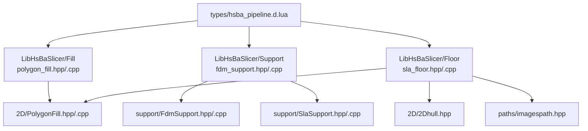
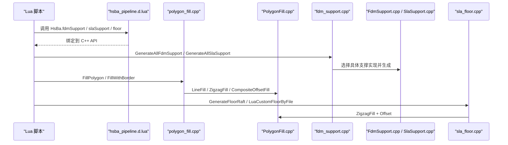
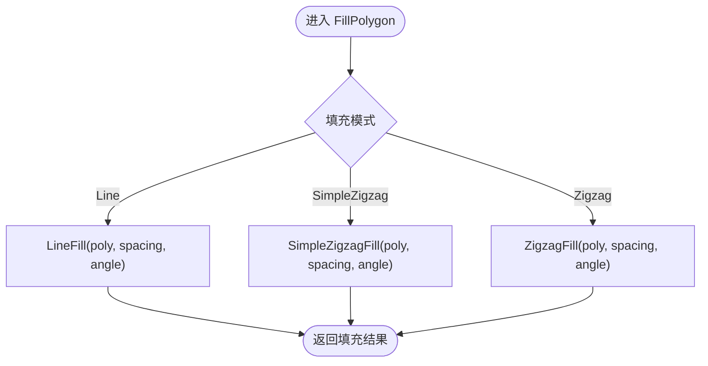
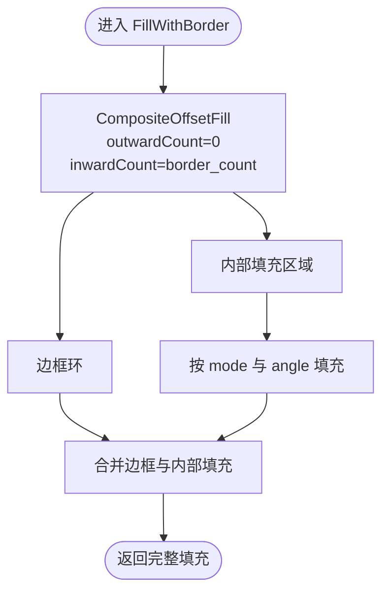
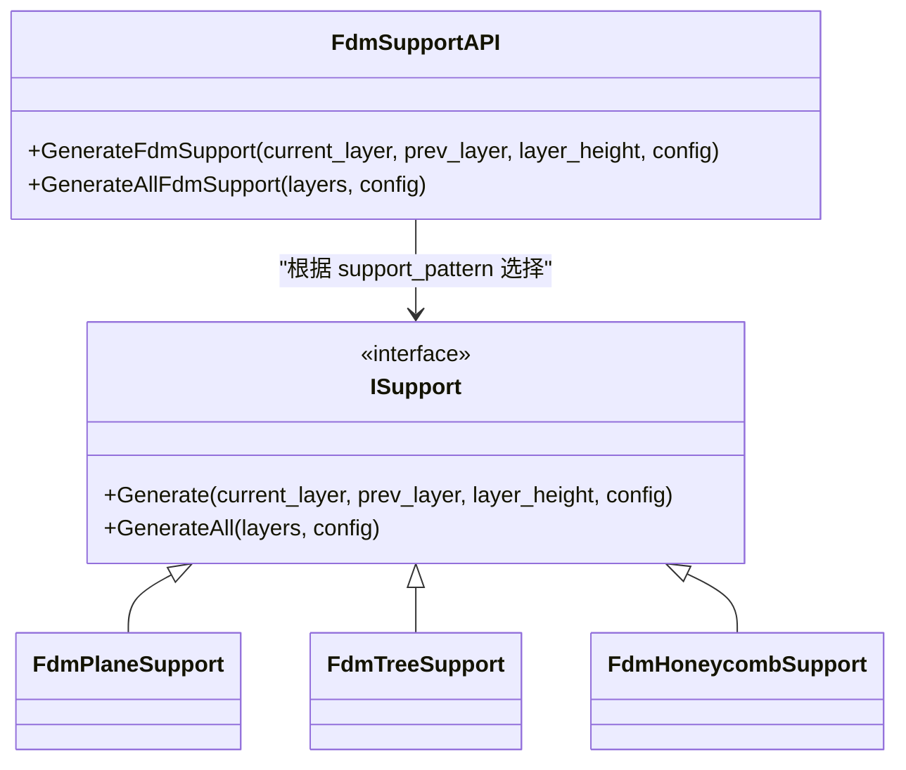
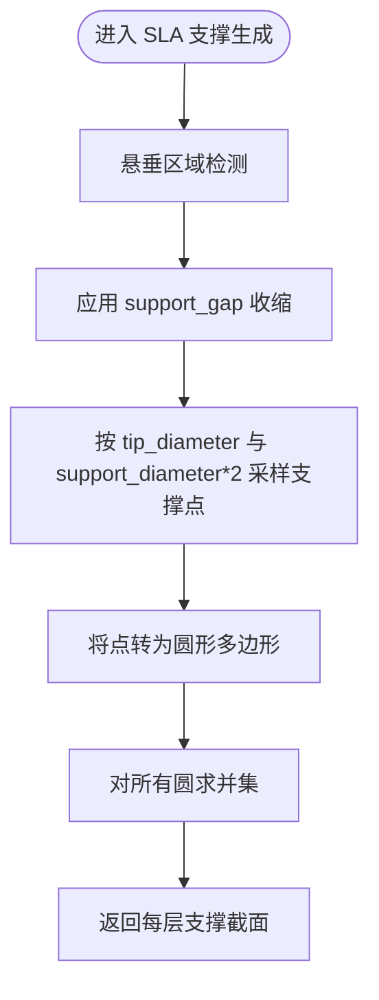
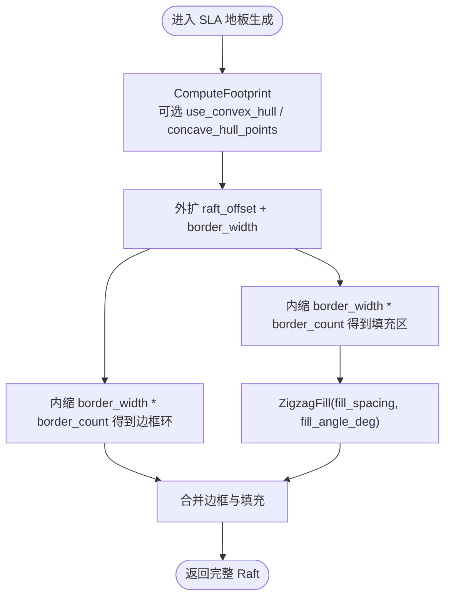
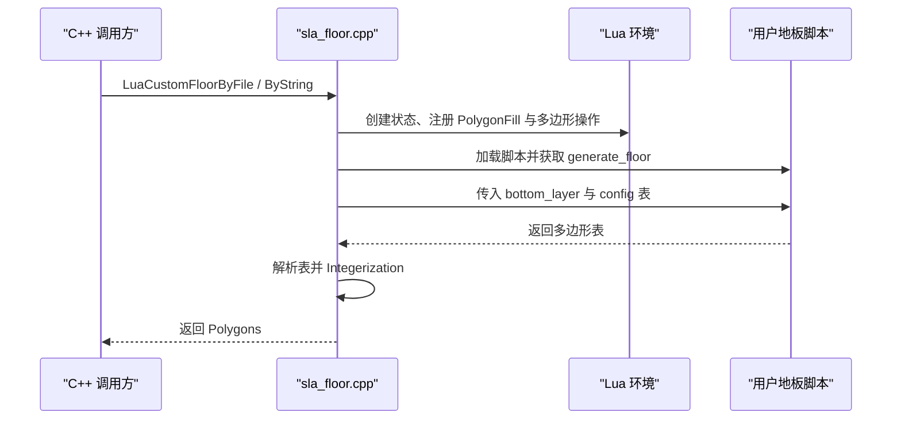
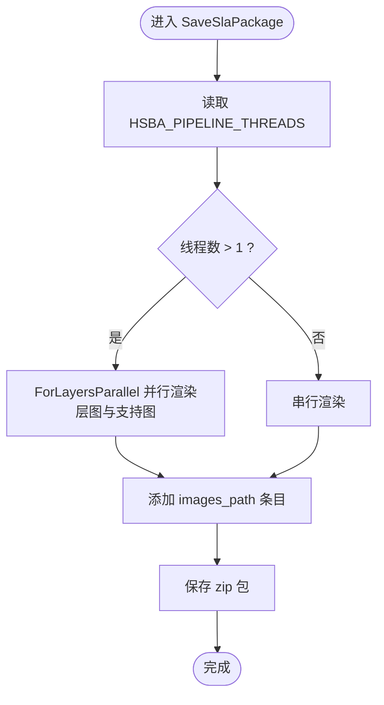

# 填充·支撑·地板函数

<cite>
**本文引用的文件**   
- [polygon_fill.hpp](file://LibHsBaSlicer/Fill/polygon_fill.hpp)
- [polygon_fill.cpp](file://LibHsBaSlicer/Fill/polygon_fill.cpp)
- [PolygonFill.hpp](file://2D/PolygonFill.hpp)
- [PolygonFill.cpp](file://2D/PolygonFill.cpp)
- [fdm_support.hpp](file://LibHsBaSlicer/Support/fdm_support.hpp)
- [fdm_support.cpp](file://LibHsBaSlicer/Support/fdm_support.cpp)
- [SupportConfig.hpp](file://support/SupportConfig.hpp)
- [FdmSupport.hpp](file://support/FdmSupport.hpp)
- [FdmSupport.cpp](file://support/FdmSupport.cpp)
- [SlaSupport.hpp](file://support/SlaSupport.hpp)
- [SlaSupport.cpp](file://support/SlaSupport.cpp)
- [sla_floor.hpp](file://LibHsBaSlicer/Floor/sla_floor.hpp)
- [sla_floor.cpp](file://LibHsBaSlicer/Floor/sla_floor.cpp)
- [hsba_pipeline.d.lua](file://types/hsba_pipeline.d.lua)
</cite>

## 目录
1. [引言](#引言)
2. [项目结构定位](#项目结构定位)
3. [核心组件总览](#核心组件总览)
4. [架构与调用关系](#架构与调用关系)
5. [填充函数分析](#填充函数分析)
6. [FDM 支撑生成分析](#fdm-支撑生成分析)
7. [SLA 支撑生成分析](#sla-支撑生成分析)
8. [SLA 地板生成分析](#sla-地板生成分析)
9. [参数调优建议](#参数调优建议)
10. [性能优化技巧](#性能优化技巧)
11. [故障排除](#故障排除)
12. [结论](#结论)

## 引言
本文聚焦 HsBa 全局算子中的几何生成函数，围绕四个关键能力展开：多边形填充、FDM 支撑生成、SLA 支撑生成和 SLA 地板生成。这些函数位于 LibHsBaSlicer 层，向上暴露给 Lua 全局算子 `HsBa.fdmSupport`、`HsBa.slaSupport`、`HsBa.floor`，向下复用 2D 几何引擎、Clipper2 偏移运算、悬垂检测以及线程池等基础设施。文档以源码为依据，说明各函数的输入输出、内部算法流程、配置字段含义，并给出 FDM 与 SLA 工艺下的参数调优建议和性能优化方向。

## 项目结构定位
这四个功能分别分布在三个模块中：
- 填充：`LibHsBaSlicer/Fill/polygon_fill.*` 包装 `2D/PolygonFill.*`。
- 支撑：`LibHsBaSlicer/Support/fdm_support.*` 调度 `support/FdmSupport.*`、`support/SlaSupport.*`、`support/LuaSupport.*`。
- 地板：`LibHsBaSlicer/Floor/sla_floor.*` 负责 SLA raft、Lua 自定义地板、图像渲染与 SLA 包导出。

**图表来源**
- [polygon_fill.hpp:15-53](file://LibHsBaSlicer/Fill/polygon_fill.hpp#L15-L53)
- [fdm_support.hpp:17-67](file://LibHsBaSlicer/Support/fdm_support.hpp#L17-L67)
- [sla_floor.hpp:24-100](file://LibHsBaSlicer/Floor/sla_floor.hpp#L24-L100)
- [hsba_pipeline.d.lua:404-424](file://types/hsba_pipeline.d.lua#L404-L424)

**章节来源**
- [polygon_fill.hpp:15-53](file://LibHsBaSlicer/Fill/polygon_fill.hpp#L15-L53)
- [fdm_support.hpp:17-67](file://LibHsBaSlicer/Support/fdm_support.hpp#L17-L67)
- [sla_floor.hpp:24-100](file://LibHsBaSlicer/Floor/sla_floor.hpp#L24-L100)
- [hsba_pipeline.d.lua:404-424](file://types/hsba_pipeline.d.lua#L404-L424)

## 核心组件总览
| 功能 | 主要 API | 输入 | 输出 | 核心依赖 |
|---|---|---|---|---|
| 多边形填充 | `FillPolygon`、`FillWithBorder`、`LuaCustomFillByFile` | 多边形、间距、填充模式、角度 | 填充多边形 | `LineFill`、`SimpleZigzagFill`、`ZigzagFill`、`CompositeOffsetFill` |
| FDM 支撑 | `GenerateFdmSupport`、`GenerateAllFdmSupport` | 当前层、上一层、层高、FDM 配置 | 每层支撑截面 | `FdmPlaneSupport`、`FdmTreeSupport`、`FdmHoneycombSupport` |
| SLA 支撑 | `GenerateAllSlaSupport` | 所有层轮廓、SLA 配置 | 每层牺牲支撑截面 | `SlaSacrificialSupport`、悬垂检测 |
| SLA 地板 | `GenerateFloorContact`、`GenerateFloorRaft`、`GenerateFloorBorder`、`GenerateFloorFill`、`LuaCustomFloorByFile/String` | 底层轮廓、`SlaFloorConfig` | 接触面、边框、填充、完整 Raft | 凸包/凹包、偏移、Zigzag 填充、图像渲染 |

**章节来源**
- [polygon_fill.hpp:17-53](file://LibHsBaSlicer/Fill/polygon_fill.hpp#L17-L53)
- [fdm_support.hpp:19-67](file://LibHsBaSlicer/Support/fdm_support.hpp#L19-L67)
- [sla_floor.hpp:24-100](file://LibHsBaSlicer/Floor/sla_floor.hpp#L24-L100)

## 架构与调用关系
全局算子通过 Lua 类型定义暴露，实际实现由 C++ 层完成：
- `HsBa.fdmSupport` 对应 FDM 支撑生成。
- `HsBa.slaSupport` 对应 SLA 支撑生成。
- `HsBa.floor` 对应 SLA 地板生成。

**图表来源**
- [hsba_pipeline.d.lua:404-424](file://types/hsba_pipeline.d.lua#L404-L424)
- [fdm_support.cpp:14-59](file://LibHsBaSlicer/Support/fdm_support.cpp#L14-L59)
- [polygon_fill.cpp:13-49](file://LibHsBaSlicer/Fill/polygon_fill.cpp#L13-L49)
- [sla_floor.cpp:90-117](file://LibHsBaSlicer/Floor/sla_floor.cpp#L90-L117)

**章节来源**
- [hsba_pipeline.d.lua:404-424](file://types/hsba_pipeline.d.lua#L404-L424)
- [fdm_support.cpp:14-59](file://LibHsBaSlicer/Support/fdm_support.cpp#L14-L59)
- [polygon_fill.cpp:13-49](file://LibHsBaSlicer/Fill/polygon_fill.cpp#L13-L49)
- [sla_floor.cpp:90-117](file://LibHsBaSlicer/Floor/sla_floor.cpp#L90-L117)

## 填充函数分析
### 填充模式
填充系统提供三种内置模式：
- 平行线填充：`Line`。
- 简单折线填充：`SimpleZigzag`。
- 高级折线填充：`Zigzag`。

`FillPolygon` 根据 `FillMode` 分派到对应实现；`FillWithBorder` 使用复合偏移填充，先向外偏移零次、向内偏移 `border_count` 次形成边框，再对内部区域按指定模式和角度填充。

**图表来源**
- [polygon_fill.cpp:13-25](file://LibHsBaSlicer/Fill/polygon_fill.cpp#L13-L25)
- [PolygonFill.hpp:63-68](file://2D/PolygonFill.hpp#L63-L68)

### 边框与复合填充
`FillWithBorder` 使用 `CompositeOffsetFill`，其中外扩层数为 0，内缩层数为 `border_count`，从而得到边框环；内部区域再用选定的填充模式生成。

**图表来源**
- [polygon_fill.cpp:27-33](file://LibHsBaSlicer/Fill/polygon_fill.cpp#L27-L33)
- [PolygonFill.hpp:70-85](file://2D/PolygonFill.hpp#L70-L85)

### Lua 自定义填充
`LuaCustomFillByFile` 将 2D 几何函数与路径优化函数注册到 Lua 环境，然后加载外部脚本并调用指定函数，返回填充多边形。该机制允许用户在不修改 C++ 的情况下扩展填充策略。

**章节来源**
- [polygon_fill.hpp:17-53](file://LibHsBaSlicer/Fill/polygon_fill.hpp#L17-L53)
- [polygon_fill.cpp:13-49](file://LibHsBaSlicer/Fill/polygon_fill.cpp#L13-L49)
- [PolygonFill.hpp:63-130](file://2D/PolygonFill.hpp#L63-L130)
- [PolygonFill.cpp:504-564](file://2D/PolygonFill.cpp#L504-L564)

## FDM 支撑生成分析
### 接口与实现选择
`GenerateFdmSupport` 与 `GenerateAllFdmSupport` 根据 `config.support_pattern` 选择具体支撑实现：
- 0：平面支撑 `FdmPlaneSupport`。
- 1：树状支撑 `FdmTreeSupport`。
- 2：蜂窝支撑 `FdmHoneycombSupport`。

单层接口传入当前层与上一层，多层接口直接遍历所有层。

**图表来源**
- [fdm_support.cpp:14-52](file://LibHsBaSlicer/Support/fdm_support.cpp#L14-L52)
- [FdmSupport.hpp:13-42](file://support/FdmSupport.hpp#L13-L42)

### 支撑配置字段
通用支撑配置 `SupportConfig` 包含悬垂角度阈值、层高、支撑间隙、支撑直径、密度、模式及树/蜂窝特有参数；`FdmSupportConfig` 在此基础上增加界面层数与界面密度。

| 字段 | 类型 | 默认值 | 含义 |
|---|---|---:|---|
| `overhang_angle_threshold` | float | 45.0 | 悬垂角度阈值（度） |
| `layer_height` | float | 0.2 | 层高（mm） |
| `support_gap` | float | 0.5 | 支撑与模型间隙（mm） |
| `support_diameter` | float | 2.0 | 支撑柱直径（mm） |
| `support_density` | float | 0.3 | 支撑填充密度 [0,1] |
| `support_pattern` | int | 0 | 0=平面，1=树，2=蜂窝 |
| `tree_branch_angle` | float | 30.0 | 树分支角度（度） |
| `tree_max_branch_radius` | float | 5.0 | 树最大分支半径（mm） |
| `honeycomb_cell_size` | float | 5.0 | 蜂窝单元尺寸（mm） |
| `interface_layers` | int | 2 | FDM 界面层数量 |
| `interface_density` | float | 0.5 | FDM 界面层填充密度 |

**章节来源**
- [fdm_support.hpp:19-37](file://LibHsBaSlicer/Support/fdm_support.hpp#L19-L37)
- [fdm_support.cpp:14-52](file://LibHsBaSlicer/Support/fdm_support.cpp#L14-L52)
- [SupportConfig.hpp:14-34](file://support/SupportConfig.hpp#L14-L34)
- [FdmSupport.hpp:13-42](file://support/FdmSupport.hpp#L13-L42)

## SLA 支撑生成分析
### 牺牲支撑算法
`GenerateAllSlaSupport` 使用 `SlaSacrificialSupport`，其核心流程为：
1. 基于悬垂检测确定需要支撑的区域。
2. 应用支撑间隙收缩悬垂区域。
3. 以小尖端直径采样支撑点，间距取支撑直径的两倍。
4. 将每个支撑点转换为圆形多边形并求并集，得到每层支撑截面。

**图表来源**
- [SlaSupport.cpp:38-124](file://support/SlaSupport.cpp#L38-L124)
- [fdm_support.cpp:54-59](file://LibHsBaSlicer/Support/fdm_support.cpp#L54-L59)

### SLA 支撑配置字段
`SlaSupportConfig` 继承通用配置，并增加尖端直径与筏板厚度。

| 字段 | 类型 | 默认值 | 含义 |
|---|---|---:|---|
| `tip_diameter` | float | 0.3 | 支撑尖端直径（mm），便于去除 |
| `raft_thickness` | float | 0.5 | 筏板层厚（mm） |
| 其他字段 | 同 `SupportConfig` | 见上表 | 悬垂阈值、层高、间隙、直径、密度、模式等 |

**章节来源**
- [fdm_support.hpp:39-50](file://LibHsBaSlicer/Support/fdm_support.hpp#L39-L50)
- [fdm_support.cpp:54-59](file://LibHsBaSlicer/Support/fdm_support.cpp#L54-L59)
- [SlaSupport.hpp:13-42](file://support/SlaSupport.hpp#L13-L42)
- [SlaSupport.cpp:38-134](file://support/SlaSupport.cpp#L38-L134)
- [SupportConfig.hpp:39-43](file://support/SupportConfig.hpp#L39-L43)

## SLA 地板生成分析
### 接触面、边框与填充
`GenerateFloorContact` 计算底板接触面，可选择凸包或凹包简化；`GenerateFloorBorder` 通过外扩与内缩差集生成边框环；`GenerateFloorFill` 在边框内部使用 Zigzag 填充；`GenerateFloorRaft` 组合边框与内部填充，形成完整 Raft。

**图表来源**
- [sla_floor.cpp:33-117](file://LibHsBaSlicer/Floor/sla_floor.cpp#L33-L117)

### 地板配置选项
`SlaFloorConfig` 控制 Raft 的偏移、边框宽度、填充间距、填充角度、边框圈数、是否使用凸包以及凹包点数。

| 字段 | 类型 | 默认值 | 含义 |
|---|---|---:|---|
| `raft_offset` | double | 2.0 | Raft 相对模型足迹的外扩距离（mm） |
| `border_width` | double | 1.0 | 边框环宽度（mm） |
| `fill_spacing` | double | 0.5 | 内部填充线间距（mm） |
| `fill_angle_deg` | double | 0.0 | 填充图案角度（度） |
| `border_count` | int | 2 | 边框内缩圈数 |
| `use_convex_hull` | bool | false | 使用凸包代替原始足迹 |
| `concave_hull_points` | int | 0 | 凹包简化点数，0 表示禁用 |

**章节来源**
- [sla_floor.hpp:24-78](file://LibHsBaSlicer/Floor/sla_floor.hpp#L24-L78)
- [sla_floor.cpp:33-117](file://LibHsBaSlicer/Floor/sla_floor.cpp#L33-L117)

### Lua 自定义地板
`LuaCustomFloorByFile` 与 `LuaCustomFloorByString` 将底层多边形与 `SlaFloorConfig` 推入 Lua，调用用户脚本函数，解析返回的多边形表并转回整数多边形。脚本可访问 PolygonFill 与多边形操作库。

**图表来源**
- [sla_floor.cpp:148-228](file://LibHsBaSlicer/Floor/sla_floor.cpp#L148-L228)
- [sla_floor.cpp:230-314](file://LibHsBaSlicer/Floor/sla_floor.cpp#L230-L314)
- [sla_floor.hpp:81-116](file://LibHsBaSlicer/Floor/sla_floor.hpp#L81-L116)

**章节来源**
- [sla_floor.hpp:81-116](file://LibHsBaSlicer/Floor/sla_floor.hpp#L81-L116)
- [sla_floor.cpp:148-314](file://LibHsBaSlicer/Floor/sla_floor.cpp#L148-L314)

## 参数调优建议
### 填充参数
- 当需要快速填充且打印效率优先时，优先使用 `Line` 模式，并通过调整 `spacing` 控制材料用量与强度。
- 对于需要连续路径减少起停的场景，使用 `Zigzag` 或 `SimpleZigzag`；复杂边界建议使用 `Zigzag`，其对拐角处理更稳健。
- 边框圈数 `border_count` 越大，边缘越厚实，但内部填充面积越小；小件模型可适当降低 `border_count` 以提升填充密度。
- 填充角度 `angle_deg` 可用于避免层间纹理对齐，通常在不同层交替角度以减少分层可见性。

### FDM 支撑参数
- 平面支撑适合大面积悬垂，`support_gap` 不宜过小，否则易粘连模型；`support_diameter` 增大可提高支撑强度，但移除难度上升。
- 树支撑适合复杂悬垂结构，`tree_branch_angle` 与 `tree_max_branch_radius` 影响分支覆盖范围与连接稳定性；密度较低时可减少材料，但需保证关键悬垂处有足够分支。
- 蜂窝支撑适合均匀网格支撑需求，`honeycomb_cell_size` 越小支撑越密，强度越高但材料消耗更大。
- FDM 界面层 `interface_layers` 与 `interface_density` 用于改善支撑与模型的分离面，适当提高界面密度可降低剥离时的表面损伤。

### SLA 支撑参数
- SLA 牺牲支撑强调易去除，`tip_diameter` 应保持较小；`support_gap` 控制支撑与模型之间的树脂间隙，过大可能导致悬垂塌陷，过小则难以清理。
- `support_diameter` 决定支撑点间距，较大间距可减少支撑体积，但可能降低支撑覆盖率；建议结合模型悬垂面积与树脂特性调优。
- `raft_thickness` 影响底部附着层厚度，较厚筏板提升附着力，但会增加后处理时间。

### SLA 地板参数
- `raft_offset` 控制 Raft 外扩范围，大模型或弱附着场景可适当增大；过小可能导致边缘翘曲。
- `border_width` 与 `border_count` 共同决定边框厚度与圈数；边框过薄容易断裂，过厚则浪费材料。
- `fill_spacing` 与 `fill_angle_deg` 控制 Raft 内部填充密度与方向；高密度填充提升底部平整度，但会延长打印时间。
- `use_convex_hull` 适用于需要简化接触面的模型；`concave_hull_points` 可在保留部分凹形特征的同时减少顶点数量。

**章节来源**
- [polygon_fill.hpp:17-53](file://LibHsBaSlicer/Fill/polygon_fill.hpp#L17-L53)
- [SupportConfig.hpp:14-43](file://support/SupportConfig.hpp#L14-L43)
- [sla_floor.hpp:24-78](file://LibHsBaSlicer/Floor/sla_floor.hpp#L24-L78)

## 性能优化技巧
### 填充性能
- 使用 `LineFill` 时，避免过小的 `spacing`，否则会显著增加线段数量与几何运算量。
- `ZigzagFill` 与 `SimpleZigzagFill` 在复杂边界上会产生较多折线连接，建议合理设置 `lineThickness` 与 `spacing`，避免过度细分。
- 复合偏移填充 `CompositeOffsetFill` 的 `inwardCount` 越大，偏移次数越多，应谨慎设置。

### 支撑性能
- FDM 支撑生成在多层的场景下，`GenerateAllFdmSupport` 会逐层调用具体实现；若模型层数很大，建议先评估悬垂区域面积，必要时关闭不必要的支撑模式。
- SLA 牺牲支撑在大量悬垂区域时会生成较多圆形并集，建议通过 `support_gap` 与 `support_diameter` 控制支撑点密度，避免过度密集。

### 地板与导出性能
- SLA 地板生成涉及多次偏移与 Zigzag 填充，`border_count` 与 `fill_spacing` 直接影响几何复杂度。
- SLA 包导出 `SaveSlaPackage` 使用线程池并行渲染层图像与支持图像，可通过环境变量 `HSBA_PIPELINE_THREADS` 控制并发线程数；在资源受限平台，建议限制线程数以避免内存峰值过高。

**图表来源**
- [sla_floor.cpp:405-465](file://LibHsBaSlicer/Floor/sla_floor.cpp#L405-L465)
- [sla_floor.cpp:468-529](file://LibHsBaSlicer/Floor/sla_floor.cpp#L468-L529)

**章节来源**
- [PolygonFill.cpp:504-800](file://2D/PolygonFill.cpp#L504-L800)
- [fdm_support.cpp:34-52](file://LibHsBaSlicer/Support/fdm_support.cpp#L34-L52)
- [sla_floor.cpp:405-529](file://LibHsBaSlicer/Floor/sla_floor.cpp#L405-L529)

## 故障排除
- **Lua 地板脚本未找到函数**：检查脚本中导出的函数名是否与调用参数一致；错误信息会提示缺失的函数名。
- **Lua 地板脚本返回非表**：脚本必须返回多边形表，每个多边形为 `{x,y}` 点表；否则会被拒绝并抛出运行时错误。
- **SLA 包导出失败**：若层轮廓为空或图像渲染失败，导出会返回失败；检查输入数据是否为空，以及图像格式扩展名是否正确。
- **支撑结果为空**：当悬垂区域经间隙收缩后为空，或采样点为空时，支撑生成返回空结果；检查 `support_gap` 是否过大，或悬垂角度阈值是否设置不当。

**章节来源**
- [sla_floor.cpp:148-228](file://LibHsBaSlicer/Floor/sla_floor.cpp#L148-L228)
- [sla_floor.cpp:230-314](file://LibHsBaSlicer/Floor/sla_floor.cpp#L230-L314)
- [sla_floor.cpp:468-529](file://LibHsBaSlicer/Floor/sla_floor.cpp#L468-L529)
- [SlaSupport.cpp:86-124](file://support/SlaSupport.cpp#L86-L124)

## 结论
HsBa 的全局几何生成函数围绕填充、支撑与地板三大能力构建，采用清晰的 C++ API 与 Lua 扩展机制。填充系统支持多种模式与复合偏移；FDM 支撑通过平面、树、蜂窝三种策略适配不同悬垂形态；SLA 支撑以牺牲柱形式优化去除体验；SLA 地板提供从接触面到完整 Raft 的一体化生成，并支持 Lua 自定义。通过合理调优参数与利用线程池导出，可以在保证质量的前提下获得较好的性能表现。